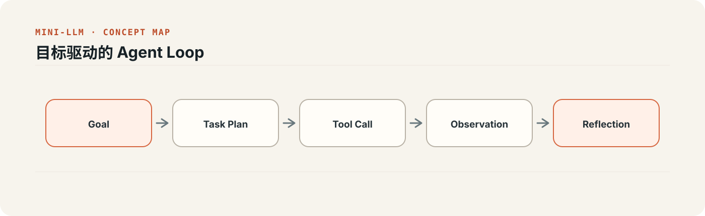
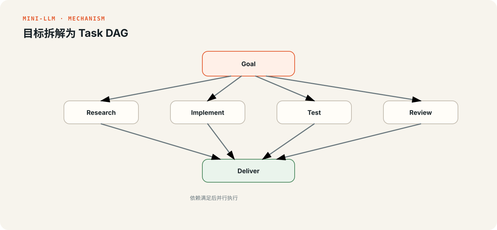

# **mini-llm Agent Engine 深度解析：从 Goal Representation、Task Planning 到 Tool Calling、Memory 与 Autonomous Execution**



_图：目标驱动的 Agent Loop。从左到右展示本章核心概念之间的数据流与依赖关系。_

**副标题：从语言模型到智能体——让 AI 不仅能够回答问题，还能够理解目标、拆解任务、调用工具、观察结果并持续完成工作。**

在前面的 World Model Engine 中，我们研究了一个重要问题：

**智能体如何理解世界、表示当前状态、预测未来，并根据目标规划行动？**

但是，一个能够预测未来的模型，并不一定能够自主完成任务。

例如，我们告诉 AI：

> 帮我分析一个 GitHub 开源项目，了解它的技术架构，评估优缺点，最后生成一篇技术文章。

这不是一个简单的问答任务。

它需要：

1. 理解用户真正想完成的目标。
2. 将目标拆解为多个子任务。
3. 判断哪些任务需要搜索、哪些需要分析。
4. 调用 GitHub 或 Web 工具。
5. 获取工具执行结果。
6. 根据结果调整后续任务。
7. 生成最终文章。
8. 检查结果是否满足要求。

这就是 Agent（智能体）需要解决的问题。

13

# **一、什么是 Agent？**

## **1.1 LLM 与 Agent 有什么区别？**

首先区分两个概念。

**LLM（Large Language Model）** 是大语言模型。

它的基本任务是根据上下文预测下一个 Token：

\\[ P(x_t\mid x_1,x_2,\ldots,x\_{t-1}) \\]

例如：

```
输入：什么是 Transformer？

输出：Transformer 是一种基于注意力机制的神经网络架构……
```

它接收输入，生成输出。

而 Agent 不只是生成文本。

它还需要：

- 观察环境。
- 理解目标。
- 制定计划。
- 调用工具。
- 执行任务。
- 获取反馈。
- 修改计划。

因此，可以将 Agent 抽象为：

\\[ Agent=LLM+State+Memory+Planning+Tools+Execution \\]

这只是一个概念性公式，并不意味着所有 Agent 都必须使用 LLM，也不意味着这些模块一定是相互独立的。

## **1.2 从函数到闭环系统**

传统 LLM 的交互过程：

```
User Input
    |
    v
   LLM
    |
    v
Text Output
```

Agent 的执行过程：

```
        User Goal
            |
            v
       Goal Parser
            |
            v
        Planner
            |
            v
      Task Scheduler
            |
            v
       Tool Calling
            |
            v
        Execution
            |
            v
      Environment
            |
            v
        Observation
            |
            v
       State Update
            |
            +---------> Planner
```

最大的区别是：

**Agent 不只是产生答案，还能够根据执行结果决定下一步做什么。**

# **二、Agent Architecture：智能体整体架构**


_图：一台正在被编程的人形机器人。Agent 的真实形态往往不是一段 prompt，而是感知、规划、执行与评估共同组成的闭环系统。图片：ZhanatKappassov，[Wikimedia Commons](https://commons.wikimedia.org/wiki/File:Humanoid_robot_is_being_programmed.jpg)，[CC0 1.0](https://creativecommons.org/publicdomain/zero/1.0/)。_

我们先构建一个完整的 Agent 架构。

可以划分为九个核心模块：

| 模块                | 核心职责        |
| ----------------- | ----------- |
| Goal Manager      | 管理用户目标      |
| Context Engine    | 理解任务上下文     |
| Planning Engine   | 生成执行计划      |
| Task Scheduler    | 管理任务依赖和执行顺序 |
| Memory Engine     | 保存历史信息      |
| Tool Registry     | 管理可调用工具     |
| Execution Engine  | 执行具体任务      |
| Evaluation Engine | 检查任务结果      |
| Reflection Engine | 根据反馈修正计划    |

这里有一个重要设计思想：

**不要把 Agent 实现成一个无限循环的 LLM Prompt。**

更可靠的方式是将它设计成一个有状态、可观察、可恢复、可控制的执行系统。

例如：

```
agent/
├── core/
│   ├── agent.py
│   ├── state.py
│   ├── event.py
│   └── runtime.py
│
├── goal/
│   ├── parser.py
│   ├── manager.py
│   └── evaluator.py
│
├── planning/
│   ├── planner.py
│   ├── task_graph.py
│   └── scheduler.py
│
├── memory/
│   ├── short_term.py
│   ├── long_term.py
│   ├── episodic.py
│   └── retrieval.py
│
├── tools/
│   ├── registry.py
│   ├── schema.py
│   └── dispatcher.py
│
├── execution/
│   ├── executor.py
│   ├── sandbox.py
│   └── checkpoint.py
│
├── evaluation/
│   ├── evaluator.py
│   └── verifier.py
│
└── reflection/
    └── reflection.py
```

# **三、Goal Representation：如何理解用户目标？**

Agent 的第一项工作不是调用工具，而是理解目标。

例如：

> 帮我研究一个开源项目，并写一篇技术文章。

这句话包含多个隐含要求：

- 研究哪个项目？
- 需要了解什么？
- 是否需要分析源代码？
- 文章需要多深入？
- 最终输出是什么格式？

如果 Agent 没有明确目标，就很容易出现执行偏差。

## **3.1 目标表示**

可以把目标表示为：

\\[ G=(I,C,K,O) \\]

其中：

- \\(I\\)：Intent，用户意图。
- \\(C\\)：Constraints，约束条件。
- \\(K\\)：Knowledge，已有上下文。
- \\(O\\)：Expected Output，预期结果。

例如：

```
goal = {    "intent": "研究开源项目",    "constraints": {        "language": "Chinese",        "include_architecture": True,        "include_source_analysis": True    },    "context": {        "repository": "example/project"    },    "expected_output": {        "type": "technical_article",        "depth": "deep"    }}
```

这是一个简化的结构化目标表示。

## **3.2 Goal 与 Task 的区别**

Goal 是最终想达到的结果。

Task 是为了达到目标而需要执行的具体任务。

例如：

**Goal：完成开源项目技术研究文章**

**Task 1**

获取项目资料

**Task 2**

分析项目架构

**Task 3**

分析核心代码

**Task 4**

评估技术优缺点

**Output：生成并检查技术文章**

一个 Goal 通常需要多个 Task。

一个 Task 也可能包含多个更小的 Subtask。

这就引出了 Task Decomposition。

# **四、Task Decomposition：智能体如何拆解任务？**



_图：复杂目标被拆成具有依赖与并行关系的任务 DAG。_

## **4.1 为什么需要任务拆解？**

假设让 Agent 完成一个复杂任务：

> 开发一个支持用户登录、权限管理、项目管理和 AI 代码生成的平台。

如果直接把整个需求交给一个 LLM，可能出现：

- 需求遗漏。
- 模块之间接口不一致。
- 执行顺序混乱。
- 无法准确追踪进度。
- 出错后难以定位问题。

因此，需要先把大任务拆成可执行的小任务。

这种过程叫 Task Decomposition。

数学上，可以把一个任务表示为：

\\[ T=\\{T_1,T_2,\ldots,T_n\\} \\]

其中：

\\[ T_i\subseteq T \\]

每个子任务应该具有：

- 明确的输入。
- 明确的输出。
- 执行条件。
- 完成标准。
- 依赖关系。

## **4.2 任务图 Task Graph**

任务之间不一定是简单的线性关系。

例如：

```
获取项目代码
      |
      v
分析项目结构
      |
      +------------+
      |            |
      v            v
分析依赖关系   分析核心模块
      |            |
      +------+-----+
             |
             v
        架构总结
             |
             v
        生成技术文章
             |
             v
          质量检查
```

这可以表示为有向无环图（DAG）。

\\[ G=(V,E) \\]

其中：

- \\(V\\)：任务节点。
- \\(E\\)：任务之间的依赖边。

例如：

\\[ T_1\rightarrow T_2 \\]

表示任务 2 必须等待任务 1 完成。

而：

\\[ T_2\rightarrow T_3,\quad T_2\rightarrow T_4 \\]

表示任务 3 和任务 4 可以在任务 2 完成后并行执行。

## **4.3 任务依赖与并行执行**

一个简单的任务定义：

```
task = {    "id": "analyze_dependencies",    "description": "分析项目依赖",    "depends_on": ["inspect_repository"],    "status": "pending",    "output": None}
```

任务调度器可以检查依赖：

```
def can_execute(task, tasks):    for dependency_id in task["depends_on"]:        dependency = tasks[dependency_id]        if dependency["status"] != "completed":            return False    return True
```

这样，Agent 就可以根据任务依赖决定哪些工作可以执行。

**任务拆解的核心不是把一句话切成很多句话，而是把目标转化为具有依赖关系、输入输出和验收标准的工作单元。**

# **五、Planning Engine：如何制定执行计划？**

Task Decomposition 负责拆解任务。

Planning Engine 负责决定如何完成任务。

二者有联系，但并不完全相同。

例如，分析一个开源项目，可以有不同执行策略：

方案 A：

1. 先读 README。
2. 再看目录结构。
3. 最后阅读核心源码。

方案 B：

1. 先阅读入口文件。
2. 追踪核心调用链。
3. 再回头分析文档。

这两种方案都可能完成目标，但效率和信息质量不同。

## **5.1 规划的数学表达**

假设有一组候选行动：

\\[ A=\\{a_1,a_2,\ldots,a_n\\} \\]

Agent 需要选择一组行动序列：

\\[ \pi=(a_1,a_2,\ldots,a_H) \\]

使得任务收益最大、执行成本最小。

可以定义：

\\[ \pi^\*= \arg\max\_\pi \left[ R(\pi)-\lambda C(\pi) \right] \\]

其中：

- \\(R(\pi)\\)：执行计划带来的收益。
- \\(C(\pi)\\)：执行成本。
- \\(\lambda\\)：成本权重。

实际系统中，成本可以包含：

- Token 消耗。
- 工具调用次数。
- 执行时间。
- 计算资源。
- 失败风险。

## **5.2 ReAct：推理与行动交替**

一种经典的 Agent 设计模式是 ReAct，即 Reasoning + Acting。

它让模型交替进行推理与行动。

例如：

```
Thought:
我需要先了解项目结构。

Action:
调用 GitHub 工具获取仓库目录。

Observation:
发现项目包含 frontend、backend、docs。

Thought:
我应该进一步分析 backend。

Action:
读取 backend 目录。

Observation:
发现使用 NestJS 和 PostgreSQL。

Thought:
现在可以开始分析后端架构。
```

这里的 Thought 是概念性示意，并不要求将模型内部隐藏推理链完整暴露给用户。

工程上更适合保存可审计的：

- 执行计划。
- 行动理由摘要。
- 工具调用参数。
- 工具执行结果。
- 状态变化。

这样既能追踪执行，也不会把不可验证的内部推理文本当作事实依据。

## **5.3 Plan-and-Execute**

另一种模式是 Plan-and-Execute。

先制定计划，再逐步执行：

```
用户目标
   |
   v
生成完整计划
   |
   v
执行 Task 1
   |
   v
执行 Task 2
   |
   v
执行 Task 3
   |
   v
检查最终结果
```

两种模式的区别：

| 模式               | 特点            | 适用场景    |
| ---------------- | ------------- | ------- |
| ReAct            | 根据观察动态决定下一步   | 探索性任务   |
| Plan-and-Execute | 先规划，再执行       | 结构清晰的任务 |
| Hybrid           | 先制定计划，执行时动态调整 | 复杂工程任务  |

对于 mini-llm，我更建议采用 Hybrid 架构。

先生成任务图，再根据执行反馈调整任务图。

# **六、Tool Calling：Agent 如何使用外部工具？**

这是 Agent 区别于普通聊天模型的重要能力之一。

LLM 本身不能天然访问 GitHub、数据库、文件系统或浏览器。

但它可以根据上下文生成结构化工具调用请求，再由外部运行时执行。

## **6.1 Tool 是什么？**

Tool 可以理解为 Agent 能够调用的外部能力。

例如：

| 工具          | 能力     |
| ----------- | ------ |
| Web Search  | 搜索互联网  |
| GitHub      | 读取仓库   |
| File System | 读写文件   |
| Terminal    | 执行命令   |
| Database    | 查询数据库  |
| Browser     | 操作网页   |
| Python      | 执行计算   |
| HTTP API    | 调用外部服务 |

工具一般需要三个核心信息：

\\[ Tool=(Name,Description,Schema) \\]

例如：

```
tool = {    "name": "read_file",    "description": "读取指定文件内容",    "parameters": {        "type": "object",        "properties": {            "path": {                "type": "string"            }        },        "required": ["path"]    }}
```

## **6.2 LLM 如何决定调用工具？**

假设用户说：

> 读取项目的 package.json，分析依赖。

模型可以生成一个结构化调用：

```
{
  "tool": "read_file",
  "arguments": {
    "path": "package.json"
  }
}
```

这里有一个关键区别：

**模型生成的是工具调用请求，不是工具执行结果。**

真正的执行过程是：

```
User Request
     |
     v
     LLM
     |
     v
Tool Call Request
     |
     v
Tool Dispatcher
     |
     v
Permission Check
     |
     v
Tool Execution
     |
     v
Tool Result
     |
     v
     LLM
     |
     v
Final Answer
```

Tool Dispatcher 负责找到对应工具。

Permission Check 负责检查是否允许执行。

Tool Execution 负责实际执行。

工具结果再返回给模型，成为后续上下文。

## **6.3 Tool Registry**

我们需要一个工具注册中心。

```
class ToolRegistry:    def __init__(self):        self.tools = {}    def register(self, tool):        self.tools[tool.name] = tool    def get(self, name):        return self.tools.get(name)    def list_tools(self):        return list(self.tools.values())
```

然后建立统一执行器：

```
class ToolDispatcher:    def __init__(self, registry):        self.registry = registry    def execute(self, name, arguments):        tool = self.registry.get(name)        if tool is None:            raise ValueError("Unknown tool")        tool.validate(arguments)        return tool.execute(arguments)
```

这里还需要增加实际工程中的权限检查、超时、日志、异常处理和结果大小限制。

## **6.4 Tool Calling 与 MCP 的关系**

MCP（Model Context Protocol）是一种用于连接 AI 应用与外部工具、数据源及上下文服务的开放协议。

它解决的问题包括：

- 如何发现工具。
- 如何描述工具。
- 如何传递调用参数。
- 如何返回调用结果。

但 MCP 不等于 Agent。

它更像是 Agent 与外部能力之间的一种标准化连接方式。

可以这样理解：

```
Agent
  |
  v
Tool Registry
  |
  v
MCP Client
  |
  v
MCP Server
  |
  v
External Tools
```

Agent 负责决定何时使用工具。

MCP 负责提供一种标准化的连接和调用机制。

# **七、Memory Engine：Agent 为什么需要记忆？**

如果每次对话都从零开始，Agent 很难持续完成复杂任务。

例如：

第一天：

> 帮我设计一个 AI 编程平台。

第二天：

> 继续完善执行引擎。

如果 Agent 不知道前一天的架构设计，就无法准确继续工作。

因此，Agent 需要 Memory Engine。

## **7.1 记忆不等于上下文窗口**

LLM 的 Context Window 是模型一次推理可以接收的上下文范围。

Memory 则是系统在不同任务、不同会话甚至不同运行周期中保存和检索信息的机制。

两者不同：

| 概念               | 作用         |
| ---------------- | ---------- |
| Context Window   | 当前推理可访问的信息 |
| Working Memory   | 当前任务中的临时信息 |
| Long-term Memory | 跨任务保存的信息   |
| Episodic Memory  | 过去事件与执行经历  |
| Semantic Memory  | 已提取的事实和知识  |

## **7.2 四种记忆结构**

**第一种：Working Memory**

保存当前正在执行任务的信息。

```
working_memory = {    "current_goal": "分析项目架构",    "current_task": "分析后端模块",    "completed_tasks": ["获取仓库", "读取目录"],    "pending_tasks": ["分析依赖", "生成报告"]}
```

**第二种：Episodic Memory**

保存过去发生过的事件。

例如：

```
2026-11-23
执行项目分析任务。
读取了 package.json。
发现项目使用 React 和 Vite。
```

**第三种：Semantic Memory**

保存提取后的稳定知识。

例如：

```
该项目使用 React + Vite。
后端使用 NestJS。
数据库使用 PostgreSQL。
```

**第四种：Procedural Memory**

保存完成某类任务的方法。

例如：

```
分析 TypeScript 项目：
1. 检查 package.json。
2. 检查 tsconfig.json。
3. 检查入口文件。
4. 追踪模块依赖。
5. 分析测试结构。
```

这种记忆可以帮助 Agent 复用经验。

## **7.3 Memory Retrieval**

记忆并不是越多越好。

Agent 需要根据当前任务检索相关信息。

一种简单的向量检索方式：

\\[ score(q,m_i)= \frac{q\cdot m_i}{\\|q\\|\\|m_i\\|} \\]

其中：

- \\(q\\)：当前任务的查询向量。
- \\(m_i\\)：某条记忆的向量。

系统可以根据相似度、时间、重要性、可信度等因素进行排序。

例如：

\\[ Score(m_i)= \alpha S\_{\text{semantic}} +\beta S\_{\text{recency}} +\gamma S\_{\text{importance}} \\]

这是一个可选的工程评分设计，不是唯一标准。

# **八、Execution Engine：如何真正执行任务？**

Planning 决定做什么。

Tool Calling 决定调用什么工具。

Execution Engine 则负责把行动真正执行出来。

例如：

```
任务：创建一个 React 项目

执行步骤：
1. 创建目录
2. 初始化 package.json
3. 安装依赖
4. 创建入口文件
5. 创建组件
6. 执行构建
7. 检查构建结果
```

执行引擎必须管理任务生命周期。

## **8.1 Task Lifecycle**

1. **Pending**

   任务等待执行。
2. **Ready**

   依赖满足，可以开始。
3. **Running**

   正在执行。
4. **Completed / Failed**

   任务成功或失败。
5. **Verified**

   结果经过验收。

这里有一个容易忽略的问题：

**Completed 不等于 Verified。**

例如，代码文件创建成功，不代表代码可以正常运行。

因此，需要将执行成功和结果验证分开。

## **8.2 Checkpoint：检查点**

对于长时间运行的 Agent，必须支持检查点。

例如：

```
checkpoint = {    "run_id": "run_001",    "goal": "开发用户登录模块",    "completed_tasks": [        "create_project",        "create_user_model"    ],    "current_task": "implement_login_api",    "task_graph": {},    "memory_snapshot": {},    "status": "running"}
```

当执行失败或者系统重启时，可以从检查点恢复。

这对于 AI 编程 Agent 尤其重要。

例如：

- 任务执行到第 8 步失败。
- 不应该重新执行前面所有任务。
- 应该从最近一个安全检查点继续。

对于文件修改、数据库写入等有副作用的操作，还需要设计幂等性、事务或补偿机制，避免恢复时重复执行造成损坏。

# **九、Evaluation Engine：如何判断任务是否真正完成？**

Agent 很容易出现一种问题：

它认为自己已经完成任务，但实际上结果不符合要求。

例如：

用户要求：

> 创建一个能够正常运行的 React 项目。

Agent 创建了文件，却没有运行构建。

它就可能错误地认为任务已经完成。

因此，需要独立的 Evaluation Engine。

## **9.1 任务验收标准**

可以把任务完成条件表示为：

\\[ Done(T)= \begin{cases} 1,& \text{所有验收条件满足}\\\ 0,& \text{否则} \end{cases} \\]

例如：

```
acceptance_criteria = [    "package.json exists",    "dependencies installed",    "build succeeds",    "entry component exists"]
```

对于代码开发，还可以执行：

```
npm install
npm run build
npm test
```

然后根据实际结果判断。

## **9.2 多层评价**

建议将 Agent 评价分为四层：

| 评价层               | 检查内容       |
| ----------------- | ---------- |
| Task Evaluation   | 单个任务是否完成   |
| Output Evaluation | 输出是否符合要求   |
| System Evaluation | 整个流程是否正常   |
| Goal Evaluation   | 用户最终目标是否达成 |

例如：

代码生成任务：

- 文件是否存在？
- 类型检查是否通过？
- 单元测试是否通过？
- 是否满足原始需求？
- 是否破坏已有功能？

这比单纯让 LLM 自己判断“我已经完成了”可靠得多。

# **十、Reflection Engine：Agent 如何自我修正？**

假设 Agent 执行任务时发生错误：

```
Action:
执行 npm run build

Observation:
TypeScript 编译失败。

Error:
Property 'userId' does not exist.
```

此时 Agent 不能简单重复执行。

它需要：

1. 分析错误。
2. 判断错误原因。
3. 更新任务状态。
4. 制定修复方案。
5. 再次执行。
6. 验证修复结果。

这就是 Reflection（反思）。

可以抽象为：

\\[ R_t=Reflect(S_t,O_t) \\]

其中：

- \\(S_t\\)：当前任务状态。
- \\(O_t\\)：执行观察结果。
- \\(R_t\\)：反思后的修正方案。

示意代码：

```
class ReflectionEngine:    def analyze(self, task, result):        if result.success:            return {                "decision": "continue"            }        return {            "decision": "repair",            "error": result.error,            "next_action": "analyze_error"        }
```

但这里要注意：

LLM 自己生成的错误分析不一定正确。

更可靠的反思过程应当结合：

- 编译器错误。
- 测试报告。
- 日志。
- 运行时状态。
- 实际文件差异。

反思的价值在于形成可验证的修正闭环，而不是不断生成更长的解释。

# **十一、Multi-Agent：为什么需要多个智能体？**

一个 Agent 可以完成许多任务。

但复杂工作可能需要多个专业角色。

例如开发一个软件系统：

- 产品 Agent：负责需求分析。
- 架构 Agent：负责架构设计。
- Coding Agent：负责代码实现。
- Testing Agent：负责测试。
- Review Agent：负责代码审查。

## **11.1 多智能体协作结构**

可以表示为：

```
              Manager Agent
                    |
          +---------+---------+
          |         |         |
          v         v         v
      Product   Architect   Research
       Agent      Agent      Agent
          |         |         |
          +---------+---------+
                    |
                    v
                Coding Agent
                    |
                    v
                Testing Agent
                    |
                    v
                Review Agent
                    |
                    v
                Final Output
```

每个 Agent 可以拥有不同的：

- System Prompt。
- 工具权限。
- 模型配置。
- 工作记忆。
- 任务职责。

## **11.2 多 Agent 不一定更智能**

多智能体架构也存在成本：

- Agent 之间需要通信。
- 相同信息可能被重复处理。
- 可能产生相互矛盾的决策。
- 协调成本增加。
- 错误可能在 Agent 之间传播。

因此，不能认为 Agent 数量越多，系统能力越强。

合理的策略是：

**先使用单 Agent + 模块化工具架构，只有当任务确实需要独立专业能力、并行执行或隔离权限时，再引入多 Agent。**

# **十二、Agent 与 World Model 如何结合？**

现在把前两篇联系起来。

World Model 解决：

> 世界是什么样子？行动之后可能发生什么？

Agent 解决：

> 我想完成什么？应该执行哪些行动？

两者可以组成一个完整闭环。

我们可以建立以下关系：

| World Model          | Agent                       |
| -------------------- | --------------------------- |
| State Representation | Context Understanding       |
| State Transition     | Action Effect Prediction    |
| Prediction           | Planning Support            |
| World Dynamics       | Environment Modeling        |
| Uncertainty          | Risk Evaluation             |
| Simulator            | Candidate Action Evaluation |

完整执行过程：

```
用户目标
   |
   v
Goal Representation
   |
   v
Task Decomposition
   |
   v
Planning Engine
   |
   v
World Model
   |
   v
预测不同动作的结果
   |
   v
选择最合适的行动
   |
   v
Tool Calling
   |
   v
Execution Engine
   |
   v
环境反馈
   |
   v
State Update
   |
   v
Evaluation Engine
   |
   +---- 成功 ----> 完成
   |
   +---- 失败 ----> Reflection
                       |
                       v
                    重新规划
```

这是一种比简单 Prompt → Response 更完整的智能系统结构。

# **十三、mini-llm Agent Engine：完整工程实现路线**

对于 mini-llm，不建议一开始就实现复杂的多 Agent 系统。

应该按照能力逐步增加。

## **13.1 V1：单 Agent 执行框架**

目标：让 LLM 能够调用工具并完成简单任务。

模块：

```
agent/
├── agent.py
├── state.py
├── prompt.py
├── tool_registry.py
├── tool_dispatcher.py
└── executor.py
```

实现能力：

- 接收用户目标。
- 识别工具调用请求。
- 执行工具。
- 将工具结果返回 LLM。
- 生成最终答案。

## **13.2 V2：任务规划与记忆**

新增：

```
planning/
├── planner.py
├── task.py
└── scheduler.py

memory/
├── working_memory.py
├── episodic_memory.py
└── retrieval.py
```

实现能力：

- 任务拆解。
- DAG 依赖。
- 任务状态。
- 上下文记忆。
- 失败重试。

## **13.3 V3：自主执行与恢复**

新增：

```
runtime/
├── checkpoint.py
├── event_bus.py
├── permission.py
├── sandbox.py
└── recovery.py

evaluation/
├── evaluator.py
└── verifier.py
```

实现能力：

- 运行检查点。
- 执行日志。
- 工具权限。
- 沙箱执行。
- 任务验收。
- 中断恢复。

## **13.4 V4：World Model 与多 Agent**

新增：

```
world_model/
├── state_encoder.py
├── dynamics.py
├── predictor.py
└── planner.py

multi_agent/
├── manager.py
├── coordinator.py
└── communication.py
```

实现能力：

- 环境状态建模。
- 未来状态预测。
- 基于模型的规划。
- 多 Agent 协作。

注意：对于主要处理代码和文档的 Agent，World Model 不一定需要模拟物理世界。它可以表示项目状态、依赖关系、代码变更、任务状态以及执行环境。

# **十四、最终思考：Agent 是不是智能的完整形态？**

我们已经研究了：

1. Transformer Engine：如何处理上下文。
2. Representation Engine：如何形成内部表示。
3. World Model Engine：如何表示和预测世界。
4. Agent Engine：如何根据目标规划和执行行动。

这几个模块可以形成一个更完整的智能系统框架：

**1. Representation**

理解和表示世界。

**2. World Model**

预测世界可能发生的变化。

**3. Goal & Planning**

理解目标并制定行动策略。

**4. Agent Execution**

使用工具和环境执行行动。

**5. Learning & Evaluation**

根据反馈评估结果、修正模型和策略。

但是，还有一个更深层的问题：

**如果一个智能体能够理解世界、预测未来、制定目标、执行行动，它是否就拥有了智能？**

还不一定。

我们还需要研究：

- 它能否从失败中真正学习？
- 能否将旧知识迁移到新环境？
- 能否发现自己不知道什么？
- 能否自主形成新的问题？
- 能否在长期运行中保持目标一致性？
- 能否在资源和时间有限的情况下进行有效决策？

这些问题将把研究从 Agent Architecture 推向更深层的智能机制。

## **下一篇：mini-llm Learning Engine 深度解析：从 Feedback、Experience Replay 到 Online Learning、Self-Improvement**

下一篇建议研究：

1. Feedback Learning：如何从反馈中学习。
2. Experience Replay：如何重复利用过去经验。
3. Online Learning：如何持续更新模型。
4. Reinforcement Learning：如何通过奖励学习策略。
5. Self-Reflection vs Self-Improvement：反思和真正改进有什么区别。
6. Continual Learning：如何持续学习而不遗忘旧知识。
7. Credit Assignment：如何判断成功或失败应该归因于哪个动作。
8. Agent Evaluation：如何证明 Agent 确实变得更好。

核心问题是：

**一个 Agent 执行了任务，并不意味着它学会了新知识。它如何将一次行动的结果转化为长期能力？**

