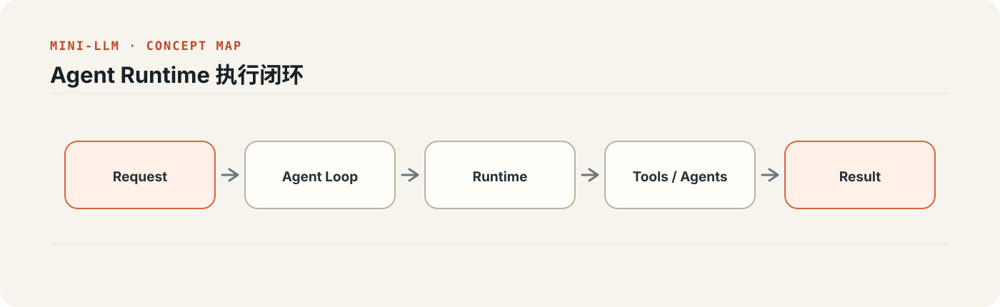
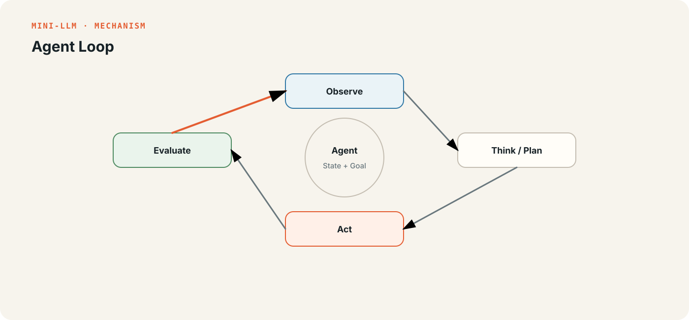

# **《mini-llm Agent Engine 深度解析：从 Agent Loop、Tool Calling 到 Runtime、Multi-agent 与 Autonomous Agent》**



_图：Agent Runtime 执行闭环。从左到右展示本章核心概念之间的数据流与依赖关系。_

前面的系列，我们已经逐步构建了 mini-llm 的多个智能模块：

- **Representation Engine**：如何表示信息和概念。
- **Memory Engine**：如何保存、检索和组织记忆。
- **Knowledge Engine**：如何组织知识、实体和关系。
- **World Model Engine**：如何预测世界状态的变化。
- **Causal Reasoning Engine**：如何理解行动与结果之间的因果关系。
- **Decision Engine**：如何选择行动。
- **Planning Engine**：如何制定实现目标的行动路径。

但这些模块仍然只是能力组件。

它们还没有回答一个关键问题：

**如何将这些能力组织成一个能够持续运行、调用工具、执行任务、观察结果并自主调整行为的智能系统？**

这就是 Agent Engine（智能体引擎）需要解决的问题。

传统语言模型的主要工作是根据上下文生成下一个 Token：

\\[ P(x\_{t+1}|x_1,x_2,\ldots,x_t) \\]

而 Agent 不仅需要生成 Token，还需要通过工具与外部环境交互：

\\[ Observe\rightarrow Think\rightarrow Plan \rightarrow Act\rightarrow Observe \\]

它不再只是生成答案，而是形成一个持续运行的行动闭环。

# **一、什么是 Agent？**

## **1.1 从 Language Model 到 Agent**

先看两个系统的区别。

**传统 LLM**

用户输入

Transformer

Token Generation

文本回答

**Agent**

用户目标 / 环境事件

Agent Engine

理解、记忆、规划、决策

Tool Calling / Action

外部环境发生变化

重新观察环境，更新状态并决定下一步行动

传统 LLM 的输出主要是文本。

Agent 的输出可以是：

- 一段文本。
- 一次数据库查询。
- 一次 HTTP 请求。
- 一次代码修改。
- 一次终端命令。
- 一次文件操作。
- 一次远程服务调用。
- 一系列连续行动。

因此，Agent 的核心不只是语言生成，而是：

**利用模型的认知和推理能力，通过行动影响外部环境，并根据反馈不断调整行为。**

## **1.2 Agent 的基本定义**

可以将 Agent 抽象为：

\\[ Agent=(O,S,M,G,P,D,A,E) \\]

其中：

| 符号      | 含义               |
| ------- | ---------------- |
| \\(O\\) | Observation：环境观察 |
| \\(S\\) | State：当前状态       |
| \\(M\\) | Memory：记忆        |
| \\(G\\) | Goal：目标          |
| \\(P\\) | Planning：规划      |
| \\(D\\) | Decision：决策      |
| \\(A\\) | Action：行动        |
| \\(E\\) | Environment：外部环境 |

Agent 不一定需要所有模块都采用神经网络实现。

例如：

- 语言理解可以由 LLM 完成。
- 任务依赖可以使用 DAG。
- 搜索可以使用 A\*。
- 记忆可以使用数据库。
- 权限控制可以使用规则引擎。
- 工具执行可以由 Runtime 负责。

这也是构建工程化 Agent 的重要思想：**将模型能力与确定性软件机制组合起来。**

# **二、Agent Architecture：智能体整体架构**

一个完整的 Agent 可以分成五个主要层次。

## **Agent Architecture**

**1. Cognitive Layer｜认知层**

LLM、Representation、Reasoning、Reflection

**2. Planning Layer｜规划层**

Goal、Task Decomposition、Planning、Decision

**3. Memory Layer｜记忆层**

Working Memory、Episodic Memory、Knowledge

**4. Execution Layer｜执行层**

Tool Registry、Tool Calling、Executor、Runtime

**5. Environment Layer｜环境层**

Filesystem、Database、API、Browser、Terminal、External Services

这五层不是必须严格分开的物理服务，而是逻辑架构。

## **2.1 Cognitive Layer**

负责理解和推理。

主要组件：

- LLM Engine。
- Representation Engine。
- Reasoning Engine。
- World Model。
- Causal Reasoning。
- Reflection。

例如用户提出：

```
帮我检查项目中的性能问题，
找到瓶颈并修复。
```

认知层需要理解：

- 项目是什么。
- 什么是性能问题。
- 应该检查哪些位置。
- 什么结果算修复成功。

## **2.2 Planning Layer**

负责目标管理与行动规划。

主要组件：

- Goal Manager。
- Task Decomposer。
- Planning Engine。
- Decision Engine。
- Constraint Checker。

例如：

```
1. 分析项目结构。
2. 运行性能测试。
3. 定位性能瓶颈。
4. 设计优化方案。
5. 修改代码。
6. 重新测试。
```

## **2.3 Memory Layer**

负责保存当前任务和历史经验。

包括：

- Working Memory。
- Episodic Memory。
- Semantic Memory。
- Procedural Memory。

例如：

```
历史经验：
之前这个项目的图片加载瓶颈
来自未压缩的大尺寸资源。
```

Agent 可以在新任务中检索这条经验。

## **2.4 Execution Layer**

负责真正执行行动。

例如：

```
read_file()
search_code()
run_tests()
modify_file()
git_diff()
```

它不应该简单地把 LLM 生成的字符串直接交给操作系统执行。

工具调用需要经过：

- 参数验证。
- 权限检查。
- 执行策略。
- 资源限制。
- 日志记录。

## **2.5 Environment Layer**

Agent 所面对的外部世界。

包括：

- 操作系统。
- 文件系统。
- 数据库。
- 网络服务。
- 浏览器。
- 代码仓库。
- 其他 Agent。

Environment 是 Agent 获取观察结果和产生实际影响的地方。

# **三、Agent Loop：智能体运行循环**



_图：Agent 在观察、思考、规划、行动和评估之间持续循环。_

Agent 最核心的机制是 Agent Loop。

它让 Agent 不再只处理一次输入，而是可以根据行动反馈继续工作。

## **3.1 基本循环**

\\[ Observe\rightarrow Think\rightarrow Plan \rightarrow Act\rightarrow Observe \\]

**Observe**

观察环境，获取当前状态

**Think**

理解问题，分析当前情况

**Plan**

生成或调整执行计划

**Act**

调用工具，执行行动

**Evaluate**

检查结果，判断是否完成

未完成：更新状态并进入下一轮

## **3.2 Observe：观察**

Agent 首先需要获取环境信息。

例如：

```
observation = {    "project_path": "/workspace/app",    "git_status": "modified",    "test_status": "failed",    "error_count": 3}
```

观察信息可能来自：

- 用户输入。
- 工具返回。
- 文件系统。
- 数据库。
- 外部 API。
- 其他 Agent。

观察结果不一定等于真实世界状态。

例如，HTTP 请求超时并不能证明服务端没有完成操作。

所以 Agent 需要记录信息来源和不确定性。

## **3.3 Think：分析**

Agent 根据观察结果和上下文，判断当前状态。

例如：

```
观察：
- 测试失败
- 3 个错误
- 错误集中在用户认证模块

分析：
- 可能是 Token 验证逻辑异常
- 需要进一步检查认证中间件
```

这里可以使用 LLM 进行语义分析，也可以结合规则和静态分析工具。

## **3.4 Plan：规划**

根据当前状态生成下一步行动。

```
计划：

1. 查找认证中间件。
2. 检查 Token 验证逻辑。
3. 编写复现测试。
4. 修改错误代码。
5. 重新运行测试。
```

## **3.5 Act：行动**

Agent 调用工具。

```
result = tools.read_file(    path="src/auth/middleware.ts")
```

## **3.6 Evaluate：评估**

执行完成后，检查实际结果。

```
if result.success:    update_task_status("completed")else:    update_task_status("failed")    trigger_replanning()
```

关键点：

**工具返回成功，不一定意味着用户目标完成。**

例如，文件写入成功只能证明写入动作完成，不能证明代码功能正确。

因此需要分别验证：

- Action Success：行动是否执行成功。
- Task Success：任务是否达到验收条件。
- Goal Success：整体目标是否实现。

# **四、Agent State：智能体状态管理**

Agent Loop 必须维护状态，否则每轮执行都可能丢失之前的信息。

## **4.1 什么是 Agent State？**

可以将 Agent State 定义为：

\\[ S_t=(G_t,O_t,M_t,P_t,A_t,R_t) \\]

其中：

- \\(G_t\\)：当前目标。
- \\(O_t\\)：最新观察。
- \\(M_t\\)：记忆。
- \\(P_t\\)：当前计划。
- \\(A_t\\)：已执行行动。
- \\(R_t\\)：执行结果。

示例：

```
agent_state = {    "goal": "修复用户认证模块",    "observation": {        "test_failed": True,        "error_count": 3    },    "memory": [],    "plan": [        "检查认证中间件",        "修复 Token 验证",        "运行测试"    ],    "completed_actions": [],    "current_action": None,    "status": "running"}
```

## **4.2 状态与上下文有什么区别？**

这是构建 Agent 时非常重要的概念。

| 概念               | 主要作用                  | 生命周期    |
| ---------------- | --------------------- | ------- |
| Context Window   | 当前模型调用可见的信息           | 单次或多次调用 |
| Agent State      | 当前任务的结构化运行状态          | 任务生命周期  |
| Working Memory   | 当前任务中需要持续使用的信息        | 短期      |
| Long-term Memory | 跨任务保存的经验和知识           | 长期      |
| KV Cache         | Transformer 已计算的注意力键值 | 模型推理过程  |

这几个概念不能混为一谈。

例如：

- Agent State 可以保存在数据库。
- Context Window 是送给 LLM 的输入内容。
- KV Cache 是 Transformer 推理优化机制。
- Long-term Memory 可以跨多个 Agent 会话存在。

即使模型上下文窗口很大，也不代表 Agent 已经具备可靠的长期记忆。

## **4.3 Agent State 的版本管理**

复杂任务中，状态可能不断发生变化。

因此建议增加版本：

```
agent_state = {    "task_id": "task_001",    "version": 12,    "status": "running",    "updated_at": "2026-11-23T08:00:00Z"}
```

每次重要状态变化都应该形成一个事件：

```
TaskCreated
PlanGenerated
ActionStarted
ActionCompleted
ActionFailed
PlanRevised
GoalCompleted
```

这样可以实现：

- 执行追踪。
- 故障恢复。
- 审计。
- 回滚。
- 复现问题。

对于需要长时间运行的 Agent，这比单纯保留对话历史重要得多。

# **五、Tool Calling：工具调用机制**

这是 Agent 与普通 LLM 最重要的工程区别之一。

LLM 本身通常不能直接访问你的数据库、文件系统或者操作系统。

需要通过 Tool Calling 将模型的意图转换成外部系统能够执行的操作。

## **5.1 什么是 Tool Calling？**

例如用户提出：

```
帮我查看项目中的 package.json。
```

Agent 判断需要调用工具：

```
read_file(    path="package.json")
```

工具执行后返回：

```
{
  "success": true,
  "content": {
    "name": "my-project",
    "version": "1.0.0"
  }
}
```

LLM 再根据结果生成回答。

整个过程：

**User Message**

**LLM**

判断需要读取文件

**Tool Call**

read_file(path="package.json")

**Tool Executor**

检查权限并执行文件读取

**Tool Result**

**LLM Final Response**

注意：模型产生的是工具调用请求，不是已经执行的行动。

只有 Tool Executor 真正执行后，才能得到执行结果。

## **5.2 Tool Definition：工具定义**

每个工具应该有明确的结构。

例如：

```
read_file_tool = {    "name": "read_file",    "description": "读取工作区中的文件",    "parameters": {        "type": "object",        "properties": {            "path": {                "type": "string",                "description": "相对于工作区的文件路径"            }        },        "required": ["path"]    }}
```

这里使用了 JSON Schema 风格的参数定义。

工具描述很重要。

如果工具描述模糊，LLM 可能：

- 选择错误工具。
- 传入错误参数。
- 混淆工具用途。
- 在不需要工具时调用工具。

## **5.3 Tool Call 与 Function Calling**

这两个术语经常一起出现。

Function Calling 通常强调模型输出一个结构化函数调用请求。

Tool Calling 的概念更广，可以包括：

- 函数。
- HTTP API。
- MCP Server。
- 浏览器。
- 数据库。
- 命令行工具。
- 外部 Agent。

可以简单理解为：

Function 是一种工具形式，而 Tool 是更广泛的能力接口。

## **5.4 Tool Calling 并不意味着模型直接执行代码**

例如：

```
{
  "tool": "delete_file",
  "arguments": {
    "path": "important.db"
  }
}
```

这个请求不能直接执行。

执行器必须检查：

1. 工具是否存在。
2. 参数是否符合 Schema。
3. 路径是否在授权范围内。
4. 当前 Agent 是否有删除权限。
5. 是否需要人工确认。
6. 是否存在危险操作。

**LLM 可以提出行动，但不应该自动拥有所有行动权限。**

# **六、Tool Registry：工具注册与管理**

随着 Agent 能力增加，工具数量可能越来越多。

不可能将所有工具都写死在 Agent 主程序中。

因此需要 Tool Registry。

## **6.1 什么是 Tool Registry？**

Tool Registry 是工具注册中心。

它负责管理：

- 工具名称。
- 工具描述。
- 参数 Schema。
- 工具版本。
- 执行入口。
- 权限要求。
- 超时限制。
- 风险等级。

例如：

```
class ToolRegistry:    def __init__(self):        self.tools = {}    def register(self, tool):        self.tools[tool.name] = tool    def get(self, name):        return self.tools.get(name)    def list_tools(self):        return list(self.tools.values())
```

工具定义：

```
class Tool:    def __init__(        self,        name,        description,        schema,        handler,        permission    ):        self.name = name        self.description = description        self.schema = schema        self.handler = handler        self.permission = permission
```

注册工具：

```
registry = ToolRegistry()registry.register(    Tool(        name="read_file",        description="读取工作区文件",        schema={},        handler=read_file,        permission="filesystem.read"    ))
```

这只是简化的内存注册中心，实际系统还需要 Schema 校验、版本兼容、并发安全和工具生命周期管理。

## **6.2 Tool Discovery：工具发现**

工具数量很多时，不能每次都把所有工具描述发送给 LLM。

例如一个 Agent 可能拥有：

```
文件系统工具：20 个
Git 工具：15 个
数据库工具：12 个
浏览器工具：10 个
部署工具：18 个
监控工具：12 个
```

总共 87 个工具。

全部塞进上下文会带来：

- Token 消耗。
- 工具描述干扰。
- 选择错误。
- 上下文膨胀。

可以引入工具发现机制：

```
用户目标
   │
   ▼
任务分类
   │
   ▼
检索相关工具
   │
   ▼
选择候选工具
   │
   ▼
发送给 LLM
```

例如：

```
tools = registry.search(    category="filesystem",    capability="read")
```

更进一步，可以使用语义检索匹配工具能力，但需要注意：工具检索的结果只是候选工具，仍然需要参数验证和权限检查。

# **七、Agent Runtime：智能体运行时**

Tool Calling 解决的是如何调用工具。

Runtime 解决的是：

**如何安全、稳定、可控地运行整个 Agent？**

这是一个非常重要的工程边界。

## **7.1 什么是 Runtime？**

Runtime 是 Agent 的运行环境和生命周期管理系统。

它负责：

- 创建 Agent 实例。
- 管理任务状态。
- 调度模型调用。
- 执行工具。
- 控制超时。
- 限制资源。
- 保存检查点。
- 处理异常。
- 管理并发。
- 终止任务。

可以将 Runtime 看成 Agent 的操作系统层。

## **7.2 Runtime 与 Executor 的区别**

| 模块        | 职责         |
| --------- | ---------- |
| Agent     | 决定任务如何完成   |
| Planner   | 生成行动计划     |
| Executor  | 执行具体工具     |
| Runtime   | 管理整个运行生命周期 |
| Sandbox   | 隔离执行环境     |
| Scheduler | 调度任务和资源    |

例如：

```
Agent
  │
  ▼
Runtime
  │
  ├── Model Gateway
  │
  ├── Tool Registry
  │
  ├── Executor
  │
  ├── Sandbox
  │
  ├── State Manager
  │
  └── Scheduler
```

## **7.3 Runtime 为什么不能只是一个 while 循环？**

简单 Agent 可能只有：

```
while not done:    response = llm.call()    execute_tool(response)
```

但生产环境中会出现：

- 模型调用超时。
- 工具执行失败。
- Agent 无限循环。
- 任务被重复执行。
- 进程崩溃。
- 多任务资源竞争。
- 上下文超过限制。
- 外部 API 返回不稳定。

因此 Runtime 需要建立任务生命周期。

例如：

```
CREATED
   │
   ▼
RUNNING
   │
   ├── WAITING_TOOL
   │
   ├── WAITING_APPROVAL
   │
   ├── PAUSED
   │
   ├── FAILED
   │
   ▼
COMPLETED
```

这比简单的 `done=True/False` 更适合复杂 Agent。

# **八、Sandbox：智能体沙箱**

如果 Agent 可以运行命令、修改文件、安装依赖，那么它就拥有了影响系统的能力。

这也意味着安全风险。

## **8.1 为什么需要 Sandbox？**

例如 Agent 收到任务：

```
优化项目，并清理无用文件。
```

如果没有限制，它可能：

- 删除重要文件。
- 修改系统配置。
- 访问工作区之外的数据。
- 执行危险命令。
- 泄露环境变量。
- 消耗过多 CPU 和内存。

因此需要 Sandbox。

[What is Sandbox Security? | Docker](https://images.openai.com/static-rsc-4/Z-gecfELNWMhq3mD0idUOQW0uSls41kYd0W6AoB0gMslvfj7tok9pwsmktML8Sga7IIhsVibJH3GL8l7ReWK9vkKskwvLlbwRnv8GoqlIcF5ActZdpG3mdorpUJWwJkXTg2_cEJWR6tqBBb021L4l0XizWTHSgVQLC0lYSqKpcA?purpose=inline)

[docker.com](https://www.docker.com/blog/what-is-sandbox-security/?utm_source=chatgpt.com)

## **8.2 Sandbox 的隔离维度**

| 隔离维度       | 控制内容   |
| ---------- | ------ |
| Filesystem | 文件访问范围 |
| Process    | 进程隔离   |
| Network    | 网络访问   |
| CPU        | CPU 配额 |
| Memory     | 内存限制   |
| Storage    | 磁盘限制   |
| Time       | 执行时间   |
| Permission | 系统权限   |

在 Linux 中，可以组合使用：

- Linux Namespaces。
- cgroups。
- seccomp。
- Linux capabilities。
- 文件系统挂载隔离。
- 网络命名空间。
- 容器运行时。

对于高风险、恶意代码或多租户场景，还需要考虑更强的隔离边界，不能把普通容器等同于完整的安全虚拟机。

## **8.3 Sandbox 与 Agent 的关系**

Agent 决定做什么。

Sandbox 限制它能够做什么。

两者必须分离。

```
LLM：提出行动
       │
       ▼
Policy Engine：检查权限
       │
       ▼
Sandbox：限制执行环境
       │
       ▼
Executor：执行行动
       │
       ▼
Result：返回结果
```

这里有一个重要原则：

**不能依靠 Prompt 告诉模型不要执行危险操作，必须由外部权限系统和运行环境真正限制操作能力。**

# **九、Context Management：上下文管理**

Agent 运行时间越长，需要处理的信息就越多。

但 Transformer 的上下文窗口不是无限的。

因此需要 Context Management。

## **9.1 上下文膨胀问题**

例如，一个 Agent 执行软件开发任务：

```
第 1 轮：读取项目说明
第 2 轮：分析目录结构
第 3 轮：读取多个源文件
第 4 轮：运行测试
第 5 轮：修改代码
第 6 轮：读取错误日志
第 7 轮：再次修改代码
```

如果每一轮都把全部历史内容发送给 LLM：

\\[ Context_t=\sum\_{i=1}^{t}Message_i \\]

上下文会持续增长。

这会导致：

- Token 成本增加。
- 推理延迟增加。
- 重要信息被大量噪声淹没。
- 最终超过模型上下文窗口。

## **9.2 Context Compression：上下文压缩**

可以将历史过程压缩为摘要：

```
任务：
修复用户认证模块。

已完成：
- 检查项目结构。
- 找到认证中间件。
- 确认 Token 过期处理存在问题。

当前发现：
- refresh_token 验证逻辑异常。

未完成：
- 修复代码。
- 运行集成测试。

重要约束：
- 不修改数据库结构。
- 保持现有 API 兼容。
```

但压缩不是简单地总结对话。

应当保留：

- 当前目标。
- 已完成任务。
- 未完成任务。
- 关键事实。
- 决策依据。
- 约束。
- 文件引用。
- 执行结果。
- 待验证假设。

## **9.3 Context 与 Memory 的协作**

建议采用：

```
Long-term Memory
       │
       ▼
Memory Retrieval
       │
       ▼
Task State
       │
       ▼
Context Builder
       │
       ▼
LLM Context Window
```

也就是说：

长期记忆不需要全部进入上下文。

应该根据当前任务检索相关内容，再由 Context Builder 组织成模型能够理解的信息。

此外，摘要不能替代原始证据。对于关键代码修改、错误日志和用户约束，应该保留可追溯的原始记录或引用。

# **十、Reflection：反思与自我修正**

Agent 执行任务之后，不能只看工具有没有返回成功。

还需要检查行动是否达到预期效果。

这就是 Reflection。

## **10.1 什么是 Reflection？**

Reflection 是 Agent 对自身行动、结果和计划进行检查的过程。

例如：

```
行动：
修改用户认证代码。

结果：
单元测试通过，但集成测试失败。

反思：
当前修改只解决了局部问题，
可能遗漏了 Token 刷新流程。

下一步：
检查 refresh_token 相关逻辑。
```

## **10.2 Reflection 的三个层次**

**第一层：结果反思**

行动是否成功？

```
命令执行是否成功？
文件是否修改？
测试是否通过？
```

**第二层：原因反思**

为什么出现失败？

```
是代码错误？
环境问题？
依赖缺失？
还是原计划不合理？
```

**第三层：策略反思**

以后是否应该改变解决问题的方法？

```
过去：
先修改代码，再运行测试。

新的策略：
先建立失败测试，再修改代码。
```

## **10.3 Reflection 与 Learning 的区别**

| Reflection | Learning     |
| ---------- | ------------ |
| 检查当前行动     | 更新长期能力       |
| 识别错误       | 从经验中改进       |
| 修正当前计划     | 改变未来行为       |
| 可以只修改任务状态  | 可能更新参数、规则或记忆 |

需要特别注意：

**模型能够描述自己的错误，并不代表它已经真正学会避免这个错误。**

真正的能力提升需要通过后续任务验证。

例如：

- 错误是否再次发生？
- 相同任务是否更快完成？
- 是否降低了失败率？
- 是否减少了资源消耗？

# **十一、Multi-agent System：多智能体系统**

单个 Agent 能够完成很多任务。

但复杂系统可能需要多个具有不同职责的 Agent 协作。

这就是 Multi-agent System。

## **11.1 为什么需要多个 Agent？**

假设开发一个完整 SaaS 系统。

可以拆分为：

- 架构 Agent。
- 前端 Agent。
- 后端 Agent。
- 数据库 Agent。
- 测试 Agent。
- 安全审查 Agent。

不同 Agent 可以拥有不同的工具、上下文和任务权限。

**Coordinator Agent**

目标分解、任务分配、结果整合

**Frontend Agent**

前端开发

**Backend Agent**

后端开发

**Database Agent**

数据库设计

**Testing Agent**

测试验证

**Shared Task State / Integration**

共享任务状态、接口契约与集成结果

## **11.2 Multi-agent 的基本模式**

### **模式一：Coordinator-Worker**

一个主 Agent 分配任务，多个子 Agent 执行。

```
Coordinator
   │
   ├── Worker A
   ├── Worker B
   └── Worker C
```

优点：

- 结构简单。
- 任务分配清晰。
- 容易统一管理。

缺点：

- 主 Agent 可能成为瓶颈。
- 子 Agent 之间的信息共享需要额外设计。

### **模式二：Peer-to-Peer**

多个 Agent 之间直接通信。

```
Agent A ←→ Agent B
   ↕          ↕
Agent C ←→ Agent D
```

优点：

- 更灵活。
- 适合分布式协作。

缺点：

- 通信复杂。
- 容易产生冲突。
- 难以统一控制。

### **模式三：Hierarchical Multi-agent**

多个层级的 Agent 共同工作。

```
Strategic Agent
       │
       ▼
Planning Agent
       │
       ├── Coding Agent
       ├── Testing Agent
       └── Review Agent
```

适合复杂、长期运行的任务，但层级过多也会增加通信成本和协调延迟。

## **11.3 Multi-agent 的关键问题**

多个 Agent 不代表系统一定更聪明。

多智能体会产生新的问题：

- 任务重复。
- 结果冲突。
- 资源竞争。
- 信息不一致。
- 循环委派。
- 通信成本增加。
- 责任归属不清。

因此，需要引入：

**Shared State、Message Protocol、Task Ownership、Conflict Resolution 和 Coordinator。**

# **十二、Agent Communication：智能体通信**

多 Agent 系统需要定义通信协议。

否则不同 Agent 之间只能交换不稳定的自然语言。

## **12.1 结构化消息**

例如：

```
message = {    "message_id": "msg_001",    "from_agent": "backend_agent",    "to_agent": "testing_agent",    "type": "task_result",    "task_id": "task_102",    "payload": {        "status": "completed",        "api_endpoint": "/api/users",        "methods": ["GET", "POST"]    }}
```

这样可以让消息被程序验证和处理。

## **12.2 Agent Message 的核心字段**

| 字段             | 作用     |
| -------------- | ------ |
| message_id     | 消息唯一标识 |
| from_agent     | 发送者    |
| to_agent       | 接收者    |
| task_id        | 关联任务   |
| type           | 消息类型   |
| payload        | 消息内容   |
| timestamp      | 时间     |
| correlation_id | 关联请求   |
| status         | 消息处理状态 |

## **12.3 A2A 与 MCP**

这里有两个值得区分的协议方向：

- **MCP（Model Context Protocol）**：主要解决 AI 应用与外部工具、数据源之间的连接问题。
- **A2A（Agent2Agent）**：主要面向不同 Agent 系统之间的协作与通信。

它们并不是竞争关系。

可以理解为：

```
Agent A
   │
   ├── MCP → 工具与数据
   │
   └── A2A → 其他 Agent
```

MCP 更偏向能力接入，A2A 更偏向 Agent 之间的协作。

在具体工程中，还要关注协议版本、认证、消息可靠性和任务状态同步，不能仅依赖协议本身解决所有协调问题。

# **十三、Autonomous Agent：自主智能体**

前面讨论的 Agent 大多由用户提供目标。

但更进一步的问题是：

**Agent 能不能在没有用户持续指挥的情况下，持续管理目标、监控环境并自主完成任务？**

这就是 Autonomous Agent 的研究方向。

## **13.1 Reactive Agent 与 Autonomous Agent**

| 类型                  | 特征                |
| ------------------- | ----------------- |
| Reactive Agent      | 根据当前输入做出响应        |
| Goal-directed Agent | 围绕明确目标行动          |
| Planning Agent      | 能够组织多步行动          |
| Autonomous Agent    | 能够在授权边界内持续管理任务和行动 |

自主性不是一个简单的开关，而是多个能力的组合：

- 自主感知。
- 目标管理。
- 长期规划。
- 任务调度。
- 环境监控。
- 失败恢复。
- 经验积累。

## **13.2 自主目标管理**

例如，一个项目维护 Agent 可以每天执行：

```
1. 检查 Git 仓库状态。
2. 检查自动化测试。
3. 检查依赖安全公告。
4. 检查系统运行状态。
5. 识别潜在问题。
6. 生成维护任务。
7. 在授权范围内执行修复。
8. 提交结果报告。
```

但这里必须区分：

- 用户授权的长期目标。
- Agent 根据目标产生的子任务。
- Agent 自行提出的建议。

Agent 可以提出新目标，但不能因为自己认为有价值，就自动扩大权限或改变用户授权范围。

## **13.3 Autonomous Agent 的控制边界**

自主性越高，控制机制越重要。

建议设置：

| 控制维度 | 机制                |
| ---- | ----------------- |
| 目标范围 | Goal Policy       |
| 工具权限 | Permission Engine |
| 运行时间 | Time Budget       |
| 资源消耗 | Cost Budget       |
| 操作风险 | Risk Policy       |
| 外部影响 | Human Approval    |
| 执行追踪 | Audit Log         |
| 异常处理 | Recovery Engine   |

尤其需要区分低风险行动与高风险行动。

例如：

- 读取文件：通常低风险。
- 创建测试文件：相对低风险。
- 修改业务代码：需要审查。
- 删除数据库：高风险。
- 转账、发布生产版本：需要严格审批。

自主 Agent 应该是在明确边界内自主，而不是无限制自主。

# **十四、构建 mini-llm Agent Engine**

现在将前面的理论组合成工程架构。

## **14.1 模块结构**

```
mini-llm/
│
├── core/
│   ├── tensor/
│   ├── autograd/
│   ├── nn/
│   └── transformer/
│
├── engines/
│   ├── representation/
│   ├── memory/
│   ├── knowledge/
│   ├── world_model/
│   ├── causal/
│   ├── decision/
│   ├── planning/
│   │
│   └── agent/
│       ├── agent.py
│       ├── agent_loop.py
│       ├── agent_state.py
│       │
│       ├── cognition/
│       │   ├── thinker.py
│       │   ├── reflection.py
│       │   └── evaluator.py
│       │
│       ├── tools/
│       │   ├── tool.py
│       │   ├── registry.py
│       │   ├── discovery.py
│       │   └── schema.py
│       │
│       ├── runtime/
│       │   ├── runtime.py
│       │   ├── scheduler.py
│       │   ├── lifecycle.py
│       │   └── checkpoint.py
│       │
│       ├── execution/
│       │   ├── executor.py
│       │   ├── retry.py
│       │   └── result.py
│       │
│       ├── context/
│       │   ├── builder.py
│       │   ├── compressor.py
│       │   └── manager.py
│       │
│       ├── security/
│       │   ├── policy.py
│       │   ├── permission.py
│       │   └── approval.py
│       │
│       └── multi_agent/
│           ├── coordinator.py
│           ├── worker.py
│           ├── message.py
│           └── communication.py
│
└── tests/
    ├── test_agent_loop.py
    ├── test_tool_calling.py
    ├── test_runtime.py
    ├── test_context.py
    └── test_multi_agent.py
```

## **14.2 核心 Agent 数据结构**

```
from dataclasses import dataclass, fieldfrom typing import Any@dataclassclass AgentConfig:    name: str    max_steps: int = 20    timeout_seconds: int = 300    max_tool_calls: int = 30@dataclassclass AgentState:    task_id: str    goal: str    status: str = "created"    current_plan: list = field(        default_factory=list    )    observations: list = field(        default_factory=list    )    action_history: list = field(        default_factory=list    )    step: int = 0@dataclass
```

## **14.3 Agent Loop 简化实现**

```
class Agent:    def __init__(        self,        model,        planner,        tool_registry,        executor,        evaluator    ):        self.model = model        self.planner = planner        self.tool_registry = tool_registry        self.executor = executor        self.evaluator = evaluator    def run(self, state):        state.status = "running"        while state.step < 20:            # 1. 组织上下文            context = self.build_context(state)            # 2. 获取模型决策            decision = self.model.generate(                context            )            # 3. 判断是否完成            if decision.type == "final":                result = self.evaluator.evaluate(                    state,                    decision.content                )
```

这段代码只是用于说明架构的简化示意，并不是可直接部署的生产实现。

实际运行时还需要：

- Tool Schema 验证。
- 权限检查。
- 任务取消。
- 超时控制。
- 幂等执行。
- 失败重试策略。
- 结构化日志。
- 状态持久化。
- 检查点恢复。
- 模型输出异常处理。
- 目标完成验证。

尤其是模型返回 `final`，不能直接等同于任务完成。必须根据目标的验收条件判断。

# **十五、Agent Engine 的核心工程问题**

一个真正可用的 Agent，不能只关注模型推理能力。

还需要解决一系列系统工程问题。

| 问题         | 解决模块              |
| ---------- | ----------------- |
| Agent 无限循环 | Loop Guard        |
| 工具误调用      | Tool Validator    |
| 越权操作       | Permission Engine |
| 执行失败       | Recovery Engine   |
| 上下文膨胀      | Context Manager   |
| 状态丢失       | State Persistence |
| 任务冲突       | Scheduler         |
| 多 Agent 冲突 | Coordinator       |
| 成本失控       | Cost Manager      |
| 结果不可信      | Evaluation Engine |
| 执行不可追踪     | Audit Engine      |

这也说明了一个问题：

**Agent 工程的复杂度，远远不只是调用一次 LLM API。**

真正的难点在于让系统在长期运行、环境变化和不确定性条件下，依然保持可控、可恢复和可验证。

# **十六、如何评估 Agent Engine？**

Agent 的评价不能只看回答质量。

需要将语言质量、行动能力和任务完成能力分开。

| 指标                      | 含义       |
| ----------------------- | -------- |
| Task Completion Rate    | 任务完成率    |
| Tool Selection Accuracy | 工具选择准确率  |
| Tool Argument Accuracy  | 工具参数准确率  |
| Action Success Rate     | 行动执行成功率  |
| Goal Verification Rate  | 目标验证通过率  |
| Recovery Success Rate   | 故障恢复成功率  |
| Average Steps           | 平均执行步骤   |
| Token Cost              | Token 成本 |
| Execution Latency       | 执行延迟     |
| Policy Violation Rate   | 权限策略违规率  |
| Human Intervention Rate | 人工介入比例   |

其中最重要的不是工具调用次数，而是：

**Agent 是否真正完成了用户授权的目标。**

例如：

一个 Agent 调用了 20 次工具，但最终没有解决问题。

另一个 Agent 只调用了 5 次工具，就完成了任务。

不能因为第一个 Agent 更活跃，就认为它更智能。

# **十七、Agent Engine 与完整智能系统**

到这里，我们已经把前面的一系列 Engine 连接起来。

## **mini-llm 完整智能系统**

**User Goal / Environment**

用户目标与环境事件

**Cognitive Architecture**

Representation · Reasoning · Metacognition

**Memory Engine**

记忆检索与更新

**Knowledge Engine**

知识组织与推理

**World Model**

未来状态预测

**Causal Engine**

行动效果分析

**Decision Engine**

选择行动

**Planning Engine**

组织行动路径

**Agent Engine**

任务循环 · 工具调用 · 运行时 · 执行反馈

**Runtime / Sandbox / Tools**

安全执行与环境交互

**Environment**

文件、数据库、API、操作系统、外部服务

观察行动结果，更新记忆与世界状态，继续循环

我们可以将整个系统总结为：

\\[ \boxed{ Intelligence = Representation+ Prediction+ Reasoning+ Decision+ Planning+ Action+ Learning } \\]

这不是一个严格的数学恒等式，而是对智能系统主要功能模块的工程抽象。

# **十八、接下来应该研究什么？**

Agent Engine 完成后，mini-llm 已经从单纯的 Transformer 模型，扩展到了一个具有记忆、知识、推理、规划、工具和执行能力的智能体架构。

但还有一个重要问题没有解决：

**当 Agent 执行了大量任务之后，如何从经验中真正获得新的能力？**

例如：

- 第一次执行任务失败。
- 第二次通过修改计划成功。
- 第三次能否主动采用更好的策略？
- 能否将成功经验迁移到其他任务？
- 能否识别哪些经验值得长期保存？
- 能否避免错误经验污染模型和记忆？

这就进入了 Agent Learning。

下一篇建议：

# **《mini-llm Agent Learning Engine 深度解析：从 Experience Replay、Credit Assignment 到 Policy Optimization、Continual Learning 与 Self-improvement》**

建议研究：

1. Experience：智能体如何记录行动经验。
2. Trajectory：如何表示完整行动轨迹。
3. Experience Replay：如何重用历史经验。
4. Credit Assignment：如何判断哪些行动真正带来了成功。
5. Reward Modeling：如何评价行动质量。
6. Policy Optimization：如何改进智能体策略。
7. Reinforcement Learning：强化学习与 Agent。
8. Online Learning：在线学习。
9. Continual Learning：持续学习与灾难性遗忘。
10. Self-improvement：自我改进的边界和机制。
11. Agent Evaluation：如何证明能力真的提升。
12. Learning Architecture：如何将学习引擎接入完整 Agent。

**这将解决从“Agent 能够执行任务”到“Agent 能够从任务经验中持续改进”的关键问题。**

