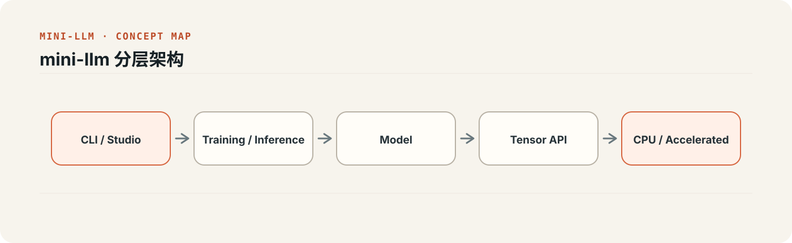
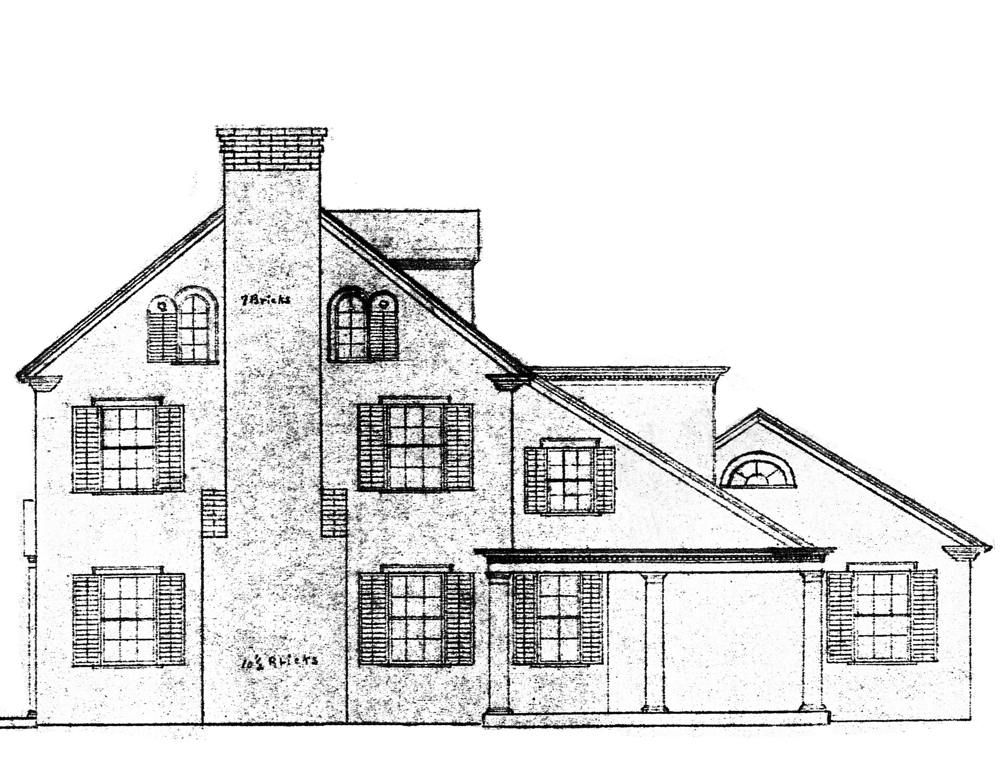
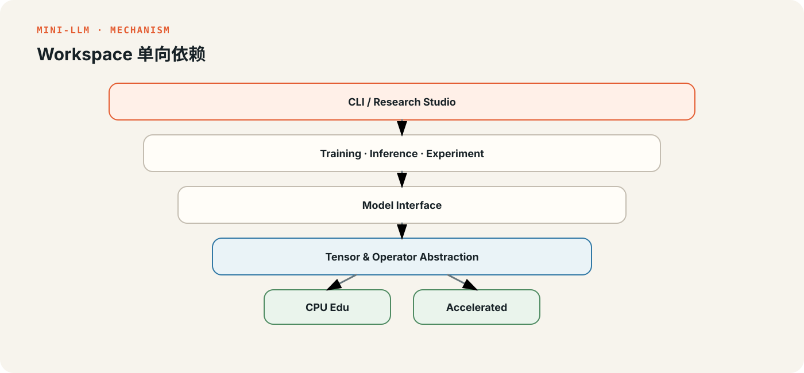

# mini-llm 系统架构



_图：mini-llm 分层架构。从左到右展示本章核心概念之间的数据流与依赖关系。_

## 1. 架构原则

- Rust-first，核心功能不依赖 Python。
- CPU 教学实现作为数值参考实现。
- 加速后端可替换，不把模型逻辑绑定到 Candle。
- 模型、训练器、数据集、后端分层。
- Inspector 通过显式 Trace / Hook / Event 获取数据，避免默认复制所有中间张量。
- 小步演进，先保证可测试，再追求性能。

## 2. 逻辑架构



_图：蓝图用一组正交视图把一栋建筑拆成结构、开口、屋面等几层，任何一层单独看都不足以施工。架构文档承担同样的职责——让读者在不读完全部代码的前提下，看清分层、依赖方向和边界。图片：Alice Trythall Washburn，[Wikimedia Commons](https://commons.wikimedia.org/wiki/File:Blueprint_of_elevation_by_Alice_Trythall_Washburn.jpg)，公有领域。_

```text
CLI / Future Research Studio
            |
     Application Layer
            |
  Experiment / Training / Inference
            |
       Model Interface
            |
  Tensor & Operator Abstraction
       /             \
 Educational CPU   Accelerated Backend
       |                 |
   Vec<f32>            Candle
            |
     Device / Memory
```

## 3. Workspace crate 责任

| Crate | 责任 | 不应负责 |
|---|---|---|
| mini-llm-tensor | CPU Tensor、逐元素算子、矩阵 kernel、广播 | 训练任务管理 |
| mini-llm-random | 确定性 RNG（xorshift64\*）与初始化采样 | 模型结构、数据加载 |
| mini-llm-autograd | 计算图、反向传播、梯度累积 | 优化器状态、模型结构 |
| mini-llm-nn | Linear / Embedding / Norm / SwiGlu / MoE / 优化器 | 具体任务与数据加载 |
| mini-llm-data | 字符 tokenizer、窗口批采样 | 模型结构与训练 |
| mini-llm-train | 训练循环、checkpoint 序列化、DPO/GRPO 配方 | 模型定义、UI |
| mini-llm-model | 模型配置、Attention / Block / TinyGpt、注意力捕获 | 文件持久化、UI |
| mini-llm-trace | 训练事件协议、JSONL sink、张量记录 | 训练逻辑、模型结构 |
| mini-llm-backend | `Backend` 抽象、CPU 参考实现、可选 Candle | 实验业务规则 |
| mini-llm-cli | 命令行应用（每个命令一个模块） | 核心算法实现 |

模块划分原则：每个 crate 的 `lib.rs` 只做模块声明与 re-export；一个文件只承担
一个职责。例如 tensor 拆成 `error` / `broadcast` / `tensor` / `matrix`，
autograd 拆成 `graph` / `value` / `ops::{arith, activation, shape}`，
nn 拆成「每层一个文件 + `module` + `error`」。

## 4. Tensor 设计

MVP Tensor 使用连续 row-major `Arc<Vec<f32>>` 存储。共享缓冲让 `Tensor::clone`
是 O(1)（引用计数），因为 autograd 每次访问节点值都会 clone；若用独占 `Vec`，
这一步会退化成与张量大小成正比的内存拷贝。

不变量：

- `shape` 的维度乘积必须等于 `data.len()`。
- 标量可用空 shape 表示（后续确定是否支持）。
- MVP 首先支持二维矩阵运算。
- 非法维度通过 `Result` 返回错误。
- 逐元素算子采用 NumPy 风格的右对齐广播：维度相等或其中一个为 1 时兼容，
  否则返回 `ShapeMismatch`；反向传播用 `sum_to` 把梯度归约回原形状。
- 矩阵乘法在 work ≥ 4M 次乘加时按行切分到多个线程（`std::thread::scope`），
  线程数上限为 `min(核数, work / 2M)`，避免中等矩阵为每行都付线程启动开销。
  每个线程内一次累积 4 个输出行，使 `right` 的一行只加载一次、复用四次。
  每个输出元素的累加顺序与串行版本一致，因此结果逐位相同，训练可复现；
  小矩阵仍在调用线程上串行计算。

Autograd 只依赖 tensor：节点保存 `value`、`requires_grad`、可选 `grad`、
父节点以及一个 `Fn(&Tensor) -> Vec<Tensor>` 的 backward 闭包。图按需构建，
没有全局 tape；`backward()` 每次做拓扑排序，因此共享子表达式会正确累积梯度。

## 5. Attention 数据约定

MVP 采用单头 scaled dot-product attention：

- Q: `[query_len, head_dim]`
- K: `[key_len, head_dim]`
- V: `[key_len, value_dim]`
- Scores: `Q × Kᵀ / sqrt(head_dim)`
- Weights: 对 Scores 每行做 Softmax
- Output: `Weights × V`

当前示例不包含 causal mask、multi-head reshape、dropout 或 KV cache。这些属于后续 Transformer 里程碑。

## 6. 训练与可观测性设计

未来训练循环应发布结构化事件，例如：

- `RunStarted`
- `StepStarted`
- `MetricsReported`
- `TensorCaptured`
- `CheckpointSaved`
- `RunCompleted`
- `RunFailed`

事件中应包含 run_id、step、timestamp、metric name/value、模型层路径等元数据。大张量不应直接通过 WebSocket 高频传输；应先落盘或转成采样、降维后的可视化数据。

## 7. 持久化约定

- 模型权重：独立二进制文件。
- 模型配置：TOML / JSON。
- 实验元数据：SQLite（后续）。
- 数据集：用户指定路径，记录 hash 和来源。
- Checkpoint：权重、优化器状态、step、随机状态和配置版本。

## 8. 依赖方向



_图：Workspace 保持从应用层到模型层、再到张量与后端的单向依赖。_

```text
mini-llm-cli
 ├── mini-llm-train ──► mini-llm-model ──► mini-llm-nn ──► mini-llm-autograd
 │                          │                  │                 │
 │                          └──────────────────┴──────► mini-llm-random
 │                                                          │
 └── mini-llm-data ──► mini-llm-random                      ▼
                                                     mini-llm-tensor
```

具体边：

- `tensor -> ∅`
- `random -> tensor`（初始化采样需要构造 Tensor）
- `autograd -> tensor`
- `nn -> autograd + random + tensor`
- `data -> random`（只复用 `Rng`，不再依赖 nn）
- `model -> nn + autograd + random + tensor`
- `train -> model + data + nn + autograd + tensor + trace`
- `trace -> ∅`（纯事件与序列化类型）
- `backend -> tensor`（可选 `candle` feature）
- `cli -> model + data + nn + train + trace + autograd + tensor`

本次重构去掉了 `data -> nn` 这条反向依赖：`Rng` 下沉到 `mini-llm-random`，
数据层不再把整个 autograd 栈带进依赖树。`trace` 与 `backend` 是叶子依赖，
不反向依赖训练或模型。

后续建议：

- React Research Studio 消费 `traces/*.jsonl`，不需要改动训练代码。
- `backend -> tensor abstraction`：让更多 kernel（softmax、LayerNorm）走同一 seam。
- `model` 不应反向依赖 `cli` 或 UI。
