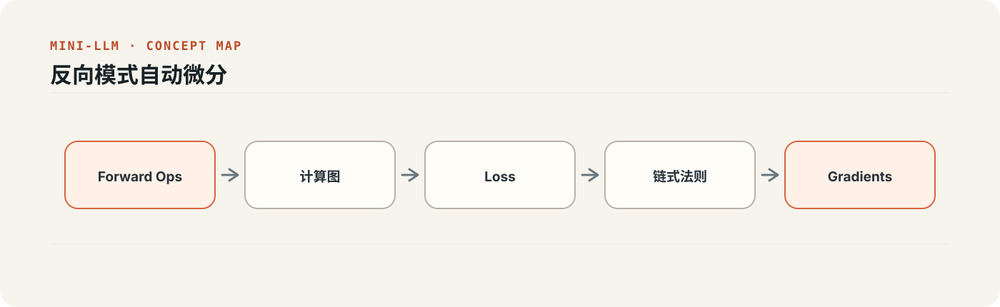

# **mini-llm Autograd Engine 深度解析**



_图：反向模式自动微分。从左到右展示本章核心概念之间的数据流与依赖关系。_

## **从计算图、链式法则到反向传播：让神经网络学会自动计算梯度**

mini-llm 技术文档 · 第三部分 · Autograd Engine

## **一、为什么 Tensor Engine 还不够？**

在上一篇文章中，我们介绍了 Tensor Engine。

Tensor Engine 解决了一个问题：

**计算机如何存储和计算神经网络中的数据？**

它提供了：

- Tensor 数据结构。
- Shape 和 Stride。
- 内存布局。
- 矩阵乘法。
- 加法、乘法、激活函数。
- CPU 数值计算。

但这还不能让神经网络完成训练。

假设我们有一个简单的神经网络：

\\[ y=wx+b \\]

其中：

- \\(x\\)：输入数据。
- \\(w\\)：模型权重。
- \\(b\\)：偏置。
- \\(y\\)：模型预测结果。

假设：

\\[ x=2,\quad w=3,\quad b=1 \\]

那么：

\\[ y=3\times2+1=7 \\]

现在，假设真实答案是 10。

我们可以计算预测误差：

\\[ L=(y-10)^2 \\]

\\[ L=(7-10)^2=9 \\]

到这里，Tensor Engine 已经能够完成所有计算。

但是，接下来出现一个关键问题：

> 我们知道预测错了，却不知道应该修改 w 还是 b，以及分别应该修改多少。

这就是 Autograd Engine 要解决的问题。

## **1.1 Autograd Engine 的核心任务**

Autograd（Automatic Differentiation，自动微分）负责：

1. 记录计算过程。
2. 构建计算图。
3. 计算每个运算的梯度。
4. 将梯度从 Loss 反向传播到模型参数。
5. 为优化器提供参数梯度。

整个过程可以理解为：

**Tensor Engine**

负责数值计算

**Autograd Engine**

记录计算图、自动求梯度

**Optimizer**

根据梯度更新参数

参数更新后进入下一轮训练

三者分工：

| 模块              | 解决的问题   |
| --------------- | ------- |
| Tensor Engine   | 如何计算？   |
| Autograd Engine | 如何计算梯度？ |
| Optimizer       | 如何更新参数？ |

# **二、什么是梯度？**

理解 Autograd，首先必须理解梯度。

## **2.1 从一个简单函数开始**

假设：

\\[ y=x^2 \\]

当：

\\[ x=3 \\]

那么：

\\[ y=9 \\]

现在，我们希望知道：

当 x 发生变化时，y 会如何变化？

求导：

\\[ \frac{dy}{dx}=2x \\]

代入：

\\[ \frac{dy}{dx}=6 \\]

这意味着，在 x=3 附近，如果 x 增加一个很小的量，y 大约增加这个量的 6 倍。

例如：

\\[ x=3 \\]

\\[ x'=3.001 \\]

那么：

\\[ y'=3.001^2=9.006001 \\]

y 增加了约 0.006。

这就是导数描述的局部变化率。

## **2.2 神经网络为什么需要梯度？**

神经网络可以表示为一个参数化函数：

\\[ y=f(x;\theta) \\]

其中：

\\[ \theta=[w_1,w_2,\ldots,w_n] \\]

代表模型的所有参数。

训练目标是让预测结果接近真实答案。

因此，我们定义损失函数：

\\[ L(\theta) \\]

希望找到一组参数，使得：

\\[ \theta^\*=\arg\min\_\theta L(\theta) \\]

但模型参数可能有数百万、数十亿个。

我们不可能逐个尝试每一种参数组合。

所以需要计算：

\\[ \nabla\_\theta L \\]

也就是 Loss 对所有模型参数的梯度。

梯度告诉我们：

- 哪些参数影响了预测结果。
- 参数增加会让 Loss 增大还是减小。
- 当前参数附近，Loss 对参数有多敏感。

**梯度是神经网络训练过程中最重要的信息之一。**

# **三、什么是计算图（Computational Graph）？**

这是 Autograd Engine 的核心概念。

## **3.1 普通程序与计算图**

假设我们编写：

```
let a = 2.0;
let b = 3.0;
let c = a * b;
let d = c + 4.0;
```

普通程序执行后：

\\[ c=6 \\]

\\[ d=10 \\]

程序只关心计算结果。

但如果我们希望知道：

\\[ \frac{\partial d}{\partial a} \\]

就需要保留计算过程中各个变量之间的依赖关系。

计算图就是用图结构表示这些依赖关系。

## **3.2 构建计算图**

对于：

\\[ a=2 \\]

\\[ b=3 \\]

\\[ c=a\times b \\]

\\[ d=c+4 \\]

计算图可以表示为：

## **计算图示例**

**a = 2**

**b = 3**

**c = a × b = 6**

**d = c + 4 = 10**

图中：

- a 和 b 是输入节点。
- 乘法是一个运算节点。
- c 是中间结果。
- 加法是另一个运算节点。
- d 是最终输出。

计算图记录了：

\\[ a,b\rightarrow Multiply\rightarrow c \\]

\\[ c\rightarrow Add\rightarrow d \\]

这样，Autograd 就知道 d 是如何由 a、b 计算出来的。

## **3.3 计算图的节点和边**

一个计算图通常包含：

**节点（Node）**

表示：

- Tensor。
- 常量。
- 中间计算结果。
- 模型参数。

**边（Edge）**

表示：

- 数据依赖关系。
- 运算输入输出关系。
- 梯度传播关系。

从工程角度看，一个 Node 通常需要记录：

| 字段           | 含义        |
| ------------ | --------- |
| Value        | 当前计算结果    |
| Grad         | 当前节点的梯度   |
| Parents      | 输入节点      |
| Op           | 产生该节点的运算  |
| RequiresGrad | 是否需要梯度    |
| Metadata     | 运算所需的额外信息 |

其中最重要的是 Value、Grad 和 Parents。

# **四、为什么反向传播需要链式法则？**

计算图建立之后，接下来就要计算梯度。

这需要用到前面数学章节介绍的链式法则。

## **4.1 链式法则回顾**

假设：

\\[ z=f(y) \\]

\\[ y=g(x) \\]

那么：

\\[ z=f(g(x)) \\]

根据链式法则：

\\[ \frac{dz}{dx} = \frac{dz}{dy} \frac{dy}{dx} \\]

也就是说：

如果一个变量通过另一个变量影响最终结果，那么它对最终结果的影响可以通过中间变量的导数传递。

## **4.2 一个完整的计算例子**

假设：

\\[ a=2 \\]

\\[ b=3 \\]

\\[ c=a\times b \\]

\\[ d=c+4 \\]

我们希望计算：

\\[ \frac{\partial d}{\partial a} \\]

由于：

\\[ c=ab \\]

\\[ d=c+4 \\]

因此：

\\[ \frac{\partial d}{\partial a} = \frac{\partial d}{\partial c} \times \frac{\partial c}{\partial a} \\]

其中：

\\[ \frac{\partial d}{\partial c}=1 \\]

\\[ \frac{\partial c}{\partial a}=b=3 \\]

所以：

\\[ \frac{\partial d}{\partial a}=1\times3=3 \\]

同理：

\\[ \frac{\partial d}{\partial b}=a=2 \\]

最终：

\\[ \frac{\partial d}{\partial a}=3 \\]

\\[ \frac{\partial d}{\partial b}=2 \\]

## **4.3 为什么要从后往前计算？**

我们知道：

\\[ d=c+4 \\]

因此首先计算：

\\[ \frac{\partial d}{\partial c}=1 \\]

然后：

\\[ c=ab \\]

进一步计算：

\\[ \frac{\partial c}{\partial a}=b \\]

\\[ \frac{\partial c}{\partial b}=a \\]

所以计算顺序是：

\\[ d\rightarrow c\rightarrow a,b \\]

这就是反向传播（Backpropagation）。

[4.3.5 Chain Rule and Backpropagation Preview | AI Roads](https://images.openai.com/static-rsc-4/4e_WKEExjQATkEhQX-Yd326PQYg-0G3sZiiImiQj-iUvwFmbL14D_YYSMmA5HUo_rMDcclcX4PtFVmT4mgd_XLsQ7PaIkesfpFHOCNqaU9COlYPi_gNNy6hR4-1_hgyo9VYEj6J2IRJ6AAwHPYuvRTmcoITrK8TsBC4z0MQZ_I8?purpose=inline)

[airoads.org](https://airoads.org/ch04-ai-math/ch03-calculus/04-chain-rule-backprop/?utm_source=chatgpt.com)

**前向传播计算数值，反向传播计算梯度。**

# **五、什么是 Reverse-mode Automatic Differentiation？**

自动微分有不同的实现方式。

最重要的两种是：

1. Forward-mode Automatic Differentiation。
2. Reverse-mode Automatic Differentiation。

## **5.1 Forward-mode：正向模式自动微分**

正向模式在前向计算的同时传播导数。

假设：

\\[ y=f(x) \\]

计算时同时记录：

\\[ x,\quad \frac{dx}{dx}=1 \\]

当计算：

\\[ y=x^2 \\]

就可以得到：

\\[ \frac{dy}{dx}=2x \\]

这种方法适合输入变量少、输出变量多的情况。

## **5.2 Reverse-mode：反向模式自动微分**

反向模式首先执行完整前向计算，得到输出。

然后从输出开始，反向传播梯度。

对于：

\\[ y=f(x_1,x_2,\ldots,x_n) \\]

如果我们只有一个标量输出 y，却有很多输入参数，那么反向模式通常非常高效。

例如：

一个神经网络：

\\[ X\rightarrow Layer_1\rightarrow Layer_2\rightarrow Layer_3\rightarrow Loss \\]

输入和参数可能非常多，但最终训练目标通常是一个标量 Loss。

我们只需要执行一次反向传播，就能得到 Loss 对所有参数的梯度。

## **5.3 为什么 LLM 通常使用反向模式？**

因为神经网络的特点是：

- 输入变量很多。
- 参数非常多。
- 最终优化目标通常是一个标量 Loss。

假设模型有：

\\[ N=7,000,000,000 \\]

个参数。

我们需要计算：

\\[ \frac{\partial L}{\partial\theta_i} \\]

对每个参数都求梯度。

反向模式可以在一次反向遍历中计算所有参数的梯度，而不是对每个参数单独重新执行一次前向计算。

这就是深度学习框架普遍采用反向模式自动微分的原因。

# **六、反向传播中的梯度累积**

这是一个非常重要但容易被忽略的问题。

## **6.1 一个节点被多个节点使用**

假设：

\\[ a=2 \\]

\\[ b=a\times a \\]

\\[ c=a+b \\]

也就是：

\\[ c=a+a^2 \\]

计算：

\\[ \frac{dc}{da} = 1+2a \\]

当：

\\[ a=2 \\]

得到：

\\[ \frac{dc}{da}=5 \\]

但是从计算图看，a 有两条影响路径：

第一条：

\\[ a\rightarrow c \\]

梯度：

\\[ 1 \\]

第二条：

\\[ a\rightarrow b\rightarrow c \\]

梯度：

\\[ 2a=4 \\]

因此总梯度：

\\[ \frac{dc}{da}=1+4=5 \\]

## **6.2 为什么需要累积？**

如果 Autograd 只保留最后一条路径的梯度，就会得到错误结果。

正确做法是：

\\[ Grad(a)=Grad_1(a)+Grad_2(a)+\cdots \\]

这称为梯度累积。

在神经网络中，一个参数可能被多个计算分支共同使用，因此必须累积来自不同路径的梯度。

例如：

- 权重共享。
- Embedding 权重被多个 Token 使用。
- 多个 Loss 分支。
- 残差连接。

## **6.3 梯度累积与训练中的梯度清零**

这里还需要区分两个概念。

**计算图内部的梯度累积：**

同一次反向传播中，多个路径对同一节点的贡献相加。

**训练迭代之间的梯度累积：**

多个 Batch 的梯度相加，再统一更新参数。

例如：

```
Batch 1 → backward → 梯度累积
Batch 2 → backward → 梯度继续累积
Batch 3 → backward → 梯度继续累积
Optimizer.step()
```

两者机制相关，但不是同一件事。

通常在新的训练迭代开始前，需要清零上一轮的参数梯度，除非刻意使用 Gradient Accumulation。

# **七、常见运算的反向传播公式**

Autograd Engine 必须知道每种运算如何计算梯度。

下面是第一阶段最重要的运算。

## **7.1 加法（Add）**

前向：

\\[ z=x+y \\]

反向：

\\[ \frac{\partial z}{\partial x}=1 \\]

\\[ \frac{\partial z}{\partial y}=1 \\]

如果上游梯度是：

\\[ \frac{\partial L}{\partial z}=g \\]

那么：

\\[ \frac{\partial L}{\partial x}=g \\]

\\[ \frac{\partial L}{\partial y}=g \\]

加法的梯度会直接传递到两个输入。

## **7.2 逐元素乘法（Elementwise Mul）**

前向：

\\[ z=x\odot y \\]

其中 \\(\odot\\) 表示逐元素乘法。

反向：

\\[ \frac{\partial z}{\partial x}=y \\]

\\[ \frac{\partial z}{\partial y}=x \\]

如果上游梯度为 g：

\\[ Grad_x=g\odot y \\]

\\[ Grad_y=g\odot x \\]

## **7.3 矩阵乘法（MatMul）**

这是神经网络最重要的梯度公式之一。

前向：

\\[ C=AB \\]

假设：

\\[ A\in\mathbb{R}^{M\times K} \\]

\\[ B\in\mathbb{R}^{K\times N} \\]

那么：

\\[ C\in\mathbb{R}^{M\times N} \\]

设上游梯度：

\\[ G=\frac{\partial L}{\partial C} \\]

则：

\\[ \boxed{ \frac{\partial L}{\partial A}=GB^T } \\]

\\[ \boxed{ \frac{\partial L}{\partial B}=A^TG } \\]

### **为什么是这两个公式？**

从矩阵乘法：

\\[ C\_{ij}=\sum_k A\_{ik}B\_{kj} \\]

可以推导出：

\\[ \frac{\partial L}{\partial A\_{ik}} = \sum_j \frac{\partial L}{\partial C\_{ij}} B\_{kj} \\]

整理成矩阵形式：

\\[ Grad_A=GB^T \\]

同理：

\\[ \frac{\partial L}{\partial B\_{kj}} = \sum_i A\_{ik} \frac{\partial L}{\partial C\_{ij}} \\]

整理得到：

\\[ Grad_B=A^TG \\]

这两个公式是 Linear 层反向传播的数学基础。

## **7.4 ReLU**

前向：

\\[ y=\max(0,x) \\]

导数：

\\[ \frac{dy}{dx}= \begin{cases} 1,&x>0\\\ 0,&x<0 \end{cases} \\]

当 x=0 时，数学上不可导，工程实现通常选择一个约定的次梯度，常见为 0。

因此：

\\[ Grad_x= \begin{cases} Grad_y,&x>0\\\ 0,&x\leq0 \end{cases} \\]

## **7.5 Sum**

前向：

\\[ y=\sum_i x_i \\]

反向：

\\[ \frac{\partial y}{\partial x_i}=1 \\]

如果：

\\[ \frac{\partial L}{\partial y}=g \\]

那么每个输入元素都会收到相同的梯度 g。

## **7.6 Mean**

前向：

\\[ y=\frac{1}{N}\sum_i x_i \\]

反向：

\\[ \frac{\partial L}{\partial x_i}=\frac{g}{N} \\]

每个元素得到相同的上游梯度，但需要除以元素总数。

## **7.7 Softmax**

Softmax：

\\[ y_i=\frac{e^{x_i}}{\sum_j e^{x_j}} \\]

它的 Jacobian：

\\[ \frac{\partial y_i}{\partial x_j} = y_i(\delta\_{ij}-y_j) \\]

其中：

\\[ \delta\_{ij}= \begin{cases} 1,&i=j\\\ 0,&i\neq j \end{cases} \\]

实际反向计算可以写成：

\\[ Grad_x=y\odot \left( Grad_y-\sum_i Grad\_{y_i}y_i \right) \\]

这比直接构造完整 Jacobian 更高效。

## **7.8 Cross Entropy 与 Softmax 的组合**

语言模型中通常将 Softmax 和 Cross Entropy 组合起来计算。

如果真实标签是 one-hot 分布 y，预测概率为 p：

\\[ L=-\sum_i y_i\log p_i \\]

对于 Softmax + Cross Entropy 的组合，Logits 的梯度可以简化为：

\\[ \boxed{ Grad\_{logits}=p-y } \\]

这是 GPT 训练中非常重要的梯度公式。

实际实现还需要考虑 Batch、Sequence 和 Loss Reduction 的归一化方式。

# **八、Autograd 的核心执行过程**

现在，我们可以把上面的数学过程转换成算法。

## **8.1 前向传播**

假设：

\\[ a=2,\quad b=3 \\]

\\[ c=a\times b \\]

\\[ d=c+4 \\]

前向传播：

```
a = 2
b = 3
c = a * b = 6
d = c + 4 = 10
```

每次运算都创建一个新的计算节点，并保存其依赖关系。

## **8.2 反向传播**

假设最终 Loss 就是：

\\[ L=d \\]

那么：

\\[ \frac{\partial L}{\partial d}=1 \\]

从 d 开始向前面的节点传播。

```
d.grad = 1

c.grad += d.grad * 1

a.grad += c.grad * b
b.grad += c.grad * a
```

最终：

\\[ Grad_a=3 \\]

\\[ Grad_b=2 \\]

## **8.3 为什么需要拓扑排序？**

计算图不一定是简单的链式结构。

例如：

\\[ a\rightarrow b \\]

\\[ a\rightarrow c \\]

\\[ b,c\rightarrow d \\]

节点 d 依赖 b 和 c。

在反向传播时，必须确保：

- d 的梯度先计算。
- b 和 c 收到来自 d 的梯度后，再向 a 传播。
- a 必须等所有后继路径贡献都到达后，才能得到完整梯度。

这需要正确的图遍历顺序。

常见做法是：

1. 从 Loss 节点出发。
2. 沿 Parents 访问所有依赖节点。
3. 通过 DFS 构建拓扑顺序。
4. 从拓扑顺序末尾向前遍历。
5. 调用每个节点对应的 backward 规则。

# **九、mini-llm Autograd Engine 的 Rust 架构**

现在进入项目设计。

此前 mini-llm v0.2 已经采用了一个学习型方案：

- `Rc<RefCell<Node>>` 管理节点共享。
- Node 保存计算结果与梯度。
- 保存父节点依赖。
- 反向传播使用拓扑排序。
- 已支持 Add、Elementwise Mul、MatMul、ReLU、Sum。

下面从原理上梳理这个架构。

## **9.1 Node 的设计**

一个计算节点可以抽象为：

```
struct Node {
    value: Tensor,
    grad: Option<Tensor>,
    parents: Vec<Value>,
    op: Op,
    requires_grad: bool,
}
```

这里：

| 字段            | 作用          |
| ------------- | ----------- |
| value         | 当前节点的前向计算结果 |
| grad          | 当前节点的梯度     |
| parents       | 产生当前节点的输入   |
| op            | 当前节点对应的运算   |
| requires_grad | 是否需要计算梯度    |

## **9.2 Value 的设计**

为了支持多个节点引用同一个计算结果，可以使用共享引用：

```
type Value = Rc<RefCell<Node>>;
```

这意味着多个运算节点可以引用同一个父节点。

例如：

```
        a
       / \
      /   \
     b     c
      \   /
        d
```

a 被 b、c 同时使用。

使用共享引用可以保留这种依赖关系。

但要注意：

- `Rc` 不是线程安全的。
- `RefCell` 使用运行时借用检查。
- 如果计算图形成循环，可能导致引用计数无法释放。
- 高性能并行训练需要更适合线程安全和内存复用的方案。

对于当前学习型 CPU 实现，这种设计比较直观。

## **9.3 Op：运算类型**

可以定义：

```
enum Op {
    Leaf,
    Add,
    Mul,
    MatMul,
    ReLU,
    Sum,
}
```

每个 Op 都需要具备：

- 前向计算规则。
- 反向传播规则。
- 必要的上下文信息。

例如 MatMul 的 backward 需要使用前向输入 A、B，以及上游梯度 G。

所以不能只记录“发生了 MatMul”，还必须保留足够的信息来计算梯度。

## **9.4 为什么需要 requires_grad？**

并不是所有 Tensor 都需要计算梯度。

例如：

- 输入 Token IDs。
- 常量。
- 不参与训练的参数。
- 推理阶段的中间结果。

如果每个节点都记录梯度和计算图，会产生额外内存开销。

因此：

```
requires_grad: bool
```

用于决定某个节点是否参与梯度计算。

训练时，模型参数通常需要梯度。

推理时，通常可以关闭梯度跟踪。

## **9.5 backward() 的设计**

用户最终希望能够这样使用：

```
let loss = model.forward(&input)?;

loss.backward()?;
```

内部过程：

```
1. 检查 Loss 是否是标量
2. 初始化 Loss 的梯度为 1
3. 构建计算图拓扑顺序
4. 从 Loss 开始逆序遍历
5. 执行每个 Op 的 backward
6. 累积父节点梯度
7. 完成参数梯度计算
```

这里有一个重要的数学原因：

为什么标量 Loss 的初始梯度是 1？

因为：

\\[ \frac{\partial L}{\partial L}=1 \\]

如果输出不是标量，就需要指定一个向量-Jacobian 乘积的上游梯度，而不是简单地假定为 1。

# **十、Autograd Engine 的工程难点**

学习型 Autograd 与成熟深度学习框架之间有很大差距。

我们需要理解后续可能遇到的问题。

## **10.1 Broadcasting 的梯度**

假设：

\\[ A\in\mathbb{R}^{2\times3} \\]

\\[ b\in\mathbb{R}^{3} \\]

执行：

\\[ C=A+b \\]

这里 b 会广播到两行。

反向传播时：

\\[ Grad_b= Grad\_{C_0}+Grad\_{C_1} \\]

也就是说，广播时复制出去的梯度必须在反向过程中累加回来。

这通常称为 Reduce-to-Shape。

## **10.2 In-place Operation**

假设某个 Tensor 的值被直接修改。

如果前向传播中某个操作需要保存原始值，后续修改就可能破坏梯度计算。

因此，自动微分系统需要明确：

- 哪些操作允许原地修改。
- 哪些操作必须保存输入快照。
- 如何检测版本变化。
- 如何避免计算图中的数据被意外覆盖。

## **10.3 梯度检查（Gradient Checking）**

Autograd 的梯度公式如果写错，训练可能仍然能够运行，但结果会错误。

因此需要数值验证。

使用有限差分：

\\[ \frac{\partial L}{\partial x} \approx \frac{L(x+\epsilon)-L(x-\epsilon)}{2\epsilon} \\]

将数值梯度与 Autograd 的解析梯度对比。

例如：

\\[ L(x)=x^2 \\]

当：

\\[ x=3,\quad\epsilon=0.001 \\]

数值梯度约为：

\\[ \frac{(3.001)^2-(2.999)^2}{0.002}=6 \\]

解析梯度：

\\[ \frac{dL}{dx}=2x=6 \\]

二者一致。

这就是 Gradient Checking。

## **10.4 内存释放**

计算图保存了前向计算过程。

但训练过程中会创建大量中间节点。

如果计算图无法释放，内存就会不断增长。

需要考虑：

- backward 后是否释放图。
- 是否支持 retain_graph。
- 是否允许多次 backward。
- 如何清理中间 Tensor。
- 是否复用内存。

成熟框架通常会提供计算图释放和内存管理机制。

# **十一、Autograd 在 Transformer 中如何工作？**

现在把 Autograd 放回大语言模型。

一个 Transformer Block 可以简化为：

\\[ X\rightarrow Attention\rightarrow Add\rightarrow MLP\rightarrow Add \\]

实际结构还包含 LayerNorm 或 RMSNorm、Dropout 等组件，具体顺序取决于模型架构。

假设输入：

\\[ X\in\mathbb{R}^{B\times S\times D} \\]

经过 Transformer 后得到：

\\[ H\in\mathbb{R}^{B\times S\times D} \\]

再经过输出投影：

\\[ Logits\in\mathbb{R}^{B\times S\times V} \\]

然后计算交叉熵：

\\[ L=-\sum_t\log P(x_t|x\_{\<t}) \\]

Autograd 需要将梯度从 Loss 一直传回：

```
Cross Entropy
      ↓
Logits
      ↓
Output Projection
      ↓
Transformer Block
      ↓
MLP / Attention
      ↓
QKV Projection
      ↓
Embedding
      ↓
Model Parameters
```

这意味着模型中的每一个可训练参数，都需要获得自己的梯度。

## **11.1 Attention 的反向传播为什么复杂？**

Attention：

\\[ Attention(Q,K,V)= Softmax\left(\frac{QK^T}{\sqrt{d_k}}\right)V \\]

它由多个运算组成：

1. 矩阵乘法 \\(QK^T\\)。
2. 缩放。
3. Mask。
4. Softmax。
5. 矩阵乘法与 V 相乘。

因此，梯度需要依次通过这些操作。

不仅要计算：

\\[ Grad_Q \\]

还要计算：

\\[ Grad_K,\quad Grad_V \\]

最后继续传回 Q、K、V 的线性投影权重。

这就是为什么 Transformer 训练不仅需要正确的前向计算，还需要完整的反向传播机制。

# **十二、mini-llm Autograd 的开发路线**

建议分成五个阶段，不要一次实现所有能力。

| 阶段 | 目标             | 主要内容                    |
| -- | -------------- | ----------------------- |
| V1 | 基础自动微分         | Add、Mul、MatMul、ReLU、Sum |
| V2 | 完整基础运算         | Mean、Transpose、Softmax  |
| V3 | 神经网络训练         | Linear、Loss、SGD、Adam    |
| V4 | Transformer 训练 | LayerNorm、Attention、FFN |
| V5 | 性能和内存          | Checkpoint、图释放、内存复用     |

## **V1：验证基本反向传播**

必须通过：

- 加法梯度。
- 逐元素乘法梯度。
- 矩阵乘法梯度。
- ReLU 梯度。
- Sum 梯度。
- 共享节点梯度累积。
- 数值梯度检查。

## **V2：完善 Tensor 与 Autograd 的连接**

需要实现：

- Reduce-to-Shape。
- Broadcasting。
- Transpose backward。
- Softmax backward。
- Mean backward。
- 更完整的错误处理。

## **V3：构建可训练神经网络**

增加：

- Parameter。
- Linear。
- MLP。
- CrossEntropyLoss。
- SGD。
- Adam。
- AdamW。

最终可以训练一个简单的分类网络。

## **V4：进入 Transformer**

增加：

- Embedding。
- Positional Encoding 或 RoPE。
- LayerNorm / RMSNorm。
- Multi-Head Attention。
- Causal Mask。
- FFN。
- Transformer Block。

## **V5：性能与工程完善**

进一步研究：

- Gradient Checkpointing。
- Fused Operations。
- 内存池。
- 图释放。
- CPU SIMD。
- GPU Backend。
- 混合精度。

# **十三、动手理解：计算图交互实验**

下面通过一个简单的函数观察前向计算与梯度。

设：

\\[ L=(ab+4)^2 \\]

其中：

\\[ a=2,\quad b=3 \\]

请尝试改变 a、b，观察 Loss 和梯度。

## **Autograd 前向与反向传播实验**

调整参数，观察数学计算结果。这里使用精确解析梯度模拟反向传播。

**参数 a**

## **2.0**

**参数 b**

## **3.0**

**前向传播**

c = ab + 4

# **10.00**

Loss = c²

# **100.00**

**反向传播**

∂L / ∂a

# **60.00**

∂L / ∂b

# **40.00**

**梯度下降（学习率 0.01）**

更新后的 a

**1.4000**

更新后的 b

**2.6000**

恢复初始参数

这里使用的梯度公式为：

\\[ \frac{\partial L}{\partial a}=2(ab+4)b \\]

\\[ \frac{\partial L}{\partial b}=2(ab+4)a \\]

你可以观察：

- 当梯度为正时，梯度下降会减小参数。
- 当梯度为负时，梯度下降会增大参数。
- 参数变化会影响下一次前向计算。
- Loss 会随着参数更新而变化，但不保证每一次更新都能使 Loss 下降，学习率过大时尤其如此。

# **十四、本章总结：Autograd 究竟解决了什么？**

现在我们可以把整个过程归纳为：

## **从计算到学习**

1. **Tensor**

   存储模型输入、参数和中间结果。
2. **Forward**

   执行矩阵乘法、加法、激活函数等运算。
3. **Computational Graph**

   记录每个运算之间的依赖关系。
4. **Loss**

   将模型预测结果与目标进行比较。
5. **Backward**

   使用链式法则，从 Loss 向前传播梯度。
6. **Optimizer**

   根据梯度调整模型参数。
7. **Repeat**

   重复训练，让模型逐步改善预测能力。

需要特别理解一个问题：

**Autograd 并不知道什么是语言，也不知道什么是知识。**

它只负责根据计算图和微分规则计算梯度。

它不负责判断：

- 一句话是否符合常识。
- 一个回答是否正确。
- 一个概念是否合理。
- 模型是否真正理解了世界。

这些行为来自模型结构、训练数据、训练目标以及后续训练机制的共同作用。

Autograd 提供的是让这些可学习参数能够被优化的数学和工程基础。

# **十五、下一篇：mini-llm Neural Network Engine 深度解析**

Tensor Engine 解决数据计算，Autograd Engine 解决梯度计算。

接下来，我们要把二者组合成一个完整的神经网络系统。

下一篇建议研究：

**《mini-llm Neural Network Engine 深度解析：从 Linear、MLP 到 Loss、Optimizer》**

重点包括：

1. 什么是神经元？神经网络为什么需要多层结构？
2. Linear 层究竟学习了什么？
3. 为什么非线性激活函数能够增强表达能力？
4. MLP 如何组合多个 Linear 层？
5. Loss Function 如何定义模型的学习目标？
6. SGD、Momentum、Adam、AdamW 有什么区别？
7. Parameter 与普通 Tensor 有什么区别？
8. 如何用 Rust 构建一个可以真正训练的神经网络？
9. 如何从简单分类任务过渡到 GPT 语言模型？

**最终目标：让 mini-llm 从一个能够执行数学运算的 Tensor 系统，逐步成长为一个能够训练神经网络的完整框架。**

