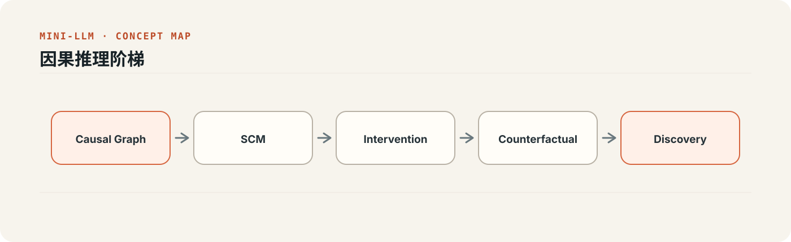
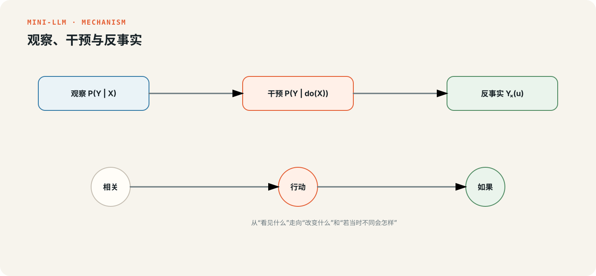

# **《mini-llm Causal Reasoning Engine 深度解析：从 Causal Graph、Structural Causal Model 到 Intervention、Counterfactual 与 Causal Discovery》**



_图：因果推理阶梯。从左到右展示本章核心概念之间的数据流与依赖关系。_


_图：多米诺是最直观的因果链：推倒第一张，后面的牌会依次倒下。但仅仅观察它们倒下的顺序，还不足以知道“推哪一张会导致什么”——这正是相关性、干预与反事实要区分的东西。图片：Dietmar Rabich，[Wikimedia Commons](https://commons.wikimedia.org/wiki/File:Domino_--_2021_--_6759.jpg)，[CC BY-SA 4.0](https://creativecommons.org/licenses/by-sa/4.0/)。_

在前面的 mini-llm 系列中，我们已经研究了：

- Representation Engine：如何形成内部表征。
- Memory Architecture：如何保存和检索经验。
- Knowledge Architecture：如何组织事实、概念与关系。
- World Model Engine：如何表示世界状态、预测状态变化和规划行动。

但是，World Model 仍然留下了一个重要问题：

**系统能够预测世界发生什么变化，却不一定知道为什么会发生这种变化。**

例如：

AI 发现：

- 天气越热，冰淇淋销量越高。
- 天气越热，游泳人数越多。

它可以学习两个变量之间的统计关系。

但它是否理解：

- 天气为什么影响冰淇淋销量？
- 冰淇淋销量增加是否会导致游泳人数增加？
- 如果人为增加冰淇淋销量，游泳人数是否会变化？
- 如果天气没有变热，两个结果还会不会发生？

这些问题涉及一个比相关性预测更深的研究方向：

**Causal Reasoning（因果推理）。**

因果推理希望让智能系统不仅能够观察变量之间的关系，还能够分析变量之间可能存在的因果机制，预测干预的结果，并推理没有发生过的情况。

这也是构建更可靠的 AI Agent、World Model 和决策系统的重要基础。

# **一、Correlation 与 Causation：相关性不等于因果关系**

## **1.1 什么是 Correlation？**

Correlation（相关性）描述两个变量是否存在统计关联。

例如，某城市连续一段时间的数据显示：

| 气温  | 冰淇淋销量 |
| --- | ----- |
| 20℃ | 100   |
| 23℃ | 130   |
| 26℃ | 180   |
| 30℃ | 250   |
| 34℃ | 330   |

可以观察到：

气温越高，冰淇淋销量通常越高。

我们可以使用 Pearson 相关系数衡量两个变量的线性相关程度：

\\[ r\_{XY}= \frac{\operatorname{Cov}(X,Y)} {\sigma_X\sigma_Y} \\]

其中：

- \\(X\\)：气温。
- \\(Y\\)：冰淇淋销量。
- \\(\operatorname{Cov}(X,Y)\\)：协方差。
- \\(\sigma_X,\sigma_Y\\)：标准差。

相关系数范围：

\\[ -1\leq r\leq 1 \\]

| 相关系数          | 含义      |
| ------------- | ------- |
| \\(r=1\\)     | 完全正线性相关 |
| \\(0\<r<1\\)  | 正线性相关   |
| \\(r=0\\)     | 无线性相关   |
| \\(-1\<r<0\\) | 负线性相关   |
| \\(r=-1\\)    | 完全负线性相关 |

下面可以通过交互图观察相关性的变化。

Drag points

2468102468\\(X\\)\\(Y\\)

Linear correlation is positive (r = 0.98).

NegativeNear zeroPositive

Give feedback

但是，相关系数只能说明变量之间的统计关系，不能直接说明谁导致了谁。

## **1.2 什么是 Causation？**

Causation（因果关系）关注：

**一个变量发生变化，是否会通过某种机制导致另一个变量发生变化？**

例如：

```
气温升高
    ↓
人们更愿意购买冷饮
    ↓
冰淇淋销量增加
```

这里我们提出了一个可能的因果机制。

与相关性相比，因果关系关注的是变量变化的原因和结果。

可以对比：

| 维度   | Correlation | Causation     |
| ---- | ----------- | ------------- |
| 研究对象 | 统计关联        | 因果机制          |
| 关注重点 | 是否一起变化      | 一个变化是否导致另一个变化 |
| 数据要求 | 观察数据通常可以计算  | 需要额外因果假设和识别条件 |
| 方向   | 通常对称        | 有方向           |
| 干预   | 不能直接回答      | 可以研究干预结果      |

## **1.3 三种容易混淆的情况**

### **情况一：X 导致 Y**

```
X ─────→ Y
```

例如：

增加有效训练时间，可能提高某项技能的熟练程度。

### **情况二：Y 导致 X**

```
X ←───── Y
```

例如：

不是运动导致购买运动装备，而是准备参加运动的人更可能购买运动装备。

### **情况三：Z 同时影响 X 和 Y**

```
       Z
      / \
     ↓   ↓
     X   Y
```

例如：

```
       天气炎热
       /    \
      ↓      ↓
冰淇淋销量  游泳人数
```

这时，冰淇淋销量与游泳人数可能高度相关。

但它们之间不一定存在直接因果关系。

这个共同原因 Z 就是后面要研究的：

**Confounder（混杂变量）。**

# **二、Causal Graph：如何用图表示因果关系？**



_图：观察、干预与反事实对应的三层因果推理。_

## **2.1 什么是 Causal Graph？**

Causal Graph（因果图）是一种使用有向图表示变量之间因果假设的工具。

通常使用：

- 节点：变量。
- 有向边：假设存在的直接因果影响。

例如：

## **一个简单的因果图**

**气温 X**

**冰淇淋销量 Y**

**游泳人数 Z**

示意：气温被假设为两个结果的共同原因

这个图表达：

气温可能影响冰淇淋销量，也可能影响游泳人数。

它没有表达冰淇淋销量直接导致游泳人数增加。

## **2.2 DAG：有向无环图**

Causal Graph 经常使用 DAG（Directed Acyclic Graph）。

即：

- Directed：有向。
- Acyclic：无环。

例如：

```
A → B → C
    ↓
    D
```

这是一个有向无环图。

而下面的结构存在循环：

```
A → B → C
↑       ↓
└───────┘
```

它不属于 DAG。

为什么因果分析经常使用 DAG？

因为 DAG 能够清晰表达一个变量如何沿着有向路径影响其他变量，并为条件独立、混杂控制和干预分析提供基础。

不过，现实系统可能存在反馈循环，例如：

```
价格上涨 → 需求变化 → 价格再次变化
```

这类系统可以使用动态因果图、时间展开 DAG 或结构方程系统建模，不能简单地认为所有现实因果关系都没有循环。

## **2.3 直接因果与间接因果**

例如：

```
训练时间
    ↓
技能熟练度
    ↓
任务完成效率
```

训练时间可能没有直接影响任务完成效率，而是通过技能熟练度产生间接影响。

因此：

- Direct Effect：直接效应。
- Indirect Effect：间接效应。
- Total Effect：总效应。

在因果图中，路径的结构非常重要。

它决定我们应该控制哪些变量，以及哪些变量不能随意控制。

## **2.4 Causal Graph 的工程表示**

可以把因果图表示为邻接表：

```
causal_graph = {    "temperature": [        "ice_cream_sales",        "swimming_population"    ],    "ice_cream_sales": [],    "swimming_population": []}
```

或者定义结构：

```
class CausalNode:    def __init__(self, name):        self.name = name        self.parents = []        self.children = []class CausalGraph:    def __init__(self):        self.nodes = {}    def add_node(self, name):        self.nodes[name] = CausalNode(name)    def add_edge(self, source, target):        self.nodes[source].children.append(target)        self.nodes[target].parents.append(source)
```

真实工程还需要增加：

- 边的来源。
- 因果假设说明。
- 数据集版本。
- 时间范围。
- 置信度或不确定性。
- 专家审核状态。
- 图结构版本管理。

尤其需要注意：**图中的一条边表示一个因果假设，不代表它已经被实验验证。**

# **三、Structural Causal Model：结构因果模型**

Causal Graph 告诉我们变量之间可能存在怎样的因果结构。

但是，它本身没有完整说明变量如何生成。

例如：

气温升高会增加冰淇淋销量。

那么，销量究竟如何随气温变化？

这需要数学方程。

这就是 Structural Causal Model，简称 SCM。

## **3.1 什么是结构因果模型？**

SCM 通常由以下部分构成：

\\[ M=(U,V,F,P(U)) \\]

其中：

- \\(U\\)：外生变量（Exogenous Variables）。
- \\(V\\)：内生变量（Endogenous Variables）。
- \\(F\\)：结构方程集合。
- \\(P(U)\\)：外生变量的概率分布。

解释一下：

- **外生变量：**：模型之外的因素，或者当前模型没有继续解释的因素。
- **内生变量：**：模型内部需要解释的变量。
- **结构方程：**：描述变量如何由其他变量生成。
- **外生变量分布：**：描述模型之外的不确定性。

- \\(T\\)：气温。
- \\(S\\)：冰淇淋销量。
- \\(W\\)：游泳人数。

定义：

\\[ T=U_T \\]

\\[ S=10T+U_S \\]

\\[ W=5T+U_W \\]

其中：

- \\(U_T\\)：气温相关的外部因素。
- \\(U_S\\)：其他影响冰淇淋销量的因素。
- \\(U_W\\)：其他影响游泳人数的因素。

可以得到：

```
T → S
T → W
```

假设：

\\[ T=30 \\]

\\[ U_S=20 \\]

那么：

\\[ S=10\times30+20=320 \\]

如果：

\\[ U_W=50 \\]

那么：

\\[ W=5\times30+50=200 \\]

这个模型把变量之间的关系具体化为数学计算。

## **3.3 加入随机噪声**

现实中的变量往往受到大量未知因素影响。

因此，可以写成：

\\[ Y=f(X,U_Y) \\]

或者在简单线性场景中：

\\[ Y=\beta_0+\beta_1X+\epsilon \\]

其中：

- \\(\beta_0\\)：截距。
- \\(\beta_1\\)：影响系数。
- \\(\epsilon\\)：未建模因素。

需要区分：

统计回归方程本身不自动成为结构因果方程。只有在模型结构、变量定义和因果识别假设成立时，回归系数才可能具有因果解释。

## **3.4 SCM 与普通机器学习模型有什么区别？**

普通预测模型：

\\[ \hat{Y}=f\_\theta(X) \\]

目标是：

根据输入 X，预测 Y。

结构因果模型：

\\[ Y=f_Y(PA_Y,U_Y) \\]

目标是：

表达 Y 如何由其直接原因（Parents）和外部因素共同生成。

两者的差异：

| 维度   | 普通预测模型 | SCM        |
| ---- | ------ | ---------- |
| 核心目标 | 预测     | 表达生成机制     |
| 输入   | 特征变量   | 直接原因和外生变量  |
| 结构   | 可以是黑盒  | 具有因果结构假设   |
| 干预   | 不一定支持  | 可以定义 do 操作 |
| 反事实  | 需要额外机制 | 可基于结构方程推导  |
| 可解释性 | 取决于模型  | 结构具有明确语义   |

需要强调，SCM 也可能包含复杂函数和神经网络，并不一定是简单线性模型。

# **四、Confounder：混杂变量**

混杂变量是因果推理中最容易导致错误结论的问题之一。

## **4.1 什么是混杂变量？**

假设我们研究：

运动时间是否能够改善健康状况。

观察数据发现：

运动时间越长的人，健康状况通常越好。

我们可能得到：

```
运动时间 → 健康状况
```

但是，还有一个因素：

健康意识。

具有较强健康意识的人可能：

- 更愿意运动。
- 更重视饮食。
- 更愿意定期体检。
- 更愿意遵循健康建议。

因此：

```
          健康意识
          /    \
         ↓      ↓
      运动时间  健康状况
```

健康意识是一个潜在混杂变量。

如果忽略它，就可能高估运动时间的实际因果效应。

## **4.2 混杂变量为什么危险？**

因为它会制造或者扭曲变量之间的统计关系。

假设：

- \\(X\\)：是否接受某项治疗。
- \\(Y\\)：康复结果。
- \\(Z\\)：疾病严重程度。

疾病严重程度可能影响：

- 医生是否选择治疗。
- 患者最终康复情况。

因果结构：

```
疾病严重程度
    /    \
   ↓      ↓
接受治疗  康复结果
   └──────→
```

如果只观察治疗组和非治疗组，可能得到错误结论。

例如，重症患者更容易接受治疗，但重症患者本身康复难度也更高。

于是，治疗组的总体康复率可能低于非治疗组。

这并不意味着治疗有害。

它可能只是因为两组患者的初始病情不同。

## **4.3 Backdoor Criterion：后门准则**

在 DAG 中，如果一条路径从处理变量 X 出发，第一条边指向 X，那么它是 X 与结果 Y 之间的后门路径。

例如：

```
Z → X → Y
Z ─────→ Y
```

其中：

```
X → Y
```

是我们想研究的因果路径。

而：

```
X ← Z → Y
```

是后门路径。

如果 Z 是合适的混杂变量，我们可以通过控制 Z 阻断这条后门路径。

在满足后门准则时，可以使用：

\\[ P(Y\mid do(X=x)) = \sum_z P(Y\mid X=x,Z=z)P(Z=z) \\]

这里表达的是：

先在每个 Z 分层中估计 X 对 Y 的影响，再按照 Z 的总体分布进行加权。

这是一种重要的因果识别方法。

但不能认为控制所有变量都是正确的。

例如，控制中介变量可能会阻断我们想估计的部分因果效应；控制碰撞变量还可能引入新的偏差。

# **五、Intervention：因果干预**

这是从相关性走向因果推理的关键步骤。

## **5.1 Observation 与 Intervention**

先看两个问题：

问题 A：

> 天气为 30℃ 时，冰淇淋销量是多少？

问题 B：

> 如果我们人为将天气设置为 30℃，冰淇淋销量会是多少？

两者看起来相似，但数学意义不同。

Observation：

\\[ P(Y\mid X=x) \\]

表示观察到 X 等于 x 时，Y 的概率。

Intervention：

\\[ P(Y\mid do(X=x)) \\]

表示人为干预，将 X 设置为 x 后，Y 的概率。

这里的 \\(do(X=x)\\) 是 Pearl 因果推理框架中的干预算子。

## **5.2 为什么干预和观察不一样？**

假设：

```
健康意识 Z
    /    \
   ↓      ↓
运动 X → 健康 Y
```

观察运动时间较长的人，可能本身健康意识就更强。

但如果我们通过实验随机分配运动计划，就可以在设计上使两组人的健康意识平均趋于平衡。

这时，我们更接近研究运动本身的因果效应。

需要注意：

在真实研究中，随机实验还需要考虑依从性、失访、干预污染和样本代表性等问题。

## **5.3 使用 do 算子改变因果模型**

假设：

\\[ X=U_X \\]

\\[ Y=3X+U_Y \\]

正常情况下：

\\[ X\rightarrow Y \\]

当执行：

\\[ do(X=5) \\]

我们不再使用 X 原来的生成方程，而是直接将它设置为 5。

因此：

\\[ Y=3\times5+U_Y \\]

这就是干预的核心思想：

**干预不是观察变量，而是改变变量的生成机制。**

## **5.4 工程中的 Intervention API**

```
class Intervention:    def __init__(self, variable, value):        self.variable = variable        self.value = value    def apply(self, scm):        return scm.replace_equation(            self.variable,            lambda: self.value        )
```

这是概念级伪代码。

真实实现还需要：

- 保留原始模型。
- 创建干预后的模型副本。
- 校验变量是否存在。
- 检查干预值是否合法。
- 记录干预来源和实验配置。
- 比较干预前后的结果。

# **六、Do-Calculus：如何从观察数据推导干预结果？**

知道了 Intervention，还会遇到一个实际问题：

**我们不能对所有变量进行真实实验时，能否只通过观察数据推导干预结果？**

这就是因果演算（Do-Calculus）试图解决的问题之一。

它由 Judea Pearl 的因果推理体系发展而来。

## **6.1 为什么需要 Do-Calculus？**

假设：

我们拥有大量历史数据。

但我们不能随意改变：

- 用户年龄。
- 天气。
- 企业历史。
- 患者既往病史。

我们希望估计：

如果改变某个变量，结果会怎样？

Do-Calculus 提供了一组图结构规则，用来判断某些干预概率能否通过观察概率表达。

它不是一个简单的数值公式，而是一套基于因果图的推导规则。

## **6.2 三条基本规则**

设：

- \\(X\\)：干预变量。
- \\(Y\\)：结果变量。
- \\(Z,W\\)：其他变量。

### **规则一：插入或删除观察**

在满足相应图条件时，可以在表达式中插入或删除观察条件：

\\[ P(y\mid do(x),z,w) = P(y\mid do(x),w) \\]

成立条件是：在对应的干预图中，Y 与 Z 在给定 X、W 后满足条件独立关系。

### **规则二：交换观察与干预**

在满足特定图条件时，可以将观察条件转换成干预条件：

\\[ P(y\mid do(x),do(z),w) = P(y\mid do(x),z,w) \\]

这条规则并不是无条件成立的，必须检查相应的图分离条件。

### **规则三：插入或删除干预**

在满足相应图条件时，可以删除一个干预：

\\[ P(y\mid do(x),do(z),w) = P(y\mid do(x),w) \\]

其直观含义是：在某些因果结构中，对 Z 进行干预并不会影响 Y 的结果分布。

以上是三条规则的简化表达。正式推导必须使用经过删边或改边的干预图，不能只看原始 DAG 中是否存在一条路径。

## **6.3 Do-Calculus 的实际意义**

假设：

企业希望研究广告投放是否提高销售额。

变量：

- \\(A\\)：广告投入。
- \\(S\\)：销售额。
- \\(B\\)：品牌知名度。
- \\(D\\)：市场需求。

可能存在：

```
品牌知名度 → 广告投入
品牌知名度 → 销售额

市场需求 → 广告投入
市场需求 → 销售额

广告投入 → 销售额
```

直接计算：

\\[ P(S\mid A) \\]

无法自动区分广告效果和其他因素。

我们希望估计：

\\[ P(S\mid do(A=a)) \\]

如果因果图和识别条件允许，就可以通过观察数据进行调整。

这就是 Do-Calculus 的价值：

**它帮助我们判断一个因果问题是否能够从现有数据中识别，以及如何推导。**

# **七、Counterfactual：反事实推理**

Intervention 研究主动改变变量后会发生什么。

Counterfactual 则进一步研究：

**对于已经发生的某个具体个体或事件，如果当时采取另一种行动，结果会怎样？**

## **7.1 Prediction、Intervention、Counterfactual 的区别**

假设一个人接受了某种治疗，最终康复。

我们提出三个问题：

| 类型             | 问题                              |
| -------------- | ------------------------------- |
| Prediction     | 如果接受治疗，通常有多大概率康复？               |
| Intervention   | 如果人为安排接受治疗，整体康复率会怎样变化？          |
| Counterfactual | 对这个已经接受治疗并康复的人，如果没有接受治疗，他还会康复吗？ |

第三个问题更难。

因为同一个人在同一时间只能经历一种现实结果。

我们无法直接观察同一个人的两个潜在结果。

## **7.2 Potential Outcomes：潜在结果框架**

定义：

\\[ Y(1) \\]

表示个体接受处理时的潜在结果。

\\[ Y(0) \\]

表示个体不接受处理时的潜在结果。

个体因果效应：

\\[ \tau=Y(1)-Y(0) \\]

但是，我们只能观察其中一个：

\\[ Y=AY(1)+(1-A)Y(0) \\]

其中：

- \\(A=1\\)：接受处理。
- \\(A=0\\)：未接受处理。

如果 A=1，我们只能观察到 \\(Y(1)\\)，看不到同一个人的 \\(Y(0)\\)。

这就是因果推理中的基本困难：

**反事实结果无法直接观测。**

## **7.3 SCM 如何计算反事实？**

反事实推理通常包含三个步骤：

1. Abduction：根据已观察到的事实推断外生因素。
2. Action：对模型进行干预。
3. Prediction：计算干预后的结果。

假设：

\\[ Y=2X+U \\]

已知某个个体：

\\[ X=3,\quad Y=10 \\]

那么：

\\[ 10=2\times3+U \\]

得到：

\\[ U=4 \\]

现在问：

如果这个个体当时没有接受处理，即：

\\[ do(X=0) \\]

那么：

\\[ Y=2\times0+4=4 \\]

因此，在这个结构方程模型下：

- 现实结果：10。
- 反事实结果：4。

这个例子展示了反事实计算的基本机制。

但结论依赖于我们假设的结构方程正确、外生变量可以如此推断等条件。现实数据中，通常无法直接确定个体的反事实结果。

## **7.4 Counterfactual 在 AI 编程中的应用**

假设 AI Agent 修改了一个项目：

```
修改文件 A
    ↓
修改文件 B
    ↓
运行测试
    ↓
测试失败
```

Agent 可以提出：

- 如果不修改 A，测试会不会失败？
- 如果只修改 B，测试会不会通过？
- 如果采用另一种实现，是否可以避免这个问题？

这就是一种反事实分析思路。

不过，软件工程中的反事实实验需要建立可信的对照环境，例如 Git Worktree、独立分支、固定依赖和一致的测试配置。

否则，两个实验结果可能受到其他变化影响。

# **八、Causal Discovery：如何从数据中发现因果结构？**

前面我们都是先假设因果图，然后进行推理。

但是，一个更困难的问题是：

**如果我们连因果图都不知道，能否从数据中发现它？**

这就是 Causal Discovery。

## **8.1 什么是因果发现？**

假设我们有三个变量：

- A：训练时间。
- B：技能熟练度。
- C：任务完成效率。

我们观察到大量数据：

```
训练时间
技能熟练度
任务完成效率
```

希望从数据中推断：

```
A → B → C
```

这就是因果发现的目标。

但必须强调：

**仅凭观察数据，通常不能唯一确定真实因果结构。**

不同因果图可能生成相同的观察分布。

## **8.2 方法一：基于约束的算法**

代表方法：

- PC Algorithm。
- FCI Algorithm。

基本思想：

1. 从一个较完整的无向图开始。
2. 通过条件独立性检验删除不必要的边。
3. 识别 V-Structure。
4. 根据规则确定部分边方向。
5. 得到一个可能的因果图或等价图。

例如：

```
A — B — C
```

通过条件独立性检验，可能得到：

```
A → B ← C
```

这是一种 V-Structure。

PC 算法通常依赖因果充分性等假设；FCI 则尝试处理潜在未观测混杂因素，并输出部分祖先图（PAG）。

## **8.3 方法二：基于评分的算法**

代表方法：

- Greedy Equivalence Search（GES）。
- Bayesian Network Structure Learning。

基本思想：

生成不同候选图，并计算评分：

\\[ Score(G,D) \\]

其中：

- \\(G\\)：候选因果图。
- \\(D\\)：观察数据。

算法选择评分更好的图。

评分可能包含：

- 数据拟合程度。
- 模型复杂度。
- 先验结构。
- 贝叶斯概率。

例如 BIC：

\\[ BIC=-2\log L+k\log n \\]

其中：

- \\(L\\)：似然函数。
- \\(k\\)：模型参数数量。
- \\(n\\)：样本数量。

通常希望在拟合能力和复杂度之间取得平衡。

但是，评分最优不代表因果结构就是真实结构。

## **8.4 方法三：基于函数形式的因果发现**

例如：

- LiNGAM。
- Additive Noise Model（ANM）。

这类方法利用变量之间的函数形式或噪声性质，尝试识别因果方向。

例如：

\\[ Y=f(X)+\epsilon \\]

如果噪声 \\(\epsilon\\) 与 X 独立，而反方向的模型不满足相同条件，那么在特定假设下可以帮助识别方向。

LiNGAM 依赖线性、非高斯、无潜在混杂等重要假设。

ANM 也依赖加性噪声及相应的可识别条件。

因此，不能把某种算法发现的边直接当作事实。

## **8.5 三类因果发现方法对比**

| 方法               | 核心思想      | 代表算法       |
| ---------------- | --------- | ---------- |
| Constraint-based | 条件独立性检验   | PC、FCI     |
| Score-based      | 图结构评分与搜索  | GES        |
| Functional-based | 利用函数与噪声特征 | LiNGAM、ANM |

## **8.6 Causal Discovery 的主要难点**

1. 数据中可能存在隐藏变量。
2. 数据量不足可能导致独立性检验不准确。
3. 时间顺序不一定等于因果方向。
4. 变量测量错误可能改变图结构。
5. 不同图可能具有相同的观察分布。
6. 现实系统可能随时间发生机制变化。

因此，因果发现通常需要结合：

- 领域知识。
- 实验设计。
- 时间信息。
- 自然实验。
- 干预数据。
- 稳健性检验。

# **九、Causal Representation Learning：因果表征学习**

前面我们在 Representation Engine 中研究过：

- Embedding Space。
- Latent Representation。
- Feature。
- Semantic Geometry。
- SAE。
- 神经网络内部表征。

现在需要进一步研究：

**神经网络学到的内部表征，能否表达真实世界中的因果因素？**

这就是 Causal Representation Learning 的核心研究方向之一。

## **9.1 普通表征学习**

假设我们给神经网络输入一张图片：

Encoder 提取潜在表示：

\\[ z=Encoder(x) \\]

例如：

\\[ z= [z_1,z_2,\ldots,z\_{512}] \\]

普通表征学习的目标通常是：

- 保留重要信息。
- 识别对象。
- 区分不同类别。
- 支持下游任务。

但是，这些维度不一定对应清晰、独立的现实因素。

## **9.2 因果表征学习**

假设图像中的对象由以下因素决定：

- 形状。
- 颜色。
- 位置。
- 光照。
- 材料。

可以抽象成：

\\[ z_c= [z\_{shape},z\_{color},z\_{position},z\_{light},z\_{material}] \\]

理想情况下，我们希望这些因素具有一定程度的独立性和可操作性。

例如：

只改变颜色：

\\[ do(z\_{color}=red) \\]

希望得到：

- 颜色改变。
- 形状不变。
- 位置不变。
- 材料不变。

这就是学习可干预的潜在因果因素的一种目标。

## **9.3 普通 Latent Space 与 Causal Latent Space**

| 维度   | 普通潜在空间    | 因果潜在空间       |
| ---- | --------- | ------------ |
| 表示目标 | 压缩与提取信息   | 表达生成因素       |
| 变量含义 | 不一定明确     | 尝试对应因果因素     |
| 变量关系 | 可能混合      | 显式建模依赖       |
| 干预   | 不一定具有语义意义 | 希望支持因素级干预    |
| 解释性  | 取决于模型     | 目标之一是可解释因果结构 |

但这里有一个非常重要的问题：

**仅仅将潜在空间拆成多个维度，并不能证明这些维度是真实因果因素。**

因果表征学习通常需要额外的归纳偏置、环境变化、多视角数据、干预数据或者结构假设。

## **9.4 Causal Representation Learning 与 SAE**

SAE（Sparse Autoencoder）可以帮助研究神经网络激活中的稀疏特征。

例如：

```
神经网络激活
      ↓
Sparse Encoder
      ↓
稀疏特征
      ↓
Feature Interpretation
```

但需要区分：

- Feature Extraction：提取特征。
- Feature Interpretation：解释特征。
- Causal Validation：验证特征是否具有因果作用。

SAE 找到某个与红色物体相关的特征，不代表改变该特征就一定能够只改变颜色，也不代表该特征对应现实世界中独立的因果变量。

因此，因果表征研究还需要结合：

- Activation Intervention。
- Counterfactual Generation。
- Invariance Testing。
- Environment Shift。
- Causal Graph Learning。

# **十、Causal Reasoning 与 LLM、World Model、Agent 的结合**

这是整个 Causal Reasoning Engine 最重要的工程方向。

我们需要把前面学习的多个系统连接起来。

## **10.1 LLM：负责语言理解与因果假设生成**

LLM 可以承担：

- 从文本中抽取变量。
- 识别可能的因果关系。
- 生成候选因果图。
- 解释因果机制。
- 生成实验假设。
- 将自然语言问题转换为因果查询。

例如：

用户：

> 为什么系统响应时间增加之后，用户流失率也增加？

LLM 可以抽取：

```
系统响应时间
用户流失率
```

并提出候选假设：

```
系统响应时间 → 用户流失率
```

但是，LLM 生成的因果关系只是待验证假设，不是因果证据。

## **10.2 World Model：负责模拟状态变化**

World Model 可以提供：

- 当前状态。
- 状态转移。
- 动力学预测。
- 未来轨迹。
- 预测不确定性。

例如：

```
当前状态：
服务器响应时间 = 300ms
并发用户数 = 1000
错误率 = 1%
```

当 Agent 调整服务器资源时：

World Model 可以预测：

- 响应时间可能如何变化。
- 错误率可能如何变化。
- 资源消耗可能如何变化。

但是，单纯的状态预测并不能证明资源调整是变化的原因。

要进行因果解释，还需要明确干预变量、因果结构和识别假设。

## **10.3 Causal Engine：负责因果分析**

Causal Engine 负责：

- Causal Graph。
- SCM。
- Confounder Detection。
- Intervention。
- Do-Calculus。
- Counterfactual。
- Causal Discovery。

它回答：

- 哪些因素可能导致结果变化？
- 控制哪些变量可以减少偏差？
- 如果主动改变某个变量，会发生什么？
- 如果过去采取另一种行动，结果会怎样？

## **10.4 Agent：负责执行与验证**

Agent 可以：

1. 接收目标。
2. 调用 LLM 生成候选假设。
3. 调用 Causal Engine 建立因果分析。
4. 调用 World Model 模拟可能结果。
5. 选择实验或行动。
6. 调用真实工具执行。
7. 获取反馈。
8. 更新模型。

整体架构：

## **Causal AI Architecture**

- **LLM Engine**：自然语言理解 · 假设生成 · 变量抽取
- **World Model**：状态估计 · 状态转移 · 未来模拟
- **Causal Engine**：因果图 · SCM · 干预 · 反事实
- **Agent Engine**：目标管理 · 实验设计 · 决策 · 工具执行
- **Environment**：真实系统 · 软件 · 机器人 · 数据库 · 用户

## **11.1 工程目录**

```
mini-llm/
│
├── tensor/
├── autograd/
├── neural_network/
├── transformer/
│
├── representation/
├── memory/
├── knowledge/
├── world_model/
│
├── causal/
│   │
│   ├── graph/
│   │   ├── causal_graph.py
│   │   ├── graph_validator.py
│   │   └── graph_visualizer.py
│   │
│   ├── scm/
│   │   ├── structural_equation.py
│   │   ├── exogenous_variable.py
│   │   └── structural_causal_model.py
│   │
│   ├── identification/
│   │   ├── backdoor.py
│   │   ├── frontdoor.py
│   │   └── do_calculus.py
│   │
│   ├── intervention/
│   │   ├── intervention.py
│   │   └── intervention_engine.py
│   │
│   ├── counterfactual/
│   │   ├── abduction.py
│   │   ├── action.py
│   │   └── prediction.py
│   │
│   ├── discovery/
│   │   ├── conditional_independence.py
│   │   ├── pc_algorithm.py
│   │   ├── score_search.py
│   │   └── causal_discovery.py
│   │
│   ├── representation/
│   │   ├── causal_encoder.py
│   │   ├── latent_factors.py
│   │   └── invariance.py
│   │
│   ├── evaluation/
│   │   ├── graph_metrics.py
│   │   ├── effect_estimation.py
│   │   └── counterfactual_metrics.py
│   │
│   └── causal_engine.py
│
└── agent/
```

## **11.2 核心数据结构**

### **CausalVariable**

```
class CausalVariable:    def __init__(        self,        name,        variable_type,        observed=True    ):        self.name = name        self.variable_type = variable_type        self.observed = observed
```

### **CausalEdge**

```
class CausalEdge:    def __init__(        self,        source,        target,        evidence=None    ):        self.source = source        self.target = target        self.evidence = evidence or []
```

### **Structural Equation**

```
class StructuralEquation:    def __init__(        self,        variable,        parents,        function    ):        self.variable = variable        self.parents = parents        self.function = function    def evaluate(self, values, exogenous):        return self.function(            values,            exogenous        )
```

### **Structural Causal Model**

```
class StructuralCausalModel:    def __init__(self):        self.variables = {}        self.equations = {}    def add_equation(self, variable, equation):        self.equations[variable] = equation    def simulate(self, exogenous_values):        values = {}        for variable in self.topological_order():            equation = self.equations[variable]            values[variable] = equation.evaluate(                values,                exogenous_values            )        return values
```

这里省略了循环检测、缺失值处理、概率分布采样、方程类型校验和图一致性检查。真实实现不能仅依赖字典遍历顺序，必须根据因果图的拓扑顺序执行。

## **11.3 Intervention Engine**

```
class InterventionEngine:    def intervene(self, scm, variable, value):        model = scm.copy()        model.replace_equation(            variable,            lambda values, exogenous: value        )        return model
```

例如：

```
intervened_model = engine.intervene(    scm,    variable="advertising_budget",    value=10000)result = intervened_model.simulate(    exogenous_values)
```

这表示：

我们创建一个干预后的模型，将广告预算设置为 10000，然后模拟其他变量的变化。

## **11.4 Counterfactual Engine**

```
class CounterfactualEngine:    def __init__(self, scm):        self.scm = scm    def explain(self, observation, intervention):        # 1. Abduction        exogenous = self.infer_exogenous(            observation        )        # 2. Action        modified_model = self.apply_intervention(            intervention        )        # 3. Prediction        result = modified_model.simulate(            exogenous        )        return result
```

这个接口体现了反事实推理的三个阶段。

真正的实现需要处理外生变量不可唯一识别、噪声分布、观测不完整以及个体反事实的不确定性。

# **十二、Causal Reasoning Engine 应该如何测试？**

因果系统不能只测试代码是否运行成功。

还必须验证：

- 因果图是否正确。
- 因果效应是否估计准确。
- 干预是否改变正确的变量。
- 反事实是否符合模型定义。
- 未观测混杂是否影响结论。
- 因果发现是否能够恢复已知结构。

## **12.1 核心测试指标**

| 指标                   | 说明           |
| -------------------- | ------------ |
| SHD                  | 预测图与真实图的结构差异 |
| SID                  | 因果推断结构误差     |
| Precision            | 预测因果边的精确率    |
| Recall               | 真实因果边的召回率    |
| F1                   | 因果边识别综合指标    |
| ATE Error            | 平均处理效应估计误差   |
| ITE Error            | 个体处理效应估计误差   |
| Counterfactual Error | 反事实预测误差      |
| Calibration          | 因果预测的不确定性校准  |

注意：

SHD、SID 等指标的定义和计算约定会因工具与研究设置而不同。比较结果时必须说明图方向、等价类和评分规则。

## **12.2 建议的实验顺序**

1. **实验一：人工构造因果图**

   创建已知的 DAG，验证图结构、拓扑排序和循环检测。
2. **实验二：结构方程模拟**

   使用已知方程生成数据，验证模型能否正确模拟变量。
3. **实验三：混杂变量实验**

   对比不控制混杂变量与正确调整后的效应估计。
4. **实验四：干预实验**

   分别执行观察查询和 do 操作，检查两者是否得到不同结果。
5. **实验五：反事实实验**

   根据已知 SCM 推导个体反事实，并检查计算过程。
6. **实验六：因果发现**

   从模拟数据中恢复已知因果结构，分析不同假设下的结果。

# **十三、一个完整案例：AI 如何分析软件系统故障？**

我们把前面的理论放到一个实际工程问题中。

假设某个 Web 系统最近出现用户流失率上升。

我们观察到：

- 服务器响应时间增加。
- 错误率增加。
- 用户流失率增加。
- 并发用户数量增加。

普通数据分析可能发现：

```
响应时间 ↑
错误率 ↑
用户流失率 ↑
```

但是，谁导致了谁？

可能的因果图：

```
并发用户数
   /   \
  ↓     ↓
响应时间  错误率
   \     /
    ↓   ↓
     用户流失率
```

也可能存在：

```
响应时间 → 用户流失率
错误率   → 用户流失率
```

这需要进一步验证。

## **13.1 第一步：建立变量**

```
variables = [    "concurrency",    "response_time",    "error_rate",    "user_churn"]
```

## **13.2 第二步：生成候选因果图**

LLM 根据日志和系统架构提出假设：

```
并发用户数 → 响应时间
并发用户数 → 错误率
响应时间 → 用户流失率
错误率 → 用户流失率
```

然后由工程人员、系统知识和数据分析共同审核。

## **13.3 第三步：建立 SCM**

例如：

\\[ R=\beta_0+\beta_1C+U_R \\]

\\[ E=\gamma_0+\gamma_1C+U_E \\]

\\[ L=\alpha_0+\alpha_1R+\alpha_2E+U_L \\]

其中：

- \\(C\\)：并发用户数。
- \\(R\\)：响应时间。
- \\(E\\)：错误率。
- \\(L\\)：用户流失率。

这些方程是一个简化的候选模型，不应直接当作已经验证的真实机制。

## **13.4 第四步：执行干预**

我们希望研究：

如果增加服务器资源，响应时间是否会下降？

建立新的干预：

```
intervention = {    "server_capacity": 200}
```

在模型中执行：

\\[ do(Capacity=200) \\]

然后预测：

- 响应时间。
- 错误率。
- 用户流失率。

这里需要把服务器容量加入因果模型，并明确它如何影响响应时间和错误率。否则，只修改一个模型中不存在的变量，无法得到可信的干预结论。

## **13.5 第五步：真实环境验证**

Agent 可以：

1. 在测试环境增加服务器资源。
2. 运行负载测试。
3. 记录响应时间和错误率。
4. 与对照环境比较。
5. 检查预测误差。
6. 更新模型。

这才构成一个完整的因果分析与工程验证闭环。

**关键是：LLM 负责提出假设，Causal Engine 负责分析，World Model 负责模拟，Agent 负责执行，真实环境负责提供证据。**

# **十四、最终总结：从相关性预测到因果理解**

我们可以把整个 Causal Reasoning Engine 理解为一个能力体系：

| 层次                    | 核心能力  | 要回答的问题          |
| --------------------- | ----- | --------------- |
| Correlation           | 统计关联  | 哪些变量一起变化？       |
| Causal Graph          | 因果结构  | 哪些变量可能影响哪些变量？   |
| SCM                   | 生成机制  | 变量是如何产生的？       |
| Confounder Analysis   | 混杂分析  | 是否存在共同原因？       |
| Intervention          | 因果干预  | 主动改变变量会怎样？      |
| Do-Calculus           | 因果识别  | 如何从观察数据推导干预结果？  |
| Counterfactual        | 反事实推理 | 如果过去不同，结果会怎样？   |
| Causal Discovery      | 因果发现  | 如何从数据推断因果结构？    |
| Causal Representation | 因果表征  | 如何在潜在空间中表达因果因素？ |

我们还可以将几个核心概念进一步区分：

## **四种不同的智能问题**

**Prediction：预测**

根据当前信息，未来可能发生什么？

World Model

**Causation：因果**

为什么会发生这种变化？

Causal Engine

**Counterfactual：反事实**

如果当时采取另一种行动，结果会怎样？

Counterfactual Reasoning

**Planning：规划**

为了实现目标，现在应该采取什么行动？

Agent Engine

最终，我们希望 mini-llm 不只是一个能够从海量数据中寻找模式的模型。

而是逐渐形成一套完整的认知与决策架构：

```
感知世界
   ↓
建立内部表征
   ↓
保存经验与知识
   ↓
构建世界模型
   ↓
识别因果结构
   ↓
模拟干预结果
   ↓
进行反事实推理
   ↓
规划未来行动
   ↓
执行并观察反馈
   ↓
更新内部模型
```

这条路线的核心意义在于：

**从知道变量之间有什么关系，走向理解变量为什么发生变化；从预测未来，走向分析行动的因果后果；从被动观察，走向主动实验与决策。**

当然，因果模型仍然依赖数据质量、结构假设和识别条件。它不是自动获得真实因果知识的万能机制。

## **下一篇：mini-llm Decision Engine**

建议下一篇研究：

# **《mini-llm Decision Engine 深度解析：从 Utility Function、Expected Utility 到 Bayesian Decision Theory、Risk-sensitive Planning 与 Multi-agent Decision》**

重点包括：

1. Decision Theory：决策理论。
2. Utility Function：效用函数。
3. Expected Utility：期望效用。
4. Bayesian Decision Theory：贝叶斯决策理论。
5. Decision under Uncertainty：不确定性下的决策。
6. Risk-sensitive Decision：风险敏感决策。
7. Multi-objective Optimization：多目标优化。
8. Value of Information：信息价值。
9. Sequential Decision Making：序贯决策。
10. Multi-agent Decision：多智能体决策。

**下一阶段要回答的问题是：当智能系统已经能够预测未来、理解因果关系之后，它究竟应该如何在多个可能的未来中做出选择？**

