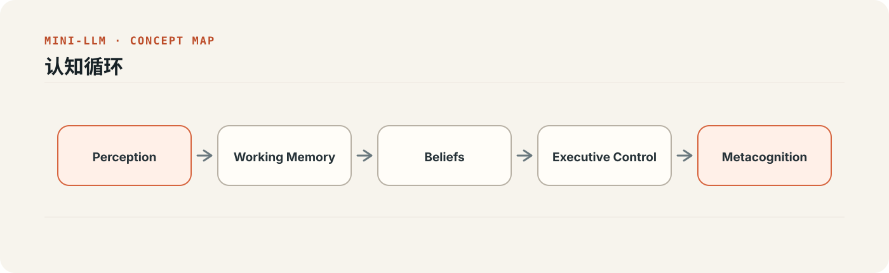
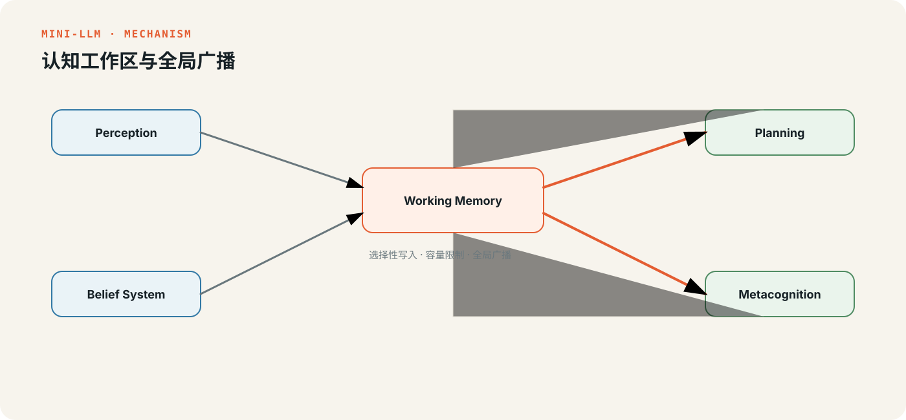

# **mini-llm Cognitive Architecture 深度解析：从 Working Memory、Belief System 到 Metacognition、Executive Function 与 Cognitive Loop**



_图：认知循环。从左到右展示本章核心概念之间的数据流与依赖关系。_

在前面的 mini-llm 系列中，我们已经逐步构建了：

- **Transformer Engine**：模型如何处理 Token 和上下文。
- **Representation Engine**：模型如何形成内部表示。
- **World Model Engine**：模型如何表示状态、预测变化和推演未来。
- **Agent Engine**：模型如何理解目标、规划任务和执行行动。
- **Learning Engine**：系统如何通过反馈和经验改善行为。

但是，这些模块之间还缺少一个重要的组织层：

**一个智能系统如何管理自己的认知过程？**

例如，当用户提出一个复杂问题时，系统需要：

1. 决定当前应该关注哪些信息。
2. 从历史信息中提取相关知识。
3. 判断哪些信息是事实，哪些只是推测。
4. 维护当前任务的状态。
5. 决定下一步应该思考、搜索还是执行。
6. 监控自己的推理是否出现错误。
7. 根据执行结果调整策略。

这已经不只是 Transformer 的计算问题，也不只是 Agent 的工具调用问题。

它涉及一个更高层次的系统：

**Cognitive Architecture（认知架构）。**

# **一、什么是 Cognitive Architecture？**

Cognitive Architecture 是一种组织智能系统内部认知过程的架构。

它关注的不是单个神经网络如何计算，而是多个认知功能如何协同工作。

可以把它理解为：

> Cognitive Architecture 负责组织智能系统的感知、记忆、注意、推理、决策、行动和自我监控。

在人类认知研究中，认知架构涉及工作记忆、长期记忆、注意控制、执行功能、元认知等机制。

在 AI 工程中，我们可以把这些理论转化为可实现的软件模块。

[Methodological aspects for cognitive architectures construction: a study and proposal | Artificial Intelligence Review | Springer Nature Link](https://images.openai.com/static-rsc-4/msMhUIazDJckfhGxqPg4yI8Yc4MbNPCaI7wpSPNP0RgS5Yd7T0M-YGj36rU2jA54hH-kMVYtlULLY2U3BPZj-Z3ArInPZrV1xSCi9I-kmjO1P1iI7CWKaXBs2ADJ-oXUdtHE_ecd6bJdMq-EytL4LBPWK1-a-YviIyhG5k1da3E?purpose=inline)

[link.springer.com](https://link.springer.com/article/10.1007/s10462-020-09901-x?utm_source=chatgpt.com)

一个简化的 mini-llm Cognitive Architecture 可以表示为：

```
                User / Environment
                        |
                        v
                 Perception Engine
                        |
                        v
                 Attention Control
                        |
          +-------------+-------------+
          |                           |
          v                           v
    Working Memory              Long-term Memory
          |                           |
          +-------------+-------------+
                        |
                        v
                  Belief System
                        |
                        v
                Reasoning Engine
                        |
                        v
               Executive Function
                        |
                        v
                  Action Engine
                        |
                        v
                 Environment
                        |
                        v
                   Feedback
                        |
                        v
                 Metacognition
                        |
                        +------> Cognitive Loop
```

需要注意：这是一种工程抽象，不代表人脑已经被证明按照这样的模块结构运行，也不意味着语言模型已经具备人类式认知。

# **二、Working Memory：工作记忆**



_图：工作记忆作为认知工作区连接感知、信念、规划和元认知。_

## **2.1 什么是工作记忆？**

工作记忆是认知系统暂时保存和操作当前任务信息的能力。

例如：

用户提出：

> 比较 React、Vue 和 Svelte，并根据大型企业项目的实际需求，推荐一种技术方案。

系统需要暂时维护：

```
当前任务：
比较三个前端框架

比较维度：
1. 性能
2. 生态
3. 开发效率
4. 企业级工程能力
5. 长期维护成本

约束：
大型企业项目

当前进度：
正在比较生态和工程能力
```

这些信息并不需要永久保存，但在任务完成之前必须保持可用。

这就是工作记忆的工程意义。

## **2.2 工作记忆与 Transformer 上下文窗口有什么区别？**

这两个概念很容易混淆。

| 概念               | 主要作用                    | 生命周期             |
| ---------------- | ----------------------- | ---------------- |
| Context Window   | 提供模型当前可读取的 Token 上下文    | 当前推理上下文          |
| KV Cache         | 缓存已处理 Token 的 Key/Value | 当前生成过程，通常随请求结束释放 |
| Working Memory   | 管理当前任务所需的信息和状态          | 一个任务或会话          |
| Long-term Memory | 保存跨任务可复用的信息             | 长期               |

例如：

假设一个模型有 128K Token 上下文窗口。

这意味着模型在一次推理过程中能够访问一定规模的上下文。

但这不代表它拥有一个完善的工作记忆系统。

因为：

- 上下文窗口不负责判断哪些信息重要。
- KV Cache 不负责判断任务是否完成。
- 上下文窗口不负责自动维护任务状态。
- KV Cache 不是跨会话持久化记忆。

**上下文窗口提供信息容量，工作记忆负责信息组织和任务管理。**

## **2.3 工作记忆的数据结构**

在 mini-llm 中，可以把工作记忆设计成一个结构化状态对象。

简化示意：

```
class WorkingMemory:    def __init__(self):        self.goal = None        self.constraints = []        self.active_facts = []        self.hypotheses = []        self.pending_tasks = []        self.completed_tasks = []        self.context = {}    def set_goal(self, goal):        self.goal = goal    def add_fact(self, fact):        self.active_facts.append(fact)    def add_hypothesis(self, hypothesis):        self.hypotheses.append(hypothesis)    def add_task(self, task):        self.pending_tasks.append(task)    def complete_task(self, task):        self.pending_tasks.remove(task)        self.completed_tasks.append(task)
```

例如：

```
memory = WorkingMemory()memory.set_goal(    "设计一个企业级 AI Agent 平台")memory.add_fact(    "系统需要支持多个模型")memory.add_fact(    "需要记录 AI 代码修改过程")memory.add_hypothesis(    "可以使用 Git Worktree 隔离任务")memory.add_task(    "设计任务调度模块")
```

这里有一个重要区别：

- Fact：已经有依据的信息。
- Hypothesis：尚待验证的假设。
- Task：还没有完成的工作。

如果把三者混在一起，系统很容易将猜测当成事实，或者把计划误认为已经执行的结果。

## **2.4 工作记忆为什么需要容量管理？**

工作记忆不能无限增长。

假设当前任务包含 100 个信息：

```
A：用户最终目标
B：项目技术栈
C：数据库结构
D：某个错误日志
E：历史讨论
...
```

其中只有部分信息与当前推理有关。

因此，系统需要进行：

- 信息筛选。
- 重要性排序。
- 信息压缩。
- 过期信息清理。
- 任务状态更新。

这实际上是一个资源分配问题。

可以定义一个简单的信息优先级：

\\[ P_i = \alpha R_i+ \beta I_i+ \gamma U_i \\]

其中：

- \\(R_i\\)：与当前任务的相关程度。
- \\(I_i\\)：信息重要程度。
- \\(U_i\\)：当前使用价值。
- \\(\alpha,\beta,\gamma\\)：权重。

这个公式是工程设计中的启发式评分，不是人类工作记忆的已知数学定律。

# **三、Attention Control：注意力控制**

## **3.1 Transformer Attention 不等于认知注意力**

这是一个非常重要的区别。

Transformer 的 Attention：

\\[ Attention(Q,K,V) = Softmax\left( \frac{QK^T}{\sqrt{d_k}} \right)V \\]

它解决的是：

**在计算过程中，如何根据 Query 和 Key 的关系，对 Value 进行加权组合。**

而 Cognitive Attention Control 解决的是：

**整个智能系统当前应该把计算资源和认知资源分配给什么问题？**

例如：

用户要求：

> 帮我分析一个项目为什么部署失败。

系统可能同时拥有：

- Docker 日志。
- Nginx 配置。
- 数据库错误。
- 历史部署记录。
- 操作系统信息。

注意力控制需要决定：

```
当前优先关注：

1. 最近一次部署日志
2. 容器启动状态
3. Nginx 反向代理配置

暂时忽略：

1. 与当前部署无关的业务代码
2. 更早的历史日志
3. 其他项目的配置
```

这不是 Transformer 某一层 Attention 权重就能完整实现的功能。

## **3.2 注意力控制的三个层次**

**第一层：Token Attention**

模型内部的注意力计算，决定不同 Token 表示如何交互。

**第二层：Context Attention**

从历史对话、文档、数据库中选择当前任务相关的信息。

**第三层：Task Attention**

决定当前应该执行哪个子任务、调用哪个工具、优先解决哪个问题。

## **3.3 Attention Control 的工程实现**

```
class AttentionController:    def select(self, candidates, current_goal):        scored = []        for item in candidates:            relevance = semantic_similarity(                item.content,                current_goal            )            importance = item.importance            urgency = item.urgency            score = (                0.5 * relevance +                0.3 * importance +                0.2 * urgency            )            scored.append((score, item))        scored.sort(            key=lambda x: x[0],            reverse=True        )        return [            item for score, item in scored[:5]        ]
```

这里使用的是一个简化的优先级模型。

生产系统还需要考虑：

- 信息来源可信度。
- Token 预算。
- 任务依赖关系。
- 时间成本。
- 不同工具的调用成本。

# **四、Belief System：信念系统**

这是 Cognitive Architecture 中非常重要的模块。

## **4.1 什么是 Belief？**

Belief 可以理解为系统对于某个命题是否成立的内部判断。

例如：

```
命题：
服务器部署失败的原因是内存不足。

当前判断：
可能成立。

支持证据：
容器日志出现 OOMKilled。

反对证据：
主机仍然有较多可用内存。

当前状态：
需要进一步检查容器内存限制。
```

这里的关键不是简单地保存一个答案。

而是同时保存：

1. 命题。
2. 支持证据。
3. 反对证据。
4. 信息来源。
5. 置信程度。
6. 验证状态。

## **4.2 Belief 与 Fact 有什么区别？**

| 类型         | 含义         | 示例              |
| ---------- | ---------- | --------------- |
| Fact       | 有可靠证据支持的信息 | 日志出现 OOMKilled  |
| Belief     | 当前系统接受的判断  | 容器可能内存不足        |
| Hypothesis | 等待验证的假设    | Docker 限制可能设置过低 |
| Unknown    | 当前不知道      | 实际内存限制是多少       |

一个可靠的 AI 系统不能把这些信息混为一谈。

## **4.3 用概率表示信念**

贝叶斯推断提供了一种更新信念的方法：

\\[ P(H|E)= \frac{P(E|H)P(H)}{P(E)} \\]

其中：

- \\(H\\)：假设。
- \\(E\\)：观察到的证据。
- \\(P(H)\\)：先验概率。
- \\(P(E|H)\\)：假设成立时观察到证据的可能性。
- \\(P(H|E)\\)：观察证据之后的后验概率。

例如：

假设：

\\[ H = \text{容器内存不足} \\]

观察：

\\[ E = \text{容器出现 OOMKilled} \\]

如果这个证据在内存不足时更容易出现，那么观察它之后，我们应该提高对 \\(H\\) 的判断。

但是需要强调：

**LLM 输出的 Token 概率，并不自动等于它对现实世界某个命题的校准置信度。**

模型说“我有 95% 的把握”，不代表这个概率经过真实数据校准。

## **4.4 Belief System 的工程结构**

```
class Belief:    def __init__(        self,        proposition,        confidence,        evidence,        source    ):        self.proposition = proposition        self.confidence = confidence        self.evidence = evidence        self.source = source        self.status = "unverified"
```

更完整的系统还需要：

- 证据之间的冲突检测。
- 时间有效性。
- 来源可信度。
- 事实更新。
- 过期信念失效。
- 置信度校准。

Belief System 的价值在于让 AI 不只是生成答案，还能够管理自己判断的依据。

# **五、Metacognition：元认知**

## **5.1 什么是元认知？**

Metacognition 通常被称为：

**对认知过程的认知。**

普通认知关注：

> 这个问题的答案是什么？

元认知关注：

> 我是如何得到这个答案的？推理是否可靠？还缺少什么信息？是否需要重新检查？

例如：

```
普通认知：

发现服务器启动失败。
推测是配置文件错误。

元认知：

当前推测是否有足够证据？
是否检查过完整日志？
是否存在其他可能原因？
是否需要执行一次配置验证？
```

元认知不是让模型多说几句“我可能错了”。

它真正关注的是对认知过程进行监控和调节。

## **5.2 元认知的两个核心组成**

**Metacognitive Monitoring**

监控认知过程。

- 当前任务是否理解正确？
- 推理是否存在矛盾？
- 证据是否充分？
- 结果是否符合预期？

**Metacognitive Control**

调节认知过程。

- 是否需要重新推理？
- 是否需要调用工具？
- 是否需要搜索新信息？
- 是否需要拆分任务？
- 是否应该停止？

## **5.3 元认知的工程实现**

```
class MetacognitionEngine:    def evaluate(self, task, result):        checks = {            "goal_match": check_goal_match(                task, result            ),            "evidence": check_evidence(                result            ),            "consistency": check_consistency(                result            ),            "execution": check_execution(                result            )        }        if not all(checks.values()):            return {                "decision": "rethink",                "checks": checks            }        return {            "decision": "accept",            "checks": checks        }
```

这段代码只是一个概念原型。

真实系统不能简单地使用 `all(checks.values())` 作为所有任务的验收标准。

例如：

- 一个探索性任务允许存在不确定性。
- 一个代码修改任务需要测试通过。
- 一个医疗信息任务需要来源和安全边界。
- 一个数据分析任务需要检查计算过程。

不同任务需要不同的评估标准。

## **5.4 元认知与 Self-Reflection 的区别**

| Self-Reflection | Metacognition |
| --------------- | ------------- |
| 回顾刚才的推理         | 监控整个认知过程      |
| 发现可能的问题         | 判断是否需要干预      |
| 生成反思文本          | 调整策略和资源       |
| 可以停留在语言层面       | 应该产生可验证的控制行为  |

因此：

**反思只是元认知可能采用的一种方法，而不是元认知本身。**

# **六、Executive Function：执行功能**

如果说工作记忆负责维护当前信息，注意力负责分配认知资源，那么执行功能负责组织整个任务的执行。

在认知科学中，Executive Function 通常涉及：

- 目标管理。
- 计划制定。
- 抑制控制。
- 任务切换。
- 冲突处理。
- 工作记忆协调。

在 AI Agent 中，它可以映射为一个任务管理与决策控制层。

## **6.1 执行功能解决什么问题？**

例如：

用户提出：

> 帮我开发一个可以分析 GitHub 仓库的 AI 平台。

系统需要拆分任务：

```
目标：构建 GitHub AI 分析平台

任务 A：仓库数据获取
任务 B：代码解析
任务 C：依赖关系分析
任务 D：LLM 分析
任务 E：报告生成
任务 F：前端展示
任务 G：测试与部署
```

这些任务存在依赖关系：

```
A
|
v
B
|
v
C
|
v
D
|
v
E
|
v
F
|
v
G
```

执行功能需要判断：

- 哪个任务可以先执行？
- 哪些任务可以并行？
- 哪些任务必须等待？
- 是否需要暂停当前任务？
- 是否需要调整优先级？
- 资源不足时应该放弃什么？

## **6.2 执行功能的数学抽象**

可以把任务执行抽象为一个受约束的优化问题：

\\[ \max\_{\pi} \mathbb{E} \left[ \sum\_{t=0}^{T} \gamma^t R(s_t,a_t) \right] \\]

约束：

\\[ \begin{aligned} Cost(\pi)&\leq B\\\ Risk(\pi)&\leq R\_{\max}\\\ Dependencies(\pi)&=\text{Satisfied} \end{aligned} \\]

其中：

- \\(\pi\\)：任务执行策略。
- \\(s_t\\)：当前任务状态。
- \\(a_t\\)：选择的动作。
- \\(R\\)：任务收益。
- \\(B\\)：预算。
- \\(R\_{\max}\\)：允许的风险上限。

这可以与前面 Learning Engine 中的强化学习联系起来。

不过，实际工程中的任务调度不一定需要强化学习。规则引擎、DAG 调度、优先队列和约束优化往往更简单、更可靠。

## **6.3 Executive Function 的代码设计**

```
class ExecutiveFunction:    def __init__(self):        self.tasks = []        self.current_task = None    def add_task(self, task):        self.tasks.append(task)    def select_next_task(self):        ready_tasks = [            task for task in self.tasks            if task.status == "ready"        ]        if not ready_tasks:            return None        ready_tasks.sort(            key=lambda task: task.priority,            reverse=True        )        self.current_task = ready_tasks[0]        return self.current_task    def switch_task(self, new_task):        self.current_task = new_task    def finish_task(self):        self.current_task.status = "completed"        self.current_task = None
```

这里体现了一个重要思想：

**智能系统不仅需要知道如何完成任务，还需要知道什么时候执行、什么时候等待、什么时候切换以及什么时候停止。**

# **七、Cognitive Loop：认知循环**

前面介绍的模块并不是相互独立的。

它们需要构成一个不断循环的系统。

一个简化的认知循环：

[Schrödinger's AI Part 7:  What Is an AI Agent](https://images.openai.com/static-rsc-4/5NghmCjETDXxOl_cFyfRjivqTHxnZEKjD8bfgPQzLlDDFJQGEIKIsGrNqBIYQhc4k3EWSaepn3PSn5y3UMv6sWjE9Qa3M6yGvnbD2JSr69d-eCjETV_NIseZG5igbPdloJgiVf2SqdK7q5SElH7iUNaWdZ30lnIPGK8M1K8EK0s?purpose=inline)

[c-sharpcorner.com](https://www.c-sharpcorner.com/article/schrdingers-ai-part-7-what-is-an-ai-agent/?utm_source=chatgpt.com)

```
         1. Perception
               |
               v
         2. Attention
               |
               v
         3. Working Memory
               |
               v
         4. Belief Update
               |
               v
         5. Reasoning
               |
               v
         6. Executive Control
               |
               v
         7. Action
               |
               v
         8. Feedback
               |
               v
         9. Metacognition
               |
               +----------+
                          |
                          v
                    下一轮认知
```

## **7.1 一个具体例子**

假设 AI Agent 要部署一个 Web 项目。

**第一步：感知**

读取项目文件、Docker 配置、部署日志。

**第二步：注意力控制**

发现最近一次部署日志包含数据库连接错误，优先分析数据库配置。

**第三步：工作记忆**

维护：

```
目标：完成项目部署

已知：
数据库容器正在运行

待确认：
数据库用户名是否正确

当前任务：
验证数据库连接
```

**第四步：信念更新**

系统形成假设：

```
数据库连接失败可能是用户名错误。
```

**第五步：推理**

检查环境变量和数据库用户配置。

**第六步：执行功能**

决定先验证连接，而不是立即重建所有容器。

**第七步：行动**

执行数据库连接测试。

**第八步：反馈**

得到：

```
Access denied for user
```

**第九步：元认知**

检查之前的判断是否得到证据支持。

如果证据支持，则修正配置；如果不支持，则重新分析。

随后进入下一轮认知循环。

# **八、Global Workspace Theory：全局工作空间理论**

前面介绍的是认知架构的工程设计。

接下来介绍一个非常有影响力的认知科学理论：

**Global Workspace Theory（GWT，全局工作空间理论）。**

它由认知科学家 Bernard Baars 提出。

其核心思想是：

大脑中存在大量并行处理的专门化过程，而某些信息进入一个共享的全局工作空间后，可以被多个认知系统访问。

例如：

- 视觉系统识别一个物体。
- 记忆系统检索相关经验。
- 语言系统生成描述。
- 执行系统根据识别结果做出决策。

当某条信息成为当前认知活动的中心时，它能够影响多个处理模块。

[Medium](https://images.openai.com/static-rsc-4/Gu3IQqKH3IJ1uEYgDXPH8-gep72gWVuYvhm_PSGgzgPnev1G0qXun1bpPzzgPcSuh726AKrZniGFuPvqJNsQCW6KZNjVpR_xhlLjeFPkQBnz9rRIjTNq9dk1hZ33LJ2m2xzM2OLix7uRq-AkiDFUUJmJmHx15zM5KKtCF9eCGrA?purpose=inline)

[grahamjroy.medium.com](https://grahamjroy.medium.com/the-spotlight-on-the-stage-dcbf35ebb9fe?utm_source=chatgpt.com)

在 mini-llm 中，可以尝试设计一个类似的机制：

```
Vision Module --------+
                      |
Memory Module --------+
                      |
Language Module ------+----> Global Workspace
                      |             |
Planning Module ------+             |
                                    |
                         +----------+----------+
                         |          |          |
                         v          v          v
                     Reasoning   Planning   Action
```

例如：

视觉模块发现：

```
屏幕上出现红色错误提示。
```

这条信息进入全局工作空间后：

- 记忆模块查找类似错误。
- 推理模块分析错误原因。
- 规划模块决定下一步操作。
- 语言模块向用户解释结果。

需要强调：

GWT 是解释意识和认知整合的一种理论框架，不能直接证明 AI 系统具有意识。工程上的信息广播机制也不等于人类意识。

# **九、Predictive Processing：预测加工**

另一个值得研究的理论是 Predictive Processing。

它强调：

**认知系统不仅接收外部信息，还会不断生成关于外部世界的预测，并根据预测误差更新内部模型。**

可以用下面的关系理解：

\\[ Prediction\ Error = Observed - Predicted \\]

例如：

AI Agent 预测：

```
执行 npm install 应该成功。
```

实际结果：

```
依赖安装失败。
```

于是：

\\[ Error = ActualResult - ExpectedResult \\]

系统需要根据错误信息调整判断。

可以形成这样的循环：

```
内部模型
   |
   v
预测下一状态
   |
   v
执行行动
   |
   v
获得真实结果
   |
   v
计算预测误差
   |
   v
更新内部模型
```

它与前面的 World Model Engine、Learning Engine 存在直接联系。

但预测误差并不一定是简单的数值差。在复杂任务中，它可以表现为分类错误、状态不一致、约束违反或预测结果与观察结果之间的结构差异。

# **十、构建 mini-llm Cognitive Engine**

现在可以把上述理论转化为一个具体的软件工程模块。

## **10.1 模块目录**

```
mini-llm/
│
├── cognitive/
│   │
│   ├── perception/
│   │   ├── input_parser.py
│   │   └── environment_observer.py
│   │
│   ├── attention/
│   │   ├── attention_controller.py
│   │   └── context_selector.py
│   │
│   ├── memory/
│   │   ├── working_memory.py
│   │   ├── episodic_memory.py
│   │   └── semantic_memory.py
│   │
│   ├── belief/
│   │   ├── belief_store.py
│   │   ├── evidence_manager.py
│   │   └── belief_updater.py
│   │
│   ├── reasoning/
│   │   ├── reasoning_engine.py
│   │   └── hypothesis_generator.py
│   │
│   ├── executive/
│   │   ├── task_manager.py
│   │   ├── scheduler.py
│   │   └── policy_controller.py
│   │
│   ├── metacognition/
│   │   ├── monitor.py
│   │   ├── evaluator.py
│   │   └── strategy_controller.py
│   │
│   ├── workspace/
│   │   └── global_workspace.py
│   │
│   └── cognitive_loop.py
│
└── tests/
    ├── test_memory.py
    ├── test_belief.py
    ├── test_attention.py
    ├── test_executive.py
    └── test_cognitive_loop.py
```

## **10.2 核心认知循环**

简化实现：

```
class CognitiveEngine:    def __init__(        self,        perception,        attention,        memory,        belief,        reasoning,        executive,        metacognition    ):        self.perception = perception        self.attention = attention        self.memory = memory        self.belief = belief        self.reasoning = reasoning        self.executive = executive        self.metacognition = metacognition    def run(self, user_input):        observation = self.perception.process(            user_input        )        relevant_info = self.attention.select(            observation,            self.memory        )        self.memory.update(            relevant_info        )        self.belief.update(
```

这是一个架构原型，不是可以直接运行的完整实现。实际工程还需要定义模块接口、异常处理、权限校验、工具沙箱、状态持久化和循环终止条件。

## **10.3 Cognitive Engine 与其他 Engine 的关系**

**Cognitive Engine**

认知组织、信息管理、判断与控制

**Representation Engine**

内部表示

**World Model Engine**

状态与预测

**Agent Engine**

目标与行动

**Learning Engine**

经验与改进

**Transformer / Neural Network Engine**

底层神经网络计算与语言建模

这里需要区分两个层面：

- Transformer、Autograd、Tensor 等属于神经网络计算层。
- Cognitive、Agent、World Model 等属于更高层的系统组织和行为架构。

它们并不是严格的上下级关系。Cognitive Engine 可以调用 Agent、Memory、World Model 等模块，也可以与它们共享状态和控制权。

# **十一、如何测试一个 Cognitive Architecture？**

不能因为系统能够输出一段看起来合理的推理过程，就认为它具备了良好的认知能力。

应该设计独立测试。

| 测试能力   | 测试方法       | 评价指标    |
| ------ | ---------- | ------- |
| 工作记忆   | 多步骤任务状态维护  | 状态准确率   |
| 注意力控制  | 大量无关信息干扰   | 关键事实召回率 |
| 信念管理   | 提供相互矛盾的证据  | 冲突识别率   |
| 元认知    | 设置无法解决的任务  | 错误识别率   |
| 执行功能   | 构造有依赖关系的任务 | 任务完成率   |
| 认知循环   | 执行中注入环境变化  | 恢复成功率   |
| 全局工作空间 | 多模块共享关键信息  | 信息传递准确率 |

还应该测试：

1. 是否会无限循环？
2. 是否会重复执行相同动作？
3. 是否会将过期信息当作当前事实？
4. 是否会在证据不足时过度自信？
5. 是否会因为新任务而丢失旧任务状态？
6. 是否会在预算耗尽时正确停止？

# **十二、最重要的认识：智能不只是计算，而是对计算过程的组织**

回顾整个 mini-llm 系列，我们可以看到一条逐渐扩展的技术路线：

1. **Tensor Engine**

   数据如何表示和计算？
2. **Autograd / Neural Network Engine**

   模型如何学习参数？
3. **Transformer / Decoder Engine**

   模型如何处理上下文并生成内容？
4. **Representation Engine**

   模型如何形成内部表示？
5. **World Model Engine**

   模型如何表示状态、预测变化？
6. **Agent Engine**

   系统如何根据目标采取行动？
7. **Learning Engine**

   系统如何从经验和反馈中改善？
8. **Cognitive Architecture**

   系统如何组织、管理和监控整个认知过程？

我认为这里有一个值得深入研究的工程问题：

**如果 Transformer 提供计算能力，World Model 提供状态与预测能力，Agent 提供行动能力，那么 Cognitive Architecture 提供的就是对这些能力的动态组织与协调。**

但需要注意，这种工程架构可以产生更复杂、更可靠的智能行为，并不意味着它已经复制了人类的大脑或证明了机器具有意识。

## **下一篇：mini-llm Memory Architecture 深度解析**

认知架构解决了信息如何参与当前思考的问题，但还有一个更深入的问题：

**一个智能系统如何记住过去，并从过去的经验中形成长期知识？**

下一篇可以进一步研究：

1. Short-term Memory 与 Long-term Memory。
2. Episodic Memory：情景记忆。
3. Semantic Memory：语义记忆。
4. Procedural Memory：程序性记忆。
5. Vector Database 与 Knowledge Graph。
6. Memory Consolidation：记忆巩固。
7. Forgetting Mechanism：遗忘机制。
8. Memory Retrieval：记忆检索。
9. Memory Compression：记忆压缩。
10. AI Agent 的长期记忆工程架构。

这将进一步回答一个核心问题：

**为什么一个真正有用的 AI 系统，不应该每次面对新问题时都像第一次认识这个世界？**

