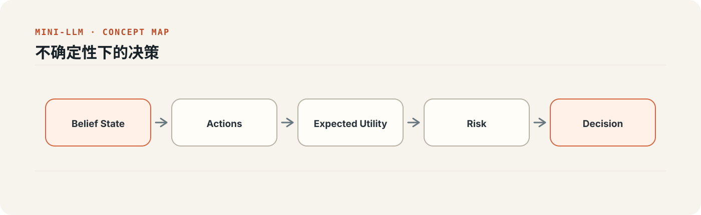
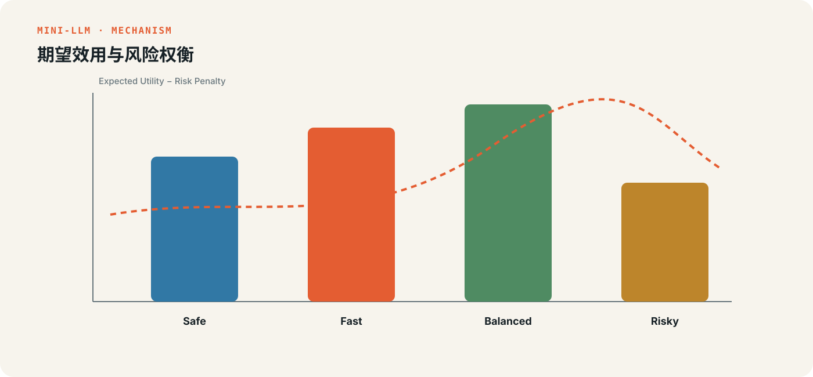

# **《mini-llm Decision Engine 深度解析：从 Utility Function、Expected Utility 到 Bayesian Decision Theory、Risk-sensitive Planning 与 Multi-agent Decision》**



_图：不确定性下的决策。从左到右展示本章核心概念之间的数据流与依赖关系。_

在前面的 mini-llm 系列中，我们已经逐步构建了一个智能系统的多个核心模块：

- Representation Engine：如何形成内部表征。
- Memory Architecture：如何保存和检索经验。
- Knowledge Architecture：如何组织事实、概念和关系。
- World Model Engine：如何表示世界状态、预测未来变化。
- Causal Reasoning Engine：如何理解变量之间的因果关系。

但是，这些能力还没有回答一个关键问题：

**当智能系统面对多个可能的行动、多个可能的未来，以及相互冲突的目标时，它究竟应该如何做出选择？**

例如，一个 AI Agent 正在修改一个软件项目。

它有三个选择：

1. 直接修改代码，速度快，但可能引入 Bug。
2. 先分析依赖关系，再修改代码，耗时较长，但风险较低。
3. 先创建 Git Worktree，在独立环境中实验，成本较高，但可以隔离风险。

这三个方案都可能实现目标。

但哪个方案更好？

如果只考虑执行速度，方案一可能最好。

如果考虑代码质量，方案二可能更好。

如果考虑可回滚性和风险隔离，方案三可能更好。

这意味着：

**智能决策不是简单地寻找一个能够完成任务的行动，而是在多个目标、多个约束和不确定结果之间进行权衡。**

这就是 Decision Theory（决策理论）研究的核心问题。


_图：棋类是决策理论最古老的试验场：每个局面都有多个可行走法，评估函数只能给出估计，而选择必须现在就做出。区别在于棋类是完全可观测的，真实世界的决策还要额外处理不确定性。图片：Wilfredor，[Wikimedia Commons](https://commons.wikimedia.org/wiki/File:Chess_game_Staunton_No._6.jpg)，[CC0 1.0](https://creativecommons.org/publicdomain/zero/1.0/)。_

# **一、Decision Theory：什么是决策理论？**

## **1.1 决策与预测有什么区别？**

先区分两个概念。

**Prediction（预测）：**

根据当前信息，推测未来可能发生什么。

例如：

```
如果直接修改代码：
测试失败概率可能为 20%。

如果先进行依赖分析：
测试失败概率可能为 8%。
```

**Decision（决策）：**

根据预测结果，结合目标和成本，选择应该采取什么行动。

例如：

```
直接修改代码：
耗时 5 分钟，失败风险较高。

先进行依赖分析：
耗时 15 分钟，失败风险较低。
```

预测告诉我们可能发生什么。

决策告诉我们应该做什么。

两者可以抽象为：

\\[ \boxed{ \text{Decision} = \text{Prediction} + \text{Preference} + \text{Constraint} } \\]

其中：

- Prediction：预测不同选择的结果。
- Preference：系统偏好什么结果。
- Constraint：系统必须遵守什么约束。

这里的 Preference 非常重要。

因为两个系统即使拥有完全相同的预测能力，也可能做出不同决策。

原因是它们的目标不同。

## **1.2 决策问题的基本数学结构**

一个基本决策问题可以表示为：

\\[ D=(S,A,\Omega,P,U) \\]

其中：

| 符号           | 含义      |
| ------------ | ------- |
| \\(S\\)      | 当前状态    |
| \\(A\\)      | 可选行动集合  |
| \\(\Omega\\) | 可能发生的结果 |
| \\(P\\)      | 结果概率分布  |
| \\(U\\)      | 效用函数    |

假设：

当前状态：

\\[ S=\text{代码修改任务} \\]

行动集合：

\\[ A=\\{a_1,a_2,a_3\\} \\]

其中：

- \\(a_1\\)：直接修改。
- \\(a_2\\)：先分析再修改。
- \\(a_3\\)：隔离环境中修改。

系统需要根据每个行动可能产生的结果，以及这些结果的价值，选择最合适的行动。

## **1.3 决策理论的基本流程**

- **1. State**：理解当前状态
- **2. Action Space**：生成候选行动
- **3. Outcome Prediction**：预测不同行动的可能结果
- **4. Utility Evaluation**：评估每种结果的价值
- **5. Decision**：选择行动
- **6. Feedback**：观察真实结果并更新决策模型

## **2.1 什么是 Utility？**

Utility（效用）是决策理论中的核心概念。

它用于表达：

**一个结果对于决策主体而言有多大价值。**

例如，一个 AI 编程 Agent 完成某项任务后，可能产生以下结果：

| 结果           | 效用   |
| ------------ | ---- |
| 功能正确、测试通过    | 100  |
| 功能正确，但代码质量一般 | 70   |
| 功能部分完成       | 30   |
| 引入严重 Bug     | -100 |

可以将效用表示为：

\\[ U(o) \\]

其中：

- \\(o\\)：结果。
- \\(U(o)\\)：结果的效用。

效用值越高，表示系统越偏好该结果。

需要注意：

效用不是结果的客观属性，而是相对于某个决策主体、目标和偏好定义的评价尺度。

## **2.2 Utility 与 Reward 有什么区别？**

这两个概念在 AI 中经常出现，但不能完全混用。

**Utility：**

描述决策主体对某种结果的偏好或价值评价。

**Reward：**

通常指强化学习环境在某个时间步返回的数值反馈。

例如：

```
任务完成：
Reward = +10

测试失败：
Reward = -5
```

强化学习算法可能利用 Reward 学习策略。

但如果奖励设计不能准确表达真实目标，就可能产生 Reward Hacking。

例如：

Agent 为了尽快完成任务，删除了失败测试。

测试数量减少了，某些奖励指标甚至变好了，但系统实际质量下降了。

因此：

**Reward 是学习系统使用的反馈信号，不一定等于真实 Utility。**

## **2.3 多维效用函数**

现实任务通常有多个目标。

例如 AI 编程系统需要考虑：

- 功能正确性。
- 代码质量。
- 执行时间。
- Token 成本。
- 安全性。
- 可维护性。

可以定义：

\\[ U= w_1Q+ w_2M+ w_3S- w_4T- w_5C \\]

其中：

- \\(Q\\)：功能质量。
- \\(M\\)：可维护性。
- \\(S\\)：安全性。
- \\(T\\)：执行时间。
- \\(C\\)：资源成本。
- \\(w_i\\)：各项权重。

假设：

\\[ U=0.4Q+0.2M+0.3S-0.05T-0.05C \\]

那么系统就可以对不同方案进行统一评价。

但是，这个公式有一个前提：

**各个指标必须具有合理的量纲和归一化方式。**

例如，代码质量是 0–100 分，而执行时间是秒，不能直接随意相加。

通常需要先进行归一化或设计合理的尺度。

## **2.4 效用函数不一定是线性的**

假设两个方案：

- 方案 A：收益 100，损失风险较高。
- 方案 B：收益 80，风险较低。

如果采用线性效用函数：

\\[ U(x)=x \\]

那么收益更高的方案可能始终更有吸引力。

但人类和实际决策系统通常会对风险、损失和极端结果有不同偏好。

例如：

\\[ U(x)=\sqrt{x} \\]

可以表达某种边际效用递减。

也就是说，从 10 增加到 20 的效用提升，可能大于从 100 增加到 110 的效用提升。

对于损失，也可以使用不同的效用曲线。

## **2.5 效用函数的工程实现**

```
class UtilityFunction:    def __init__(self, weights):        self.weights = weights    def evaluate(self, metrics):        utility = 0        for key, weight in self.weights.items():            utility += weight * metrics[key]        return utility
```

使用：

```
utility = UtilityFunction({    "quality": 0.4,    "maintainability": 0.2,    "security": 0.3,    "time_cost": -0.05,    "resource_cost": -0.05})score = utility.evaluate({    "quality": 90,    "maintainability": 80,    "security": 95,    "time_cost": 20,    "resource_cost": 10})
```

这个示例假设输入指标已经标准化，实际系统还应该处理缺失指标、约束条件和权重版本。

# **三、Expected Utility：期望效用**



_图：决策引擎综合收益、发生概率与风险惩罚比较候选行动。_

现实世界存在不确定性。

一个行动可能产生多个不同结果。

我们无法确定最终结果，但可以估计每种结果出现的概率。

这时就需要 Expected Utility（期望效用）。

## **3.1 什么是期望效用？**

假设一个 Agent 有两个行动：

方案 A：

- 80% 概率获得 100 分。
- 20% 概率获得 -50 分。

方案 B：

\- 100% 概率获得 60 分。

方案 A 的期望效用：

\\[ EU(A)=0.8\times100+0.2\times(-50) \\]

\\[ EU(A)=80-10=70 \\]

方案 B：

\\[ EU(B)=1.0\times60=60 \\]

因此：

\\[ EU(A)>EU(B) \\]

按照期望效用最大化原则，系统会选择方案 A。

## **3.2 期望效用的一般公式**

\\[ \boxed{ EU(a)=\sum\_{i=1}^{n}P(o_i\mid a)U(o_i) } \\]

其中：

- \\(a\\)：行动。
- \\(o_i\\)：可能结果。
- \\(P(o_i\mid a)\\)：采取行动 a 后结果出现的概率。
- \\(U(o_i)\\)：结果的效用。

最优行动：

\\[ a^\*=\arg\max\_{a\in A}EU(a) \\]

这就是经典期望效用决策。

## **3.3 交互示例：为什么不能只看最高收益？**

## **期望效用计算器**

调整方案 A 的成功概率和结果，比较它与确定性方案 B。

**方案 A 成功概率**

## **80%**

成功效用

失败效用

**方案 B：确定性效用**

方案 A 期望效用

# **70.0**

方案 B 期望效用

# **60.0**

**期望效用较高：方案 A**

该比较只考虑期望效用，不包含风险偏好、概率估计误差和安全约束。

## **3.4 期望效用的局限**

期望效用最大化并不意味着风险最小。

例如：

方案 A：

- 99% 概率收益 10。
- 1% 概率损失 900。

期望效用：

\\[ EU(A)=0.99\times10+0.01\times(-900) \\]

\\[ EU(A)=0.9 \\]

方案 B：

\- 100% 概率收益 0.5。

\\[ EU(B)=0.5 \\]

期望效用选择 A。

但是，如果损失 900 会导致系统无法恢复，A 可能根本不可接受。

这就需要研究风险敏感决策。

# **四、Bayesian Decision Theory：贝叶斯决策理论**

期望效用解决了：

已知概率分布时，如何选择行动？

但现实中还有一个问题：

**我们通常不知道真实概率。**

例如：

AI Agent 修改某个模块时，可能不知道：

- 当前代码是否存在隐藏依赖。
- 新版本 API 是否兼容。
- 某个测试是否覆盖关键路径。
- 生产环境是否存在特殊配置。

这时，系统需要根据证据更新对未知状态的信念。

这就是 Bayesian Decision Theory。

## **4.1 贝叶斯决策的核心**

贝叶斯决策理论将两件事情结合起来：

1. Bayesian Inference：根据证据更新概率。
2. Utility Maximization：根据概率和效用选择行动。

基本流程：

```
先验信念 Prior
      ↓
获得新证据 Evidence
      ↓
贝叶斯更新 Posterior
      ↓
计算不同决策的期望效用
      ↓
选择最优行动
```

## **4.2 贝叶斯公式**

\\[ \boxed{ P(H\mid E)= \frac{P(E\mid H)P(H)} {P(E)} } \\]

其中：

- \\(H\\)：假设。
- \\(E\\)：观察到的证据。
- \\(P(H)\\)：先验概率。
- \\(P(E\mid H)\\)：似然。
- \\(P(H\mid E)\\)：后验概率。

例如：

某个代码模块可能存在隐藏依赖。

我们设：

\\[ P(H)=0.2 \\]

即修改前认为隐藏依赖存在的概率是 20%。

现在静态分析工具发现了一个异常。

假设：

\\[ P(E\mid H)=0.8 \\]

\\[ P(E\mid \neg H)=0.1 \\]

那么：

\\[ P(E)=0.8\times0.2+0.1\times0.8 \\]

\\[ P(E)=0.24 \\]

因此：

\\[ P(H\mid E)=\frac{0.8\times0.2}{0.24} \\]

\\[ P(H\mid E)\approx0.667 \\]

发现异常之后，隐藏依赖存在的概率从 20% 上升到约 66.7%。

注意：这里的概率是模型假设下的后验概率，并不是静态分析工具输出的任意置信分数。

## **4.3 Bayesian Decision：概率如何影响行动？**

假设现在有两个行动：

- A：直接修改。
- B：先进行依赖分析。

我们设：

| 行动     | 隐藏依赖存在 | 隐藏依赖不存在 |
| ------ | ------ | ------- |
| 直接修改 A | -100   | 100     |
| 先分析 B  | 20     | 70      |

根据后验概率：

\\[ P(H\mid E)=0.667 \\]

\\[ P(\neg H\mid E)=0.333 \\]

直接修改：

\\[ EU(A)=0.667\times(-100)+0.333\times100 \\]

\\[ EU(A)\approx-33.4 \\]

先分析：

\\[ EU(B)=0.667\times20+0.333\times70 \\]

\\[ EU(B)\approx36.65 \\]

因此：

\\[ EU(B)>EU(A) \\]

系统应该先进行依赖分析。

## **4.4 Bayesian Decision Engine 的工程结构**

```
class BayesianDecisionEngine:    def update_belief(        self,        prior,        likelihood,        evidence_probability    ):        return (            likelihood * prior            / evidence_probability        )    def expected_utility(        self,        probabilities,        utilities    ):        return sum(            p * u            for p, u in zip(                probabilities,                utilities            )        )    def choose(self, actions):        return max(            actions,            key=lambda action: action.expected_utility        )
```

生产实现还需要支持：

- 多假设。
- 连续概率分布。
- 联合概率。
- 参数估计。
- 概率校准。
- 模型不确定性。
- 证据来源和时间。

# **五、Decision under Uncertainty：不确定性下的决策**

贝叶斯决策已经涉及不确定性，但不确定性并不只有一种。

这是一个非常重要的概念。

## **5.1 Risk 与 Uncertainty**

在一些经典决策理论划分中：

**Risk（风险）：**

可能结果及其概率分布已知或可以合理估计。

**Uncertainty（不确定性）：**

概率分布本身未知，或者缺乏可靠依据进行估计。

例如：

抛一枚均匀硬币：

\\[ P(Head)=0.5 \\]

这属于相对明确的风险环境。

而一个 Agent 修改从未接触过的企业内部系统：

- 依赖关系未知。
- 业务规则未知。
- 测试覆盖率未知。
- 部署环境未知。

这更接近深度不确定性环境。

## **5.2 三种决策方式**

### **第一种：Expected Utility**

适合具有可靠概率分布的情况。

\\[ a^\*=\arg\max_a EU(a) \\]

### **第二种：Maximin**

当系统希望优先保证最差结果时：

\\[ a^\*=\arg\max_a\min_s U(a,s) \\]

例如：

在三个方案中，选择最差情况下损失最小的方案。

### **第三种：Minimax Regret**

Regret（后悔值）衡量：

某种情况下，如果事后知道真实状态，原本可以获得多少更好的效用。

定义：

\\[ R(a,s)= \max\_{a'}U(a',s)-U(a,s) \\]

然后：

\\[ a^\*= \arg\min_a\max_s R(a,s) \\]

它选择最大后悔值最小的行动。

## **5.3 三种方法的差异**

| 方法               | 决策原则    | 适合场景       |
| ---------------- | ------- | ---------- |
| Expected Utility | 最大化平均效用 | 概率可估计      |
| Maximin          | 最大化最差结果 | 极端保守       |
| Minimax Regret   | 最小化最大后悔 | 概率未知但状态可列举 |

没有一种方法在所有场景中都最好。

Decision Engine 应该根据任务类型选择决策规则。

# **六、Risk-sensitive Decision：风险敏感决策**

前面我们看到：

两个方案即使期望收益相同，也可能具有完全不同的风险结构。

例如：

方案 A：

\- 每次稳定获得 50。

方案 B：

- 50% 概率获得 100。
- 50% 概率获得 0。

两者期望收益相同：

\\[ EU(A)=50 \\]

\\[ EU(B)=0.5\times100+0.5\times0=50 \\]

但它们的风险完全不同。

## **6.1 方差与风险**

最简单的风险衡量方法是方差：

\\[ Var(X)=E[(X-E[X])^2] \\]

标准差：

\\[ \sigma=\sqrt{Var(X)} \\]

方案 A：

\\[ Var(A)=0 \\]

方案 B：

\\[ Var(B)=2500 \\]

因此：

\\[ \sigma_B=50 \\]

如果系统偏好稳定性，那么方案 A 更有吸引力。

## **6.2 均值—方差效用**

可以构造：

\\[ U=E[R]-\lambda Var(R) \\]

其中：

- \\(E[R]\\)：期望收益。
- \\(Var(R)\\)：收益方差。
- \\(\lambda\\)：风险厌恶系数。

当：

\\[ \lambda=0 \\]

系统只关心期望收益。

当：

\\[ \lambda>0 \\]

系统开始惩罚风险。

但是，方差同时惩罚收益高于平均值和低于平均值的波动，并不总是适合作为风险指标。

## **6.3 CVaR：条件风险价值**

对于存在严重尾部损失的任务，CVaR 通常比简单方差更有解释力。

例如：

AI Agent 修改代码时：

- 大部分时候只产生轻微 Bug。
- 极少数时候导致核心数据库损坏。

这种极端损失需要单独关注。

VaR（Value at Risk）衡量某个置信水平下的损失分位数。

CVaR 则关注超过 VaR 阈值后的平均损失。

例如：

95% VaR 表示在相应损失分布下，95% 的损失不超过某个阈值。

95% CVaR 关注最差 5% 情况下的平均损失。

如果定义损失为 \\(L\\)，可以写成：

\\[ CVaR\_\alpha(L) = E[L\mid L\geq VaR\_\alpha(L)] \\]

这是连续分布下的一种直观表达；实际计算常采用更一般的优化定义，以处理离散分布和分位数处的概率质量。

## **6.4 风险敏感决策的工程例子**

假设 Agent 有三个方案：

| 方案     | 期望收益 | 风险评分 |
| ------ | ---- | ---- |
| A：直接修改 | 90   | 80   |
| B：先分析  | 80   | 30   |
| C：隔离实验 | 75   | 10   |

如果使用：

\\[ U=收益-\lambda\times风险 \\]

当：

\\[ \lambda=0.1 \\]

得到：

\\[ U(A)=82 \\]

\\[ U(B)=77 \\]

\\[ U(C)=74 \\]

选择 A。

当：

\\[ \lambda=0.5 \\]

得到：

\\[ U(A)=50 \\]

\\[ U(B)=65 \\]

\\[ U(C)=70 \\]

选择 C。

这说明：

**决策结果不仅取决于环境，还取决于系统对风险的容忍程度。**

对于具有不可逆副作用的操作，通常还应设置硬约束，而不只是给风险加一个惩罚项。

# **七、Multi-objective Optimization：多目标优化**

现实中的智能系统通常不只有一个目标。

例如：

AI 编程 Agent 可能需要同时优化：

- 功能正确性。
- 代码质量。
- 运行速度。
- 安全性。
- 成本。
- 开发时间。

这些目标可能相互冲突。

## **7.1 什么是多目标优化？**

单目标优化：

\\[ \max_x f(x) \\]

多目标优化：

\\[ \max_x \left[ f_1(x),f_2(x),\ldots,f_n(x) \right] \\]

例如：

\\[ \max_x \begin{cases} Quality(x)\\\ Security(x)\\\ Maintainability(x) \end{cases} \\]

同时：

\\[ \min_x \begin{cases} Time(x)\\\ Cost(x) \end{cases} \\]

问题在于：

可能不存在一个方案能够在所有目标上都优于其他方案。

## **7.2 Pareto Optimality：帕累托最优**

假设有三个方案：

| 方案 | 质量 | 成本 |
| -- | -- | -- |
| A  | 90 | 80 |
| B  | 80 | 40 |
| C  | 70 | 30 |

这里质量越高越好，成本越低越好。

A 的质量最高，但成本也最高。

C 成本最低，但质量较低。

B 处于中间。

如果一个方案不存在另一个方案在所有目标上都不差、并且至少一个目标更好，那么它就是 Pareto Optimal（帕累托最优）的候选方案。

由所有非支配方案组成的集合称为：

**Pareto Frontier（帕累托前沿）。**

## **7.3 Weighted Sum：加权求和**

最简单的多目标优化方法：

\\[ U(x)=\sum\_{i=1}^{n}w_if_i(x) \\]

例如：

\\[ U=0.7Q-0.3C \\]

优点：

- 简单。
- 容易实现。
- 方便统一排序。

缺点：

- 权重难以确定。
- 不同指标需要归一化。
- 可能忽略非凸 Pareto 前沿上的部分方案。

## **7.4 Lexicographic Optimization：字典序优化**

有些目标不能简单加权。

例如：

安全性必须优先于成本。

可以定义：

1. 首先满足安全要求。
2. 在安全可行方案中，选择质量最高的方案。
3. 在质量相近的情况下，选择成本最低的方案。

这就是字典序优化。

对于安全关键型 Agent，硬约束与分层决策往往比单纯加权更可靠。

## **7.5 多目标决策的工程实现**

```
class MultiObjectiveDecision:    def evaluate(self, candidate, weights):        return (            weights["quality"] * candidate.quality            + weights["security"] * candidate.security            - weights["cost"] * candidate.cost            - weights["time"] * candidate.time        )
```

生产环境还需要增加：

- 指标归一化。
- 硬约束过滤。
- Pareto 支配检测。
- 权重配置版本。
- 决策解释记录。
- 不同业务场景的偏好配置。

# **八、Value of Information：信息的价值**

这是 Decision Engine 中非常重要、也非常容易被忽略的概念。

智能体经常需要决定：

**现在是否值得再收集一些信息？**

例如：

Agent 准备修改一个复杂模块。

它可以：

- 直接修改。
- 先读取代码。
- 搜索调用关系。
- 运行测试。
- 查询文档。
- 询问用户。

每一步都会消耗时间和资源。

那么，系统什么时候应该停止分析，开始行动？

这就是 Value of Information（信息价值）研究的问题。

## **8.1 什么是信息价值？**

信息价值衡量：

获得额外信息之后，决策质量可能提高多少。

假设：

现在有两个行动：

- A：直接修改。
- B：先进行检查。

如果不进行检查，系统只能选择一个行动。

如果获得新信息，系统可能根据不同情况选择不同的行动。

因此，信息能够改善决策。

## **8.2 Expected Value of Perfect Information**

完全信息价值：

\\[ EVPI= E\left[\max_a U(a,\theta)\right] - \max_a E[U(a,\theta)] \\]

其中：

- \\(\theta\\)：真实状态。
- \\(a\\)：行动。

第一项表示：

如果提前知道真实状态，可以获得的期望效用。

第二项表示：

不知道真实状态时，当前能够获得的最大期望效用。

两者之差就是完全信息的价值。

## **8.3 一个具体例子**

假设系统有两种环境：

- 正常环境：概率 0.8。
- 异常环境：概率 0.2。

有两个行动：

| 行动   | 正常环境 | 异常环境 |
| ---- | ---- | ---- |
| 直接修改 | 100  | -100 |
| 安全修改 | 60   | 50   |

不获取额外信息：

直接修改：

\\[ EU(A)=0.8\times100+0.2\times(-100) \\]

\\[ EU(A)=60 \\]

安全修改：

\\[ EU(B)=0.8\times60+0.2\times50 \\]

\\[ EU(B)=58 \\]

因此当前选择 A，期望效用为 60。

如果拥有完全信息：

正常环境选择 A，异常环境选择 B。

\\[ EU\_{\text{perfect}}= 0.8\times100+0.2\times50 \\]

\\[ EU\_{\text{perfect}}=90 \\]

因此：

\\[ EVPI=90-60=30 \\]

这意味着：

在当前模型下，完全消除状态不确定性最多值得付出 30 个效用单位。

## **8.4 Expected Value of Sample Information**

现实中，我们通常不能获得完全信息。

例如：

运行一次测试，只能降低一部分不确定性。

这时可以计算：

\\[ EVSI= E_Z\left[ \max_a E[U(a,\theta)\mid Z] \right] - \max_a E[U(a,\theta)] \\]

其中：

- \\(Z\\)：新获得的信息。
- \\(EVSI\\)：样本信息的期望价值。

如果收集信息需要成本 \\(C_Z\\)，那么：

\\[ NetValue=EVSI-C_Z \\]

当：

\\[ EVSI>C_Z \\]

进一步收集信息可能值得。

## **8.5 Agent 如何决定是否继续分析？**

可以设计：

```
def should_gather_information(    expected_information_value,    information_cost):    return (        expected_information_value        > information_cost    )
```

例如：

```
读取文件：
信息价值 = 20
成本 = 2

运行完整测试：
信息价值 = 30
成本 = 15

继续搜索：
信息价值 = 3
成本 = 8
```

那么：

- 读取文件：值得。
- 运行完整测试：可能值得。
- 继续搜索：不值得。

这个机制可以帮助 Agent 避免两种极端：

1. 信息不足就贸然行动。
2. 无限分析，始终不采取行动。

# **九、Sequential Decision Making：序贯决策**

前面的决策例子，大多假设系统只需要选择一次行动。

但是，Agent 的工作通常是连续的。

例如：

```
理解需求
   ↓
分析代码
   ↓
修改文件
   ↓
运行测试
   ↓
发现错误
   ↓
修复错误
   ↓
再次测试
   ↓
提交代码
```

每一步的结果都会影响下一步的决策。

这就是 Sequential Decision Making（序贯决策）。

## **9.1 什么是序贯决策？**

序贯决策关注：

**当系统需要在多个时间步骤中连续做出行动时，如何优化整个过程的长期收益？**

它通常可以表示为：

\\[ S_t\xrightarrow{A_t}S\_{t+1} \\]

在每个时间步：

- 系统观察状态。
- 选择行动。
- 获得反馈。
- 更新状态。
- 再次决策。

## **9.2 Markov Decision Process（MDP）**

MDP 是序贯决策的重要数学框架。

通常定义为：

\\[ MDP=(S,A,P,R,\gamma) \\]

其中：

| 符号           | 含义     |
| ------------ | ------ |
| \\(S\\)      | 状态空间   |
| \\(A\\)      | 行动空间   |
| \\(P\\)      | 状态转移概率 |
| \\(R\\)      | 奖励函数   |
| \\(\gamma\\) | 折扣因子   |

状态转移：

\\[ P(s'\mid s,a) \\]

表示在状态 s 下采取行动 a 后，进入状态 s' 的概率。

奖励：

\\[ R(s,a,s') \\]

表示状态转移产生的奖励。

折扣因子：

\\[ 0\leq\gamma\leq1 \\]

用于衡量未来奖励相对于当前奖励的重要程度。

## **9.3 Return：长期收益**

对于一系列行动：

\\[ R_0,R_1,R_2,\ldots \\]

累计折扣收益：

\\[ G_t= R_t+\gamma R\_{t+1} +\gamma^2R\_{t+2}+\cdots \\]

如果：

\\[ \gamma=0 \\]

系统只关注当前奖励。

如果：

\\[ \gamma\rightarrow1 \\]

系统会更加重视长期奖励。

## **9.4 Value Function：状态价值函数**

状态价值函数：

\\[ V^\pi(s)= E\_\pi[G_t\mid S_t=s] \\]

表示：

从状态 s 开始，按照策略 \\(\pi\\) 行动，预期可以获得多少长期收益。

行动价值函数：

\\[ Q^\pi(s,a)= E\_\pi[G_t\mid S_t=s,A_t=a] \\]

表示：

在状态 s 下先采取行动 a，再按照策略行动，能够获得多少长期收益。

## **9.5 Bellman Equation**

Bellman 方程描述价值函数的递归关系：

\\[ V^\pi(s)= \sum_a\pi(a\mid s) \sum\_{s'}P(s'\mid s,a) \left[ R(s,a,s')+\gamma V^\pi(s') \right] \\]

它的直观含义：

**当前状态的价值，取决于当前行动带来的即时收益，以及未来状态的预期价值。**

这也是强化学习和动态规划的重要基础。

## **9.6 Agent 为什么需要序贯决策？**

因为 Agent 的任务通常不是单次问答。

例如 AI 软件工程 Agent：

| 时间 | 状态    | 行动     |
| -- | ----- | ------ |
| T0 | 需求未知  | 分析需求   |
| T1 | 已理解需求 | 阅读代码   |
| T2 | 已发现依赖 | 制定修改计划 |
| T3 | 代码已修改 | 运行测试   |
| T4 | 测试失败  | 定位错误   |
| T5 | 错误已修复 | 再次测试   |
| T6 | 测试通过  | 提交变更   |

每一步都在改变系统状态。

而且：

**当前最好的行动，不一定是长期最好的行动。**

例如，立即修改代码可能节省几分钟，但如果造成大量返工，整体成本反而更高。

# **十、多智能体决策：Multi-agent Decision**

现在进一步扩大问题。

前面我们假设只有一个智能体。

但现实系统中，可能存在多个 Agent：

- 一个负责需求分析。
- 一个负责代码开发。
- 一个负责测试。
- 一个负责安全审查。
- 一个负责项目管理。

这些 Agent 可能拥有不同目标、不同信息和不同能力。

这就进入 Multi-agent Decision（多智能体决策）。

## **10.1 什么是 Multi-agent System？**

多智能体系统由多个可以独立行动的智能体构成。

每个 Agent 通常具有：

- 自己的状态认知。
- 自己的目标。
- 自己的策略。
- 自己的信息。
- 自己的行动能力。

例如：

## **多智能体软件开发系统**

- **Orchestrator Agent**：目标管理、任务分配、冲突协调
- **Developer Agent**：代码实现
- **Test Agent**：测试验证
- **Security Agent**：安全检查
- **Review Agent**：代码审查
- **Shared Workspace**：任务状态、代码变更、测试结果、审计记录

例如：

开发 Agent 和测试 Agent 共同完成一个软件功能。

它们可以共同优化：

\\[ U\_{\text{team}}= U_1+U_2+\cdots+U_n \\]

但是，这个简单的加和只有在效用尺度具有可比较性时才有意义。

合作系统还需要解决：

- 任务分配。
- 信息共享。
- 成本分摊。
- 冲突协调。
- 贡献评价。

## **10.3 Competitive Game：竞争博弈**

多个 Agent 的目标可能存在冲突。

例如：

Agent A 负责最大化任务完成速度。

Agent B 负责最大化安全性。

如果 A 为了提高速度减少测试，而 B 要求增加测试，那么两者之间可能出现目标冲突。

可以将这种关系表示为：

\\[ U_A(a_A,a_B) \\]

\\[ U_B(a_A,a_B) \\]

每个 Agent 的收益不仅取决于自己的行动，也取决于其他 Agent 的行动。

## **10.4 Nash Equilibrium：纳什均衡**

纳什均衡是一种重要的博弈论概念。

如果在某个策略组合下，任何一个 Agent 单独改变自己的策略，都不能获得更高收益，那么这个策略组合就是纳什均衡。

对于 Agent \\(i\\)：

\\[ U_i(a_i^\*,a\_{-i}^\*) \geq U_i(a_i,a\_{-i}^\*) \\]

其中：

- \\(a_i^\*\\)：Agent i 的均衡策略。
- \\(a\_{-i}^\*\\)：其他 Agent 的策略。

直观理解：

每个 Agent 在其他 Agent 不改变策略的情况下，都没有动力单方面改变自己的选择。

但是：

纳什均衡不一定是整个系统的最优结果。

可能每个 Agent 都在追求自己的利益，却导致整体效率下降。

## **10.5 Multi-agent Coordination：多智能体协调**

实际 Agent 系统往往更需要协调机制，而不是纯粹竞争。

例如：

```
任务分配
   ↓
多个 Agent 并行执行
   ↓
共享执行状态
   ↓
发现冲突
   ↓
协调和重新规划
   ↓
合并结果
   ↓
统一验证
```

核心技术包括：

- Centralized Planning：集中式规划。
- Decentralized Planning：分布式规划。
- Contract Net Protocol：合同网协议。
- Multi-agent Reinforcement Learning：多智能体强化学习。
- Communication Protocol：通信协议。
- Conflict Resolution：冲突解决。

## **10.6 多智能体系统的工程注意事项**

多个 Agent 同时操作同一个代码仓库，可能出现：

- 同时修改同一个文件。
- 依赖版本不一致。
- 任务重复。
- 测试结果冲突。
- 共享状态不一致。
- 权限越界。

因此，多智能体决策必须和工程治理结合。

例如：

- Git Worktree 隔离代码工作区。
- 任务锁控制并发修改。
- 统一状态存储记录任务进度。
- Policy Engine 控制操作权限。
- Evaluation Engine 统一验证结果。
- Recovery Engine 提供检查点和回滚。

# **十一、Decision Engine 与其他 mini-llm 模块的关系**

现在，我们已经拥有：

- World Model：预测未来。
- Causal Engine：分析因果关系。
- Decision Engine：选择行动。

这三个模块具有明确的分工。

| 模块              | 核心问题                     |
| --------------- | ------------------------ |
| World Model     | 如果采取某个行动，未来可能怎样变化？       |
| Causal Engine   | 变量为什么发生变化？改变某个因素会造成什么影响？ |
| Decision Engine | 综合目标、成本和风险，应该采取什么行动？     |
| Agent Engine    | 如何执行行动并验证结果？             |

可以把它们组合成一个完整的智能决策架构。

## **mini-llm Decision Architecture**

- **LLM / Reasoning Engine**：理解目标、分析任务、提出候选方案
- **World Model**：状态预测、未来模拟
- **Causal Engine**：因果效应、干预分析
- **Decision Engine**：效用、概率、风险、多目标、信息价值
- **Agent Engine**：执行、协调、工具调用、反馈
- **Environment**：真实软件系统、物理世界、用户
理解目标
   ↓
生成候选行动
   ↓
预测未来
   ↓
分析因果后果
   ↓
计算期望效用
   ↓
评估风险和约束
   ↓
选择行动
   ↓
执行行动
   ↓
观察真实结果
   ↓
更新模型和决策策略
```

# **十二、mini-llm Decision Engine 工程设计**

现在将理论转化成可以逐步实现的代码架构。

## **12.1 工程目录**

```
mini-llm/
│
├── tensor/
├── autograd/
├── neural_network/
├── transformer/
│
├── representation/
├── memory/
├── knowledge/
├── world_model/
├── causal/
│
├── decision/
│   │
│   ├── state/
│   │   ├── decision_state.py
│   │   └── belief_state.py
│   │
│   ├── action/
│   │   ├── action.py
│   │   └── action_space.py
│   │
│   ├── utility/
│   │   ├── utility_function.py
│   │   └── multi_objective.py
│   │
│   ├── expected_utility/
│   │   └── expected_utility.py
│   │
│   ├── bayesian/
│   │   ├── belief_update.py
│   │   └── bayesian_decision.py
│   │
│   ├── uncertainty/
│   │   ├── uncertainty_model.py
│   │   └── robust_decision.py
│   │
│   ├── risk/
│   │   ├── variance.py
│   │   ├── var.py
│   │   └── cvar.py
│   │
│   ├── planning/
│   │   ├── mdp.py
│   │   ├── value_function.py
│   │   └── sequential_planner.py
│   │
│   ├── information/
│   │   ├── value_of_information.py
│   │   └── information_policy.py
│   │
│   ├── multi_agent/
│   │   ├── game.py
│   │   ├── coordination.py
│   │   └── conflict_resolution.py
│   │
│   ├── evaluation/
│   │   ├── decision_metrics.py
│   │   └── policy_evaluator.py
│   │
│   └── decision_engine.py
│
└── agent/
```

## **12.2 核心数据结构**

### **Action**

```
class Action:    def __init__(        self,        action_id,        parameters=None    ):        self.action_id = action_id        self.parameters = parameters or {}
```

### **Outcome**

```
class Outcome:    def __init__(        self,        state,        probability,        metrics    ):        self.state = state        self.probability = probability        self.metrics = metrics
```

### **DecisionContext**

```
class DecisionContext:    def __init__(        self,        state,        goal,        constraints,        beliefs    ):        self.state = state        self.goal = goal        self.constraints = constraints        self.beliefs = beliefs
```

### **DecisionEngine**

```
class DecisionEngine:    def __init__(        self,        world_model,        causal_engine,        utility_function    ):        self.world_model = world_model        self.causal_engine = causal_engine        self.utility_function = utility_function    def decide(        self,        context,        candidate_actions    ):        evaluations = []        for action in candidate_actions:            outcomes = self.world_model.predict(                context.state,                action            )            outcomes = self.causal_engine.evaluate(                outcomes,                action            )            utility = self.utility_function.evaluate(                outcomes            )            evaluations.append({
```

这是架构级伪代码。生产版本还必须增加：

- 概率分布处理。
- 风险评估。
- 约束过滤。
- 信息价值计算。
- 多目标优化。
- 决策解释。
- 决策审计。
- 模型版本和证据追踪。

特别需要注意：World Model 返回的预测不能直接当作因果效应。只有在适当的因果模型和识别条件下，才能进行因果解释。

# **十三、如何评价 Decision Engine？**

一个决策系统不能只看它是否选择了某个行动。

还要看它的决策质量。

建议建立以下评估指标。

| 指标                        | 评价内容         |
| ------------------------- | ------------ |
| Expected Utility          | 期望效用         |
| Realized Utility          | 实际获得的效用      |
| Regret                    | 相对于最优选择的损失   |
| Decision Accuracy         | 决策结果正确程度     |
| Calibration               | 概率预测校准       |
| Risk Exposure             | 风险暴露         |
| CVaR                      | 尾部损失         |
| Constraint Violation Rate | 约束违反率        |
| Information Efficiency    | 信息收集效率       |
| Task Completion Rate      | 任务完成率        |
| Coordination Efficiency   | 多 Agent 协调效率 |

尤其建议关注三个指标。

**第一：Regret。**

系统做出的决策距离事后可实现的最佳决策有多远？

**第二：Realized Utility。**

系统最终是否获得了预期价值？

**第三：Constraint Violation Rate。**

系统是否为了追求高收益，违反了安全、权限或业务规则？

一个好的 Decision Engine 不应该只追求高分，还应该能够遵守不可突破的约束。

# **十四、最终理解：Decision Engine 是智能系统的价值选择机制**

回顾这一系列技术模块：

| Engine                  | 主要职责  |
| ----------------------- | ----- |
| Tensor Engine           | 数值计算  |
| Autograd Engine         | 梯度计算  |
| Neural Network Engine   | 学习函数  |
| Transformer Engine      | 上下文建模 |
| Representation Engine   | 内部表征  |
| Memory Engine           | 经验存储  |
| Knowledge Engine        | 知识组织  |
| World Model Engine      | 未来预测  |
| Causal Reasoning Engine | 因果理解  |
| Decision Engine         | 行动选择  |
| Agent Engine            | 任务执行  |

我们可以把智能系统理解为一个逐步形成的过程：

1. 感知世界。
2. 构建内部表征。
3. 保存经验和知识。
4. 建立世界模型。
5. 理解因果机制。
6. 预测不同选择的结果。
7. 评估结果的价值。
8. 权衡不确定性和风险。
9. 选择行动。
10. 执行行动并接受反馈。

其中最重要的区别是：

**World Model 解决未来可能是什么样的问题。**

**Causal Engine 解决为什么发生变化以及干预后会怎样的问题。**

**Decision Engine 解决在这些可能性中应该选择什么的问题。**

而 Agent Engine 负责把选择变成现实行动。

因此：

\\[ \boxed{ \text{Intelligent Decision} = \text{Prediction} + \text{Causal Understanding} + \text{Utility} + \text{Risk Management} + \text{Action} } \\]

这也说明了为什么真正可靠的 AI Agent 不应该只是一个不断调用工具的 LLM。

它需要拥有目标、状态、预测、价值评价、风险约束和反馈机制。

# **下一篇：mini-llm Planning Engine**

建议下一篇深入研究：

# **《mini-llm Planning Engine 深度解析：从 Goal Decomposition、Search Algorithms 到 Hierarchical Planning、MCTS 与 Model Predictive Control》**

重点包括：

1. Goal Representation：目标表示。
2. Goal Decomposition：目标分解。
3. Task Planning：任务规划。
4. State-space Search：状态空间搜索。
5. BFS、DFS、Uniform Cost Search。
6. A\* Search：启发式搜索。
7. Hierarchical Planning：分层规划。
8. HTN：层次任务网络。
9. Monte Carlo Tree Search：蒙特卡洛树搜索。
10. Model Predictive Control：模型预测控制。
11. Planning under Uncertainty：不确定性规划。
12. Planning 与 LLM、World Model、Decision Engine、Agent 的结合。

**下一阶段需要研究的问题是：一个智能系统如何把抽象目标转化成可执行的行动序列，并在环境不断变化时动态调整自己的计划？**

