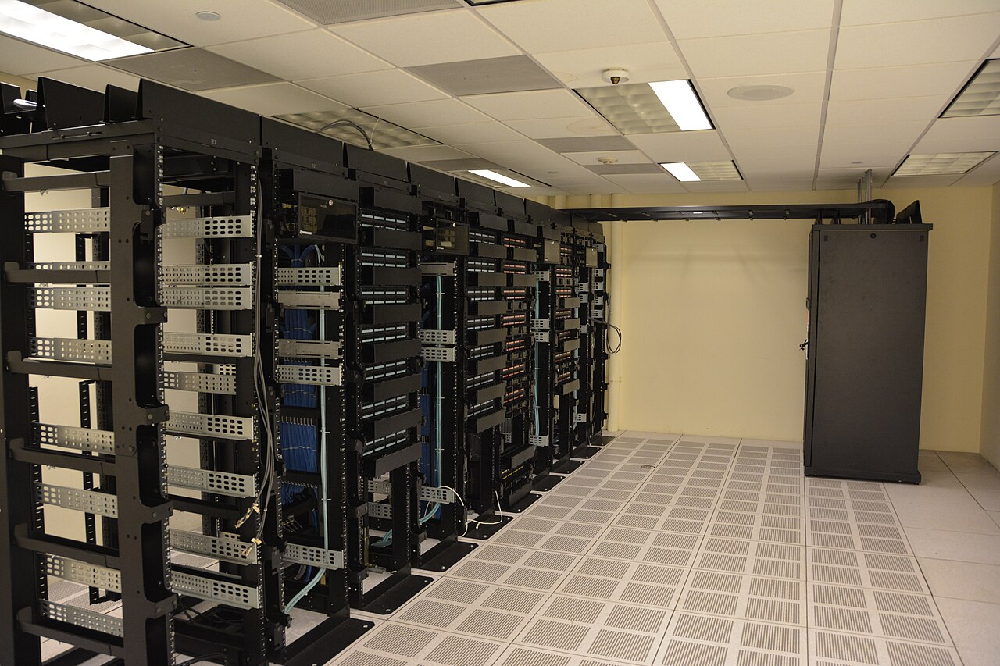
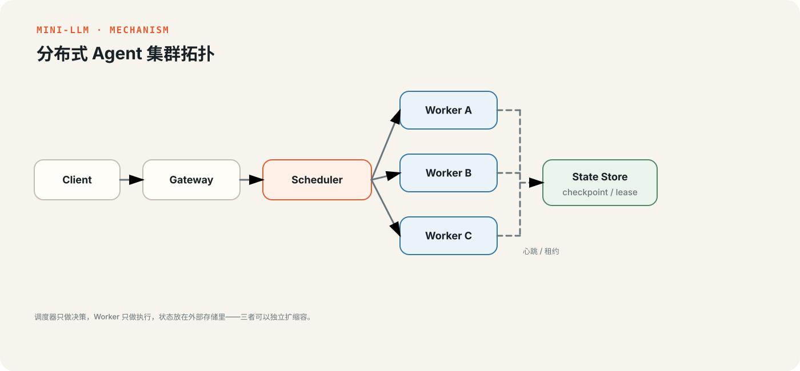
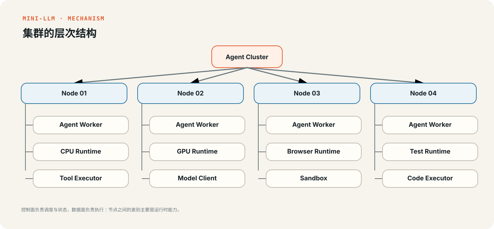
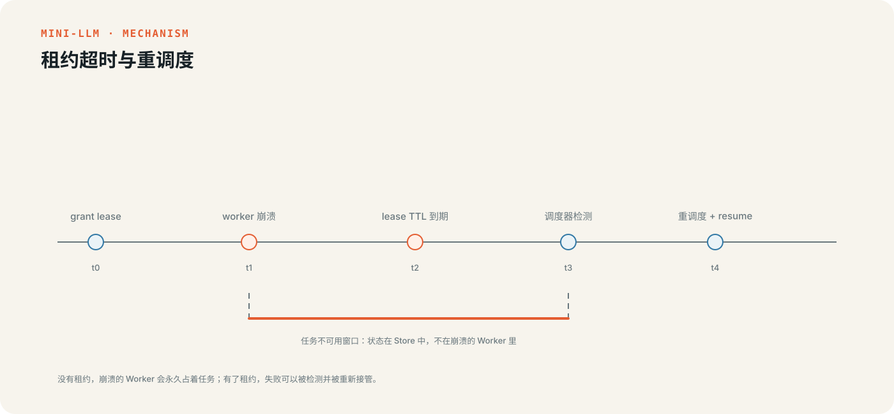

# **《mini-llm Distributed Agent Engine 深度解析：从 Agent Cluster、Distributed Scheduling 到 State Synchronization、Fault Tolerance 与 Scalable Execution》**

## **一、Distributed Agent Engine：为什么需要分布式智能体系统？**

前面我们已经讨论了 Multi-Agent Engine。

它解决的是多个 Agent 如何协作完成复杂任务的问题。

例如，一个软件开发任务可以由多个 Agent 分工：

- Architect Agent：负责架构设计。
- Frontend Agent：负责前端开发。
- Backend Agent：负责后端开发。
- QA Agent：负责测试。
- Reviewer Agent：负责代码审查。

但如果所有 Agent 都运行在一台机器上，就会遇到新的问题：

1. CPU、内存和 GPU 资源有限。
2. 多个 Agent 同时请求模型，容易产生资源竞争。
3. 单台机器故障可能导致整个任务系统停止。
4. Agent 数量增加后，单机调度能力可能不足。
5. 不同地区、不同机器上的 Agent 无法直接共享运行状态。
6. 不同模型服务可能部署在不同节点，需要统一路由。
7. 长时间运行的 Agent 任务需要跨进程、跨机器恢复。

这就引出了 Distributed Agent Engine。

**Distributed Agent Engine 的目标，是将 Agent 的执行、调度、状态、记忆和资源管理从单机环境扩展到多个计算节点，构建一个能够横向扩展、故障恢复和持续运行的智能体执行平台。**

### **1.1 从 Single Machine 到 Distributed Agent Cluster**

单机架构：

**Single Machine**

**Agent Manager**

Frontend Agent

Backend Agent

QA Agent

Reviewer Agent

**Local Runtime + Local Resources**

所有 Agent 共享同一台机器的 CPU、内存、网络和可能的 GPU。

分布式架构：

**Distributed Agent Cluster**

**Control Plane**

任务调度、节点管理、资源分配、状态协调

**Node A**

Healthy

Frontend Agent

CPU Worker

**Node B**

Healthy

Backend Agent

GPU Worker

**Node C**

Healthy

QA Agent

Test Worker

**Node D**

Healthy

Reviewer Agent

Analysis Worker

**Distributed Infrastructure**

Message Bus · State Store · Memory Store · Model Gateway

此时，Agent 不再依赖某一台固定机器。

一个任务可以在 Node A 上创建，在 Node B 上执行，在 Node C 上验证，最后由 Control Plane 整合结果。



_图：数据中心里的服务器机架。分布式 Agent 引擎要解决的调度、状态同步与故障恢复，和机房运维面对的是同一类工程问题。图片：Carl Lender，[Wikimedia Commons](https://commons.wikimedia.org/wiki/File:Datacenter_Server_Racks_%2822370909788%29.jpg)，[CC BY 2.0](https://creativecommons.org/licenses/by/2.0/)。_

# **二、Agent Cluster：如何构建分布式 Agent 集群？**



_图：GateWay–Scheduler–Worker–State Store 的分工：调度器只做决策，Worker 只做执行，状态放在外部存储，三者可独立扩缩容。_

## **2.1 什么是 Agent Cluster？**

Cluster 是集群。

在分布式系统中，Cluster 通常指多个计算节点通过网络连接起来，共同提供一个逻辑上的服务。

Agent Cluster 则是由多个能够运行 Agent 或 Agent Worker 的计算节点构成的集群。

例如：



_图：一个 Agent 集群的层次结构：每个节点都跑着 Agent Worker，但挂载的运行时不同（CPU、GPU、浏览器、代码执行），因此能承接的任务类型也不同。_

这些节点可以运行：

- 不同类型的 Agent。
- 不同版本的 Agent。
- 不同模型的推理客户端。
- 不同工具执行环境。
- 不同的任务处理 Worker。

### **2.2 Node 的基本结构**

一个分布式节点通常包含：

| 组件                | 作用            |
| ----------------- | ------------- |
| Node Agent        | 节点管理程序        |
| Worker Runtime    | 执行 Agent 任务   |
| Resource Monitor  | 监控 CPU、内存、GPU |
| Heartbeat Client  | 定期上报节点状态      |
| Task Executor     | 执行具体任务        |
| Local State Cache | 缓存运行状态        |
| Health Checker    | 检测本地服务健康情况    |

可以定义一个 Node：

```
class AgentNode:    node_id: str    hostname: str    status: str    cpu_capacity: float    memory_capacity: int    gpu_capacity: dict    worker_capacity: int    active_workers: int    labels: dict    last_heartbeat: str
```

其中 `labels` 用于描述节点能力。

例如：

```
{
  "node_id": "gpu-node-01",
  "labels": {
    "gpu": "nvidia",
    "gpu_memory": "48GB",
    "runtime": "cuda",
    "architecture": "x86_64",
    "capabilities": [
      "llm-inference",
      "embedding",
      "reranking"
    ]
  }
}
```

这样调度器就可以根据任务需求寻找合适的节点。

### **2.3 Control Plane 与 Data Plane**

分布式 Agent 系统最好采用 Control Plane / Data Plane 分离架构。

**Control Plane：控制平面**

- **Cluster Manager**：节点管理
- **Scheduler**：任务调度
- **State Manager**：状态协调
- **Resource Manager**：资源分配

任务执行

- **Model Runtime**：模型推理
- **Tool Runtime**：工具调用
- **Sandbox Runtime**：隔离执行

两者分离后，可以独立扩展：

- 增加 Worker，不必增加 Scheduler。
- 增加 GPU 节点，不必改变 Agent 业务逻辑。
- 替换消息队列，不必重写模型执行代码。

但是控制平面也需要高可用设计，否则它本身可能成为整个集群的单点故障。

# **三、Distributed Scheduling：如何跨机器调度 Agent？**

分布式系统最核心的问题之一是：

**一个任务应该交给哪台机器执行？**

这就是 Distributed Scheduling。

## **3.1 单机调度与分布式调度**

单机调度：

```
Task Queue
    |
    v
Local Scheduler
    |
    +----> Worker 1
    +----> Worker 2
    +----> Worker 3
```

分布式调度：

```
                    Task Queue
                        |
                        v
                Distributed Scheduler
                        |
          +-------------+-------------+
          |             |             |
          v             v             v
       Node A         Node B         Node C
          |             |             |
       Worker         Worker         Worker
```

分布式调度需要考虑：

- 节点能力。
- 节点健康状态。
- 当前负载。
- 网络延迟。
- 任务优先级。
- 数据本地性。
- GPU 资源。
- 任务依赖关系。
- 故障恢复能力。

## **3.2 Task Scheduling 的基本过程**

假设用户提交：

```
使用本地 LLM 分析一个大型 TypeScript 项目，
完成依赖分析、代码审查和测试。
```

Scheduler 可以将任务分为：

| 子任务    | 资源需求   | 执行节点   |
| ------ | ------ | ------ |
| 项目扫描   | CPU、磁盘 | Node A |
| 代码分析   | CPU、内存 | Node B |
| LLM 推理 | GPU、显存 | Node C |
| 测试     | CPU、内存 | Node D |

调度过程：

```
Task Submitted
      |
      v
Task Decomposition
      |
      v
Resource Requirement Analysis
      |
      v
Node Discovery
      |
      v
Scheduling Decision
      |
      v
Worker Assignment
      |
      v
Remote Execution
      |
      v
Result Collection
```

## **3.3 Scheduling Algorithm**

### **方法一：Round Robin**

轮询调度。

```
def select_node(nodes, index):    node = nodes[index % len(nodes)]    return node
```

优点：

- 实现简单。
- 节点分配较均匀。

缺点：

- 不考虑节点实际负载。
- 不考虑任务资源需求。
- 不适合异构 GPU 集群。

### **方法二：Least Loaded**

选择负载最低的节点。

可以构造负载函数：

\\[ L_i = w_c CPU_i+ w_m Memory_i+ w_g GPU_i+ w_q Queue_i \\]

其中：

- \\(CPU_i\\)：CPU 使用率。
- \\(Memory_i\\)：内存使用率。
- \\(GPU_i\\)：GPU 使用率。
- \\(Queue_i\\)：任务队列压力。

选择：

\\[ Node^\*=\arg\min_i L_i \\]

优点是能够根据节点状态进行调度。

缺点是不同资源之间的权重需要根据任务类型调整。

例如 GPU 推理任务应该更关注 GPU 显存和推理队列，而不是简单看 CPU 使用率。

### **方法三：Capability-based Scheduling**

按照任务需求选择具备特定能力的节点。

例如：

```
{
  "task_type": "llm_inference",
  "requirements": {
    "gpu": true,
    "gpu_memory": "24GB",
    "runtime": "cuda"
  }
}
```

Scheduler 只选择符合约束的节点。

这种方式对于 Agent 集群尤其重要，因为不同任务可能需要：

- GPU 推理。
- 浏览器。
- 文件系统。
- 数据库。
- Docker。
- 特定架构的 CPU。
- 特定模型权重。

### **方法四：Priority Scheduling**

按照任务优先级调度。

例如：

| 优先级 | 任务          |
| --- | ----------- |
| P0  | 紧急生产任务      |
| P1  | 用户交互任务      |
| P2  | 普通 Agent 任务 |
| P3  | 后台索引任务      |

但需要防止低优先级任务长期得不到执行，也就是 Starvation。

可以通过 Aging 机制解决：

等待时间越长，任务的有效优先级逐渐提高。

## **3.4 多维调度策略**

mini-llm 不应该只依赖单一负载指标。

可以定义：

\\[ Score(n,t)= \alpha C(n,t) +\beta A(n,t) +\gamma D(n,t) -\delta L(n,t) -\lambda K(n,t) \\]

其中：

- \\(C\\)：节点能力匹配度。
- \\(A\\)：节点可用性。
- \\(D\\)：数据本地性。
- \\(L\\)：节点负载。
- \\(K\\)：执行成本。

Scheduler 选择综合评分最高的合格节点。

注意：权限、硬件兼容性、资源上限等条件应该先做硬过滤，不能让高评分抵消不满足的安全约束。

# **四、Agent Worker：如何构建无状态和有状态 Worker？**

Worker 是真正执行任务的计算单元。

在分布式系统中，Worker 设计直接影响扩展能力和故障恢复能力。

## **4.1 Stateless Worker**

无状态 Worker 不依赖本地持久化状态来继续执行任务。

```
Task
  |
  v
Worker
  |
  v
Execute
  |
  v
Result
```

任务需要的上下文、参数和执行状态由外部传入，执行结果写入外部存储。

例如：

```
class StatelessWorker:    async def execute(self, task):        context = task.context        result = await run_agent(            task.goal,            context        )        await save_result(            task.id,            result        )        return result
```

优点：

- 容易水平扩展。
- Worker 可以随时替换。
- 故障后可以由其他节点接管。
- 不依赖本地磁盘状态。
- 部署和升级简单。

缺点：

- 每次执行可能需要重新加载上下文。
- 外部状态存储访问量较大。
- 长任务需要额外设计 Checkpoint。

## **4.2 Stateful Worker**

有状态 Worker 会在本地维护运行状态。

例如：

- 当前 Agent 对话上下文。
- 模型推理 Session。
- 浏览器 Session。
- 本地文件状态。
- GPU 模型缓存。
- 长时间运行的工具进程。

```
Worker
  |
  +-- Local Agent State
  |
  +-- Browser Session
  |
  +-- GPU Model Cache
  |
  +-- Runtime Process
```

优点：

- 减少重复初始化。
- 可以复用昂贵资源。
- 适合长时间运行的任务。

缺点：

- 节点故障可能导致状态丢失。
- 调度需要考虑 Session Affinity。
- 扩缩容更加复杂。
- 任务迁移困难。

## **4.3 混合 Worker 架构**

我建议 mini-llm 采用混合模式：

**Hybrid Worker**

- **Stateless Execution Layer**：任务接收、参数验证、任务执行、结果提交
- **Local Stateful Runtime**：模型缓存、浏览器 Session、工具进程、临时文件
- **External Durable State**：任务状态、Checkpoint、Session 元数据、执行事件

例如：

- Agent 的长期状态保存在外部 State Store。
- 浏览器运行时保存在特定 Worker。
- 浏览器 Session 通过 Session ID 关联。
- Worker 故障后，可以重建浏览器环境，但不保证原有页面状态能够完全恢复。

### **4.4 Worker 生命周期**

```
STARTING
   |
   v
READY
   |
   v
BUSY
   |
   v
COMPLETING
   |
   v
READY

异常：
BUSY
  |
  v
FAILED
  |
  v
RECOVERING
  |
  v
READY / TERMINATED
```

Worker 需要报告：

- 当前状态。
- 正在执行的任务。
- 资源使用情况。
- 最近一次心跳。
- 当前模型版本。
- 可用工具能力。
- 运行时版本。

# **五、State Synchronization：如何同步 Agent 状态？**

这是分布式 Agent 系统最容易被低估的部分。

在单机环境中，Agent 可以直接使用内存对象保存状态。

但是在分布式环境中：

Agent A 可能在 Node A。

Agent B 可能在 Node B。

Agent C 可能在 Node C。

它们如何知道当前任务进行到了哪一步？

## **5.1 什么是 Agent State？**

Agent State 不只是聊天记录。

可以拆成：

| 状态类型               | 内容     |
| ------------------ | ------ |
| Task State         | 任务状态   |
| Execution State    | 执行进度   |
| Conversation State | 对话上下文  |
| Memory State       | 长期记忆   |
| Policy State       | 当前策略版本 |
| Tool State         | 工具运行状态 |
| Resource State     | 资源分配状态 |

例如：

```
{
  "agent_id": "backend-agent-01",
  "task_id": "task-1001",
  "status": "running",
  "current_step": "implement_api",
  "checkpoint_version": 12,
  "policy_version": "v1.4",
  "last_updated": "2026-11-24T10:00:00Z"
}
```

这里的时间仅为结构示例。

## **5.2 Centralized State Store**

最简单的方案是使用中心化状态存储。

```
Node A ─┐
Node B ─┼──> State Store
Node C ─┘
```

可以使用：

- PostgreSQL：持久化任务和状态。
- Redis：缓存、短期协调、租约和消息加速。
- Object Storage：保存大体积 Checkpoint、文件和产物。

建议：

不要把所有状态都放进 Redis。

重要的任务状态和审计数据应保存在可靠的持久化存储中。

## **5.3 Snapshot 与 Event**

状态同步有两种重要方式。

### **Snapshot**

定期保存当前状态快照。

例如：

```
{
  "task_id": "task-1001",
  "version": 20,
  "status": "running",
  "completed_steps": [
    "analyze",
    "design",
    "implement"
  ]
}
```

优点：

- 恢复速度快。
- 不需要从头重放所有事件。

缺点：

- 快照之间的状态变化可能需要额外恢复。
- 快照可能较大。

### **Event Sourcing**

不只保存当前状态，而是保存状态变化事件。

例如：

```
TaskCreated
TaskAssigned
WorkerStarted
ToolCalled
ToolCompleted
CodeModified
TestStarted
TestFailed
TaskRetried
TestPassed
TaskCompleted
```

当前状态可以通过事件重建：

\\[ S_n=Reduce(S_0,E_1,E_2,\ldots,E_n) \\]

其中：

- \\(S_0\\)：初始状态。
- \\(E_i\\)：状态变化事件。
- Reduce：按照事件更新状态的函数。

示例：

```
def apply_event(state, event):    if event.type == "TaskStarted":        state["status"] = "running"    elif event.type == "TaskCompleted":        state["status"] = "completed"    elif event.type == "TaskFailed":        state["status"] = "failed"    return state
```

真实 Event Sourcing 还需要处理事件顺序、版本兼容、重复事件和快照一致性。

## **5.4 Snapshot + Event 的混合方式**

推荐：

```
Event Stream
     |
     v
State Projector
     |
     v
Current State
     |
     v
Periodic Snapshot
```

当任务恢复时：

1. 读取最近一次 Snapshot。
2. 获取 Snapshot 之后的事件。
3. 依次重放事件。
4. 重建当前状态。

这样可以兼顾恢复速度和审计能力。

## **5.5 乐观并发控制**

多个 Worker 可能同时修改同一个任务状态。

例如：

Worker A 读取版本 10。

Worker B 也读取版本 10。

Worker A 更新到版本 11。

Worker B 仍然基于版本 10 更新。

如果没有并发控制，Worker B 可能覆盖 Worker A 的结果。

可以采用版本号：

```
UPDATE agent_tasks
SET
    status = 'completed',
    version = version + 1
WHERE
    task_id = 'task-1001'
    AND version = 10;
```

如果影响行数为 0，说明状态版本已经变化，需要重新读取和处理。

# **六、Distributed Memory：如何共享分布式记忆？**

Memory Engine 负责保存 Agent 的历史经验。

但在分布式系统中，Memory 不再只是某个 Agent 的本地文件或向量数据库。

它需要成为多个 Agent 能够访问的共享服务。

## **6.1 为什么需要 Distributed Memory？**

例如：

Frontend Agent 完成了一个任务：

```
项目使用 React 19。
状态管理采用 Zustand。
接口请求统一封装在 src/api。
UI 组件基于自定义设计系统。
```

随后 Backend Agent 和 Reviewer Agent 也需要了解项目的相关信息。

如果记忆只保存在 Frontend Agent 的本地上下文中，其他 Agent 就无法有效复用。

因此，需要共享记忆。

## **6.2 Distributed Memory 架构**

**Distributed Memory**

Agent A

Agent B

Agent C

Agent D

- **Memory Gateway**：权限检查、检索、写入、版本管理
- **Episodic Memory**：任务经历
- **Semantic Memory**：事实与知识
- **Procedural Memory**：工作流程与技能
- **Vector Index**：语义检索索引
| ----------------- | ---------------- |
| Episodic Memory   | 上一次部署失败的经历       |
| Semantic Memory   | 项目使用 PostgreSQL  |
| Procedural Memory | 如何部署项目           |
| Working Memory    | 当前任务上下文          |
| Shared Memory     | 多个 Agent 共同需要的信息 |

不同记忆应该具有不同的生命周期和访问策略。

例如：

Working Memory 可能只在一个任务执行期间有效。

Semantic Memory 可能长期保留。

Episodic Memory 应保留来源和结果，避免把失败经验误当成有效知识。

## **6.4 Memory Consistency**

共享记忆也会发生冲突。

例如：

```
Agent A：
项目使用 MySQL。

Agent B：
项目已经迁移到 PostgreSQL。
```

如果没有版本和时间信息，系统可能同时检索到两个互相矛盾的结论。

建议为 Memory 增加：

```
class MemoryRecord:    id: str    namespace: str    content: str    source_agent: str    source_task: str    created_at: str    valid_from: str    valid_until: str | None    version: int    confidence: float    evidence: list    visibility: str
```

特别注意：

- `confidence` 不是客观真实性保证。
- `evidence` 用于追溯来源。
- `valid_from`、`valid_until` 用于处理知识的有效时间。
- `visibility` 控制哪些 Agent 可以访问。

## **6.5 Memory 不应该无限共享**

不是所有 Agent 都应该访问所有记忆。

例如：

- Finance Agent 不应该自动读取无关的个人隐私。
- Security Agent 可以读取安全审查所需的证据。
- Developer Agent 只需要读取与当前项目相关的记忆。

因此 Memory Gateway 应当执行：

1. 身份验证。
2. 命名空间隔离。
3. 权限检查。
4. 敏感信息过滤。
5. 来源标记。
6. 访问审计。

**共享记忆必须建立在访问控制之上，而不是建立在所有 Agent 互相信任之上。**

# **七、Fault Tolerance：如何处理节点故障？**



_图：租约超时与重调度。没有租约，崩溃的 Worker 会永久占着任务；有了租约，失败可以被检测并被重新接管。_

分布式系统无法假设节点永远正常。

节点可能出现：

- 断电。
- 网络中断。
- CPU 或内存耗尽。
- GPU OOM。
- Worker 进程崩溃。
- 模型服务超时。
- 消息丢失。
- 存储不可用。

因此，Fault Tolerance 是 Distributed Agent Engine 的核心能力。

## **7.1 Heartbeat：心跳机制**

每个节点定期向 Control Plane 发送心跳。

```
Node A ─── Heartbeat ───> Cluster Manager
Node B ─── Heartbeat ───> Cluster Manager
Node C ─── Heartbeat ───> Cluster Manager
```

例如：

```
{
  "node_id": "node-01",
  "status": "healthy",
  "cpu_usage": 0.42,
  "memory_usage": 0.67,
  "active_workers": 8,
  "timestamp": 1795500000
}
```

如果一段时间没有收到心跳，Cluster Manager 可以将节点标记为 Suspected。

注意：

**没有收到心跳，不等于节点一定已经崩溃。**

也可能只是网络暂时不可用。

所以建议使用状态：

```
HEALTHY
   |
   v
SUSPECTED
   |
   v
UNAVAILABLE
   |
   v
RECOVERING
   |
   v
HEALTHY
```

不要仅凭一次心跳超时就立即认定节点死亡。

## **7.2 Task Lease：任务租约**

假设任务分配给 Node A。

如果 Node A 崩溃，Scheduler 需要知道任务是否可以重新分配。

可以使用 Lease。

```
Task
  |
  v
Worker A
  |
  v
Acquire Lease
  |
  v
Execute Task
  |
  v
Renew Lease
```

如果租约到期且没有续约，系统可以将任务标记为可能需要恢复。

租约需要带有唯一的持有者标识和递增的 fencing token（栅栏令牌）。

为什么需要 Fencing Token？

因为网络分区时，旧 Worker 可能只是暂时失去连接，但仍在执行任务。

新 Worker 可能已经接管。

如果旧 Worker 恢复后继续写入，就可能覆盖新 Worker 的结果。

可以让存储层只接受最新的 fencing token：

```
Worker A：token = 10
Worker B：token = 11

存储系统：
拒绝 Worker A 的旧写入
接受 Worker B 的新写入
```

这比仅依赖超时更可靠。

## **7.3 Retry：任务重试**

失败任务可以重试。

但是不应该无条件无限重试。

可以使用指数退避：

\\[ Delay_n=\min(D\_{\max},D_0\cdot 2^n) \\]

其中：

- \\(D_0\\)：初始等待时间。
- \\(n\\)：重试次数。
- \\(D\_{\max}\\)：最大等待时间。

还可以加入随机抖动，避免大量任务同时重试造成流量峰值。

需要区分错误：

| 错误         | 是否适合重试   |
| ---------- | -------- |
| 网络瞬时超时     | 通常适合     |
| 模型服务暂时不可用  | 通常适合     |
| GPU 临时资源不足 | 重新调度后可重试 |
| 参数格式错误     | 通常不适合    |
| 权限拒绝       | 不应自动重试   |
| 业务规则冲突     | 应先修复问题   |
| 外部副作用结果未知  | 必须先核实状态  |

## **7.4 Checkpoint：执行检查点**

长时间运行的 Agent 任务可能执行数小时。

如果中途崩溃，从头开始会浪费大量资源。

因此需要 Checkpoint。

例如：

```
Task Execution
      |
      v
Step 1: Analyze
      |
   Checkpoint 1
      |
      v
Step 2: Design
      |
   Checkpoint 2
      |
      v
Step 3: Implement
      |
   Checkpoint 3
      |
      v
Step 4: Test
      |
   Checkpoint 4
      |
      v
Step 5: Complete
```

Checkpoint 可以保存：

- 当前任务状态。
- 已完成步骤。
- 工具执行结果。
- 代码变更版本。
- 当前策略版本。
- 上下文引用。
- 产物地址。
- 执行事件位置。

但要注意：

**恢复 Agent 任务，不等于可以从任意位置安全地重新执行所有操作。**

例如：

- 已经发送的邮件。
- 已经执行的支付。
- 已经删除的数据。
- 已经发布的部署。

这些操作可能产生不可逆副作用。

恢复时必须先查询外部系统状态，再决定继续、补偿还是终止。

## **7.5 Exactly Once 的现实问题**

分布式系统常见三种交付语义：

| 语义               | 含义                  |
| ---------------- | ------------------- |
| At-most-once     | 最多执行一次，可能丢失         |
| At-least-once    | 至少执行一次，可能重复         |
| Effectively-once | 通过幂等和状态管理达到业务上的一次效果 |

不能轻易声称一个跨网络的 Agent 工具调用天然具备 Exactly Once。

对于 mini-llm，更实际的方案是：

- 消息允许重复投递。
- Worker 支持幂等。
- 关键状态持久化。
- 副作用操作有幂等键。
- 结果未知时进行核查。
- 使用补偿操作处理无法回滚的业务动作。

# **八、Load Balancing：如何平衡模型和 Agent 负载？**

当 Agent 数量增加后，负载均衡不只是把任务平均分给机器。

还需要考虑模型服务的特点。

## **8.1 为什么 Agent 负载与普通 Web 请求不同？**

普通 Web 请求主要消耗：

- CPU。
- 内存。
- 网络。
- 数据库连接。

Agent 任务可能同时消耗：

- CPU。
- GPU。
- GPU 显存。
- 模型上下文窗口。
- Input Tokens。
- Output Tokens。
- KV Cache。
- 工具执行资源。
- 浏览器 Session。
- 外部 API 额度。

因此，不能只根据 CPU 使用率判断 Agent 节点是否繁忙。

## **8.2 Model Gateway**

建议增加统一 Model Gateway。

**Model Gateway**

- **Agent Requests**：不同 Agent 的模型请求
- **Model Router**：模型选择、负载均衡、成本控制、限流
- **Model A**：本地 GPU
- **Model B**：云端 API
- **Model C**：高性能推理节点
- **Model D**：轻量模型节点

- Agent Scheduler 决定任务在哪个 Worker 执行。
- Model Gateway 决定模型请求发送到哪个模型服务。

例如：

一个 Backend Agent 在 Node A 上执行。

它发出的模型请求可以被路由到 Node C 上的 GPU 推理服务。

这样 Agent 执行节点和模型推理节点可以独立扩缩容。

## **8.3 Model Load Balancing**

可以考虑：

### **Round Robin**

轮流分配模型请求。

适合模型实例性能接近、请求规模相似的情况。

### **Least Connections**

优先选择活动请求较少的实例。

但请求数量不一定等于 GPU 负载，因为不同请求的上下文长度和生成长度可能相差很大。

### **Least Estimated Load**

估算当前模型实例的资源压力。

例如：

\\[ L_i = w_1 Q_i+ w_2 K_i+ w_3 G_i+ w_4 T_i \\]

其中：

- \\(Q_i\\)：等待队列。
- \\(K_i\\)：KV Cache 占用。
- \\(G_i\\)：GPU 使用压力。
- \\(T_i\\)：正在处理的 Token 工作量估计。

### **Sticky Routing**

让同一个会话尽量使用同一个模型实例。

适合需要复用模型缓存、会话状态或特定推理 Session 的场景。

但 Sticky Routing 不应成为可靠性保障：实例不可用时，系统仍应支持迁移或降级。

# **九、Resource Scheduling：如何管理 GPU、CPU、Token 和并发额度？**

这是 AI 分布式平台与普通任务调度系统最大的区别之一。

传统调度器通常关注 CPU 和内存。

Agent 调度还必须考虑模型推理资源。

## **9.1 CPU Scheduling**

CPU 资源通常需要考虑：

- CPU 核心数。
- CPU 使用率。
- 任务线程数。
- 并发 Worker 数。
- 任务执行优先级。

例如：

```
{
  "cpu_request": 2,
  "cpu_limit": 4,
  "memory_request": "4Gi",
  "memory_limit": "8Gi"
}
```

这类资源声明可以参考容器平台的资源管理方式。

## **9.2 GPU Scheduling**

GPU 资源更加复杂。

需要关注：

- GPU 型号。
- 显存容量。
- 已分配显存。
- 当前 GPU 利用率。
- 模型权重大小。
- KV Cache。
- Batch Size。
- 推理并发量。

例如：

```
{
  "gpu": {
    "vendor": "nvidia",
    "device": "A100",
    "memory_required": "24GB",
    "cuda_version": "12.x"
  }
}
```

注意：

GPU 利用率和显存使用率不是同一个概念。

GPU 利用率较低时，也可能因为显存不足而无法加载模型。

对于 GPU 调度，应该先进行显存可行性检查，再考虑计算负载。

## **9.3 Token Scheduling**

这是 LLM 平台特有的资源管理问题。

假设：

- Agent A 需要 2,000 Input Tokens。
- Agent B 需要 30,000 Input Tokens。
- Agent C 需要 5,000 Input Tokens。

如果只按请求数量平均分配，可能造成资源分配不公平。

更合理的方式是估算 Token 预算。

\\[ B\_{\text{request}}= T\_{\text{input}}+ T\_{\text{output,max}} \\]

其中：

- \\(T\_{\text{input}}\\)：输入 Token 数量。
- \\(T\_{\text{output,max}}\\)：最大输出 Token 预算。

需要区分：

- Token 预算不等于 GPU 显存占用。
- 相同 Token 数量在不同模型和精度下的显存成本可能不同。
- KV Cache 还与并发请求数、序列长度、层数、隐藏维度和缓存精度等因素有关。

## **9.4 Resource Quota**

不同 Agent 可以设置资源配额。

例如：

| Agent     | 最大并发 | Token 预算 | GPU 优先级 |
| --------- | ---- | -------- | ------- |
| Architect | 2    | 100K     | 中       |
| Developer | 4    | 200K     | 高       |
| QA        | 3    | 100K     | 低       |
| Reviewer  | 2    | 80K      | 中       |

这些数值是配置示例，不是通用推荐值。

配额的作用是防止某个 Agent 占用所有资源。

## **9.5 Admission Control**

有些任务即使已经提交，也不应该立即执行。

例如：

GPU 显存只剩 4GB，但新任务需要加载一个 24GB 模型。

这时应该拒绝、排队或重新路由，而不是直接启动任务后等待 OOM。

Admission Control 的基本流程：

```
Task Submitted
      |
      v
Resource Estimation
      |
      v
Quota Check
      |
      v
Capacity Check
      |
      +----> Insufficient
      |          |
      |          v
      |       Queue / Reject
      |
      v
Resource Reservation
      |
      v
Task Execution
```

资源预约还必须设置过期机制，避免任务未启动却长期占用配额。

# **十、Distributed Tracing：如何追踪跨机器的 Agent 执行链？**

分布式 Agent 系统的一个难点是：

任务可能经过多个机器、多个 Worker、多个模型和多个工具。

如果只记录普通日志，很难还原完整执行过程。

这就需要 Distributed Tracing。

## **10.1 为什么需要 Trace？**

例如：

```
User Request
    |
    v
Manager Agent
    |
    v
Scheduler
    |
    +------> Node A
    |           |
    |           v
    |       Frontend Agent
    |
    +------> Node B
    |           |
    |           v
    |       Backend Agent
    |
    +------> Node C
                |
                v
             QA Agent
```

如果任务失败，我们需要知道：

- Manager 花了多长时间？
- Scheduler 是否等待过久？
- Node B 是否发生超时？
- Backend Agent 调用了哪个模型？
- 哪个工具执行失败？
- QA Agent 为什么返回失败？

Trace 可以将这些事件关联起来。

## **10.2 Trace、Span 与 Context**

OpenTelemetry 是分布式可观测性的重要基础。

核心概念：

**Trace**

表示一次完整的请求或任务执行链。

**Span**

表示执行链中的一个具体操作。

例如：

```
Trace: task-1001

├── manager.run
│
├── scheduler.assign
│
├── node-a.frontend.execute
│   ├── model.generate
│   └── tool.write_file
│
├── node-b.backend.execute
│   ├── model.generate
│   └── tool.run_command
│
└── node-c.qa.execute
    ├── test.run
    └── result.validate
```

每个 Span 应包含：

- Trace ID。
- Span ID。
- Parent Span ID。
- 开始时间。
- 结束时间。
- 状态。
- 属性。
- 错误信息。

## **10.3 Context Propagation**

跨机器调用时，Trace Context 必须随请求传递。

例如：

```
Node A
  |
  | traceparent
  v
Node B
  |
  | traceparent
  v
Node C
```

如果上下文没有正确传递，Trace 就会断裂。

可以在消息中加入：

```
{
  "task_id": "task-1001",
  "trace_id": "trace-001",
  "span_id": "span-002",
  "parent_span_id": "span-001"
}
```

实际生产环境应优先使用 OpenTelemetry Context Propagation 标准，而不是自行发明 Trace 字段格式。

## **10.4 Trace 与 Agent Reasoning**

这里需要特别注意：

Distributed Trace 不等于模型完整的内部思维过程。

可观测性系统应该记录可审计的执行信息：

- 接收了什么任务。
- 选择了哪个 Agent。
- 调用了什么工具。
- 使用了哪个模型版本。
- 工具返回了什么结果。
- 产生了什么代码变更。
- 哪些验证通过或失败。
- 为什么做出某个可审计的决策（理由摘要和证据）。

不应该把模型的私有 Chain-of-Thought 当成必须采集的系统日志。

# **十一、Distributed Agent Architecture：如何构建完整的 mini-llm 分布式智能体平台？**

现在整合前面九个部分。

## **11.1 完整架构**

**mini-llm Distributed Agent Platform**

- **Client Layer**：Web UI · API · CLI · SDK
- **API Gateway**：认证、限流、租户隔离、请求路由
- **Control Plane**：Cluster Manager

State Manager

Agent Registry

Recovery Manager

Message Bus / RPC / Event Stream

**Data Plane**

Agent Worker Pool

Model Worker Pool

Tool Worker Pool

Sandbox Worker Pool

**Shared Infrastructure**

Database · Redis · Object Storage · Vector Store · Observability

## **11.2 各层职责**

| 层                  | 主要职责         |
| ------------------ | ------------ |
| Client Layer       | 用户交互         |
| API Gateway        | 请求入口和身份验证    |
| Control Plane      | 集群控制和调度      |
| Message Bus        | 跨节点通信        |
| Data Plane         | Agent 和工具执行  |
| Model Gateway      | 模型路由         |
| State Store        | 状态持久化        |
| Distributed Memory | 共享记忆         |
| Observability      | 日志、指标和 Trace |
| Security Engine    | 身份、权限和安全策略   |

## **11.3 推荐技术栈**

对于 mini-llm，我建议先以轻量、可替换为原则。

| 模块                  | V1 技术选择          | 后续扩展                      |
| ------------------- | ---------------- | ------------------------- |
| Control Plane API   | Python / FastAPI | Go                        |
| Worker Runtime      | Python AsyncIO   | Rust Worker               |
| Agent Communication | Redis Streams    | NATS / Kafka              |
| State Store         | PostgreSQL       | PostgreSQL 集群             |
| Cache / Lease       | Redis            | Redis Cluster             |
| Object Storage      | S3-compatible    | MinIO 等                   |
| Model Gateway       | 独立 HTTP 服务       | 多模型动态路由                   |
| Container Isolation | OCI Runtime      | Kubernetes                |
| Observability       | OpenTelemetry    | Prometheus + Tempo + Loki |
| Vector Memory       | pgvector         | 独立向量服务                    |

这里有一个设计原则：

**mini-llm 不应该为了分布式而一开始就引入 Kubernetes、Kafka、复杂微服务和多数据库。**

先建立清晰的模块边界，再根据实际负载决定是否拆分。

# **十二、核心数据模型设计**

分布式 Agent 系统需要可靠的数据模型。

建议至少建立以下数据表。

### **12.1 agent_nodes**

节点注册表：

```
CREATE TABLE agent_nodes (
    id VARCHAR(64) PRIMARY KEY,
    hostname VARCHAR(255),
    status VARCHAR(32),

    capabilities JSON,
    resources JSON,

    last_heartbeat TIMESTAMP,

    created_at TIMESTAMP,
    updated_at TIMESTAMP
);
```

### **12.2 agent_tasks**

任务表：

```
CREATE TABLE agent_tasks (
    id VARCHAR(64) PRIMARY KEY,

    task_type VARCHAR(64),
    status VARCHAR(32),

    assigned_node_id VARCHAR(64),
    assigned_worker_id VARCHAR(64),

    priority INT DEFAULT 0,

    input JSON,
    result JSON,

    version BIGINT DEFAULT 0,

    created_at TIMESTAMP,
    updated_at TIMESTAMP
);
```

### **12.3 agent_events**

任务事件：

```
CREATE TABLE agent_events (
    id BIGINT PRIMARY KEY,

    task_id VARCHAR(64),
    event_type VARCHAR(64),

    event_version BIGINT,
    payload JSON,

    created_at TIMESTAMP
);
```

### **12.4 agent_checkpoints**

任务检查点：

```
CREATE TABLE agent_checkpoints (
    id VARCHAR(64) PRIMARY KEY,

    task_id VARCHAR(64),
    checkpoint_version BIGINT,

    state JSON,
    artifact_uri TEXT,

    created_at TIMESTAMP
);
```

### **12.5 agent_resources**

资源分配记录：

```
CREATE TABLE agent_resources (
    id VARCHAR(64) PRIMARY KEY,

    task_id VARCHAR(64),
    node_id VARCHAR(64),

    cpu_reserved FLOAT,
    memory_reserved BIGINT,
    gpu_memory_reserved BIGINT,

    token_budget BIGINT,

    status VARCHAR(32),

    created_at TIMESTAMP
);
```

真实生产系统还需要：

- 外键或等效完整性约束。
- 任务状态合法迁移。
- 事件唯一性和幂等键。
- 资源预留过期机制。
- 租户隔离。
- 索引和分区策略。
- 大型 JSON 产物外置存储。
- 事务和并发控制。

尤其是任务状态、事件记录和资源预留，必须定义清晰的事务边界，避免出现任务已分配但资源没有成功预留等不一致状态。

# **十三、Scalable Execution：如何实现真正的横向扩展？**

分布式架构不代表天然具有扩展性。

需要分析系统瓶颈在哪里。

## **13.1 Vertical Scaling 与 Horizontal Scaling**

**Vertical Scaling：纵向扩展**

给单台机器增加：

- CPU。
- 内存。
- GPU。
- 磁盘。

**Horizontal Scaling：横向扩展**

增加计算节点：

```
Node A
Node B
Node C
Node D
Node E
```

对于 Agent Worker，横向扩展通常更容易。

但模型推理节点不一定如此。

例如，一个模型权重可能需要 80GB 显存。

如果单个节点无法加载模型，就需要：

- 更大显存的 GPU。
- 模型量化。
- CPU/GPU 混合部署。
- 模型分片。
- Tensor Parallelism。
- Pipeline Parallelism。

这不是简单增加 Worker 数量就能解决的问题。

## **13.2 任务吞吐量**

可以用简单的排队模型理解系统吞吐量。

假设：

- 系统有 \\(N\\) 个 Worker。
- 每个 Worker 平均每秒处理 \\(\mu\\) 个任务。

理论最大服务能力：

\\[ Throughput\_{\max}=N\mu \\]

但实际吞吐量还受到：

- 模型服务容量。
- 消息队列吞吐量。
- 数据库连接数。
- GPU 显存。
- 网络带宽。
- 任务平均执行时间。
- 任务之间依赖关系。

的限制。

如果 Scheduler 只能每秒分配 100 个任务，而 Worker 可以处理 1,000 个任务，那么 Scheduler 就成为瓶颈。

## **13.3 Backpressure：背压**

当下游处理速度低于上游任务提交速度时，队列会不断增长。

例如：

```
Task Submission：1000 tasks/s

Worker Processing：200 tasks/s

Queue Growth：800 tasks/s
```

如果不控制，最终可能出现：

- 内存耗尽。
- 排队时间过长。
- 任务超时。
- 用户请求堆积。
- 整个系统雪崩。

因此需要 Backpressure。

常见方式：

1. 限制队列长度。
2. 限制每个租户并发数。
3. 控制任务提交速率。
4. 优先处理高优先级任务。
5. 暂停低优先级任务。
6. 对超额任务返回明确的排队或拒绝状态。

## **13.4 Autoscaling：自动扩缩容**

可以根据负载自动增加或减少 Worker。

例如：

```
Queue Length > Threshold
       |
       v
Scale Out Workers
       |
       v
Load Decreases
       |
       v
Scale In Workers
```

但 Agent Worker 扩缩容有一个特殊问题：

有些 Worker 可能正在执行长时间任务。

不能直接删除正在运行的 Worker。

应该支持：

- Graceful Shutdown。
- Worker Drain。
- 当前任务完成或迁移。
- 停止接收新任务。
- 释放资源。
- 最终终止进程。

对于有状态 Worker，还需要考虑 Session 的迁移或重建。

# **十四、mini-llm Distributed Agent Engine 的工程目录**

建议将分布式能力独立为一个 Engine。

```
mini-llm/
│
├── engines/
│   ├── agent/
│   ├── multi_agent/
│   ├── runtime/
│   ├── memory/
│   ├── observability/
│   │
│   └── distributed_agent/
│       │
│       ├── cluster/
│       │   ├── node.py
│       │   ├── registry.py
│       │   ├── heartbeat.py
│       │   └── health.py
│       │
│       ├── scheduler/
│       │   ├── scheduler.py
│       │   ├── placement.py
│       │   ├── priority.py
│       │   └── load_balancer.py
│       │
│       ├── worker/
│       │   ├── worker.py
│       │   ├── lifecycle.py
│       │   ├── executor.py
│       │   └── pool.py
│       │
│       ├── state/
│       │   ├── state_store.py
│       │   ├── snapshot.py
│       │   ├── event_store.py
│       │   └── synchronization.py
│       │
│       ├── memory/
│       │   ├── memory_gateway.py
│       │   ├── shared_memory.py
│       │   └── consistency.py
│       │
│       ├── fault_tolerance/
│       │   ├── lease.py
│       │   ├── retry.py
│       │   ├── recovery.py
│       │   ├── checkpoint.py
│       │   └── circuit_breaker.py
│       │
│       ├── resources/
│       │   ├── cpu.py
│       │   ├── gpu.py
│       │   ├── token.py
│       │   ├── quota.py
│       │   └── admission.py
│       │
│       ├── communication/
│       │   ├── message.py
│       │   ├── message_bus.py
│       │   ├── rpc.py
│       │   └── protocol.py
│       │
│       └── tracing/
│           ├── context.py
│           ├── tracer.py
│           └── propagation.py
│
├── services/
│   ├── control_plane/
│   ├── model_gateway/
│   └── worker_node/
│
├── infrastructure/
│   ├── postgres/
│   ├── redis/
│   ├── object_storage/
│   └── observability/
│
└── tests/
    ├── cluster/
    ├── scheduling/
    ├── state/
    ├── recovery/
    └── scalability/
```

# **十五、V1 实施路线：先做一个三节点分布式 Agent 系统**

不建议一开始就做一个完整的 Kubernetes 替代品。

mini-llm 的 V1 应该先证明：

**多个 Agent Worker 能够在不同机器上执行任务，并且在节点故障后能够恢复任务。**

## **第一阶段：Cluster Management**

实现：

- Node 注册。
- Heartbeat。
- Health Check。
- Node Capability。
- Node 状态管理。

验收标准：

能够识别节点加入、离线和恢复。

## **第二阶段：Distributed Scheduling**

实现：

- Task Queue。
- Worker 注册。
- 资源匹配。
- 任务分配。
- 任务优先级。
- 并发限制。

验收标准：

一个任务能够从 Control Plane 分配到另一台机器执行。

## **第三阶段：State Persistence**

实现：

- PostgreSQL 状态存储。
- Task State。
- Event Store。
- Checkpoint。
- 状态恢复。

验收标准：

Control Plane 或 Worker 重启后，任务状态能够恢复。

## **第四阶段：Fault Tolerance**

实现：

- Lease。
- Fencing Token。
- Retry。
- Timeout。
- Worker Failure Detection。
- Task Recovery。

验收标准：

Worker 崩溃后，任务可以在其他合适节点上安全恢复。

## **第五阶段：Resource Scheduling**

实现：

- CPU 资源监控。
- 内存资源监控。
- GPU 资源注册。
- Token Budget。
- Model Gateway。
- Admission Control。

验收标准：

资源不足时能够排队、拒绝或重新调度，而不是无控制地启动任务。

## **第六阶段：Distributed Observability**

实现：

- OpenTelemetry。
- Trace Context Propagation。
- Worker 日志。
- 任务指标。
- 模型成本统计。
- 故障事件记录。

验收标准：

能够从用户请求追踪到具体 Worker、模型调用和工具执行。

# **十六、mini-llm 分布式架构的测试方案**

分布式系统不能只测试正常情况。

应该主动模拟故障。

| 测试场景           | 预期行为              |
| -------------- | ----------------- |
| Node 加入集群      | 注册并进入健康状态         |
| Node 心跳丢失      | 标记 Suspected      |
| Worker 进程崩溃    | 任务进入恢复流程          |
| 网络短暂中断         | 不产生错误的双重接管        |
| Redis 不可用      | 根据架构设计暂停或降级       |
| PostgreSQL 不可用 | 不继续执行无法持久化的关键状态变更 |
| GPU OOM        | 释放或隔离资源，按策略恢复     |
| 消息重复投递         | 不重复产生业务副作用        |
| Scheduler 重启   | 恢复待调度任务           |
| Worker 扩容      | 新节点自动注册并接收任务      |
| Worker 缩容      | 停止接收新任务并安全退出      |

建议还要增加混沌测试（Chaos Testing）：

随机终止 Worker、模拟网络延迟、制造消息积压、限制 GPU 显存。

目的不是证明系统永远不会失败，而是验证系统在失败时是否能够按照预期恢复。

# **十七、Distributed Agent Engine 与其他 Engine 的关系**

到这里，mini-llm 的整体架构已经出现了更加清晰的层次。

| Engine                   | 核心职责       |
| ------------------------ | ---------- |
| Transformer Engine       | 模型信息处理     |
| Tensor Engine            | 张量计算       |
| Autograd Engine          | 自动微分       |
| Training Engine          | 模型训练       |
| Representation Engine    | 内部表示       |
| World Model Engine       | 世界状态与未来预测  |
| Agent Engine             | 单 Agent 执行 |
| Multi-Agent Engine       | 多 Agent 协作 |
| Runtime Engine           | 任务执行环境     |
| Memory Engine            | 记忆管理       |
| Self-Improvement Engine  | 持续改进       |
| Distributed Agent Engine | 跨节点执行与协调   |
| Observability Engine     | 系统可观测性     |
| Security Engine          | 权限与安全边界    |

特别要明确三个 Engine 的区别：

- **Runtime Engine：**：解决任务如何在一个执行环境中运行。
- **Multi-Agent Engine：**：解决多个 Agent 如何协作完成任务。
- **Distributed Agent Engine：**：解决这些 Agent 如何跨机器部署、调度、同步和恢复。

传统分布式计算平台主要调度：

- CPU 任务。
- GPU 任务。
- 容器。
- 微服务。
- 数据处理 Pipeline。

而 Distributed Agent Platform 调度的不只是计算任务。

它还需要调度：

- 智能体。
- 模型推理。
- 工具调用。
- 长期任务。
- 记忆访问。
- 决策流程。
- 多 Agent 协作。

这带来了一个新的抽象：

\\[ Distributed\ Intelligence = Distributed\ Compute + Distributed\ State + Distributed\ Memory + Distributed\ Decision \\]

这里的 Distributed Decision 并不是说所有决策都必须分布式一致，而是指决策任务、决策上下文和执行责任可以跨多个智能体和节点组织。

未来的 Agent 平台可能同时具备：

1. 类似 Kubernetes 的节点和资源调度能力。
2. 类似消息系统的异步通信能力。
3. 类似工作流引擎的任务编排能力。
4. 类似数据库的状态持久化能力。
5. 类似模型服务平台的推理调度能力。
6. 类似 Multi-Agent System 的智能体协作能力。

但它不应该简单地复制这些系统。

它需要针对 Agent 长任务、模型推理、上下文、工具副作用和不确定性进行专门设计。

## **十九、总结：从 Agent 到 Distributed Intelligence**

**mini-llm 智能体系统演进路径**

1. **Single Agent**

   一个 Agent 理解并执行任务。
2. **Multi-Agent**

   多个 Agent 分工协作。
3. **Distributed Agent**

   多个 Agent 跨机器执行。
4. **Agent Cluster**

   多个计算节点形成智能体集群。
5. **Distributed Coordination**

   跨节点调度、同步、负载均衡和故障恢复。
6. **Scalable Agent Platform**

   根据任务和资源需求动态扩展整个智能体平台。

这篇文章最重要的结论是：

**分布式 Agent 系统不是简单地把多个 Agent 放到不同机器上，而是要建立一套能够管理智能体生命周期、任务状态、执行资源、记忆共享和故障恢复的分布式计算基础设施。**

如果 Multi-Agent 解决的是智能体之间的协作，那么 Distributed Agent Engine 解决的就是：

**如何让这种协作跨越机器、网络和计算资源边界，成为一个稳定、可靠、可扩展的智能系统。**

## **下一篇建议**

**《mini-llm Workflow Engine 深度解析：从 DAG、Workflow Orchestration 到 State Machine、Event-Driven Execution 与 Human-in-the-Loop》**

建议重点研究：

1. Workflow Engine：为什么 Agent 需要工作流引擎？
2. DAG：如何表示复杂任务依赖？
3. Workflow Orchestration：如何协调多个 Agent 和工具？
4. State Machine：如何管理长时间运行的任务？
5. Event-Driven Execution：如何实现事件驱动执行？
6. Conditional Branching：如何根据执行结果动态分支？
7. Parallel Execution：如何实现任务并行？
8. Compensation：如何处理失败后的补偿操作？
9. Human-in-the-Loop：如何让人类参与审批和决策？
10. Workflow Persistence：如何保存、恢复和重放工作流？
11. Workflow Versioning：如何管理工作流版本？
12. Workflow Architecture：如何构建 mini-llm 工作流执行引擎？
