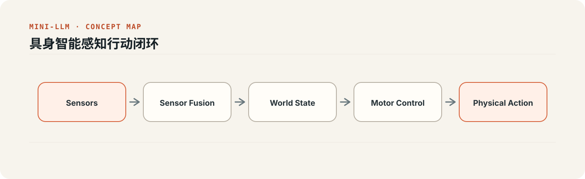

# **《mini-llm Embodied AI Engine 深度解析：从 Perception、Sensor Fusion 到 Motor Control、Action Execution 与 Physical Interaction》**



_图：具身智能感知行动闭环。从左到右展示本章核心概念之间的数据流与依赖关系。_

前面的文章中，我们讨论了 World Model Engine。

World Model 让 AI 能够在内部表示世界、预测环境变化，并推演不同动作可能产生的结果。

但是，一个重要的问题还没有解决：

**如果 AI 不只是观察世界，而是拥有真实的身体，它应该如何与物理世界交互？**

例如，一个机器人需要完成以下任务：

1. 通过摄像头观察桌面。
2. 识别桌子上的杯子。
3. 判断杯子的位置和姿态。
4. 规划机械臂的运动轨迹。
5. 控制机械臂移动。
6. 抓住杯子。
7. 将杯子移动到指定位置。
8. 根据传感器反馈调整抓取力度。

这已经不只是语言理解和文本生成，而是一个完整的物理交互系统。

它涉及一个重要研究方向：

**Embodied AI（具身人工智能）。**

本文将围绕 mini-llm，研究如何构建一个具备感知、空间理解、运动控制和物理交互能力的 Embodied AI Engine。

# **一、Embodied AI：什么是具身智能？**

## **1.1 从数字智能到具身智能**

传统 LLM 主要通过文本与外部世界交互。

例如：

```
用户：桌子上的杯子在哪里？

AI：杯子位于桌子的右侧。
```

这种交互主要发生在信息空间。

但如果 AI 控制的是一个机器人，任务就会发生变化：

```
任务：把桌子右侧的杯子拿起来。
```

机器人必须完成：

- 视觉感知。
- 对象识别。
- 空间定位。
- 路径规划。
- 机械臂控制。
- 抓取执行。
- 力反馈。
- 结果验证。

这就是具身智能与普通语言模型的重要区别。

具身智能不仅需要理解世界，还需要通过身体与世界发生交互。

## **1.2 Embodied AI 的定义**

可以将 Embodied AI 定义为：

**通过身体、传感器和执行器与环境持续交互，并在感知、行动和反馈过程中形成智能行为的系统。**

一个典型的具身智能系统包含：

\\[ E=(B,S,A,W) \\]

其中：

- \\(B\\)：Body，身体或物理载体。
- \\(S\\)：Sensors，传感器。
- \\(A\\)：Actuators，执行器。
- \\(W\\)：World，外部环境。

例如：

| 组成        | 机器人示例        |
| --------- | ------------ |
| Body      | 机器人底盘、机械臂    |
| Sensors   | 摄像头、IMU、力传感器 |
| Actuators | 电机、舵机、夹爪     |
| World     | 房间、桌子、杯子、人类  |

具身智能的核心不是简单地把 LLM 接到机器人上，而是建立一个能够持续感知和控制物理环境的系统。

## **1.3 Embodied AI 与传统 AI 的区别**

| 对比维度 | 传统数字 AI   | Embodied AI |
| ---- | --------- | ----------- |
| 主要输入 | 文本、图片、数据  | 视觉、声音、传感器   |
| 主要输出 | 文本、图像、代码  | 运动、动作、控制信号  |
| 运行环境 | 数字空间      | 物理或模拟环境     |
| 反馈   | 用户评价、数据结果 | 传感器和环境变化    |
| 主要风险 | 信息错误、软件故障 | 碰撞、损坏、人身安全  |
| 核心能力 | 理解、推理、生成  | 感知、预测、控制、行动 |

需要注意：具身智能也可以运行在模拟环境中，不一定必须拥有真实机器人。

# **二、Embodied AI 的核心架构**

具身智能需要把 AI 的认知能力与物理控制能力连接起来。

一个完整的系统可以抽象为：

\\[ Observation \rightarrow Perception \rightarrow Representation \rightarrow World\ Model \rightarrow Planning \rightarrow Control \rightarrow Action \\]

行动之后，传感器再次获取环境信息，形成闭环。

## **mini-llm Embodied AI Architecture**

**Physical Environment**

房间、物体、地面、人类和其他机器人

**Perception Engine**

视觉、听觉、触觉和传感器感知

**Spatial Engine**

空间、位置、姿态

**Sensor Fusion**

多传感器信息融合

**World Model Engine**

环境表示、动态预测和不确定性

**Planning Engine**

任务规划、路径规划和动作规划

**Motor Control Engine**

运动控制、轨迹跟踪和反馈控制

**Actuator Execution**

电机、机械臂、底盘和夹爪

**Physical Feedback**

执行结果返回传感器，重新进入感知流程

这里可以看到，具身智能不是一个单独的模型，而是多个 Engine 协同工作的系统。

# **三、Perception Engine：AI 如何感知真实世界？**

具身智能的第一步是感知。

人类通过眼睛、耳朵、皮肤和其他感觉器官获取环境信息。

机器人则通过传感器获取信息。

## **3.1 机器人有哪些传感器？**

[Luxonis OAK D Pro W OV9782 RGB Depth Stereo IR Robot Kamera Fiyatı, Satın Alma Seçenekleri ve Özellikleri](https://images.openai.com/static-rsc-4/Hd-1WkAXJytetmrlcTF5a1BpwzHgYGt5oOKtYTULHxSuav2vyn0QYTg8KL-_MAogezJwLml6PNpBNutzgUiyaq1LkV9HkfX7cSlUvkHo1mtxGQedKnZNYraw6V_AUleBfudx9khaIblyDLY0ECseRnp-vWNPPqxniUpOl4-TSm4?purpose=inline)

**RGB Camera**

获取颜色、纹理和视觉信息

[Intel 82635DSD455 Vision Camera - Barcodesinc.com](https://images.openai.com/static-rsc-4/tNsZgIJw1ipehyYdmyK400pHD_kohlqYEaPgUwDAkch8YPooHM-nU-rjtHfdifxiDWnrpN3__pZN95pTtk1RWG5SCIa_CJTWyW73SDTYrwWN0na18exPaMzEiLNMlT5S9AVeIXylH2UNLWVMVSnkam9yUHd2qxfbbS9z_yGe-0c?purpose=inline)

**Depth Camera**

获取场景深度信息

[Empowering the Future of Robotic Intelligence | Analog Devices at Digi Key](https://images.openai.com/static-rsc-4/djci37s8zTBITsyjJ0kxeHrtef8tFXAGMh8VgPgoqfWiLcifK7wrPLbdUf2oIG_0p_LK3h52pV3Fz7vXYXdC0uoKJTbG_El6AgvFg10QKxAYcbKnSk7MdXxpUdagnvrA1jE6dHekh0nVx8z-4uGiTg2YCCsWOLsrVeMPYUa4eZE?purpose=inline)

**IMU**

测量角速度和加速度

[Yujin Robot Launches 3D Lidar for Service Robots and Smart Factories - IEEE Spectrum](https://images.openai.com/static-rsc-4/OkKCj0ODkuqjWw76s9VmFPguCrPjQJ93p5-izwxJJdUgnsurpe8m3NOdsuSpyD_pCV1W31yTUrn1yUlkdSMgbvLiw05QAM9daE-RubnVGZt8dcyYb5-a-_87_A_utpwWNfaZqRsVVDVQKEM1OwoEwEdK181MwC4kmyAt5k-nOWQ?purpose=inline)

**LiDAR**

获取周围环境的距离信息

[Bota Systems' new force torque sensor triples sensitivity of small payload cobots | Bota Systems](https://images.openai.com/static-rsc-4/TmD9AznLhGVp4chnqNQ9Njx-fLvRU4HMY6HVCo1wdmfDRC7yZP66IJZ6zhbC5z6zN_kM2mF6wkyEIe-G3thdkjMJpZcOERqVJcvNKSIay1NxWHEhCxDIdPSgS3371MvSZZyZ441Wk15n49hw6OXj0cQ2eoGn9L6o9dR4UYNqplc?purpose=inline)

**Force Sensor**

感知接触力和力矩

[GR-Dexter 技术报告 | alphaXiv](https://images.openai.com/static-rsc-4/Xt_U4aL3NjuSNv9sI-atlF-RQsDRerEzy0etUkzvVlAu6FAanfJX0zjQ4ikirQffZ97og1rFMARUclu_jKe8Ybow4Oc4HkciONRgMYhl_uE1cwu-6pWermW6VwuUPJCeY6OgKxNgvhyf3BhKZUNSg9L-zhsmL1NRCZnStg8fL2o?purpose=inline)

**Tactile Sensor**

感知接触位置和压力分布

不同传感器提供不同类型的信息。

例如：

摄像头可以告诉机器人：

```
前面有一个杯子。
```

深度相机可以进一步告诉机器人：

```
杯子距离摄像头 80 厘米。
```

力传感器则可以告诉机器人：

```
机械臂已经接触杯子，当前接触力为 2N。
```

这三种信息共同帮助机器人理解环境。

## **3.2 视觉感知**

视觉感知通常包括：

- Image Classification：图像分类。
- Object Detection：目标检测。
- Semantic Segmentation：语义分割。
- Instance Segmentation：实例分割。
- Pose Estimation：姿态估计。
- Optical Flow：光流估计。
- Visual Tracking：目标跟踪。

例如：

输入一张桌面图片：

[NVIDIA and Stanford Just Gave Robots 3D Vision | by Aarav Bedi | KAIRI AI | Jan, 2026 | Medium](https://images.openai.com/static-rsc-4/WPuCjC-n0Fm9P8og8CFXDvAxCPjNCaYgqIACtoVOCjfKkCr8FP820IbVe7-u9xQskYUp_4oPFydMdGImgOsnAnq3ekS1VrhAsSnHMEZZDgoRp7DQSaoRTZsu7XNeeCmogwNYOjsutw_lt3Qgapfp9Sziw5rguHxT_wnM58A4vCY?purpose=inline)

[medium.com](https://medium.com/kairi-ai/nvidia-and-stanford-just-gave-robots-3d-vision-f0640f11205a?utm_source=chatgpt.com)

模型需要识别：

```
objects = [    {        "class": "cup",        "bbox": [120, 80, 220, 250],        "confidence": 0.97    },    {        "class": "bottle",        "bbox": [300, 60, 390, 270],        "confidence": 0.94    }]
```

这只是一个目标检测输出示例。

但要注意：

**检测到物体，不代表机器人已经知道如何抓住物体。**

还需要进一步计算物体在三维空间中的位置和姿态。

## **3.3 感知与理解的区别**

感知系统可能告诉我们：

```
发现一个杯子。
```

空间理解系统还需要知道：

```
杯子位于桌面右侧。
杯口朝上。
杯子距离机械臂末端 30 厘米。
```

而行动系统还需要知道：

```
应该从杯子的哪个位置接近？
机械臂应该采用什么姿态？
需要多大的夹持力？
```

因此：

Perception 是输入信息获取，Spatial Understanding 是对空间结构的解释，Planning 才是行动方案的形成。

# **四、Sensor Fusion：如何融合多个传感器？**

单一传感器通常无法完整描述真实世界。

例如：

摄像头可以识别物体，但在光线不足时可能失效。

LiDAR 可以测量距离，但不一定能够识别物体的具体语义。

IMU 可以测量加速度和角速度，但单纯积分会产生漂移。

因此，需要融合多个传感器。

## **4.1 什么是 Sensor Fusion？**

Sensor Fusion（传感器融合）是指：

**将多个传感器提供的信息结合起来，获得比单一传感器更完整、更稳定的环境估计。**

例如：

| 传感器          | 提供的信息   |
| ------------ | ------- |
| Camera       | 物体外观、类别 |
| Depth Camera | 深度、距离   |
| IMU          | 角速度、加速度 |
| LiDAR        | 环境几何结构  |
| Encoder      | 电机或关节位置 |
| Force Sensor | 接触力和力矩  |

## **4.2 传感器融合的基本架构**

## **Sensor Fusion Architecture**

**Camera**

视觉

**IMU**

惯性

**LiDAR**

距离

**Sensor Fusion**

时间同步、坐标转换、状态估计

**Fused State**

统一的位置、姿态和环境状态估计

## **4.3 时间同步**

不同传感器可能以不同频率运行。

例如：

| 传感器           | 频率     |
| ------------- | ------ |
| Camera        | 30 FPS |
| IMU           | 200 Hz |
| LiDAR         | 10 Hz  |
| Joint Encoder | 100 Hz |

如果直接将这些数据拼接，可能出现时间错位。

例如：

摄像头记录的是 10:00:00.100 的图像，而 IMU 数据来自 10:00:00.080。

在快速运动场景中，这种差异可能造成明显误差。

因此，需要：

- Timestamp。
- Clock Synchronization。
- Interpolation。
- Sensor Buffer。
- Approximate Time Synchronization。

## **4.4 Kalman Filter：经典状态融合方法**

假设机器人状态：

\\[ x_t= \begin{bmatrix} 位置\\\ 速度 \end{bmatrix} \\]

状态预测：

\\[ \hat{x}\_{t|t-1}=F\hat{x}\_{t-1|t-1}+Bu_t \\]

预测协方差：

\\[ P\_{t|t-1}=FP\_{t-1|t-1}F^T+Q \\]

当传感器提供新的测量值时：

\\[ K_t=P\_{t|t-1}H^T (HP\_{t|t-1}H^T+R)^{-1} \\]

\\[ \hat{x}\_{t|t} = \hat{x}\_{t|t-1} + K_t(z_t-H\hat{x}\_{t|t-1}) \\]

其中：

- \\(F\\)：状态转移矩阵。
- \\(B\\)：控制输入矩阵。
- \\(Q\\)：过程噪声协方差。
- \\(H\\)：观测矩阵。
- \\(R\\)：观测噪声协方差。
- \\(K\\)：Kalman Gain。

Kalman Filter 适合线性、高斯假设下的状态估计。

对于非线性问题，可以考虑：

- EKF：Extended Kalman Filter。
- UKF：Unscented Kalman Filter。
- Particle Filter：粒子滤波。

实际工程中，视觉惯性里程计和机器人定位还会使用优化方法、因子图等技术。

# **五、Spatial Understanding：AI 如何理解三维空间？**

具身智能必须理解空间。

因为机器人不仅要知道物体是什么，还必须知道物体在哪里、朝向哪里，以及能否到达。

## **5.1 坐标系**

机器人系统中通常存在多个坐标系：

- World Frame：世界坐标系。
- Robot Frame：机器人坐标系。
- Camera Frame：摄像头坐标系。
- Base Frame：机械臂基座坐标系。
- End-effector Frame：末端执行器坐标系。

[3D视觉坐标系与坐标转换-技术圈](https://images.openai.com/static-rsc-4/2xjy7KEG7rFKr7m4eeraIozL5I6gUqMvZruogtUFHOsIOevAo3KUlnTNNEd-Om5bs6-PsMnhv5oq3Cz2MnhWzq6Um7nWKvLb6vojJKpM-l5-izYYEGpJvev1AMttiFKZLRu1XutbinAwl3mxnB4wveTlWgq16eYPRX-lLkSRbr4?purpose=inline)

[jishu.proginn.com](https://jishu.proginn.com/doc/47826475d39cec57a?utm_source=chatgpt.com)

同一个物体，在不同坐标系下的位置可能不同。

例如：

摄像头坐标系下：

\\[ P_C= \begin{bmatrix} 0.3\\\ 0.1\\\ 0.8 \end{bmatrix} \\]

转换到机器人基座坐标系：

\\[ P_B=R\_{BC}P_C+t\_{BC} \\]

其中：

- \\(R\_{BC}\\)：旋转矩阵。
- \\(t\_{BC}\\)：平移向量。

这就是坐标变换的基本形式。

## **5.2 齐次变换矩阵**

机器人学中常使用齐次变换矩阵：

\\[ T= \begin{bmatrix} R&t\\\ 0&1 \end{bmatrix} \\]

一个三维点可以表示为：

\\[ P= \begin{bmatrix} x\\\y\\\z\\\1 \end{bmatrix} \\]

变换：

\\[ P_B=T\_{BC}P_C \\]

齐次变换能够统一处理旋转和平移。

## **5.3 机器人为什么需要理解坐标变换？**

假设摄像头发现杯子：

```
Camera Frame:
x = 0.3m
y = 0.1m
z = 0.8m
```

机械臂需要知道：

```
Robot Base Frame:
x = ?
y = ?
z = ?
```

如果没有坐标转换，机械臂无法直接根据摄像头输出的位置执行抓取。

因此，Spatial Engine 应当成为 Embodied AI 中的基础组件。

## **5.4 空间表示方式**

常见的三维空间表示包括：

| 表示方式           | 特点      | 常见用途       |
| -------------- | ------- | ---------- |
| Point Cloud    | 三维点集合   | LiDAR、深度相机 |
| Voxel Grid     | 三维体素网格  | 障碍物和占据建模   |
| Occupancy Grid | 空间占据概率  | 移动机器人导航    |
| Mesh           | 顶点、边和面  | 三维模型和碰撞检测  |
| TSDF           | 截断符号距离场 | 三维重建       |
| Scene Graph    | 对象与空间关系 | 场景理解       |

不同表示方式适合不同任务，不需要全部同时采用。

# **六、Localization：机器人如何知道自己在哪里？**

机器人在环境中移动时，必须知道自身位置。

这就是 Localization（定位）。

## **6.1 绝对位置与相对位置**

绝对位置：

```
机器人位于地图坐标：
x = 10.2m
y = 5.8m
```

相对位置：

```
机器人距离桌子：
2.5m
```

实际系统往往同时需要这两种信息。

## **6.2 Odometry：里程计**

机器人可以通过轮速计、关节编码器或视觉运动估计自身移动。

例如：

```
初始位置：
x = 0

轮子转动后：
估计移动 1 米

新位置：
x = 1 米
```

但是，里程计误差会不断累积。

因此，单纯依靠里程计通常无法长期保持精确定位。

## **6.3 SLAM：同时定位与建图**

SLAM（Simultaneous Localization and Mapping）解决一个经典问题：

**机器人不知道自己在哪里，也不知道环境地图是什么，但它需要一边移动，一边建立地图，同时估计自己的位置。**

[How Robots 'See': Cameras, Sensors, and Obstacles | OnOff.gr](https://images.openai.com/static-rsc-4/U4uJtHFmZddIFugY-QXqqEW-TVodeW1OJZX6KEd_R9ARLlCGJimtwtfTBUeV_R9a7VYKID2pfSnGlXeX__SF418QHF6asX_F_PmGl6ER3O1ikBsC9RnxAW2m2mH47tx8ue1zLmHSZpfORZ23m7lerIE0FmFPdeLIHPv-Iz2swQI?purpose=inline)

[onoff.gr](https://www.onoff.gr/blog/en/robot/how-robots-see-cameras-sensors-obstacles/?utm_source=chatgpt.com)

SLAM 的基本流程：

```
传感器获取数据
      ↓
特征提取
      ↓
运动估计
      ↓
地图更新
      ↓
回环检测
      ↓
全局优化
      ↓
更新机器人位置
```

其中：

- Odometry：估计运动。
- Mapping：建立环境地图。
- Loop Closure：检测是否回到以前到过的位置。
- Optimization：减少累计误差。

常见的 SLAM 技术包括视觉 SLAM、激光 SLAM 和视觉惯性 SLAM。

## **6.4 SLAM 与 World Model 的关系**

SLAM 主要解决：

```
我在哪里？
周围空间是什么样子？
```

World Model 还需要进一步处理：

```
物体是什么？
物体如何运动？
执行行动之后会发生什么？
```

因此，SLAM 可以为 World Model 提供空间和定位基础，但它并不等同于完整世界模型。

# **七、Motor Control：AI 如何控制身体运动？**

感知和理解解决了机器人如何知道环境的问题。

但机器人还必须真正执行动作。

这就涉及 Motor Control（运动控制）。

## **7.1 从目标到电机控制**

假设 AI 的目标是：

```
让机械臂末端移动到杯子上方。
```

这是一条高层指令。

底层控制器却需要知道：

- 每个关节转动多少？
- 关节转动速度是多少？
- 电机需要输出多大的力矩？
- 如何避免机械臂碰撞？
- 如何保证运动稳定？

因此，需要将高层任务转换为低层控制指令。

## **7.2 机器人运动控制的层级**

## **Motor Control Hierarchy**

**Task Level**

抓取杯子、移动到目标位置

**Motion Planning**

规划机械臂运动轨迹

**Trajectory Generation**

生成位置、速度和加速度曲线

**Joint Controller**

关节位置、速度和力矩控制

**Motor Driver**

向实际电机发送控制信号

这意味着：

LLM 不应该直接生成未经验证的电机电流或高频控制信号。

更合理的架构是：

LLM 负责高层任务理解，规划系统负责生成可行的动作目标，实时控制器负责稳定、安全地执行动作。

## **7.3 运动学（Kinematics）**

运动学研究机器人关节运动与末端位置之间的关系。

对于一个机械臂：

\\[ q= \begin{bmatrix} q_1\\\q_2\\\q_3 \end{bmatrix} \\]

其中 \\(q_i\\) 表示各关节角度。

末端位置可以表示为：

\\[ x=f(q) \\]

这就是 Forward Kinematics（正向运动学）。

给定关节角度，计算末端执行器的位置。

反过来：

\\[ q=f^{-1}(x) \\]

这是 Inverse Kinematics（逆运动学）。

给定目标位置，求解关节角度。

逆运动学可能存在多个解，也可能没有满足约束的解。

## **7.4 动力学（Dynamics）**

运动学关注位置和运动关系。

动力学则关注力、力矩与运动之间的关系。

机械臂动力学的经典形式：

\\[ M(q)\ddot{q} + C(q,\dot q)\dot q + g(q) = \tau \\]

其中：

- \\(M(q)\\)：质量矩阵。
- \\(C(q,\dot q)\\)：科氏力和离心力项。
- \\(g(q)\\)：重力项。
- \\(\tau\\)：关节力矩。

这说明控制机器人不仅需要知道应该移动到哪里，还需要考虑怎样产生所需的运动。

# **八、Feedback Control：如何根据反馈调整动作？**

如果机器人只执行预先生成的动作，而不观察执行结果，那么它很容易出现偏差。

例如：

机械臂原计划移动 20 厘米，但实际只移动了 18 厘米。

如果系统不检查反馈，就可能导致后续抓取失败。

因此，具身智能需要闭环控制。

## **8.1 开环控制与闭环控制**

开环控制：

```
生成指令
   ↓
执行指令
   ↓
结束
```

闭环控制：

```
生成指令
   ↓
执行指令
   ↓
读取传感器
   ↓
计算误差
   ↓
修正控制指令
   ↓
继续执行
```

## **8.2 PID 控制器**

PID 是一种经典控制方法。

控制误差：

\\[ e(t)=r(t)-y(t) \\]

其中：

- \\(r(t)\\)：目标值。
- \\(y(t)\\)：实际测量值。

PID 控制输出：

\\[ u(t)= K_pe(t) + K_i\int_0^t e(\tau)d\tau + K_d\frac{de(t)}{dt} \\]

三个部分：

| 参数 | 作用            |
| -- | ------------- |
| P  | 根据当前误差进行修正    |
| I  | 累积历史误差，消除稳态偏差 |
| D  | 根据误差变化趋势进行修正  |

PID 广泛用于电机、温度、速度和位置控制。

## **8.3 AI 与传统控制器如何配合？**

一个重要的工程原则：

**AI 负责智能决策，传统控制器负责稳定执行。**

例如：

```
LLM：
把杯子移动到桌子左侧。

Planning：
计算抓取和移动动作。

Motion Controller：
生成机械臂轨迹。

PID / Servo Controller：
控制关节和电机。

Sensor Feedback：
检查动作是否达到目标。
```

AI 并不需要替代所有传统控制算法。

相反，将学习型模型与成熟的控制方法组合，通常更容易构建可靠系统。

# **九、Action Execution：如何将决策变成真实行动？**

Planning Engine 输出的是行动计划。

但真实设备需要执行协议和控制指令。

这就是 Action Execution 的职责。

## **9.1 Action 的分层表示**

建议将动作分成三个层级：

| 层级              | 示例         | 执行模块             |
| --------------- | ---------- | ---------------- |
| Semantic Action | 抓取杯子       | Agent            |
| Motion Action   | 移动到杯子上方    | Motion Planner   |
| Control Command | 关节角度、速度、力矩 | Motor Controller |

例如：

```
action = {    "type": "grasp",    "target": "cup_001",    "parameters": {        "grasp_position": [0.3, 0.1, 0.2],        "gripper_width": 0.05    }}
```

这属于高层动作描述，不应直接作为未经验证的电机指令。

## **9.2 Action Executor**

```
class ActionExecutor:    def __init__(        self,        planner,        controller,        safety    ):        self.planner = planner        self.controller = controller        self.safety = safety    def execute(self, action):        trajectory = self.planner.plan(action)        if not self.safety.validate(trajectory):            raise RuntimeError(                "Unsafe trajectory"            )        result = self.controller.execute(            trajectory        )        return result
```

这里将安全检查放在实际执行之前。

真实系统还必须在执行期间持续检查安全状态，而不能只在启动时验证一次。

## **9.3 Action Feedback**

执行完成后，需要返回结构化结果：

```
result = {    "action_id": "action_001",    "status": "completed",    "success": True,    "actual_state": {        "object_position": [0.4, 0.2, 0.3]    },    "error": None}
```

如果抓取失败：

```
result = {    "action_id": "action_002",    "status": "failed",    "success": False,    "error": "object_slipped"}
```

这些结果可以进入 Memory Engine 和 Learning Engine，用于后续分析和改进。

# **十、Sim-to-Real：如何从模拟环境迁移到真实世界？**

这是具身智能研究中的一个重要难题。

在模拟环境中训练出来的机器人，不一定能直接在现实世界中正常工作。

例如：

模拟器中的地面摩擦系数为 0.8。

但真实地面的摩擦系数可能是 0.5。

机器人在模拟器中能够稳定移动，现实中却可能打滑。

## **10.1 Sim-to-Real Gap**

模拟环境与现实世界之间存在差异：

| 差异    | 模拟环境  | 真实环境    |
| ----- | ----- | ------- |
| 物理参数  | 理想化参数 | 真实变化    |
| 光照    | 可控    | 动态变化    |
| 传感器噪声 | 简化    | 复杂      |
| 摩擦    | 固定或简化 | 随材料变化   |
| 延迟    | 可控    | 网络与硬件延迟 |
| 碰撞    | 近似模型  | 真实接触复杂性 |

这种差异称为 Sim-to-Real Gap。

## **10.2 Domain Randomization**

一种常见方法是 Domain Randomization。

训练时随机改变模拟环境参数：

```
import randomdef randomize_environment():    return {        "friction": random.uniform(0.3, 1.0),        "mass": random.uniform(0.5, 2.0),        "lighting": random.uniform(0.2, 1.0),        "sensor_noise": random.uniform(0.0, 0.05)    }
```

这样，模型不会只适应某一组固定的模拟参数。

## **10.3 System Identification**

另一种方法是系统辨识。

通过真实设备的数据，估计实际系统的动力学参数。

例如：

- 电机响应。
- 质量。
- 摩擦。
- 运动延迟。
- 执行器限制。

然后更新模拟器，使它更接近真实设备。

## **10.4 Sim-to-Real 的基本流程**

## **Sim-to-Real Pipeline**

**Simulation Environment**

构建可控训练环境

**Policy / Model Training**

训练感知、控制和决策模型

**Domain Randomization**

增强环境变化适应能力

**Real Robot Deployment**

经过验证后部署到真实设备

**Real-world Evaluation**

比较预测与实际执行结果

Sim-to-Real 并不是简单地把模拟器中的模型复制到机器人上。

真实部署需要重新进行硬件校准、系统辨识、安全验证和分阶段测试。

# **十一、具身智能中的安全机制**

物理世界中的错误可能造成真实损害。

因此，具身智能不能只依靠模型输出的合理性。

必须建立独立的安全控制层。

## **11.1 为什么需要 Safety Engine？**

例如，LLM 接收到：

```
把桌子上的杯子拿起来。
```

它可能规划出一个抓取动作。

但执行之前必须检查：

- 机械臂是否会碰撞人类？
- 关节是否会超过限制？
- 运动速度是否过高？
- 夹爪力量是否超过上限？
- 目标是否在机械臂可达范围内？
- 紧急停止是否有效？

这些都不应该只由 LLM 自己判断。

## **11.2 Safety Layer**

建议增加独立的 Safety Layer：

```
Agent
  ↓
Planning
  ↓
Safety Validation
  ↓
Motion Control
  ↓
Actuator
```

安全层可以包含：

- Joint Limits。
- Velocity Limits。
- Torque Limits。
- Collision Detection。
- Workspace Constraints。
- Emergency Stop。
- Human Safety Zone。
- Watchdog。
- Hardware Interlock。

## **11.3 安全原则**

对于具身智能，建议遵循：

1. 高风险动作必须有独立安全约束。
2. 模型不能直接绕过控制器向硬件发送任意指令。
3. 传感器异常时应进入安全状态。
4. 失联、超时和执行异常必须有明确处理策略。
5. 急停功能不能依赖 LLM 或云端服务。
6. 未经过验证的策略不能直接部署到真实机器人。

尤其是涉及人类协作的机器人，安全要求必须依据具体设备和应用场景设计。

# **十二、mini-llm Embodied AI Engine 工程架构**

前面介绍的能力可以整理成一个独立的 Engine。

建议目录：

```
mini-llm/
│
├── embodied/
│
│   ├── perception/
│   │   ├── camera.py
│   │   ├── object_detection.py
│   │   ├── segmentation.py
│   │   └── tracking.py
│   │
│   ├── sensor_fusion/
│   │   ├── synchronization.py
│   │   ├── kalman_filter.py
│   │   ├── ekf.py
│   │   └── fusion.py
│   │
│   ├── spatial/
│   │   ├── coordinate.py
│   │   ├── transform.py
│   │   ├── point_cloud.py
│   │   └── scene_graph.py
│   │
│   ├── localization/
│   │   ├── odometry.py
│   │   ├── slam.py
│   │   └── pose_estimation.py
│   │
│   ├── motion/
│   │   ├── kinematics.py
│   │   ├── inverse_kinematics.py
│   │   ├── trajectory.py
│   │   └── collision.py
│   │
│   ├── control/
│   │   ├── pid.py
│   │   ├── joint_controller.py
│   │   ├── velocity_controller.py
│   │   └── force_controller.py
│   │
│   ├── execution/
│   │   ├── action.py
│   │   ├── executor.py
│   │   └── feedback.py
│   │
│   ├── safety/
│   │   ├── constraints.py
│   │   ├── safety_monitor.py
│   │   └── emergency_stop.py
│   │
│   ├── simulation/
│   │   ├── simulator_adapter.py
│   │   └── sim_to_real.py
│   │
│   ├── integration/
│   │   ├── world_model_adapter.py
│   │   ├── planning_adapter.py
│   │   └── agent_adapter.py
│   │
│   └── embodied_engine.py
│
└── tests/
    ├── test_perception.py
    ├── test_sensor_fusion.py
    ├── test_spatial.py
    ├── test_kinematics.py
    ├── test_control.py
    └── test_safety.py
```

## **12.1 统一接口**

```
from abc import ABC, abstractmethodclass EmbodiedEngine(ABC):    @abstractmethod    def observe(self):        pass    @abstractmethod    def estimate_state(self):        pass    @abstractmethod    def plan_action(self, goal):        pass    @abstractmethod    def validate_action(self, action):        pass    @abstractmethod    def execute_action(self, action):        pass    @abstractmethod    def get_feedback(self):        pass
```

## **12.2 核心执行流程**

```
class RobotAgent:    def __init__(        self,        perception,        world_model,        planner,        safety,        executor    ):        self.perception = perception        self.world_model = world_model        self.planner = planner        self.safety = safety        self.executor = executor    def run(self, goal):        observation = self.perception.observe()        state = self.world_model.encode(            observation        )        action = self.planner.plan(            state,            goal        )        if not self.safety.validate(action):            return {                "status": "rejected",                "reason": "unsafe_action"            }        result = self.executor.execute(action)
```

这个例子是架构级伪实现。生产系统需要异步数据流、执行超时、取消机制、实时状态监控，以及执行期间的连续安全检查。

# **十三、mini-llm Embodied AI V1 实施路线**

不建议第一阶段就开发完整人形机器人。

具身智能涉及硬件、算法、控制和安全，应该先从可控任务开始。

## **Phase 1：视觉感知**

V1 基础

实现：

- 摄像头数据读取。
- 目标检测。
- 物体跟踪。
- 图像坐标输出。

验收：

- 能识别桌面上的常见物体。
- 能输出目标边界框。
- 能持续跟踪目标。

## **Phase 2：空间感知**

实现：

- 深度相机。
- 相机标定。
- 坐标变换。
- 三维物体位置估计。

验收：

- 能获取物体的三维坐标。
- 能在不同坐标系之间转换。
- 能估计目标位置误差。

## **Phase 3：模拟机械臂**

实现：

- 机器人模型。
- 正向运动学。
- 逆向运动学。
- 轨迹规划。
- 碰撞检测。

验收：

- 能在模拟环境中移动机械臂。
- 能到达指定末端位置。
- 能检测明显碰撞风险。

## **Phase 4：闭环控制**

实现：

- PID。
- 关节控制。
- 状态反馈。
- 运动误差分析。

验收：

- 能跟踪目标轨迹。
- 能根据反馈修正动作。
- 能检测控制异常。

## **Phase 5：真实设备集成**

实现：

- 摄像头。
- 机械臂。
- 夹爪。
- 安全控制。
- Action Executor。

验收：

- 能完成经过限定的抓取任务。
- 能检测抓取失败。
- 能在异常时停止执行。
- 能记录每次任务的执行轨迹。

# **十四、推荐的开源技术生态**

如果要真正实现 mini-llm Embodied AI，没有必要从零开发所有底层能力。

可以基于成熟的机器人软件生态构建。

[Open Source First — The Anomalous Company](https://images.openai.com/static-rsc-4/f2CodnzRzIXR9AvvpQzqKXuesQ-8ZUdY7dLFliQvv9WFlznxP8dP4NsOFRhY_pSxayRVp4JysB7YV7hFrLskXBv_eHBjna23x4FMqmjDR9L-fUmiimpHvKrjJ9UjZodhHeqr50TU57giV32yUAiEtnK7dfZn66kE3eDHJ8O6WsY?purpose=inline)

**ROS 2**

机器人通信、节点管理、传感器数据和控制接口。

[官方文档](https://docs.ros.org/?utm_source=chatgpt.com)

[Getting Started — MoveIt Documentation: Humble  documentation](https://images.openai.com/static-rsc-4/T1hdc8d-bvfk6_L-oL4e8NjhroDfyTK_IP5vd7OuE3htKwC2QlDEGyjQIxbwxXKZPjU7nxlrR6L6BqWuG2DNAlwL-P6PYlwpCC5Y1h7afH8hW4zH137qh2mON3oAj8zMvIq4vAvC-EVr2fgID-qXJSujUrFhGBK6WbgW62eHBeU?purpose=inline)

**MoveIt 2**

机械臂运动规划、碰撞检测和抓取任务。

[官方文档](https://moveit.picknik.ai/?utm_source=chatgpt.com)

[ROSCon 23: Simulation of Highly Dynamic Omnidirectional Robots in Isaac Sim | Vu N.](https://images.openai.com/static-rsc-4/iC9qrSM3hgu33sBLW3cE90UYqtcZMM-sVZvUyxv44A2--IV83B1bw_ShCkLC5h6KiME60vEpTwh7kCjibLF5i4gNIq-NnmUjeIpbtgPlrF6RHdQ6YjoR-DORAeP8ZbRrRzSSMUbUr64HlshgioCyA3IpAqC_FfdNVe8HFmK86d0?purpose=inline)

**NVIDIA Isaac Sim**

机器人仿真、传感器模拟和 Sim-to-Real 研究。

[官方网站](https://developer.nvidia.com/isaac/sim?utm_source=chatgpt.com)

[RobotRank.ai - Benchmark Your Robot Controllers](https://images.openai.com/static-rsc-4/Vev2GRf4iw17uYfGrQ-T5ZQWLr9MyNF6omTNrG8jlxTW6qSa7QbElS7N0YtsFVhYH7jGNSa9i7egcBda-Zp86ffKtiWtqctLZ6YkR-ms7PVIS9PpQ9DNstBL188s2z7Y8ZWDyjfn91rnF9Pnai-ScD5qPU-6J7PaL8JS8co2nUc?purpose=inline)

**MuJoCo**

物理仿真、机器人控制和强化学习。

[官方网站](https://mujoco.org/?utm_source=chatgpt.com)

[Open Source Initiative :osi: (@osi@opensource.org) - OSI Mastodon](https://images.openai.com/static-rsc-4/fxbAqZD5n5r2OBCd4nPHCiC6wbv3lpJ97epHKcaq6WLVDdG2RwhPhm3RDDJFQZtRUAjvcKEjE2uENyHdZqm3FQKIyYIOjKI8SeTzrUyYnydrkO5AqrtCdqw32Vjmry3HQhHTTdCSbmNl8lq4Kbx6Mgj0sK1TokBFoOM9JsgCUuE?purpose=inline)

**OpenCV**

图像处理、相机标定、视觉算法。

[官方网站](https://opencv.org/?utm_source=chatgpt.com)

[Open3d React Icon SVG](https://images.openai.com/static-rsc-4/Em0ZGB6HRHhkSiezo16OxYIxL2cfkmyerv7ageEQN4f-i5xzL_ztXSR-t2p7rw7RKdyGSeD9HwOhQ8s0CEJPQk94lZtBwDb9gL411KUyRAjG-m0dhJ_JCZf0Kk69mjReC9QzbB9ZC5TyrPhep1r3T84UAE-7ZCko7BDY-04HrEQ?purpose=inline)

**Open3D**

点云、三维重建和空间数据处理。

[官方网站](https://www.open3d.org/?utm_source=chatgpt.com)

这些项目不是互相替代的关系：

- ROS 2 解决机器人系统通信与集成。
- MoveIt 2 解决机械臂运动规划。
- Isaac Sim 和 MuJoCo 提供不同侧重点的仿真环境。
- OpenCV 和 Open3D 分别提供视觉与三维数据处理能力。

mini-llm 可以在这些成熟基础设施之上构建统一的智能决策层。

# **十五、最终思考：智能为什么需要身体？**

我们可以从一个简单问题开始：

**一个 AI 能够描述杯子，却没有办法触碰杯子，它真正理解杯子吗？**

从语言层面看，它可能知道：

- 杯子的形状。
- 杯子的用途。
- 杯子的材质。
- 杯子可以盛水。

但当它真正控制机械臂抓取杯子时，还需要理解：

- 杯子的空间位置。
- 杯子的重量。
- 杯子的摩擦特性。
- 抓取位置。
- 夹持力度。
- 物体接触后的变化。

这些知识不仅来自语言，也需要来自环境交互、传感器反馈和行动结果。

具身智能强调：

**智能不仅是对世界的描述，还包括在世界中行动，并通过行动获得新的信息。**

可以把这个过程表示为：

\\[ Perception \rightarrow Representation \rightarrow Prediction \rightarrow Planning \rightarrow Action \rightarrow Feedback \rightarrow Learning \\]

这与我们此前研究的 World Model、Simulation、Planning、Decision 和 Agent Learning 形成了完整联系。

但需要保持一个重要区别：拥有身体或传感器，不自动意味着系统就具有更高级的智能。具身系统是否真正形成有效的环境理解，需要通过预测准确性、行动效果、泛化能力和安全性进行验证。

# **十六、mini-llm Engine 体系进一步扩展**

经过这一系列研究，mini-llm 已经不再只是一个简单的大语言模型实现项目。

它正在形成一个更完整的智能系统架构：

## **mini-llm：从模型到具身智能系统**

**基础计算层**

Tensor

Autograd

Neural Network

Transformer

**认知与知识层**

Representation

Memory

Knowledge

Causal Reasoning

World Model

Learning

**决策与执行层**

Planning

Decision

Agent

Runtime

Protocol

Simulation

**物理交互层**

Perception

Sensor Fusion

Spatial

Localization

Motor Control

Action Execution

**横向工程保障**

Security

Observability

Evaluation

Recovery

Resource Management

Architecture Guard

这里需要强调：这是一种逻辑架构划分，不代表每个模块都必须独立部署为一个服务。V1 应优先建立清晰接口，再根据性能、实时性和团队维护需求决定模块边界。

## **下一篇建议**

**《mini-llm Robotics Engine 深度解析：从 Robot Kinematics、Dynamics 到 Motion Planning、Trajectory Optimization 与 Manipulation》**

下一篇进一步深入机器人本体与运动数学：

1. Robot Architecture：机器人系统由哪些部分组成？
2. Forward Kinematics：如何从关节角度计算末端位置？
3. Inverse Kinematics：如何根据目标位置反求关节角度？
4. Robot Dynamics：机器人如何受到力和力矩影响？
5. Motion Planning：如何规划无碰撞运动路径？
6. Trajectory Generation：如何生成平滑的运动轨迹？
7. Trajectory Optimization：如何优化运动时间和能耗？
8. Manipulation：如何抓取、移动和操作物体？
9. Force Control：如何控制接触力？
10. Robotics Architecture：如何将机器人运动学和控制系统集成到 mini-llm？

