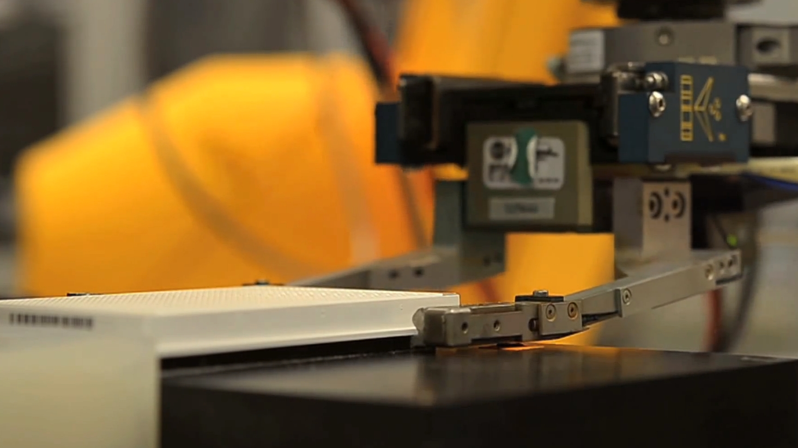
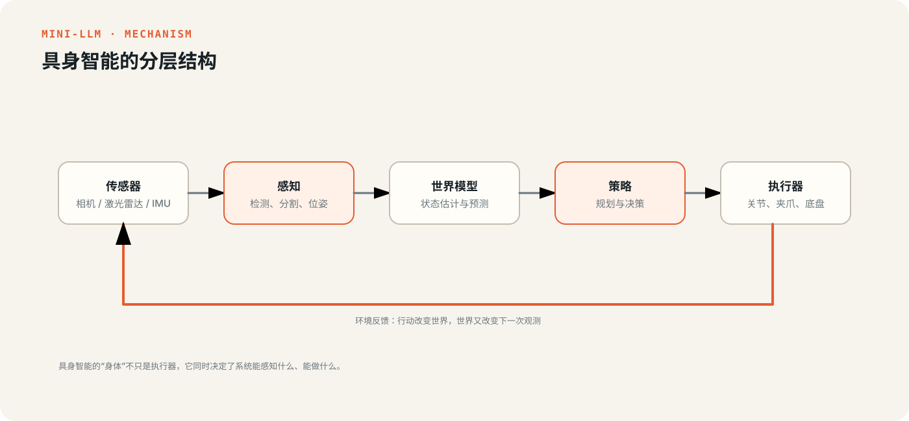
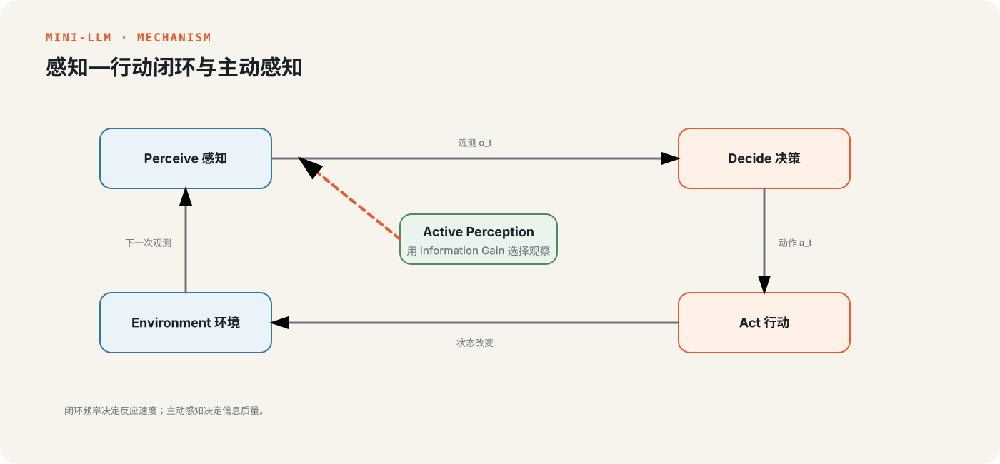

# **《mini-llm Embodied Intelligence Engine 深度解析：从 Embodied AI、Perception-Action Loop 到 Active Perception、World Interaction 与 Autonomous Learning》**

此前，我们已经从不同角度研究了 AI 系统的核心能力：

- Transformer Engine：如何理解和处理信息？
- Representation Engine：如何形成内部表示？
- World Model Engine：如何建立世界模型？
- Cognitive Architecture：如何组织认知过程？
- Memory Engine：如何积累和使用经验？
- Agent Engine：如何自主执行任务？
- Planning Engine：如何规划未来行动？
- Simulation Engine：如何模拟环境？
- Robotics Engine：如何控制机器人？
- VLA Engine：如何根据视觉和语言生成动作？

这些 Engine 共同指向一个更深层的问题：

**如果 AI 不再只是观察和描述世界，而是能够拥有身体、感知环境、采取行动，并通过行动改变环境，那么智能系统会发生什么变化？**

例如：

一个 AI 可以通过摄像头识别桌面上的杯子，可以通过语言模型理解“拿起杯子”，也可以通过 Robotics Engine 规划机械臂的运动。

但是，当机器人真正执行任务时，还会遇到更多问题：

- 摄像头被遮挡了怎么办？
- 不知道杯子的重量怎么办？
- 不确定杯子是否已经被抓住怎么办？
- 抓取失败后如何调整？
- 如何通过触觉判断物体是否滑动？
- 如何主动移动摄像头，获取更多信息？
- 如何通过反复与环境交互，逐渐学会新的技能？

这些问题不再只是语言理解或动作生成问题。

它们涉及一种更加完整的智能形态：

**具身智能（Embodied Intelligence）。**

# **一、Embodied Intelligence：什么是具身智能？**



_图：机械臂从实验台上取放检测板。具身智能的难点往往不在“看见”，而在接触：抓取力、位姿误差、物体滑动都只能在行动中暴露。图片：美国国家过敏和传染病研究所，[Wikimedia Commons](https://commons.wikimedia.org/wiki/File:Robot_arm_handles_an_assay_plate.jpg)，美国公有领域。_

## **1. 从离身智能到具身智能**

我们可以先区分两种不同的智能系统。

**离身智能（Disembodied Intelligence）**

主要通过文本、图像、音频和数字信息与世界交互。

例如：

- 语言模型回答问题。
- 图像模型识别物体。
- AI Agent 调用软件工具。
- AI 系统分析数据库。
- 多模态模型理解视频。

它们可以获得大量关于世界的信息，但不一定拥有直接改变物理世界的能力。

**具身智能（Embodied Intelligence）**

则强调智能体具有某种身体或行动载体，通过传感器获取环境信息，通过执行器改变环境，并根据反馈持续调整行为。

例如：

- 机器人通过摄像头观察物体。
- 机械臂通过触觉感知抓取状态。
- 自动驾驶汽车通过传感器观察道路。
- 无人机通过飞行改变自身观察位置。
- 虚拟智能体通过模拟身体与数字环境交互。

**离身智能**

主要通过信息输入和输出与外部世界交互

**具身智能**

通过身体、传感器和行动与环境持续交互

这里有一个重要区别：

语言模型可以说：

> 杯子很重，拿起来时应该小心。

具身智能系统则需要实际判断：

- 杯子是否真的很重？
- 需要多大的抓取力？
- 杯子是否正在滑动？
- 应该如何调整夹爪？
- 是否需要重新抓取？

前者主要是对知识的表达，后者需要在真实交互中获得反馈。

## **2. 智能为什么需要身体？**

首先需要澄清：

**身体并不是所有智能形式的逻辑必要条件。**

数学推理、形式逻辑、文本生成等能力可以在没有物理身体的系统中实现。

但是，如果目标是让智能体在物理世界中自主行动、适应环境，并获得关于物理世界的直接经验，那么身体就具有重要意义。

可以从五个方面理解。

### **第一：身体提供感知通道**

人类通过眼睛、耳朵、皮肤、鼻子等感知世界。

机器人也可以通过不同传感器获取信息：

| 传感器            | 感知内容       |
| -------------- | ---------- |
| RGB Camera     | 颜色、纹理、物体外观 |
| Depth Camera   | 深度和空间结构    |
| LiDAR          | 距离和环境几何结构  |
| Microphone     | 声音和语音      |
| Force Sensor   | 接触力        |
| Tactile Sensor | 接触位置和压力分布  |
| IMU            | 加速度和角速度    |
| Joint Encoder  | 关节位置和运动状态  |

身体使智能体能够获得不同类型的环境信息。

### **第二：身体提供行动能力**

智能不只是观察。

一个机器人需要通过行动改变环境。

例如：

- 移动机械臂。
- 推动物体。
- 抓取物体。
- 打开抽屉。
- 移动摄像头。
- 调整自身位置。

行动会产生新的环境状态。

因此，具身智能不再是单向的信息处理，而是双向交互。

### **第三：身体带来物理约束**

物理世界不是任意的。

机器人会受到：

- 重力。
- 摩擦力。
- 惯性。
- 碰撞。
- 关节限制。
- 能量消耗。
- 执行器速度限制。

这些约束会影响智能体的决策。

例如，一个机器人可能知道桌子上有一个杯子，但它的机械臂长度不够，就无法直接抓取。

这意味着：

**智能体的行动能力不仅取决于它知道什么，还取决于它的身体能够做什么。**

### **第四：身体让行动产生经验**

假设机器人不知道一个杯子是否容易滑动。

它可以尝试：

1. 轻轻夹住杯子。
2. 缓慢抬起。
3. 观察杯子是否发生位移。
4. 根据触觉传感器判断是否打滑。
5. 调整夹持力。

经过多次交互，机器人可以逐渐建立关于物体抓取特性的经验。

### **第五：身体改变认知过程**

具身智能的重要特点是：

感知、认知和行动不是完全独立的阶段，而是相互影响的过程。

机器人可能因为需要更准确地识别物体，而主动改变摄像头位置。

也可能因为触觉信息不足，而调整夹爪动作。

这意味着智能体不只是被动接收信息，还能够主动选择如何获得信息。

# **二、Embodied AI 的基本结构**



_图：具身智能的分层结构：传感器 → 感知 → 世界模型 → 策略 → 执行器，执行结果再通过环境反馈回来。_

具身智能可以用一个简单的数学模型描述。

定义：

- \\(S_t\\)：环境在时刻 \\(t\\) 的真实状态。
- \\(O_t\\)：智能体通过传感器获得的观察。
- \\(A_t\\)：智能体执行的动作。
- \\(S\_{t+1}\\)：动作执行后的环境状态。

环境状态转移：

\\[ S\_{t+1}\sim T(S\_{t+1}\mid S_t,A_t) \\]

传感器观察：

\\[ O_t\sim Z(O_t\mid S_t) \\]

智能体策略：

\\[ A_t\sim\pi\_\theta(A_t\mid O\_{0:t},A\_{0:t-1},L) \\]

其中：

- \\(T\\)：环境状态转移模型。
- \\(Z\\)：观察模型。
- \\(\pi\_\theta\\)：智能体策略。
- \\(L\\)：任务指令。

这构成了具身智能的基本交互模型。

整个过程可以表示为：

```
         Environment
              |
              v
          Sensors
              |
              v
          Perception
              |
              v
       Internal State
              |
              v
          Cognition
              |
              v
           Planning
              |
              v
           Action
              |
              v
          Actuators
              |
              v
         Environment
              |
              +------> Feedback
```

与传统 AI 不同，这里存在一个持续循环：

**感知 → 表征 → 决策 → 行动 → 反馈 → 再感知。**

这就是具身智能的核心结构。

# **三、Perception-Action Loop：感知与行动循环**



_图：感知—行动闭环。Active Perception 用 Information Gain 决定下一步看哪里，而不只是被动接收观测。_

## **1. 为什么感知和行动不能分离？**

传统计算机视觉系统通常可以按照以下方式工作：

```
图像输入
   |
   v
物体检测
   |
   v
分类结果
   |
   v
输出结果
```

但对于机器人来说，这样的流程是不够的。

假设机器人需要拿起桌上的一个杯子。

它通过摄像头发现杯子，但是摄像头无法准确判断杯子的背面形状。

此时机器人可以：

1. 移动摄像头。
2. 从另一个角度观察杯子。
3. 获取新的图像。
4. 更新内部表示。
5. 重新规划抓取动作。

这里的行动并不是为了直接完成抓取，而是为了改善感知。

这就是感知与行动之间的循环关系。

## **2. Perception-Action Loop 的数学表示**

定义：

\\[ O_t=Perception(S_t) \\]

\\[ B_t=Update(B\_{t-1},O_t,A\_{t-1}) \\]

\\[ A_t=Policy(B_t,G) \\]

其中：

- \\(O_t\\)：当前观察。
- \\(B_t\\)：内部信念状态。
- \\(G\\)：任务目标。
- \\(A_t\\)：当前动作。

执行动作之后：

\\[ S\_{t+1}=T(S_t,A_t) \\]

然后获取新的观察：

\\[ O\_{t+1}=Perception(S\_{t+1}) \\]

最终形成：

\\[ O_t\rightarrow B_t\rightarrow A_t \rightarrow S\_{t+1}\rightarrow O\_{t+1} \\]

这里的 \\(B_t\\) 不一定是一个显式概率分布，也可以是系统内部维护的状态估计、对象关系、场景表示和不确定性信息。

## **3. 一个真实的机器人例子**

任务：

> 把桌子上的杯子放到抽屉里。

机器人需要完成：

| 阶段 | 感知       | 行动      |
| -- | -------- | ------- |
| 1  | 识别杯子     | 移动到杯子附近 |
| 2  | 估计杯子位置   | 调整机械臂姿态 |
| 3  | 识别抓取位置   | 闭合夹爪    |
| 4  | 检测抓取状态   | 缓慢抬起    |
| 5  | 识别抽屉位置   | 移动到抽屉   |
| 6  | 检查抽屉状态   | 调整放置位置  |
| 7  | 检查杯子是否放入 | 松开夹爪    |

这里最值得注意的是：

机器人不会在最初就拥有全部信息。

它是在行动过程中逐渐获得信息，并根据新信息调整行为。

## **4. 闭环控制与开环控制**

开环控制：

\\[ A_0,A_1,A_2,\ldots,A_n \\]

先生成完整动作序列，然后执行。

如果环境变化，原计划可能失效。

闭环控制：

\\[ A_t=\pi(O_t) \\]

每次行动后重新获取观察，再决定下一步动作。

两者的区别：

| 比较   | 开环控制    | 闭环控制    |
| ---- | ------- | ------- |
| 环境反馈 | 不依赖实时反馈 | 使用反馈    |
| 环境变化 | 适应能力有限  | 可以动态调整  |
| 执行效率 | 可能较高    | 需要反馈计算  |
| 误差处理 | 难以及时修正  | 可以持续修正  |
| 典型应用 | 固定动作序列  | 动态机器人任务 |

具身智能通常需要闭环交互，但并不意味着每一个电机控制周期都需要调用大模型。

更合理的结构是：

- VLA 负责相对高层的动作决策。
- Robotics Engine 负责运动规划和控制。
- 低层控制器负责高频反馈。

# **四、Active Perception：为什么智能体需要主动感知？**

这是具身智能非常重要的能力。

传统感知系统通常是：

> 环境提供信息，系统接收信息。

Active Perception 则进一步提出：

> 智能体可以主动采取行动，改变自己的观察条件，从而获得更有价值的信息。

## **1. 被动感知的问题**

假设机器人正在识别一个杯子。

摄像头只能看到杯子的正面。

它无法确定：

- 杯子背面是否有把手？
- 杯子是否存在裂纹？
- 杯子是否被其他物体遮挡？
- 杯子的真实空间姿态是什么？

如果仅仅等待摄像头输入，机器人可能无法获得足够信息。

## **2. 主动感知的基本过程**

机器人可以主动改变观察位置：

```
初始观察
   |
   v
发现信息不足
   |
   v
计算需要获取的信息
   |
   v
选择观察动作
   |
   v
移动摄像头
   |
   v
获得新观察
   |
   v
更新内部模型
```

例如：

机器人发现杯子的把手被遮挡，于是移动手腕摄像头，从侧面重新观察。

这就是 Active Perception。

## **3. Information Gain：如何判断观察是否有价值？**

可以使用信息论中的信息增益来描述。

假设机器人对某个目标存在不确定性：

\\[ H(B_t) \\]

其中 \\(H\\) 表示熵，\\(B_t\\) 是当前信念状态。

机器人采取一个观察动作 \\(a\\)，获得新的观察 \\(O\_{t+1}\\)。

那么预期信息增益可以表示为：

\\[ IG(a)= H(B_t)- \mathbb{E}\_{O\_{t+1}\mid a} [H(B\_{t+1})] \\]

含义：

- 当前不确定性越大，熵越高。
- 新观察越能消除不确定性，信息增益越大。

机器人可以选择能够带来更大信息增益的观察动作。

不过，信息增益并不等于任务价值。

例如，机器人可能通过移动摄像头获得大量无关信息，却没有帮助完成抓取。

因此，可以将信息增益与行动成本、任务风险结合：

\\[ U(a)= \alpha IG(a) +\beta V\_{task}(a) -\gamma C(a) -\lambda R(a) \\]

其中：

- \\(IG(a)\\)：信息增益。
- \\(V\_{task}(a)\\)：对任务完成的预期价值。
- \\(C(a)\\)：行动成本。
- \\(R(a)\\)：行动风险。
- \\(\alpha,\beta,\gamma,\lambda\\)：权重。

## **4. Active Perception 的实际应用**

| 应用    | 主动感知行为       |
| ----- | ------------ |
| 机器人抓取 | 调整摄像头观察角度    |
| 自动驾驶  | 调整传感器融合与观察策略 |
| 无人机   | 改变飞行高度获取视野   |
| 仓储机器人 | 移动物体以识别被遮挡物  |
| 工业检测  | 改变检测视角       |
| 人形机器人 | 通过触摸确认物体属性   |

需要注意：

主动感知不是单纯增加摄像头数量。

它强调的是智能体根据当前任务和不确定性，主动选择下一步应该如何观察。

# **五、World Interaction：智能体如何通过行动改变世界？**

如果 Active Perception 主要解决：

> 如何获得更多信息？

那么 World Interaction 进一步解决：

> 如何通过行动改变环境，并利用改变后的结果学习？

这是具身智能区别于普通感知模型的另一个重要方面。

## **1. 世界不是静态的数据集**

假设一个机器人正在学习如何打开抽屉。

它需要知道：

- 抽屉的位置。
- 抽屉把手的位置。
- 抽屉的运动方向。
- 抽屉是否能够移动。
- 抽屉需要多大的拉力。

仅靠图像识别并不能完整解决问题。

机器人需要真正与抽屉发生交互。

例如：

1. 识别抽屉把手。
2. 移动机械臂。
3. 抓住把手。
4. 施加一定的拉力。
5. 观察抽屉是否移动。
6. 根据反馈调整拉力和方向。

这里，机器人不仅观察世界，还通过动作改变世界。

## **2. Action 改变 Environment**

我们可以用状态转移函数描述：

\\[ S\_{t+1}=T(S_t,A_t) \\]

例如：

当前状态：

\\[ S_t= \\{ Drawer=Closed \\} \\]

机器人执行：

\\[ A_t=Pull(Drawer) \\]

新状态：

\\[ S\_{t+1}= \\{ Drawer=Open \\} \\]

这只是理想化的确定性示例。

真实世界中，抽屉可能没有打开，可能出现摩擦、卡顿或抓取失败，因此更一般的描述是：

\\[ P(S\_{t+1}\mid S_t,A_t) \\]

同一个动作在不同环境条件下，可能产生不同结果。

## **3. Interaction Experience：交互经验**

机器人每次与环境交互，都可以产生一条经验记录：

\\[ e_t=(O_t,S_t,A_t,O\_{t+1},R_t) \\]

其中：

- \\(O_t\\)：执行前的观察。
- \\(S_t\\)：当前状态估计。
- \\(A_t\\)：执行动作。
- \\(O\_{t+1}\\)：执行后的观察。
- \\(R_t\\)：任务反馈或奖励。

如果使用强化学习，这种记录可以构成经验样本。

如果使用监督学习，也可以将执行成功或失败的轨迹作为训练数据。

但要注意，真实交互数据不一定天然带有可靠标签。成功、失败和奖励信号都需要明确的定义和验证。

## **4. 交互让模型获得物理经验**

例如，机器人需要学习不同物体的抓取方式。

它可以通过多次尝试积累经验：

| 尝试 | 动作     | 观察结果 | 学习信息    |
| -- | ------ | ---- | ------- |
| 1  | 夹持杯子   | 成功   | 当前力度可行  |
| 2  | 夹持纸盒   | 物体变形 | 力度过大    |
| 3  | 夹持金属球  | 发生滑动 | 摩擦不足    |
| 4  | 调整抓取姿态 | 成功   | 姿态影响稳定性 |

这类知识不只是从文本中读取的静态知识，还包括通过行动获得的经验。

# **六、Body Schema：智能体如何理解自己的身体？**

这是具身认知和机器人学中值得深入研究的概念。

机器人不仅需要理解外部世界，还需要理解自己。

例如：

- 自己的机械臂有多长？
- 末端执行器在哪里？
- 当前关节角度是多少？
- 自己能够伸到哪里？
- 移动一个关节会产生什么变化？

这类关于身体结构和状态的内部表示，可以与 Body Schema（身体图式）这一概念联系起来。

## **1. 什么是 Body Schema？**

可以将它理解为：

**智能体内部对自身身体结构、位置、姿态和行动能力的动态表示。**

对于机器人而言，它可能包括：

```
Robot Body Schema
│
├── Body Structure
│   ├── Links
│   ├── Joints
│   └── End Effectors
│
├── Body State
│   ├── Joint Positions
│   ├── Joint Velocities
│   └── Orientation
│
├── Body Constraints
│   ├── Joint Limits
│   ├── Workspace
│   └── Collision Constraints
│
└── Action Capabilities
    ├── Reachability
    ├── Grasping
    └── Locomotion
```

## **2. Body Schema 与 Forward Kinematics**

在 Robotics Engine 中，我们已经讨论过正运动学。

对于机械臂：

\\[ T\_{base}^{end} = T_1(q_1) T_2(q_2) \cdots T_n(q_n) \\]

它能够根据关节状态计算末端执行器的位置和姿态。

因此，机器人可以估计：

> 我的机械臂末端现在在哪里？

但 Body Schema 不应仅仅是正运动学计算结果。

它还可以结合：

- 传感器测量。
- 关节反馈。
- 执行器状态。
- 结构参数。
- 可达空间。
- 运动限制。

构建一个更完整的自身状态表示。

## **3. 为什么 Body Schema 很重要？**

假设机器人想抓取一个距离自己 1 米的物体。

但机械臂的最大有效工作距离只有 0.7 米。

如果系统不了解自己的身体能力，就可能不断尝试不可达动作。

如果具有 Body Schema，就可以判断：

\\[ Reachable(Object)=False \\]

然后采取其他策略：

- 移动底盘。
- 调整自身位置。
- 改变机械臂姿态。
- 重新规划抓取路径。

这说明智能不仅需要理解外部环境，还需要理解自身的行动边界。

# **七、Embodied Learning：智能如何通过交互学习？**

具身智能的核心不仅是执行动作，还包括从交互中学习。

我们可以将学习方式分为四种。

## **1. Supervised Learning：监督学习**

从专家演示中学习。

\\[ (O_t,L,S_t)\rightarrow A_t \\]

例如：

人类操作机械臂完成抓取，系统记录对应的观察和动作。

模型通过模仿专家动作进行训练。

这就是前面 VLA Engine 讨论过的 Behavior Cloning。

## **2. Reinforcement Learning：强化学习**

通过奖励信号学习行为策略。

定义：

\\[ M=(S,A,T,R,\gamma) \\]

其中：

- \\(S\\)：状态空间。
- \\(A\\)：动作空间。
- \\(T\\)：状态转移。
- \\(R\\)：奖励函数。
- \\(\gamma\\)：折扣因子。

目标：

\\[ \max\_\pi \mathbb{E} \left[ \sum\_{t=0}^{T}\gamma^tR_t \right] \\]

例如：

机器人成功打开抽屉得到正奖励。

如果撞到障碍物，则得到负奖励。

通过不断尝试，机器人学习如何完成任务。

但强化学习在真实机器人上可能存在成本和安全问题：

- 真实设备训练速度慢。
- 错误动作可能损坏设备。
- 奖励设计困难。
- 探索行为可能具有危险性。

因此，常见做法是在仿真环境中先训练，再进行真实环境验证和适配。

## **3. Self-Supervised Learning：自监督学习**

具身智能还可以从大量无标签交互数据中学习。

例如：

机器人执行一个动作之前，记录当前环境。

执行动作之后，再记录新的环境。

系统可以学习预测：

\\[ \hat O\_{t+1} = f\_\theta(O_t,A_t) \\]

然后与实际观察进行比较：

\\[ L= \\|\hat O\_{t+1}-O\_{t+1}\\| \\]

这是一种简化的预测学习形式。

它让模型学习：

- 动作会产生什么变化？
- 物体可能移动到哪里？
- 环境结构如何变化？
- 哪些动作可能导致碰撞？

这种能力与 World Model 的学习方向密切相关。

但像素级预测误差并不一定代表物理理解能力，模型也可能只学到视觉相关性，而没有学到可靠的动力学规律。

## **4. Online Learning：在线学习**

在线学习强调模型在运行过程中不断吸收新数据。

例如：

```
模型初始能力
    |
    v
执行机器人任务
    |
    v
记录成功和失败
    |
    v
分析新的经验
    |
    v
更新数据集
    |
    v
离线训练或适配
    |
    v
评估新模型
    |
    v
安全部署
```

这里需要强调：

在线学习不意味着机器人每执行一次动作，就立即修改核心模型权重。

在真实系统中，通常需要经过数据审核、训练、独立评估和版本发布，避免新经验使原有能力退化。

# **八、Autonomous Learning：什么是自主学习？**

具身智能的进一步发展方向，是让智能体不仅执行人类指定的任务，还能主动发现需要学习的内容。

例如：

一个机器人被要求整理桌面。

它发现自己无法识别某种新物体。

它可以：

1. 识别当前任务失败。
2. 判断失败原因。
3. 收集新的观察数据。
4. 尝试其他观察角度。
5. 进行安全的探索。
6. 记录成功经验。
7. 更新自己的技能库。

这就是 Autonomous Learning（自主学习）的重要研究方向。

## **1. 从被动学习到主动学习**

被动学习：

```
人类提供数据
     |
     v
模型训练
     |
     v
模型部署
```

主动学习：

```
智能体执行任务
     |
     v
发现知识缺口
     |
     v
选择需要学习的内容
     |
     v
主动采集数据
     |
     v
形成训练样本
     |
     v
更新模型或技能
     |
     v
验证学习结果
```

## **2. Curiosity：好奇心驱动学习**

在强化学习和认知科学中，Curiosity 是一个重要研究方向。

智能体可能因为遇到未知状态而产生探索动机。

一种简化的内在奖励可以表示为：

\\[ R\_{total} = R\_{task} + \eta R\_{intrinsic} \\]

其中：

- \\(R\_{task}\\)：外部任务奖励。
- \\(R\_{intrinsic}\\)：内在探索奖励。
- \\(\eta\\)：权重。

一种内在奖励设计方式是预测误差：

\\[ R\_{intrinsic} = \\|O\_{t+1}-\hat O\_{t+1}\\|^2 \\]

即模型越难预测的状态，可能获得越高的探索奖励。

但是，这种简单方法有一个问题：

**预测误差高不一定意味着值得学习。**

例如，随机闪烁的灯光可能很难预测，但它未必对机器人完成任务有帮助。

因此，实际系统还需要考虑：

- 信息价值。
- 任务相关性。
- 探索成本。
- 安全风险。
- 学习是否能够迁移到其他任务。

## **3. Skill Learning：从动作到技能**

机器人最初学习的可能是单个动作：

```
Move
Grab
Release
Rotate
Push
Pull
```

随着经验积累，可以把多个动作组合为一个技能：

```
PickAndPlace
OpenDrawer
InsertObject
SortObjects
CleanTable
```

这涉及 Hierarchical Reinforcement Learning 中的 Options 等概念。

一个 Option 通常可以表示为：

\\[ \omega=(I\_\omega,\pi\_\omega,\beta\_\omega) \\]

其中：

- \\(I\_\omega\\)：技能可以启动的状态集合。
- \\(\pi\_\omega\\)：技能内部策略。
- \\(\beta\_\omega\\)：技能终止条件。

例如：

**Skill：PickAndPlace**

**启动条件**

目标物体可见，且机器人能够到达目标区域。

**内部策略**

1. 接近物体
2. 调整抓取姿态
3. 闭合夹爪
4. 抬起物体
5. 移动到目标位置
6. 松开夹爪

**终止条件**

目标物体已经成功放置，或任务失败并进入恢复流程。

这使得机器人可以从原子动作逐渐构建更高层次的技能。

# **九、Embodied Intelligence 与认知科学**

具身智能不仅是机器人技术，也与认知科学、心理学和哲学存在紧密联系。

## **1. Embodied Cognition：具身认知**

具身认知强调：

认知活动与身体、感知和行动之间存在深刻联系。

例如，人类理解“上”“下”“远”“近”“抓取”“推动”等概念，往往与身体经验有关。

我们不仅通过语言知道什么是重力，也通过实际行动体验重力。

但是，需要注意：

具身认知是一组研究观点，并不是所有认知科学家都接受同一种理论，也不能由此直接推导出“没有身体就没有智能”。

## **2. Enactive Cognition：生成式认知**

Enactive Cognition（生成式认知）进一步强调：

认知并不是简单地复制外部世界，而是在主体与环境持续交互的过程中形成的。

例如：

一个机器人在移动过程中发现，某个物体从不同角度看起来形状不同。

它通过改变观察位置，逐渐建立对该物体的稳定认识。

这里的认知并非只发生在模型内部，也与智能体的行动和环境反馈有关。

## **3. Predictive Processing：预测加工**

Predictive Processing 是另一个重要研究方向。

它认为，感知系统可以通过预测和预测误差来解释部分认知过程。

简化表示：

\\[ Prediction=Model(Input\_{history}) \\]

\\[ Error=Observation-Prediction \\]

智能体不断更新内部模型，使预测与观察更加一致。

对于机器人而言：

```
预测：
  抓取杯子后，杯子应该随机械臂一起移动。

实际：
  杯子没有移动。

预测误差：
  夹爪可能没有抓住杯子。

后续动作：
  重新观察，调整抓取位置。
```

这种预测—反馈机制可以与 World Model、Active Perception 和 Robotics Engine 结合。

不过，Predictive Processing 是认知科学中的理论框架之一，不能据此断言所有具身智能系统都遵循同一机制，更不能证明机器具有意识。

# **十、Embodied Intelligence 与 mini-llm 各 Engine 的关系**

现在可以把前面研究的多个 Engine 组织成一套完整架构。

建议将具身智能视为一个跨 Engine 的系统级架构，而不是单纯的模型模块。

| Engine                 | 在具身智能中的作用    |
| ---------------------- | ------------ |
| Vision Engine          | 感知环境         |
| Audio Engine           | 感知声音         |
| Representation Engine  | 构建内部特征表示     |
| World Model Engine     | 表示和预测世界状态    |
| Memory Engine          | 保存交互经验       |
| Knowledge Engine       | 管理结构化知识      |
| Cognitive Architecture | 组织认知过程       |
| Decision Engine        | 选择行动         |
| Planning Engine        | 规划任务和步骤      |
| Agent Engine           | 组织任务执行       |
| VLA Engine             | 生成条件动作       |
| Robotics Engine        | 运动规划与控制      |
| Simulation Engine      | 仿真与验证        |
| Learning Engine        | 从经验中更新能力     |
| Observability Engine   | 记录、评估和追踪执行过程 |
| Security Engine        | 管理权限、风险和安全边界 |

这里可以进一步抽象出五层结构。

## **mini-llm Embodied Intelligence Architecture**

**Layer 1：Perception**

Vision / Audio / Touch / Sensor Fusion

获取环境和自身状态信息

**Layer 2：Cognition**

Representation / World Model / Memory / Knowledge / Cognitive Architecture

建立内部表示、预测和记忆

**Layer 3：Intelligence & Decision**

Agent / Planning / Decision / Learning

理解目标、规划任务、选择行动和学习

**Layer 4：Action**

VLA / Robotics / Motion Control

生成动作、执行控制、接收反馈

**Layer 5：Environment**

Physical World / Simulation / Digital Environment

智能体实际交互的环境

Observability、Security、Runtime、Evaluation 和 Safety 等横向能力贯穿各层。

这里最重要的不是层数，而是它们之间存在持续的反馈关系。

例如：

- Perception 为 World Model 提供数据。
- World Model 为 Planning 提供预测。
- Planning 为 VLA 提供任务目标。
- VLA 为 Robotics 提供动作候选。
- Robotics 控制真实设备。
- Environment 返回新的观察。
- Learning 从执行经验中更新策略。

这形成一个完整的具身智能循环。

# **十一、mini-llm Embodied Intelligence Engine 的工程设计**

接下来考虑如何把具身智能做成真正可以运行的软件系统。

## **1. 核心架构**

```
mini-llm Embodied Intelligence
│
├── Body
│   ├── Body Schema
│   ├── Kinematics
│   ├── Capabilities
│   └── Constraints
│
├── Perception
│   ├── Vision
│   ├── Audio
│   ├── Touch
│   ├── Depth
│   └── Sensor Fusion
│
├── State Estimation
│   ├── World State
│   ├── Robot State
│   ├── Belief State
│   └── Uncertainty
│
├── Cognition
│   ├── Representation
│   ├── World Model
│   ├── Memory
│   └── Knowledge
│
├── Interaction
│   ├── Perception Action Loop
│   ├── Active Perception
│   ├── World Interaction
│   └── Feedback Handler
│
├── Intelligence
│   ├── Agent
│   ├── Planning
│   ├── Decision
│   └── Learning
│
├── Action
│   ├── VLA
│   ├── Robotics
│   ├── Motion Control
│   └── Skill Execution
│
├── Runtime
│   ├── Task Scheduler
│   ├── Execution Coordinator
│   └── State Manager
│
└── Safety & Evaluation
    ├── Safety Monitor
    ├── Action Validator
    ├── Task Evaluation
    └── Experience Logger
```

## **2. 推荐目录结构**

```
mini-llm/
│
├── engines/
│   │
│   ├── embodied/
│   │   ├── body/
│   │   │   ├── schema.py
│   │   │   ├── capabilities.py
│   │   │   └── constraints.py
│   │   │
│   │   ├── perception/
│   │   │   ├── vision.py
│   │   │   ├── audio.py
│   │   │   ├── touch.py
│   │   │   └── fusion.py
│   │   │
│   │   ├── state/
│   │   │   ├── world_state.py
│   │   │   ├── robot_state.py
│   │   │   └── belief_state.py
│   │   │
│   │   ├── interaction/
│   │   │   ├── perception_action.py
│   │   │   ├── active_perception.py
│   │   │   └── world_interaction.py
│   │   │
│   │   ├── cognition/
│   │   │   ├── state_estimator.py
│   │   │   ├── world_model.py
│   │   │   └── memory.py
│   │   │
│   │   ├── learning/
│   │   │   ├── experience.py
│   │   │   ├── self_supervised.py
│   │   │   ├── reinforcement.py
│   │   │   └── skill_learning.py
│   │   │
│   │   ├── runtime/
│   │   │   ├── coordinator.py
│   │   │   └── scheduler.py
│   │   │
│   │   └── safety/
│   │       ├── monitor.py
│   │       └── validator.py
│   │
│   ├── vla/
│   ├── robotics/
│   ├── world_model/
│   ├── planning/
│   └── simulation/
│
├── environments/
│   ├── tabletop/
│   ├── mobile_robot/
│   └── simulation/
│
├── datasets/
│   ├── observations/
│   ├── actions/
│   ├── trajectories/
│   └── experiences/
│
├── skills/
│   ├── pick_and_place/
│   ├── open_drawer/
│   └── object_sorting/
│
└── examples/
    ├── active_perception/
    ├── closed_loop_control/
    └── autonomous_learning/
```

# **十二、核心代码：实现一个最小 Perception-Action Loop**

先不考虑复杂的 VLA 模型。

我们可以用一个简化的 Python 接口，理解具身智能最核心的执行逻辑。

### **1. 定义环境观察**

```
from dataclasses import dataclassfrom typing import Any@dataclassclass Observation:    image: Any    robot_state: dict    objects: list    timestamp: float
```

### **2. 定义内部状态**

```
@dataclassclass BeliefState:    target_object: str    target_position: list    confidence: float    uncertainty: float
```

这里的 confidence 和 uncertainty 是系统根据感知、定位或估计模型计算得到的量，不能直接把语言模型自报的置信度当成经过校准的概率。

### **3. 定义动作**

```
@dataclassclass Action:    action_type: str    parameters: dict
```

### **4. 实现感知—决策—行动循环**

```
class EmbodiedAgent:    def __init__(        self,        perception,        state_estimator,        planner,        controller,        safety    ):        self.perception = perception        self.state_estimator = state_estimator        self.planner = planner        self.controller = controller        self.safety = safety    def step(self, instruction):        # 1. 获取环境观察        observation = self.perception.observe()        # 2. 更新内部状态        belief = self.state_estimator.update(            observation        )        # 3. 根据任务生成行动计划        action = self.planner.plan(            instruction,            belief        )        # 4. 检查动作安全性        if not self.safety.validate(action):            return {                "status": "rejected",
```

这个例子展示的是模块关系，并不是完整的机器人实时控制器。

真实系统还需要异步传感器处理、状态同步、动作超时、取消机制、执行反馈以及独立安全监控。

### **5. 加入 Active Perception**

我们可以进一步增加主动观察策略：

```
class ActivePerception:    def __init__(self, sensor, evaluator):        self.sensor = sensor        self.evaluator = evaluator    def observe(self, belief):        if self.evaluator.is_uncertain(belief):            action = self.evaluator.select_viewpoint(                belief            )            self.sensor.move_viewpoint(action)        return self.sensor.capture()
```

这段代码表达了一个重要思想：

**感知系统不仅可以接收数据，也可以通过行动改变下一次获得的数据。**

# **十三、V1 实施路线：从模拟机器人开始**

不建议一开始就开发完整的通用具身智能系统。

更合理的方式是从一个可以闭环验证的任务开始。

推荐 V1

**桌面物体抓取与放置**

### **阶段一：建立虚拟身体**

使用仿真环境创建：

- 机械臂。
- 夹爪。
- 摄像头。
- 桌面。
- 杯子。
- 托盘。

建议研究 MuJoCo 或 Isaac Lab。

### **阶段二：建立感知系统**

实现：

- RGB 图像采集。
- 深度信息获取。
- 物体识别。
- 空间位置估计。
- 机器人自身状态获取。

### **阶段三：建立 Perception-Action Loop**

让机器人能够：

1. 观察桌面。
2. 识别目标物体。
3. 规划动作。
4. 执行抓取。
5. 重新观察。
6. 根据结果调整动作。

### **阶段四：加入 Active Perception**

模拟物体被遮挡的情况。

要求机器人主动移动观察视角，获取新的信息。

### **阶段五：加入 World Interaction**

让机器人学习：

- 推动物体。
- 抓取物体。
- 放置物体。
- 打开抽屉。
- 调整夹持力度。

### **阶段六：加入 Autonomous Learning**

记录每一次任务：

```
Observation
Action
Next Observation
Execution Result
Failure Reason
Recovery Action
```

通过数据积累，训练或更新机器人策略。

### **阶段七：从仿真迁移到真实机器人**

这里需要处理 Sim-to-Real 问题：

- 视觉差异。
- 物理参数差异。
- 摩擦系数差异。
- 传感器噪声。
- 控制延迟。
- 机械臂标定误差。

仿真中成功不代表真实环境一定成功，因此必须经过真实设备上的受控验证。

# **十四、如何评价 Embodied Intelligence？**

具身智能不能只看模型回答得是否正确。

需要从感知、行动、交互、学习和安全多个维度进行评估。

| 评价维度              | 指标                    | 说明        |
| ----------------- | --------------------- | --------- |
| Perception        | Object Recognition    | 物体识别能力    |
| State Estimation  | Position Error        | 状态估计误差    |
| Active Perception | Information Gain      | 主动观察的信息价值 |
| Action            | Action Success Rate   | 动作成功率     |
| Interaction       | Interaction Success   | 交互成功率     |
| Learning          | Learning Efficiency   | 学习效率      |
| Generalization    | Task Generalization   | 跨任务泛化     |
| Recovery          | Recovery Success Rate | 失败恢复能力    |
| Safety            | Collision Rate        | 碰撞率       |
| Efficiency        | Task Completion Time  | 任务完成时间    |

还可以定义一个综合任务评价：

\\[ J= w_1S+ w_2G+ w_3E- w_4C- w_5R \\]

其中：

- \\(S\\)：任务成功率。
- \\(G\\)：泛化能力。
- \\(E\\)：执行效率。
- \\(C\\)：执行成本。
- \\(R\\)：风险。
- \\(w_i\\)：评价权重。

不过，安全关键约束不应仅仅通过综合分数抵消。碰撞、危险区域进入、超限力矩等问题应设置独立硬约束和安全指标。

# **十五、一个更深层的问题：智能究竟来自模型，还是来自交互？**

现在可以回到文章最初的问题：

**智能为什么需要身体？**

我们可以从三个角度理解。

### **1. 智能可以通过模型获得知识**

语言模型可以从海量文本中学习：

- 物理规律。
- 物体关系。
- 数学知识。
- 社会规则。
- 操作步骤。

这些知识可以帮助智能体理解世界。

但是，模型内部的知识不等于对当前真实环境的直接感知。

### **2. 智能可以通过身体获得经验**

身体让智能体能够：

- 感知真实环境。
- 施加物理作用。
- 观察行动结果。
- 发现预测错误。
- 修正内部模型。

这是交互经验的重要来源。

### **3. 智能可以通过交互不断改变自身策略**

最有意义的地方在于：

智能体可以根据自己行动的结果，调整下一步行动。

它不再只是回答：

> 什么是正确答案？

而是不断解决：

> 我现在处于什么状态？\
> 我希望到达什么状态？\
> 我应该采取什么行动？\
> 行动之后发生了什么？\
> 我是否需要改变原来的策略？

可以将其抽象为：

\\[ \boxed{ Intelligence= Perception+ Representation+ Prediction+ Decision+ Action+ Learning } \\]

这不是一个已经被科学界统一接受的智能定义，而是一个适合构建具身智能系统的工程抽象。

真正的具身智能并不是给语言模型接上一个机械臂就完成了。

它需要建立一套完整的感知、认知、行动、反馈和学习系统。

# **十六、总结：从 LLM 到 Embodied Intelligence**

## **AI 智能形态的演进**

1. **LLM：语言智能**

   理解和生成语言。
2. **VLM：多模态智能**

   理解图像、文本等多模态信息。
3. **VLA：视觉语言行动**

   根据视觉和语言生成动作。
4. **Embodied AI：具身智能**

   通过身体、传感器和行动与环境交互。
5. **Autonomous Learning：自主学习**

   从持续交互中积累经验、学习技能并改进策略。

这条发展路线并不是严格的替代关系。

LLM、VLM、VLA 和具身智能可以同时存在于同一个系统中。

最终，一个完整的具身智能系统应该具有以下能力：

1. 感知环境。
2. 理解自身。
3. 建立世界模型。
4. 预测行动结果。
5. 规划任务。
6. 生成动作。
7. 安全执行。
8. 获取反馈。
9. 积累经验。
10. 改进策略。

**智能不只是对世界建立一个内部模型，还包括利用这个模型与世界交互，并通过交互不断修正自己的认识和行为。**

## **下一篇：mini-llm Spatial Intelligence Engine**

建议下一篇进入一个更具体、也非常重要的方向：

**《mini-llm Spatial Intelligence Engine 深度解析：从 3D Representation、Spatial Reasoning 到 Scene Graph、Object Pose Estimation 与 3D World Understanding》**

重点研究：

1. Spatial Intelligence：什么是空间智能？
2. 3D Representation：如何表示三维世界？
3. Coordinate System：机器人如何理解不同坐标系？
4. Point Cloud：如何理解三维点云？
5. Object Pose Estimation：如何估计物体的位置和姿态？
6. Scene Graph：如何表示物体之间的空间关系？
7. Spatial Reasoning：如何进行空间推理？
8. 3D World Model：如何构建可操作的三维世界模型？
9. Spatial Intelligence 与 VLA、Robotics、World Model 的关系。
10. mini-llm Spatial Intelligence Engine 的工程架构。

它将进一步解决一个基础问题：

**如果 AI 要在三维世界中行动，它究竟需要怎样表示和理解空间？**
