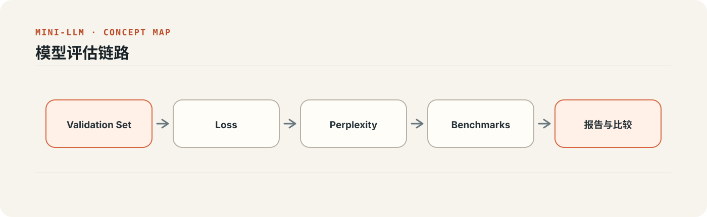
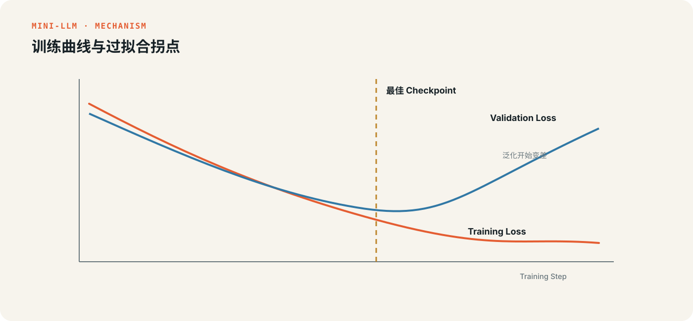

# **mini-llm Evaluation Engine 深度解析：从 Validation Loss、Perplexity 到 Benchmark、模型泛化能力**



_图：模型评估链路。从左到右展示本章核心概念之间的数据流与依赖关系。_

**副标题：模型训练完成之后，如何判断它真正学会了什么？**

在上一篇文章中，我们完成了 mini-llm Training Engine 的设计，已经理解了：

- Dataset：如何组织训练数据。
- Tokenizer：如何将文本转换为 Token。
- Batch：如何构造批量训练样本。
- Cross Entropy：如何计算预测误差。
- Backpropagation：如何计算模型梯度。
- AdamW：如何更新模型参数。
- Learning Rate Scheduler：如何控制学习率。
- Checkpoint：如何保存和恢复训练状态。

现在，我们已经拥有了一个可以训练的 Transformer。

但这里出现了一个新的问题：

**模型训练 Loss 很低，就代表模型真的变聪明了吗？**

不一定。

一个模型可能只是记住了训练数据，却无法理解没有见过的文本。

一个模型可能能够准确预测常见句子，却无法处理复杂问题。

一个模型可能在某个 Benchmark 上表现优秀，却在真实应用中频繁出错。

因此，我们需要一个新的模块：

**Evaluation Engine（模型评估引擎）。**

它的任务不是训练模型，而是通过一系列可重复、可量化的实验，判断模型究竟学到了什么，以及它能否把学到的能力迁移到新问题中。

## **一、为什么需要 Evaluation Engine？**

先看一个简单例子。

假设我们训练了两个语言模型。

**模型 A**

# **0.12**

Training Loss

训练误差较低

可能记住了大量训练样本。

**模型 B**

# **0.25**

Training Loss

训练误差较高

可能对新数据具有更好的泛化能力。

**关键问题：哪个模型更好？**

仅凭 Training Loss 无法判断。我们还需要比较它们在未参与训练的数据上的表现。

模型评估至少需要回答五个问题：

1. 模型是否学会了训练数据中的规律？
2. 模型能否处理没有见过的数据？
3. 模型是否存在过拟合？
4. 模型是否具有稳定的语言生成能力？
5. 模型在不同任务上的能力如何？

这就需要不同层次的评估指标。

## **二、Training Loss 与 Validation Loss**



_图：训练集与验证集曲线分离时出现过拟合。_

这是模型评估中最基础的两个指标。

### **2.1 Training Loss**

Training Loss 表示模型在训练数据上的预测误差。

例如：

```
Epoch 1: 5.21
Epoch 2: 4.36
Epoch 3: 3.58
Epoch 4: 2.91
Epoch 5: 2.34
```

可以看到，随着训练进行，Loss 不断下降。

这说明模型越来越能够预测训练数据中的下一个 Token。

但这只能证明模型对训练数据的拟合程度在提高。

不能证明它已经掌握了可以迁移到新数据上的规律。

### **2.2 Validation Loss**

Validation Loss 是模型在验证集上的预测误差。

验证集具有一个重要特点：

**它不参与模型参数更新。**

假设我们有 100 万条训练文本。

可以将数据划分为：

| 数据集            | 比例  | 主要用途         |
| -------------- | --- | ------------ |
| Training Set   | 90% | 更新模型参数       |
| Validation Set | 5%  | 评估训练效果、调整超参数 |
| Test Set       | 5%  | 最终独立评估       |

比例只是一个示例，实际划分需要根据数据规模、任务和数据分布确定。

模型训练时：

```
Training Set
     |
     v
Transformer
     |
     v
Loss
     |
     v
Backpropagation
     |
     v
Update Parameters
```

模型验证时：

```
Validation Set
     |
     v
Transformer
     |
     v
Loss
     |
     v
Record Metrics
```

验证阶段不执行参数更新。

在 PyTorch 风格的实现中：

```
model.eval()total_loss = 0total_tokens = 0with torch.no_grad():    for input_ids, targets in val_loader:        logits = model(input_ids)        loss_sum, token_count = compute_loss_sum(            logits,            targets        )        total_loss += loss_sum.item()        total_tokens += token_countval_loss = total_loss / total_tokens
```

这里采用累计 Loss 总和再除以有效 Token 数量的方式，可以避免不同 Batch 大小或有效 Token 数量不同造成的平均值偏差。

### **2.3 为什么要同时观察两个 Loss？**

假设训练过程中出现以下结果：

训练集与验证集 Loss 的示意曲线，用于解释过拟合。

Training LossValidation Loss

024612345678

可以发现：

- Training Loss 持续下降。
- Validation Loss 先下降，随后开始上升。

这可能意味着模型出现了过拟合。

## **三、Overfitting：什么是过拟合？**

过拟合是机器学习中非常重要的概念。

我们先用一个简单例子理解。

假设模型需要学习：

```
1 + 1 = 2
2 + 2 = 4
3 + 3 = 6
4 + 4 = 8
```

如果模型只是记住这些答案：

```
1 + 1 = 2
2 + 2 = 4
3 + 3 = 6
4 + 4 = 8
```

那么，当我们问：

```
5 + 5 = ?
```

它可能无法正确回答。

这说明模型记住了训练样本，但没有充分学会其中的规律。

当然，真实语言模型中的过拟合更加复杂，并不只是记忆几个例子。

### **3.1 过拟合的数学理解**

假设训练数据来自某个真实数据分布：

\\[ P\_{data}(x) \\]

我们希望模型学习一个近似分布：

\\[ P\_\theta(x) \\]

训练过程实际上是在有限训练样本上优化：

\\[ \min\_\theta \frac{1}{N} \sum\_{i=1}^{N} -\log P\_\theta(x_i) \\]

但我们真正关心的是模型在真实数据分布上的表现：

\\[ \mathbb{E}\_{x\sim P\_{data}} [-\log P\_\theta(x)] \\]

训练样本只是从真实分布中抽取的一部分。

因此：

**训练集上的表现，并不能完全代表真实世界中的表现。**

### **3.2 过拟合有哪些原因？**

常见原因包括：

- 训练数据太少。
- 数据重复率过高。
- 模型参数规模相对于数据规模过大。
- 训练时间过长。
- 训练数据与验证数据分布差异明显。
- 数据质量不佳。

### **3.3 如何减少过拟合？**

常见方法：

| 方法             | 作用           |
| -------------- | ------------ |
| 增加高质量数据        | 提供更多训练样本     |
| 数据去重           | 减少重复记忆       |
| Weight Decay   | 限制参数过度增大     |
| Early Stopping | 验证效果恶化时停止训练  |
| 数据增强           | 增加训练样本变化     |
| 调整模型规模         | 避免模型容量远超数据需求 |

但要注意，Early Stopping 并不能代替独立测试集。反复根据验证集调整模型，也可能逐渐对验证集产生过拟合。

## **四、Perplexity：如何衡量语言模型的预测能力？**

接下来介绍语言模型最重要的评价指标之一：

**Perplexity（困惑度，PPL）。**

它与 Cross Entropy Loss 有直接关系。

### **4.1 从 Cross Entropy 到 Perplexity**

在上一篇文章中，我们已经知道语言模型训练目标是：

\\[ L=-\frac{1}{N} \sum\_{i=1}^{N}\log P\_\theta(x_i|x\_{\<i}) \\]

这里的 Loss 是平均负对数似然。

Perplexity 定义为：

\\[ PPL=e^L \\]

也可以写为：

\\[ PPL= \exp\left( -\frac{1}{N} \sum\_{i=1}^{N} \log P\_\theta(x_i|x\_{\<i}) \right) \\]

### **4.2 PPL 究竟意味着什么？**

假设模型的平均交叉熵为：

\\[ L=\ln 4 \\]

那么：

\\[ PPL=e^{\ln4}=4 \\]

可以粗略理解为：模型在预测下一个 Token 时，具有相当于 4 个等概率候选项的平均不确定性。

但这只是直觉解释。

PPL 并不意味着模型每次真的只在 4 个 Token 中选择，也不代表它一定有四分之一的概率预测正确。

### **4.3 PPL 数值越低越好吗？**

在相同 Tokenizer、相同评估文本、相同上下文和相同计算方式下：

通常是的。

例如：

| 模型      | Validation Loss | Perplexity |
| ------- | --------------- | ---------- |
| Model A | 2.0             | 7.39       |
| Model B | 1.5             | 4.48       |
| Model C | 1.0             | 2.72       |

不同平均 Cross Entropy 对应的 Perplexity，示意数据。

02468ABC

Model C 的 PPL 最低，意味着它在这组评估文本上的平均 Token 预测概率最好。

但是，不能简单地用 PPL 判断两个使用不同 Tokenizer 的模型谁更聪明。

因为 Tokenizer 会改变文本被切分的方式，甚至改变预测任务本身的粒度。

### **4.4 PPL 实现**

```
import mathdef calculate_perplexity(loss):    return math.exp(loss)
```

例如：

```
loss = 1.5ppl = calculate_perplexity(loss)print(ppl)# 4.4817...
```

真实评估时，必须保证 Loss 是所有有效预测 Token 的平均负对数似然，而不是简单地平均各个 Batch 的 Loss。

还需要注意数值溢出：当 Loss 非常大时，直接计算 `exp(loss)` 可能超出浮点数范围。

## **五、为什么 PPL 不能代表模型的全部能力？**

这是一个非常重要的问题。

假设两个模型：

- 模型 A：擅长预测常见自然语言文本。
- 模型 B：擅长代码生成、数学推理。

在普通中文文本测试集上，模型 A 可能拥有更低的 PPL。

但是，当我们要求它们生成 Python 代码时，模型 B 可能表现更好。

这说明：

**语言预测能力与特定任务能力有关联，但不是完全等价的。**

PPL 主要衡量模型对给定文本序列的概率建模能力。

它无法直接衡量：

- 数学推理能力。
- 代码执行正确率。
- 长文本理解能力。
- 工具调用能力。
- 指令遵循能力。
- 多轮对话能力。
- 事实准确性。

因此，我们还需要 Benchmark。

## **六、Benchmark：如何评估模型的具体能力？**

Benchmark 是一套标准化评估任务和测试数据。

它让我们能够在相对统一的条件下比较不同模型。

常见评估领域包括：

[Rethinking Genius: Why Top Mathematicians Don’t Need to Be Mental Math Whizzes | by Jonipol Esquillo Fortaliza | Medium](https://images.openai.com/static-rsc-4/qLJRNL3L4Y4Vqhqw5ZzvIyik8rHR4ZXOktjcuj_yINOs8ZPhCzaI7BB9_exWe13mZsWtrM3RFdh1TAwbZHY_h0GmazYNHNWG_8CsP4328svbb6ybCoTial5dHGHVO_IFwDxmqIqfsdOJGoxlEBqxvu1Xs4I-jUc4g9kerxCxLW8?purpose=inline)

**数学能力**

计算、数学问题、逻辑推导、证明。

[Hire a Back-end Dev Outsourced in Vietnam](https://images.openai.com/static-rsc-4/fr9S0Y78YeyPYzZ-z1GwY4ldb6zdcRDWdGnszjKxNMYSAd_fn9VRMcIgn9bHPv4DpMS_A3fTVKLGb91STPDyQwk2ZvgjkeVduog4PFv0G-xscNYTihuz1Bo9YbGfBEUCUnwFv1Roq4sUbXbAXIWwkZI-FQS0Fa5eMsw7O4ryrec?purpose=inline)

**代码能力**

代码生成、代码理解、调试、测试通过率。

[BC hosts annual Graduate Research Symposium](https://images.openai.com/static-rsc-4/X_qqUkFuG_aObi7H5BqFpv6TMUCNc-YB38cVi7g46E3ndRdaOAQlwPbvaXy2pa5nDxX14uaWVVWDXRXw2VCj3PqvORPrRNijZMEKgtQnBQLAYaAO-6EIoDg2Eu0Si_HkuhZyy88kIq6Adh8jE3ZuX56MOpEXDbtLXPkaa9agJ34?purpose=inline)

**知识能力**

科学、历史、自然语言知识、事实问答。

[Jakie są zasady gry w sudoku dla początkujących?](https://images.openai.com/static-rsc-4/Z3TdOkjnzSpNEdNgOEWWEPesGqSZ0r8elU9X6XV50XczsmScCIByGjegdHAb76j109snoMb38H1OF6oAxvXhHHTfb9wLM38GdG0IFBN0mGiO-evJyrvRZYyLxShjwzoN9mJK2JHGopX9iMC_SJJZO6yM8TEcfdeJI_xiwUDjsrw?purpose=inline)

**推理能力**

多步骤问题、条件推理、复杂任务规划。

[Home](https://images.openai.com/static-rsc-4/nsgw0eZnk3cBUKNrs9DVtgYfiIo6Rn2T5itOxIHMF9-6eSIXgH867phMxRgPUQlmcfhKeSDn0vtq7Lz6yRaRk6wgBnpx4YKKDSdlFAkSU-vzlQsQdsPIn10gH6Q9RipuicEuxpOxdxANT00pnY5knODCo7OWI7oieBlDrNv6eTI?purpose=inline)

**指令遵循能力**

格式控制、多轮对话、约束条件执行。

### **6.1 常见 Benchmark**

| Benchmark | 主要评估方向      |
| --------- | ----------- |
| MMLU      | 多学科知识与理解    |
| GSM8K     | 数学文字题       |
| MATH      | 数学问题求解      |
| HumanEval | Python 代码生成 |
| MBPP      | Python 编程任务 |
| HellaSwag | 常识性情境推断     |
| ARC       | 科学问答与推理     |
| GPQA      | 高难度科学知识问答   |

这些 Benchmark 只是评估体系中的一部分。它们的题目、版本、评分方式和数据污染风险都需要关注。

### **6.2 以 HumanEval 为例**

HumanEval 主要用于评估代码生成能力。

给模型一个函数定义：

```
def add(a, b):    """    Return the sum of a and b.    """
```

模型需要生成：

```
def add(a, b):    return a + b
```

然后执行测试：

```
assert add(1, 2) == 3assert add(-1, 1) == 0assert add(100, 200) == 300
```

如果通过所有测试，则该样本通过。

但这里有一个重要问题：

代码能否通过测试，取决于测试是否覆盖了真正需要的行为。

因此，代码 Benchmark 通常需要设计多个测试用例，并在隔离环境中执行模型生成的代码。

### **6.3 Pass\@k 是什么？**

代码生成中常见一个指标：

\\[ Pass\@k \\]

它表示模型生成 \\(k\\) 个候选答案时，至少有一个答案通过测试的概率。

一种常见的无偏估计公式为：

\\[ Pass\@k= 1- \frac{\binom{n-c}{k}}{\binom{n}{k}} \\]

其中：

- \\(n\\)：生成的候选程序数量。
- \\(c\\)：其中通过测试的程序数量。
- \\(k\\)：允许考虑的候选数量。

例如，模型生成 10 个程序，其中 3 个通过测试。

如果只取 1 个候选：

\\[ Pass\@1=\frac{3}{10}=0.3 \\]

如果允许选择 5 个候选，则至少一个通过测试的概率会更高。

注意：Pass\@k 反映的是多次采样下的成功概率，不等于模型一次生成就能成功的概率。

## **七、Zero-shot、One-shot、Few-shot：测试条件为什么重要？**

同一个模型，在不同提示条件下，表现可能有很大区别。

因此，Benchmark 必须说明模型获得了多少示例。

### **7.1 Zero-shot**

不给模型任何示例，直接提问。

```
问题：

如果一个物体从静止开始加速运动，
它的速度会如何变化？
```

### **7.2 One-shot**

给模型一个示例：

```
示例：

问题：1 + 1 = ?
答案：2

现在回答：

问题：2 + 2 = ?
```

### **7.3 Few-shot**

给模型多个示例，让模型从上下文中识别任务模式。

```
示例 1：
问题：1 + 1 = ?
答案：2

示例 2：
问题：2 + 2 = ?
答案：4

示例 3：
问题：3 + 3 = ?
答案：6

现在回答：
问题：4 + 4 = ?
```

这些方法并不一定需要更新模型参数。

它们主要利用上下文中的示例，引导模型完成任务。

因此，我们必须区分：

- Pretraining：预训练，更新模型参数。
- Fine-tuning：微调，进一步更新模型参数。
- In-context Learning：上下文学习，通常不更新模型参数。

## **八、数据污染：Benchmark 分数为什么可能不可靠？**

这是大模型评估中非常值得重视的问题。

假设某个 Benchmark 有 1000 道题。

模型在预训练时已经见过其中大量题目和答案。

那么模型在测试时取得高分，可能有两种原因：

1. 真正掌握了问题背后的规律。
2. 记住了训练过程中出现过的题目或答案。

如果无法区分这两种情况，Benchmark 分数就可能高估模型的泛化能力。

### **8.1 数据污染的几种形式**

- 训练语料直接包含测试题。
- 训练语料包含测试题的答案。
- 测试题被改写后出现在训练数据中。
- 网络文章讨论过测试题。
- 微调数据集与评估数据集存在重叠。

### **8.2 如何降低数据污染风险？**

可以采用：

- 对训练集与测试集进行精确去重。
- 使用模糊匹配检测近似重复文本。
- 采用新发布或私有测试集。
- 使用动态生成的测试题。
- 使用真实环境中的任务测试。
- 使用独立评估数据源。

但需要强调：模型训练数据来源不透明时，无法仅靠一次去重就证明模型没有接触过测试题。

## **九、Generalization：什么是泛化能力？**

这是 Evaluation Engine 最核心的理论问题。

泛化能力（Generalization）是指：

**模型能否将从训练数据中学习到的规律，应用到没有见过的新数据和新场景中。**

例如：

训练数据：

```
苹果是水果。
香蕉是水果。
橙子是水果。
```

测试问题：

```
葡萄属于什么类别？
```

如果模型回答：

```
葡萄属于水果。
```

说明它可能学会了某种可迁移的类别规律。

但这只是一个简单例子。

真实大模型的泛化能力涉及：

- 分布内泛化（In-distribution Generalization）。
- 分布外泛化（Out-of-distribution Generalization）。
- 组合泛化（Compositional Generalization）。
- 迁移学习（Transfer Learning）。
- 任务泛化（Task Generalization）。

### **9.1 分布内泛化**

训练集和测试集来自相似的数据分布。

例如：

训练数据是大量中文新闻。

测试数据也是同一时期、相近主题的中文新闻。

模型在测试集上的表现可以反映它对相似数据的泛化能力。

### **9.2 分布外泛化**

训练数据与测试数据存在明显差异。

例如：

训练数据：

```
普通中文文章
```

测试数据：

```
专业生物学论文
```

模型能否理解专业术语和复杂表达，是一种分布外泛化测试。

### **9.3 组合泛化**

组合泛化更加有意思。

假设模型见过：

```
红色的汽车
蓝色的汽车
红色的飞机
```

现在要求它理解：

```
蓝色的飞机
```

模型是否能够将已经学习的概念进行新的组合？

这涉及内部表征、概念组合和关系建模等问题。

## **十、Evaluation Engine 应该如何设计？**

现在进入 mini-llm 的工程实现。

Evaluation Engine 不应该只是一个计算 PPL 的函数。

它应该成为独立的评估系统。

建议分为六个模块：

## **Evaluation Engine 架构**

**Evaluation Dataset**

独立测试集、验证集、Benchmark

**Evaluation Runner**

统一加载模型、执行评估任务

**Language Metrics**

Loss、PPL

**Task Metrics**

Accuracy、Pass\@k

**Generation Metrics**

生成质量、重复率

**Robustness Metrics**

稳定性、鲁棒性

**Evaluation Report**

指标、对比、趋势、失败样本

### **10.1 建议的项目目录**

```
mini-llm/
│
├── evaluation/
│   │
│   ├── datasets/
│   │   ├── validation.py
│   │   ├── benchmark.py
│   │   └── loader.py
│   │
│   ├── metrics/
│   │   ├── loss.py
│   │   ├── perplexity.py
│   │   ├── accuracy.py
│   │   ├── pass_at_k.py
│   │   └── generation.py
│   │
│   ├── runners/
│   │   ├── language_runner.py
│   │   ├── benchmark_runner.py
│   │   └── generation_runner.py
│   │
│   ├── analysis/
│   │   ├── error_analysis.py
│   │   ├── data_leakage.py
│   │   └── comparison.py
│   │
│   ├── report/
│   │   ├── json_report.py
│   │   └── html_report.py
│   │
│   └── evaluator.py
│
└── train.py
```

## **十一、构建一个完整的 Evaluator**

先定义一个统一接口：

```
class Evaluator:    def __init__(self, model, tokenizer):        self.model = model        self.tokenizer = tokenizer    def evaluate(self, dataset):        raise NotImplementedError
```

然后实现语言模型评估：

```
class LanguageModelEvaluator(Evaluator):    def evaluate(self, dataloader):        self.model.eval()        total_loss = 0.0        total_tokens = 0        with torch.no_grad():            for input_ids, targets in dataloader:                logits = self.model(input_ids)                loss_sum, count = compute_loss_sum(                    logits,                    targets                )                total_loss += loss_sum.item()                total_tokens += count        avg_loss = total_loss / total_tokens        return {            "loss": avg_loss,            "perplexity": math.exp(avg_loss),            "tokens": total_tokens        }
```

这样就能将评估逻辑与训练逻辑分离。

训练引擎负责优化参数。

评估引擎负责衡量模型能力。

二者可以通过统一的 Checkpoint 接口连接。

## **十二、模型评估报告应该包含什么？**

假设我们训练了一个 mini-llm 模型。

最终可以生成这样的报告：

## **mini-llm Evaluation Report**

示意报告 · 非真实模型测试结果

Evaluation

Validation Loss

# **1.82**

Perplexity

# **6.17**

Validation Tokens

# **100K**

Benchmark Accuracy

# **62%**

**能力测试**

| 测试项目 | 得分  |
| ---- | --- |
| 数学基础 | 55% |
| 代码生成 | 48% |
| 常识问答 | 72% |
| 逻辑推理 | 61% |
| 指令遵循 | 70% |

**错误分析**

- 数学多步骤推导容易出错。
- 代码生成存在边界条件问题。
- 长文本上下文利用能力需要进一步测试。

这样的报告比单纯记录一个 Training Loss 更有价值。

因为它可以帮助我们判断下一步应该：

- 增加训练数据。
- 调整模型结构。
- 修改学习率。
- 改进数据质量。
- 增加代码训练语料。
- 调整指令微调数据。

## **十三、一个容易忽略的问题：评估本身也会影响模型**

假设我们不断观察某个 Benchmark。

然后不断调整：

- 模型结构。
- 训练数据。
- 超参数。
- 提示词。
- 解码策略。

直到模型在这个 Benchmark 上取得非常高的分数。

此时，即使模型没有直接训练这些测试题，我们也可能已经间接地针对这个 Benchmark 进行了大量优化。

这叫做：

**Evaluation Overfitting（评估过拟合）。**

因此，需要区分：

| 数据集        | 是否用于参数更新 | 是否用于模型选择     |
| ---------- | -------- | ------------ |
| Training   | 是        | 是            |
| Validation | 否        | 是            |
| Test       | 否        | 最终使用，尽量不反复调参 |

如果不断根据 Test Set 结果调整模型，它就逐渐失去了独立测试集的意义。

一个严谨的评估系统应该保存：

- 数据集版本。
- 数据集哈希。
- 模型 Checkpoint 版本。
- Tokenizer 版本。
- Prompt 模板。
- 生成参数。
- 评估代码版本。
- 随机种子。
- 评估时间。

这样不同实验之间才具有可比性。

## **十四、从 Evaluation Engine 走向模型能力研究**

现在我们已经完成了 mini-llm 的三个核心阶段：

**Training Engine**

通过数据和梯度更新模型参数。

已构建

**Evaluation Engine**

衡量模型的预测能力与泛化能力。

已设计

**Model Understanding**

研究模型内部表征、知识和推理能力。

下一阶段

到这里，我们应该提出一个更深层次的问题：

我们知道：

1. Transformer 通过 Attention 建立上下文关系。
2. Training Engine 通过梯度下降优化参数。
3. Evaluation Engine 通过测试数据衡量预测能力。
4. 模型在大量文本上训练后，能够表现出复杂的语言和推理能力。

但我们仍然不知道：

**模型内部究竟形成了什么？**

例如：

- 模型内部是否存在概念？
- Embedding 空间中的向量是否代表语义？
- Attention 是否真的在进行关系推理？
- 多层 Transformer 是否逐渐形成抽象表征？
- 模型是否构建了某种内部世界模型？
- 为什么预测下一个 Token 能够产生看似复杂的智能行为？

这些问题将进入大模型研究中更深层的领域：Mechanistic Interpretability（机制可解释性）、Representation Learning（表征学习）和 World Models（世界模型）。

## **十五、下一篇：mini-llm Representation Engine 深度解析**

建议下一篇：

**《mini-llm Representation Engine 深度解析：从 Embedding Space、Semantic Geometry 到 Feature、Concept 与 World Representation》**

重点研究：

1. Embedding Space：向量空间如何表达语义？
2. Semantic Geometry：语义关系为什么能够形成几何结构？
3. Feature：模型内部特征是什么？
4. Neuron：神经元是否对应某种概念？
5. Superposition：为什么一个神经元可能参与多个特征？
6. Residual Stream：Transformer 如何传递和组合信息？
7. SAE：如何使用稀疏自编码器研究模型特征？
8. World Representation：模型是否形成了内部世界表征？

这一步将从传统的模型工程，进入模型内部机制研究。

**我们不再只研究模型如何训练、如何预测，而是开始研究模型内部究竟如何表示世界。**

