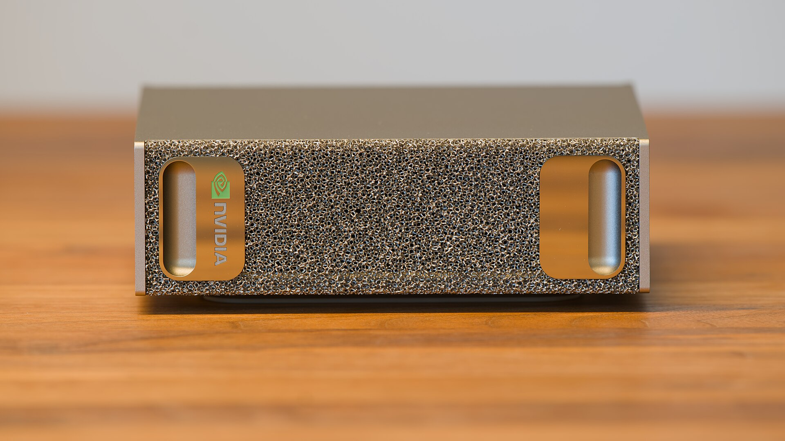
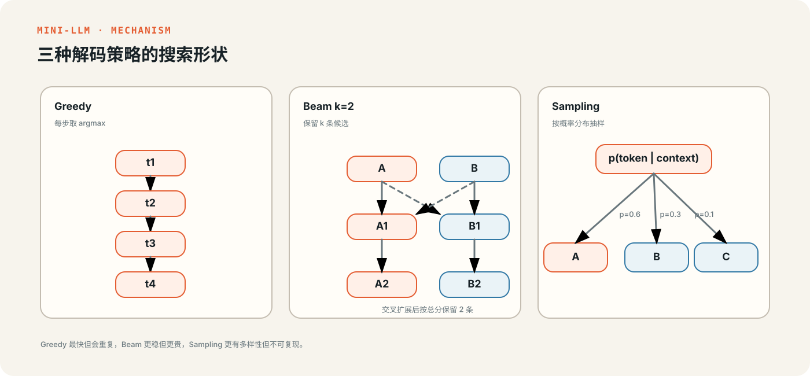
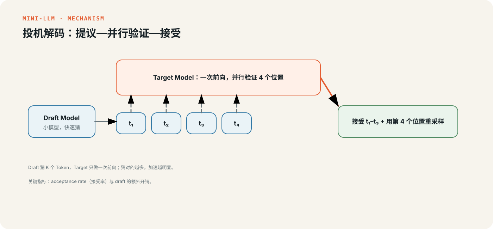

# **mini-llm Generation Engine 深度解析：从 Autoregressive Decoding、Sampling Strategy 到 Speculative Decoding、Constrained Generation 与 Multimodal Output**

在前面的 mini-llm 系列中，我们已经研究了 Tensor Engine、Autograd Engine、Neural Network Engine、Transformer Engine、Training Engine、Representation Engine、Agent Engine 和 Multimodal Engine 等核心模块。

这些 Engine 解决的是不同层面的问题：

- Tensor Engine：如何进行张量计算？
- Neural Network Engine：如何构建神经网络？
- Transformer Engine：如何理解上下文？
- Training Engine：如何通过数据学习参数？
- Representation Engine：如何形成内部表示？
- Multimodal Engine：如何处理图像、音频和视频？

但是，一个模型即使已经完成训练，也已经拥有了丰富的内部表示，它仍然需要解决一个非常重要的问题：

**如何把内部计算结果转换成用户能够理解、系统能够执行的输出？**

这就是 Generation Engine（生成引擎）要解决的问题。

Generation Engine 不只是简单地从模型输出中选择一个 Token。它还需要管理生成策略、采样温度、输出约束、流式传输、生成加速、多模态输出，以及生成过程中的停止和异常控制。

从工程角度看，Generation Engine 是连接模型推理能力与外部应用的重要桥梁。




_图：一台面向本地推理的 AI 计算盒子。生成阶段的成本几乎全部落在解码循环上，这也是 KV Cache、批处理与投机解码被反复优化的原因。图片：Daniel Lu，[Wikimedia Commons](https://commons.wikimedia.org/wiki/File:Nvidia_DGX_front_view_dllu.jpg)，[CC BY-SA 4.0](https://creativecommons.org/licenses/by-sa/4.0/)。_

# **一、Generation Engine：模型如何把内部表示转换成输出？**

## **1.1 模型的内部计算结果是什么？**

假设用户输入：

> 请解释什么是 Transformer。

经过 Tokenizer、Embedding 和 Transformer Stack 后，模型会得到一个隐藏状态：

\\[ H \in \mathbb{R}^{B\times T\times d} \\]

其中：

- \\(B\\)：Batch Size
- \\(T\\)：输入序列长度
- \\(d\\)：隐藏维度

对于自回归语言模型，我们通常关注最后一个位置的隐藏状态：

\\[ h_t\in\mathbb{R}^{d} \\]

经过 LM Head：

\\[ z_t=W\_{vocab}h_t+b \\]

得到：

\\[ z_t\in\mathbb{R}^{V} \\]

这里：

- \\(V\\)：词表大小
- \\(z_t\\)：Logits
- 每个 Logit 对应词表中的一个 Token。

例如：

| Token       | Logit |
| ----------- | ----- |
| Transformer | 5.2   |
| Neural      | 3.1   |
| Model       | 2.8   |
| Database    | -1.2  |
| Apple       | -2.4  |

Logits 只是模型对下一个 Token 的未归一化评分。

它们还不是最终输出。

## **1.2 从 Logits 到 Token**

首先使用 Softmax 将 Logits 转换为概率分布：

\\[ P(x\_{t+1}=i\mid x\_{\leq t}) = \frac{e^{z_i}}{\sum\_{j=1}^{V}e^{z_j}} \\]

例如：

| Token       | 概率   |
| ----------- | ---- |
| Transformer | 0.55 |
| Neural      | 0.20 |
| Model       | 0.15 |
| Database    | 0.06 |
| Apple       | 0.04 |

Generation Engine 需要根据生成策略，从这个概率分布中决定下一个 Token。

例如：

```
Transformer
```

随后将它追加到输入序列：

```
请解释什么是 Transformer。
Transformer
```

然后再次调用模型，预测下一个 Token。

这个过程不断重复，直到满足停止条件。

**Generation Engine 的基本工作流程**

**Transformer Model**

计算隐藏状态

**LM Head**

Hidden State → Logits

**Logits Processor**

Temperature、Top-K、Top-P、约束处理

**Sampler / Decoder**

选择下一个 Token

**Token Stream**

输出、追加上下文、继续生成或停止

模型推理与生成策略共同构成完整的文本生成过程

## **1.3 Generation Engine 与 Inference Engine 的区别**

两者容易混淆。

| 模块                | 主要职责            |
| ----------------- | --------------- |
| Inference Engine  | 执行模型前向计算        |
| Generation Engine | 决定如何生成输出        |
| Tokenizer         | Token 与文本之间的转换  |
| Decoder           | 将 Token 转换回可读内容 |
| Streaming Engine  | 将生成结果实时传输给客户端   |

例如：

Inference Engine 负责计算：

\\[ Logits=Model(Input) \\]

Generation Engine 负责：

\\[ Token=Sampling(Logits) \\]

因此，模型推理和生成策略应该保持模块分离。

# **二、Autoregressive Generation：为什么模型需要逐 Token 生成？**

## **2.1 自回归生成是什么？**

Autoregressive Generation，中文称为自回归生成。

它的核心思想是：

**当前 Token 的生成依赖于之前已经生成的 Token。**

语言模型通常学习如下概率分解：

\\[ P(x_1,x_2,\dots,x_T) = \prod\_{t=1}^{T}P(x_t\mid x_1,\dots,x\_{t-1}) \\]

这意味着：

- 第一个 Token 依赖起始条件。
- 第二个 Token 依赖第一个 Token。
- 第三个 Token 依赖前两个 Token。
- 后续 Token 依赖之前的整个上下文。

例如：

```
输入：人工智能的未来是

第 1 步：充满
第 2 步：机遇
第 3 步：和
第 4 步：挑战
第 5 步：。
```

模型每一步都需要重新计算当前上下文对应的下一个 Token 分布。

## **2.2 为什么不能一次生成整句话？**

因为普通自回归模型训练的目标是：

\\[ P(x_t\mid x\_{\<t}) \\]

它并没有直接学习一个普通意义上的：

\\[ P(x_1,x_2,\dots,x_T) \\]

一次性并行生成所有 Token 的机制。

当然，也存在非自回归模型、Mask-Predict、Diffusion Language Model 等其他生成路线，但它们采用不同的训练目标和生成机制。

## **2.3 Autoregressive Generation 的执行过程**

**逐 Token 生成示意**

**Prompt**

请解释人工智能

Step 1

**人工智能可以**

根据 Prompt 预测第一个输出 Token

Step 2

**人工智能可以通过**

把上一步输出加入上下文

Step 3

**人工智能可以通过数据**

继续预测下一个 Token

Step 4

**人工智能可以通过数据学习**

持续进行自回归生成

以上以 Token 边界与中文词语边界恰好对应为简化示意；实际 Tokenizer 可能把一个词拆成多个 Token。

## **2.4 自回归生成为什么比较慢？**

假设需要生成 1000 个 Token。

普通逐 Token 解码需要进行约 1000 次连续的模型解码步骤。

这些步骤存在依赖关系：

\\[ x\_{t+1}\leftarrow x_t \\]

因此，无法像训练阶段那样直接对所有未来 Token 完全并行计算。

不过，推理时可以通过 KV Cache 避免重复计算历史 Token 的 Key 和 Value。

例如：

第一次：

```
Prompt → Transformer → Token 1
```

第二次：

```
Prompt KV Cache + Token 1
→ Transformer
→ Token 2
```

第三次：

```
Prompt KV Cache + Token 1 KV + Token 2
→ Transformer
→ Token 3
```

KV Cache 主要减少历史上下文的重复计算，但并没有消除逐 Token 生成的依赖关系。

# **三、Decoding Strategy：Greedy、Beam Search、Sampling 有什么区别？**



_图：三种解码策略的搜索形状。Greedy 最快但会重复，Beam 更稳但更贵，Sampling 更有多样性但不可复现。_


Decoding Strategy 是决定如何从概率分布中选择 Token 的策略。

不同策略会影响生成内容的：

- 确定性
- 多样性
- 搜索范围
- 生成质量
- 计算成本

## **3.1 Greedy Decoding**

Greedy Decoding，贪心解码。

每一步都选择概率最大的 Token：

\\[ x\_{t+1}=\arg\max_i P(x_i\mid x\_{\leq t}) \\]

例如：

| Token | 概率   |
| ----- | ---- |
| A     | 0.60 |
| B     | 0.25 |
| C     | 0.15 |

Greedy 一定选择 A。

代码：

```
import torchdef greedy_decode(logits):    return torch.argmax(logits, dim=-1)
```

优点：

- 实现简单。
- 计算开销低。
- 结果确定。
- 适合某些结构化或确定性生成场景。

缺点：

- 容易陷入局部最优。
- 多样性不足。
- 可能产生重复内容。
- 当前最优 Token 不一定使整个序列最优。

需要注意：

Greedy 只保证每一步选择局部概率最大的 Token，不保证整个序列概率最大。

## **3.2 Beam Search**

Beam Search，束搜索。

它不会只保留一个候选序列，而是同时保留多个候选序列。

假设：

\\[ BeamSize=3 \\]

模型第一步产生：

```
A: 0.6
B: 0.3
C: 0.1
```

保留三个候选。

下一步，每个候选都扩展出新的 Token，系统根据累计序列得分选择得分最高的三个候选。

序列概率通常通过对数概率累计：

\\[ Score(x\_{1:T}) = \sum\_{t=1}^{T}\log P(x_t\mid x\_{\<t}) \\]

实际 Beam Search 常加入长度惩罚或其他评分机制。

[Foundations of NLP Explained Visually: Beam Search, How it Works | by Ketan Doshi | TDS Archive](https://images.openai.com/static-rsc-4/2B2jit3lwN-An6wqJZdUXEbwHeOQzzbC-CPJwVrLOjZ4ULavgmHLCM-ORY4kYlkIeKMhmqV2s2_1ZzYC1EByf9pQUqkX6abUaaivTKNBEiAi_Lh8TOCHyz92QddoTMlO1t1ljUlY-pZTdXsudk1Kdo5HYggEw1WsD4BJboPCj2U?purpose=inline)

[medium.com](https://medium.com/data-science/foundations-of-nlp-explained-visually-beam-search-how-it-works-1586b9849a24?utm_source=chatgpt.com)

优点：

- 可以探索多条候选路径。
- 适合某些机器翻译、语音识别和受限搜索任务。

缺点：

- 计算量更大。
- 候选序列可能趋同。
- 不一定适合开放式创意生成。
- 长度偏好需要额外处理。

Beam Search 不是简单意义上的“更高级的 Greedy”，而是另一种搜索策略。

## **3.3 Sampling**

Sampling，采样。

它根据概率分布随机选择 Token，而不是每次都选择最大概率 Token。

例如：

| Token | 概率   |
| ----- | ---- |
| A     | 0.60 |
| B     | 0.25 |
| C     | 0.15 |

采样可能选择 A，也可能选择 B 或 C。

代码：

```
import torchdef sample_decode(logits):    probs = torch.softmax(logits, dim=-1)    return torch.multinomial(        probs,        num_samples=1    )
```

Sampling 能够让模型生成更加多样化的结果。

但如果概率分布不合理，采样也可能产生质量较低的 Token。

## **3.4 三种策略对比**

| 策略          | 选择方式    | 多样性     | 计算开销 |
| ----------- | ------- | ------- | ---- |
| Greedy      | 最大概率    | 低       | 低    |
| Beam Search | 多路径搜索   | 取决于搜索设置 | 较高   |
| Sampling    | 按概率随机采样 | 较高      | 通常较低 |

# **四、Temperature、Top-K、Top-P：如何控制生成结果？**

这三个参数是现代大语言模型生成系统中最常见的控制参数。

## **4.1 Temperature**

Temperature 用于调整概率分布的尖锐程度。

计算公式：

\\[ P_i= \frac{\exp(z_i/T)} {\sum_j\exp(z_j/T)} \\]

其中：

- \\(z_i\\)：Logit
- \\(T\\)：Temperature

假设原始 Logits：

\\[ z=[2,1,0] \\]

不同 Temperature 会产生不同概率分布。

Temperature 对概率分布的影响

示意数据：同一组 Logits [2,1,0]，不同 Temperature 下第一个 Token 的概率。

0%25%50%75%100%0.51.02.0

当：

\\[ T\rightarrow 0^+ \\]

概率分布会趋向于把最大概率集中到最高 Logit 的 Token 上。

当：

\\[ T>1 \\]

概率分布通常更加平坦。

需要注意，Temperature 不会改变 Logits 的排序，但会改变概率之间的差距。

典型使用：

| Temperature | 常见用途      |
| ----------- | --------- |
| 0 或接近 0     | 偏确定性输出    |
| 0.2–0.5     | 技术解释、代码辅助 |
| 0.7–1.0     | 日常对话      |
| 1.0 以上      | 更开放的创意探索  |

这些只是经验范围，不是普适标准。

## **4.2 Top-K Sampling**

Top-K 的思想非常简单：

**只保留概率最高的 K 个 Token，然后在它们之间重新采样。**

例如：

```
A: 0.50
B: 0.25
C: 0.15
D: 0.07
E: 0.03
```

设置：

\\[ K=3 \\]

只保留：

```
A: 0.50
B: 0.25
C: 0.15
```

重新归一化：

```
A: 0.556
B: 0.278
C: 0.167
```

Top-K 可以过滤掉概率较低的候选。

但是它存在一个问题：

不同上下文中的概率分布差异很大，固定 K 不一定合适。

## **4.3 Top-P Sampling**

Top-P 又叫 Nucleus Sampling，核采样。

它不是固定保留 K 个 Token，而是保留累计概率达到 P 的最小候选集合。

例如：

```
A: 0.50
B: 0.25
C: 0.15
D: 0.07
E: 0.03
```

设置：

\\[ P=0.9 \\]

累计概率：

```
A = 0.50
A+B = 0.75
A+B+C = 0.90
```

最终保留：

```
A、B、C
```

与 Top-K 不同，Top-P 的候选数量可以动态变化。

## **4.4 Top-K 与 Top-P 的区别**

| 特性     | Top-K   | Top-P       |
| ------ | ------- | ----------- |
| 过滤方式   | 固定候选数量  | 累计概率阈值      |
| 候选数量   | 固定      | 动态          |
| 适应概率分布 | 一般      | 更灵活         |
| 主要作用   | 剔除低概率候选 | 保留概率质量集中的候选 |

## **4.5 组合使用**

实际生成系统经常组合使用：

```
Logits
  ↓
Temperature
  ↓
Top-K
  ↓
Top-P
  ↓
Sampling
  ↓
Next Token
```

但处理顺序和组合方式会影响最终分布，不同推理框架可能有所不同。

# **五、Repetition Penalty：如何减少重复生成？**

大模型有时会出现重复输出：

```
人工智能能够提高效率。

人工智能能够提高效率。

人工智能能够提高效率。
```

这通常与概率分布、上下文建模、解码策略等因素有关。

Repetition Penalty 是一种常见的生成控制方法。

## **5.1 重复惩罚原理**

对于已经出现过的 Token，可以对其 Logits 进行调整。

一种常见实现为：

\\[ z_i'= \begin{cases} z_i/r, & z_i>0\\\ z_i\cdot r, & z_i\leq 0 \end{cases} \\]

其中：

\\[ r>1 \\]

表示对重复 Token 进行惩罚。

代码：

```
def repetition_penalty(    logits,    generated_tokens,    penalty=1.2):    for token_id in set(generated_tokens):        score = logits[token_id]        if score > 0:            logits[token_id] /= penalty        else:            logits[token_id] *= penalty    return logits
```

## **5.2 其他重复控制机制**

除了 Repetition Penalty，还有：

- Presence Penalty：Token 出现过就施加惩罚。
- Frequency Penalty：根据出现频率增加惩罚。
- No Repeat N-Gram：禁止重复出现指定长度的 N-Gram。
- Min Length：限制生成长度，避免过早结束。

需要注意：

过强的重复惩罚可能导致语法不自然，甚至破坏必要的重复表达。

例如：

```
机器学习是机器学习的重要基础。
```

重复出现的词不一定都是错误。

因此，重复控制应该是可配置策略，而不是无条件删除重复 Token。

# **六、Speculative Decoding：如何通过小模型加速大模型生成？**



_图：投机解码。Draft 模型一次猜 K 个 Token，Target 模型用一次前向并行验证；猜对的越多，加速越明显。_


这是 Generation Engine 中非常重要的性能优化技术。

普通自回归生成的主要问题是：

大模型每次只能确定下一个 Token。

如果生成 1000 个 Token，就需要进行大量连续的模型解码步骤。

Speculative Decoding（推测解码）尝试解决这个问题。

## **6.1 核心思想**

使用一个小模型先快速预测多个 Token。

然后让大模型一次性验证这些预测。

例如：

```
Small Model：

我认为接下来是：

人工智能 → 正在 → 改变 → 世界
```

小模型一次预测 4 个 Token。

然后大模型并行计算这些候选 Token 在对应上下文中的概率，并通过接受/拒绝规则验证。

如果候选 Token 被接受，就可以一次推进多个 Token。

如果某个候选被拒绝，则按照校正分布重新采样，并从新的上下文继续。

[Speculative Decoding in vLLM: Complete Guide to Faster LLM Inference | Jarvis Labs Blog | Jarvis Labs](https://images.openai.com/static-rsc-4/f1jLS8KDGu3zvdZG17yl2epVoaHG4fYtFLW-XkhgMvy3P7TOhqI44Gl8zIHeK5n5--c5Ws6UAb6E0UO771lQUyiZ6oNz2kyS7wMQAcT4H-TmDGSbgfAxSP6F8tf8iR9jvgDQErcVa2alklUYehW7slL6UKuvioxDirCSXSQ0EvI?purpose=inline)

[jarvislabs.ai](https://jarvislabs.ai/blog/speculative-decoding-vllm-faster-llm-inference?utm_source=chatgpt.com)

## **6.2 为什么需要大模型验证？**

因为小模型的预测不一定与大模型一致。

假设：

小模型分布：

\\[ q(x) \\]

大模型分布：

\\[ p(x) \\]

推测解码不能简单地接受所有小模型预测，否则最终生成分布就会偏离目标模型。

一种经典的无损推测采样方法，对候选 Token \\(x\\) 的接受概率为：

\\[ P(accept)= \min\left(1,\frac{p(x)}{q(x)}\right) \\]

如果候选被拒绝，则从校正分布采样：

\\[ r(x)\propto \max(0,p(x)-q(x)) \\]

这样在相应算法假设下，可以保持目标模型的采样分布。

## **6.3 Speculative Decoding 的执行流程**

**推测解码流程**

**1. Draft Model**

小模型快速生成多个候选 Token

Token A

Token B

Token C

Token D

**2. Target Model**

大模型并行验证候选序列

**3. Acceptance / Rejection**

接受 A

接受 B

拒绝 C

重新采样

**4. Continue Generation**

追加已接受 Token 和校正采样 Token，进入下一轮

## **6.4 为什么能够加速？**

核心原因：

大模型可以在一次前向计算中并行验证多个候选位置。

如果小模型预测的 Token 被大量接受，就能减少大模型逐 Token 解码的迭代次数。

但加速效果取决于：

- Draft Model 与 Target Model 的预测一致程度。
- Draft Model 的执行成本。
- Target Model 的并行验证效率。
- GPU 显存和带宽。
- Batch Size 和上下文长度。

因此，Speculative Decoding 并不保证所有任务都能加速。

## **6.5 其他生成加速技术**

| 技术                     | 核心思想                 |
| ---------------------- | -------------------- |
| Speculative Decoding   | 小模型提出候选，大模型验证        |
| Medusa                 | 使用额外预测头提出多个候选        |
| Multi-Token Prediction | 训练模型预测多个未来 Token     |
| Lookahead Decoding     | 通过候选序列和验证减少串行解码      |
| Prompt Lookup Decoding | 利用 Prompt 中已有的片段提出候选 |

这些技术的实现方式不同，不能全部视为同一种算法。

# **七、Constrained Generation：如何保证输出符合 JSON、Schema 或语法规则？**

这是 AI 工程化中非常重要的能力。

普通语言生成具有不确定性。

例如，要求模型输出 JSON：

```
请输出一个用户对象：

{
  "name": "Tom",
  "age": 18
}
```

模型可能生成：

```
以下是 JSON：

{
  "name": "Tom",
  "age": "18",
}
```

这里存在两个问题：

1. JSON 前面多了说明文字。
2. `age` 被错误输出为字符串，且存在尾随逗号。

对于普通聊天，这可能可以接受。

但对于 API、数据库、Agent Tool Calling 来说，这可能直接导致执行失败。

## **7.1 Constrained Generation 是什么？**

Constrained Generation（受约束生成）是在生成过程中限制模型可以选择的 Token。

假设模型当前需要输出：

```
{"age":
```

根据 JSON Schema：

```
{
  "type": "object",
  "properties": {
    "age": {
      "type": "integer"
    }
  },
  "required": ["age"]
}
```

那么接下来只能选择符合 JSON 整数值语法的 Token 序列。

不符合语法的候选 Token 会被屏蔽。

## **7.2 Logits Masking**

最基础的实现方式是 Logits Masking。

假设：

\\[ M_i\in\\{0,1\\} \\]

其中：

- \\(M_i=1\\)：允许 Token。
- \\(M_i=0\\)：禁止 Token。

调整 Logits：

\\[ z_i'= \begin{cases} z_i,&M_i=1\\\ -\infty,&M_i=0 \end{cases} \\]

然后执行 Softmax 和采样。

这样被禁止的 Token 概率就变成 0。

## **7.3 JSON Schema 与 Grammar**

工程中可以使用 JSON Schema 定义数据结构。

例如：

```
schema = {    "type": "object",    "properties": {        "name": {            "type": "string"        },        "age": {            "type": "integer"        },        "active": {            "type": "boolean"        }    },    "required": [        "name",        "age",        "active"    ],    "additionalProperties": False}
```

但需要注意：

JSON Schema 本身通常负责描述和验证结构，并不会自动改变模型的 Token 选择。

需要将 Schema 编译为 Grammar 或其他可执行约束，再由解码器在生成过程中应用约束。

常见机制包括：

- Context-Free Grammar
- Finite State Machine
- JSON Grammar
- Regex Constraint
- Schema-Guided Decoding

[Why SGLang is a Game-Changer for LLM Workflows](https://images.openai.com/static-rsc-4/bET5tkk9OjvH97zJXHC-OdPJ_sUpSQzELLO4McWWYEVpcbf3c7IVqKVR25HWsJQRY_zLeO33FYIPlxdeiwVpIc9lKTpAFcuD4udE8WjpxPKbvHtjxgYJm8NcUwthDhPcc2mUsWq1OqMQ8s-YGJQt9qnFRYKX3ZLBTILpeFzY0us?purpose=inline)

[huggingface.co](https://huggingface.co/blog/paresh2806/sglang-efficient-llm-workflows?utm_source=chatgpt.com)

## **7.4 Constrained Generation 的边界**

非常重要：

**格式正确不代表语义正确，更不代表业务操作安全。**

例如：

```
{
  "user_id": 1001,
  "amount": 999999
}
```

这个 JSON 可以完全符合 Schema。

但它不代表：

- 用户有权限操作这个账户。
- 金额符合业务规则。
- 这笔交易应该被执行。

因此，Generation Engine 负责格式约束，业务系统仍然必须负责语义校验、身份认证和权限控制。

# **八、Streaming Generation：如何实现实时 Token 输出？**

如果模型需要生成 1000 个 Token，等全部生成完成再返回，用户体验会比较差。

Streaming Generation 的思想是：

**模型每生成一部分内容，就立即向客户端发送一部分内容。**

## **8.1 普通请求模式**

```
Client
  |
  | Request
  v
LLM Server
  |
  | Generate 1000 Tokens
  |
  | Wait...
  v
Complete Response
  |
  v
Client
```

用户必须等待整个生成过程。

## **8.2 流式生成模式**

```
Client
  |
  | Request
  v
LLM Server
  |
  | Token 1
  | Token 2
  | Token 3
  | Token 4
  |
  v
Client
```

每生成一部分 Token，就可以发送给用户。

[How To Deploy LLM Applications - by Damien Benveniste](https://images.openai.com/static-rsc-4/jvl-ZZEEsLpG4YNp88-pJIm_9Wkal_mNECRDRr_dJtF6xO2_oJnS5errPEygfX4boezaC-AP2c7xkvNbu6HwvtuIuUqLBl1R6JSFs-ut9WbZLYDWDAjvDY0pVzyOknBX87g63pCKOk-k13DZaqWw-TFaB02K9ctHVklANJdCVOQ?purpose=inline)

[newsletter.theaiedge.io](https://newsletter.theaiedge.io/p/how-to-deploy-llm-applications?utm_source=chatgpt.com)

## **8.3 Streaming 的关键指标**

最重要的是 TTFT：

Time To First Token。

即从请求开始到第一个 Token 到达客户端的时间。

还有：

- TPOT：Time Per Output Token，平均每个输出 Token 的生成时间。
- ITL：Inter-Token Latency，相邻 Token 到达间隔。
- E2E Latency：完整请求的端到端延迟。

例如：

| 指标         | 示例      |
| ---------- | ------- |
| TTFT       | 300ms   |
| TPOT       | 30ms    |
| 输出 Token 数 | 100     |
| 估算总耗时      | 约 3.3 秒 |

这里假设 Token 间隔稳定，实际还要考虑网络传输、排队、首轮预填充和结束处理。

## **8.4 使用 Python 实现流式输出**

以生成器为例：

```
def generate_stream(    model,    tokenizer,    prompt,    max_tokens=100):    input_ids = tokenizer.encode(prompt)    for _ in range(max_tokens):        logits = model(input_ids)        next_token = sample(logits)        input_ids.append(next_token)        yield tokenizer.decode(            [next_token]        )        if next_token == tokenizer.eos_token_id:            break
```

真实推理框架还需要处理：

- KV Cache。
- 异步任务。
- 请求取消。
- 多用户并发。
- Batch Scheduling。
- 客户端断开连接。
- Token 解码边界。
- 特殊 Token 和工具调用事件。

此外，实际系统可能使用 SSE、WebSocket 或其他流式协议。

# **九、Multimodal Generation：如何生成图像、音频和视频？**

前面研究的 Multimodal Engine 主要解决输入侧的问题。

而 Multimodal Generation 研究的是输出侧。

传统语言模型的主要输出是文本：

\\[ Text\rightarrow Token \\]

多模态生成则需要支持：

\\[ Text\rightarrow Image \\]

\\[ Text\rightarrow Audio \\]

\\[ Text\rightarrow Video \\]

以及：

\\[ Text+Image\rightarrow Audio \\]

## **9.1 Text Generation**

文本生成主要使用自回归模型。

```
Prompt
  ↓
Transformer
  ↓
Logits
  ↓
Sampler
  ↓
Text Tokens
  ↓
Text Decoder
  ↓
Text
```

## **9.2 Image Generation**

图像生成通常使用 Diffusion Model 或其他生成架构。

文本提示：

```
一座未来主义城市，
高楼林立，夜晚，蓝色灯光。
```

经过 Text Encoder，得到条件表示：

\\[ c=TextEncoder(prompt) \\]

然后生成模型逐步生成图像表示。

以 Latent Diffusion 为例：

\\[ z_T\sim\mathcal{N}(0,I) \\]

逐步去噪：

\\[ z\_{t-1}=Denoiser(z_t,t,c) \\]

最终通过 VAE Decoder 得到图像：

\\[ Image=Decoder(z_0) \\]

[Stable Diffusion on the Panther Lake NPU | by Scott Baker | Apr, 2026 | Medium](https://images.openai.com/static-rsc-4/7aRlpsI9iNt04W-3YlYlHbiHvLj8TaX-sViSxFPIOuK0RGpUtBZvRixG6ua77PBMaY7K4sStHqYUey_mOtp8hEHOS38GUo9_LAOa3Xl4GUK-gUa9EQB2VCMfzdoI9vuj8EwifkyHawGfCfWneA0wO6mhhVGqN9GUyx_x08Z5nRk?purpose=inline)

[medium.com](https://medium.com/%40smbaker/stable-diffusion-on-the-panther-lake-npu-2081855e3c30?utm_source=chatgpt.com)

这里的公式是简化表示，实际扩散采样还取决于噪声调度器和具体参数化方式。

## **9.3 Audio Generation**

音频生成可以采用多种路线：

- 自回归 Audio Token 生成。
- Codec Token 生成。
- Flow Matching。
- Diffusion。
- 直接预测声学特征。

典型架构：

```
Text / Context
      |
      v
Audio Generation Model
      |
      v
Audio Tokens
      |
      v
Audio Codec Decoder
      |
      v
Waveform
```

语音生成还需要考虑：

- 发音准确性。
- 语速。
- 停顿。
- 韵律。
- 说话人特征。
- 情感表达。

## **9.4 Video Generation**

视频生成比图像生成更加复杂。

因为它需要同时处理空间信息和时间信息。

一个视频可以表示为：

\\[ Video=\\{F_1,F_2,\dots,F_T\\} \\]

其中：

- \\(F_t\\)：第 t 帧。
- \\(T\\)：视频帧数量。

生成视频不仅要保证每一帧看起来合理，还要保证帧与帧之间的时间连续性。

例如：

```
Frame 1：人物站立
Frame 2：人物抬手
Frame 3：人物开始行走
Frame 4：人物走向前方
```

如果每一帧独立生成，就可能出现：

- 人物外观变化。
- 物体位置跳变。
- 光照不一致。
- 运动不连续。

因此，Video Generation 通常需要时空联合建模。

# **十、Diffusion Generation：扩散模型如何逐步生成内容？**

Diffusion Model 是现代图像和视频生成领域的重要技术路线。

它与传统自回归语言模型的生成方式不同。

## **10.1 正向扩散**

正向过程逐渐向真实数据添加噪声。

假设原始图像为：

\\[ x_0 \\]

经过多次加噪：

\\[ x_0\rightarrow x_1\rightarrow x_2 \rightarrow\dots\rightarrow x_T \\]

最终得到近似高斯噪声。

常见的前向过程可以写为：

\\[ q(x_t|x\_{t-1}) = \mathcal{N} \left( \sqrt{1-\beta_t}x\_{t-1}, \beta_t I \right) \\]

其中：

\\[ \beta_t \\]

表示每一步的噪声强度。

## **10.2 反向生成**

训练模型学习如何从带噪数据中预测噪声或其他等价目标。

反向过程：

\\[ x_T\rightarrow x\_{T-1} \rightarrow\dots\rightarrow x_0 \\]

最终从噪声中逐渐生成图像。

[What Are the Types of Generative AI: Examples and Uses | VOSU.AI](https://images.openai.com/static-rsc-4/1j_1BJHLI5Sfvby94YczK8lIKvG-FN0tiFS7lDoqx7UV8Jmz5GPgcSzxeiGNRy87wS9CdpZDA2CIzMuU5xfncM5L90Rwd2Bn1N9JPnOUQnTBChhR-JpNuqkTxy_II2hdZx3o60pHCiujH34LTMJDO3N5AkX0HCuQzwfl2t4Iw1k?purpose=inline)

[vosu.ai](https://vosu.ai/artificial-intelligence/generative/types?utm_source=chatgpt.com)

## **10.3 Diffusion 与 Autoregressive 的区别**

| 特性   | Autoregressive | Diffusion |
| ---- | -------------- | --------- |
| 生成方式 | 逐 Token 生成     | 逐步去噪      |
| 生成对象 | Token 序列       | 连续或离散表示   |
| 主要依赖 | 历史 Token       | 当前噪声状态和条件 |
| 典型应用 | 文本、语音、部分视频     | 图像、视频、音频  |
| 生成过程 | 自回归解码          | 迭代采样      |

两者并不是绝对互斥的。

现代生成系统也可能将 Transformer、自回归模型、Diffusion 和 Flow Matching 组合使用。

# **十一、Generation Evaluation：如何评估生成质量？**

模型能够生成内容，不代表生成质量足够好。

Generation Engine 需要建立独立的评估机制。

## **11.1 文本生成评估**

常见指标：

| 指标         | 主要用途               |
| ---------- | ------------------ |
| BLEU       | 机器翻译等任务的 n-gram 匹配 |
| ROUGE      | 摘要等任务的内容覆盖         |
| METEOR     | 结合词汇匹配和语言变体        |
| BERTScore  | 基于上下文表示计算语义相似度     |
| Perplexity | 衡量模型对文本的预测不确定性     |

需要注意：

这些指标不能直接代表文本的事实正确性、逻辑严谨性或用户满意度。

例如：

一个回答可以具有很高的 ROUGE 分数，但事实完全错误。

## **11.2 结构化输出评估**

对于 JSON 或代码生成，可以关注：

- Syntax Validity：语法是否合法。
- Schema Validity：是否符合 Schema。
- Type Correctness：字段类型是否正确。
- Semantic Correctness：语义是否正确。
- Execution Success：是否能够成功执行。

对于代码生成：

```
Code Generation
      |
      v
Syntax Check
      |
      v
Type Check
      |
      v
Unit Test
      |
      v
Integration Test
      |
      v
Security Review
```

代码能够通过语法检查，不代表业务逻辑正确。

## **11.3 多模态生成评估**

图像生成：

- FID
- CLIP Score
- 人工评价
- 图像质量评估
- 提示词一致性

音频生成：

- WER（用于语音转写评估）
- MOS
- 音频自然度
- 说话人一致性

视频生成：

- 时空一致性
- 运动连续性
- 视觉质量
- 文本条件一致性

这些指标的适用范围不同，不能直接互相替代。

## **11.4 Generation Evaluation 与 Agent Evaluation 的区别**

| 模块                    | 评估对象         |
| --------------------- | ------------ |
| Generation Evaluation | 生成内容是否符合要求   |
| Agent Evaluation      | Agent 是否完成任务 |
| Model Evaluation      | 模型整体能力       |
| System Evaluation     | 整个系统的可靠性和性能  |

例如：

Agent 要求模型生成一段 SQL。

SQL 生成正确，是 Generation Evaluation。

SQL 是否查询到了正确数据，是任务层面的 Evaluation。

Agent 是否在正确权限下执行 SQL，是系统和安全层面的 Evaluation。

# **十二、Generation Architecture：如何构建完整的 mini-llm Generation Engine？**

前面的内容已经涉及：

- 自回归生成。
- 解码策略。
- 采样控制。
- 重复控制。
- 推测解码。
- 结构化生成。
- 流式生成。
- 多模态生成。
- 生成质量评估。

现在将这些能力组织为完整的工程架构。

## **12.1 总体架构**

## **mini-llm Generation Engine**

**Generation Request**

Prompt / Context / Generation Config

**Generation Controller**

Request Manager

Stop Controller

Token Budget

Cancellation

**Decoding Engine**

Greedy / Beam Search

Sampling

Temperature / Top-P

Repetition Penalty

**Generation Runtime**

Model Inference

KV Cache

Speculative Decoding

Grammar Constraint

**Output Engine**

Text Decoder

Audio Decoder

Image Decoder

Video Decoder

**Streaming / Final Output**

Text / JSON / Tool Call / Image / Audio / Video

## **12.2 核心模块职责**

| 模块                    | 职责                  |
| --------------------- | ------------------- |
| Generation Controller | 管理整个生成生命周期          |
| Decoding Engine       | 决定 Token 选择策略       |
| Logits Processor      | 调整 Logits 分布        |
| Sampler               | 根据策略选择 Token        |
| Constraint Engine     | 限制输出格式和语法           |
| Speculative Engine    | 管理推测生成              |
| Generation Runtime    | 协调模型推理和 KV Cache    |
| Output Decoder        | 将模型输出转换为文本或多模态数据    |
| Streaming Engine      | 实时发送输出              |
| Stop Controller       | 管理结束 Token、停止词和长度限制 |
| Generation Evaluator  | 评估输出质量              |

## **12.3 核心接口设计**

使用 Python 定义一个简化接口：

```
from dataclasses import dataclassfrom typing import Optional, Iterator@dataclassclass GenerationConfig:    max_new_tokens: int = 512    temperature: float = 0.7    top_k: Optional[int] = 50    top_p: float = 0.9    repetition_penalty: float = 1.0    do_sample: bool = True    num_beams: int = 1    stream: bool = True@dataclassclass GenerationResult:    text: str    token_ids: list[int]    finish_reason: str    prompt_tokens: int    completion_tokens: intclass GenerationEngine:    def generate(        self,        prompt: str,
```

这个接口只是一个起点。

真实工程中还需要加入：

- 结构化输出配置。
- Stop Sequences。
- Seed。
- Logprobs。
- 多模态输出类型。
- 请求取消机制。
- 采样策略版本。
- 模型版本和执行元数据。

## **12.4 工程目录结构**

建议：

```
mini-llm/
│
├── generation/
│   │
│   ├── controller/
│   │   ├── generation_controller.py
│   │   ├── request_manager.py
│   │   └── stop_controller.py
│   │
│   ├── decoding/
│   │   ├── greedy.py
│   │   ├── beam_search.py
│   │   ├── sampling.py
│   │   └── speculative.py
│   │
│   ├── processors/
│   │   ├── temperature.py
│   │   ├── top_k.py
│   │   ├── top_p.py
│   │   └── repetition.py
│   │
│   ├── constraints/
│   │   ├── grammar.py
│   │   ├── json_schema.py
│   │   └── logits_mask.py
│   │
│   ├── runtime/
│   │   ├── inference_runtime.py
│   │   ├── kv_cache.py
│   │   └── batch_runtime.py
│   │
│   ├── multimodal/
│   │   ├── text_output.py
│   │   ├── image_output.py
│   │   ├── audio_output.py
│   │   └── video_output.py
│   │
│   ├── streaming/
│   │   ├── stream_manager.py
│   │   └── event_protocol.py
│   │
│   ├── evaluation/
│   │   ├── quality.py
│   │   └── benchmark.py
│   │
│   └── tests/
│       ├── test_sampling.py
│       ├── test_constraints.py
│       ├── test_streaming.py
│       └── test_generation.py
```

# **十三、mini-llm Generation Engine 的 V1 实施路线**

不建议一开始就实现所有复杂算法。

应该先建立可靠的自回归生成闭环，再逐步扩展。

## **V1 开发路线**

1. **阶段一：基础自回归生成**

   优先实现
   - Greedy Decoding
   - Sampling
   - EOS Token
   - Max New Tokens
   - Tokenizer Decode
2. **阶段二：Sampling Strategy**
   - Temperature
   - Top-K
   - Top-P
   - Repetition Penalty
   - Random Seed
3. **阶段三：性能优化**
   - KV Cache 接入
   - Batch Generation
   - Continuous Batching
   - TTFT / TPOT 统计
4. **阶段四：结构化生成**
   - JSON Mode
   - JSON Schema
   - Grammar Constraint
   - 输出校验
5. **阶段五：流式生成**
   - Token Streaming
   - SSE
   - Request Cancellation
   - 多用户并发
6. **阶段六：高级生成**
   - Beam Search
   - Speculative Decoding
   - 多模态输出
   - Generation Evaluation

## **13.1 V1 验收标准**

| 测试项目            | 验收目标                   |
| --------------- | ---------------------- |
| Greedy          | 相同模型和输入条件下结果可复现        |
| Sampling        | 能够正确根据概率分布采样           |
| Temperature     | 能够正确调整概率分布             |
| Top-K           | 候选集合不超过 K              |
| Top-P           | 保留达到累计概率阈值的最小候选集合      |
| EOS             | 能够正确停止生成               |
| Max Tokens      | 不超过配置的输出 Token 上限      |
| KV Cache        | 缓存解码与无缓存解码结果在适当数值容差内一致 |
| Streaming       | 能够逐步发送生成内容             |
| JSON Constraint | 输出符合指定语法约束             |
| Cancellation    | 能够停止已取消的生成请求           |

对于 Speculative Decoding，还应该专门测试目标分布一致性，而不只是比较生成速度。

# **十四、Generation Engine 在整个 mini-llm 中的位置**

到这里，我们可以把模型的核心处理过程串起来。

## **mini-llm 核心执行链路**

**Input**

Text / Image / Audio / Video

**Tokenizer / Multimodal Encoder**

**Embedding / Representation**

**Transformer / Model Inference**

Context Processing → Hidden States → Logits

**Generation Engine**

Decoding → Sampling → Constraint → Token Selection

**Output Decoder**

Text / JSON / Audio / Image / Video

**Application / Agent / User**

消费结果、调用工具或采取下一步行动

需要特别强调：

Generation Engine 不等于 Agent。

Generation Engine 负责生成模型输出，而 Agent 负责根据目标、环境状态和策略决定下一步行动。

例如：

```
Agent
  |
  | 请求模型生成下一步计划
  v
Generation Engine
  |
  | 生成 Tool Call
  v
Protocol Engine
  |
  | 校验协议和参数
  v
Security Engine
  |
  | 检查权限
  v
Runtime Engine
  |
  | 执行工具
  v
Environment
```

这几个模块必须保持职责边界。

尤其不能因为模型生成了一个合法的工具调用 JSON，就认为该操作可以执行。

# **十五、从 Generation Engine 到 AI 系统的下一层问题**

Generation Engine 解决的是：

**如何把模型内部的概率分布转化为可控、可验证、可传输的输出？**

但还有一个更深层的问题：

当模型生成内容后，如何判断这些内容是否值得相信？

例如：

```
用户：南京明天会下雨吗？

模型：明天南京有 80% 的概率下雨。
```

模型可能生成了一个看起来非常合理的答案。

但：

- 这个概率来自哪里？
- 模型是否访问了实时天气数据？
- 它是否有可靠的数据来源？
- 它的置信度是否经过校准？
- 如果没有证据，是否应该拒绝回答？

这些问题已经超出了 Generation Engine 的范围。

它们涉及模型的可信度、事实验证、不确定性估计和证据管理。

因此，下一篇建议进入：

# **《mini-llm Trust & Verification Engine 深度解析：从 Hallucination Detection、Fact Verification 到 Uncertainty Estimation、Confidence Calibration 与 Evidence Grounding》**

建议研究：

1. Trust Engine：为什么 AI 系统需要可信度管理？
2. Hallucination：大模型为什么会产生幻觉？
3. Fact Verification：如何验证模型生成的事实？
4. Evidence Grounding：如何让回答建立在真实证据上？
5. Uncertainty Estimation：如何估计模型的不确定性？
6. Confidence Calibration：如何让置信度与真实准确率对应？
7. Source Attribution：如何追踪答案的来源？
8. Self-Consistency：多次生成能否提高可信度？
9. External Verification：如何通过搜索、数据库和工具验证答案？
10. Adversarial Verification：如何识别错误信息和恶意输入？
11. Trust Policy：如何根据可信度决定是否回答、拒绝或请求人工审核？
12. Trust Architecture：如何构建完整的 mini-llm 可信验证引擎？

**这个模块将把 mini-llm 从一个能够生成内容的模型，进一步推进为一个能够提供证据、表达不确定性并接受外部验证的 AI 系统。**
