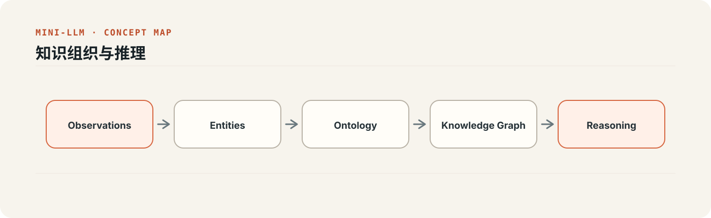
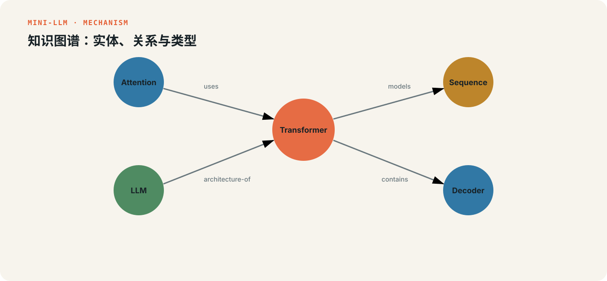

# **mini-llm Knowledge Architecture 深度解析：从 Knowledge Representation、Ontology 到 Knowledge Graph、Knowledge Reasoning 与 Neuro-symbolic AI**



_图：知识组织与推理。从左到右展示本章核心概念之间的数据流与依赖关系。_

在前面的 mini-llm 系列中，我们已经讨论了 Memory Architecture。

我们知道，一个智能系统可以通过 Episodic Memory 保存经历，通过 Semantic Memory 保存知识，通过 Procedural Memory 保存技能，并利用 Vector Database 检索相关记忆。

但是，当记忆数量不断增加时，会出现一个更深层的问题：

**记住大量信息，并不意味着真正理解这些信息之间的关系。**

例如，一个 AI 系统保存了以下记忆：

```
记忆 A：
Transformer 使用 Self-Attention。

记忆 B：
Self-Attention 使用 Query、Key、Value。

记忆 C：
Decoder 使用 Causal Mask。

记忆 D：
KV Cache 用于缓存历史 Key 和 Value。

记忆 E：
Autoregressive Generation 根据前面的 Token 预测下一个 Token。
```

这些信息单独看都没有问题。

但是，如果用户问：

> 为什么 KV Cache 能够提高 Transformer Decoder 的生成效率？它与 Causal Mask、Self-Attention 和 Autoregressive Generation 有什么关系？

系统就需要完成更复杂的工作：

1. 找到相关记忆。
2. 识别其中的概念。
3. 建立概念之间的关系。
4. 理解关系的方向和含义。
5. 根据关系进行推理。
6. 检查推理是否有依据。
7. 将新的知识加入原有知识体系。

这已经不只是 Memory Retrieval，而是 Knowledge Architecture 要解决的问题。

**Memory Architecture 负责记住信息，Knowledge Architecture 负责组织信息之间的意义和关系。**


_图：图书馆是最古老的知识架构：分类法决定一本书放在哪一排，索书号编码它与相邻书籍的关系，读者沿书架行走，完成一次“多跳检索”。知识图谱要做的，是把这种隐式的组织方式显式化为实体、关系和本体。图片：FrENdwquymn，[Wikimedia Commons](https://commons.wikimedia.org/wiki/File:SZ_Futian_%E6%B7%B1%E5%9C%B3%E5%9C%96%E6%9B%B8%E9%A4%A8_Shenzhen_Library_interior_Dec-2017_IX1_stacks_bookshelves_01.jpg)，[CC BY-SA 4.0](https://creativecommons.org/licenses/by-sa/4.0/)。_

# **一、Knowledge Representation：知识表示**

## **1.1 什么是知识表示？**

Knowledge Representation，简称 KR，中文通常称为知识表示。

它研究的是：

**如何将现实世界中的对象、概念、属性、关系和规则，转换成计算机能够处理的结构。**

例如：

人类可以理解：

> Transformer 是一种基于 Attention 机制的神经网络架构。

但是计算机不能仅仅依靠这句话就自动获得一个明确的知识结构。

我们需要把它表示为：

```
Entity:
Transformer

Type:
Neural Network Architecture

Relation:
based_on

Target:
Attention Mechanism
```

也可以表示成三元组：

\\[ (Transformer,\ based\\\_on,\ Attention) \\]

这样，计算机就可以对它进行查询、关联和推理。

## **1.2 从文本到结构化知识**

假设系统读取下面这段文本：

> Transformer 使用 Self-Attention 计算不同 Token 之间的关系。Self-Attention 使用 Query、Key 和 Value 进行信息聚合。

经过知识抽取，可以得到：

```
实体：

Transformer
Self-Attention
Query
Key
Value

关系：

Transformer -> uses -> Self-Attention

Self-Attention -> uses -> Query

Self-Attention -> uses -> Key

Self-Attention -> uses -> Value
```

这就完成了从非结构化文本到结构化知识的转换。

## **1.3 常见的知识表示方法**

| 方法               | 表示方式     | 适用场景 |
| ---------------- | -------- | ---- |
| Logic            | 逻辑表达式    | 规则推理 |
| Semantic Network | 语义网络     | 概念关联 |
| Knowledge Graph  | 实体与关系    | 知识关联 |
| Frame            | 属性与槽位    | 对象描述 |
| Ontology         | 概念、类型、约束 | 领域建模 |
| Rule System      | IF-THEN  | 业务规则 |

### **方法一：逻辑表示**

例如：

所有 Transformer Decoder 都使用某种因果约束来防止当前位置访问未来 Token。

可以用逻辑表达：

\\[ \forall x,\ Decoder(x) \Rightarrow CausalConstraint(x) \\]

这里的表达是一个简化的领域规则。

它不是说所有 Decoder 在具体实现中都必须采用同一种 Mask 实现方式，而是表达其因果约束。

### **方法二：框架表示（Frame）**

例如：

```
transformer = {    "name": "Transformer",    "type": "Neural Network Architecture",    "components": [        "Attention",        "FeedForward Network",        "Normalization"    ],    "variants": [        "Encoder",        "Decoder",        "Encoder-Decoder"    ]}
```

Frame 适合表示一个对象及其属性。

### **方法三：三元组表示**

\\[ (Subject, Predicate, Object) \\]

例如：

\\[ (Transformer, uses, Attention) \\]

\\[ (Decoder, uses, CausalMask) \\]

\\[ (KVCache, accelerates, AutoregressiveInference) \\]

三元组是很多知识图谱系统的基础。

## **1.4 知识表示最重要的是什么？**

不是把句子拆成三元组就结束了。

真正重要的是区分：

- 实体是什么？
- 实体属于什么类型？
- 属性是什么？
- 两个实体是什么关系？
- 关系是否具有方向？
- 关系是否有时间范围？
- 关系是否有来源？
- 这个知识是否经过验证？

例如：

```
KV Cache -> accelerates -> Generation
```

这个表达还不够准确。

更严谨的表达应该是：

```
KV Cache
    |
    | reduces repeated computation during
    v
Autoregressive Transformer Inference
```

因为 KV Cache 并不是无条件加速所有模型计算，它主要通过缓存历史 Token 的 Key 和 Value，减少后续生成时对历史位置的重复计算。

**知识表示的质量，决定了后续推理的可靠程度。**

# **二、Ontology：本体与概念体系**

知识表示解决的是如何表达知识。

Ontology 则进一步解决：

**一个领域中究竟有哪些概念？概念之间是什么层级关系？哪些关系是允许的？**

## **2.1 什么是 Ontology？**

Ontology 中文通常翻译为本体。

在计算机领域，它是对某个知识领域中的概念、类型、关系、属性和约束进行形式化定义。

例如，构建一个 AI 技术领域的 Ontology。

首先定义核心概念：

```
AI Technology
    |
    +---- Neural Network
    |        |
    |        +---- Transformer
    |        +---- CNN
    |        +---- RNN
    |
    +---- Learning Algorithm
    |        |
    |        +---- Supervised Learning
    |        +---- Reinforcement Learning
    |
    +---- AI System
             |
             +---- Agent
             +---- RAG System
             +---- Multimodal System
```

这就是一个初步的概念体系。

## **2.2 Ontology 与普通分类有什么区别？**

普通分类通常只关心：

```
Transformer 属于 Neural Network。
```

Ontology 还会定义：

```
Transformer 是一种 Neural Network Architecture。

Transformer 可以包含 Attention Layer。

Attention Layer 使用 Query、Key、Value。

Transformer Decoder 支持 Autoregressive Generation。

KV Cache 可以用于优化自回归推理。
```

也就是说，Ontology 不只是分类体系。

它还描述：

- 概念类型。
- 属性定义。
- 关系类型。
- 关系约束。
- 领域规则。

## **2.3 Ontology 的核心组成**

| 组成              | 含义   | 示例                 |
| --------------- | ---- | ------------------ |
| Class           | 概念类别 | NeuralNetwork      |
| Individual      | 具体实例 | GPT-某个具体模型         |
| Property        | 属性   | hidden_size        |
| Object Property | 实体关系 | uses_attention     |
| Data Property   | 数据属性 | num_layers         |
| Axiom           | 逻辑约束 | Decoder 属于模型架构     |
| Constraint      | 约束   | hidden_size 必须为正整数 |

例如：

```
Class:
Transformer

SubClassOf:
NeuralNetworkArchitecture

Properties:
has_attention
has_feed_forward
has_normalization

Constraints:
has_attention 至少存在一个实例
```

这是一个概念示例。真正的本体需要根据领域定义清楚属性的基数、值类型、关系定义域和值域。

## **2.4 为什么 AI 系统需要 Ontology？**

假设系统中存在：

```
KV Cache
Key-Value Cache
Attention Cache
```

这些名称可能指向同一个概念，也可能在某些上下文中代表不同的东西。

如果没有统一的本体，系统可能把它们当作三个独立知识。

Ontology 可以提供统一的概念标识：

```
Canonical Concept:
KV Cache

Aliases:
Key-Value Cache

Domain:
Transformer Inference
```

这能减少知识重复，提高检索和推理的一致性。

## **2.5 Ontology 的工程表达**

可以先用 Python 定义一个简化本体：

```
class Concept:    def __init__(        self,        name,        parent=None,        properties=None    ):        self.name = name        self.parent = parent        self.properties = properties or {}neural_network = Concept(    name="NeuralNetwork")transformer = Concept(    name="Transformer",    parent=neural_network,    properties={        "architecture": "Attention-based",        "supports_parallel_training": True    })
```

这只是普通对象模型的示意。

如果要构建正式的语义本体，可以使用 RDF、RDFS、OWL 等标准。

# **三、Knowledge Graph：知识图谱**



_图：实体、关系与类型约束组成可推理的知识图谱。_

现在进入 Knowledge Architecture 最核心的部分。

## **3.1 什么是知识图谱？**

Knowledge Graph 是通过节点和边表示知识的结构。

其中：

- Node：实体或概念。
- Edge：实体之间的关系。
- Property：节点或关系的属性。

例如：

```
              Transformer
                   |
                 uses
                   |
                   v
             Self-Attention
               /    |    \
              /     |     \
           uses    uses   uses
            /       |      \
           v        v       v
           Q        K       V
```

知识图谱的关键不是画出一张图，而是将实体和关系转化为可以查询、验证和推理的数据结构。

## **3.2 知识图谱的数据结构**

最简单的知识图谱可以用三元组表示：

\\[ G=(V,E) \\]

其中：

- \\(V\\)：节点集合。
- \\(E\\)：关系集合。

每条关系可以表示为：

\\[ e=(v_i,r,v_j) \\]

例如：

\\[ (Transformer,uses,Attention) \\]

\\[ (Attention,contains,QKV) \\]

\\[ (Decoder,uses,KVCache) \\]

更严格地说，知识图谱可以使用带标签的有向多重图，节点和边还可以附带属性、来源、时间和置信度。

## **3.3 知识图谱如何进行多跳关联？**

假设系统有这些知识：

```
Transformer
    |
    | uses
    v
Self-Attention
    |
    | uses
    v
QKV
    |
    | used_in
    v
Attention Computation
```

用户问：

> Transformer 为什么需要 Q、K、V？

系统可以沿着关系链进行多跳查询：

```
Transformer
    |
    v
Self-Attention
    |
    v
QKV
    |
    v
Attention Computation
```

这比只检索一段相似文本更具有结构性。

## **3.4 Knowledge Graph 的工程实现**

可以先使用 Python 构建一个简单的图：

```
class KnowledgeGraph:    def __init__(self):        self.nodes = {}        self.edges = []    def add_node(self, node_id, data):        self.nodes[node_id] = data    def add_edge(self, source, relation, target):        self.edges.append({            "source": source,            "relation": relation,            "target": target        })    def find_neighbors(self, node_id):        return [            edge for edge in self.edges            if edge["source"] == node_id        ]
```

添加知识：

```
kg = KnowledgeGraph()kg.add_node(    "Transformer",    {"type": "Architecture"})kg.add_node(    "SelfAttention",    {"type": "Mechanism"})kg.add_edge(    "Transformer",    "uses",    "SelfAttention")
```

查询：

```
relations = kg.find_neighbors("Transformer")print(relations)
```

这个实现可以帮助理解图结构，但它还不支持复杂图查询、事务、路径搜索和数据一致性。

实际项目可以考虑：

- Neo4j。
- ArangoDB。
- PostgreSQL。
- RDF Triple Store。

# **四、RDF 与 Property Graph**

知识图谱有不同的数据模型。

其中比较重要的是 RDF 和 Property Graph。

## **4.1 RDF：Resource Description Framework**

RDF 是 W3C 制定的资源描述框架。

它使用三元组表示资源之间的关系。

基本形式：

\\[ (Subject,Predicate,Object) \\]

例如：

```
Transformer
    uses
Self-Attention
```

可以表示为：

```
@prefix ai: <https://example.org/ai/> .

ai:Transformer
    ai:uses
    ai:SelfAttention .
```

RDF 的核心思想是：

**使用统一标识符和标准化的关系表达，将不同来源的数据连接起来。**

RDF 的重要组成：

| 组成         | 说明            |
| ---------- | ------------- |
| URI / IRI  | 资源唯一标识        |
| Triple     | 三元组           |
| Graph      | 三元组集合         |
| RDF Schema | 定义类别与属性       |
| OWL        | 定义更丰富的本体和逻辑关系 |
| SPARQL     | 查询 RDF 数据     |

## **4.2 SPARQL 查询**

例如，查询所有使用 Self-Attention 的实体：

```
PREFIX ai: <https://example.org/ai/>

SELECT ?entity
WHERE {
    ?entity ai:uses ai:SelfAttention .
}
```

这是一种声明式查询。

它告诉系统需要什么结果，而不是详细描述每一步如何查找。

## **4.3 Property Graph：属性图**

Property Graph 采用节点、关系以及属性的形式。

例如：

```
Node:
Transformer

Properties:
{
    type: "Architecture",
    domain: "AI"
}

Relationship:
USES

Target:
Self-Attention
```

关系本身也可以具有属性：

```
Relationship:
USES

Properties:
{
    source: "Research Paper",
    confidence: 0.98,
    created_at: "2026-11-23"
}
```

Property Graph 非常适合业务关系和工程系统。

## **4.4 RDF 与 Property Graph 对比**

| 维度   | RDF        | Property Graph   |
| ---- | ---------- | ---------------- |
| 基本结构 | 三元组        | 节点、关系、属性         |
| 资源标识 | 通常使用 IRI   | 通常使用数据库内部 ID     |
| 标准化  | W3C 标准体系   | 多种数据库实现          |
| 本体支持 | RDFS / OWL | 取决于数据库和应用        |
| 查询   | SPARQL     | Cypher、Gremlin 等 |
| 适合场景 | 跨系统语义互操作   | 业务关系与图分析         |

**如何选择？**

如果目标是：

- 跨数据源共享知识。
- 建立正式领域本体。
- 使用标准语义推理。

可以优先考虑 RDF。

如果目标是：

- 项目依赖关系。
- 用户与项目关联。
- 代码调用关系。
- 多跳业务查询。

Property Graph 往往更容易落地。

两者也可以结合使用。

# **五、Entity Resolution：实体对齐**

这是知识图谱构建过程中一个非常关键的问题。

## **5.1 什么是实体对齐？**

假设系统从不同来源获得了这些数据：

```
来源 A：
OpenAI

来源 B：
Open AI

来源 C：
openai

来源 D：
OpenAI 公司
```

这些名称可能指向同一个实体。

但是计算机默认不会知道它们是同一个对象。

Entity Resolution 的目标就是：

**判断不同记录是否指向同一个真实实体，并将它们关联到统一标识。**

## **5.2 为什么实体对齐很重要？**

如果没有实体对齐：

```
OpenAI
Open AI
openai
OpenAI 公司
```

可能被系统创建为四个不同节点。

这会导致：

- 知识重复。
- 关系分散。
- 查询遗漏。
- 统计错误。
- 推理路径中断。

## **5.3 实体对齐的处理流程**

```
          Raw Entities
               |
               v
          Normalization
               |
               v
         Candidate Blocking
               |
               v
         Similarity Matching
               |
               v
         Context Verification
               |
               v
         Entity Resolution
               |
               v
         Canonical Entity
```

各阶段含义：

1. Normalization：统一大小写、空格、标点等。
2. Candidate Blocking：减少需要比较的候选数量。
3. Similarity Matching：计算名称和属性相似度。
4. Context Verification：结合上下文判断是否同一实体。
5. Entity Resolution：合并或建立映射。

## **5.4 实体匹配的数学模型**

可以设计一个简单评分：

\\[ S(A,B)= w_1S\_{name} +w_2S\_{attribute} +w_3S\_{context} +w_4S\_{relation} \\]

其中：

- \\(S\_{name}\\)：名称相似度。
- \\(S\_{attribute}\\)：属性相似度。
- \\(S\_{context}\\)：上下文相似度。
- \\(S\_{relation}\\)：关联关系相似度。

当：

\\[ S(A,B)>\theta \\]

系统可以将其作为候选匹配。

但是阈值判断不应该直接等于自动合并。

例如：

```
Apple

可能表示：
Apple 公司
Apple 水果
```

即使名称完全一致，语义实体也不同。

因此，实体对齐必须结合领域和上下文。

## **5.5 工程示意**

```
def resolve_entity(a, b):    name_score = compare_name(        a["name"],        b["name"]    )    context_score = compare_context(        a["context"],        b["context"]    )    attribute_score = compare_attributes(        a["attributes"],        b["attributes"]    )    score = (        0.4 * name_score +        0.3 * context_score +        0.3 * attribute_score    )    if score >= 0.9:        return "same_entity"    if score >= 0.7:        return "manual_review"    return "different_entity"
```

实际系统还需要处理一对多、多对一、实体拆分、实体合并撤销等情况。

# **六、Relation Extraction：关系抽取**

实体对齐解决的是：

> 两条记录是不是同一个实体？

关系抽取解决的是：

> 两个实体之间是什么关系？

## **6.1 从文本抽取关系**

例如：

> Transformer 使用 Self-Attention 机制，Self-Attention 通过 Query、Key、Value 完成信息聚合。

系统需要抽取：

```
实体：
Transformer
Self-Attention
Query
Key
Value

关系：
Transformer -> uses -> Self-Attention

Self-Attention -> uses -> Query

Self-Attention -> uses -> Key

Self-Attention -> uses -> Value
```

这就是 Relation Extraction。

## **6.2 关系抽取的三种方法**

### **方法一：规则抽取**

例如：

```
X 使用 Y
```

抽取：

\\[ (X,uses,Y) \\]

优点：

- 简单。
- 可解释。
- 结果可控。

缺点：

- 对表达方式敏感。
- 难以处理复杂语言。
- 需要人工编写规则。

### **方法二：机器学习抽取**

使用训练好的关系分类模型，判断实体之间的关系类型。

例如：

```
输入：
Transformer 使用 Self-Attention。

实体对：
Transformer / Self-Attention

预测关系：
USES
```

### **方法三：LLM 抽取**

使用大语言模型将文本转换为结构化数据。

例如要求模型输出：

```
{
  "entities": [
    {
      "id": "Transformer",
      "type": "Architecture"
    },
    {
      "id": "SelfAttention",
      "type": "Mechanism"
    }
  ],
  "relations": [
    {
      "source": "Transformer",
      "type": "USES",
      "target": "SelfAttention"
    }
  ]
}
```

但必须注意：

LLM 可能生成文本中并不存在的关系。

因此，生产系统应该采用：

- JSON Schema 校验。
- 实体存在性检查。
- Ontology 约束检查。
- 原文证据定位。
- 置信度与人工审核。

**结构化输出格式正确，不代表抽取出来的知识一定正确。**

# **七、Knowledge Fusion：知识融合**

当一个系统从多个来源获得知识时，可能出现重复、冲突和信息不一致。

这就需要 Knowledge Fusion。

## **7.1 什么是知识融合？**

知识融合是将多个来源的知识进行对齐、整合和冲突处理，形成统一知识体系的过程。

例如：

来源 A：

```
模型架构：Transformer。
```

来源 B：

```
模型架构：Transformer Decoder。
```

来源 C：

```
该模型使用 Decoder-only 架构。
```

这三条知识可能具有不同粒度，但并不一定互相矛盾。

融合之后：

```
模型架构：
Transformer Decoder

架构类型：
Decoder-only

基础架构：
Transformer
```

## **7.2 知识冲突**

例如：

来源 A：

```
项目使用 SQLite。
```

来源 B：

```
项目使用 PostgreSQL。
```

系统不能简单地将两者合并为：

```
项目同时使用 SQLite 和 PostgreSQL。
```

需要进一步判断：

- 是否属于同一个项目？
- 是否是不同版本？
- 是否一个是候选方案？
- 是否已经发生技术选型变更？
- 是否存在不同模块分别使用不同数据库的情况？

## **7.3 知识融合流程**

```
          Knowledge Sources
                   |
                   v
             Entity Alignment
                   |
                   v
             Relation Mapping
                   |
                   v
            Duplicate Detection
                   |
                   v
            Conflict Detection
                   |
                   v
              Source Ranking
                   |
                   v
             Knowledge Fusion
                   |
                   v
            Unified Knowledge
```

## **7.4 知识来源可信度**

可以给知识增加来源信息：

```
Knowledge:
项目数据库使用 PostgreSQL。

Source:
项目最终决策文档。

Timestamp:
2026-11-23。

Status:
Confirmed。

Confidence:
Verified。
```

注意，这里的 `Verified` 是业务状态，不应该简单地与概率置信度混为一谈。

知识融合需要考虑：

1. 来源权威性。
2. 时间新旧。
3. 是否明确确认。
4. 是否有原始证据。
5. 是否与其他知识冲突。
6. 是否适用于当前环境。

# **八、Knowledge Reasoning：知识推理**

这是整个 Knowledge Architecture 最重要的能力之一。

知识图谱不仅可以查询，还可以进行推理。

## **8.1 什么是知识推理？**

知识推理就是：

**根据已有知识和规则，推导出新的知识或判断。**

例如：

已知：

```
事实 A：
所有 Transformer Decoder 都使用因果约束。

事实 B：
模型 X 是 Transformer Decoder。
```

可以推出：

```
结论：
模型 X 具有因果约束。
```

逻辑表达：

\\[ \forall x,\ Decoder(x) \Rightarrow Causal(x) \\]

\\[ Decoder(ModelX) \\]

因此：

\\[ Causal(ModelX) \\]

这就是规则推理。

## **8.2 知识推理的主要类型**

| 类型                      | 说明    | 示例         |
| ----------------------- | ----- | ---------- |
| Deductive Reasoning     | 演绎推理  | 根据规则推出结论   |
| Inductive Reasoning     | 归纳推理  | 从多个案例总结规律  |
| Abductive Reasoning     | 溯因推理  | 根据结果寻找可能原因 |
| Graph Reasoning         | 图关系推理 | 通过多跳关系寻找关联 |
| Temporal Reasoning      | 时间推理  | 判断事件先后和有效期 |
| Probabilistic Reasoning | 概率推理  | 根据证据更新判断   |

### **1. Deductive Reasoning：演绎推理**

从一般规则推出具体结论。

例如：

```
所有 Decoder-only 模型都是生成式架构。

模型 A 是 Decoder-only 模型。

所以：

模型 A 是生成式架构。
```

前提成立、逻辑形式有效时，结论具有必然性。

### **2. Inductive Reasoning：归纳推理**

从多个具体案例总结一般规律。

例如：

```
案例 A：模型使用 KV Cache。
案例 B：模型使用 KV Cache。
案例 C：模型使用 KV Cache。

观察到：
它们在自回归推理中缓存历史 K/V。

归纳：
KV Cache 通常用于优化自回归生成。
```

归纳得到的是可能成立的规律，不是逻辑上必然成立的结论。

### **3. Abductive Reasoning：溯因推理**

根据观察到的现象寻找最合理的解释。

例如：

```
观察：
模型生成速度明显下降。

可能原因：
A. KV Cache 被关闭。
B. GPU 显存不足。
C. 模型量化配置发生变化。
D. 推理批次发生变化。
```

系统需要寻找证据，判断哪个原因最可能。

这在故障诊断中非常重要。

## **8.3 规则推理的工程实现**

```
rules = [    {        "if": {            "type": "DecoderOnlyModel"        },        "then": {            "property": "supports_autoregressive_generation",            "value": True        }    }]
```

简化推理：

```
def apply_rule(entity, rule):    if entity["type"] == rule["if"]["type"]:        return {            **entity,            rule["then"]["property"]:                rule["then"]["value"]        }    return entity
```

真实系统还需要处理规则优先级、否定事实、冲突规则和推理链记录。

## **8.4 为什么 Knowledge Reasoning 不能完全依赖 LLM？**

LLM 很擅长根据上下文生成推理过程，但它并不保证每一步推理都严格有效。

例如：

```
事实：
所有 A 都是 B。

事实：
X 是 B。

错误结论：
X 一定是 A。
```

这是典型的逻辑错误。

因为：

\\[ A \Rightarrow B \\]

不能反推出：

\\[ B \Rightarrow A \\]

因此，复杂知识系统应该将：

- LLM 的语言理解和知识抽取能力。
- 规则引擎的确定性推理能力。
- 数据库的结构化查询能力。
- 概率模型的不确定性推理能力。

结合起来。

# **九、Temporal Knowledge：时序知识**

知识并不是永远不变的。

一个项目的技术选型、组织结构、产品状态和业务规则都可能发生变化。

因此，知识系统必须理解时间。

## **9.1 什么是时序知识？**

Temporal Knowledge 是带有时间信息的知识。

例如：

```
2025 年：
项目使用 SQLite。

2026 年：
项目迁移到 PostgreSQL。

2027 年：
项目引入分布式数据库。
```

如果系统只保存：

```
项目使用 SQLite。
项目使用 PostgreSQL。
项目使用分布式数据库。
```

那么用户问：

> 项目现在使用什么数据库？

系统就可能给出错误答案。

## **9.2 两种时间概念**

时序数据库和知识系统中，一个非常重要的概念是：

**Valid Time 与 Transaction Time。**

| 类型               | 含义            |
| ---------------- | ------------- |
| Valid Time       | 事实在现实世界中生效的时间 |
| Transaction Time | 系统记录这条事实的时间   |

例如：

2026 年 11 月 20 日，系统记录：

```
项目数据库使用 PostgreSQL。
```

但实际决策从 2026 年 11 月 18 日开始生效。

那么：

```
Valid Time:
2026-11-18

Transaction Time:
2026-11-20
```

两者并不相同。

## **9.3 时序知识的数据结构**

```
class TemporalFact:    def __init__(        self,        subject,        predicate,        object,        valid_from,        valid_to,        recorded_at    ):        self.subject = subject        self.predicate = predicate        self.object = object        self.valid_from = valid_from        self.valid_to = valid_to        self.recorded_at = recorded_at
```

例如：

```
fact = TemporalFact(    subject="ProjectA",    predicate="uses_database",    object="PostgreSQL",    valid_from="2026-11-18",    valid_to=None,    recorded_at="2026-11-20")
```

## **9.4 时序知识为什么重要？**

它可以解决：

- 当前状态查询。
- 历史状态回溯。
- 决策变更追踪。
- 版本对比。
- 事件顺序分析。
- 知识有效期判断。

尤其在 AI Agent 的长期项目管理中，时序知识非常重要。

**记住一个事实还不够，还要知道它在什么时候成立。**

# **十、Neuro-symbolic AI：神经符号智能**

现在来到一个更有研究价值的方向。

前面我们分别讨论了：

- 神经网络。
- 语言模型。
- 知识图谱。
- 规则系统。
- 逻辑推理。

那么，一个重要问题出现了：

**能不能把神经网络的学习能力与符号系统的逻辑推理能力结合起来？**

这就是 Neuro-symbolic AI。

## **10.1 什么是 Neuro-symbolic AI？**

Neuro-symbolic AI 是将神经网络与符号表示、逻辑规则、知识推理等方法结合起来的研究方向。

其中：

Neural 部分主要负责：

- 感知。
- 模式识别。
- 表征学习。
- 语言理解。
- 模糊信息处理。

Symbolic 部分主要负责：

- 显式知识表示。
- 逻辑规则。
- 约束检查。
- 确定性推理。
- 结构化知识操作。

## **10.2 神经网络与符号系统的差异**

| 维度   | Neural AI | Symbolic AI |
| ---- | --------- | ----------- |
| 核心机制 | 神经网络计算    | 符号和规则       |
| 学习方式 | 从数据中学习    | 人工定义或逻辑推导   |
| 表示方式 | 分布式向量     | 显式符号        |
| 优势   | 模式识别、泛化   | 规则清晰、可追溯    |
| 局限   | 难以保证逻辑一致性 | 对模糊数据适应性有限  |

## **10.3 一个具体例子：AI 代码开发 Agent**

假设用户要求：

> 修改数据库结构，增加一个用户表。

Neural 部分负责：

- 理解用户需求。
- 阅读项目代码。
- 识别数据库类型。
- 生成 SQL 方案。

Symbolic 部分负责：

- 检查表名是否冲突。
- 检查字段类型是否合法。
- 检查外键约束。
- 检查是否违反架构规则。
- 检查是否需要迁移脚本。
- 检查操作是否获得授权。

工作流程：

```
           User Request
                 |
                 v
          Neural Network
                 |
                 v
          Intent Understanding
                 |
                 v
           Knowledge Graph
                 |
                 v
           Symbolic Reasoning
                 |
                 v
          Constraint Validation
                 |
                 v
           Permission Check
                 |
                 v
             Execution
                 |
                 v
             Test Result
```

这里的神经网络负责理解和生成候选方案，符号系统负责检查明确的约束。

这比让 LLM 单独生成并直接执行 SQL 更可靠。

## **10.4 Neuro-symbolic 的三种结合方式**

### **方式一：Symbolic Knowledge 增强 Neural Model**

将知识图谱或规则作为模型输入。

```
用户问题
   |
   v
LLM
   |
   v
检索知识图谱
   |
   v
注入相关知识
   |
   v
生成答案
```

### **方式二：Neural Model 增强 Symbolic System**

利用 LLM 从非结构化文本中提取实体、关系和规则，再由符号系统进行验证。

```
文本
 |
 v
LLM 抽取
 |
 v
实体与关系
 |
 v
Ontology 验证
 |
 v
Knowledge Graph
```

### **方式三：Neural 与 Symbolic 联合推理**

让神经模型和符号系统共同参与推理过程。

例如：

- 神经网络提出候选假设。
- 知识图谱寻找支持关系。
- 逻辑引擎检查规则。
- 神经网络根据反馈调整候选方案。

这类系统可以进一步研究可微逻辑、神经定理证明器以及神经符号程序学习等方向。

需要注意，Neuro-symbolic AI 并不意味着把一个知识图谱接入 LLM 就完成了。真正的联合学习和联合推理涉及更复杂的模型设计、语义对齐和训练机制。

# **十一、构建 mini-llm Knowledge Engine**

前面介绍的是理论，现在将它转化为工程架构。

## **11.1 总体模块设计**

```
mini-llm/
│
├── knowledge/
│   │
│   ├── representation/
│   │   ├── entity.py
│   │   ├── relation.py
│   │   └── triple.py
│   │
│   ├── ontology/
│   │   ├── schema.py
│   │   ├── concept.py
│   │   └── constraint.py
│   │
│   ├── graph/
│   │   ├── graph_store.py
│   │   ├── graph_query.py
│   │   └── graph_traversal.py
│   │
│   ├── extraction/
│   │   ├── entity_extractor.py
│   │   └── relation_extractor.py
│   │
│   ├── alignment/
│   │   ├── entity_resolution.py
│   │   └── entity_merger.py
│   │
│   ├── fusion/
│   │   ├── duplicate_detector.py
│   │   ├── conflict_detector.py
│   │   └── knowledge_fusion.py
│   │
│   ├── reasoning/
│   │   ├── rule_engine.py
│   │   ├── logical_reasoner.py
│   │   └── graph_reasoner.py
│   │
│   ├── temporal/
│   │   ├── temporal_fact.py
│   │   └── temporal_query.py
│   │
│   ├── validation/
│   │   ├── schema_validator.py
│   │   └── evidence_validator.py
│   │
│   └── knowledge_engine.py
│
└── tests/
    ├── test_representation.py
    ├── test_ontology.py
    ├── test_graph.py
    ├── test_alignment.py
    ├── test_reasoning.py
    └── test_temporal.py
```

## **11.2 Knowledge Engine 的核心接口**

```
class KnowledgeEngine:    def extract(self, text):        """从文本中提取知识"""        pass    def normalize(self, knowledge):        """标准化实体和关系"""        pass    def resolve_entities(self, entities):        """实体对齐"""        pass    def validate(self, knowledge):        """本体与证据校验"""        pass    def store(self, knowledge):        """存储知识"""        pass    def query(self, query):        """查询知识"""        pass    def reason(self, facts, rules):        """知识推理"""        pass    def fuse(self, knowledge_sources):        """融合多来源知识"""        pass
```

## **11.3 一个完整的知识处理过程**

假设用户输入：

> Transformer Decoder 使用 Causal Mask，避免当前位置访问未来 Token。

系统执行：

**第一步：实体抽取**

```
Transformer Decoder
Causal Mask
Token
```

**第二步：关系抽取**

```
Transformer Decoder
    |
    | uses
    v
Causal Mask
```

**第三步：属性和规则抽取**

```
Causal Mask

Function:
Prevent access to future positions
```

**第四步：Ontology 验证**

检查：

- Transformer Decoder 是否为合法概念。
- Causal Mask 是否为合法机制。
- `uses` 是否为允许的关系。
- 目标实体类型是否符合关系定义。

**第五步：证据验证**

确认原始文本中存在相应表达。

**第六步：存储**

保存实体、关系、来源和时间信息。

**第七步：推理**

未来用户问：

> Decoder 为什么不能访问未来 Token？

系统可以检索这条知识，并结合 Autoregressive Generation 的定义进行推理。

# **十二、Knowledge Engine 的评估体系**

知识图谱建立起来，不意味着知识质量一定高。

需要针对不同能力设计测试。

| 评估维度                | 指标                           | 目的       |
| ------------------- | ---------------------------- | -------- |
| Entity Extraction   | Precision / Recall / F1      | 实体抽取质量   |
| Relation Extraction | Precision / Recall / F1      | 关系抽取质量   |
| Entity Resolution   | Pairwise F1                  | 实体对齐准确率  |
| Ontology Validation | Violation Rate               | 本体约束违反率  |
| Knowledge Fusion    | Conflict Resolution Accuracy | 冲突处理能力   |
| Knowledge Reasoning | Reasoning Accuracy           | 推理正确率    |
| Temporal Reasoning  | Temporal Accuracy            | 时间判断能力   |
| Retrieval           | Recall\@K / MRR              | 知识检索质量   |
| Provenance          | Evidence Coverage            | 结论证据覆盖程度 |

还应当设置几个关键测试：

1. 是否能识别两个不同实体的同名情况？
2. 是否能识别同一个实体的不同别名？
3. 是否会错误合并不同来源的冲突知识？
4. 是否能区分当前有效事实与历史事实？
5. 是否能识别错误的逻辑逆推？
6. 是否能追溯一个推理结论的原始证据？
7. 当知识图谱缺少必要信息时，是否能够承认未知？

最后一个尤其重要。

**一个可靠的知识系统不仅要知道什么是正确的，还要知道哪些问题目前没有足够证据回答。**

# **十三、Memory、Knowledge、World Model 的关系**

到这里，mini-llm 已经有三个容易混淆的模块：

- Memory Engine。
- Knowledge Engine。
- World Model Engine。

它们有什么区别？

这是整个系列中非常重要的一组概念。

| 模块                 | 核心问题                | 主要产物          |
| ------------------ | ------------------- | ------------- |
| Memory Engine      | 过去发生了什么？            | 经历、记忆、技能      |
| Knowledge Engine   | 我们知道什么？它们有什么关系？     | 事实、概念、规则、知识图谱 |
| World Model Engine | 世界当前是什么状态？未来可能如何变化？ | 状态表示、转移模型、预测  |

举一个机器人移动的例子。

**Memory Engine：**

```
昨天机器人在走廊中移动时，
遇到了一次障碍物。
```

**Knowledge Engine：**

```
机器人知道：
走廊是一个空间区域。
障碍物会影响通行。
```

**World Model Engine：**

```
根据当前传感器信息，
预测机器人向前移动 2 米后，
可能遇到障碍物。
```

三者共同工作：

```
             Experience
                  |
                  v
             Memory Engine
                  |
                  v
            Knowledge Engine
                  |
                  v
           World Model Engine
                  |
                  v
             Prediction
                  |
                  v
               Agent
                  |
                  v
               Action
                  |
                  v
               Feedback
                  |
                  +------> Memory
```

需要注意，这是一种工程上的职责划分，并非所有智能系统都必须采用独立的三个模块。真实系统中，三者可能共享数据结构、模型和计算过程。

# **十四、mini-llm 整体架构的进一步演化**

到现在，我们已经从底层 Tensor 逐步研究到知识组织和认知架构。

可以把目前的技术体系整理为：

**Cognitive Architecture**

认知组织与控制

**Memory Engine**

经历与记忆

**Knowledge Engine**

知识与关系

**World Model Engine**

状态与预测

**Agent Engine**

目标与行动

**Learning Engine**

经验与改进

**Evaluation Engine**

评估与验证

**Representation Engine**

内部表示

**Transformer / Neural Network Engine**

底层神经网络计算

可以这样理解：

- Neural Network 提供模式学习能力。
- Representation 提供内部表示。
- Memory 保存经历。
- Knowledge 组织概念和关系。
- World Model 表示状态并预测变化。
- Agent 根据目标执行行动。
- Learning 从反馈中改善行为。
- Cognitive Architecture 负责协调认知过程。
- Evaluation 验证系统是否真的完成了任务。

这已经不只是一个语言模型，而是一套可以研究和逐步实现的智能系统架构。

# **十五、这一篇最值得记住的七个结论**

1\. **Knowledge Representation 是知识工程的基础。** 它将文本中的概念、属性和关系转化为计算机可处理的结构。

2\. **Ontology 是知识体系的概念规范。** 它定义概念类型、关系和约束，避免知识体系混乱。

3\. **Knowledge Graph 是知识关联的结构。** 它可以支持实体关联、多跳查询和图关系推理。

4\. **Entity Resolution 和 Relation Extraction 是知识图谱构建的关键。** 前者解决实体是否相同，后者解决实体之间是什么关系。

5\. **Knowledge Fusion 需要处理冲突和来源。** 多个来源的信息不能不加判断地合并。

6\. **Knowledge Reasoning 不等于语言生成。** 严格推理需要规则、逻辑和证据支持。

7\. **Neuro-symbolic AI 是值得研究的融合方向。** 它尝试结合神经网络的学习能力与符号系统的结构化推理能力。

## **下一篇：mini-llm World Model Engine 深度解析**

现在我们已经研究了：

- 如何保存经历。
- 如何形成知识。
- 如何组织知识关系。
- 如何根据规则进行推理。

但还有一个更深的问题：

**一个智能系统如何不仅知道世界是什么，还能够预测世界将如何变化？**

下一篇建议深入研究：

1. State Representation：状态表示。
2. State Space：状态空间。
3. State Transition：状态转移。
4. Dynamics Model：动力学模型。
5. Observation Model：观测模型。
6. Prediction Error：预测误差。
7. Model-based Planning：基于模型的规划。
8. Counterfactual Reasoning：反事实推理。
9. Causal Model：因果模型。
10. World Model 与 LLM、Agent、Reinforcement Learning 的关系。

核心研究问题是：

**为什么真正具有行动能力的智能系统，不能只知道世界中的事实，还必须能够预测行动会给世界带来什么变化？**

