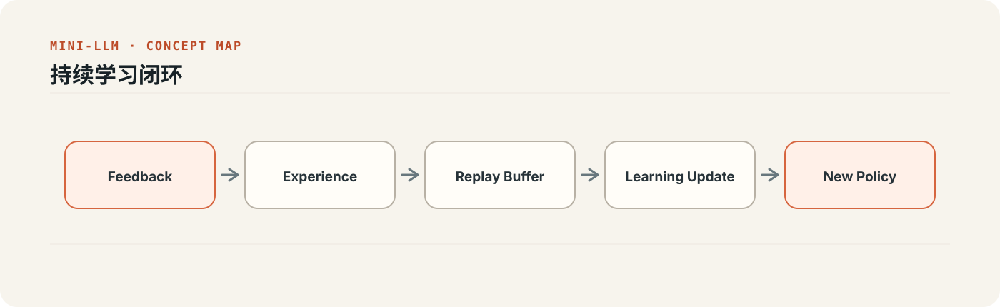
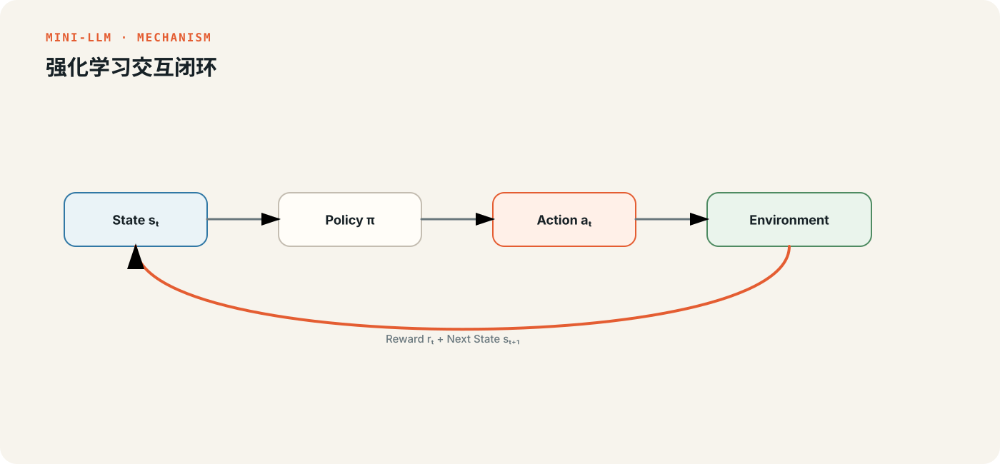

# **mini-llm Learning Engine 深度解析：从 Feedback、Experience Replay 到 Online Learning、Reinforcement Learning 与 Self-Improvement**



_图：持续学习闭环。从左到右展示本章核心概念之间的数据流与依赖关系。_

**副标题：智能体如何从经验中学习？从一次任务的成功与失败，到持续更新知识、优化策略，最终形成不断改进的智能系统。**


_图：机器人靠力传感器完成柔顺抛光：每一次接触都会产生一条“状态—动作—结果”的经验。Learning Engine 要做的，是把这些零散的经验变成可复用的策略，而不是每次都从零试错。图片：本仓库 AI 生成图。_

在前面的 Agent Engine 中，我们已经构建了一个能够理解目标、拆解任务、调用工具、执行行动并检查结果的智能体。

但是，一个重要问题还没有解决：

**Agent 完成了一次任务，是否意味着它获得了新的能力？**

答案是否定的。

例如：

第一次让 AI 编写一个 React 组件，它失败了。

第二次，你告诉它正确的写法，它成功了。

第三次，你再次让它编写类似组件，它又犯了同样的错误。

这说明什么？

它可能在第二次任务中利用了当前上下文，却没有真正形成能够长期复用的经验。

真正的 Learning Engine，需要解决：

1. 如何从环境获得反馈？
2. 如何从成功和失败中提取经验？
3. 如何保存和重复利用经验？
4. 如何更新行为策略？
5. 如何避免学习新知识时遗忘旧知识？
6. 如何验证系统真的变得更好？

这就是本篇要研究的问题。

[Verso la valutazione olistica dei LLM: integrare il feedback umano con le metriche tradizionali | HackerNoon](https://images.openai.com/static-rsc-4/QYLpTWbcGqOJqEMAuqWMgQhvEGK0BjXkKVDy9XzjBaIsnOxNIiLhRF3HxYl3rjzqhQ4AsFJZEFWIlslPKQYsN0WRjzozV8Fil75NmcUss9lkwKtmWkW9lz5yRSmcbWUsvN5gZHQrTbRKf0gIAgbBH953vjPBawqXK55_zwaHTM4?purpose=inline)

[From Moon Landings to Medicine: How Deep Q-Learning is Shaping the Future of Healthcare](https://images.openai.com/static-rsc-4/YrW8hmj5_MiLgjG64Tm25r-tj9M7Jx863XuClXZXDlDxdZoaST_tKXpIeKRbl3XUe3C5dDZJwD3rmYVeZjGh7EdahRHXtoojx37jSF-axIresiHkxUw9PVUFM_cJBZgKOFZvYD74BHAfide1Fipfb54T6VejeH0QPDz1milt9kA?purpose=inline)

[Catastrophic forgetting in Large Language Models | UnfoldAI](https://images.openai.com/static-rsc-4/v-otblpo97K_A8cJSldHJl_ngSmaDJr9QVyANE0NDOjHYOZyj5d0vJK2F6FQe-3k84YicYVk8fR2V5nesMBbenzAR5Da9YJJogrWm7JmnNgKI0YxLWTDotCb3_XTfHJVlesEajBB7NRi7x57bbDzA7RTp6SwNfvLQY4sPiop7h0?purpose=inline)

11

# **一、Feedback Learning：智能体如何获得反馈？**

## **1.1 执行不等于学习**

先看一个简单的过程：

```
用户提出任务
    |
    v
Agent 制定计划
    |
    v
Agent 执行行动
    |
    v
环境返回结果
    |
    v
Agent 判断结果
```

例如：

```
任务：创建一个 React 项目

行动：
执行 npm run build

反馈：
Build Failed

错误：
Cannot find module './App'
```

此时 Agent 得到了一个反馈。

但是，反馈本身不等于学习。

如果 Agent 只是读取错误并临时修改代码，它完成的是一次错误恢复。

如果它进一步提取出：

> 在创建 React 项目时，需要确保入口文件引用路径与实际文件结构一致。

并在后续相关任务中正确应用，那么它才形成了可复用经验。

因此：

**Feedback 是学习的输入，Learning 是利用反馈改变模型、策略或记忆的过程。**

## **1.2 Feedback 的类型**

反馈可以来自不同来源。

| 反馈类型                 | 来源    | 示例       |
| -------------------- | ----- | -------- |
| Explicit Feedback    | 用户    | 用户明确指出错误 |
| Environment Feedback | 环境    | 命令执行失败   |
| Reward Feedback      | 奖励函数  | 任务得分     |
| Human Feedback       | 人类评价  | 专家评分     |
| Automated Feedback   | 自动评价器 | 测试通过率    |
| Self-Evaluation      | 模型评价  | 根据标准检查答案 |

例如，一个代码 Agent 可以同时获得：

```
feedback = {    "build": {        "success": True    },    "tests": {        "passed": 18,        "failed": 2    },    "review": {        "score": 0.82    },    "user_feedback": {        "approved": False,        "comment": "错误处理不完整"    }}
```

这些反馈代表不同维度的信息。

需要注意：模型自我评价并不等于客观评价。对于代码任务，实际测试结果通常比模型自己声称的完成程度更可靠。

## **1.3 Feedback 如何转化为学习信号？**

假设任务有一个质量评价函数：

\\[ R=f(y,\hat{y}) \\]

其中：

- \\(y\\)：真实目标或参考结果。
- \\(\hat{y}\\)：模型输出。
- \\(R\\)：反馈得分。

例如：

\\[ R= 0.3R\_{\text{correctness}} +0.3R\_{\text{completeness}} +0.2R\_{\text{quality}} +0.2R\_{\text{efficiency}} \\]

这里的权重只是一个示例。

对于不同任务，评价标准应该不同。

代码开发可能更重视正确性和测试通过率；文章写作可能更重视事实准确性、结构和可读性。

因此，Learning Engine 首先需要建立一个可靠的 Feedback Pipeline：

```
Task Execution
      |
      v
Feedback Collection
      |
      v
Feedback Normalization
      |
      v
Quality Evaluation
      |
      v
Learning Signal
      |
      v
Memory / Policy / Model Update
```

# **二、Experience Replay：为什么需要重复利用过去经验？**

## **2.1 什么是 Experience？**

Experience（经验）可以理解为智能体在过去任务中经历的完整记录。

一个经验不应该只保存最终答案，还应该包含：

- 当时的状态。
- 目标。
- 执行的动作。
- 环境反馈。
- 最终结果。
- 评价信息。

在强化学习中，常用一个基本结构：

\\[ e_t=(s_t,a_t,r_t,s\_{t+1}) \\]

其中：

- \\(s_t\\)：当前状态。
- \\(a_t\\)：执行的动作。
- \\(r_t\\)：获得的奖励。
- \\(s\_{t+1}\\)：动作后的新状态。

对于复杂 Agent，还可以增加任务、工具调用、执行日志和结果验证等信息。

例如：

```
experience = {    "task": "create_react_component",    "state": {        "project_type": "react",        "language": "typescript"    },    "action": {        "type": "create_file",        "path": "src/components/Button.tsx"    },    "feedback": {        "build_success": True,        "test_success": True    },    "reward": 1.0}
```

这就是一条经验记录。

## **2.2 为什么不能只依靠最新经验？**

假设 Agent 连续执行三个任务：

```
Task A：成功
Task B：失败
Task C：成功
```

如果系统只保留最近一次经验，那么 Task A 和 Task B 的信息可能被丢弃。

这会带来两个问题：

1. 过去有效的经验无法重复利用。
2. 系统可能反复犯已经犯过的错误。

Experience Replay 的核心思想就是：

**将过去的经验保存起来，在后续学习过程中重新使用。**

## **2.3 Experience Replay Buffer**

在深度强化学习中，常用 Replay Buffer 保存历史经验。

[Medipixel, Inc](https://images.openai.com/static-rsc-4/y3GNZ7VSG3S_jQGTiSTJwp47tId382HdDe7yHrJuqId9-l70CO1H0jZtAz6onN4eM1sIF9cuh8TNnJWhv1QrWY4toAr0HxI1J-7nCGCRJ7B0Qgsz6SAcB44P4JoH_HcWXKJLvGbOccYHM2TrMQA6L4f4fXYPQJANVQ-8DhoNQ4k?purpose=inline)

[medipixel.io](https://medipixel.io/products/blog/%EA%B0%95%ED%99%94%ED%95%99%EC%8A%B5%EC%9D%98-%ED%98%88%EA%B4%80-%EC%86%8D-%ED%83%90%ED%97%98-3-%EC%8B%A4%ED%97%98%ED%99%98%EA%B2%BD-%EA%B5%AC%EC%84%B1%EA%B3%BC-%EA%B0%95%ED%99%94%ED%95%99%EC%8A%B5-%EC%95%8C%EA%B3%A0%EB%A6%AC%EC%A6%98-%EC%86%8C%EA%B0%9C?utm_source=chatgpt.com)

简单实现：

```
import randomfrom collections import dequeclass ReplayBuffer:    def __init__(self, capacity):        self.buffer = deque(maxlen=capacity)    def add(self, experience):        self.buffer.append(experience)    def sample(self, batch_size):        return random.sample(            self.buffer,            min(batch_size, len(self.buffer))        )    def __len__(self):        return len(self.buffer)
```

使用：

```
buffer = ReplayBuffer(capacity=10000)buffer.add(experience)batch = buffer.sample(batch_size=32)
```

为什么不按照时间顺序训练？

因为连续经验可能高度相似。

例如：

```
第 1 条：向右移动
第 2 条：向右移动
第 3 条：向右移动
第 4 条：向右移动
```

如果只按照顺序训练，模型可能受到局部连续样本的影响。

随机采样有助于降低样本之间的相关性。

不过，普通随机 Replay 也不是万能的。如果样本分布严重不均衡，重要经验可能被稀释。

## **2.4 Prioritized Experience Replay**

一个进一步的改进是 Prioritized Experience Replay（优先经验回放）。

它让学习系统更频繁地采样重要经验。

在 DQN 中，常用 TD Error（时序差分误差）衡量经验的重要程度：

\\[ \delta_i= r_i+\gamma\max_a Q(s'\_i,a) -Q(s_i,a_i) \\]

然后定义采样优先级：

\\[ p_i=(|\delta_i|+\epsilon)^\alpha \\]

采样概率：

\\[ P(i)=\frac{p_i}{\sum_jp_j} \\]

其中：

- \\(\delta_i\\)：TD Error。
- \\(\epsilon\\)：避免概率为零。
- \\(\alpha\\)：控制优先采样程度。

直观理解：

**预测误差越大的经验，可能越值得重新学习。**

但是，大误差也可能来自噪声、异常数据或错误标签。因此，不能把所有大误差样本都视为高质量经验。

# **三、Reinforcement Learning：通过奖励学习行为策略**



_图：状态、行动、奖励和下一状态构成强化学习交互闭环。_

前面介绍的 Experience Replay 解决了经验如何保存和重复利用的问题。

但它没有完全回答：

**智能体应该如何知道哪种行动更好？**

这就涉及 Reinforcement Learning（强化学习）。

## **3.1 什么是强化学习？**

强化学习的核心思想是：

智能体通过与环境交互，根据行动结果获得奖励，并逐渐学习更好的行为策略。

[Building Heat Demand Prediction Based on Reinforcement Learning for Thermal Comfort Management | MDPI](https://images.openai.com/static-rsc-4/NWrnDDj9ff2hJlKwjjKs82yy_Gy_FrOVL9RVI4tX26pAomcF1Gno407EMAvM2YxyGvsVb9egefEsP80OkaGpi_FRppuXjNnMvrf5ADBrrXLE2wU3pGH9qjVLz-DBpjxsnRQiPlr0dymF_tjHb7EvsG-EDOit2mASeyDA3h44Dks?purpose=inline)

[mdpi.com](https://www.mdpi.com/1996-1073/15/21/7856?utm_source=chatgpt.com)

基本结构：

```
       Agent
         |
         | Action
         v
     Environment
         |
         | State + Reward
         v
       Agent
```

智能体与环境不断交互：

1. 观察当前状态。
2. 选择动作。
3. 环境发生变化。
4. 获得奖励。
5. 更新策略。
6. 继续执行。

## **3.2 Markov Decision Process**

强化学习通常使用马尔可夫决策过程（MDP）描述问题。

定义：

\\[ MDP=(S,A,P,R,\gamma) \\]

其中：

- \\(S\\)：状态空间。
- \\(A\\)：动作空间。
- \\(P\\)：状态转移概率。
- \\(R\\)：奖励函数。
- \\(\gamma\\)：折扣因子。

状态转移：

\\[ P(s\_{t+1}\mid s_t,a_t) \\]

奖励：

\\[ r_t=R(s_t,a_t,s\_{t+1}) \\]

策略：

\\[ \pi(a\mid s) \\]

策略表示智能体在某个状态下选择不同动作的概率。

## **3.3 Reward：如何衡量行动好坏？**

假设机器人需要到达一个目标位置。

我们可以设计奖励：

\\[ R= \begin{cases} +100,& \text{到达目标}\\\ -10,& \text{发生碰撞}\\\ -1,& \text{每执行一步} \end{cases} \\]

这样：

- 到达目标获得奖励。
- 发生碰撞受到惩罚。
- 无意义地绕路会产生额外成本。

但奖励函数的设计非常关键。

如果只奖励机器人到达目标，它可能选择一条危险路径。

如果奖励函数没有充分描述安全要求，模型可能找到一个满足形式要求、却违背实际目标的策略。

这类问题通常称为 Reward Hacking 或 Specification Gaming。

因此，奖励函数必须尽量贴近真正的任务目标，并结合独立约束和评价机制。

## **3.4 Return：为什么需要考虑长期奖励？**

强化学习不是只看当前一步的奖励。

它更关心长期累计收益：

\\[ G_t= \sum\_{k=0}^{\infty} \gamma^k r\_{t+k} \\]

其中：

\\[ 0\leq\gamma\leq1 \\]

例如：

行动 A：

- 当前奖励：10。
- 后续奖励：0。

行动 B：

- 当前奖励：2。
- 后续奖励：20。

如果只看当前奖励，A 更好。

但如果考虑长期收益，B 可能更好。

这就是强化学习与简单规则决策之间的重要区别。

# **四、Q-Learning：智能体如何学习行动价值？**

## **4.1 什么是 Q Value？**

Q Value 表示：

**在当前状态下采取某个动作，未来预计能够获得多少累计奖励。**

数学表示：

\\[ Q^\pi(s,a)= \mathbb{E}\_\pi \left[ \sum\_{k=0}^{\infty} \gamma^k r\_{t+k} \mid s_t=s,a_t=a \right] \\]

例如：

| 当前状态 | 行动 | Q Value |
| ---- | -- | ------- |
| 靠近目标 | 向前 | 10      |
| 靠近目标 | 向后 | 2       |
| 靠近目标 | 向左 | 5       |
| 靠近目标 | 向右 | 4       |

Agent 可以倾向于选择 Q Value 更高的行动。

## **4.2 Q-Learning 更新公式**

Q-Learning 是一种经典的无模型强化学习算法。

它的更新公式：

\\[ Q(s_t,a_t)\leftarrow Q(s_t,a_t) +\alpha \left[ r_t+\gamma\max_a Q(s\_{t+1},a) -Q(s_t,a_t) \right] \\]

其中：

- \\(\alpha\\)：学习率。
- \\(r_t\\)：当前奖励。
- \\(\gamma\\)：折扣因子。
- \\(Q(s_t,a_t)\\)：当前估计值。
- \\(\max_a Q(s\_{t+1},a)\\)：下一状态下最优动作价值。

方括号中的部分叫 TD Error：

\\[ \delta_t= r_t+\gamma\max_a Q(s\_{t+1},a) -Q(s_t,a_t) \\]

如果实际结果比预期更好，TD Error 通常为正；如果比预期更差，则通常为负。

## **4.3 一个简单的 Q-Learning 实现**

下面使用一个简化的网格世界。

```
import numpy as npQ = np.zeros((5, 4))alpha = 0.1gamma = 0.9def update_q(state, action, reward, next_state):    old_value = Q[state, action]    next_value = np.max(Q[next_state])    target = reward + gamma * next_value    Q[state, action] = (        old_value + alpha * (target - old_value)    )
```

这里：

- 5 表示 5 个离散状态。
- 4 表示 4 种动作。

它只是展示 Q-Learning 更新过程的最小实现，并没有包含完整的环境交互、终止状态处理和探索策略。

## **4.4 Exploration vs Exploitation**

如果 Agent 总是选择当前 Q Value 最大的动作，它可能无法发现更好的行动。

因此，需要探索机制。

经典的 ε-greedy 策略：

\\[ a_t= \begin{cases} \text{随机选择动作},&概率为\epsilon\\\ \arg\max_a Q(s_t,a),&概率为1-\epsilon \end{cases} \\]

例如：

- 95% 的时候选择当前认为最好的动作。
- 5% 的时候尝试其他动作。

这就是 Exploration 与 Exploitation 的平衡。

# **五、Policy Learning：从价值函数到行动策略**

Q-Learning 学习的是动作价值。

另一种方法是直接学习策略。

策略函数：

\\[ \pi\_\theta(a\mid s) \\]

其中：

- \\(s\\)：当前状态。
- \\(a\\)：动作。
- \\(\theta\\)：策略网络参数。

例如：

```
class PolicyNetwork:    def forward(self, state):        logits = self.network(state)        probabilities = softmax(logits)        return probabilities
```

假设输出：

\\[ \pi(a\mid s)= [0.1,0.7,0.1,0.1] \\]

表示：

- 动作 1：10%。
- 动作 2：70%。
- 动作 3：10%。
- 动作 4：10%。

系统可以根据这个概率分布采样行动。

## **5.1 Policy Gradient**

策略梯度方法直接优化策略参数：

\\[ \nabla\_\theta J(\theta) = \mathbb{E} \left[ \nabla\_\theta\log\pi\_\theta(a\mid s) \cdot A(s,a) \right] \\]

其中 \\(A(s,a)\\) 是 Advantage（优势函数）。

它表示：

**某个动作相对于当前状态下的平均预期表现，到底好多少。**

如果动作表现优于预期，增加它被选择的概率。

如果表现低于预期，则降低它被选择的概率。

这类方法为后续 PPO、Actor-Critic 等算法奠定了基础。

# **六、RLHF 与 RLAIF：大语言模型如何通过反馈学习？**

现在将强化学习与 LLM 联系起来。

普通强化学习通常有明确的环境奖励。

但大语言模型的回答质量很难直接通过一个简单数字准确衡量。

例如：

> 请解释 Transformer 的 Multi-Head Attention。

我们可能得到三个答案：

- 答案 A：内容准确，但过于简短。
- 答案 B：内容详细，但包含错误。
- 答案 C：内容准确、结构清晰、解释完整。

如何让模型更倾向于生成 C？

这就是 RLHF 等技术试图解决的问题。

## **6.1 RLHF 是什么？**

RLHF：

Reinforcement Learning from Human Feedback。

即基于人类反馈的强化学习。

经典流程可以分为四步。

[GPT Models & Text Generation - Complete NLP Series Part 10 - Wasil Zafar](https://images.openai.com/static-rsc-4/uiP5ahc60dAulEuDUvd-QqrPM__g5G9g9rixXlIJABeO-MgvNv_aN7Bu9eH4eOIMbLAvfLq5eo3TGBW4H4C2GKqBzyuYjY16wYyvzuVY0p7RY4pIXFApt8DlgRiRI3FrRfyosbXCU0CIvXzvO39r3FwjdYmQeJnhq0HZz_eQOBY?purpose=inline)

[wasilzafar.com](https://www.wasilzafar.com/pages/series/nlp/nlp-gpt-text-generation.html?utm_source=chatgpt.com)

**第一步：预训练。**

模型通过大量文本学习语言规律。

**第二步：SFT（监督微调）。**

使用高质量示范数据训练模型，让模型学会按照指令回答。

\\[ L\_{\text{SFT}} = -\sum_t\log P\_\theta(y_t\mid x,y\_{\<t}) \\]

**第三步：收集偏好数据。**

让人类比较不同答案。

例如：

```
问题：解释 Attention。

答案 A：简单介绍 Attention。

答案 B：解释 Q、K、V，并给出数学公式。

人类偏好：B
```

**第四步：训练奖励模型并进行强化学习。**

奖励模型：

\\[ r\_\phi(x,y) \\]

它估计一个回答在偏好标准下的奖励。

然后使用 PPO 等强化学习方法优化语言模型，同时通常加入 KL 约束，避免模型偏离参考模型过远。

## **6.2 RLAIF 是什么？**

RLAIF：

Reinforcement Learning from AI Feedback。

它与 RLHF 类似，但反馈来源可以是 AI 评价器，而不是完全依赖人类标注。

例如：

```
问题：
解释 Transformer。

答案 A：
......

答案 B：
......

AI Judge：
答案 B 更准确、更完整。
```

AI 可以协助生成偏好数据。

但 AI 评价器也可能存在偏差：

- 偏好冗长答案。
- 对格式产生偏好。
- 无法识别某些专业错误。
- 与生成模型产生共同偏差。

因此，AI Feedback 仍然需要高质量评测集和人类抽查。

# **七、Online Learning：Agent 如何持续学习？**

前面介绍的训练通常是在准备好的数据集上进行。

但真实 Agent 可能每天都会产生新经验。

例如：

```
第一天：执行 10 个任务
第二天：执行 20 个任务
第三天：执行 30 个任务
```

能否让模型根据新经验持续更新？

这就是 Online Learning（在线学习）。

## **7.1 Batch Learning 与 Online Learning**

| 特征   | Batch Learning | Online Learning |
| ---- | -------------- | --------------- |
| 数据   | 预先准备           | 持续到达            |
| 更新   | 批量训练           | 持续或周期性更新        |
| 反馈   | 通常集中获得         | 可以逐步获得          |
| 适用场景 | 固定训练集          | 动态环境            |
| 风险   | 数据过时           | 噪声和数据漂移         |

Batch Learning：

\\[ \theta^\*= \arg\min\_\theta \sum\_{i=1}^{N}L(x_i,y_i;\theta) \\]

Online Learning：

\\[ \theta\_{t+1} = \theta_t-\eta_t\nabla\_\theta L_t \\]

每收到新的训练样本，就可以更新模型。

## **7.2 为什么不能让 Agent 每执行一次任务就直接更新模型？**

这是一个非常重要的工程问题。

假设 Agent 第一次遇到一个错误答案。

用户告诉它：

> 以后所有数据库查询都使用 SELECT \*。

这条建议可能适用于某个临时场景，但绝对不应该被无条件当作通用规则。

如果直接更新模型参数，错误经验可能影响未来大量任务。

因此，在线学习需要质量控制。

推荐流程：

```
新经验
  |
  v
经验验证
  |
  v
质量评估
  |
  v
去重与冲突检测
  |
  v
进入候选数据集
  |
  v
离线评测
  |
  v
批准更新
  |
  v
模型或策略版本发布
```

对于很多 Agent 产品，优先更新外部记忆、检索索引、工具策略和任务模板，比直接在线修改基础模型权重更加安全、成本也更低。

# **八、Continual Learning：持续学习如何避免灾难性遗忘？**

持续学习有一个经典难题：

**Catastrophic Forgetting（灾难性遗忘）。**

## **8.1 什么是灾难性遗忘？**

假设模型先学习任务 A：

```
任务 A：Python 编程
```

然后学习任务 B：

```
任务 B：Go 编程
```

如果训练任务 B 时模型参数发生较大变化，就可能导致它在任务 A 上的能力下降。

也就是说：

模型学习了新知识，却忘记了旧知识。

数学上：

假设模型在任务 A 上的损失为：

\\[ L_A(\theta) \\]

在任务 B 上的损失为：

\\[ L_B(\theta) \\]

只优化任务 B：

\\[ \theta^\*= \arg\min\_\theta L_B(\theta) \\]

并不保证：

\\[ L_A(\theta^\*)\approx L_A(\theta\_{\text{old}}) \\]

这就是持续学习的核心挑战。

## **8.2 Experience Replay 解决思路**

一种方式是：

在学习新任务时，重新加入部分旧任务数据。

\\[ L= L\_{\text{new}} +\lambda L\_{\text{replay}} \\]

这样可以让模型在学习新知识时，继续保持旧任务能力。

## **8.3 Elastic Weight Consolidation**

EWC 是一种经典的持续学习方法。

它通过 Fisher Information 估计重要参数，并在学习新任务时尽量保护这些参数。

目标函数：

\\[ L(\theta)= L_B(\theta) + \frac{\lambda}{2} \sum_i F_i(\theta_i-\theta_i^\*)^2 \\]

其中：

- \\(F_i\\)：参数重要性估计。
- \\(\theta_i^\*\\)：旧任务训练完成时的参数。
- \\(\lambda\\)：保护强度。

直观理解：

重要参数尽量不要随意修改。

不重要参数可以有更大的更新空间。

EWC 并不能彻底解决灾难性遗忘，但提供了一种参数约束思路。

## **8.4 LoRA 与持续学习**

对于大语言模型，还有一种工程上很实用的思路：

使用 LoRA 等参数高效微调方法。

例如：

```
Base Model
    |
    +---- LoRA: Python
    |
    +---- LoRA: Go
    |
    +---- LoRA: React
    |
    +---- LoRA: Database
```

不同任务可以使用不同适配器。

这样可以减少直接修改基础模型带来的风险。

但需要注意：

- 不同 LoRA 之间仍可能发生能力冲突。
- 多个 LoRA 的组合不保证效果相加。
- 适配器需要独立评估和版本管理。
- 参数高效微调不等于解决了持续学习问题。

# **九、Credit Assignment：如何知道哪个行动导致了成功或失败？**

这是 Agent Learning 中一个非常关键、但容易被忽略的问题。

假设 Agent 完成了一个复杂任务：

```
1. 搜索资料
2. 分析代码
3. 修改文件
4. 执行测试
5. 生成报告
```

最终任务成功了。

那么，应该奖励哪个行动？

如果最终任务失败了，又应该惩罚哪个行动？

这就是 Credit Assignment（信用分配）。

## **9.1 为什么 Credit Assignment 很难？**

假设执行了 10 个动作。

第 10 个动作导致任务成功。

但成功可能来自：

- 第 1 个动作获取了正确资料。
- 第 4 个动作找到了关键依赖。
- 第 7 个动作修复了错误。
- 第 9 个动作完成了关键测试。

不能简单地认为第 10 个动作最重要。

强化学习中，奖励可能延迟出现。

这被称为 Delayed Reward。

## **9.2 价值函数帮助分配长期贡献**

状态价值：

\\[ V^\pi(s)= \mathbb{E}\_\pi \left[ \sum\_{k=0}^{\infty}\gamma^k r\_{t+k} \mid s_t=s \right] \\]

动作价值：

\\[ Q^\pi(s,a)= \mathbb{E}\_\pi \left[ \sum\_{k=0}^{\infty}\gamma^k r\_{t+k} \mid s_t=s,a_t=a \right] \\]

优势函数：

\\[ A^\pi(s,a)=Q^\pi(s,a)-V^\pi(s) \\]

优势函数试图衡量：

某个动作比当前状态下的平均行动水平好多少。

## **9.3 Agent 工程中的 Credit Assignment**

对于工具型 Agent，还可以利用任务依赖图。

例如：

```
获取项目资料
      |
      v
分析依赖关系
      |
      v
修改代码
      |
      v
运行测试
      |
      v
最终成功
```

如果测试失败，可以沿着依赖关系追踪：

- 是资料错误？
- 是架构判断错误？
- 是代码修改错误？
- 是测试环境错误？

这不等于严格的因果归因，但能够帮助定位问题。

**对于工程 Agent，执行事件日志、代码差异、任务依赖和测试结果，是 Credit Assignment 的重要基础。**

# **十、Self-Reflection 与 Self-Improvement：反思就等于自我进化吗？**

这是一个非常值得区分的问题。

很多 Agent 系统声称具备 Self-Reflection。

但反思与真正的能力提升不是同一件事。

## **10.1 Self-Reflection**

Self-Reflection 是对过去执行过程进行分析。

例如：

```
任务：
创建用户登录接口。

执行结果：
测试失败。

反思：
遗漏了密码错误处理。

改进建议：
增加密码验证和异常处理。
```

它主要产生分析结果和修正建议。

## **10.2 Self-Improvement**

Self-Improvement 则要求系统真正改变后续行为，并且这种改变可以通过测试验证。

例如：

```
第一次：
登录接口遗漏密码错误处理。

第二次：
根据经验增加密码验证。

第三次：
新项目中自动考虑密码错误处理。

第四次：
经过独立测试确认功能正确。
```

这才体现出可复用的能力提升。

可以用一个概念性公式表示：

\\[ Improvement= Performance\_{after} - Performance\_{before} \\]

但是，必须在相同或可比较的评测条件下测量。

否则，性能差异可能来自任务难度变化，而不是学习本身。

## **10.3 自我改进闭环**

[Language & AGI Lab](https://images.openai.com/static-rsc-4/JKskJgEViWrj2vLz1OP5pFV9Yw2fR7q-UlLn7oHW53fnqyHvFwUMhK8E49Qr-76LI1sbMRtjNLI438ruKfsHgs-CZThIvMr6fpOufz3Ae8vOeSbUfEQDS_2qVKeIOyqMuvoPHxFRpm01RUmu4mLF0-6GI9Mt7ocyYkoSkBVTw9Y?purpose=inline)

[langlab.yonsei.ac.kr](https://langlab.yonsei.ac.kr/join?utm_source=chatgpt.com)

可以构建：

```
执行任务
   |
   v
收集反馈
   |
   v
分析失败原因
   |
   v
提取经验
   |
   v
更新记忆或策略
   |
   v
再次执行
   |
   v
独立评估
   |
   v
确认能力是否提升
```

需要强调：

**只修改 Prompt、增加记忆或生成反思文本，并不自动证明模型能力得到了提升。**

真正的自我改进必须有可重复的外部评测证据。

# **十一、Learning Engine 工程架构设计**

现在将理论转化为 mini-llm 的模块。

## **11.1 完整目录结构**

```
mini-llm/
│
├── learning/
│   │
│   ├── feedback/
│   │   ├── collector.py
│   │   ├── normalizer.py
│   │   └── reward.py
│   │
│   ├── experience/
│   │   ├── schema.py
│   │   ├── replay_buffer.py
│   │   └── prioritized_replay.py
│   │
│   ├── reinforcement/
│   │   ├── mdp.py
│   │   ├── q_learning.py
│   │   ├── policy_gradient.py
│   │   └── advantage.py
│   │
│   ├── online/
│   │   ├── online_trainer.py
│   │   └── data_stream.py
│   │
│   ├── continual/
│   │   ├── replay.py
│   │   ├── ewc.py
│   │   └── adapter_manager.py
│   │
│   ├── attribution/
│   │   └── credit_assignment.py
│   │
│   ├── reflection/
│   │   └── reflection_engine.py
│   │
│   └── evaluation/
│       ├── benchmark.py
│       ├── regression.py
│       └── improvement.py
│
└── experiments/
    ├── q_learning_demo.py
    ├── experience_replay_demo.py
    ├── online_learning_demo.py
    └── continual_learning_demo.py
```

## **11.2 Learning Engine 核心数据结构**

```
class Experience:    def __init__(        self,        state,        action,        reward,        next_state,        done    ):        self.state = state        self.action = action        self.reward = reward        self.next_state = next_state        self.done = done
```

对于 Agent 任务，可以扩展：

```
class AgentExperience:    def __init__(        self,        goal,        task,        action,        observation,        feedback,        result    ):        self.goal = goal        self.task = task        self.action = action        self.observation = observation        self.feedback = feedback        self.result = result
```

## **11.3 Feedback Collector**

```
class FeedbackCollector:    def collect(self, execution_result):        return {            "success": execution_result.success,            "error": execution_result.error,            "duration": execution_result.duration,            "output": execution_result.output        }
```

## **11.4 Experience Manager**

```
class ExperienceManager:    def __init__(self, replay_buffer):        self.buffer = replay_buffer    def save(self, experience):        self.buffer.add(experience)    def retrieve(self, batch_size):        return self.buffer.sample(batch_size)
```

## **11.5 Reflection Engine**

```
class ReflectionEngine:    def reflect(self, experience):        if experience.result["success"]:            return {                "type": "successful_pattern",                "action": experience.action            }        return {            "type": "failure_pattern",            "action": experience.action,            "feedback": experience.feedback        }
```

这只是基础数据流示例。实际系统需要增加经验去重、隐私处理、可信度判断、冲突解决和版本控制。

# **十二、如何证明 mini-llm 真的学会了？**

这是整个 Learning Engine 最重要的工程问题。

如果没有评测，就无法区分：

- 模型真的学会了。
- 只是记住了某个答案。
- 只是当前上下文更长。
- 只是碰巧遇到简单任务。
- 只是评价器发生了变化。

## **12.1 建立 Benchmark**

假设我们设计一个 Agent 编程任务集：

| 任务               | 评估目标   |
| ---------------- | ------ |
| 创建 React 组件      | 基础代码生成 |
| 修复 TypeScript 错误 | 错误修复能力 |
| 编写单元测试           | 测试能力   |
| 分析项目依赖           | 代码理解能力 |
| 修改已有模块           | 代码维护能力 |
| 修复回归问题           | 长期稳定性  |

记录学习前后的结果。

## **12.2 评估指标**

**Task Success Rate**

\\[ \text{Success Rate}=\frac{\text{Successful Tasks}}{\text{Total Tasks}} \\]

**Average Task Cost**

\\[ \text{Cost}=\frac{\text{Total Cost}}{\text{Completed Tasks}} \\]

**Regression Rate**

\\[ \text{Regression Rate}=\frac{\text{Previously Passed, Now Failed}}{\text{Previously Passed}} \\]

**Learning Gain**

\\[ \Delta P=P\_{after}-P\_{before} \\]

还应该测量：

- 工具调用成功率。
- 平均任务完成时间。
- 错误恢复成功率。
- 跨任务迁移能力。
- 旧任务能力保持率。
- 记忆检索准确率。

最重要的是：

**训练集、验证集和测试集需要合理隔离。**

否则，模型可能只是记住了评测题目。

## **12.3 一个简单的学习效果实验**

可以设计如下实验：

**mini-llm Learning Engine 实验**

这是实验设计，不是实际测量结果。

1. **Baseline**

   不使用经验记忆，执行 100 个任务，记录成功率
2. **Memory**

   加入历史经验检索，再执行同一组任务
3. **Replay**

   使用历史经验进行策略训练或优化
4. **Evaluation**

   在未见过的任务上测试迁移能力和回归情况

对比不同方案的成功率、成本、耗时及旧任务表现，才能判断哪种学习机制真正有效。

# **十三、一个关键认识：Agent Learning 不等于 LLM Training**

这里需要特别区分三个层次。

| 学习层次            | 改变什么      | 是否修改模型权重 |
| --------------- | --------- | -------- |
| Memory Learning | 外部记忆与知识库  | 否        |
| Policy Learning | 工具选择、执行策略 | 不一定      |
| Model Learning  | 神经网络参数    | 是        |

例如：

**Memory Learning**

Agent 记住某个项目使用 NestJS。

**Policy Learning**

Agent 学会分析 NestJS 项目时，优先检查模块、Controller 和 Provider。

**Model Learning**

通过微调，让模型本身更擅长理解 NestJS 代码。

三者并不冲突。

一个成熟的 Agent 系统可能同时使用这三种方式。

但它们的成本、风险和效果验证方式不同。

对于 mini-llm，我建议按照以下顺序建设：

1. 首先实现经验记录和记忆检索。
2. 然后实现工具调用策略优化。
3. 再研究强化学习。
4. 最后研究模型参数更新和持续微调。

这样可以避免一开始就把整个系统复杂化。

# **十四、从 Transformer 到 Learning Engine：完整智能系统的形成**

现在，我们已经连续研究了多个 Engine。

把它们连接起来：

## **mini-llm 智能系统架构**

从神经网络计算到自主学习的分层结构

**1. Tensor & Autograd Engine**

提供张量运算、自动微分和梯度计算。

**2. Transformer & Decoder Engine**

完成上下文建模和 Token 生成。

**3. Representation Engine**

形成特征、概念和内部表示。

**4. World Model Engine**

表示世界状态并预测动态变化。

**5. Agent Engine**

理解目标、规划任务、调用工具并执行。

**6. Learning Engine**

从反馈和经验中更新记忆、策略与模型。

**形成持续反馈与学习闭环**

我们可以将这个系统抽象为：

\\[ Intelligence= Representation+ Prediction+ Planning+ Action+ Learning \\]

这是一种用于研究和设计智能系统的概念框架，不是一个已经被证明的智能充分条件。

真正重要的是这些模块之间能否形成有效的闭环。

# **十五、下一篇：mini-llm Cognitive Architecture 深度解析**

到目前为止，我们已经研究了模型计算、内部表示、世界预测、行动执行和持续学习。

但还有一个更深的问题：

**智能体如何在内部组织知识、目标、信念、注意力和决策？**

下一篇建议进入 Cognitive Architecture（认知架构）。

重点研究：

1. Cognitive Architecture：认知架构是什么？
2. Working Memory：工作记忆如何管理当前信息？
3. Attention Control：注意力如何分配？
4. Belief System：智能体如何表示信念？
5. Metacognition：智能体如何认识自己的认知局限？
6. Executive Function：如何管理多个目标与任务？
7. Cognitive Loop：感知、思考、行动与学习如何循环？
8. Global Workspace Theory：全局工作空间理论与 AI 的关系。
9. Predictive Processing：预测加工与智能的关系。
10. mini-llm Cognitive Engine：如何构建可运行的认知架构。

核心问题将从：

**AI 如何学习？**

进一步推进到：

**AI 如何组织自己的认知活动？**

