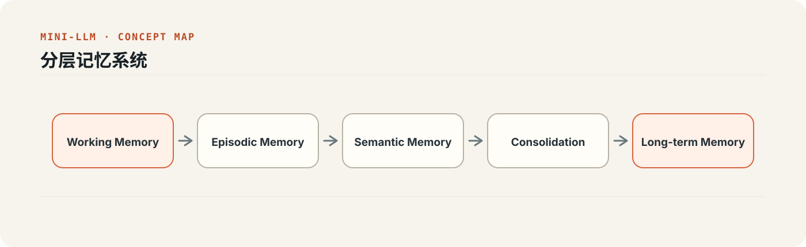
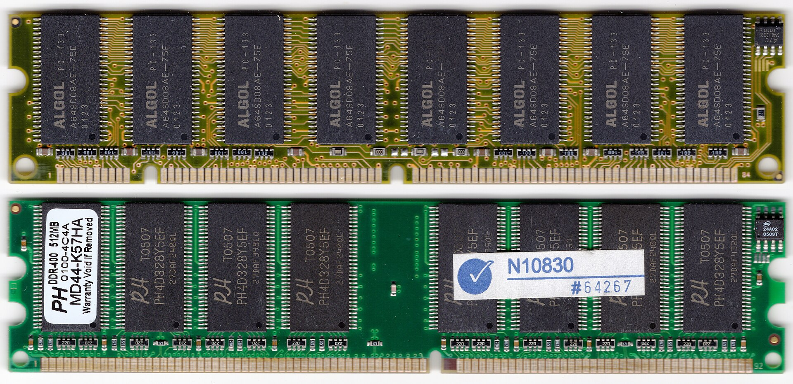
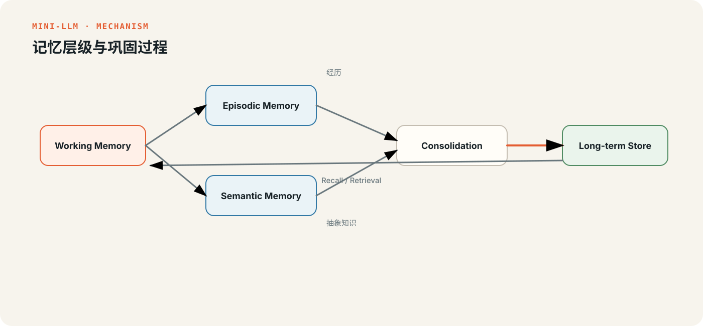

# **mini-llm Memory Architecture 深度解析：从 Short-term Memory、Episodic Memory 到 Memory Consolidation、Forgetting Mechanism 与 Long-term Memory**



_图：分层记忆系统。从左到右展示本章核心概念之间的数据流与依赖关系。_

在前面的 mini-llm 系列中，我们已经讨论了 Cognitive Architecture。

其中有一个重要问题：

**一个智能系统如何在不同时间、不同任务和不同环境中，持续积累知识，并在需要的时候正确地回忆和使用这些知识？**

例如：

今天，用户告诉 AI：

> 我正在开发一个基于 Rust 的轻量级容器引擎，底层使用 Youki，未来希望支持 AI Agent Sandbox。

明天，用户又问：

> 我们之前讨论的容器项目，下一步应该怎么设计？

如果 AI 每次都从头开始分析，就无法真正利用过去的经验。

理想的系统应该能够：

1. 记住之前讨论过的项目。
2. 识别哪些信息值得长期保存。
3. 将零散的讨论整理成稳定的知识。
4. 在新问题出现时找到相关记忆。
5. 根据新信息更新旧知识。
6. 删除过时或不再有价值的信息。
7. 将过去的经验应用于新的任务。

这就是 **Memory Architecture（记忆架构）** 要解决的问题。

需要首先明确：

**Memory Architecture 不等于给 LLM 增加一个向量数据库。**

向量数据库只是记忆系统可能使用的一种存储和检索技术。真正的记忆架构还涉及信息编码、分类、存储、巩固、遗忘、检索和更新。



_图：记忆首先需要物理载体。图中是两条不同容量与年代的 DDR 内存条，由多颗 DRAM 芯片、金手指和内存控制器接口组成。AI 的 Memory Architecture 借用的是同一套隐喻——编码、存储、检索、巩固、遗忘——只是管理的对象从电荷变成了信息。图片：Veeblefetzer，[Wikimedia Commons](https://commons.wikimedia.org/wiki/File:168_pin_and_184_pin_DIMM.jpg)，[CC BY 4.0](https://creativecommons.org/licenses/by/4.0/)。_

# **一、什么是 Memory Architecture？**

Memory Architecture 是智能系统管理信息生命周期的一套机制。

它回答六个基本问题：

| 问题      | 对应机制                 |
| ------- | -------------------- |
| 记住什么？   | Memory Encoding      |
| 存在哪里？   | Memory Storage       |
| 如何组织？   | Memory Organization  |
| 如何找到？   | Memory Retrieval     |
| 如何长期保留？ | Memory Consolidation |
| 什么时候遗忘？ | Forgetting Mechanism |

可以把 mini-llm 的记忆系统抽象成：

```
              New Experience
                    |
                    v
              Memory Encoder
                    |
                    v
              Memory Classifier
                    |
          +---------+---------+
          |         |         |
          v         v         v
       Episodic  Semantic  Procedural
       Memory    Memory    Memory
          |         |         |
          +---------+---------+
                    |
                    v
              Memory Storage
                    |
          +---------+---------+
          |                   |
          v                   v
     Vector Index        Knowledge Graph
          |                   |
          +---------+---------+
                    |
                    v
              Memory Retrieval
                    |
                    v
              Working Memory
                    |
                    v
              Reasoning / Agent
                    |
                    v
                 Action
                    |
                    v
                Feedback
                    |
                    v
           Memory Consolidation
                    |
                    v
             Long-term Memory
```

这里最重要的是：记忆不是一个静态的数据集合，而是一个持续变化的信息系统。

# **二、Short-term Memory 与 Long-term Memory**



_图：工作记忆、情景记忆、语义记忆与长期记忆之间的写入和召回。_

首先要理解两种基本的记忆类型。

## **2.1 Short-term Memory：短期记忆**

Short-term Memory 指短时间内保持的信息。

例如：

用户正在与 AI 讨论一个项目：

```
当前项目：
mini-llm

当前主题：
Memory Architecture

已经讨论：
1. Working Memory
2. Episodic Memory
3. Semantic Memory

当前问题：
如何设计长期记忆？
```

这些信息在当前任务中非常重要。

但是任务结束之后，其中一些信息可能就没有继续保存的必要。

短期记忆的特点：

- 生命周期较短。
- 与当前任务关系密切。
- 经常被更新。
- 容量通常受到限制。
- 可以包含临时状态和未完成事项。

在工程实现中，Short-term Memory 可以使用：

- 内存对象。
- Redis。
- 会话状态存储。
- Agent State。
- 临时任务数据库。

## **2.2 Long-term Memory：长期记忆**

长期记忆用于保存未来可能重复使用的信息。

例如：

```
用户正在开发 mini-llm。

技术路线：
Python 实现核心原理。

学习目标：
理解 Transformer、Agent、World Model
和 Cognitive Architecture。

当前进度：
已经完成 Transformer Engine、
Learning Engine 和 Cognitive Architecture。
```

这些信息可能在几天、几周甚至几个月之后仍然有价值。

长期记忆的特点：

- 可以跨会话存在。
- 需要支持持久化。
- 需要检索。
- 需要更新和删除。
- 需要解决信息冲突。

## **2.3 Short-term 与 Long-term 的区别**

| 维度   | Short-term Memory | Long-term Memory |
| ---- | ----------------- | ---------------- |
| 生命周期 | 短                 | 长                |
| 主要用途 | 当前任务              | 跨任务复用            |
| 数据变化 | 频繁                | 相对稳定             |
| 存储   | 内存、会话状态           | 数据库、文件、索引        |
| 检索   | 直接访问              | 需要查询             |
| 管理重点 | 上下文和任务状态          | 持久化、更新、遗忘        |

这里还需要区分三个概念：

- Short-term Memory 是短期记忆。
- Working Memory 是当前任务中主动维护和操作的信息。
- Context Window 是 Transformer 一次推理可以读取的 Token 范围。

三者有关联，但不能视为同一个东西。

例如，一条信息可以存放在长期记忆中，但当前没有进入 Working Memory，也没有进入模型的 Context Window。

只有经过检索并注入当前上下文，它才可能参与当前推理。

# **三、Episodic Memory：情景记忆**

## **3.1 什么是情景记忆？**

Episodic Memory 是对具体经历和事件的记忆。

它不只是保存一个事实，而是保存：

**在什么时间、什么情境下，发生了什么事情，以及产生了什么结果。**

例如：

```
事件：
讨论 mini-llm Memory Architecture。

时间：
2026-11-23。

上下文：
正在系统性研究大语言模型底层原理。

用户提出：
需要进一步研究长期记忆系统。

结果：
确定研究 Short-term Memory、
Episodic Memory、Semantic Memory 等主题。
```

这里保存的是一次具体的交互经历。

它与普通知识有明显区别。

例如：

- “Transformer 使用 Self-Attention”是语义知识。
- “上周我们讨论过为什么 Transformer 需要 Multi-Head Attention”是情景记忆。

前者回答的是世界中的知识。

后者回答的是过去发生过什么。

## **3.2 Episodic Memory 的数据结构**

一个事件可以表示为：

\\[ E_i = (T_i,C_i,A_i,O_i,R_i) \\]

其中：

- \\(T_i\\)：Time，发生时间。
- \\(C_i\\)：Context，事件上下文。
- \\(A_i\\)：Action，采取的行动。
- \\(O_i\\)：Outcome，事件结果。
- \\(R_i\\)：Reflection，对事件的总结。

例如：

```
class EpisodicMemory:    def __init__(        self,        timestamp,        context,        action,        outcome,        reflection    ):        self.timestamp = timestamp        self.context = context        self.action = action        self.outcome = outcome        self.reflection = reflection
```

一个实际事件：

```
episode = EpisodicMemory(    timestamp="2026-11-23",    context="研究 mini-llm 长期记忆架构",    action="设计 Memory Architecture",    outcome="确定分层记忆设计",    reflection="记忆不仅需要存储，还需要检索和更新")
```

## **3.3 为什么情景记忆很重要？**

假设 AI 只记住：

```
用户正在研究 Rust 容器引擎。
```

但没有保存之前的讨论过程。

那么，当用户问：

> 为什么我们当初选择 Youki？

AI 可能无法准确回答。

如果保存了情景记忆：

```
事件 A：
比较多个 OCI Runtime。

事件 B：
决定 Fork Youki。

事件 C：
决定尽量减少对 Youki 的修改。

事件 D：
将 AI Agent Sandbox 设计为可选扩展。
```

系统就能够重建决策过程。

这对于以下场景特别重要：

- 长期软件开发。
- 项目决策追踪。
- AI Agent 执行审计。
- 多阶段研究。
- 用户长期偏好理解。

**情景记忆保存的不只是结论，还包括结论形成的过程。**

# **四、Semantic Memory：语义记忆**

## **4.1 什么是语义记忆？**

Semantic Memory 保存经过抽象和整理的知识。

例如，系统在多次讨论中接触到以下信息：

```
事件 A：
讨论 Transformer 的 Attention。

事件 B：
讨论 Multi-Head Attention。

事件 C：
讨论 KV Cache。

事件 D：
讨论 Autoregressive Generation。
```

这些是多个独立事件。

经过整理后，系统可以形成一条更稳定的知识：

```
Transformer Decoder 使用因果注意力，
根据已有上下文预测下一个 Token。

在自回归生成过程中，
KV Cache 可以缓存历史 Token 的
Key 和 Value，避免重复计算。
```

这就是从情景记忆到语义记忆的转换。

## **4.2 情景记忆与语义记忆的区别**

| 维度      | Episodic Memory | Semantic Memory |
| ------- | --------------- | --------------- |
| 保存内容    | 具体事件            | 抽象知识            |
| 是否包含时间  | 通常包含            | 不一定             |
| 是否包含上下文 | 强               | 可以较弱            |
| 典型问题    | 之前发生了什么？        | 某个概念是什么？        |
| 主要用途    | 回顾经历            | 知识推理            |

例如：

Episodic Memory

**2026 年 11 月 20 日**

用户讨论了 Attention 为什么需要 Q、K、V。

多次经历经过抽象、归纳与验证

Semantic Memory

**Attention 的基本机制**

Q 表示查询，K 用于计算相关性，V 提供被加权聚合的信息。

## **4.3 Semantic Memory 的工程实现**

可以设计一个知识对象：

```
class SemanticMemory:    def __init__(        self,        concept,        definition,        relations,        sources    ):        self.concept = concept        self.definition = definition        self.relations = relations        self.sources = sources
```

例如：

```
knowledge = SemanticMemory(    concept="KV Cache",    definition="缓存历史 Token 的 Key 和 Value",    relations=[        "Transformer",        "Self-Attention",        "Autoregressive Generation"    ],    sources=[        "Transformer学习笔记"    ])
```

但是要注意：

**知识不能只保存文本，还应该尽可能保存来源、适用条件和验证状态。**

否则，错误信息经过抽象后，反而可能成为系统长期传播的错误知识。

# **五、Procedural Memory：程序性记忆**

这是 AI Agent 长期记忆中非常有价值的一类。

## **5.1 什么是程序性记忆？**

Procedural Memory 保存的是：

**如何完成某件事情。**

例如：

```
如何部署一个 Docker 项目？

1. 检查 Dockerfile。
2. 检查 Compose 配置。
3. 构建镜像。
4. 启动容器。
5. 检查容器状态。
6. 检查应用日志。
7. 执行健康检查。
```

它不是关于 Docker 的知识，而是一套可以重复执行的流程。

再举一个例子：

```
知识：
MySQL DECIMAL(6,2) 最大可表示 9999.99。

程序：
遇到 Data too long for column 时，
先检查字段精度，再检查实际输入值，
最后判断是否需要调整 Schema。
```

前者属于 Semantic Memory。

后者更接近 Procedural Memory。

## **5.2 Procedural Memory 的三种形式**

| 类型       | 内容   | 示例             |
| -------- | ---- | -------------- |
| Skill    | 技能   | 分析 Docker 部署错误 |
| Workflow | 工作流程 | 代码开发与测试流程      |
| Policy   | 行为规则 | 修改文件之前先检查权限    |

程序性记忆可以保存为：

- Python 函数。
- Workflow。
- Agent Skill。
- Prompt Template。
- 工具调用策略。
- 经过验证的操作序列。

## **5.3 Procedural Memory 的结构**

```
class ProceduralMemory:    def __init__(        self,        name,        trigger,        steps,        preconditions,        success_criteria    ):        self.name = name        self.trigger = trigger        self.steps = steps        self.preconditions = preconditions        self.success_criteria = success_criteria
```

示例：

```
docker_workflow = ProceduralMemory(    name="Docker Deployment Diagnosis",    trigger="Docker部署失败",    preconditions=[        "拥有读取部署日志的权限",        "能够访问容器状态"    ],    steps=[        "检查容器状态",        "读取容器日志",        "检查环境变量",        "检查网络连接",        "验证修复结果"    ],    success_criteria=[        "容器正常运行",        "应用健康检查通过"    ])
```

这里还需要一个重要的安全设计：

**程序性记忆不能因为曾经执行成功，就自动获得永久执行权限。**

尤其涉及：

- 删除数据。
- 修改数据库。
- 生产环境部署。
- 修改服务器配置。
- 资金交易。

这些操作仍然需要权限控制、环境检查和必要的人工确认。

# **六、Vector Database 与 Knowledge Graph**

现在进入记忆系统的工程核心。

大量记忆如何保存？如何检索？如何找到不同知识之间的关系？

目前最常见的两种技术是：

1. Vector Database。
2. Knowledge Graph。

它们解决的问题不同。

## **6.1 Vector Database：向量数据库**

向量数据库主要用于语义相似性检索。

假设保存了三条记忆：

```
M1：Transformer 使用 Self-Attention。

M2：KV Cache 可以减少自回归生成中的重复计算。

M3：Docker Compose 可以定义多个容器服务。
```

用户现在问：

> 如何减少大语言模型生成过程中的重复计算？

系统将问题转换成向量：

\\[ q \rightarrow \mathbf{v}\_q \\]

记忆也被转换成向量：

\\[ M_i \rightarrow \mathbf{v}\_i \\]

然后计算相似度。

常见的余弦相似度：

\\[ Similarity(A,B)= \frac{A\cdot B} {\\|A\\|\\|B\\|} \\]

系统可以找到与当前问题语义最接近的记忆。

### **简化实现**

```
def cosine_similarity(a, b):    dot = sum(        x * y for x, y in zip(a, b)    )    norm_a = sum(x * x for x in a) ** 0.5    norm_b = sum(x * x for x in b) ** 0.5    if norm_a == 0 or norm_b == 0:        return 0    return dot / (norm_a * norm_b)
```

实际系统通常使用 ANN（Approximate Nearest Neighbor，近似最近邻）索引提升检索效率。

例如：

- HNSW。
- IVF。
- Product Quantization。

Vector Database 的优势：

- 支持语义搜索。
- 可以检索表达不同但含义相近的信息。
- 适合大量文本记忆。
- 可以结合 RAG 使用。

局限：

- 相似不等于真实。
- 相关不等于因果。
- 不能保证时间关系正确。
- 不能天然解决知识冲突。
- 不能保证检索结果完整。

因此，向量检索不能独立承担全部记忆管理任务。

## **6.2 Knowledge Graph：知识图谱**

知识图谱关注的是：

**知识之间存在什么关系？**

例如：

```
Transformer
    |
    | uses
    v
Self-Attention
    |
    | produces
    v
Contextual Representation
    |
    | used by
    v
Decoder
```

知识图谱通常使用三元组：

\\[ (h,r,t) \\]

其中：

- \\(h\\)：Head，主体。
- \\(r\\)：Relation，关系。
- \\(t\\)：Tail，客体。

例如：

\\[ (Transformer, uses, SelfAttention) \\]

\\[ (SelfAttention, produces, ContextualRepresentation) \\]

\\[ (Decoder, uses, KVCache) \\]

一个简单的知识图谱：

### **简化实现**

```
class KnowledgeGraph:    def __init__(self):        self.edges = []    def add_relation(        self,        subject,        relation,        object    ):        self.edges.append({            "subject": subject,            "relation": relation,            "object": object        })    def find_relations(self, entity):        return [            edge for edge in self.edges            if (                edge["subject"] == entity                or edge["object"] == entity            )        ]
```

例如：

```
graph = KnowledgeGraph()graph.add_relation(    "Transformer",    "uses",    "Self-Attention")graph.add_relation(    "Decoder",    "uses",    "KV Cache")
```

知识图谱适合：

- 实体关系。
- 依赖关系。
- 项目架构。
- 因果关系表达。
- 多跳查询。
- 知识关联分析。

但它同样存在局限：

- 构建成本较高。
- 关系抽取可能出错。
- 知识更新复杂。
- 图结构不等于真实世界的完整模型。

## **6.3 Vector Database 与 Knowledge Graph 如何配合？**

两者并不是竞争关系。

**用户提出问题**

如何理解 Transformer 的 KV Cache？

**Vector Search**

找到语义相关的历史文章、讨论和说明。

**Graph Search**

找到 KV Cache 与 Attention、Decoder、推理过程之间的关系。

**Memory Fusion**

合并相关记忆、来源、关系与时间信息

**Working Memory**

将当前问题需要的信息放入工作记忆

这就是 Hybrid Memory 的基本思路。

# **七、Memory Consolidation：记忆巩固**

这是从短期记忆走向长期记忆的关键过程。

## **7.1 什么是记忆巩固？**

人类认知研究中的 Memory Consolidation，通常指记忆逐渐稳定、组织和整合的过程。

在 AI 系统中，可以将其设计为：

**把大量临时经历，整理成少量稳定、可复用的长期记忆。**

例如：

短期经历：

```
第一次：
用户讨论了 Rust Container Engine。

第二次：
决定以 Youki 作为 OCI Runtime 基础。

第三次：
讨论如何保持对上游的兼容。

第四次：
决定将 Agent Sandbox 设计为独立扩展。
```

记忆巩固之后：

```
长期项目记忆：

用户正在开发独立的 Rust Container Engine。

基础：
Fork Youki。

原则：
尽量减少对 Youki 的修改，
独立实现引擎和平台层。

扩展：
AI Agent Sandbox。

设计目标：
轻量化、模块化、便于上游同步。
```

原始经历没有必要全部作为长期记忆重复保存。

可以将它们压缩成一条稳定的项目知识。

## **7.2 Memory Consolidation 的处理流程**

```
          Episodic Memories
                  |
                  v
             Clustering
                  |
                  v
           Duplicate Removal
                  |
                  v
           Conflict Detection
                  |
                  v
             Summarization
                  |
                  v
          Knowledge Extraction
                  |
                  v
            Memory Validation
                  |
                  v
           Long-term Memory
```

每个阶段解决不同问题：

| 阶段                   | 任务       |
| -------------------- | -------- |
| Clustering           | 将相似经历聚类  |
| Duplicate Removal    | 删除重复记忆   |
| Conflict Detection   | 检查矛盾信息   |
| Summarization        | 提炼核心内容   |
| Knowledge Extraction | 提取稳定知识   |
| Validation           | 检查来源和正确性 |
| Persistence          | 保存长期记忆   |

## **7.3 记忆巩固的代码设计**

```
class MemoryConsolidator:    def consolidate(self, episodes):        groups = self.cluster(episodes)        consolidated = []        for group in groups:            clean = self.remove_duplicates(group)            conflicts = self.detect_conflicts(clean)            summary = self.summarize(clean)            knowledge = self.extract_knowledge(                summary,                conflicts            )            if self.validate(knowledge):                consolidated.append(knowledge)        return consolidated
```

这是一个流程示意。

实际系统需要为每条抽取出的知识保留来源事件和证据，不能只保存模型生成的摘要。

否则，一旦摘要产生错误，就很难追溯错误来自哪里。

## **7.4 为什么不能立即把所有对话保存为长期记忆？**

假设用户说：

> 我们暂时考虑使用 PostgreSQL。

如果立即将它保存成：

```
项目数据库：PostgreSQL。
```

就可能产生错误。

因为“暂时考虑”并不意味着“最终决定”。

更合理的做法是保存为：

```
项目数据库选型：

候选方案：PostgreSQL

状态：待确认

来源：某次项目讨论
```

当用户最终确认后，再更新为：

```
项目数据库：PostgreSQL

状态：已确认
```

所以记忆巩固还需要一个重要机制：

**区分讨论、假设、决定和已验证事实。**

# **八、Forgetting Mechanism：遗忘机制**

很多 AI 记忆系统只考虑如何保存，却忽略了另一个问题：

**什么时候应该遗忘？**

如果所有信息永久保存，记忆系统会逐渐出现：

- 数据冗余。
- 检索噪声。
- 过期信息。
- 冲突信息。
- 存储成本增加。
- 隐私和安全风险。

因此，一个真正的记忆系统必须具备遗忘机制。

## **8.1 为什么遗忘有价值？**

假设系统保存了：

```
2025 年：
用户正在研究项目 A。

2026 年：
项目 A 已经结束。

2027 年：
用户已经开始项目 B。
```

如果系统始终优先使用项目 A 的信息，就可能产生错误。

所以记忆需要随着时间和环境变化而更新。

## **8.2 时间衰减模型**

可以使用一个简单的时间衰减函数：

\\[ W(t)=W_0e^{-\lambda t} \\]

其中：

- \\(W_0\\)：初始记忆权重。
- \\(t\\)：距离最近一次确认的时间。
- \\(\lambda\\)：衰减系数。

时间越长，权重可能越低。

但需要注意：

时间衰减只是一个工程启发式。

不能认为所有记忆都应该随着时间均匀衰减。

例如：

- 用户当前正在进行的临时任务，可能很快过期。
- 已经确认的项目架构原则，可能长期有效。
- 历史项目决策，即使不再适用，也可能具有审计价值。

## **8.3 多维遗忘模型**

可以设计一个综合保留价值：

\\[ RetentionScore = \alpha I+ \beta F+ \gamma R+ \delta C- \lambda A \\]

其中：

- \\(I\\)：重要程度。
- \\(F\\)：使用频率。
- \\(R\\)：未来复用价值。
- \\(C\\)：确认程度。
- \\(A\\)：过时程度。

例如：

| 记忆       | 重要性   | 处理方式          |
| -------- | ----- | ------------- |
| 已确认的技术架构 | 高     | 长期保存          |
| 当前任务进度   | 中高    | 任务结束后归档       |
| 一次性错误日志  | 低     | 短期保存          |
| 已废弃的技术方案 | 历史价值高 | 标记为废弃，不作为当前方案 |
| 重复的讨论内容  | 低     | 合并            |

## **8.4 遗忘不等于物理删除**

这里要区分三个操作：

1. **Decay**：降低检索优先级。
2. **Archive**：归档，不再默认参与日常检索。
3. **Delete**：真正删除数据及其相关索引和副本。

例如：

一个项目已经结束，可以归档。

但是历史决策仍然可能在未来被查询。

如果用户明确要求删除，则不能只降低权重或隐藏结果，而应进入真正的数据删除流程。

# **九、Memory Retrieval：记忆检索**

有记忆并不意味着能够正确使用记忆。

系统必须能够在适当的时候找到正确的信息。

这就是 Memory Retrieval。

## **9.1 为什么记忆检索很难？**

假设数据库中保存了 100 万条记忆。

用户提出：

> 我们之前为什么决定使用 Go 开发 GeoPilot？

系统不能简单地搜索包含“Go”的所有文本。

因为可能存在：

- Go 语言学习笔记。
- 其他项目的技术讨论。
- GeoPilot 的架构决策。
- 关于 Java 和 Go 的对比。
- 已经废弃的技术方案。

真正需要的是：

**找到与 GeoPilot 项目相关、时间正确、状态有效的技术决策记忆。**

## **9.2 五种常见检索方式**

| 方法              | 作用    | 示例             |
| --------------- | ----- | -------------- |
| Exact Search    | 精确匹配  | 搜索项目名称         |
| Keyword Search  | 关键词搜索 | 搜索 Go、GeoPilot |
| Semantic Search | 语义检索  | 找到意思相近的讨论      |
| Graph Search    | 关系检索  | 找到项目与技术栈的关联    |
| Temporal Search | 时间检索  | 找到最近一次决策       |

## **9.3 Hybrid Retrieval：混合检索**

实际系统可以组合多种检索方式：

```
User Query
    |
    v
Query Understanding
    |
    +----------+-----------+-----------+
    |          |           |           |
    v          v           v           v
Keyword     Vector      Graph       Time
Search      Search      Search      Filter
    |          |           |           |
    +----------+-----------+-----------+
                       |
                       v
                  Result Fusion
                       |
                       v
                     Rerank
                       |
                       v
                 Memory Retrieval
```

例如，可以设计一个融合评分：

\\[ Score(m,q)= w_1S\_{semantic} +w_2S\_{keyword} +w_3S\_{graph} +w_4S\_{recency} +w_5S\_{reliability} \\]

其中：

- \\(S\_{semantic}\\)：语义相似度。
- \\(S\_{keyword}\\)：关键词匹配程度。
- \\(S\_{graph}\\)：图关系相关性。
- \\(S\_{recency}\\)：时间相关性。
- \\(S\_{reliability}\\)：来源和确认程度。

实际应用中，这些分数需要归一化，并根据具体任务调整权重。

例如，查找历史决策时，来源和时间可能比语义相似度更重要。

## **9.4 Retrieval 的一个核心原则**

**检索出来的记忆，不应该自动变成事实。**

系统应该将检索结果放回 Working Memory，并检查：

- 是否来自正确的项目？
- 是否已经过时？
- 是否有更新版本？
- 是否有冲突信息？
- 是否有可靠来源？

这也是 Memory Architecture 与普通 RAG 系统的重要区别。

# **十、Memory Compression：记忆压缩**

长期记忆会不断增加。

假设一个 AI Agent 每天产生：

- 1000 条交互记录。
- 500 条工具调用记录。
- 100 条任务状态记录。
- 50 条总结信息。

一年之后，原始数据可能非常庞大。

如果每次推理都将所有记忆放进上下文，不仅成本高，而且会引入大量噪声。

因此需要 Memory Compression。

## **10.1 记忆压缩的层次**

**Level 1：原始记忆**

保存完整对话、日志、工具调用和结果。

**Level 2：事件摘要**

将一个任务的经历整理成事件摘要。

**Level 3：知识摘要**

提取稳定知识、决策和技术原则。

**Level 4：用户与项目画像**

保存跨任务有效的长期信息。

例如：

原始记录：

```
讨论了很多次容器引擎架构，
比较了 Youki、runc 和其他 OCI Runtime，
讨论了 Fork 方式、上游同步、模块边界、
Agent Sandbox 等。
```

压缩后：

```
项目：
轻量级 Rust Container Engine。

技术基础：
Youki / OCI Runtime。

架构原则：
尽量减少对上游代码的修改，
独立开发引擎与平台模块。

扩展能力：
AI Agent Sandbox。

设计目标：
轻量化、模块化、可持续同步上游。
```

压缩减少了冗余，但保留了对未来决策最有价值的信息。

## **10.2 压缩的主要风险**

记忆压缩可能导致：

- 丢失细节。
- 丢失原始语境。
- 丢失否定条件。
- 混淆讨论与决定。
- 丢失证据来源。

例如：

原始记忆：

> 可以考虑使用 PostgreSQL，但目前还没有确定。

错误压缩：

> 项目使用 PostgreSQL。

因此，压缩算法必须保留状态、时间、来源和确定性。

一个好的压缩系统应该支持：

**摘要可以回溯到原始记忆。**

# **十一、AI Agent 的长期记忆工程架构**

现在将前面的概念整合起来。

我们可以为 mini-llm 构建一个独立的 Memory Engine。

## **11.1 总体架构**

```
                    AI Agent
                       |
                       v
                 Memory Interface
                       |
          +------------+------------+
          |                         |
          v                         v
     Memory Write              Memory Read
          |                         |
          v                         v
    Memory Encoder            Query Understanding
          |                         |
          v                         v
    Memory Classifier         Hybrid Retrieval
          |                         |
          v                         v
    Memory Validator          Result Ranking
          |                         |
          v                         v
    Memory Consolidator       Context Builder
          |                         |
          v                         v
    Memory Storage  <------> Working Memory
          |
    +-----+-------+----------------+
    |             |                |
    v             v                v
 Episodic      Semantic        Procedural
 Memory        Memory          Memory
    |             |                |
    +-------------+----------------+
                  |
          +-------+-------+
          |               |
          v               v
     Vector Index    Knowledge Graph
          |               |
          +-------+-------+
                  |
                  v
             Persistence
```

## **11.2 建议的技术选型**

如果从零开始构建一个 mini-llm Memory Engine，可以考虑：

| 模块              | V1 技术方案            | 作用     |
| --------------- | ------------------ | ------ |
| Memory API      | Python / FastAPI   | 统一接口   |
| Metadata        | SQLite             | 保存元数据  |
| Raw Memory      | JSONL / 文件         | 保存原始经历 |
| Vector Search   | FAISS / hnswlib    | 语义检索   |
| Embedding       | BGE / E5           | 文本向量化  |
| Keyword Search  | SQLite FTS5        | 关键词检索  |
| Knowledge Graph | SQLite 关系表         | 保存实体关系 |
| Consolidation   | Python Worker      | 记忆巩固   |
| Scheduler       | APScheduler / 后台任务 | 定期整理   |
| Evaluation      | Python Benchmark   | 测试记忆质量 |

这里不建议 V1 就引入过多数据库。

一个 SQLite + FTS5 + FAISS 的组合，足以验证基本的记忆写入、检索、更新和压缩流程。

当数据规模、并发和部署需求增长之后，再考虑独立向量数据库和图数据库。

## **11.3 Memory 数据库设计**

可以先设计五张核心表。

**memory_items：记忆主表**

| 字段          | 类型       | 说明                               |
| ----------- | -------- | -------------------------------- |
| id          | TEXT     | 记忆 ID                            |
| memory_type | TEXT     | episodic / semantic / procedural |
| content     | TEXT     | 记忆内容                             |
| status      | TEXT     | active / archived / deleted      |
| importance  | REAL     | 重要程度                             |
| confidence  | REAL     | 可信度评分                            |
| created_at  | DATETIME | 创建时间                             |
| updated_at  | DATETIME | 更新时间                             |
| expires_at  | DATETIME | 可选过期时间                           |

**memory_sources：来源表**

| 字段          | 类型   | 说明                         |
| ----------- | ---- | -------------------------- |
| id          | TEXT | 来源 ID                      |
| memory_id   | TEXT | 对应记忆                       |
| source_type | TEXT | conversation / file / tool |
| source_ref  | TEXT | 原始来源标识                     |
| evidence    | TEXT | 支持证据                       |

**memory_relations：关系表**

| 字段        | 类型   | 说明    |
| --------- | ---- | ----- |
| id        | TEXT | 关系 ID |
| source_id | TEXT | 起点记忆  |
| relation  | TEXT | 关系类型  |
| target_id | TEXT | 终点记忆  |

**memory_vectors：向量索引映射表**

| 字段              | 类型      | 说明             |
| --------------- | ------- | -------------- |
| memory_id       | TEXT    | 记忆 ID          |
| vector_id       | INTEGER | 向量索引 ID        |
| embedding_model | TEXT    | Embedding 模型版本 |

**memory_access_logs：访问记录表**

| 字段        | 类型       | 说明                      |
| --------- | -------- | ----------------------- |
| id        | TEXT     | 日志 ID                   |
| memory_id | TEXT     | 记忆 ID                   |
| operation | TEXT     | read / update / archive |
| timestamp | DATETIME | 操作时间                    |
| reason    | TEXT     | 操作原因                    |

实际实现时还应加入租户或用户隔离、权限、数据版本、删除状态同步、事务和索引一致性设计。

# **十二、Memory Engine 的核心接口**

一个独立的 Memory Engine 至少需要以下接口：

```
class MemoryEngine:    def encode(self, experience):        """将经历转换为记忆对象"""        pass    def store(self, memory):        """保存记忆"""        pass    def retrieve(self, query, filters=None):        """检索相关记忆"""        pass    def update(self, memory_id, new_content):        """更新记忆"""        pass    def consolidate(self):        """执行记忆巩固"""        pass    def compress(self, memory_ids):        """压缩多条记忆"""        pass    def archive(self, memory_id):        """归档记忆"""        pass    def delete(self, memory_id):        """删除记忆及其索引"""        pass
```

这里有一个重要的架构原则：

**Agent 不应该直接操作底层向量数据库。**

Agent 应该通过 Memory Interface 访问记忆。

这样未来无论底层使用：

- SQLite。
- FAISS。
- Qdrant。
- PostgreSQL。
- Neo4j。

上层 Agent 都不需要发生大规模修改。

# **十三、如何验证 Memory Engine 是否真正有效？**

一个记忆系统能保存数据，不代表它具备良好的记忆能力。

需要设计独立的评估体系。

## **13.1 核心评估指标**

| 指标                      | 说明                |
| ----------------------- | ----------------- |
| Recall\@K               | 前 K 个结果中是否找到目标记忆  |
| Precision\@K            | 前 K 个结果中有多少结果相关   |
| MRR                     | 第一个正确结果的排名表现      |
| Memory Accuracy         | 保存信息是否正确          |
| Conflict Detection Rate | 冲突记忆识别能力          |
| Update Accuracy         | 记忆更新是否正确          |
| Compression Ratio       | 压缩前后数据规模变化        |
| Retrieval Latency       | 检索延迟              |
| Token Cost              | 记忆注入上下文的 Token 成本 |
| Stale Memory Rate       | 检索结果中已经过时的记忆比例    |

## **13.2 关键测试场景**

可以设计如下测试：

**测试一：跨会话回忆**

第一轮：

```
用户：我决定使用 Rust 开发容器引擎。
```

第二轮：

```
用户：我之前决定使用什么语言？
```

预期：

```
Rust。
```

**测试二：决策更新**

第一轮：

```
项目数据库暂时考虑 SQLite。
```

第二轮：

```
最终决定改为 PostgreSQL。
```

第三轮：

```
现在项目使用什么数据库？
```

预期：

```
PostgreSQL。
```

系统应保留历史记录，但默认返回最新有效决策。

**测试三：讨论与决定区分**

第一轮：

```
可以考虑使用 Java。
```

第二轮：

```
最终确定使用 Go。
```

第三轮：

```
最终技术选型是什么？
```

预期：

```
Go。
```

**测试四：过期信息处理**

第一轮：

```
项目暂时使用旧版本依赖。
```

第二轮：

```
项目已经升级依赖。
```

第三轮：

```
当前使用哪个版本？
```

预期：

返回新版本，并且不能将旧版本作为当前版本。

**测试五：错误记忆控制**

提供一条没有可靠来源的记忆，测试系统是否会将其直接作为事实使用。

这五类测试比单纯测试向量搜索准确率更接近真实的长期记忆能力。

# **十四、Memory Architecture 与 RAG、Fine-tuning 有什么区别？**

这是理解 AI 记忆系统时必须掌握的问题。

| 技术                  | 主要作用       | 是否修改模型权重 |
| ------------------- | ---------- | -------- |
| RAG                 | 从外部知识库检索内容 | 否        |
| Vector Database     | 提供向量检索     | 否        |
| Knowledge Graph     | 保存实体及关系    | 否        |
| Memory Architecture | 管理经历、知识和技能 | 不一定      |
| Fine-tuning         | 调整模型行为与参数  | 是        |
| Continual Learning  | 持续从新数据中学习  | 通常涉及参数更新 |

例如：

用户告诉 AI：

> 我偏好使用 React + TypeScript 开发前端。

使用 RAG：

把这句话保存到外部数据库，在相关问题出现时检索。

使用 Memory Architecture：

将它识别为长期偏好，保存来源、适用范围和更新时间，在未来相关任务中主动使用。

使用 Fine-tuning：

将大量类似偏好和行为样本用于训练，让模型的参数发生变化。

这三个层次并不相互替代。

特别需要注意：

**外部记忆更新，不等于模型参数已经学会新知识。**

AI 可以通过外部记忆在下一次任务中使用新信息，而不需要重新训练整个模型。

# **十五、mini-llm Memory Engine 的最终定位**

到这里，我们可以把整个 mini-llm 项目的架构进一步扩展。

**Cognitive Architecture**

组织认知过程

**Memory Engine**

管理过去

**World Model Engine**

表示与预测世界

**Agent Engine**

管理目标与行动

**Learning Engine**

从经验中改进

**Representation Engine**

形成内部信息表示

**Transformer / Neural Network Engine**

提供底层计算和语言建模能力

可以用一句话总结这些模块：

- Representation Engine：系统如何表示信息？
- Memory Engine：系统如何记住信息？
- World Model Engine：系统如何理解和预测状态变化？
- Agent Engine：系统如何采取行动？
- Learning Engine：系统如何通过经验改善？
- Cognitive Architecture：系统如何协调这些过程？

它们共同构成一个更完整的智能系统设计框架。

# **十六、这一篇最值得记住的五个结论**

1\. **记忆不等于存储。** 存储只是记忆系统的一部分，真正的记忆还需要编码、组织、检索、更新和遗忘。

2\. **情景记忆、语义记忆和程序性记忆不可混淆。** 它们分别回答发生过什么、知道什么、如何行动。

3\. **Vector Database 不等于 Memory Engine。** 向量检索解决语义相似性问题，而记忆架构还需要处理时间、来源、冲突和有效性。

4\. **记忆巩固和遗忘同样重要。** 一个好的记忆系统不仅知道应该保存什么，还知道应该合并什么、归档什么和删除什么。

5\. **长期记忆不必依赖模型重新训练。** 通过外部记忆系统，AI Agent 就可以跨任务复用信息，但这不等于模型权重已经发生学习。

## **下一篇：mini-llm Knowledge Architecture 深度解析**

Memory Engine 解决了信息如何被保存和回忆的问题。

但还有一个更深层的问题：

**当系统积累了大量记忆之后，如何把这些记忆组织成一个可以推理、关联、验证和扩展的知识体系？**

下一篇建议研究：

1. Knowledge Representation：知识表示。
2. Ontology：本体与概念体系。
3. Knowledge Graph：知识图谱。
4. RDF 与 Property Graph。
5. Entity Resolution：实体对齐。
6. Relation Extraction：关系抽取。
7. Knowledge Fusion：知识融合。
8. Knowledge Reasoning：知识推理。
9. Temporal Knowledge：时序知识。
10. Neuro-symbolic AI：神经符号智能。

这将把 mini-llm 从一个能够保存记忆的系统，进一步推进到一个能够组织知识和进行结构化推理的系统。

