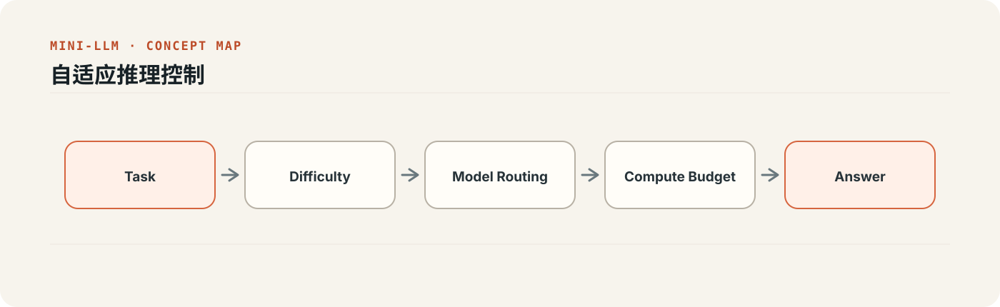

# **《mini-llm Meta-Controller 深度解析：从 Metacognition、Dynamic Model Routing 到 Compute Allocation、Inference-time Scaling 与 Adaptive Reasoning》**



_图：自适应推理控制。从左到右展示本章核心概念之间的数据流与依赖关系。_

在前面的 mini-llm 系列中，我们已经逐步构建了 Tensor Engine、Autograd Engine、Neural Network Engine、Transformer Engine、Training Engine、Memory Engine、World Model Engine、Decision Engine、Agent Engine 和 Agent Learning Engine。

这些模块解决了不同层面的问题：

- Transformer Engine：模型如何处理 Token 和上下文？
- Memory Engine：系统如何保存和检索信息？
- World Model Engine：系统如何表征和预测世界状态？
- Decision Engine：系统如何在不确定性下选择行动？
- Agent Engine：系统如何执行任务？
- Agent Learning Engine：系统如何从经验中改进？

但还存在一个更高层次的问题：

**谁来决定应该使用哪个模型、调用什么工具、投入多少计算资源、进行多深的推理，以及什么时候应该停止？**

这就是 Meta-Controller（元控制器）要解决的问题。

它不是简单的任务调度器，而是一个负责监控、评估和调节整个 AI 认知与执行过程的控制层。

# **一、Meta-Controller：为什么需要元控制器？**

## **1.1 普通 Agent 的问题**

假设我们让一个 Agent 完成以下任务：

> 分析一个大型 GitHub 项目，理解整体架构，找出潜在的性能问题，并提出优化方案。

一个普通 Agent 可能采用固定流程：

```
接收任务
   ↓
调用 LLM
   ↓
搜索代码
   ↓
分析代码
   ↓
生成报告
```

这种方式存在几个问题：

1. 简单任务和复杂任务使用相同的模型。
2. 不知道什么时候应该调用工具。
3. 不知道什么时候需要更深入的推理。
4. 不知道什么时候应该升级到更强的模型。
5. 不知道什么时候继续推理已经没有价值。
6. 无法根据剩余预算动态调整执行策略。

例如：

- 阅读一个简单函数，可能只需要小模型。
- 分析模块之间的依赖关系，需要代码索引工具。
- 分析复杂并发问题，可能需要更强的模型和更深的推理。
- 生成最终报告时，不一定需要继续调用高级推理模型。

因此，AI 系统需要一个更高层次的控制机制。

## **1.2 什么是 Meta-Controller？**

Meta-Controller 可以理解为：

**负责管理 AI 系统自身认知、推理、工具、模型和计算资源的控制器。**

普通 Controller 控制任务执行。

Meta-Controller 控制执行任务的策略。

## **普通 Agent 与 Meta-Controller**

**普通 Agent**

接收任务 → 规划 → 调用工具 → 执行 → 返回结果

**Meta-Controller**

**模型路由**

选择哪个模型

**推理控制**

推理多深

**工具控制**

使用什么工具

**资源分配**

投入多少计算

**停止控制**

什么时候结束

**多 Agent 控制**

是否需要协作

**底层 AI 能力系统**

LLM / Memory / World Model / Tools / Agents / Learning

这里有一个重要区别：

Meta-Controller 并不一定需要另一个更大的 LLM。

它可以由以下组件组合实现：

- 规则引擎
- 任务分类器
- 轻量级模型
- 强化学习策略
- 成本估算器
- 置信度评估器
- 状态机
- LLM

在工程实践中，混合控制架构往往比单纯依赖 LLM 更容易测试和约束。

# **二、Metacognition：元认知**

Meta-Controller 的理论基础之一是 Metacognition。

中文通常翻译为：元认知。

## **2.1 什么是元认知？**

普通认知解决问题。

元认知则是对认知过程进行监控和调节。

例如：

一个人正在解决数学问题。

普通认知：

```
理解题目
  ↓
选择公式
  ↓
执行计算
  ↓
得到答案
```

元认知：

```
我是否理解题目？
       ↓
当前方法是否合理？
       ↓
是否需要更换方法？
       ↓
计算结果是否可信？
       ↓
是否需要重新检查？
```

这意味着智能系统不仅需要回答：

> 我应该做什么？

还需要回答：

> 我现在的处理方式是否有效？

## **2.2 元认知的两个核心过程**

可以将元认知分成两个相互关联的过程。

### **过程一：Metacognitive Monitoring**

元认知监控。

负责观察当前认知过程的状态。

例如：

- 当前任务是否理解？
- 是否存在信息缺失？
- 当前模型是否有足够能力？
- 是否出现工具调用错误？
- 推理过程是否陷入循环？
- 当前答案是否有足够证据？

### **过程二：Metacognitive Control**

元认知控制。

根据监控结果调整认知策略。

例如：

- 更换模型。
- 检索更多信息。
- 增加推理步骤。
- 使用外部工具。
- 重新规划任务。
- 请求人工确认。
- 停止执行。

二者构成一个循环：

**Metacognitive Monitoring**

观察、评估、检测问题

**Metacognitive Control**

调整策略、模型、工具与资源

**Cognitive Execution**

继续执行任务

持续监控和调节

需要注意：模型声称“我不确定”并不代表它真的具备可靠的自我监控能力。

工程系统应该通过外部信号验证，例如：

- 测试是否通过。
- 检索是否找到证据。
- 工具是否执行成功。
- 结果是否符合 Schema。
- 不同方法是否得到一致结果。

## **2.3 元认知如何映射到工程系统？**

可以定义一个 Cognitive State：

```
class CognitiveState:    def __init__(self):        self.task_complexity = 0.0        self.uncertainty = 0.0        self.progress = 0.0        self.evidence_quality = 0.0        self.failure_count = 0        self.remaining_budget = 0.0        self.reasoning_depth = 0
```

元控制器根据状态决定下一步策略：

```
def metacognitive_control(state):    if state.failure_count >= 3:        return "replan"    if state.evidence_quality < 0.4:        return "retrieve_more"    if state.uncertainty > 0.8:        return "escalate_model"    if state.remaining_budget < 0.1:        return "budget_limited_mode"    return "continue"
```

这只是一个简化规则示例。

真实系统还需要对指标进行校准，并处理多个信号之间的冲突。

# **三、Dynamic Model Routing：动态模型路由**

这是 Meta-Controller 最重要的工程能力之一。

## **3.1 为什么需要动态模型路由？**

假设系统可以访问三个模型：

| 模型      | 能力定位      | 推理成本 |
| ------- | --------- | ---- |
| Model-S | 简单分类、提取   | 低    |
| Model-M | 常规分析、代码理解 | 中    |
| Model-L | 复杂推理、架构分析 | 高    |

如果所有任务都使用 Model-L，会造成大量资源浪费。

如果所有任务都使用 Model-S，又会导致复杂任务失败。

因此，需要根据任务特征选择模型。

这就是 Dynamic Model Routing。

## **3.2 模型路由的基本流程**

```
输入任务
   ↓
任务特征提取
   ↓
任务复杂度评估
   ↓
能力需求评估
   ↓
成本与延迟评估
   ↓
选择模型
   ↓
执行任务
   ↓
评估结果
```

任务特征可以包括：

- 任务类型。
- 输入长度。
- 代码复杂度。
- 推理深度需求。
- 是否需要多步骤规划。
- 是否需要外部知识。
- 历史任务成功率。
- 延迟预算。
- Token 预算。

## **3.3 数学建模**

假设有 \\(n\\) 个可选模型。

定义：

\\[ M=\\{m_1,m_2,\ldots,m_n\\} \\]

每个模型有不同属性：

- \\(Q_i\\)：预期任务质量。
- \\(C_i\\)：执行成本。
- \\(L_i\\)：响应延迟。
- \\(R_i\\)：可靠性。
- \\(S_i\\)：安全与合规适配程度。

可以建立一个综合评分：

\\[ Score(m_i|x)= w_qQ_i+ w_rR_i+ w_sS_i- w_cC_i- w_lL_i \\]

其中：

- \\(x\\) 表示当前任务。
- \\(w_q,w_r,w_s,w_c,w_l\\) 是业务权重。

最终选择：

\\[ m^\*=\arg\max\_{m_i\in M}Score(m_i|x) \\]

但这只是简化的加权评分模型。

更稳健的做法是将硬约束与软目标分开：

\\[ \max Q_i \\]

满足：

\\[ C_i\leq B_c \\]

\\[ L_i\leq B_l \\]

\\[ S_i\geq S\_{\min} \\]

其中 \\(B_c\\) 和 \\(B_l\\) 分别代表成本和延迟预算。

**安全约束不应仅仅被当成一个可以用更高质量抵消的评分项。**

## **3.4 Model Router 代码示例**

```
class ModelRouter:    def __init__(self, models):        self.models = models    def route(self, task):        complexity = task["complexity"]        budget = task["budget"]        if complexity < 0.3:            candidate = "model_s"        elif complexity < 0.7:            candidate = "model_m"        else:            candidate = "model_l"        model = self.models[candidate]        if model.cost > budget:            return self.find_affordable_model(                task,                budget            )        return model    def find_affordable_model(self, task, budget):        candidates = [            model for model in self.models.values()            if model.cost <= budget        ]        if not candidates:
```

实际系统不能只依据复杂度选择模型，还应考虑上下文长度、模态支持、工具调用能力、服务可用性和模型版本。

# **四、Model Cascading：模型级联**

Dynamic Model Routing 负责选择模型。

Model Cascading 则采用另一种思路：

**先让低成本模型尝试解决问题，如果结果不够可靠，再逐级升级。**

## **4.1 什么是模型级联？**

假设我们需要分析一段代码。

第一阶段：

```
Model-S
  ↓
生成初步分析
```

第二阶段：

```
Model-S 结果通过验证？
       ↓
    是 → 返回结果
       ↓
    否
       ↓
Model-M 重新分析
```

第三阶段：

```
Model-M 仍然失败？
       ↓
    是
       ↓
Model-L 深度分析
```

**Model-S**

低成本快速尝试

**Verifier**

测试、规则、证据检查

通过

**返回结果**

未通过

**升级 Model-M**

**Model-L**

高成本深度处理

## **4.2 级联策略的关键：如何判断升级？**

不能简单地认为模型说自己有信心就代表结果正确。

可以组合多个验证信号：

| 验证信号  | 示例               |
| ----- | ---------------- |
| 规则验证  | JSON 是否符合 Schema |
| 测试验证  | 代码是否通过测试         |
| 证据验证  | 结论是否有原文依据        |
| 一致性验证 | 不同路径是否得到相近结论     |
| 任务验证  | 是否满足用户的实际目标      |

还可以定义一个升级条件：

\\[ Escalate= (\text{VerificationFailure}) \lor (\text{EvidenceInsufficient}) \lor (\text{RiskTooHigh}) \\]

需要注意，模型级联可能增加延迟：如果每一级都依次执行，用户需要等待更多时间。因此它适合成本与质量之间存在明显权衡、且可以快速验证结果的任务。

# **五、Compute Allocation：计算资源分配**

模型路由解决使用哪个模型。

Compute Allocation 解决：

**应该给当前任务分配多少计算资源？**

这里的资源不仅是 GPU，也包括：

- Token 数量。
- 推理步骤。
- 工具调用次数。
- Agent 数量。
- 并行任务数量。
- 上下文窗口。
- 检索次数。
- 推理时间。

## **5.1 为什么计算资源分配很重要？**

假设有两个任务：

任务 A：

> 把这段文字翻译成英文。

任务 B：

> 分析一个大型分布式系统为什么出现间歇性数据不一致。

如果两个任务都分配相同的推理预算，显然不合理。

任务 A 可能只需要一次模型调用。

任务 B 可能需要：

1. 收集日志。
2. 检查数据库事务。
3. 分析消息队列。
4. 构建调用链。
5. 检查并发条件。
6. 设计复现测试。
7. 验证根因。

因此，计算资源应该根据任务需求动态分配。

## **5.2 资源分配数学模型**

假设有 \\(n\\) 个子任务。

每个任务分配计算资源：

\\[ b_1,b_2,\ldots,b_n \\]

总预算：

\\[ \sum\_{i=1}^{n}b_i\leq B \\]

其中 \\(B\\) 是系统总预算。

每个任务的预期质量为：

\\[ Q_i(b_i) \\]

系统希望最大化整体质量：

\\[ \max \sum\_{i=1}^{n}w_iQ_i(b_i) \\]

满足总资源约束。

这里的 \\(Q_i(b_i)\\) 通常存在边际收益递减：

- 第一次增加推理资源，效果明显。
- 第二次增加资源，可能有所改善。
- 第十次增加资源，可能几乎没有收益。

因此，合理的控制器应该不断估计：

\\[ \frac{\Delta Q_i}{\Delta b_i} \\]

即单位额外资源能够带来多少质量提升。

资源应该优先分配给边际收益较高、且尚未达到质量要求的任务。

## **5.3 一个资源分配示例**

假设有 100 个计算预算单位。

**初始资源分配**

**代码结构分析**

30%

**性能瓶颈分析**

40%

**依赖关系分析**

20%

**报告生成**

10%

示意性预算分配，不代表真实模型性能数据。

执行过程中发现：

- 代码结构已经分析完成。
- 性能瓶颈仍然不确定。
- 依赖关系分析发现了循环依赖。
- 报告还没有必要生成。

控制器可以重新分配预算：

- 减少结构分析资源。
- 增加性能分析资源。
- 增加依赖分析资源。
- 暂缓报告生成。

这就是动态计算资源分配。

# **六、Inference-time Scaling：推理时扩展**

这是近年来大模型研究中的一个重要方向。

传统模型优化通常关注：

- 增加参数量。
- 增加训练数据。
- 增加训练计算量。
- 改进模型结构。

但还有另一种方式：

**不改变模型参数，而是在推理阶段投入更多计算资源。**

这就是 Inference-time Scaling。

## **6.1 什么是推理时扩展？**

假设一个模型回答问题：

> 如何证明某个复杂数学命题？

普通推理：

```
输入问题
  ↓
模型生成一次答案
  ↓
返回
```

推理时扩展：

```
输入问题
  ↓
生成多个候选思路
  ↓
检查每个思路
  ↓
寻找反例
  ↓
验证关键步骤
  ↓
选择更可靠的答案
```

模型本身没有发生变化。

变化的是推理阶段投入的计算资源和搜索过程。

## **6.2 常见方法**

### **方法一：Best-of-N Sampling**

生成 N 个候选答案，然后通过评分器选择较好的结果。

\\[ y_1,y_2,\ldots,y_N \\]

选择：

\\[ y^\*=\arg\max\_{y_i}Score(y_i) \\]

适合：

- 代码生成。
- 数学问题。
- 多方案生成。
- 创意探索。

局限：如果评分器本身不可靠，生成更多候选并不保证最终结果更好。

### **方法二：Self-Consistency**

让模型通过不同采样路径独立求解同一个问题，再比较结果。

例如：

```
路径 A → 结果 42
路径 B → 结果 42
路径 C → 结果 36
路径 D → 结果 42
```

如果任务具有可比较的标准答案，可以利用多数一致性提高部分任务的可靠性。

但需要注意：

**多个答案一致，不代表答案一定正确。**

尤其当多个采样共享相同的错误假设时，它们可能一起犯错。

### **方法三：Tree of Thoughts**

传统生成主要沿着一条路径逐步生成。

Tree of Thoughts 则将推理过程组织成搜索树。

**问题**

**思路 A**

**思路 B**

**思路 C**

A1 / A2

B1 / B2

C1 / C2

**搜索与评估**

**选择候选路径**

核心思想是：

- 生成多个中间思路。
- 对思路进行评分。
- 剪枝低质量分支。
- 继续扩展高质量分支。

它类似搜索算法，而不是单纯的文本生成。

### **方法四：Verifier-guided Search**

使用独立验证器指导推理搜索。

例如代码任务：

```
生成代码候选
   ↓
运行单元测试
   ↓
发现失败
   ↓
分析错误
   ↓
生成新候选
   ↓
重新运行测试
```

这比单纯让模型评价自己的答案更可靠，因为验证器可以提供外部反馈。

## **6.3 推理时扩展的成本问题**

如果生成更多候选，计算成本也会上升。

简单情况下：

\\[ Cost \approx N \times C\_{\text{single}} \\]

其中：

- \\(N\\)：候选数量。
- \\(C\_{\text{single}}\\)：单次推理成本。

真实系统还要考虑共享前缀、并行计算、验证成本、搜索深度和缓存。

因此，Meta-Controller 的任务不是永远增加推理计算，而是判断：

**当前问题是否值得继续投入计算？**

# **七、Adaptive Reasoning：自适应推理**

Inference-time Scaling 解决如何增加推理计算。

Adaptive Reasoning 进一步解决：

**不同任务应该采用不同深度、不同方式的推理。**

## **7.1 固定推理深度的问题**

假设系统有三个任务：

| 任务        | 适合的推理方式 |
| --------- | ------- |
| 提取姓名      | 直接处理    |
| 分析代码异常    | 多步骤分析   |
| 设计复杂分布式系统 | 深度规划与验证 |

如果所有任务都执行相同长度的推理过程，就会造成资源浪费。

Adaptive Reasoning 的目标是根据任务状态动态调整推理深度。

## **7.2 推理深度控制**

可以将推理过程分为四个等级：

**Level 1：Direct**

低复杂度

直接回答，适用于格式转换、提取、简单问答。

**Level 2：Analytical**

中等复杂度

分析条件、比较方案、进行有限的多步骤推理。

**Level 3：Deliberative**

高复杂度

多路径分析、外部检索、验证和重新规划。

**Level 4：Search-based**

极高复杂度

搜索树、多个候选方案、独立验证器和资源动态分配。

这里的 Level 是一种工程抽象，不代表所有模型都提供相同的推理等级接口。

## **7.3 自适应推理策略**

可以设计一个简单控制器：

```
def choose_reasoning_level(task):    if task.complexity < 0.2:        return "direct"    if task.complexity < 0.5:        return "analytical"    if task.complexity < 0.8:        return "deliberative"    return "search_based"
```

更好的方法是结合任务风险、信息缺失、验证结果、预算和历史表现。

例如：

一个简单的医学术语解释可能不需要复杂搜索，但涉及实际诊疗决策时，即使任务表面上很简单，也需要更严格的证据与安全约束。

所以：

**任务复杂度不等于任务风险。**

二者应该分别评估。

# **八、Tool Selection：工具选择**

Agent 可以调用工具，但工具越多，不代表系统越智能。

Meta-Controller 需要判断：

- 是否需要工具？
- 应该调用哪个工具？
- 调用几个工具？
- 工具调用的成本是否合理？
- 工具结果是否可信？

## **8.1 工具选择的决策模型**

假设当前有三个工具：

- Search Tool
- Python Tool
- Database Tool

可以为每个工具计算预期价值：

\\[ VOI(a)= ExpectedBenefit(a)-Cost(a) \\]

这里的 Expected Benefit 可以理解为执行工具后，任务成功率、信息质量或决策质量的预期提升。

当：

\\[ VOI(a)>0 \\]

并且满足权限、安全、预算等约束时，工具调用才可能值得执行。

这与 Decision Engine 中的 Value of Information 有直接联系。

## **8.2 工具选择示例**

| 用户任务           | 工具策略                  |
| -------------- | --------------------- |
| 解释 Transformer | 可能不需要工具               |
| 查询最新模型版本       | 使用 Web Search         |
| 计算矩阵乘法结果       | 使用 Python             |
| 分析数据库结构        | 使用 Database Schema 工具 |
| 分析 GitHub 仓库   | 使用代码检索工具              |
| 修改代码并验证        | 使用代码执行与测试工具           |

注意：工具调用前还要检查权限、数据访问范围和副作用。特别是删除、转账、部署等操作，不能只根据价值评分自动执行。

# **九、Stop Decision：什么时候应该停止？**

这是 Meta-Controller 一个容易被忽略、但极其重要的能力。

很多 Agent 系统会陷入：

```
分析
  ↓
继续分析
  ↓
再次检查
  ↓
重新分析
  ↓
继续调用模型
  ↓
没有明确终点
```

这会产生：

- Token 浪费。
- 工具调用浪费。
- 延迟增加。
- 结果反复变化。
- Agent 无限循环。

因此系统需要 Stop Decision。

## **9.1 停止条件**

可以设计以下停止条件：

1. 任务目标已经完成。
2. 结果通过必要验证。
3. 已达到质量阈值。
4. 继续推理的边际收益过低。
5. 资源预算耗尽。
6. 达到最大执行次数。
7. 遇到权限或安全阻断。

## **9.2 数学模型**

设：

- \\(Q_t\\)：当前结果质量估计。
- \\(\Delta Q_t\\)：继续执行后预期增加的质量。
- \\(C_t\\)：继续执行成本。

可以定义：

\\[ Continue \quad \text{if} \quad \mathbb{E}[\Delta Q_t]> \lambda C_t \\]

否则停止。

其中 \\(\lambda\\) 表示成本敏感程度。

不过，这个公式不能覆盖所有情况。即使继续推理的预期收益很低，系统也可能因为安全要求而必须完成某项验证；反过来，即使预期收益较高，也不能突破权限和资源硬约束。

## **9.3 一个 Stop Controller**

```
def should_stop(state):    if state.safety_blocked:        return True    if state.task_completed and state.verified:        return True    if state.iterations >= state.max_iterations:        return True    if state.remaining_budget <= 0:        return True    if state.expected_gain < state.min_gain:        return True    return False
```

一个成熟的 Agent 不应该只知道如何开始任务，还必须知道何时结束任务。

# **十、Budget-aware Planning：预算感知规划**

前面的 Decision Engine 负责选择行动。

Planning Engine 负责组织行动序列。

Meta-Controller 则需要让规划过程考虑资源预算。

这就是 Budget-aware Planning。

## **10.1 普通规划与预算感知规划**

普通规划：

```
任务
 ↓
步骤 A
 ↓
步骤 B
 ↓
步骤 C
 ↓
步骤 D
```

预算感知规划：

```
任务
 ↓
估算任务成本
 ↓
确定预算
 ↓
选择关键步骤
 ↓
动态执行
 ↓
根据剩余预算调整计划
```

## **10.2 预算规划模型**

假设任务有多个候选执行方案：

\\[ P=\\{p_1,p_2,\ldots,p_n\\} \\]

每个方案具有：

- 预期质量 \\(Q(p_i)\\)
- 成本 \\(C(p_i)\\)
- 延迟 \\(L(p_i)\\)
- 风险 \\(R(p_i)\\)

可以定义：

\\[ p^\*= \arg\max\_{p_i\in P}Q(p_i) \\]

满足：

\\[ C(p_i)\leq B \\]

\\[ L(p_i)\leq T \\]

\\[ R(p_i)\leq R\_{\max} \\]

例如，一个代码审查任务可以设计三种方案：

| 方案       | 执行方式              | 资源消耗 |
| -------- | ----------------- | ---- |
| Fast     | 小模型 + 静态规则        | 低    |
| Standard | 中模型 + 代码索引 + 测试   | 中    |
| Deep     | 强模型 + 多轮分析 + 多组验证 | 高    |

系统根据预算、任务风险和质量要求选择方案。

# **十一、Multi-agent Orchestration：多 Agent 编排**

当一个任务越来越复杂，单个 Agent 可能不再适合独立完成。

例如：

> 对一个大型软件项目进行全面技术审计。

可以拆分成：

- Architecture Agent：架构分析。
- Security Agent：安全审计。
- Performance Agent：性能分析。
- Dependency Agent：依赖分析。
- Test Agent：测试覆盖分析。
- Report Agent：综合报告。

但问题来了：

**什么时候应该启用多个 Agent？**

这也属于 Meta-Controller 的职责。

## **11.1 多 Agent 不一定更好**

多个 Agent 会带来额外成本：

- 多次模型调用。
- 上下文同步。
- 任务协调。
- 结果冲突。
- 重复分析。
- 最终整合。

因此，不能简单地认为 Agent 越多，智能越强。

## **11.2 多 Agent 的启用条件**

适合启用多个 Agent 的情况：

1. 任务可以明确拆分。
2. 子任务之间具有一定独立性。
3. 不同任务需要不同专业能力。
4. 可以并行执行。
5. 结果有明确的整合方式。

不适合的情况：

1. 任务很简单。
2. 子任务高度依赖前序结果。
3. 多个 Agent 会重复执行同一件事。
4. 协调成本高于并行收益。
5. 缺乏可靠的最终验证机制。

## **11.3 多 Agent 编排结构**

**Meta-Controller**

判断是否拆分任务

**Orchestrator**

分配任务、控制依赖、协调结果

Architecture Agent

Security Agent

Performance Agent

**Result Aggregator**

冲突检测、证据整合、最终验证

Meta-Controller 管理整个过程。

Orchestrator 负责具体的任务编排。

二者可以是同一个服务中的不同模块，也可以是分离的服务。

# **十二、Meta-Controller 与其他 Engine 的关系**

现在可以把前面构建的 mini-llm 架构连接起来。

Meta-Controller 不是取代其他 Engine，而是位于它们之上，负责动态调节它们的运行方式。

| Engine                  | 核心职责 | Meta-Controller 的管理方式 |
| ----------------------- | ---- | --------------------- |
| Transformer Engine      | 语言建模 | 选择模型及推理配置             |
| Memory Engine           | 记忆管理 | 决定检索时机与范围             |
| Knowledge Engine        | 知识组织 | 决定知识检索策略              |
| World Model Engine      | 状态预测 | 决定是否需要预测              |
| Causal Reasoning Engine | 因果分析 | 决定是否需要干预或反事实分析        |
| Decision Engine         | 行动决策 | 提供决策依据                |
| Planning Engine         | 任务规划 | 调整计划和预算               |
| Agent Engine            | 任务执行 | 控制执行流程                |
| Learning Engine         | 经验学习 | 更新策略与评估参数             |
| Evaluation Engine       | 质量评估 | 提供验证信号                |

需要特别区分：Meta-Controller 可以调用这些模块，但不意味着它能够直接控制模型内部所有神经元或注意力计算。这里主要讨论的是系统级的认知和执行控制。

# **十三、Meta-Controller 工程架构设计**

接下来进入真正的工程实现。

## **13.1 核心模块**

建议将 Meta-Controller 拆分为以下模块：

```
mini-llm/
│
├── engines/
│   │
│   ├── transformer/
│   ├── memory/
│   ├── knowledge/
│   ├── world_model/
│   ├── causal/
│   ├── decision/
│   ├── planning/
│   ├── agent/
│   ├── learning/
│   └── evaluation/
│
├── meta_controller/
│   │
│   ├── controller.py
│   ├── cognitive_monitor.py
│   ├── model_router.py
│   ├── model_cascade.py
│   ├── compute_allocator.py
│   ├── reasoning_controller.py
│   ├── tool_selector.py
│   ├── stop_controller.py
│   ├── budget_manager.py
│   ├── agent_orchestrator.py
│   └── policy.py
│
├── runtime/
│   ├── execution_runtime.py
│   ├── model_runtime.py
│   └── tool_runtime.py
│
└── tests/
    └── test_meta_controller.py
```

## **13.2 MetaController 核心数据结构**

```
from dataclasses import dataclass, field@dataclassclass TaskState:    task_id: str    task_type: str    complexity: float = 0.0    uncertainty: float = 0.0    risk: float = 0.0    progress: float = 0.0    evidence_quality: float = 0.0    iteration: int = 0    remaining_budget: float = 0.0    completed: bool = False    verified: bool = False    failure_count: int = 0    metadata: dict = field(default_factory=dict)
```

这里的 `complexity`、`uncertainty`、`risk` 等字段是不同维度，不能混成一个分数。

例如：

- 任务可能非常复杂，但风险较低。
- 任务可能非常简单，但风险很高。
- 模型可能生成了流畅答案，但证据质量很差。

分开建模有助于提高控制器的可解释性。

## **13.3 核心控制循环**

```
class MetaController:    def __init__(        self,        monitor,        router,        allocator,        tool_selector,        stop_controller    ):        self.monitor = monitor        self.router = router        self.allocator = allocator        self.tool_selector = tool_selector        self.stop_controller = stop_controller    def run(self, task):        state = TaskState(            task_id=task.id,            task_type=task.type,            remaining_budget=task.budget        )        while True:            # 1. 监控当前状态            self.monitor.update(state, task)            # 2. 检查停止条件            if self.stop_controller.should_stop(state):                break            # 3. 选择模型            model = self.router.route(state)
```

这是控制架构的简化示意代码。

真正的系统还需要：

- 执行状态持久化。
- 超时和取消机制。
- 模型与工具错误恢复。
- 权限和策略检查。
- 并发控制。
- 预算原子扣减。
- 日志和审计。
- 结果验证。
- 人工介入机制。

尤其是 `task.execute()`，不应该拥有绕过权限引擎的能力。

# **十四、Meta-Controller 如何实现真正的自适应？**

上面的代码主要使用规则。

但如果希望系统逐渐学习更好的控制策略，就需要引入 Learning Engine。

## **14.1 将 Meta-Controller 看成一个决策过程**

定义：

\\[ s_t \\]

表示当前系统状态。

例如：

- 任务复杂度。
- 当前进度。
- 剩余预算。
- 历史错误。
- 证据质量。

定义：

\\[ a_t \\]

表示控制动作。

例如：

- 选择 Model-S。
- 升级 Model-L。
- 调用 Search。
- 增加推理预算。
- 启用多个 Agent。
- 停止执行。

系统执行动作后得到新状态：

\\[ s\_{t+1} \\]

并获得反馈：

\\[ r_t \\]

这样就形成了一个策略优化问题：

\\[ \pi(a_t|s_t) \\]

这里的 \\(\pi\\) 表示 Meta-Controller 的策略。

它可以通过历史任务数据、离线评估和受控实验不断改进。

## **14.2 奖励函数设计**

例如：

\\[ R= \alpha Q -\beta C -\gamma L -\delta F \\]

其中：

- \\(Q\\)：任务质量。
- \\(C\\)：成本。
- \\(L\\)：延迟。
- \\(F\\)：失败惩罚。

但必须注意，不能只优化一个综合奖励。

否则系统可能为了减少成本而降低质量，或者为了提高成功率而过度调用资源。

更合理的做法是：

1. 安全和权限作为硬约束。
2. 设置最低质量门槛。
3. 在满足门槛后优化成本与延迟。
4. 通过独立测试评估策略。
5. 对策略更新进行版本控制和回滚。

这才是可控的自适应系统。

# **十五、如何评估 Meta-Controller？**

Meta-Controller 的价值不是让系统调用更多模型，而是让系统用更合理的资源完成任务。

因此，需要建立专门的评估体系。

| 指标                      | 含义       |
| ----------------------- | -------- |
| Task Success Rate       | 任务成功率    |
| Model Routing Accuracy  | 模型路由决策效果 |
| Escalation Rate         | 模型升级比例   |
| Tool Selection Accuracy | 工具选择效果   |
| Average Compute Cost    | 平均计算成本   |
| Latency                 | 任务响应延迟   |
| Budget Overrun Rate     | 预算超支比例   |
| Stop Decision Quality   | 停止决策质量   |
| Verification Pass Rate  | 验证通过率    |
| Recovery Rate           | 失败恢复率    |
| Safety Violation Rate   | 安全策略违规率  |

最重要的不是单独追求某个指标，而是研究质量、成本、延迟与风险之间的权衡。

例如：

示意：不同路由策略的成本比较

虚构示例数据，仅用于说明评估方式。

平均成本

任务成功率

0255075100固定小模型固定大模型动态路由

这个示例说明，动态路由可能在成本和质量之间取得更好的平衡。

但不能根据一组示意数据就得出动态路由一定更好的结论。实际评估必须使用同一任务集、相同质量标准，并控制模型版本、工具和推理预算等因素。

# **十六、最终架构：mini-llm Meta-Controlled Intelligence**

现在，我们可以把整个 mini-llm 系列整合成一个完整的分层架构。

## **Meta-Controller**

元认知监控 · 模型路由 · 资源分配 · 自适应推理 · 停止决策

**Cognitive & Decision Layer**

Cognitive Architecture

World Model Engine

Causal Reasoning Engine

Decision Engine

Planning Engine

Knowledge Engine

**Agent & Learning Layer**

Agent Engine

Agent Learning Engine

Memory Engine

Evaluation Engine

**Model & Computation Layer**

Transformer Engine

Neural Network Engine

Autograd Engine

Tensor Engine

这个图是逻辑分层，而不是严格的调用依赖图。实际工程中，各层之间通常通过接口和事件进行双向交互。

# **十七、核心思想：从会思考的模型，到会管理思考的系统**

回顾整个系列，可以看到 AI 系统的能力正在发生层次上的变化。

第一阶段：模型能力。

模型能够理解和生成内容。

第二阶段：认知能力。

系统能够组织知识、记忆、预测和推理。

第三阶段：行动能力。

Agent 能够规划任务、调用工具并执行操作。

第四阶段：学习能力。

系统能够从经验和反馈中调整策略。

第五阶段：元控制能力。

系统能够根据任务情况决定：

- 应该使用什么模型。
- 应该采用什么推理策略。
- 应该调用哪些工具。
- 应该投入多少计算资源。
- 是否需要多个 Agent。
- 什么时候应该停止。
- 如何在预算与质量之间取得平衡。

这意味着 AI 系统的设计目标不再只是构建一个更强的模型，而是构建一个能够动态组织自身能力的智能系统。

但要特别强调：

**Meta-Controller 并不自动意味着系统具备了人类式的自我意识或真正理解自己的能力。**

它首先是一种工程架构：通过监控、评估、决策和反馈，对 AI 系统自身的计算与执行过程进行管理。

## **下一篇建议**

接下来可以继续研究一个更底层、也更有挑战性的问题：

# **《mini-llm Runtime Engine 深度解析：从 Execution Graph、Task Scheduler 到 Async Runtime、Parallel Execution 与 Fault Tolerance》**

建议重点研究：

1. Execution Runtime：AI 系统如何真正执行任务？
2. Execution Graph：如何表示复杂任务依赖？
3. Task Scheduler：如何调度模型、工具和 Agent？
4. Async Runtime：如何实现异步执行？
5. Parallel Execution：如何并行执行多个任务？
6. Concurrency Control：如何管理并发与资源竞争？
7. State Persistence：如何保存任务执行状态？
8. Fault Tolerance：任务失败后如何恢复？
9. Checkpoint & Rollback：如何实现检查点和回滚？
10. Distributed Execution：如何将任务分配到多台机器？
11. Runtime Isolation：如何隔离不可信工具和 Agent？
12. Runtime Architecture：如何构建完整的 mini-llm 执行运行时？

**Meta-Controller 决定系统应该如何行动，Runtime Engine 则负责让这些行动真正、安全、可靠地执行。**

