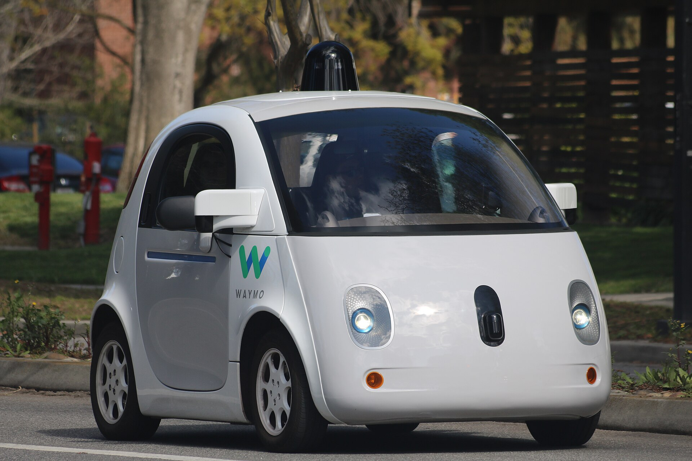
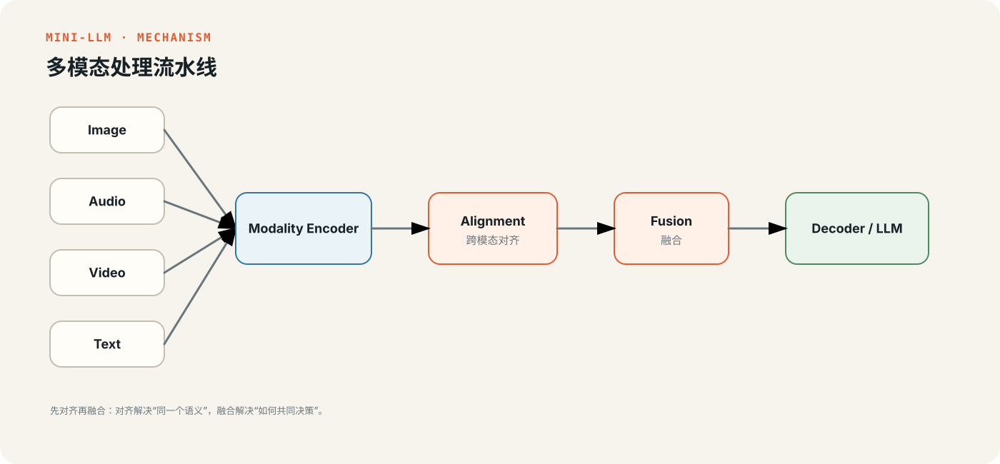
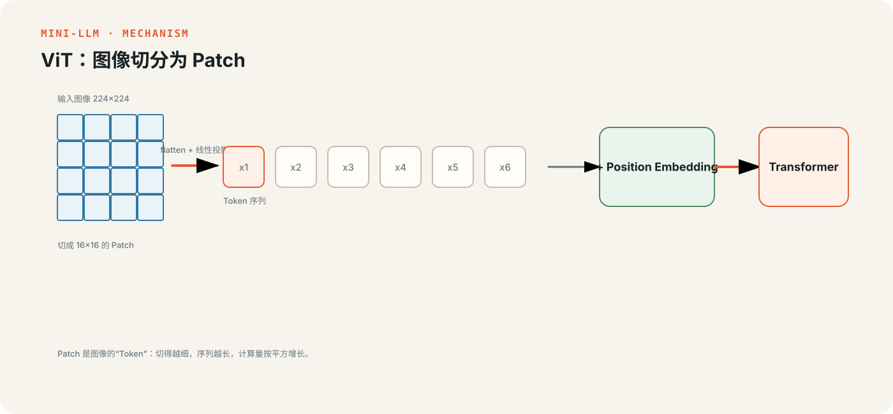
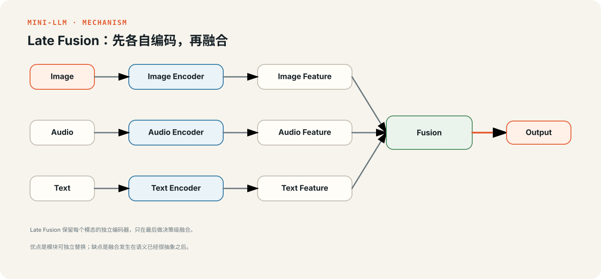
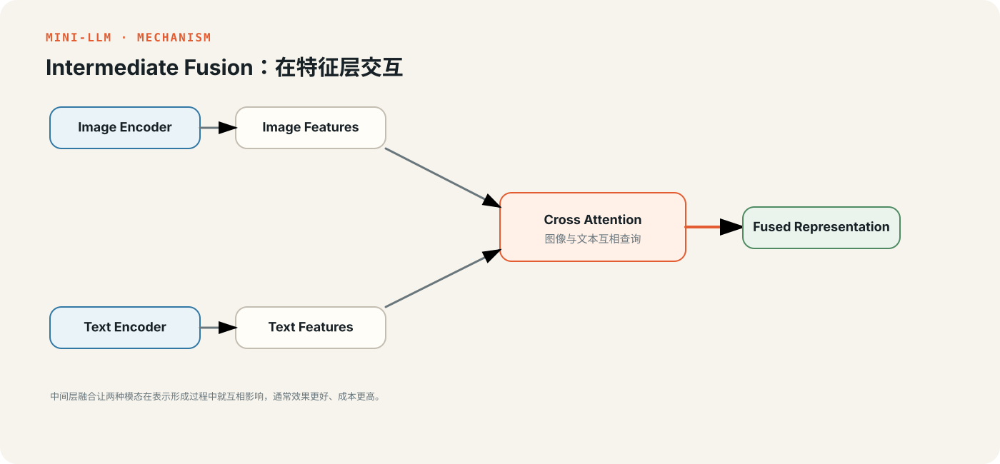
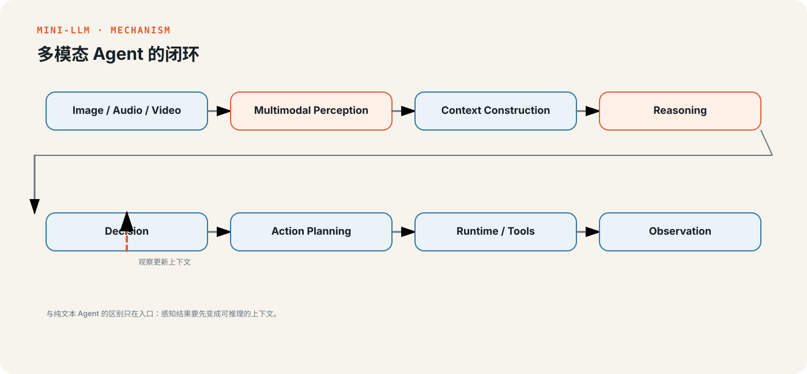

# **《mini-llm Multimodal Engine 深度解析：从 Image Encoding、Audio Processing 到 Video Understanding、Cross-Modal Alignment 与 Multimodal Fusion》**

在前面的 mini-llm 系列中，我们已经从 Tensor Engine、Autograd Engine、Transformer Engine，一直讨论到 Agent Engine、World Model Engine、Context Engine。

这些 Engine 主要围绕一个核心问题展开：

**如何让 AI 理解信息、形成表示、进行推理，并完成任务？**

但传统的大语言模型主要处理文本。

现实世界的信息却远远不止文本：

- 图像：物体、场景、颜色、形状、空间结构。
- 音频：语音、音乐、环境声音、情绪和声学事件。
- 视频：连续画面、动作、事件和时间关系。
- 空间信息：位置、方向、距离、运动轨迹。
- 多模态组合：图像中的人物说了什么、某个声音来自哪个物体、视频中某个动作发生在什么时间。

如果 AI 只能处理文字，就很难直接理解真实世界。

因此，需要建立一个统一的多模态处理架构：

核心模块

**Multimodal Engine（多模态引擎）**

它负责将不同类型的信息转换为模型能够处理的表示，并建立不同模态之间的关联，使模型能够进行跨模态理解、推理和生成。



_图：一辆 Waymo 自动驾驶出租车。摄像头给纹理与语义，激光雷达给精确距离，毫米波雷达给速度——真实系统天然是多模态的。图片：Grendelkhan，[Wikimedia Commons](https://commons.wikimedia.org/wiki/File:Waymo_self-driving_car_front_view.gk.jpg)，[CC BY-SA 4.0](https://creativecommons.org/licenses/by-sa/4.0/)。_

# **一、Multimodal Engine：为什么 AI 需要统一的多模态处理架构？**



_图：多模态处理流水线。先对齐再融合：对齐解决“同一个语义”，融合解决“如何共同决策”。_

## **1.1 什么是多模态？**

Modality 可以理解为信息的表现形式或感知模态。

人类可以通过不同感官获取信息：

| 模态      | 人类感知  | AI 输入形式                | 典型任务       |
| ------- | ----- | ---------------------- | ---------- |
| Text    | 语言    | Token                  | 文本理解、问答    |
| Image   | 视觉    | Pixel、Patch            | 图像识别、场景理解  |
| Audio   | 听觉    | Waveform、Spectrogram   | 语音识别、声音理解  |
| Video   | 视觉与时间 | Frame、Temporal Feature | 视频理解、动作识别  |
| Spatial | 空间感知  | Coordinate、Pose        | 位置关系、运动理解  |
| Motion  | 动作感知  | Action Sequence        | 机器人控制、动作生成 |

单模态模型只处理某一种信息。

例如：

- 语言模型处理文本。
- 图像模型处理图像。
- 语音模型处理声音。
- 视频模型处理连续画面。

多模态模型则希望在一个统一的系统中处理多种信息。

例如：

用户上传一段视频，并询问：

> 视频中穿红色衣服的人在做什么？他在说什么？他说话时手里拿着什么？

系统需要完成：

1. 从视频中提取关键帧。
2. 识别红色衣服的人。
3. 追踪人物在不同时间的位置。
4. 识别人物的动作。
5. 提取音频。
6. 识别语音内容。
7. 将语音和人物进行关联。
8. 综合图像、视频和语音信息生成答案。

这已经不是简单的图像识别或者语音识别，而是跨模态的信息理解。

## **1.2 多模态模型的基本架构**

一个典型的多模态系统可以采用不同模态的编码器，将它们转换为统一的表示，再交给 Transformer 进行融合和推理。

典型的架构是四路并行：图像、音频、视频与空间输入各自经过编码器，投影到同一维度后，再由多模态 Transformer 完成对齐与融合，最后解码成文本、语音、图像、视频或动作。具体结构见本章开头的流水线图。

这是一种通用架构示意，不是所有多模态模型都采用完全相同的结构。

例如：

- 有的模型使用独立视觉编码器，再通过投影层连接语言模型。
- 有的模型使用统一 Transformer 处理多种模态 Token。
- 有的模型使用交叉注意力连接不同模态。
- 有的语音模型采用离散音频 Token。
- 有的实时语音模型直接处理音频特征，并进行流式输出。

**多模态模型的核心不是简单地把图像、音频和文本放在一起，而是建立它们之间可学习、可计算的关系。**

# **二、Image Encoding：如何将图像转换为模型可以理解的表示？**

图像是多模态 AI 中最成熟的输入模态之一。

但计算机并不能像人类一样直接看到一张图片并理解其语义。

对于计算机而言，图像最初只是数字矩阵。

## **2.1 图像的数字表示**

一张 RGB 图像可以表示为：

\\[ I \in \mathbb{R}^{H\times W\times 3} \\]

其中：

- \\(H\\)：图像高度。
- \\(W\\)：图像宽度。
- \\(3\\)：RGB 三个颜色通道。

例如，一张 224×224 的 RGB 图像：

\\[ 224\times224\times3=150528 \\]

意味着这张图像包含 150,528 个颜色数值。

每个像素可以表示为：

\\[ Pixel(x,y)=[R,G,B] \\]

例如：

```
Pixel(10,20) = [255, 0, 0]
```

代表该像素是红色。

但是，如果直接把所有像素交给 Transformer，计算量会非常大。

因此需要 Image Encoder。

## **2.2 Image Encoder 做了什么？**

Image Encoder 的任务是：

**将原始像素转换为具有语义信息的特征表示。**

典型过程：

```
Raw Image
    │
    ▼
Image Preprocessing
    │
    ▼
Patch / Feature Extraction
    │
    ▼
Visual Encoder
    │
    ▼
Visual Features
    │
    ▼
Projection Layer
    │
    ▼
Visual Tokens
```

图像编码器可能使用：

- CNN；
- Vision Transformer；
- ConvNeXt；
- 混合 CNN + Transformer；
- 其他视觉网络。

对于基于 ViT 的视觉编码器，Patch Embedding 是一个关键步骤。

# **三、Patch Embedding：ViT 如何把图像切分为 Patch？**



_图：ViT 把图像切成 Patch，展平后线性投影成 Token 序列，再加位置编码送入 Transformer。_

Vision Transformer，简称 ViT，是将 Transformer 应用于图像处理的重要架构。

它的核心思想是：

**把图像切分为一系列小块，每个小块转换为一个向量，然后像处理文本 Token 一样处理这些视觉向量。**

## **3.1 为什么要切分 Patch？**

假设一张图像大小为：

\\[ 224\times224 \\]

如果每个像素都作为一个 Token，那么就需要处理：

\\[ 224\times224=50176 \\]

个空间位置。

如果每个 Patch 大小为：

\\[ 16\times16 \\]

那么图像可以划分为：

\\[ \frac{224}{16}\times\frac{224}{16} =14\times14 =196 \\]

个 Patch。

10

这样就可以把 50,176 个像素位置转换为 196 个视觉 Token。

当然，每个 Patch 本身仍包含大量像素信息。

## **3.2 Patch Embedding 的数学过程**

假设图像：

\\[ I\in\mathbb{R}^{H\times W\times C} \\]

Patch 大小：

\\[ P\times P \\]

Patch 数量：

\\[ N=\frac{H}{P}\times\frac{W}{P} \\]

每个 Patch 展平之后的维度：

\\[ D\_{raw}=P^2C \\]

通过线性投影：

\\[ E_i=x_iW_E+b \\]

其中：

- \\(x_i\\)：第 \\(i\\) 个展平后的 Patch。
- \\(W_E\\)：投影矩阵。
- \\(b\\)：偏置。
- \\(E_i\\)：Patch Embedding。

最终得到：

\\[ X=[E_1,E_2,\ldots,E_N] \\]

如果使用 224×224 RGB 图像和 16×16 Patch：

\\[ D\_{raw}=16\times16\times3=768 \\]

如果 Embedding 维度也是 768，那么每个 Patch 就被映射成一个 768 维向量。

## **3.3 为什么还需要 Position Embedding？**

文本有先后顺序。

图像 Patch 也存在空间位置。

例如：

- 左上角；
- 右上角；
- 左下角；
- 右下角。

如果模型只接收 Patch 内容，却不知道每个 Patch 原本位于什么位置，就难以正确恢复图像空间结构。

因此，需要位置编码：

\\[ Z_0=E+P\_{pos} \\]

其中：

- \\(E\\)：Patch Embedding。
- \\(P\_{pos}\\)：位置编码。

位置编码可以是可学习的，也可以采用其他位置表示方法。

## **3.4 CLS Token**

一些 ViT 架构会在 Patch 序列前加入一个特殊的 CLS Token：

\\[ Z_0=[E\_{CLS},E_1,E_2,\ldots,E_N] \\]

CLS Token 经过 Transformer 层后，可以作为整张图像的聚合表示。

但并不是所有视觉模型都依赖 CLS Token。

有些模型使用：

- Mean Pooling；
- Attention Pooling；
- 多尺度特征；
- Patch 特征直接输出。

## **3.5 ViT 的注意力计算**

视觉 Token 进入 Transformer 后，同样可以使用 Self-Attention：

\\[ Attention(Q,K,V) = Softmax\left( \frac{QK^T}{\sqrt{d_k}} \right)V \\]

这意味着：

一个 Patch 可以通过 Attention 与其他 Patch 建立关系。

例如：

- 人脸区域与眼睛区域；
- 汽车轮胎与汽车主体；
- 杯子与桌面；
- 物体与背景。

模型逐渐学习图像中不同区域之间的关系。

但需要注意：Attention 权重并不直接等同于人类可解释的视觉关注，也不能单独证明模型使用了某个特征。

## **3.6 图像分辨率与计算量**

标准全局 Self-Attention 的复杂度大致为：

\\[ O(N^2d) \\]

其中：

- \\(N\\)：视觉 Token 数量。
- \\(d\\)：隐藏维度。

如果图像分辨率提高，Patch 数量就会增加。

例如：

| 图像尺寸    | Patch 尺寸 | Patch 数量 |
| ------- | -------- | -------- |
| 224×224 | 16×16    | 196      |
| 448×448 | 16×16    | 784      |
| 896×896 | 16×16    | 3136     |

当 Patch 数量从 196 增加到 3136 时，标准全局 Attention 的 \\(N^2\\) 项会扩大到原来的 256 倍。

实际模型可能通过窗口注意力、分层结构、Token 压缩、动态分辨率和其他方法降低成本。

这也是高分辨率图像理解的一个重要工程问题。

# **四、Audio Processing：如何将声音转换为 Token 或特征表示？**

图像是空间数据。

音频则是时间连续信号。

它们的输入结构完全不同。

## **4.1 音频的原始表示**

声音本质上是随时间变化的声波。

麦克风将声波转换为数字信号。

数字音频可以表示为：

\\[ x=[x_1,x_2,\ldots,x_T] \\]

其中：

- \\(x_t\\)：某个时间采样点的振幅。
- \\(T\\)：采样点数量。

例如：

采样率为 16kHz，表示每秒采样 16,000 次。

如果录制 10 秒：

\\[ T=16000\times10=160000 \\]

意味着会产生 160,000 个采样值。

6

## **4.2 为什么不能直接把波形当成普通文本？**

因为音频波形具有以下特征：

- 时间连续性；
- 高频和低频成分；
- 音调变化；
- 节奏变化；
- 说话人差异；
- 环境噪声；
- 声学事件。

因此需要专门的音频特征提取。

## **4.3 Short-Time Fourier Transform**

一种经典方法是短时傅里叶变换，简称 STFT。

它将连续音频切分成短时间窗口，对每个窗口进行频率分析。

\\[ X(m,k)= \sum\_{n=0}^{N-1} x[n+mH]w[n]e^{-j2\pi kn/N} \\]

其中：

- \\(x[n]\\)：原始音频。
- \\(w[n]\\)：窗口函数。
- \\(N\\)：FFT 窗口长度。
- \\(H\\)：帧移。
- \\(m\\)：时间帧索引。
- \\(k\\)：频率索引。

STFT 的结果包含时间和频率两个维度。

通常将其幅度或功率表示转换为频谱图。

## **4.4 Mel Spectrogram**

Mel Spectrogram 是音频处理中常见的特征表示。

它将频率轴映射到 Mel 尺度，更接近人类听觉对频率间隔的感知方式。

基本过程：

```
Audio Waveform
      │
      ▼
STFT
      │
      ▼
Magnitude / Power Spectrogram
      │
      ▼
Mel Filter Bank
      │
      ▼
Log Mel Spectrogram
```

Mel 频率转换常见公式：

\\[ m=2595\log\_{10} \left(1+\frac{f}{700}\right) \\]

其中：

- \\(f\\)：普通频率。
- \\(m\\)：Mel 频率。

Log Mel Spectrogram 经常作为语音识别和音频模型的输入特征。

## **4.5 Audio Encoder**

音频编码器可以使用：

- CNN；
- Transformer；
- Conformer；
- RNN；
- CNN + Transformer；
- 专门设计的音频表示模型。

例如：

```
Audio
  │
  ▼
Preprocessing
  │
  ▼
Spectrogram / Learned Features
  │
  ▼
Audio Encoder
  │
  ▼
Audio Embeddings
  │
  ▼
Audio Tokens / Hidden States
```

音频 Encoder 需要学习：

- 音素特征；
- 音节结构；
- 语音节奏；
- 音调变化；
- 说话人特征；
- 环境声音；
- 音乐结构。

## **4.6 离散 Audio Token 与连续 Audio Feature**

这里有一个重要区别。

音频模型不一定都将声音转换成离散 Token。

常见方式有两种。

**方式一：连续特征表示**

\\[ A=[a_1,a_2,\ldots,a_T] \\]

其中每个 \\(a_t\\) 是一个向量。

模型直接处理连续的音频特征。

**方式二：离散音频 Token**

通过量化模型将连续音频表示映射为离散码：

\\[ z_t\in\\{1,2,\ldots,K\\} \\]

例如使用 Vector Quantization 或 Residual Vector Quantization。

这种方式可以把音频表示成 Token 序列，方便使用类似语言模型的自回归生成机制。

但两种方式并不等价：

- 连续特征保留连续向量表示。
- 离散 Token 需要经过量化，存在量化误差。

# **五、Speech Understanding：语音识别与语音理解有什么区别？**

这是多模态 AI 中非常重要的一个概念。

Speech Recognition 和 Speech Understanding 并不是一回事。

## **5.1 Speech Recognition**

语音识别的主要目标是：

**将声音转换成文字。**

例如：

**Audio Input**

**Speech Recognition**

语音转文字

“明天下午三点召开项目会议。”

这类任务通常称为 ASR（Automatic Speech Recognition）。

它主要关注识别内容是否正确。

## **5.2 Speech Understanding**

Speech Understanding 不仅仅是把语音转成文字。

它还需要理解：

- 说话人意图；
- 情绪线索；
- 语气；
- 对话关系；
- 语境；
- 说话人身份或区分；
- 语音事件。

例如：

同样一句话：

> 你真厉害。

可能表达：

- 真诚赞赏；
- 讽刺；
- 愤怒；
- 无奈。

单纯的 ASR 可能得到完全相同的文本。

但语音理解还需要结合音高、语速、重音、语调和上下文来判断可能的表达方式。

这些判断具有不确定性，不能仅凭音调就断言说话人的真实心理状态。

## **5.3 ASR 与 Speech Understanding 的区别**

| 维度    | Speech Recognition | Speech Understanding |
| ----- | ------------------ | -------------------- |
| 主要目标  | 语音转文字              | 理解语音内容和语境            |
| 输出    | Transcript         | 意图、语义、事件等            |
| 关注重点  | 词语识别               | 语义和交互                |
| 情绪分析  | 非核心任务              | 可作为辅助任务              |
| 说话人区分 | 可选                 | 常常有价值                |
| 多模态关联 | 不一定需要              | 可以结合视频、图像            |

## **5.4 Speech Generation**

多模态语音系统还有一个重要方向：

Text-to-Speech，简称 TTS。

它将文本转换成语音。

```
Text
 │
 ▼
Text Encoder
 │
 ▼
Acoustic Model
 │
 ▼
Vocoder / Audio Decoder
 │
 ▼
Generated Speech
```

更现代的语音生成模型也可能直接生成音频 Token 或连续音频表示，并不一定使用传统的声学模型加 Vocoder 两阶段结构。

## **5.5 实时语音交互**

实时语音系统还需要处理：

- Streaming Audio；
- Voice Activity Detection；
- Endpoint Detection；
- Turn Taking；
- Interruptions；
- Incremental ASR；
- Low-latency TTS。

例如：

```
User Speech
     │
     ▼
Audio Streaming
     │
     ▼
Voice Activity Detection
     │
     ▼
Speech Understanding
     │
     ▼
LLM Reasoning
     │
     ▼
Streaming Speech Generation
     │
     ▼
User Hears Response
```

这时系统不能等用户说完所有内容后才开始处理。

它需要边接收、边理解、边决定何时回应。

# **六、Video Understanding：如何处理连续的视频帧和时间信息？**

图像是一张静态画面。

视频则是连续变化的画面。

视频理解不仅要理解每一帧，还需要理解不同帧之间发生了什么。

## **6.1 视频的基本表示**

视频可以看成一个随时间变化的图像序列：

\\[ V=[I_1,I_2,\ldots,I_T] \\]

其中：

- \\(I_t\\)：第 \\(t\\) 帧图像。
- \\(T\\)：视频帧数量。

例如：

一个 30 FPS 的视频，每秒包含 30 帧。

如果视频持续 60 秒：

\\[ 30\times60=1800 \\]

意味着需要处理 1800 帧。

如果每帧都使用高分辨率视觉编码器，计算成本会非常高。

## **6.2 视频理解的基本流程**

11

典型流程：

```
Raw Video
    │
    ▼
Video Decoder
    │
    ▼
Frame Sampling
    │
    ▼
Image Encoder
    │
    ▼
Visual Features
    │
    ▼
Temporal Modeling
    │
    ▼
Video Representation
```

其中最关键的环节有两个：

1. 如何选择视频帧？
2. 如何理解时间关系？

## **6.3 Frame Sampling**

不一定需要处理所有视频帧。

可以使用不同采样策略。

**均匀采样**

例如每隔 1 秒取一帧。

适合：

- 视频摘要；
- 场景理解；
- 长视频快速浏览。

**固定帧率采样**

例如每秒取 4 帧。

适合：

- 需要较高时间分辨率的任务；
- 人物活动分析；
- 视频问答。

**关键帧采样**

选择场景发生变化或具有重要语义的帧。

适合：

- 长视频事件定位；
- 重要事件摘要。

**自适应采样**

根据运动、场景变化或任务需求动态调整采样密度。

例如：

一个人静止不动时可以减少采样。

一个人突然开始奔跑时增加采样。

但是，关键帧采样可能漏掉短暂事件，因此需要根据任务评估采样策略。

## **6.4 Temporal Modeling**

仅仅把视频帧转换为视觉向量还不够。

模型还需要理解：

- 先发生什么；
- 后发生什么；
- 物体如何移动；
- 人物动作如何变化；
- 不同事件之间有什么联系。

假设视频包含三帧：

```
Frame 1: 人拿起杯子
Frame 2: 人把杯子举到嘴边
Frame 3: 人喝水
```

如果只单独分析每帧，模型可能识别出：

- 人；
- 杯子；
- 手；
- 水。

但只有建立时间关系，才能理解：

**这个人正在喝水。**

## **6.5 时序模型**

常见时序建模方法：

- 3D CNN；
- Temporal Transformer；
- Video Transformer；
- TimeSformer；
- 时空联合注意力；
- 时序卷积；
- 光流与运动特征。

其中，Video Transformer 可以将时间和空间信息结合起来。

例如：

\\[ X\in\mathbb{R}^{T\times H\times W\times D} \\]

其中：

- \\(T\\)：时间维度；
- \\(H,W\\)：空间特征网格；
- \\(D\\)：特征维度。

模型可以在不同时间帧之间建立注意力关系。

### **Spatial Attention**

理解同一帧内部不同区域之间的关系。

### **Temporal Attention**

理解不同时间帧之间的变化。

### **Spatio-Temporal Attention**

同时建模空间和时间关系。

不同架构对空间和时间注意力的组织方式不同，并不都使用完整的全局时空 Attention。

# **七、Cross-Modal Alignment：如何对齐图像、文本和音频的语义？**

这是多模态 AI 最核心的技术问题之一。

不同模态的数据结构不同：

- 文本是 Token 序列；
- 图像是空间像素和视觉特征；
- 音频是时间信号；
- 视频是空间与时间的组合。

那么，模型如何知道：

一张猫的图片、一段猫叫声和文本“猫”，实际上指向同一个概念？

这就涉及 Cross-Modal Alignment。

## **7.1 什么是跨模态对齐？**

假设我们有：

Image

Audio

# **猫**

Text

这三种信息形式不同，但它们可能具有共同的语义。

跨模态对齐就是让模型学习：

\\[ f\_{image}(I) \approx f\_{text}(T) \\]

对于声音：

\\[ f\_{audio}(A) \approx f\_{text}(T) \\]

这里的“约等于”不是要求所有模态的向量完全相同，而是让语义匹配的样本在某种共同表示空间中更接近。

## **7.2 Contrastive Learning**

一种经典的跨模态对齐方法是对比学习。

例如 CLIP 类型的图文对齐模型。

训练数据：

```
Image 1: 一只猫
Text 1: 一只猫坐在沙发上

Image 2: 一辆汽车
Text 2: 一辆红色汽车停在路边
```

模型需要让正确匹配的图文对相似度更高，让不匹配的图文对相似度更低。

可以使用对比损失：

\\[ L\_{i\rightarrow t} = -\frac{1}{N} \sum\_{i=1}^{N} \log \frac{ \exp(s\_{ii}/\tau) }{ \sum\_{j=1}^{N}\exp(s\_{ij}/\tau) } \\]

其中：

- \\(s\_{ij}\\)：图像 \\(i\\) 与文本 \\(j\\) 的相似度。
- \\(\tau\\)：温度参数。
- \\(N\\)：Batch 中样本数量。

通常还会加入文本到图像方向的对称损失：

\\[ L= \frac{1}{2} (L\_{i\rightarrow t}+L\_{t\rightarrow i}) \\]

通过这种训练，模型能够学习图像和文本之间的语义关联。

## **7.3 Projection Layer**

不同编码器的输出维度可能不同。

例如：

- Image Encoder 输出 1024 维；
- Text Encoder 输出 768 维；
- Audio Encoder 输出 512 维。

可以通过投影层将它们映射到统一维度：

\\[ z_i=W_i h_i \\]

\\[ z_t=W_t h_t \\]

\\[ z_a=W_a h_a \\]

其中：

- \\(h_i\\)：图像特征；
- \\(h_t\\)：文本特征；
- \\(h_a\\)：音频特征；
- \\(W_i,W_t,W_a\\)：不同模态的投影矩阵。

最终得到统一维度的向量。

## **7.4 对齐不等于融合**

这是一个必须区分的概念。

**Alignment：让不同模态的语义能够对应。**

**Fusion：让不同模态的信息共同参与模型计算。**

例如：

图像和文本经过对齐后，可以知道：

- 图像中有一只猫；
- 文本描述的是猫。

但如果要回答：

> 这只猫为什么看起来害怕？

模型可能还需要融合：

- 图像中的身体姿态；
- 耳朵方向；
- 面部表现；
- 环境声音；
- 用户提供的上下文。

因此，对齐解决的是语义对应问题，融合解决的是联合信息利用问题。

# **八、Multimodal Fusion：如何融合不同模态的信息？**

多模态融合是将不同来源的信息结合起来，形成更完整的表示。

例如：

- 图像告诉我们物体是什么；
- 音频告诉我们物体发出了什么声音；
- 视频告诉我们物体如何运动；
- 文本告诉我们用户希望了解什么。

## **8.1 Early Fusion**

Early Fusion 是早期融合。

在模型的较早阶段就将不同模态的信息组合起来。

例如：

```
Image Tokens ──┐
               ├──► Joint Transformer
Audio Tokens ──┤
               │
Text Tokens ───┘
```

优点：

- 不同模态可以较早建立交互；
- 能学习细粒度跨模态关系。

缺点：

- 序列可能非常长；
- 计算成本高；
- 不同模态 Token 数量差异大；
- 需要处理不同模态的输入格式和位置关系。

## **8.2 Late Fusion**

Late Fusion 是后期融合。

不同模态先分别处理，再组合高层特征。



_图：Late Fusion 先让每个模态独立编码，再在决策层融合。_

优点：

- 模态编码器可以独立优化；
- 容易复用已有模型；
- 模块边界清晰。

缺点：

- 早期的细粒度交互较少；
- 某些跨模态关系可能难以充分表达。

## **8.3 Intermediate Fusion**

Intermediate Fusion 是中间层融合。

不同模态先通过独立编码器提取特征，再通过 Cross-Attention 或其他模块进行交互。

例如：



_图：Intermediate Fusion 在特征层用 Cross Attention 让图像与文本互相查询。_

这类结构在视觉语言模型中非常常见。

## **8.4 Cross-Attention**

Cross-Attention 是多模态融合的重要技术。

假设文本特征作为 Query，图像特征作为 Key 和 Value：

\\[ Q=X\_{text}W_Q \\]

\\[ K=X\_{image}W_K \\]

\\[ V=X\_{image}W_V \\]

然后：

\\[ CrossAttention(Q,K,V) = Softmax\left( \frac{QK^T}{\sqrt{d_k}} \right)V \\]

这意味着：

文本中的某些 Token 可以根据图像内容提取相关视觉信息。

例如用户问：

> 这辆汽车是什么颜色？

文本中的“颜色”相关表示可以通过 Cross-Attention 从图像特征中提取对应信息。

需要注意：Cross-Attention 只是信息交互机制，不能保证模型一定正确定位了图像中的目标。准确性仍然取决于训练数据、视觉表示、任务设计和模型能力。

## **8.5 三种融合方式比较**

| 融合方式                | 融合位置  | 优势    | 局限      |
| ------------------- | ----- | ----- | ------- |
| Early Fusion        | 编码早期  | 交互充分  | 序列成本较高  |
| Intermediate Fusion | 编码中间层 | 灵活、平衡 | 架构更复杂   |
| Late Fusion         | 编码后期  | 易于组合  | 细粒度交互较弱 |

不存在一种融合方式适合所有任务。

例如：

- 图文检索可能采用独立编码器和对比对齐。
- 视觉问答可能采用 Cross-Attention。
- 实时音视频模型可能采用流式多模态交互。
- 机器人模型可能需要融合视觉、空间和动作表示。

# **九、Spatial-Temporal Representation：如何表示空间和时间关系？**

普通图像理解通常关注：

- 有什么物体；
- 物体是什么；
- 物体在哪里。

视频理解还需要：

- 物体如何移动；
- 物体之间如何交互；
- 事件发生的顺序；
- 运动轨迹是什么。

因此，多模态系统还需要 Spatial-Temporal Representation。

## **9.1 空间表示**

空间表示可以包含：

\\[ P=(x,y,z) \\]

其中：

- \\(x\\)：X 坐标；
- \\(y\\)：Y 坐标；
- \\(z\\)：Z 坐标。

对于二维图像，可以使用：

\\[ P=(u,v) \\]

例如：

```
{
  "object": "person",
  "bbox": [120, 80, 300, 450],
  "confidence": 0.95
}
```

这里的 `bbox` 表示图像中的边界框，通常由左上角和右下角坐标构成。

如果要表达三维空间，还需要考虑：

- 相机内参；
- 相机外参；
- 深度；
- 坐标系；
- 空间变换。

## **9.2 时间表示**

时间信息可以表示为：

\\[ t\in\mathbb{R} \\]

对于一个事件，可以定义：

\\[ E=(t_s,t_e) \\]

其中：

- \\(t_s\\)：事件开始时间。
- \\(t_e\\)：事件结束时间。

例如：

```
{
  "event": "person_running",
  "start_time": 3.2,
  "end_time": 8.6
}
```

表示人物在视频的 3.2 秒到 8.6 秒之间处于奔跑状态。

## **9.3 运动轨迹**

物体在不同时间的位置可以构成轨迹：

\\[ Trajectory= \\{P_1,P_2,\ldots,P_T\\} \\]

其中：

\\[ P_t=(x_t,y_t,z_t) \\]

通过轨迹可以分析：

- 物体移动方向；
- 移动速度；
- 运动趋势；
- 物体交互；
- 事件变化。

速度可以近似表示为：

\\[ v_t=\frac{P_t-P\_{t-1}}{\Delta t} \\]

这只是离散位置的速度估计，真实计算还需要考虑坐标单位、时间间隔、噪声和坐标系一致性。

## **9.4 时空联合表示**

可以把多模态输入统一表示为：

\\[ X= \\{ X\_{visual}, X\_{audio}, X\_{text}, X\_{spatial}, X\_{temporal} \\} \\]

例如一段视频：

| 时间   | 图像信息 | 音频信息 | 空间信息     |
| ---- | ---- | ---- | -------- |
| 0–2s | 人物站立 | 背景音乐 | 人物位于画面左侧 |
| 2–4s | 人物举手 | 人物说话 | 手臂向上移动   |
| 4–6s | 人物转身 | 脚步声  | 人物向右移动   |

系统不仅需要理解每种信息，还要建立它们之间的时间关联。

例如：

> 人物在举手时说了一句话。

这要求模型把视觉动作和音频片段对应起来。

# **十、Multimodal Reasoning：模型如何结合多种模态进行推理？**

多模态模型真正的价值不是同时接受多种输入，而是能够基于多种信息完成复杂推理。

## **10.1 从多模态感知到推理**

假设输入：

- 一张厨房图片；
- 一段水壶发出鸣叫声的音频；
- 用户问题：“水壶是不是烧开了？”

模型需要：

1. 识别图像中的水壶。
2. 判断水壶是否位于灶台上。
3. 分析音频是否包含类似水壶鸣叫的声音。
4. 对齐声音发生时间和图像场景。
5. 判断是否有足够证据支持结论。
6. 输出带有不确定性的回答。

注意，水壶鸣叫声不一定意味着水已经烧开。模型需要结合其他证据，而不能把声音与结论简单画等号。

## **10.2 多模态推理的基本过程**

```
Multimodal Inputs
       │
       ▼
Modality Encoding
       │
       ▼
Cross-Modal Alignment
       │
       ▼
Multimodal Fusion
       │
       ▼
Joint Representation
       │
       ▼
Reasoning
       │
       ▼
Answer / Action
```

## **10.3 多模态推理中的三类问题**

### **第一类：跨模态补充**

某个模态提供的信息不完整，其他模态补充信息。

例如：

- 图像识别出一个人；
- 音频识别出人物说话内容；
- 文本提供任务背景。

### **第二类：跨模态验证**

不同模态可以相互验证。

例如：

- 视频显示汽车正在倒车；
- 音频包含倒车提示音；
- 两者共同支持汽车正在倒车的判断。

但两个模态也可能来自不同时间或不同对象，因此必须进行时间和实体对齐。

### **第三类：跨模态冲突**

不同模态提供了不一致的信息。

例如：

- 视频显示一个人正在微笑；
- 音频语调听起来比较愤怒；
- 文本字幕却表达感谢。

系统不能简单地选择某一种模态，而需要分析：

- 时间是否同步？
- 说话人是否匹配？
- 字幕是否准确？
- 是否存在讽刺或反语？
- 哪些信息是直接证据？

多模态推理的重要能力之一，就是识别冲突和不确定性。

## **10.4 多模态模型的局限**

需要特别强调：

多模态模型能够同时处理图像、音频和文本，不代表它一定真正理解了物理世界。

例如：

- 看到一个杯子，不代表理解杯子的真实重量。
- 看到一个人跌倒，不代表准确知道其受伤程度。
- 听到警报声，不代表知道警报的真实来源。
- 识别出物体运动，不代表准确掌握其动力学规律。

多模态表示可以提供更丰富的观测信息，但可靠的物理推断仍然需要合适的世界模型、因果模型和真实环境验证。

# **十一、Multimodal Agent：如何让 Agent 感知图像、声音和视频并采取行动？**

到这里，我们已经讨论了多模态感知和推理。

但 AI Agent 不应该只停留在理解信息。

它还需要根据感知结果采取行动。

这就进入 Multimodal Agent。

## **11.1 普通 Agent 与多模态 Agent**

普通文本 Agent：

```
User Text
    │
    ▼
LLM
    │
    ▼
Tool Calling
    │
    ▼
Tool Result
    │
    ▼
Response
```

多模态 Agent：



_图：多模态 Agent 的闭环：感知 → 上下文 → 推理 → 决策 → 行动 → 观察。_

## **11.2 示例：多模态桌面 Agent**

假设用户要求：

> 帮我观察屏幕中的错误提示，分析原因并修复代码。

多模态 Agent 需要：

1. 获取屏幕截图。
2. 识别错误提示。
3. 识别当前应用和界面状态。
4. 判断错误可能对应哪个项目模块。
5. 检索相关代码。
6. 生成修复方案。
7. 通过工具修改代码。
8. 运行测试。
9. 再次观察屏幕或测试结果。
10. 判断问题是否真正解决。

这形成一个感知—推理—行动—反馈循环。

## **11.3 示例：机器人多模态 Agent**

假设机器人需要拿起桌上的水杯。

它可能同时接收：

| 信息     | 用途        |
| ------ | --------- |
| RGB 图像 | 识别杯子外观    |
| 深度图    | 估计物体距离    |
| 语音     | 理解用户指令    |
| 关节状态   | 获取机器人自身状态 |
| 力传感器   | 估计接触状态    |
| 位姿信息   | 确定目标空间位置  |

执行流程：

```
User Voice
    │
    ▼
Speech Understanding
    │
    ▼
Visual Perception
    │
    ▼
Object Detection
    │
    ▼
3D Pose Estimation
    │
    ▼
Motion Planning
    │
    ▼
Robot Control
    │
    ▼
Sensor Feedback
```

这里需要区分：

- Multimodal Engine：理解多模态输入。
- Spatial Intelligence Engine：理解空间结构。
- World Model Engine：预测环境状态变化。
- Planning Engine：规划动作序列。
- Robotics Engine：处理运动学、动力学和轨迹。
- Runtime Engine：组织实际执行。

多模态模型输出的动作或位置不能直接作为未经检查的电机控制命令。必须经过坐标系、单位、关节限制、碰撞、安全速度和独立急停机制验证。

# **十二、Multimodal Architecture：如何构建完整的 mini-llm 多模态引擎？**

前面介绍了图像、音频、视频、跨模态对齐和融合。

现在将它们组合成一个完整的工程架构。

## **12.1 总体架构**

## **mini-llm Multimodal Engine**

**Input Gateway**

文本、图像、音频、视频、空间数据

**Image Pipeline**

Image Decoder

Patch Embedding

Vision Encoder

**Audio Pipeline**

Audio Decoder

Feature Extraction

Audio Encoder

**Video Pipeline**

Frame Sampling

Temporal Encoding

Video Encoder

**Spatial Pipeline**

Coordinate Encoding

Pose Encoding

Motion Features

**Representation & Alignment Layer**

Projection、Embedding、Temporal Alignment

- **Multimodal Fusion Layer**：Cross-Attention、Joint Transformer、Fusion
- **Multimodal Reasoning**：理解、问答、推理、生成
- **Output Adapter**：Text、Audio、Image、Video、Action

| 模块                   | 核心职责          |
| -------------------- | ------------- |
| Input Gateway        | 统一接收多模态输入     |
| Image Pipeline       | 图像解码、预处理、编码   |
| Audio Pipeline       | 音频解码、特征提取、编码  |
| Video Pipeline       | 视频解码、帧采样、时序建模 |
| Spatial Pipeline     | 坐标、位姿、运动表示    |
| Representation Layer | 统一特征表示        |
| Alignment Engine     | 跨模态语义对齐       |
| Fusion Engine        | 多模态特征融合       |
| Multimodal Reasoner  | 多模态联合推理       |
| Output Adapter       | 统一处理不同类型输出    |

这里建议将 Multimodal Engine 定位为一个模态处理与协调层，而不是把所有视觉、语音、视频网络都写进同一个巨大模块。

# **十三、核心数据结构与 TypeScript 接口**

如果准备开发 mini-llm Multimodal Engine，可以先定义统一的输入表示。

## **13.1 Multimodal Input**

```
type Modality =
  | "text"
  | "image"
  | "audio"
  | "video"
  | "spatial";

interface MultimodalInput {
  id: string;

  modality: Modality;

  content: unknown;

  timestamp?: number;

  duration?: number;

  metadata?: Record<string, unknown>;
}
```

## **13.2 Modality Encoder**

不同模态使用不同编码器。

```
interface ModalityEncoder<TInput, TOutput> {
  encode(
    input: TInput
  ): Promise<TOutput>;

  getModality(): Modality;
}
```

例如：

```
interface ImageFeatures {
  embeddings: Float32Array;

  patchCount: number;

  hiddenSize: number;

  width: number;

  height: number;
}

interface AudioFeatures {
  embeddings: Float32Array;

  frameCount: number;

  hiddenSize: number;

  sampleRate: number;
}
```

## **13.3 Unified Representation**

统一表示层可以定义：

```
interface ModalityRepresentation {
  modality: Modality;

  embeddings: Float32Array;

  sequenceLength: number;

  hiddenSize: number;

  timestamp?: number;

  metadata?: Record<string, unknown>;
}
```

需要注意，`Float32Array` 只是接口层面的示意。真实系统中还需要考虑：

- Batch 维度；
- 张量 Shape；
- 数据类型；
- 设备位置；
- 内存布局；
- 时间轴；
- 空间轴；
- Mask；
- 模态特定元数据。

这也是 Multimodal Engine 与前面 Tensor Engine 的直接联系。

## **13.4 Fusion Interface**

```
interface MultimodalFusion {
  fuse(
    inputs: ModalityRepresentation[]
  ): Promise<ModalityRepresentation>;
}
```

## **13.5 Multimodal Engine**

```
interface MultimodalEngine {
  encode(
    input: MultimodalInput
  ): Promise<ModalityRepresentation>;

  align(
    inputs: ModalityRepresentation[]
  ): Promise<ModalityRepresentation[]>;

  fuse(
    inputs: ModalityRepresentation[]
  ): Promise<ModalityRepresentation>;

  infer(
    input: ModalityRepresentation[]
  ): Promise<unknown>;
}
```

这套接口是一个抽象设计。

真正实现时，`infer` 通常需要接入模型执行层，而不是由 Multimodal Engine 自己实现完整的语言模型推理。

# **十四、训练多模态模型：如何让不同模态真正建立联系？**

如果只为每种模态分别训练编码器，系统虽然可以处理图像和音频，但不一定理解它们之间的关系。

因此还需要多模态训练。

## **14.1 单模态预训练**

首先可以分别训练：

- Image Encoder；
- Audio Encoder；
- Text Encoder；
- Video Encoder。

例如：

图像模型学习物体、纹理、场景和空间特征。

音频模型学习语音、声音和声学结构。

文本模型学习语言和语义。

## **14.2 跨模态对齐训练**

接下来使用配对数据。

例如：

| 图像    | 文本       |
| ----- | -------- |
| 猫的图片  | 一只猫正在睡觉  |
| 汽车的图片 | 一辆汽车停在路边 |
| 狗的图片  | 一只狗正在奔跑  |

通过对比学习，让正确匹配的图文表示更加接近。

音频也可以通过语音—文本配对、声音事件—文本描述等数据建立关联。

## **14.3 多模态指令微调**

完成表示对齐后，还需要训练模型完成真实任务。

例如：

```
Input:
一张汽车图片

Question:
这辆汽车是什么颜色？

Expected Answer:
这辆汽车是红色的。
```

或者：

```
Input:
一段包含人声和背景音乐的音频

Question:
音频中有哪些声音？

Expected Answer:
音频中有一个人在讲话，背景中伴有轻柔的音乐。
```

## **14.4 多模态训练目标**

可以将多个训练目标组合：

\\[ L\_{total} = \lambda_1 L\_{text} + \lambda_2 L\_{image} + \lambda_3 L\_{audio} + \lambda_4 L\_{alignment} + \lambda_5 L\_{generation} \\]

其中：

- \\(L\_{text}\\)：文本建模损失。
- \\(L\_{image}\\)：视觉相关任务损失。
- \\(L\_{audio}\\)：音频相关任务损失。
- \\(L\_{alignment}\\)：跨模态对齐损失。
- \\(L\_{generation}\\)：多模态生成损失。

不同模型不一定同时使用所有这些损失。

实际训练还要考虑数据配比、模态不平衡、损失权重、训练阶段和不同任务之间的梯度冲突。

## **14.5 多模态模型训练路线**

## **Multimodal Training Pipeline**

1. **单模态数据预训练**

   分别学习文本、图像、音频和视频特征
2. **跨模态表示对齐**

   学习不同模态之间的语义关联
3. **多模态融合训练**

   训练模型进行联合信息处理
4. **多模态指令微调**

   学习图文问答、音频理解、视频分析等任务
5. **多模态能力评估**

   评估识别、对齐、推理、生成和鲁棒性

# **十五、mini-llm Multimodal Engine V1：应该如何真正实现？**

如果目标是从零理解并逐步构建 mini-llm，而不是直接调用一个成熟的多模态 API，我建议不要一开始就实现图像、音频、视频和空间理解的全部功能。

应该按照依赖关系逐步推进。

## **Phase 1：Image Engine**

建议第一个实现

实现：

1. RGB 图像读取；
2. 图像 Resize；
3. Normalize；
4. Patch Embedding；
5. Position Embedding；
6. Vision Transformer；
7. Image Feature Extraction。

验收：

- 能够把图像转换为 Patch 序列。
- 能够完成 Patch Embedding。
- 能够运行 Transformer Encoder。
- 能够输出视觉特征。
- 能够通过一个小型图像分类任务验证编码器。

## **Phase 2：Audio Engine**

实现：

1. WAV 解码；
2. PCM 数据读取；
3. Resampling；
4. STFT；
5. Mel Filter Bank；
6. Log Mel Spectrogram；
7. Audio Encoder；
8. Audio Embedding。

验收：

- 能够将音频转换为频谱特征。
- 能够提取音频向量。
- 能够完成简单声音分类。
- 能够使用现成 ASR 模型验证语音转文字流程。

## **Phase 3：Image-Text Alignment**

实现：

1. Image Encoder；
2. Text Encoder；
3. Projection Layer；
4. Contrastive Loss；
5. Similarity Matrix；
6. 图文检索。

验收：

- 输入一张图片，能够检索相关文本。
- 输入一句文本，能够检索相关图片。
- 正样本相似度整体高于负样本。
- 在独立测试集上评估检索能力。

## **Phase 4：Video Engine**

实现：

1. FFmpeg 视频解码；
2. Frame Sampling；
3. Image Feature Extraction；
4. Temporal Embedding；
5. Temporal Transformer；
6. 视频事件分类。

验收：

- 能够将视频转换为帧序列。
- 能够提取帧级视觉特征。
- 能够区分简单时间顺序。
- 能够识别简单视频动作。

## **Phase 5：Multimodal Fusion**

实现：

1. 多模态输入统一接口；
2. Cross-Attention；
3. Early / Intermediate / Late Fusion；
4. 多模态指令数据；
5. 多模态问答。

验收：

- 能够联合使用图像和文本。
- 能够联合使用音频和文本。
- 能够完成简单图文问答。
- 能够处理部分跨模态冲突。
- 能够评估融合前后任务效果。

## **Phase 6：Multimodal Agent**

实现：

1. 多模态输入；
2. Context Assembly；
3. Multimodal Reasoning；
4. Decision Engine；
5. Tool Calling；
6. Action Execution；
7. Feedback Loop。

验收：

- Agent 能够接收图像、音频或视频。
- 能够根据多模态信息制定任务计划。
- 能够调用工具完成任务。
- 能够根据执行结果更新上下文。
- 高风险动作经过独立授权和安全验证。

# **十六、工程目录：mini-llm Multimodal Engine**

建议延续之前 mini-llm 的模块化设计：

```
mini-llm/
│
├── packages/
│   │
│   ├── multimodal-core/
│   │   ├── types/
│   │   │   ├── modality.ts
│   │   │   ├── representation.ts
│   │   │   └── multimodal-input.ts
│   │   │
│   │   ├── image/
│   │   │   ├── image-loader.ts
│   │   │   ├── image-preprocess.ts
│   │   │   ├── patch-embedding.ts
│   │   │   └── vision-transformer.ts
│   │   │
│   │   ├── audio/
│   │   │   ├── audio-loader.ts
│   │   │   ├── resampler.ts
│   │   │   ├── stft.ts
│   │   │   ├── mel-spectrogram.ts
│   │   │   └── audio-encoder.ts
│   │   │
│   │   ├── video/
│   │   │   ├── video-loader.ts
│   │   │   ├── frame-sampler.ts
│   │   │   ├── temporal-embedding.ts
│   │   │   └── video-encoder.ts
│   │   │
│   │   ├── spatial/
│   │   │   ├── coordinate-encoder.ts
│   │   │   ├── pose-encoder.ts
│   │   │   └── motion-encoder.ts
│   │   │
│   │   ├── alignment/
│   │   │   ├── projection.ts
│   │   │   ├── contrastive-loss.ts
│   │   │   └── cross-modal-alignment.ts
│   │   │
│   │   ├── fusion/
│   │   │   ├── early-fusion.ts
│   │   │   ├── late-fusion.ts
│   │   │   └── cross-attention.ts
│   │   │
│   │   └── engine/
│   │       └── multimodal-engine.ts
│   │
│   └── multimodal-adapters/
│       ├── ffmpeg/
│       ├── image-codec/
│       ├── audio-codec/
│       └── pretrained-models/
│
└── tests/
    ├── image/
    ├── audio/
    ├── video/
    ├── alignment/
    └── fusion/
```

建议底层张量计算复用之前的 Tensor Engine、Autograd Engine 和 Neural Network Engine。

视频解码、音频解码、图像读取等工作则交给成熟的底层库，不必全部从零实现。

# **十七、进一步思考：多模态 AI 是否正在形成一种新的世界表示？**

这是多模态 AI 最值得深入研究的问题。

传统语言模型主要通过文字描述世界。

但文字只是世界的一种表达方式。

例如：

“一个人正在打开门。”

这句话提供了语义信息，但没有完整描述：

- 门的具体位置；
- 门的尺寸；
- 门的运动方向；
- 人与门之间的距离；
- 手部接触的位置；
- 门打开时的速度；
- 门是否受到阻力。

图像可以补充空间信息。

视频可以补充时间信息。

音频可以补充声学信息。

空间数据可以补充几何关系。

不同模态组合起来，就能够形成更加丰富的世界表示。

## **17.1 从单模态表示到多模态世界表示**

可以抽象为：

\\[ W_t= f( I_t, A_t, V_t, S_t, T_t ) \\]

其中：

- \\(I_t\\)：图像信息。
- \\(A_t\\)：音频信息。
- \\(V_t\\)：视频信息。
- \\(S_t\\)：空间信息。
- \\(T_t\\)：时间信息。
- \\(W_t\\)：当前时刻的联合世界表示。

这只是一个抽象表示。实际系统还需要处理：

- 不同传感器的时间同步；
- 不同坐标系的变换；
- 缺失模态；
- 噪声和不确定性；
- 不同模态的置信程度；
- 观测与真实状态之间的区别。

## **17.2 多模态与 World Model 的关系**

这里可以建立一个重要联系：

| 模块                          | 主要职责        |
| --------------------------- | ----------- |
| Multimodal Engine           | 接收和处理多种模态   |
| Representation Engine       | 学习和组织内部表示   |
| Spatial Intelligence Engine | 理解空间结构      |
| World Model Engine          | 表示世界状态与动态变化 |
| Causal Reasoning Engine     | 分析因果关系      |
| Simulation Engine           | 模拟可能的状态变化   |
| Planning Engine             | 规划未来行动      |
| Decision Engine             | 选择行动        |

Multimodal Engine 主要解决：

**如何从不同感官信息中获得可计算的表示。**

World Model Engine 进一步解决：

**这些表示所描述的世界如何变化，以及行动可能产生什么结果。**

两者结合，才能逐渐从“看见和听见”走向“理解环境并预测变化”。

但多模态信息更丰富，不自动意味着模型拥有准确的世界模型。真正的动态理解仍需要多步预测、环境交互和真实结果验证。

# **结语：多模态 AI 让模型从处理语言走向处理世界信息**

回顾整个 mini-llm 系列，我们可以看到 AI 系统正在从简单的文本预测模型，逐渐发展为复杂的信息处理与行动系统。

最初，模型只需要处理 Token：

\\[ Text \rightarrow Token \rightarrow Embedding \\]

后来，Transformer 通过 Attention 建立上下文关系。

接着，Memory、Knowledge 和 Context Engine 让模型能够利用长期信息。

Agent、Runtime 和 Meta-Controller 让模型能够组织任务并执行行动。

而 Multimodal Engine 则进一步扩展了模型的信息输入能力：

\\[ \begin{aligned} Image &\rightarrow Visual\ Representation\\\ Audio &\rightarrow Audio\ Representation\\\ Video &\rightarrow SpatioTemporal\ Representation\\\ Text &\rightarrow Language\ Representation\\\ Spatial &\rightarrow Spatial\ Representation \end{aligned} \\]

这些表示经过对齐和融合后，可以共同参与推理。

真正值得关注的变化是：

**AI 不再只能通过人类提供的文字描述了解世界，而是可以直接处理来自图像、声音、视频和空间传感器的信息。**

这为下一步的 World Model、Embodied Intelligence、Robotics 和 VLA 提供了重要基础。

## **下一篇建议**

**《mini-llm Generation Engine 深度解析：从 Autoregressive Decoding、Sampling Strategy 到 Speculative Decoding、Constrained Generation 与 Multimodal Output》**

建议研究：

1. Generation Engine：模型如何把内部表示转换成输出？
2. Autoregressive Generation：为什么模型需要逐 Token 生成？
3. Decoding Strategy：Greedy、Beam Search、Sampling 有什么区别？
4. Temperature、Top-K、Top-P：如何控制生成结果？
5. Repetition Penalty：如何减少重复生成？
6. Speculative Decoding：如何通过小模型加速大模型生成？
7. Constrained Generation：如何保证输出符合 JSON、Schema 或语法规则？
8. Streaming Generation：如何实现实时 Token 输出？
9. Multimodal Generation：如何生成图像、音频和视频？
10. Diffusion Generation：扩散模型如何逐步生成内容？
11. Generation Evaluation：如何评估生成质量？
12. Generation Architecture：如何构建完整的 mini-llm Generation Engine？
