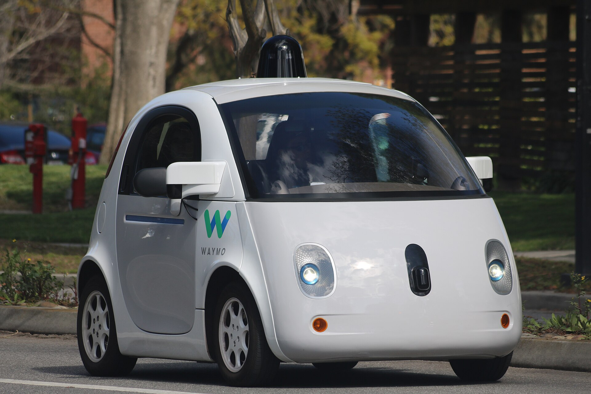
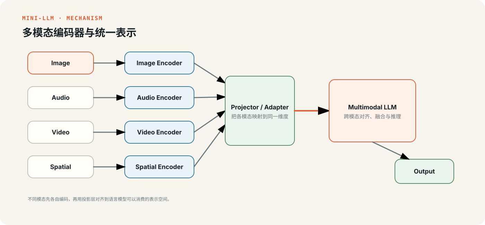
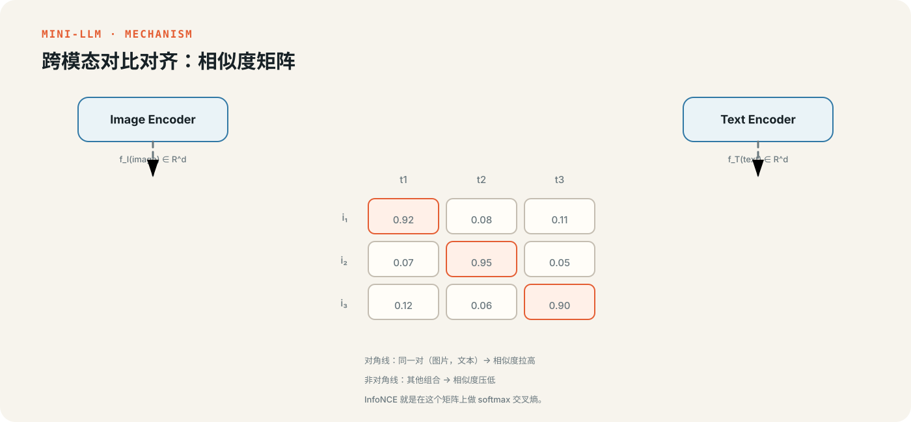

# **《mini-llm Multimodal Intelligence Engine 深度解析：从 Image、Audio、Video 到 Cross-Modal Alignment、Multimodal Fusion 与 Unified Representation》**

## **一、Multimodal Intelligence：为什么 AI 需要多模态智能？**



_图：自动驾驶汽车是天然的多模态系统：摄像头给纹理和语义，激光雷达给精确距离，毫米波雷达给速度，IMU 给自身运动。多模态融合的第一步，是把这些不同频率、不同坐标系的信息对齐到同一个表示里。图片：Grendelkhan，[Wikimedia Commons](https://commons.wikimedia.org/wiki/File:Waymo_self-driving_car_front_view.gk.jpg)，[CC BY-SA 4.0](https://creativecommons.org/licenses/by-sa/4.0/)。_

前面我们分别研究了：

- Transformer Engine：如何处理 Token 和上下文关系。
- Representation Engine：如何构建内部表示空间。
- Spatial Intelligence Engine：如何理解三维空间。
- VLA Engine：如何把视觉、语言和动作连接起来。
- Embodied Intelligence Engine：如何通过身体与环境交互。

这些 Engine 共同指向一个更深层的问题：

**现实世界的信息并不是以文字形式存在的。**

人类认识世界，依赖多种感知通道：

- 眼睛获取图像。
- 耳朵获取声音。
- 身体感知触觉和运动。
- 语言表达抽象概念。
- 时间连续性帮助理解事件。
- 空间关系帮助理解物体和环境。

如果 AI 只能处理文本，它实际上只接触到了现实世界信息的一部分。

例如，用户上传一段视频：

用户提出：

> 视频中这个人为什么突然停下来？

AI 需要完成的任务远不只是识别图片：

1. 从视频中提取关键帧。
2. 识别人物和环境。
3. 分析人物动作。
4. 识别可能的声音事件。
5. 理解动作发生的时间顺序。
6. 结合视觉和声音推断原因。
7. 用语言生成解释。

这就是多模态智能（Multimodal Intelligence）。

**多模态智能的核心，是让 AI 能够从不同类型的信息中构建统一、可关联、可推理的内部表示。**

## **二、什么是 Modality？**

Modality 可以理解为信息的模态或感知形式。

不同模态具有不同的数据结构。

| 模态          | 数据形式        | 典型内容       |
| ----------- | ----------- | ---------- |
| Text        | 离散 Token 序列 | 文字、代码、指令   |
| Image       | 二维像素矩阵      | 场景、物体、人物   |
| Audio       | 一维时间序列      | 语音、音乐、环境声音 |
| Video       | 图像帧序列       | 动作、事件、场景变化 |
| Depth       | 深度矩阵        | 距离、几何结构    |
| Point Cloud | 三维点集合       | 空间形状       |
| Motion      | 连续或离散动作序列   | 人体动作、机器人动作 |
| Tactile     | 触觉传感数据      | 压力、接触、纹理   |

每一种模态都有自己的数据特征。

### **2.1 Text：文本模态**

文本通常被转换为 Token ID：

\\[ X\_{text}=(t_1,t_2,\ldots,t_n) \\]

经过 Embedding：

\\[ H\_{text}=Embedding(X\_{text}) \\]

得到向量序列：

\\[ H\_{text}\in \mathbb{R}^{n\times d} \\]

文本天然适合表达符号、概念、关系和抽象知识。

### **2.2 Image：图像模态**

图像通常可以表示为：

\\[ I\in\mathbb{R}^{H\times W\times C} \\]

其中：

- \\(H\\)：高度。
- \\(W\\)：宽度。
- \\(C\\)：颜色通道数量。

RGB 图像通常有三个颜色通道。

图像模型需要从像素中提取：

- 颜色。
- 纹理。
- 边缘。
- 形状。
- 物体。
- 场景关系。

Vision Transformer（ViT）的一种典型方法是将图像切分成 Patch。

例如：

```
Original Image
      |
      v
Image Patches
      |
      v
Patch Embedding
      |
      v
Position Embedding
      |
      v
Transformer Encoder
      |
      v
Visual Representation
```

假设图像大小为：

\\[ 224\times224 \\]

Patch 大小为：

\\[ 16\times16 \\]

那么 Patch 数量为：

\\[ 14\times14=196 \\]

每个 Patch 被转换成一个向量。

因此，一张图像可以转换为一组视觉 Token。

注意，真实多模态模型也可能采用卷积编码器、层次化视觉编码器、动态分辨率或其他视觉 Token 化方案，不一定全部使用固定尺寸 Patch。

### **2.3 Audio：音频模态**

音频是随时间变化的信号。

可以表示为：

\\[ x(t) \\]

在数字系统中，音频通常表示为离散采样序列：

\\[ X\_{audio}=(x_1,x_2,\ldots,x_n) \\]

例如，采样率为 16kHz，意味着每秒采集 16000 个样本。

音频处理通常涉及：

- Waveform：原始波形。
- Spectrogram：频谱图。
- Mel Spectrogram：梅尔频谱。
- Audio Embedding：音频向量表示。

常见音频处理流程：

```
Audio Waveform
      |
      v
Preprocessing
      |
      v
STFT
      |
      v
Mel Spectrogram
      |
      v
Audio Encoder
      |
      v
Audio Tokens
```

但音频也可以直接通过神经网络编码波形，不一定必须先转换成 Mel Spectrogram。

### **2.4 Video：视频模态**

视频不仅是图像集合，还包含时间关系。

可以表示为：

\\[ V=(I_1,I_2,\ldots,I_T) \\]

其中：

- \\(I_t\\)：第 t 帧。
- \\(T\\)：视频帧数量。

视频理解需要同时分析：

- 空间信息。
- 时间变化。
- 动作。
- 事件。
- 因果线索。

如果只把视频中的每一帧单独处理，模型可能知道每一帧发生了什么，却不知道动作是如何连续发生的。

例如：

```
Frame 1：人站立
Frame 2：人抬起手
Frame 3：人拿起杯子
Frame 4：人喝水
Frame 5：人放下杯子
```

理解视频需要识别这些帧之间的时间联系。

## **三、Multimodal Encoder：不同模态如何转换为向量？**

不同模态的数据结构完全不同。

文本是 Token 序列。

图像是像素矩阵。

音频是时间序列。

视频是时空序列。

那么，一个 Transformer 如何同时处理这些数据？

核心思路是：

**为不同模态设计专门的 Encoder，将其转换为可以被后续模型处理的向量表示。**

### **3.1 不同模态的 Encoder**



_图：各模态先由独立编码器转成向量，再经投影层对齐到语言模型可消费的表示空间。_

## **Multimodal Encoder Architecture**

- **Text Encoder**：Token → Embedding
- **Image Encoder**：Pixels → Visual Tokens
- **Audio Encoder**：Waveform → Audio Tokens
- **Video Encoder**：Frames → Temporal Tokens

**Multimodal Transformer**

Cross-Modal Interaction / Fusion / Reasoning

不同 Encoder 可以有不同网络结构，但最终需要解决向量维度、语义对齐和信息交互问题。

### **3.2 Projection Layer：为什么需要投影层？**

假设：

文本 Encoder 输出：

\\[ H_t\in\mathbb{R}^{N_t\times768} \\]

视觉 Encoder 输出：

\\[ H_v\in\mathbb{R}^{N_v\times1024} \\]

音频 Encoder 输出：

\\[ H_a\in\mathbb{R}^{N_a\times512} \\]

它们的特征维度不同。

可以使用投影矩阵：

\\[ W_t\in\mathbb{R}^{768\times D} \\]

\\[ W_v\in\mathbb{R}^{1024\times D} \\]

\\[ W_a\in\mathbb{R}^{512\times D} \\]

分别映射到统一维度：

\\[ Z_t=H_tW_t \\]

\\[ Z_v=H_vW_v \\]

\\[ Z_a=H_aW_a \\]

最终：

\\[ Z_t,Z_v,Z_a\in\mathbb{R}^{N\times D} \\]

这里的 \\(N\\) 可以因模态不同而不同，统一特征维度不意味着 Token 数量也必须相同。

**Projection 解决的是表示维度问题，不自动解决语义对齐问题。**

这两个概念必须区分。

## **四、Cross-Modal Alignment：如何让不同模态理解同一个语义？**



_图：跨模态对比学习就是一个相似度矩阵——对角线上的正样本拉高，非对角线上的负样本压低。_

这是多模态智能的核心问题之一。

假设我们有一张图片：

对应文字：

```
A dog is running on the grass.
```

图像 Encoder 和文本 Encoder 输出的向量，最初可能处于完全不同的表示空间。

但是，我们希望：

- 图片中的狗。
- 文字中的 dog。
- 音频中的 dog barking。

能够建立语义关联。

这就是 Cross-Modal Alignment。

### **4.1 为什么需要对齐？**

假设图像向量：

\\[ v\in\mathbb{R}^{D} \\]

文本向量：

\\[ t\in\mathbb{R}^{D} \\]

我们希望语义匹配的图像和文本拥有较高相似度。

常见方法是 Cosine Similarity：

\\[ sim(v,t)= \frac{v\cdot t} {\\|v\\|\\|t\\|} \\]

例如：

```
import numpy as npdef cosine_similarity(a, b):    return np.dot(a, b) / (        np.linalg.norm(a) *        np.linalg.norm(b)    )
```

如果两种表示经过训练建立了跨模态语义关联，那么相似度可以用于图文检索。

但需要注意：

**向量维度相同，不代表向量已经对齐；向量相似，也不必然代表完整语义相同。**

### **4.2 Contrastive Learning：对比学习**

CLIP 是跨模态对齐的经典例子。

它使用图像 Encoder 和文本 Encoder：

```
Image ──> Image Encoder ──> Image Embedding
                                  |
                                  |
                             Similarity
                                  |
                                  |
Text ───> Text Encoder ───> Text Embedding
```

训练数据包含匹配的图像和文本对。

例如：

| Image   | Text                        |
| ------- | --------------------------- |
| 狗在草地上奔跑 | A dog is running on grass   |
| 汽车停在路边  | A car is parked by the road |
| 猫坐在沙发上  | A cat is sitting on a sofa  |

目标是：

- 提高正确图文配对的相似度。
- 降低错误配对的相似度。

### **4.3 InfoNCE Loss**

假设一个 Batch 有 N 组图文配对。

图像向量：

\\[ v_1,v_2,\ldots,v_N \\]

文本向量：

\\[ t_1,t_2,\ldots,t_N \\]

相似度矩阵：

\\[ S\_{ij}= \frac{v_i^\top t_j}{\tau} \\]

其中 \\(\tau\\) 是温度参数。

对于第 i 张图片，正确文本是 \\(t_i\\)。

图像到文本的对比损失：

\\[ L\_{i\rightarrow t} = -\frac{1}{N} \sum\_{i=1}^{N} \log \frac{\exp(S\_{ii})} {\sum\_{j=1}^{N}\exp(S\_{ij})} \\]

文本到图像同样计算：

\\[ L\_{t\rightarrow i} = -\frac{1}{N} \sum\_{i=1}^{N} \log \frac{\exp(S\_{ii})} {\sum\_{j=1}^{N}\exp(S\_{ji})} \\]

最终：

\\[ L= \frac{L\_{i\rightarrow t}+L\_{t\rightarrow i}}{2} \\]

直观理解：

模型需要在一批候选中，为每张图片找到正确的文本，也需要为每段文本找到正确的图片。

### **4.4 对比学习能解决什么？**

训练完成后，可以实现：

- Text-to-Image Retrieval。
- Image-to-Text Retrieval。
- Zero-shot Image Classification。
- 图文语义相似度计算。

例如：

用户输入：

```
一只狗在草地上奔跑
```

系统可以在大量图片中搜索语义匹配的图片。

但 CLIP 风格的全局向量对齐，并不等于理解图像中的所有细节。

例如：

- 狗究竟在左边还是右边？
- 狗是否正在咬一个球？
- 图中有几只狗？
- 狗与球之间的精确距离是多少？

这些任务通常需要更细粒度的视觉表示和关系推理。

## **五、Multimodal Fusion：不同模态如何融合？**

Alignment 解决不同模态之间的语义关联。

Fusion 则进一步解决：

**如何让多个模态的信息共同参与同一次推理？**

常见融合方式有三种。

### **5.1 Early Fusion：早期融合**

在模型较早阶段，就把不同模态的 Token 放到统一序列中。

例如：

```
[Text Tokens]
      +
[Image Tokens]
      +
[Audio Tokens]
      |
      v
Unified Token Sequence
      |
      v
Transformer
```

数学上可以表示为：

\\[ Z=[Z_t;Z_v;Z_a] \\]

然后输入 Transformer：

\\[ H=Transformer(Z) \\]

优点：

- 不同模态可以较早交互。
- 有机会学习细粒度跨模态关系。

缺点：

- 序列长度可能很大。
- 不同模态的统计特征差异较大。
- 计算成本可能迅速上升。

### **5.2 Late Fusion：晚期融合**

不同模态分别编码，再在高层融合。

```
Image ──> Image Encoder ──┐
                          |
Text ───> Text Encoder ───┼──> Fusion
                          |
Audio ──> Audio Encoder ──┘
                              |
                              v
                         Prediction
```

例如：

\\[ Z=Fusion(Z_t,Z_v,Z_a) \\]

优点：

- 模块独立。
- 便于替换 Encoder。
- 可以单独预训练不同模态。

缺点：

- 早期的细粒度信息交互不足。
- 复杂跨模态关系可能难以建模。

### **5.3 Cross-Attention：跨模态注意力**

Cross-Attention 是多模态融合的重要技术。

假设：

文本表示：

\\[ H_t \\]

视觉表示：

\\[ H_v \\]

可以使用文本作为 Query：

\\[ Q=H_tW_Q \\]

视觉作为 Key 和 Value：

\\[ K=H_vW_K \\]

\\[ V=H_vW_V \\]

Cross-Attention：

\\[ Attention(Q,K,V) = Softmax \left( \frac{QK^\top}{\sqrt{d_k}} \right)V \\]

这意味着：

文本中的每个 Token 都可以根据注意力权重，从图像表示中提取相关信息。

例如：

```
Text:
  "What color is the car?"

Visual Tokens:
  [road] [tree] [car] [sky] [building]
```

模型可以学习让问题中的 `car` 和颜色相关视觉区域产生更强联系。

但 Cross-Attention 的权重不能直接解释为人类意义上的注意力或因果证据。

## **六、Multimodal Transformer：统一模型如何处理多种模态？**

前面介绍了不同 Encoder、Projection、Alignment 和 Fusion。

现在可以构建一个完整的 Multimodal Transformer。

### **6.1 基本架构**

## **Multimodal Transformer**

- **Text**：Text Encoder
- **Image**：Vision Encoder
- **Audio**：Audio Encoder
- **Video**：Video Encoder
- **Modality Projection**：Common Hidden Dimension

**Unified Representation**

Shared Contextual Multimodal Features

**Text Generation**

**Image Generation**

**Audio Generation**

**Action Prediction**

### **6.2 统一表示不等于所有模态变成同一种数据**

这是一个非常重要的区别。

多模态模型可能使用统一的 Hidden Dimension，但图像、声音和文字仍然具有不同的结构。

例如：

- 图像包含二维空间结构。
- 音频包含时间和频率结构。
- 视频包含空间和时间结构。
- 文本包含符号和语言结构。

因此：

\\[ D\_{text}=D\_{image}=D\_{audio} \\]

不代表：

\\[ Structure\_{text} = Structure\_{image} = Structure\_{audio} \\]

统一的是模型可以共同处理的表示接口，而不是原始信息本身的性质。

## **七、Video Understanding：如何真正理解视频？**

视频是多模态智能中非常有代表性的任务。

因为视频不仅包含图像，还包含时间、运动和事件。

### **7.1 视频的时空结构**

一段视频可以表示为：

\\[ V\in\mathbb{R}^{T\times H\times W\times C} \\]

其中：

- T：帧数。
- H：图像高度。
- W：图像宽度。
- C：通道数量。

如果直接把所有帧都转换成视觉 Token，序列可能非常长。

例如：

- 10 秒视频。
- 每秒 30 帧。
- 每帧 196 个视觉 Token。

那么：

\\[ 10\times30\times196=58800 \\]

还没有计算文本 Token 和其他模态信息。

因此，视频模型需要控制时空计算成本。

### **7.2 视频 Tokenization**

常见方案包括：

**方案一：均匀采样**

每隔一定时间取一帧。

```
Video
  |
  v
Frame Sampling
  |
  v
Image Encoder
  |
  v
Frame Tokens
```

适合视频摘要和粗粒度事件识别。

**方案二：时空 Patch**

将视频切分为三维时空块：

\\[ Patch=(T_p,H_p,W_p) \\]

模型同时处理时间和空间局部信息。

**方案三：分层视频编码**

先处理每帧，再通过时序模块整合：

```
Frame 1 ──> Image Encoder ──┐
Frame 2 ──> Image Encoder ──┤
Frame 3 ──> Image Encoder ──┼──> Temporal Encoder
Frame 4 ──> Image Encoder ──┤
Frame 5 ──> Image Encoder ──┘
```

不同方案在计算效率、时间精度和空间细节方面各有取舍。

### **7.3 Temporal Modeling：时间建模**

视频理解需要知道：

- 哪个事件先发生？
- 哪个事件后发生？
- 某个物体是否移动？
- 人物动作是否连续？
- 两个事件是否具有时间关联？

可以将视频表示为：

\\[ H=(h_1,h_2,\ldots,h_T) \\]

然后使用时序 Transformer：

\\[ H'=Transformer\_{temporal}(H) \\]

其中 Attention 可以建立不同时间帧之间的联系。

### **7.4 从视频识别事件**

例如：

```
t=0s：桌子上有一个杯子
t=1s：一个人伸出手
t=2s：手接触杯子
t=3s：杯子离开桌面
t=4s：杯子移动到嘴边
t=5s：人物喝水
```

系统可以提取事件：

```
Event 1:
  person_reaches_for(cup)

Event 2:
  person_grasps(cup)

Event 3:
  person_lifts(cup)

Event 4:
  person_drinks_from(cup)
```

这已经不只是图像分类，而是对动态世界进行事件建模。

## **八、Audio-Visual Intelligence：如何理解声音与画面的关系？**

声音和画面经常表达同一个事件的不同方面。

例如：

视频画面可能显示：

一个人正在弹吉他。

音频可能包含：

- 吉他声音。
- 人声。
- 环境噪声。
- 其他乐器。

如果模型能够把画面中的吉他与音频中的吉他声建立联系，就能实现更深入的跨模态理解。

### **8.1 Audio-Visual Alignment**

视觉信息：

\\[ V=(v_1,v_2,\ldots,v_T) \\]

音频信息：

\\[ A=(a_1,a_2,\ldots,a_T) \\]

系统需要学习：

\\[ Alignment(V,A) \\]

例如：

- 画面中出现的敲击动作。
- 音频中对应的敲击声。
- 两者发生的时间是否一致。

### **8.2 时间同步问题**

音频和视频的采样频率不同。

例如：

- 视频：30 FPS。
- 音频：48kHz。

如果直接按照数组索引匹配，显然是不正确的。

需要统一时间基准：

```
audio_event = {    "start_time": 2.1,    "end_time": 2.8}video_event = {    "start_time": 2.2,    "end_time": 2.7}
```

然后根据时间窗口进行跨模态匹配。

实际系统还需要处理：

- 音视频编码延迟。
- 不同设备时钟偏差。
- 音频缓冲。
- 丢帧。
- 时间戳不连续。

### **8.3 Audio-Visual Learning**

常见训练目标包括：

- Audio-Video Matching。
- Audio Event Recognition。
- Lip-Speech Synchronization。
- Sound Source Localization。
- Audio-Visual Contrastive Learning。

例如，模型可以学习判断：

> 这段声音是否来自画面中正在敲击的物体？

但时间同步和相关性并不能自动证明声音的物理来源，复杂场景还需要声源定位和其他证据。

## **九、Multimodal Reasoning：多模态模型如何进行推理？**

多模态模型真正有价值的地方，不只是识别图像、声音和视频，而是把它们结合起来解决问题。

例如：

用户上传一张图片和一段录音：

图片：

音频：

```
咔嚓一声，然后听到液体流动的声音。
```

用户问：

> 刚才发生了什么？

系统需要：

1. 从图像中识别玻璃杯和水。
2. 从音频中识别声音事件。
3. 对齐音频和视觉的时间信息。
4. 判断是否可能发生了碰撞或液体洒落。
5. 结合现有证据生成解释。

这里涉及多个推理层次：

| 推理类型                  | 需要解决的问题     |
| --------------------- | ----------- |
| Perceptual Reasoning  | 看到了什么、听到了什么 |
| Cross-Modal Reasoning | 声音和画面是否对应   |
| Temporal Reasoning    | 事件发生的先后顺序   |
| Spatial Reasoning     | 物体位于哪里      |
| Causal Reasoning      | 哪些事件可能导致了结果 |
| Language Reasoning    | 如何组织最终解释    |

需要注意：

**多模态证据能够增加推断依据，但不意味着系统可以仅凭相关性确定事件的因果关系。**

如果画面只有事后状态，声音又不清晰，模型就应该表达不确定性，而不是编造完整事件过程。

## **十、Unified Representation：什么是统一多模态表示？**

这是整篇文章最重要的概念。

前面讨论了：

- Text Embedding。
- Image Embedding。
- Audio Embedding。
- Video Embedding。
- Spatial Representation。

那么，一个更深层的问题是：

**能否把这些不同形式的信息映射到统一的表示空间，让模型理解它们描述的是同一个世界？**

例如：

| 模态      | 信息           |
| ------- | ------------ |
| Text    | 一个人正在喝水      |
| Image   | 人物手中拿着杯子     |
| Audio   | 出现喝水和放下杯子的声音 |
| Video   | 人物拿起杯子并喝水    |
| Spatial | 杯子从桌面移动到人物嘴边 |
| Motion  | 人物手臂发生抬起动作   |

这些信息虽然来自不同传感通道，却可以共同描述一个事件。

### **10.1 统一表示的三种层次**

- **第一层：统一维度**：不同 Encoder 的输出映射到共同隐藏维度。
- **第二层：语义对齐**：不同模态中表达相同对象或事件的信息建立关联。
- **第三层：联合上下文表示**：不同模态在同一个上下文中相互影响，参与共同推理。

可以构建：

\\[ Z= Fusion( Z\_{text}, Z\_{image}, Z\_{audio}, Z\_{video}, Z\_{spatial} ) \\]

再通过 Transformer 形成上下文表示：

\\[ H=Transformer(Z) \\]

但 Unified Representation 不意味着模型已经构建了准确、完整的物理世界模型。

真正可操作的世界模型还需要：

- 对象状态。
- 空间坐标。
- 时间信息。
- 物理约束。
- 不确定性。
- 状态变化模型。

因此，Multimodal Intelligence Engine 与 World Model Engine 应该协作，而不是相互替代。

## **十一、多模态模型的训练方式**

不同任务需要不同训练目标。

### **11.1 Image-Text Contrastive Learning**

目标：对齐图像和文本语义。

\\[ L=L\_{contrastive} \\]

典型应用：

- 图文检索。
- Zero-shot Classification。

### **11.2 Image Captioning**

目标：根据图像生成文本描述。

\\[ P(Y\_{text}\mid X\_{image}) \\]

例如：

```
Input:
  Image

Target:
  A white cat is sitting on a chair.
```

### **11.3 Visual Question Answering**

目标：根据图像和问题生成答案。

\\[ P(Y\mid X\_{image},X\_{text}) \\]

例如：

```
Question:
  How many apples are in the picture?

Answer:
  Three.
```

### **11.4 Audio-Text Alignment**

目标：建立音频和文本之间的语义关系。

\\[ P(Y\_{text}\mid X\_{audio}) \\]

典型任务：

- 语音识别。
- 音频描述。
- 声音事件识别。

### **11.5 Video Understanding**

目标：根据视频理解事件或生成描述。

\\[ P(Y\mid X\_{video}) \\]

### **11.6 Multimodal Instruction Tuning**

让模型根据多模态指令完成任务。

例如：

```
Input:
  Image + Text

Instruction:
  Describe the object on the left.

Output:
  A red cup.
```

多模态指令微调可以让模型学会根据不同模态组合完成任务。

但训练数据质量、模态覆盖范围和任务分布会显著影响最终能力。

## **十二、mini-llm Multimodal Intelligence Engine 工程架构**

现在可以将这些概念落实到 mini-llm。

### **12.1 核心模块**

## **mini-llm Multimodal Intelligence Engine**

- **Text Pipeline**：Tokenizer / Text Encoder
- **Vision Pipeline**：Image Encoder / Patch
- **Audio Pipeline**：Audio Encoder / Features
- **Video Pipeline**：Frame / Temporal Encoder

**Cross-Modal Alignment**

Contrastive Learning / Semantic Matching

**Multimodal Fusion**

Early Fusion / Cross-Attention / Late Fusion

**Unified Representation**

Cross-Modal Context / Multimodal Memory

**Multimodal Reasoning & Generation**

Understanding / Answering / Generating / Action Conditioning

### **12.2 推荐工程目录**

```
mini-llm/
│
├── engines/
│   └── multimodal/
│       │
│       ├── encoders/
│       │   ├── text_encoder.py
│       │   ├── image_encoder.py
│       │   ├── audio_encoder.py
│       │   └── video_encoder.py
│       │
│       ├── tokenization/
│       │   ├── image_tokenizer.py
│       │   ├── audio_tokenizer.py
│       │   └── video_tokenizer.py
│       │
│       ├── adapters/
│       │   ├── projection.py
│       │   ├── modality_embedding.py
│       │   └── temporal_embedding.py
│       │
│       ├── alignment/
│       │   ├── contrastive.py
│       │   ├── image_text.py
│       │   └── audio_video.py
│       │
│       ├── fusion/
│       │   ├── early_fusion.py
│       │   ├── late_fusion.py
│       │   └── cross_attention.py
│       │
│       ├── reasoning/
│       │   ├── visual_reasoning.py
│       │   ├── audio_reasoning.py
│       │   ├── temporal_reasoning.py
│       │   └── cross_modal_reasoning.py
│       │
│       ├── generation/
│       │   ├── text_generation.py
│       │   ├── image_generation.py
│       │   └── audio_generation.py
│       │
│       ├── memory/
│       │   └── multimodal_memory.py
│       │
│       ├── evaluation/
│       │   ├── alignment_eval.py
│       │   └── reasoning_eval.py
│       │
│       └── tests/
```

## **十三、实现一个最小 Cross-Modal Alignment**

我们可以先不训练复杂的多模态模型。

通过一个简化示例理解对比学习的基本思想。

假设图像和文本 Encoder 已经输出了向量：

```
import torchimport torch.nn.functional as Fimage_features = torch.randn(4, 256)text_features = torch.randn(4, 256)# 归一化image_features = F.normalize(    image_features, dim=-1)text_features = F.normalize(    text_features, dim=-1)# 相似度矩阵temperature = 0.07logits = (    image_features @ text_features.T) / temperaturelabels = torch.arange(4)# 图像到文本loss_i2t = F.cross_entropy(    logits, labels)# 文本到图像loss_t2i = F.cross_entropy(    logits.T, labels)loss = (loss_i2t + loss_t2i) / 2
```

这里：

```
image_features: [4, 256]
text_features:  [4, 256]
logits:         [4, 4]
```

相似度矩阵：

\\[ S= \begin{bmatrix} s\_{11}&s\_{12}&s\_{13}&s\_{14}\\\ s\_{21}&s\_{22}&s\_{23}&s\_{24}\\\ s\_{31}&s\_{32}&s\_{33}&s\_{34}\\\ s\_{41}&s\_{42}&s\_{43}&s\_{44} \end{bmatrix} \\]

对角线位置表示正确配对。

这里使用随机向量只是演示张量形状和损失计算，随机向量并不具有图文语义；只有经过适当训练的 Encoder 才能学到有意义的跨模态匹配。

## **十四、Multimodal Intelligence 的关键工程问题**

真正构建多模态系统时，最困难的部分往往不是 Transformer 本身。

而是以下问题。

### **14.1 Token 数量爆炸**

图像和视频会产生大量视觉 Token。

视频又包含大量帧。

因此需要：

- Patch Compression。
- Frame Sampling。
- Token Pruning。
- Latent Representation。
- Hierarchical Encoding。

### **14.2 不同模态的时间尺度不同**

文本可以按 Token 处理。

音频可以按毫秒级窗口处理。

视频可以按帧处理。

机器人动作则可能需要更高频率的控制周期。

因此必须建立统一的时间戳和同步机制。

### **14.3 模态缺失**

现实系统可能遇到：

- 摄像头损坏。
- 麦克风没有输入。
- 深度传感器被遮挡。
- 视频丢帧。
- 传感器之间时间不同步。

系统不能假设所有模态始终存在。

### **14.4 跨模态冲突**

例如：

图像显示一个人正在微笑。

声音却检测到哭泣。

这并不一定意味着其中一个模态错误。

可能是：

- 人物在笑，但背景有人哭。
- 音频来自其他位置。
- 视频和音频不同步。
- 模型识别发生错误。

系统需要保留模态来源、时间和置信度，不能简单地把冲突信息平均融合。

### **14.5 多模态幻觉**

模型可能：

- 看错图像中的物体。
- 编造不存在的声音。
- 错误判断视频中的动作。
- 把相关事件描述成因果关系。
- 生成不存在的空间关系。

因此，多模态推理需要证据追踪。

建议每个重要判断保留：

```
evidence = {    "claim": "person picked up the cup",    "source_modality": "video",    "time_range": [2.1, 3.4],    "confidence": 0.91,    "model_version": "vision-v1"}
```

这里的置信度需要经过验证和校准，不能直接把模型输出分数当作真实概率。

## **十五、mini-llm Multimodal Intelligence Engine V1 实施路线**

建议采用渐进式架构。

不要一开始就训练一个统一处理图像、视频、音频、空间和动作的大模型。

### **阶段一：Text + Image**

目标：

- 图像编码。
- 文本编码。
- 图文向量对齐。
- 图文检索。
- Visual Question Answering。

验收：

```
输入：
  一张图片
  一个文本问题

输出：
  对图片内容的准确回答
```

### **阶段二：Audio + Text**

目标：

- 音频特征提取。
- 语音转文本。
- 音频事件识别。
- 音频文本对齐。

验收：

```
输入：
  一段音频

输出：
  语音内容
  主要声音事件
  时间区间
```

### **阶段三：Video Understanding**

目标：

- 视频抽帧。
- 视觉特征提取。
- 时间建模。
- 事件识别。
- 视频摘要。

验收：

```
输入：
  10 秒视频

输出：
  主要人物
  主要物体
  动作序列
  事件时间线
```

### **阶段四：Cross-Modal Fusion**

目标：

- 图像和文本融合。
- 音频和视频对齐。
- 多模态问答。
- 跨模态事件理解。

### **阶段五：Unified Representation**

目标：

- 统一模态接口。
- 多模态上下文。
- 统一任务调度。
- 跨模态推理。
- 与 Memory、World Model、Agent Engine 集成。

## **V1 验收指标**

| 评估维度  | 指标                            |
| ----- | ----------------------------- |
| 图文对齐  | Recall\@K                     |
| 图像理解  | VQA Accuracy                  |
| 音频识别  | WER                           |
| 音频事件  | Event F1                      |
| 视频理解  | Temporal Localization         |
| 跨模态对齐 | Alignment Accuracy            |
| 多模态推理 | Task Accuracy                 |
| 系统性能  | Latency / Memory / Token Cost |

## **十六、总结：多模态智能是通向统一世界表示的重要路径**

我们可以把整个多模态智能过程总结为：

\\[ \text{Raw Modalities} \rightarrow \text{Encoders} \rightarrow \text{Representations} \rightarrow \text{Alignment} \rightarrow \text{Fusion} \rightarrow \text{Reasoning} \\]

其中：

- Encoder 负责把原始数据转换为特征。
- Representation 负责构建内部表示。
- Alignment 负责建立模态之间的语义对应。
- Fusion 负责让不同模态共同参与计算。
- Reasoning 负责利用多模态信息解决问题。

但这里还有一个更深层的问题：

**如果 AI 已经能够同时理解文字、图像、声音、视频和三维空间，那么它是否已经拥有了一个统一的世界模型？**

答案并不简单。

多模态表示提供了构建世界模型的重要信息基础，但一个真正可操作的 World Model 还需要理解：

- 世界当前处于什么状态。
- 世界遵循什么规律。
- 行动会导致什么变化。
- 不同结果发生的概率是多少。
- 如何通过观察和行动修正预测。

因此，下一篇可以继续深入：

**《mini-llm World Model Engine 深度解析：从 State Representation、World Dynamics 到 Future Prediction、Action Simulation 与 Counterfactual Reasoning》**

这篇将进一步研究：

**AI 如何不只是理解当前世界，还能在内部模拟未来世界？**
