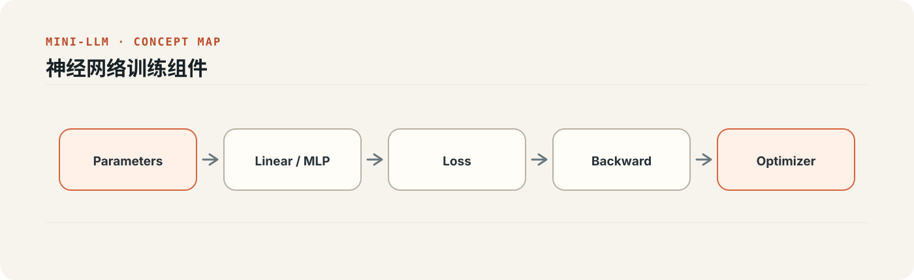

# **mini-llm Neural Network Engine 深度解析：从 Linear、MLP 到 Loss、Optimizer**



_图：神经网络训练组件。从左到右展示本章核心概念之间的数据流与依赖关系。_

## **一、为什么有了 Tensor Engine 和 Autograd Engine，还需要 Neural Network Engine？**

在 mini-llm 中，我们已经构建了两个重要基础模块：

- **Tensor Engine**：负责张量的存储、形状管理和数学运算。
- **Autograd Engine**：负责记录计算过程、构建计算图，并自动计算梯度。

但是，这两个模块仍然只是神经网络的底层基础设施。

假设我们想构建一个简单的神经网络：

\\[ x \rightarrow Linear \rightarrow ReLU \rightarrow Linear \rightarrow Loss \\]

如果完全使用 Tensor 和 Autograd，我们需要自己管理：

1. 权重矩阵。
2. 偏置向量。
3. 网络层之间的数据传递。
4. 参数的初始化。
5. 损失函数。
6. 参数梯度。
7. 优化器。
8. 训练过程。

这些工作可以完成，但会让上层模型代码变得复杂。

因此，我们需要引入第三个核心模块：

## **mini-llm 的三层基础架构**

**Neural Network Engine**

Linear · MLP · Loss · Optimizer · Parameter

**Autograd Engine**

计算图 · 链式法则 · 反向传播 · 梯度累积

**Tensor Engine**

张量 · 矩阵运算 · 数学操作 · 内存管理

这三个模块分别解决不同层次的问题：

| 模块             | 核心问题           |
| -------------- | -------------- |
| Tensor         | 数学运算如何执行？      |
| Autograd       | 参数的梯度如何计算？     |
| Neural Network | 如何组织神经网络并训练模型？ |

Neural Network Engine 的任务，就是把底层数学能力组合成真正可以训练的神经网络。

## **二、什么是神经网络？**

在理解 Linear 和 MLP 之前，需要先理解神经网络的本质。

神经网络可以看成一个具有可学习参数的数学函数。

\\[ y=f(x;\theta) \\]

其中：

- \\(x\\)：输入数据。
- \\(y\\)：模型输出。
- \\(f\\)：神经网络的计算过程。
- \\(\theta\\)：模型内部可以学习的参数。

例如：

输入一张图片，输出它属于猫还是狗的概率。

输入一段文本，输出下一个 Token 的概率分布。

输入一个 Token 序列，输出对应的隐藏状态。

这些任务虽然不同，但本质上都可以表示为：

\\[ \text{Input}\rightarrow f(x;\theta)\rightarrow \text{Output} \\]

真正重要的是参数 \\(\theta\\)。

神经网络并不是程序员提前写好所有判断规则，而是通过训练数据不断调整参数，让函数逐渐具备完成任务的能力。

### **2.1 参数到底是什么？**

假设我们有一个简单函数：

\\[ y=wx+b \\]

其中：

- \\(x\\) 是输入。
- \\(w\\) 是权重。
- \\(b\\) 是偏置。

如果：

\\[ w=2,\quad b=1 \\]

那么：

\\[ x=3 \\]

模型输出：

\\[ y=2\times3+1=7 \\]

如果训练过程中，模型发现输出不够准确，就会调整 \\(w\\) 和 \\(b\\)。

例如：

\\[ w=2.5,\quad b=0.5 \\]

此时：

\\[ y=2.5\times3+0.5=8 \\]

这就是神经网络学习的基本形式：

**通过不断调整参数，改变输入到输出之间的映射关系。**

## **三、Linear：神经网络最基础的计算单元**

Linear 是神经网络最重要的基础层之一。

它的数学形式是：

\\[ y=xW^T+b \\]

其中：

- \\(x\\)：输入向量。
- \\(W\\)：权重矩阵。
- \\(b\\)：偏置向量。
- \\(y\\)：输出向量。

Linear 也经常被称为全连接层（Fully Connected Layer）。

### **3.1 从一个神经元开始**

先考虑一个只有一个输入的神经元：

\\[ y=w_1x_1+b \\]

如果输入有三个特征：

\\[ x= \begin{bmatrix} x_1 & x_2 & x_3 \end{bmatrix} \\]

那么：

\\[ y=w_1x_1+w_2x_2+w_3x_3+b \\]

可以写成：

\\[ y=xW^T+b \\]

例如：

\\[ x=[1,2,3] \\]

\\[ W=[0.2,0.5,0.1] \\]

\\[ b=0.3 \\]

计算：

\\[ y=1(0.2)+2(0.5)+3(0.1)+0.3 \\]

\\[ y=1.8 \\]

这就是一个简单的线性神经元。

### **3.2 从一个神经元扩展到多个神经元**

假设输入有三个特征，我们希望输出四个特征。

输入：

\\[ x\in\mathbb{R}^{3} \\]

权重：

\\[ W\in\mathbb{R}^{4\times3} \\]

偏置：

\\[ b\in\mathbb{R}^{4} \\]

输出：

\\[ y\in\mathbb{R}^{4} \\]

矩阵运算：

\\[ y=xW^T+b \\]

[rcalix1.github.io](https://rcalix1.github.io/DeepLearningAlgorithms/SecondEdition/chapter4_Reg_MLP_DL/?utm_source=chatgpt.com)

这里有一个重要概念：

**一个 Linear 层实际上包含多个神经元，每个输出神经元都有一组独立的权重和一个偏置。**

### **3.3 Linear 为什么需要矩阵乘法？**

假设输入是一个 Batch：

\\[ X\in\mathbb{R}^{B\times I} \\]

其中：

- \\(B\\)：Batch Size。
- \\(I\\)：输入特征数量。

权重：

\\[ W\in\mathbb{R}^{O\times I} \\]

偏置：

\\[ b\in\mathbb{R}^{O} \\]

输出：

\\[ Y=XW^T+b \\]

最终：

\\[ Y\in\mathbb{R}^{B\times O} \\]

例如：

- Batch Size = 32。
- 输入维度 = 128。
- 输出维度 = 256。

那么：

\\[ X:[32,128] \\]

\\[ W:[256,128] \\]

\\[ Y:[32,256] \\]

这就是为什么 Tensor Engine 必须支持矩阵乘法。

### **3.4 Linear 层如何学习？**

Linear 的核心参数是：

\\[ \theta=\\{W,b\\} \\]

假设损失函数为：

\\[ L=\frac{1}{2}(y-t)^2 \\]

其中 \\(t\\) 是目标值。

根据链式法则：

\\[ \frac{\partial L}{\partial W} = \frac{\partial L}{\partial y} \frac{\partial y}{\partial W} \\]

因为：

\\[ y=xW^T+b \\]

所以：

\\[ \frac{\partial L}{\partial W} = (y-t)^Tx \\]

具体的矩阵维度需要与所采用的 Batch 和矩阵布局保持一致。

得到梯度以后，优化器就可以更新权重。

这意味着：

**Linear 并不是一个固定的数学变换，而是一个拥有可学习参数的数学变换。**

## **四、为什么只有 Linear 不够？——非线性激活函数**

现在考虑两个 Linear 层：

\\[ y=W_2(W_1x+b_1)+b_2 \\]

展开：

\\[ y=W_2W_1x+W_2b_1+b_2 \\]

可以发现：

\\[ y=Wx+b \\]

也就是说，两个 Linear 层组合起来，依然是一个 Linear 层。

无论叠加多少层 Linear，只要中间没有非线性运算，整个网络仍然是线性函数。

这会极大限制神经网络的表达能力。

### **4.1 ReLU：最简单的非线性激活函数**

ReLU 的定义：

\\[ ReLU(x)=\max(0,x) \\]

它的效果是：

- 输入大于零，保留输入。
- 输入小于零，输出零。

**输入为正**

\\[ ReLU(3)=3 \\]

保留

**输入为负**

\\[ ReLU(-2)=0 \\]

截断

ReLU 的导数：

\\[ ReLU'(x)= \begin{cases} 1 & x>0\\\ 0 & x<0 \end{cases} \\]

在 \\(x=0\\) 处通常采用一个约定的次梯度。

### **4.2 常见激活函数**

[FFN Activation Functions: ReLU, GELU, and SiLU for Transformer Models - Interactive | Michael Brenndoerfer | Michael Brenndoerfer](https://images.openai.com/static-rsc-4/Q9_-9iN4PdpYC-JpW04yBhCXo1NxVgCSnppreTaLnwNlvPr4ASa_sNGuTuvaaADqw2qJG8Vm6t77HL38n20-dbqGLvhm_U_e7iO0iZ-ZifGpdq3gdCXGXgoFW2PVgXnzkiipTy8ItbTmmAAE76cWzuqTLlo2Aeh9IEkNRpHOEMM?purpose=inline)

**ReLU**

\\[ f(x)=\max(0,x) \\]

简单、高效，常见于传统 MLP。

[FFN Activation Functions: ReLU, GELU, and SiLU for Transformer Models - Interactive | Michael Brenndoerfer | Michael Brenndoerfer](https://images.openai.com/static-rsc-4/9D2SnXG1kw5H1jEbAwXuz5XHH3eUhQfrJe2LB9YJXsLd4hXARWHhfKNcWZtETthxQVS_-D8DkKaE_OTkqQAg5TnKfRXeWn829HCX7IYVEWGV-KoDc5UqmMKp6NYN634coknXvHRVxVeT5I557bsrSRPqpwufHTREfP5frrzb7qA?purpose=inline)

**GELU**

\\[ GELU(x)=x\Phi(x) \\]

平滑地控制输入，广泛用于 Transformer。

[SiLU — PyTorch main documentation](https://images.openai.com/static-rsc-4/4XtCmZxOZNJHogk4c1EETjN7x0I301KuFwbd3YPDbCy2iK6R0gvP8a7QH8fm6mtmjfkpZYmmyss4hMx7XyECEPxskCEobCWmVwU4m94DrgakHE4q9_7lf5xLZn2phwbDiUDEuzlIUiCJM8R_GpgDpRp-_-PJs8vS_O5RExX9AYg?purpose=inline)

**SiLU / Swish**

\\[ SiLU(x)=x\sigma(x) \\]

常见于现代神经网络和部分 LLM 架构。

[Logistic Regression – Study Machine Learning](https://images.openai.com/static-rsc-4/SnA-TIb-5e9Vuw9ZSPBJsjSbRywpfvfBZJYaP8TZRjKS5Kfq7JO3fIhHwGXzeOS-xtfEZwcgMgKypCBpjIm8Y5r8xL5IpHOFKGyWyU_taoEpEG_fP1h5gA2LVx9_8WrmlHP59yWeA194gJrC6ItyUd-I-BpkwD_KteP5CO0CS9E?purpose=inline)

**Sigmoid**

\\[ \sigma(x)=\frac{1}{1+e^{-x}} \\]

将数值映射到 0 到 1。

### **4.3 为什么 LLM 使用 GELU、SiLU？**

现代 Transformer 不只是使用简单的 ReLU。

例如，GPT 系列模型和其他 Transformer 架构可能使用 GELU 或其他激活函数。

原因包括：

1. 平滑性。
2. 梯度传播特性。
3. 非线性表达能力。
4. 与网络结构和训练配置的适配。

在 mini-llm 中，建议先实现：

- ReLU
- Sigmoid
- Tanh
- GELU
- SiLU

先实现 ReLU，再实现 GELU 和 SiLU，可以逐步理解激活函数的数学性质和反向传播。

## **五、MLP：多个 Linear 与 Activation 组成的神经网络**

MLP，全称 Multi-Layer Perceptron，即多层感知机。

它是最经典的前馈神经网络结构。

例如：

\\[ Input \rightarrow Linear \rightarrow ReLU \rightarrow Linear \rightarrow ReLU \rightarrow Linear \rightarrow Output \\]

[When One Layer Isn’t Enough: Building Multi-Layer Perceptrons from Scratch | Deep Learning 3 | by Bit_Picker | Everyday AI | Jan, 2026 | Medium](https://images.openai.com/static-rsc-4/ph6r-Oj_Euqo97wMecK6vAa5zwJbAXbBWST0upvFlpu2g1vhIfCsXab0U1mzmlNenK61zHD72PbAwB_TAreeQYhhBr2dFKAFUL4myRSwIlGYs4mSypABvjAsVJmpE21FTnn1mibLvhu3cBHtPQxTlKKeCYauUdzlHlxLHrWIB-g?purpose=inline)

[medium.com](https://medium.com/everyday-ai/when-one-layer-isnt-enough-building-multi-layer-perceptrons-from-scratch-deep-learning-3-35a8487e8954?utm_source=chatgpt.com)

### **5.1 MLP 的数学表达**

假设有一个三层网络：

第一层：

\\[ h_1=ReLU(xW_1^T+b_1) \\]

第二层：

\\[ h_2=ReLU(h_1W_2^T+b_2) \\]

输出层：

\\[ y=h_2W_3^T+b_3 \\]

整体：

\\[ y=f(x;\theta) \\]

其中：

\\[ \theta=\\{W_1,b_1,W_2,b_2,W_3,b_3\\} \\]

MLP 的全部参数都由训练过程学习。

### **5.2 MLP 为什么能够学习复杂关系？**

以二维分类为例。

假设有两类数据：

- A 类：圆形区域。
- B 类：圆形区域外部。

一个简单的线性分类器只能通过一条直线划分空间。

但是 MLP 可以通过多层线性变换和非线性激活，组合出复杂的决策边界。

它能够学习：

- 非线性关系。
- 特征之间的组合。
- 高维空间中的复杂映射。
- 输入数据中的抽象特征。

需要注意：MLP 的表达能力来自网络结构和参数共同作用，而不是单纯因为层数越多就一定越聪明。训练数据、优化方法、网络宽度、初始化和正则化也很重要。

### **5.3 MLP 在 Transformer 中的作用**

这里有一个很重要的知识点：

**Transformer 不只有 Attention，它还包含 MLP。**

经典 Transformer Block 可以抽象为：

\\[ x\rightarrow Attention\rightarrow MLP\rightarrow Output \\]

Attention 负责在不同 Token 之间进行信息交互。

MLP 负责对每个 Token 的特征表示进行非线性变换。

例如，假设隐藏维度为：

\\[ d\_{model}=768 \\]

MLP 中间维度为：

\\[ d\_{ff}=3072 \\]

计算过程：

\\[ 768\rightarrow3072\rightarrow768 \\]

结构：

\\[ MLP(x)=W_2\sigma(W_1x+b_1)+b_2 \\]

其中：

\\[ W_1\in\mathbb{R}^{3072\times768} \\]

\\[ W_2\in\mathbb{R}^{768\times3072} \\]

这就是 Transformer 中 Feed Forward Network（FFN）的基本形式。

## **六、Loss：模型如何知道自己预测得对不对？**

神经网络有了输出，还需要知道输出是否正确。

这就需要 Loss Function，即损失函数。

假设模型预测：

\\[ \hat y=8 \\]

真实目标：

\\[ y=10 \\]

预测误差：

\\[ e=\hat y-y=-2 \\]

Loss 的作用就是把预测结果与真实目标之间的差异转换成一个可以优化的数值。

\\[ L=Loss(\hat y,y) \\]

训练的目标是：

\\[ \min\_{\theta}L(\theta) \\]

也就是寻找一组参数，让模型的损失尽可能小。

### **6.1 Mean Squared Error**

均方误差：

\\[ MSE=\frac{1}{N}\sum\_{i=1}^{N}(\hat y_i-y_i)^2 \\]

适合回归任务。

例如：

| 真实值 | 预测值 | 平方误差 |
| --- | --- | ---- |
| 10  | 9   | 1    |
| 20  | 18  | 4    |
| 30  | 33  | 9    |

那么：

\\[ MSE=\frac{1+4+9}{3} =\frac{14}{3} \\]

### **6.2 Binary Cross Entropy**

二分类任务通常需要预测某个样本属于正类的概率。

BCE：

\\[ L=-[y\log(p)+(1-y)\log(1-p)] \\]

其中：

- \\(y\\)：真实标签，0 或 1。
- \\(p\\)：预测为正类的概率。

如果：

\\[ y=1,\quad p=0.9 \\]

那么：

\\[ L=-\log(0.9) \\]

损失较小。

如果：

\\[ y=1,\quad p=0.1 \\]

那么：

\\[ L=-\log(0.1) \\]

损失较大。

模型越自信地预测错误，通常受到的惩罚越大。

### **6.3 Cross Entropy：LLM 的核心损失函数**

大语言模型的训练，本质上是预测下一个 Token。

假设词表中有五个 Token：

\\[ V=\\{A,B,C,D,E\\} \\]

模型预测概率：

\\[ P=[0.1,0.1,0.6,0.1,0.1] \\]

真实 Token 是 C。

那么交叉熵损失：

\\[ L=-\log P(C) \\]

\\[ L=-\log(0.6) \\]

如果模型把 C 的预测概率提高到 0.9：

\\[ L=-\log(0.9) \\]

损失就会下降。

对于一个长度为 \\(T\\) 的 Token 序列：

\\[ L=-\frac{1}{T}\sum\_{t=1}^{T} \log P(x_t|x\_{\<t}) \\]

这就是自回归语言模型训练中的核心目标之一。

### **6.4 Softmax 与 Cross Entropy 的关系**

模型输出的通常不是概率，而是 Logits。

例如：

\\[ z=[2.0,1.0,0.1] \\]

Softmax 将 Logits 转换为概率：

\\[ P_i=\frac{e^{z_i}}{\sum_j e^{z_j}} \\]

随后 Cross Entropy 计算真实 Token 对应的负对数概率。

因此：

\\[ Logits\rightarrow Softmax\rightarrow CrossEntropy \\]

工程上通常会把 Softmax 和 Cross Entropy 合并成数值稳定的计算实现，直接从 Logits 计算损失，避免不必要的数值精度问题。

## **七、Optimizer：模型如何根据梯度修改参数？**

现在我们已经有了：

- 神经网络。
- 参数。
- 预测结果。
- 损失函数。
- 梯度。

还差最后一步：

**如何利用梯度修改参数？**

这就是 Optimizer 的任务。

### **7.1 梯度代表什么？**

假设损失函数为：

\\[ L(w)=(w-5)^2 \\]

导数：

\\[ \frac{dL}{dw}=2(w-5) \\]

如果：

\\[ w=2 \\]

那么：

\\[ \frac{dL}{dw}=2(2-5)=-6 \\]

梯度为负数，意味着在当前点附近，增大 \\(w\\) 会使损失下降。

如果：

\\[ w=8 \\]

那么：

\\[ \frac{dL}{dw}=6 \\]

梯度为正数，意味着减小 \\(w\\) 会使损失下降。

因此，梯度能够告诉我们损失函数在当前位置的变化方向。

### **7.2 SGD：随机梯度下降**

最基本的参数更新公式：

\\[ w\_{t+1}=w_t-\eta\frac{\partial L}{\partial w} \\]

其中：

- \\(w_t\\)：当前参数。
- \\(\eta\\)：学习率。
- \\(\frac{\partial L}{\partial w}\\)：当前梯度。

假设：

\\[ w=2 \\]

\\[ \frac{\partial L}{\partial w}=-6 \\]

\\[ \eta=0.1 \\]

更新：

\\[ w\_{new}=2-0.1(-6) \\]

\\[ w\_{new}=2.6 \\]

参数向着损失更小的方向移动。

### **7.3 Momentum：动量优化器**

SGD 只考虑当前梯度。

Momentum 还考虑之前的更新方向。

\\[ v_t=\beta v\_{t-1}+g_t \\]

\\[ w_t=w\_{t-1}-\eta v_t \\]

其中：

- \\(g_t\\)：当前梯度。
- \\(v_t\\)：动量。
- \\(\beta\\)：动量系数。

Momentum 可以减少某些方向上的震荡，并加速沿着稳定方向的优化。

### **7.4 Adam：自适应学习率**

Adam 同时跟踪梯度的一阶矩和二阶矩。

一阶矩：

\\[ m_t=\beta_1m\_{t-1}+(1-\beta_1)g_t \\]

二阶矩：

\\[ v_t=\beta_2v\_{t-1}+(1-\beta_2)g_t^2 \\]

偏差修正：

\\[ \hat m_t=\frac{m_t}{1-\beta_1^t} \\]

\\[ \hat v_t=\frac{v_t}{1-\beta_2^t} \\]

参数更新：

\\[ w_t=w\_{t-1}- \eta\frac{\hat m_t}{\sqrt{\hat v_t}+\epsilon} \\]

Adam 的优势是可以根据不同参数的梯度历史，自适应调整更新幅度。

### **7.5 AdamW：为什么 LLM 常用它？**

AdamW 在 Adam 的基础上改进了权重衰减的处理方式。

一种常见的更新表达为：

\\[ \theta_t= \theta\_{t-1} -\eta\frac{\hat m_t}{\sqrt{\hat v_t}+\epsilon} -\eta\lambda\theta\_{t-1} \\]

其中：

- \\(\eta\\)：学习率。
- \\(\lambda\\)：权重衰减系数。
- \\(\hat m_t\\)：修正后的一阶矩。
- \\(\hat v_t\\)：修正后的二阶矩。

AdamW 将权重衰减与 Adam 的梯度自适应更新解耦。

它是现代 Transformer 训练中非常常见的优化器。

### **7.6 优化器对比**

| 优化器      | 核心机制          | 主要特点            |
| -------- | ------------- | --------------- |
| SGD      | 当前梯度          | 简单、基础           |
| Momentum | 梯度累积          | 减少震荡            |
| RMSProp  | 梯度平方的移动平均     | 自适应更新           |
| Adam     | 一阶矩 + 二阶矩     | 自适应学习率          |
| AdamW    | Adam + 解耦权重衰减 | 常用于 Transformer |

## **八、Parameter 与 Tensor：两者有什么区别？**

这是设计 mini-llm Neural Network Engine 时必须考虑的问题。

Tensor 是一种数据结构。

Parameter 则代表神经网络中需要被训练的变量。

例如：

```
let x = Tensor::new(...);
let w = Tensor::new(...);
let b = Tensor::new(...);
```

虽然它们都是 Tensor，但意义不同。

- `x` 是输入数据。
- `w` 是模型权重。
- `b` 是模型偏置。

训练过程中：

- 输入数据通常不需要优化器更新。
- 权重需要计算梯度。
- 偏置需要计算梯度。
- 优化器只应该更新模型参数。

因此，可以设计一个 Parameter 类型：

```
pub struct Parameter {
    pub name: String,
    pub data: Tensor,
    pub requires_grad: bool,
}
```

进一步还可以包含：

```
pub struct Parameter {
    pub name: String,
    pub data: Tensor,
    pub grad: Option<Tensor>,
    pub requires_grad: bool,
}
```

具体的 `grad` 存储方式需要与 Autograd Engine 的实现统一，避免出现两套互相冲突的梯度状态。

**Tensor 负责表示数值，Parameter 负责表达这个数值在模型中的可训练身份。**

## **九、把这些模块组合起来：构建一个 MLP**

现在我们可以把前面所有概念组合起来。

假设构建一个简单的网络：

\\[ 2\rightarrow 4\rightarrow 1 \\]

也就是：

- 输入维度：2。
- 隐藏层维度：4。
- 输出维度：1。

结构：

## **MLP 网络结构**

**Input**

2 个特征

**Linear(2, 4) + ReLU**

2 → 4

**Linear(4, 1)**

4 → 1

**MSE Loss**

计算预测误差

### **9.1 前向传播**

输入：

\\[ x=[x_1,x_2] \\]

第一层：

\\[ h=ReLU(xW_1^T+b_1) \\]

第二层：

\\[ \hat y=hW_2^T+b_2 \\]

损失：

\\[ L=(\hat y-y)^2 \\]

### **9.2 反向传播**

计算：

\\[ \frac{\partial L}{\partial W_2} \\]

\\[ \frac{\partial L}{\partial b_2} \\]

\\[ \frac{\partial L}{\partial W_1} \\]

\\[ \frac{\partial L}{\partial b_1} \\]

Autograd Engine 会沿计算图自动计算这些梯度。

### **9.3 优化参数**

Optimizer 根据梯度更新：

\\[ W_1\leftarrow W_1-\eta\nabla W_1 \\]

\\[ b_1\leftarrow b_1-\eta\nabla b_1 \\]

\\[ W_2\leftarrow W_2-\eta\nabla W_2 \\]

\\[ b_2\leftarrow b_2-\eta\nabla b_2 \\]

重复执行，直到损失逐渐降低。

## **十、mini-llm 的训练循环到底是什么？**

一个完整的训练过程可以表示为：

## **Training Loop**

1. **准备训练数据**

   读取输入 X 和目标 Y。
2. **清空梯度**

   `optimizer.zero_grad()`
3. **前向传播**

   `prediction = model.forward(x)`
4. **计算损失**

   `loss = criterion.forward(prediction, target)`
5. **反向传播**

   `loss.backward()`
6. **更新参数**

   `optimizer.step()`
7. **评估与记录**

   记录 Loss、学习率、训练步数等指标。

伪代码：

```
for epoch in 0..epochs {
    for (x, target) in dataset.batches() {
        optimizer.zero_grad();

        let prediction = model.forward(&x);

        let loss = criterion.forward(
            &prediction,
            &target
        );

        loss.backward();

        optimizer.step();

        println!("loss: {}", loss.item());
    }
}
```

注意：这是训练流程示意代码。具体 API 需要根据 mini-llm 的 Tensor、Autograd 和 Parameter 实现确定。

## **十一、Neural Network Engine 在 Rust 中应该如何设计？**

建议先把模块职责分离。

```
crates/
├── mini-llm-core/
│
├── mini-llm-tensor/
│
├── mini-llm-autograd/
│
├── mini-llm-nn/
│   ├── src/
│   │   ├── lib.rs
│   │   ├── parameter.rs
│   │   ├── module.rs
│   │   ├── linear.rs
│   │   ├── activation.rs
│   │   ├── sequential.rs
│   │   ├── loss.rs
│   │   ├── init.rs
│   │   └── optimizer/
│   │       ├── mod.rs
│   │       ├── sgd.rs
│   │       ├── adam.rs
│   │       └── adamw.rs
│
└── mini-llm-cli/
```

### **11.1 Module：统一神经网络层接口**

可以设计：

```
pub trait Module {
    fn forward(&self, input: &Tensor) -> Tensor;

    fn parameters(&self) -> Vec<Parameter>;
}
```

这里有一个设计细节：实际实现中，参数通常需要共享所有权或通过引用访问，避免每次 `parameters()` 都复制整个参数数据。

### **11.2 Linear**

```
pub struct Linear {
    weight: Parameter,
    bias: Parameter,
    in_features: usize,
    out_features: usize,
}
```

负责：

\\[ y=xW^T+b \\]

### **11.3 Sequential**

```
pub struct Sequential {
    layers: Vec<Box<dyn Module>>,
}
```

负责把多个层组合起来。

例如：

```
let model = Sequential::new(vec![
    Linear::new(2, 4),
    ReLU::new(),
    Linear::new(4, 1),
]);
```

这类 API 只是设计示意。实际需要解决 Rust 中 trait object、参数所有权和可变状态的问题。

### **11.4 Optimizer**

```
pub trait Optimizer {
    fn zero_grad(&mut self);

    fn step(&mut self);
}
```

AdamW 需要额外维护每个参数的一阶矩、二阶矩和时间步，因此优化器必须拥有与参数对应的状态。

## **十二、神经网络初始化：为什么不能随便设置权重？**

如果所有权重都初始化为零，会发生什么？

假设一个隐藏层有四个神经元。

如果所有神经元的权重和偏置都相同，那么它们在前向传播中会产生相同输出，在反向传播中也会得到相同梯度。

它们就无法有效地学习不同的特征。

这叫做对称性问题（Symmetry Problem）。

因此，神经网络需要合理初始化。

### **12.1 Xavier Initialization**

常用于 Sigmoid、Tanh 等激活函数的初始化场景。

\\[ Var(W)=\frac{2}{fan\_{in}+fan\_{out}} \\]

其中：

- \\(fan\_{in}\\)：输入连接数量。
- \\(fan\_{out}\\)：输出连接数量。

### **12.2 He Initialization**

常用于 ReLU 网络。

\\[ Var(W)=\frac{2}{fan\_{in}} \\]

其目的在于帮助保持信号在多层网络传播时的方差尺度。

### **12.3 Transformer 中的初始化**

Transformer 还需要考虑：

- 残差连接。
- 深层网络。
- Attention 投影。
- Embedding。
- 输出层。

因此，mini-llm 可以先实现 Xavier 和 He 初始化，再为 Transformer 增加专用初始化策略。

## **十三、mini-llm Neural Network Engine 的开发顺序**

建议不要一开始就实现所有优化器和网络层。

先实现一个真正可以训练的最小网络，再逐步扩展。

| 阶段  | 功能              | 验收目标                       |
| --- | --------------- | -------------------------- |
| V1  | Parameter       | 可以区分普通 Tensor 和可训练参数       |
| V2  | Linear          | 完成前向和梯度计算                  |
| V3  | Activation      | ReLU、Sigmoid、Tanh          |
| V4  | Loss            | MSE、BCE、CrossEntropy       |
| V5  | Optimizer       | SGD、Momentum、Adam          |
| V6  | Module          | 统一模块接口                     |
| V7  | Sequential      | 可以组合多层网络                   |
| V8  | Training Loop   | 可以完整训练 MLP                 |
| V9  | Initialization  | Xavier、He                  |
| V10 | Transformer FFN | 可以构建 Transformer 中的 MLP 子层 |

### **建议的第一个实验：学习线性函数**

训练数据：

\\[ y=3x+2 \\]

输入：

\\[ x=[1,2,3,4,5] \\]

目标：

\\[ y=[5,8,11,14,17] \\]

模型：

\\[ \hat y=wx+b \\]

初始参数随机设置。

使用 MSE Loss 和 SGD。

训练后，期望：

\\[ w\approx3 \\]

\\[ b\approx2 \\]

这能验证：

- Linear 是否正确。
- Autograd 是否正确。
- Loss 是否正确。
- Optimizer 是否正确。
- Training Loop 是否正确。

如果这个实验无法收敛，不应该急着实现 Transformer，而应该先检查梯度、初始化、学习率和矩阵运算。

## **十四、从 MLP 到 Transformer：为什么这是 LLM 的重要过渡？**

现在我们可以把 Tensor、Autograd 和 Neural Network 联系起来。

一个普通 MLP：

\\[ x\rightarrow Linear\rightarrow Activation\rightarrow Linear \\]

Transformer 在此基础上增加了 Attention：

\\[ x\rightarrow Attention\rightarrow MLP \\]

其中 Attention 的主要作用是让不同 Token 之间交换信息。

MLP 则负责对每个 Token 的隐藏状态进行特征变换。

一个简化的 Transformer Block：

[Transformers: Attention is all you need — Layer Normalization | by Shravan Kumar | Medium](https://images.openai.com/static-rsc-4/ucdlLSLPR43uzQ-JcfFlaneEdD9AzCwJ6Smn7m7XTFfn2b_YrIwYlNRn4cIdHeWVGLPhLOGq7KMjKA69d9iFtkltHxzlw9u94Drgx_QyLiHiIaMrMtkYC94laJN7Iqao6MFgs_yLjZgWfq8SFBTHEInk70l8LK1fjWYxKsFspo0?purpose=inline)

[medium.com](https://medium.com/%40shravankoninti/transformers-attention-is-all-you-need-layer-normalization-1435248866d6?utm_source=chatgpt.com)

它包含：

1. LayerNorm。
2. Multi-Head Attention。
3. Residual Connection。
4. LayerNorm。
5. Feed Forward Network。
6. Residual Connection。

这意味着 Neural Network Engine 后续还需要支持：

- LayerNorm。
- Dropout。
- Embedding。
- Linear。
- GELU / SiLU。
- Residual Connection。
- Sequential 或更灵活的模块组合。

当这些模块组合起来，我们就能够构建 Transformer。

而 Transformer 才是 GPT 等现代大语言模型的核心架构基础。

## **十五、一个重要的认识：神经网络训练到底在做什么？**

现在回顾整个过程。

假设我们有一个模型：

\\[ y=f(x;\theta) \\]

训练数据告诉我们：

\\[ (x,y\_{true}) \\]

模型产生预测：

\\[ y\_{pred}=f(x;\theta) \\]

Loss 衡量预测误差：

\\[ L=Loss(y\_{pred},y\_{true}) \\]

Autograd 计算：

\\[ \nabla\_{\theta}L \\]

Optimizer 更新：

\\[ \theta\_{t+1}=\theta_t-\eta\nabla\_{\theta}L \\]

如此循环。

从数学角度看，神经网络训练就是一个高维参数空间中的优化问题。

从工程角度看，它是一个由 Tensor、Autograd、Neural Network 和 Optimizer 共同构成的计算系统。

从机器学习角度看，它是在数据约束下不断调整模型参数，使模型学习输入与目标之间的统计规律。

而大语言模型只是把这个过程扩展到了更大的网络、更高维的参数空间和更复杂的 Token 序列预测任务。

## **十六、mini-llm 下一阶段的学习路线**

## **mini-llm 学习路线**

1. **Tensor Engine**

   基础模块

   张量、Shape、矩阵乘法、广播、数据存储。
2. **Autograd Engine**

   基础模块

   计算图、链式法则、反向传播、梯度累积。
3. **Neural Network Engine**

   当前阶段

   Linear、MLP、Loss、Parameter、Optimizer。
4. **Transformer Engine**

   Attention、Multi-Head Attention、LayerNorm、Residual、FFN。
5. **Tokenizer 与数据工程**

   BPE、Token ID、Dataset、Batch、Padding、Mask。
6. **GPT Training**

   Decoder-only Transformer、Next Token Prediction、训练循环。
7. **LLM Post-training**

   SFT、LoRA、DPO、GRPO。
8. **Research Studio**

   可视化 Attention、Hidden States、Logits、Loss 和训练过程。

## **结语**

理解大语言模型，不应该从 GPT 的复杂架构直接开始。

更好的方法是从最基础的数学计算开始，逐层构建：

\\[ Tensor \rightarrow Autograd \rightarrow Neural Network \rightarrow Transformer \rightarrow GPT \\]

Tensor 让我们能够执行数学运算。

Autograd 让我们能够计算参数梯度。

Neural Network 让我们能够组织可学习的模型。

Optimizer 让模型能够根据训练数据调整自身参数。

当我们真正理解了 Linear、MLP、Loss 和 Optimizer，就已经掌握了神经网络训练最核心的基础机制。

**下一步不是直接实现 GPT，而是先让 mini-llm 成功训练出一个 MLP。**

因为只有当我们能够从零开始构建一个网络、计算损失、反向传播、更新参数，并观察它逐渐学会一个函数时，才真正理解了现代大语言模型训练的基本机制。

**下一篇建议：**

《mini-llm Transformer Engine 深度解析：从 Embedding、Positional Encoding 到 Self-Attention、Multi-Head Attention》

这篇将正式从普通神经网络进入 Transformer，重点解释为什么 Attention 能够建立 Token 之间的关系，以及 Q、K、V 如何参与信息计算。

