# **《mini-llm Observability Engine 深度解析：从 Logging、Metrics、Tracing 到 Agent Evaluation、Cost Tracking 与 Execution Replay》**

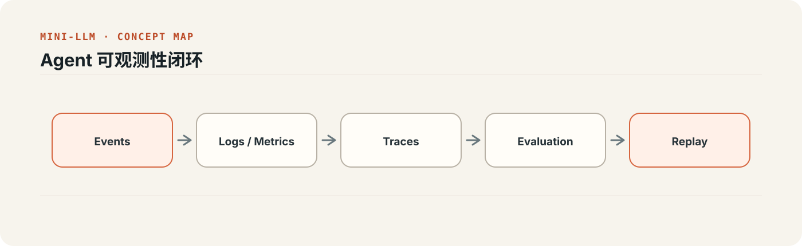

_图：Agent 可观测性闭环。从左到右展示本章核心概念之间的数据流与依赖关系。_


_图：一个真实的网络运行中心：墙面屏幕上同时展示拓扑、告警和流量，值班人员靠这些信号判断系统是否健康。Observability Engine 想为 Agent 建立的就是这样一块“墙”——不是更多日志，而是能回答“现在发生了什么”的证据。图片：USAID Pakistan，[Wikimedia Commons](https://commons.wikimedia.org/wiki/File:U.S._Ambassador_and_Power_Information_Technology_Company_CEO_Commemorate_Opening_of_Network_Operations_Center_in_Lahore_(15239121669).jpg)，美国公有领域。_

## **一、Observability Engine：为什么 AI 系统需要可观测性？**

在传统软件系统中，我们通常通过日志、指标和链路追踪来判断系统是否正常运行。

例如，一个 Web 服务出现故障，我们需要知道：

- 哪个 API 请求失败了？
- 哪个服务响应缓慢？
- 数据库查询耗时多少？
- 哪个函数抛出了异常？
- 故障发生在什么时间？

这些问题可以通过传统的 Observability（可观测性）系统解决。

但是，AI 系统尤其是 Agent 系统，带来了更复杂的问题。

假设用户向 mini-llm Agent 提出一个任务：

> 分析 GitHub 仓库，阅读核心代码，生成技术报告，并将报告保存到指定目录。

Agent 可能执行以下操作：

1. 理解用户目标。
2. 制定任务计划。
3. 调用 GitHub API。
4. 获取仓库信息。
5. 检索代码文件。
6. 调用 LLM 分析代码。
7. 发现信息不足，重新检索。
8. 调用另一个模型进行总结。
9. 生成 Markdown 文件。
10. 检查文件是否成功保存。

如果最终生成的报告质量很差，我们需要回答：

- 是任务规划出现了问题？
- 是模型理解错误？
- 是工具调用失败？
- 是上下文信息不足？
- 是检索结果不准确？
- 是模型选择不合理？
- 是 Token 超出预算？
- 是某个 Agent 无限重试？
- 是执行过程发生了状态丢失？

传统日志只能告诉我们程序执行了什么，却不一定能够解释 Agent 为什么采取某个行动，以及行动是否真正完成了目标。

因此，mini-llm 需要一个专门的 Observability Engine。

### **1.1 什么是 Observability？**

Observability 的中文通常翻译为可观测性。

它关注的是：

**能否通过系统运行过程中产生的数据，理解系统内部发生了什么。**

在控制理论中，一个系统是否可观测，涉及能否根据系统输出推断内部状态。

在软件工程中，可观测性通常由三个基础支柱构成：

## **Observability 三大支柱**

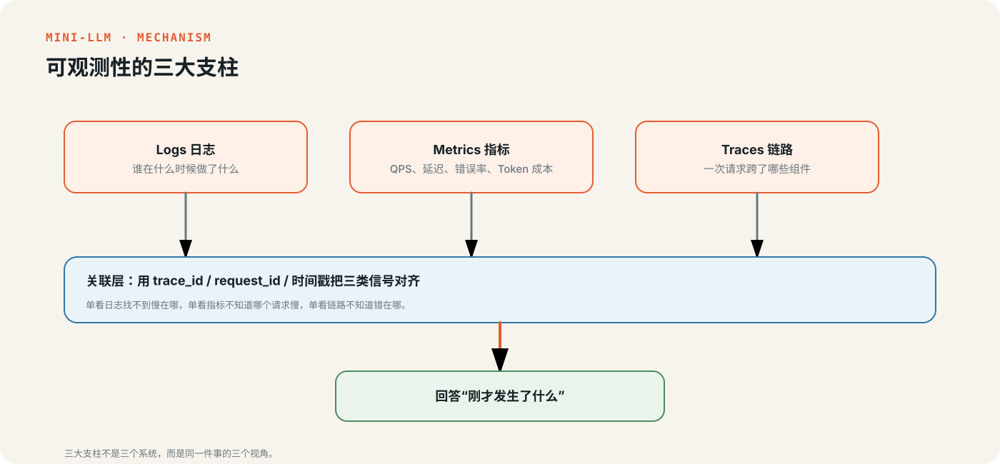

_图：可观测性的三大支柱不是三个系统，而是同一件事的三个视角：日志给出事件，指标给出趋势，链路给出因果顺序。_


- **Logging**：记录发生了什么
- **Metrics**：衡量运行状态
- **Tracing**：追踪执行路径
- Cost Tracking：模型和工具的成本追踪。
- Execution Replay：历史执行过程重放。
- Audit Trail：决策、权限和代码变更审计。

这意味着 AI 系统的可观测性不只是记录程序运行状态，还需要关注智能行为的质量、成本和可追溯性。

### **1.2 Observability 与 Monitoring 有什么区别？**

两者经常一起出现，但侧重点不同。

| 维度   | Monitoring | Observability |
| ---- | ---------- | ------------- |
| 核心目标 | 发现已知问题     | 分析未知问题        |
| 关注重点 | 预设指标       | 系统内部行为        |
| 数据来源 | 指标、告警      | 日志、指标、追踪等     |
| 典型问题 | CPU 是否过高？  | 为什么任务越来越慢？    |
| 分析方式 | 阈值和规则      | 多维度关联分析       |

例如：

Monitoring 发现：

```
Agent Task Success Rate = 65%
```

Observability 进一步分析：

```
Task Success Rate 下降的原因：

1. GitHub API 超时增加
2. 工具重试次数上升
3. 模型上下文长度增加
4. Token 预算提前耗尽
5. 最终报告生成步骤被跳过
```

Monitoring 告诉我们问题存在。

Observability 帮助我们定位问题。

### **1.3 mini-llm Observability Engine 的定位**

在 mini-llm 中，我们可以把 Observability Engine 定义为：

**负责采集、关联、分析和回放 AI 系统执行数据的基础设施模块。**

它不直接负责执行任务，也不负责决定使用哪个模型。

它负责观察其他 Engine 的运行情况。

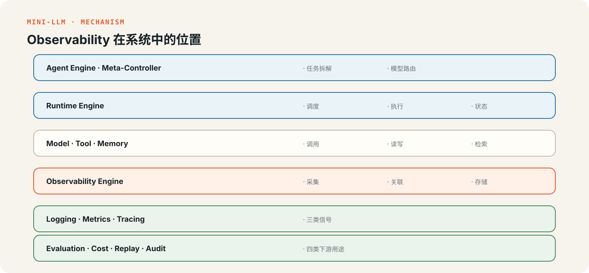

_图：Observability 在系统中的位置：采集三类信号，服务评估、成本、重放与审计。_

注意：Observability Engine 是横向基础设施，应该通过统一的采集接口覆盖其他 Engine，而不是让所有 Engine 直接依赖某一个具体日志数据库。

## **二、Logging：如何记录模型、Agent 和工具执行日志？**

Logging 是可观测性的基础。

它解决的问题是：

**系统在某个时间点究竟发生了什么？**

传统软件日志通常记录：

```
2026-11-24 10:00:01 INFO Server started
2026-11-24 10:00:02 INFO User logged in
2026-11-24 10:00:03 ERROR Database connection failed
```

这些日志适合描述程序状态。

但对于 Agent 来说，我们还需要记录任务和行动。

### **2.1 AI 系统需要什么样的日志？**

假设 Agent 正在执行：

```
任务：分析 mini-llm 项目
```

我们可能需要记录：

```
[10:00:00] TASK_CREATED
[10:00:01] AGENT_STARTED
[10:00:02] PLAN_GENERATED
[10:00:03] TOOL_CALL_REQUESTED
[10:00:04] TOOL_CALL_STARTED
[10:00:05] TOOL_CALL_COMPLETED
[10:00:06] LLM_REQUEST_STARTED
[10:00:08] LLM_RESPONSE_RECEIVED
[10:00:09] EVALUATION_COMPLETED
[10:00:10] TASK_COMPLETED
```

但这还不够。

我们还需要知道：

- 哪个 Agent 执行了操作？
- 使用了哪个模型？
- 使用了多少 Token？
- 工具调用参数是什么？
- 工具返回了什么？
- 任务属于哪个 Trace？
- 当前执行属于哪个 Span？
- 是否发生了重试？

因此，AI 日志应该具有结构化的数据格式。

### **2.2 Structured Logging**

不要只记录普通字符串：

```
logger.info("Model request completed")
```

建议记录结构化事件：

```
event = {    "event_id": "evt_001",    "timestamp": "2026-11-24T10:00:08Z",    "event_type": "model.response.completed",    "trace_id": "trace_001",    "span_id": "span_003",    "task_id": "task_001",    "agent_id": "agent_001",    "model": "mini-llm",    "provider": "local",    "input_tokens": 1200,    "output_tokens": 300,    "duration_ms": 1800,    "status": "success"}
```

结构化日志有几个优势：

1. 可以通过 trace_id 查询完整任务。
2. 可以统计不同模型的使用情况。
3. 可以分析工具失败率。
4. 可以计算 Token 消耗。
5. 可以将日志与 Trace、Metrics 关联起来。

### **2.3 统一日志事件模型**

mini-llm 可以设计统一事件结构：

```
from dataclasses import dataclassfrom typing import Anyfrom datetime import datetime@dataclassclass LogEvent:    event_id: str    timestamp: datetime    event_type: str    trace_id: str    span_id: str | None    task_id: str | None    agent_id: str | None    component: str    level: str    message: str    attributes: dict[str, Any]
```

例如：

```
event = LogEvent(    event_id="evt_001",    timestamp=datetime.now(),    event_type="tool.call.completed",    trace_id="trace_001",    span_id="span_005",    task_id="task_001",    agent_id="agent_001",    component="tool_engine",    level="INFO",    message="GitHub API request completed",    attributes={        "tool_name": "github.search",        "duration_ms": 230,        "status": "success"    })
```

### **2.4 不同类型的 AI 日志**

建议将日志划分为几个类别：

| 日志类别           | 记录内容          |
| -------------- | ------------- |
| System Log     | 系统启动、关闭、配置    |
| Model Log      | 模型请求、响应、Token |
| Agent Log      | 任务规划、行动、观察    |
| Tool Log       | 工具参数、结果、异常    |
| Memory Log     | 记忆检索、写入、更新    |
| Runtime Log    | 调度、执行、恢复      |
| Security Log   | 权限检查、拒绝、策略变更  |
| Evaluation Log | 评估结果、质量评分     |

### **2.5 日志不能无条件记录全部内容**

这是 AI 系统特别需要注意的问题。

模型 Prompt 和 Response 可能包含：

- 用户个人信息。
- API Key。
- 企业内部数据。
- 源代码。
- 数据库记录。
- 机密文档。

因此，应该支持日志脱敏和分级存储。

例如：

```
def sanitize(payload):    sensitive_keys = {        "password",        "api_key",        "access_token",        "secret"    }    result = {}    for key, value in payload.items():        if key.lower() in sensitive_keys:            result[key] = "[REDACTED]"        else:            result[key] = value    return result
```

生产系统还需要递归处理嵌套结构、自由文本、二进制内容和其他敏感字段。

建议区分：

- Metadata：默认记录。
- Prompt/Response：按策略记录。
- Sensitive Data：脱敏或不记录。
- Large Payload：存入受控对象存储，只在事件中记录引用。
- Security Audit：采用独立访问权限和保留策略。

**核心原则：可观测性不意味着无限制地保存所有数据。**

## **三、Metrics：如何衡量系统运行指标？**

Logging 记录事件。

Metrics 负责衡量系统的整体运行状态。

例如：

```
模型请求总数：10,000
模型请求成功率：98.5%
平均响应时间：1.2 秒
P95 响应时间：3.5 秒
平均 Token 消耗：2,500
Agent 任务成功率：87%
```

这些数据可以帮助我们理解系统的整体表现。

### **3.1 Metrics 的基本类型**

常见指标可以分成四类。

**1. Counter：计数器**

只增不减的累计值。

例如：

```
model_requests_total += 1tool_calls_total += 1agent_tasks_completed_total += 1
```

**2. Gauge：仪表盘**

表示某个时刻的状态，可以增加也可以减少。

例如：

```
active_agents = 12running_tasks = 30queue_size = 100
```

**3. Histogram：直方图**

记录一组数值的分布，常用于延迟和请求大小分析。

例如：

```
Model Request Duration

0-100ms       100
100-500ms     300
500-1000ms    200
1000-3000ms   150
3000ms+        20
```

**4. Summary：摘要**

用于描述观测值的统计分布，例如某些系统提供的分位数统计。

在分布式系统中，Histogram 通常更适合跨实例聚合计算分位数。

### **3.2 mini-llm 应该监控哪些指标？**

建议建立六组指标。

| 指标类别            | 典型指标             |
| --------------- | ---------------- |
| Model Metrics   | 请求次数、成功率、Token 数 |
| Agent Metrics   | 任务成功率、步骤数、重试数    |
| Tool Metrics    | 调用次数、错误率、超时率     |
| Runtime Metrics | 并发任务、队列长度、执行时间   |
| Memory Metrics  | 检索次数、命中率、检索延迟    |
| Cost Metrics    | 模型成本、工具成本、任务成本   |

例如：

```
metrics = {    "model_requests_total": 10000,    "model_errors_total": 150,    "agent_tasks_total": 1000,    "agent_tasks_success": 870,    "tool_calls_total": 5000,    "tool_errors_total": 200,    "input_tokens_total": 5000000,    "output_tokens_total": 1200000}
```

### **3.3 计算 Agent 成功率**

假设一共有 1000 个任务。

其中 870 个任务成功完成。

那么：

\\[ SuccessRate = \frac{870}{1000} =87\\% \\]

但这里有一个问题：

**什么叫任务成功？**

Agent 返回了文本，不一定代表任务完成。

例如：

```
用户：创建一个文件 test.py

Agent：文件创建成功。
```

如果文件实际上不存在，这个任务就不应该被视为成功。

因此，Agent Success Rate 必须依赖任务级别的验收条件，而不能简单依赖模型输出。

### **3.4 P50、P95、P99 是什么？**

平均延迟很容易掩盖问题。

假设 100 次模型请求：

- 90 次耗时 100ms。
- 10 次耗时 5000ms。

平均延迟：

\\[ Average = \frac{90\times100+10\times5000}{100} =590ms \\]

但是，用户体验并不一定只有 590ms。

我们还需要关注分位数。

| 指标  | 含义           |
| --- | ------------ |
| P50 | 50% 请求不超过该耗时 |
| P90 | 90% 请求不超过该耗时 |
| P95 | 95% 请求不超过该耗时 |
| P99 | 99% 请求不超过该耗时 |

P95 和 P99 能帮助发现长尾延迟。

对于 Agent 系统，长尾延迟可能来自：

- 模型推理。
- 工具 API 超时。
- 多轮 Agent 循环。
- 数据库查询。
- 任务排队。
- 重试和等待。

### **3.5 Metrics 的高基数问题**

假设我们使用：

```
agent_requests_total{
    user_id="10001",
    task_id="task_10001",
    trace_id="trace_10001"
}
```

每个用户、任务和 Trace 都可能产生一个新的时间序列。

这会导致 Metrics 的基数快速增长。

因此：

**Metrics 用于聚合统计，Trace 和 Logs 用于定位具体任务。**

推荐：

```
Metrics:
model_requests_total{model="mini-llm",status="success"}

Trace:
trace_id=trace_001

Log:
event_id=evt_001
```

不要把每个 trace_id、task_id 都放进 Prometheus 指标标签中。

## **四、Distributed Tracing：如何追踪跨 Engine 的完整调用链？**

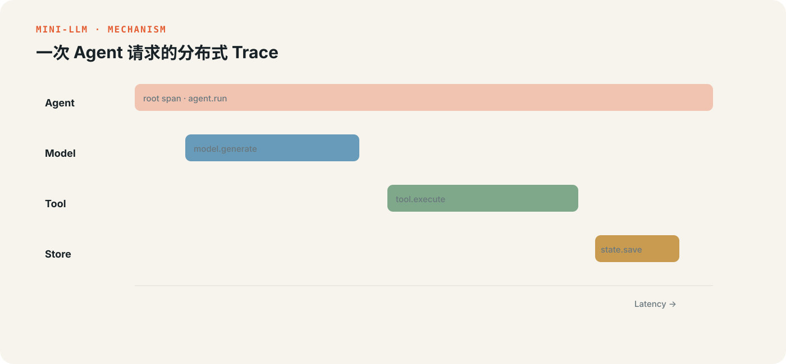

_图：一次 Agent 请求跨越模型、工具和存储的 Trace 与 Span。_

Logging 可以告诉我们某个事件发生了。

Metrics 可以告诉我们系统整体是否变慢。

但如果一个任务经过多个 Engine，我们还需要知道它们之间的调用关系。

这就是 Distributed Tracing。

### **4.1 什么是 Trace？**

Trace 是一个完整操作的追踪记录。

例如：

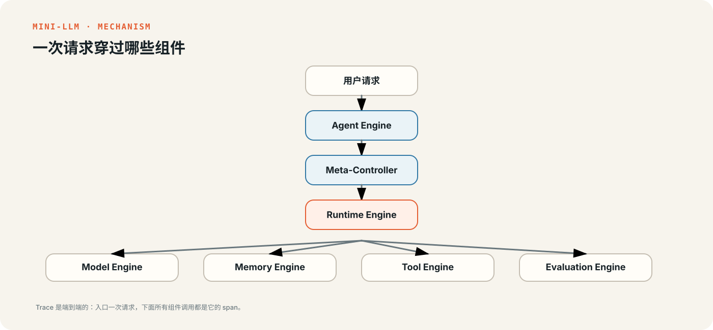

_图：一次请求穿过 Agent Engine、Meta-Controller、Runtime 与各子 Engine，整条链就是一条 Trace。_

整个任务属于一个 Trace。

Trace 由多个 Span 构成。

### **4.2 什么是 Span？**

Span 表示一次具体操作。

例如：

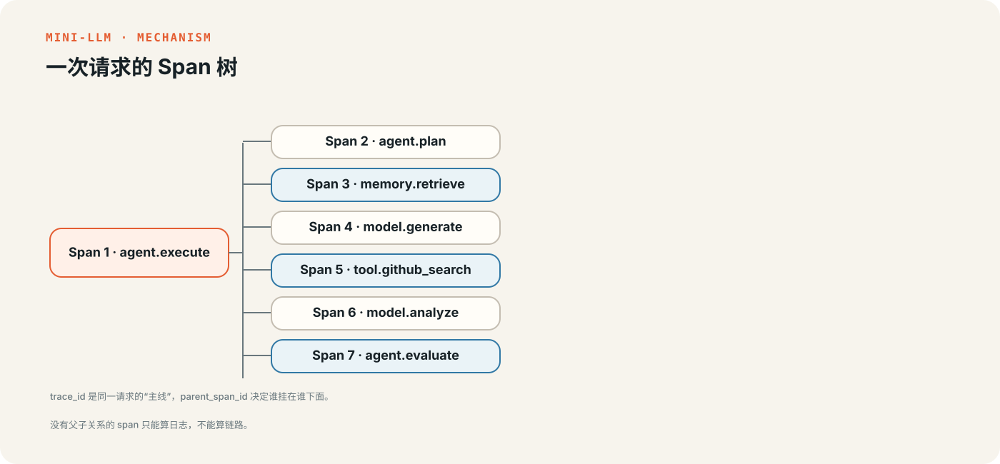

_图：一次 Agent 请求的 span 树。trace_id 把同一请求的所有 span 串起来，parent_span_id 决定层级。_

每个 Span 至少应该具有：

```
span = {    "trace_id": "trace_001",    "span_id": "span_003",    "parent_span_id": "span_001",    "name": "model.generate",    "start_time": 1000,    "end_time": 2800,    "status": "success",    "attributes": {        "model": "mini-llm",        "input_tokens": 1200,        "output_tokens": 300    }}
```

其中：

- trace_id：属于哪个完整任务。
- span_id：当前操作的唯一标识。
- parent_span_id：当前操作的父操作。
- start_time：开始时间。
- end_time：结束时间。

### **4.3 Trace 如何表示执行关系？**

可以使用树状结构：

**Trace: trace_001**

Completed

**agent.execute** 5000ms

**agent.plan** 300ms

**memory.retrieve** 200ms

**model.generate** 1800ms

**tool.github_search** 900ms

**model.analyze** 1500ms

**agent.evaluate** 300ms

实际执行过程中，Span 可能并行发生，不能总是把它理解为严格的树状顺序执行。对于跨进程消息和异步任务，还需要通过 Trace Context 传播父子关系或使用 Span Link 表达关联。

### **4.4 Trace Context 传播**

假设 Agent Engine 调用 Runtime Engine。

Agent Engine 生成：

```
trace_id = "trace_001"span_id = "span_001"
```

调用 Runtime 时传递上下文：

```
runtime.execute(    task=task,    trace_context={        "trace_id": "trace_001",        "parent_span_id": "span_001"    })
```

Runtime Engine 创建自己的 Span：

```
span = {    "trace_id": "trace_001",    "span_id": "span_002",    "parent_span_id": "span_001",    "name": "runtime.execute"}
```

这样即使请求经过多个 Engine，也能关联成完整调用链。

实际工程中建议采用 OpenTelemetry 的 Trace Context 传播机制，而不是自行发明跨服务的上下文格式。

### **4.5 Trace 的工程价值**

假设 Agent 任务耗时 12 秒。

通过 Trace，我们发现：

| 操作               | 耗时   |
| ---------------- | ---- |
| Agent Planning   | 0.5s |
| Memory Retrieval | 0.2s |
| Model Generation | 7.0s |
| Tool Execution   | 3.0s |
| Evaluation       | 1.3s |

这时我们就能明确：

模型推理和工具执行是主要耗时来源。

如果只看整个任务的 12 秒，很难判断应该优化哪个模块。

## **五、Agent Trace：如何记录 Agent 的思考、行动和观察？**

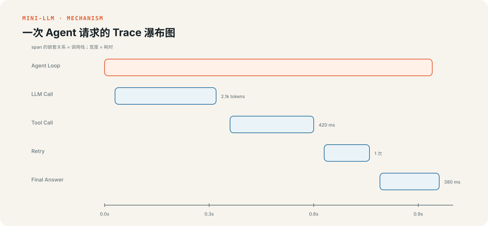

_图：一次 Agent 请求的 trace 瀑布图：span 的嵌套关系就是调用栈，span 的宽度就是耗时；重试会以兄弟 span 的形式出现。_


这是 AI 系统可观测性中最重要的扩展。

传统 Trace 主要关注函数调用和服务之间的关系。

但 Agent 系统还需要记录一个循环：

\\[ Observe \rightarrow Think \rightarrow Act \rightarrow Observe \\]

也就是：

1. 观察环境。
2. 形成决策或计划。
3. 执行行动。
4. 获取反馈。
5. 再次观察。

### **5.1 Agent Loop**

例如：

```
Goal:
分析 GitHub 仓库

Observation 1:
获取仓库基本信息

Decision 1:
需要检查项目目录

Action 1:
调用 GitHub API

Observation 2:
获取目录结构

Decision 2:
需要阅读核心文件

Action 2:
调用文件读取工具

Observation 3:
获得源代码

Decision 3:
生成技术分析报告

Action 3:
调用模型生成报告
```

如果只记录 Tool Calling，我们只能知道 Agent 调用了哪些工具。

但是无法完整理解任务状态是如何变化的。

因此，需要设计 Agent Trace。

### **5.2 Agent Trace 数据结构**

可以设计：

```
agent_trace = {    "trace_id": "trace_001",    "agent_id": "agent_001",    "task_id": "task_001",    "steps": [        {            "step_id": "step_001",            "type": "observation",            "content_ref": "obs_001"        },        {            "step_id": "step_002",            "type": "decision",            "content_ref": "decision_001"        },        {            "step_id": "step_003",            "type": "action",            "tool": "github.search",            "status": "success"        }    ]}
```

这里建议使用内容引用，而不是把所有 Prompt、Response 和工具结果直接嵌入 Trace。

这样可以避免 Trace 数据过大。

### **5.3 Agent Trace 的核心事件**

| 事件                   | 说明     |
| -------------------- | ------ |
| task.started         | 任务开始   |
| plan.created         | 计划生成   |
| observation.received | 获得新信息  |
| decision.made        | 形成决策   |
| action.requested     | 请求执行行动 |
| action.completed     | 行动完成   |
| action.failed        | 行动失败   |
| memory.retrieved     | 检索记忆   |
| reflection.created   | 产生反思记录 |
| task.completed       | 任务结束   |

### **5.4 是否应该记录模型的完整思维链？**

这是一个重要的设计问题。

Agent 的执行轨迹不等于必须保存模型内部的完整隐式推理过程。

建议记录：

- 用户目标。
- 计划摘要。
- 决策结果。
- 选择工具的理由摘要。
- 工具调用参数。
- 工具执行结果。
- 关键观察。
- 验证结果。
- 任务状态变化。

例如：

```
{
  "event_type": "agent.decision",

  "decision": "读取 package.json",

  "reason_summary": "需要确认项目依赖和技术栈",

  "evidence": [
    "repository_root"
  ],

  "confidence": null
}
```

这里的 `confidence` 可以为空。

如果没有经过校准的置信度模型，就不要把 LLM 自己生成的数字当作真实概率。

**可观测性关注可验证的决策记录，而不是无限制地收集模型内部推理文本。**

## **六、Token & Cost Tracking：如何追踪模型调用成本？**

AI 系统和传统 Web 系统有一个非常明显的区别：

模型调用通常具有直接的计算成本。

例如：

- 输入 Token 产生费用。
- 输出 Token 产生费用。
- 不同模型价格不同。
- 不同供应商价格不同。
- 缓存 Token 可能有单独价格。
- 推理模式可能具有额外计费规则。

因此，mini-llm 必须设计 Cost Tracking。

### **6.1 Token 统计**

一次模型调用可以记录：

```
token_usage = {    "model": "example-model",    "input_tokens": 2000,    "output_tokens": 500,    "cached_input_tokens": 800,    "total_tokens": 2500}
```

这里需要注意：不同供应商对 Token Usage 的字段定义可能不同。

例如，有些 API 会分别报告缓存输入 Token、推理 Token 或其他特殊计费类别。

因此，需要将供应商原始数据统一映射到 mini-llm 的内部 Usage Schema，同时保留原始字段。

### **6.2 成本计算**

假设某个模型的价格是：

- 输入：每百万 Token 2 美元。
- 输出：每百万 Token 8 美元。

某次调用：

- 输入 Token：2000。
- 输出 Token：500。

那么：

\\[ InputCost = \frac{2000}{1000000}\times2 =0.004 \\]

\\[ OutputCost = \frac{500}{1000000}\times8 =0.004 \\]

总成本：

\\[ TotalCost=0.008\ USD \\]

这是一个简化计算示例，真实系统需要根据供应商价格表、缓存价格、计费单位和生效时间计算。

### **6.3 Cost Tracker 设计**

```
class CostTracker:    def __init__(self, pricing):        self.pricing = pricing    def calculate(        self,        model,        input_tokens,        output_tokens    ):        price = self.pricing[model]        input_cost = (            input_tokens            / 1_000_000            * price["input"]        )        output_cost = (            output_tokens            / 1_000_000            * price["output"]        )        return {            "input_cost": input_cost,            "output_cost": output_cost,            "total_cost": input_cost + output_cost        }
```

生产实现还需要：

- 模型别名映射。
- 价格版本管理。
- 缓存 Token 价格。
- 多模态 Token 计费。
- 批处理价格。
- 供应商折扣。
- 本地模型成本估算。
- 货币转换和精度处理。

### **6.4 成本必须能够追踪到任务**

不能只知道：

```
今天模型总共花费 100 美元。
```

还需要知道：

```
Task A：0.02 USD
Task B：0.15 USD
Task C：2.50 USD
```

进一步可以追踪：

```
Task C
  ├── Planning Model：0.20 USD
  ├── Retrieval Model：0.10 USD
  ├── Analysis Model：1.80 USD
  └── Summary Model：0.40 USD
```

这样才能知道成本究竟消耗在哪里。

### **6.5 Cost Budget**

可以为 Agent 设置预算：

```
budget = {    "max_cost": 1.0,    "max_input_tokens": 100000,    "max_output_tokens": 20000,    "max_model_calls": 20}
```

执行时：

```
if current_cost >= budget["max_cost"]:    raise BudgetExceededError()
```

不过实际系统不能只在事后计算。

应该在每次调用前进行预算预估，在调用后根据真实 Usage 结算，并考虑并发请求已经预留但尚未结算的成本。

这可以和 Meta-Controller、Runtime Engine 协同：

- Meta-Controller：选择成本策略。
- Runtime Engine：控制执行和资源分配。
- Observability Engine：记录和统计实际成本。

## **七、Latency Analysis：如何定位推理和工具调用瓶颈？**

一个 Agent 任务可能包含多个模型调用和工具调用。

因此，不能只监控整个任务的总耗时。

需要把延迟分解到不同执行阶段。

### **7.1 延迟的组成**

可以将一个 Agent 任务的耗时表示为：

\\[ T\_{total} = T\_{queue} + T\_{planning} + T\_{retrieval} + T\_{model} + T\_{tool} + T\_{evaluation} \\]

这里是串行执行情况下的简化模型。

如果存在并行操作，不能直接将所有 Span 耗时相加作为总时间；总耗时取决于关键路径。

### **7.2 模型延迟**

模型调用可以进一步分解：

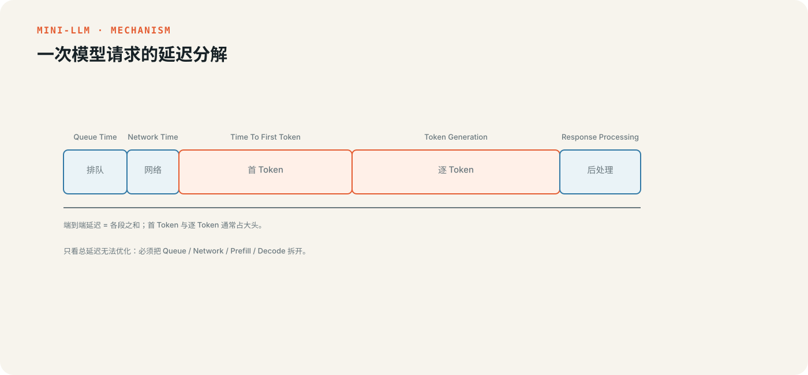

_图：一次模型请求的延迟分解。只看总延迟无法优化，必须拆到 Queue、Network、Prefill、Decode。_

其中：

**TTFT（Time To First Token）**

表示从请求发出到收到第一个生成 Token 的时间。

**TPOT（Time Per Output Token）**

表示生成输出 Token 的平均耗时，通常需要明确其统计口径。

例如：

\\[ TPOT = \frac{GenerationTime}{OutputTokens-1} \\]

具体计算应与所使用的推理服务定义保持一致。

### **7.3 工具延迟**

工具调用也应该记录：

```
tool_metrics = {    "tool_name": "github.search",    "request_time": 1000,    "response_time": 1250,    "duration_ms": 250,    "status": "success"}
```

如果工具调用时间很长，可以进一步分析：

- 网络连接时间。
- DNS 解析时间。
- 服务端处理时间。
- 响应传输时间。
- 本地数据处理时间。

### **7.4 并行执行中的关键路径**

假设 Agent 同时调用三个工具：

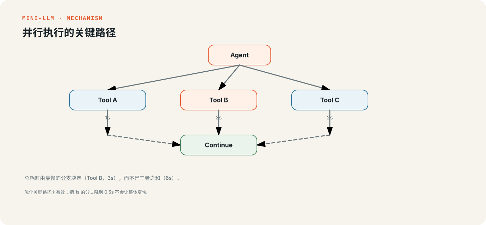

_图：并行分支的关键路径。总耗时由最慢的分支决定，而不是各分支之和。_

如果三个任务真正并行执行，那么这一阶段耗时约为：

\\[ T=\max(1,3,2)=3s \\]

而不是：

\\[ T=1+3+2=6s \\]

因此，Observability Engine 需要知道 Span 之间是串行、并行还是存在依赖关系。

这也是 Distributed Tracing 非常重要的原因。

## **八、Error Tracking：如何发现和分析系统故障？**

AI 系统的错误不只有程序异常。

我们需要区分不同层次的错误。

### **8.1 错误分类**

| 错误类型             | 示例               |
| ---------------- | ---------------- |
| System Error     | 内存不足、进程崩溃        |
| Model Error      | 模型服务不可用          |
| Timeout Error    | 模型请求超时           |
| Tool Error       | API 调用失败         |
| Protocol Error   | JSON Schema 校验失败 |
| Runtime Error    | 任务执行状态异常         |
| Memory Error     | 检索失败或数据损坏        |
| Agent Error      | 任务循环无法终止         |
| Evaluation Error | 验收不通过            |

尤其要注意：

**模型输出错误不一定是程序异常。**

例如模型回答了一个错误的技术结论，但 API 正常返回。

从系统角度看，这是一次成功的模型调用。

从任务质量角度看，却可能是一次失败。

所以 Error Tracking 和 Agent Evaluation 不能合并为一个概念。

### **8.2 统一错误模型**

```
error_event = {    "error_id": "err_001",    "trace_id": "trace_001",    "span_id": "span_005",    "component": "tool_engine",    "error_type": "TimeoutError",    "message": "GitHub API timeout",    "retryable": True,    "retry_count": 2,    "timestamp": "2026-11-24T10:00:08Z"}
```

### **8.3 错误重试与故障分析**

例如：

```
Tool Call
    │
    ▼
Request
    │
    ▼
Timeout
    │
    ▼
Retry 1
    │
    ▼
Timeout
    │
    ▼
Retry 2
    │
    ▼
Success
```

如果只记录最终结果：

```
Tool call success
```

我们就会丢失中间的故障信息。

因此，需要记录每次重试，并区分：

- 原始请求。
- 重试请求。
- 最终请求。
- 重试原因。
- 重试策略。
- 最终状态。

另外，并不是所有操作都适合自动重试。

对于写文件、转账、创建资源等具有副作用的操作，必须结合幂等键和执行状态管理，防止重试造成重复操作。

### **8.4 Error Correlation**

错误应该能够关联到：

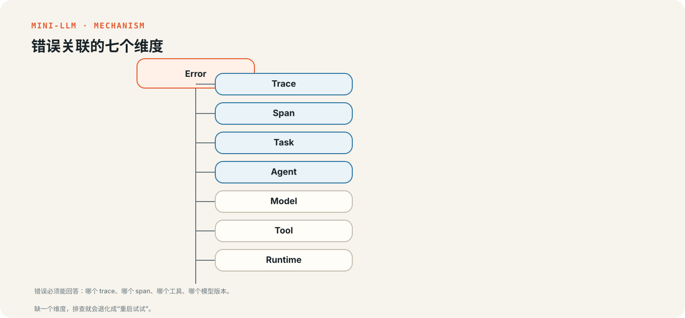

_图：错误关联的七个维度：只有把 trace、span、task、agent、model、tool、runtime 串起来，才定位得到根因。_

这样当某个工具持续失败时，我们就能分析它是否影响了特定类型的 Agent 任务。

## **九、Agent Evaluation：如何评估 Agent 的任务完成质量？**

这是 Observability Engine 与传统监控系统最明显的区别之一。

传统系统主要判断：

- 服务是否正常？
- 请求是否成功？
- 响应是否超时？

Agent 系统还需要判断：

**Agent 是否真正完成了用户要求的任务？**

### **9.1 程序执行成功不等于任务成功**

例如：

```
用户：
创建一个 Python 文件，实现快速排序。

Agent：
调用文件工具。

Tool：
返回 success。

Runtime：
任务状态 completed。
```

但是文件内容可能存在语法错误。

因此：

```
Tool Success ≠ Task Success
Runtime Completed ≠ Goal Achieved
```

必须引入独立的 Evaluation Engine。

### **9.2 Agent Evaluation 的评估维度**

可以设计以下指标：

| 维度              | 评估内容        |
| --------------- | ----------- |
| Task Completion | 是否完成目标      |
| Correctness     | 结果是否正确      |
| Relevance       | 是否符合用户需求    |
| Groundedness    | 是否有证据支持     |
| Tool Accuracy   | 工具使用是否合理    |
| Efficiency      | 执行步骤是否合理    |
| Safety          | 是否遵守权限和安全策略 |
| Robustness      | 面对异常是否能恢复   |

### **9.3 Rule-based Evaluation**

对于明确任务，优先使用确定性规则。

例如：

```
def evaluate_file_creation(result):    checks = {        "file_exists": check_file_exists(),        "syntax_valid": check_python_syntax(),        "test_passed": run_tests()    }    success = all(checks.values())    return {        "success": success,        "checks": checks    }
```

这种方式比让模型直接回答“我是否成功”更可靠。

### **9.4 LLM-as-a-Judge**

对于开放式任务，可以使用另一个模型进行评估。

例如：

```
evaluation_prompt = """请根据以下标准评估 Agent 输出：1. 是否完成用户目标？2. 是否存在事实错误？3. 是否有充分证据？4. 是否遗漏重要内容？返回结构化评分。"""
```

不过，LLM-as-a-Judge 也有局限：

- 可能偏好更长的答案。
- 可能受到措辞影响。
- 可能无法识别隐蔽事实错误。
- 可能与生成模型存在相同偏差。
- 评分不一定经过校准。

因此，最好采用：

```
Rule-based Evaluation
          +
Unit Test
          +
Integration Test
          +
LLM-as-a-Judge
          +
Human Review
```

### **9.5 Evaluation Dataset**

如果要持续改进 mini-llm，就必须建立测试任务集。

例如：

```
dataset = [    {        "task": "创建 Python 文件",        "expected": "文件存在且测试通过"    },    {        "task": "分析 GitHub 仓库",        "expected": "包含技术栈、架构和核心模块"    },    {        "task": "修复代码 Bug",        "expected": "原有测试通过且新增测试通过"    }]
```

每次升级模型、Prompt、Agent 策略或工具版本后，都可以重新运行这些任务。

注意，评估任务集需要区分开发集、验证集和独立测试集，避免 Agent 针对固定题目过拟合。

### **9.6 Agent Evaluation 与 Learning Engine 的关系**

```
Agent Execution
       │
       ▼
Observability
       │
       ▼
Evaluation
       │
       ▼
Experience Store
       │
       ▼
Learning Engine
       │
       ▼
Policy Update
       │
       ▼
New Evaluation
```

这里形成一个重要闭环：

\\[ Execution \rightarrow Evaluation \rightarrow Learning \\]

但是，评估结果只能提供学习依据，不意味着系统应该自动修改模型权重或策略。

策略更新仍然需要独立验证、版本管理和回滚机制。

## **十、Execution Replay：如何重放历史执行过程？**

这是 Observability Engine 中非常有价值的能力。

假设 Agent 昨天执行了一个代码修改任务，但结果错误。

今天我们想知道：

- 当时使用了什么模型？
- 当时使用了什么 Prompt？
- 当时读取了哪些文件？
- 当时调用了哪些工具？
- 工具返回了什么？
- 当时使用了哪个版本的 Agent？
- 为什么最终生成了错误代码？

如果只有普通日志，很难完整还原执行过程。

因此需要 Execution Replay。

### **10.1 什么是 Execution Replay？**

Execution Replay 指：

**根据历史执行记录，重新构建某次 Agent 任务的执行过程。**

例如：

```
Historical Execution
        │
        ▼
Load Trace
        │
        ▼
Load Agent Events
        │
        ▼
Load Model Requests
        │
        ▼
Load Tool Results
        │
        ▼
Restore Execution State
        │
        ▼
Replay
```

### **10.2 为什么不能简单重新调用模型？**

因为模型调用具有非确定性。

即使使用相同 Prompt：

```
Prompt A
    │
    ▼
Model
    │
    ▼
Response A
```

下一次调用也可能产生：

```
Prompt A
    │
    ▼
Model
    │
    ▼
Response B
```

原因可能包括：

- Temperature。
- Sampling。
- 模型版本变化。
- 推理框架变化。
- 系统 Prompt 变化。
- 随机种子和底层计算差异。
- 外部工具数据变化。

因此，需要区分三种 Replay。

### **10.3 三种 Replay 模式**

**模式一：Event Replay**

直接按照历史事件恢复任务状态。

```
Event 1
Event 2
Event 3
Event 4
```

适合恢复任务状态和分析状态变化。

**模式二：Deterministic Replay**

使用历史记录的模型响应、工具响应和环境输入，尽可能重建原始执行路径。

例如：

```
def replay_model_call(recorded_response):    return recorded_responsedef replay_tool_call(recorded_result):    return recorded_result
```

这种方式不重新执行外部操作，而是使用历史结果。

**模式三：Re-execution**

重新执行原任务。

```
Same Task
    │
    ▼
Current Agent
    │
    ▼
Current Model
    │
    ▼
Current Tools
```

这种模式适合比较新旧模型和策略，但不保证复现原始结果。

### **10.4 Replay 的重要限制**

如果 Agent 执行过以下操作：

- 创建文件。
- 修改代码。
- 删除数据。
- 发送邮件。
- 调用外部 API。
- 创建云资源。

那么直接重放可能造成真实副作用。

因此必须引入 Replay Mode：

```
class ReplayMode:    ANALYSIS = "analysis"    SIMULATION = "simulation"    REEXECUTION = "reexecution"
```

三种模式的区别：

| 模式           | 外部副作用  | 主要目的   |
| ------------ | ------ | ------ |
| Analysis     | 不执行    | 查看历史轨迹 |
| Simulation   | 使用模拟结果 | 测试新策略  |
| Re-execution | 可能执行   | 重新运行任务 |

真正的 Re-execution 应该使用隔离环境、权限控制和副作用拦截。

### **10.5 Execution Replay 对 AI 编程平台的价值**

对于 AI Code Agent，Replay 尤其重要。

假设 Agent 修改了三个文件：

```
src/
  ├── app.ts
  ├── service.ts
  └── database.ts
```

我们需要记录：

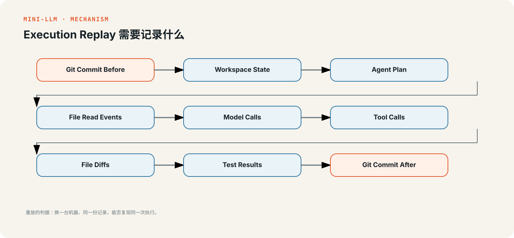

_图：Execution Replay 需要记录的全套现场：从 Git 快照到模型调用、工具调用与测试结果。_

这样就能回答：

- 哪个 Agent 修改了文件？
- 为什么修改？
- 哪个模型生成了修改内容？
- 修改前后的差异是什么？
- 测试是否通过？
- 如何回滚？

这也是 AI 编程平台实现审计和恢复的重要基础。

## **十一、Audit Trail：如何追踪 AI 系统的决策与代码变更？**

Observability 主要关注系统运行情况。

Audit Trail 更关注：

**谁在什么时间，以什么身份，基于什么授权，执行了什么操作，产生了什么结果？**

这在企业 AI 系统中尤其重要。

### **11.1 Audit Trail 与 Logging 的区别**

| 维度    | Logging | Audit Trail |
| ----- | ------- | ----------- |
| 目标    | 运行分析    | 责任追踪        |
| 关注内容  | 系统事件    | 用户和系统操作     |
| 数据完整性 | 以诊断为主   | 要求更强        |
| 修改权限  | 依系统设计   | 应严格限制       |
| 保留策略  | 按运行需要   | 按合规要求       |
| 典型场景  | 查找 Bug  | 调查未授权修改     |

### **11.2 AI 系统应该审计什么？**

建议至少包括：

1. 用户创建的任务。
2. Agent 选择的执行策略。
3. 模型和工具调用。
4. 权限检查结果。
5. 文件读写。
6. 代码修改。
7. 数据库操作。
8. 外部 API 请求。
9. 任务取消和恢复。
10. 人工审批。
11. 策略和配置变更。

### **11.3 Audit Event 数据结构**

```
audit_event = {    "audit_id": "audit_001",    "timestamp": "2026-11-24T10:00:08Z",    "actor": {        "type": "agent",        "id": "agent_001"    },    "action": "file.modify",    "resource": {        "type": "file",        "path": "src/service.ts"    },    "authorization": {        "policy": "workspace-write",        "decision": "allowed"    },    "trace_id": "trace_001",    "result": "success"}
```

### **11.4 代码修改审计**

对于 AI 编程平台，可以额外记录：

```
code_change = {    "change_id": "change_001",    "task_id": "task_001",    "repository": "mini-llm",    "file": "src/service.ts",    "before_hash": "abc123",    "after_hash": "def456",    "diff_ref": "artifact_001",    "agent_id": "agent_001",    "model": "example-model",    "test_status": "passed"}
```

其中 diff 可以保存在独立的 Artifact Store。

不要仅依赖一段日志文本保存代码修改内容。

### **11.5 如何保证审计记录不被随意修改？**

可以采用：

- Append-only 写入。
- 严格访问控制。
- 独立审计存储。
- 定期备份。
- 哈希校验。
- 数字签名。
- WORM 存储（一次写入、多次读取）。
- 审计日志访问记录。

例如，可以构建哈希链：

\\[ H_i=Hash(H\_{i-1}\Vert Event_i) \\]

每条事件的哈希依赖前一条事件。

如果中间事件被修改，后续哈希校验就会失败。

不过哈希链本身不能阻止有足够权限的攻击者重写整个存储，也不能证明事件最初记录的内容一定真实。还需要可信时间戳、签名密钥保护和外部备份等机制。

## **十二、Observability Architecture：如何构建完整的 mini-llm 可观测性系统？**

前面介绍了 Logging、Metrics、Tracing、Evaluation、Cost Tracking、Replay 和 Audit Trail。

现在需要将它们整合成统一架构。

### **12.1 总体架构**

## **mini-llm Observability Architecture**

**AI Execution Layer**

Agent · Runtime · Model · Tool · Memory · Protocol

**Instrumentation SDK**

统一事件采集 · Trace Context · Metrics API

**Collection & Processing**

Log Collector

Trace Collector

Metrics Collector

Event Processor

**Storage Layer**

**Log Store**

**Trace Store**

**Metrics Store**

**Event & Artifact Store**

**Analysis Layer**

Evaluation

Cost Analysis

Replay Engine

Audit Engine

**Observability Dashboard**

任务追踪 · 延迟分析 · 成本分析 · 错误分析 · 质量评估 · 执行回放

### **12.2 推荐技术选型**

mini-llm 第一版不需要自己开发所有基础设施。

可以采用成熟技术，再实现 AI 专属的观测能力。

| 能力                | 推荐技术                       | 作用          |
| ----------------- | -------------------------- | ----------- |
| Logging           | Python logging / structlog | 结构化日志       |
| Metrics           | Prometheus                 | 指标采集        |
| Tracing           | OpenTelemetry              | 分布式追踪       |
| Trace Backend     | Jaeger / Grafana Tempo     | Trace 存储与查询 |
| Metrics Dashboard | Grafana                    | 指标可视化       |
| Log Backend       | Loki                       | 日志查询        |
| Evaluation        | 自研 + pytest                | Agent 质量评估  |
| Cost Tracking     | 自研 Cost Tracker            | 成本统计        |
| Replay            | 自研 Replay Engine           | 执行重放        |
| Audit             | 自研 Audit Store             | 审计记录        |

这里需要区分：OpenTelemetry 是采集和传输标准及相关工具生态，不是单一数据库；Prometheus、Tempo、Loki 则分别承担不同类型数据的存储与查询职责。

### **12.3 mini-llm 项目目录设计**

建议：

```
mini-llm/
│
├── engines/
│   ├── agent/
│   ├── runtime/
│   ├── model/
│   ├── tool/
│   ├── memory/
│   ├── protocol/
│   └── evaluation/
│
├── observability/
│   │
│   ├── core/
│   │   ├── event.py
│   │   ├── context.py
│   │   ├── exporter.py
│   │   └── collector.py
│   │
│   ├── logging/
│   │   ├── logger.py
│   │   ├── formatter.py
│   │   └── sanitizer.py
│   │
│   ├── metrics/
│   │   ├── counter.py
│   │   ├── gauge.py
│   │   └── histogram.py
│   │
│   ├── tracing/
│   │   ├── tracer.py
│   │   ├── span.py
│   │   └── context.py
│   │
│   ├── agent_trace/
│   │   ├── recorder.py
│   │   └── event.py
│   │
│   ├── cost/
│   │   ├── tracker.py
│   │   ├── pricing.py
│   │   └── budget.py
│   │
│   ├── evaluation/
│   │   ├── evaluator.py
│   │   ├── dataset.py
│   │   └── report.py
│   │
│   ├── replay/
│   │   ├── recorder.py
│   │   ├── loader.py
│   │   └── executor.py
│   │
│   ├── audit/
│   │   ├── recorder.py
│   │   ├── event.py
│   │   └── integrity.py
│   │
│   └── storage/
│       ├── log_store.py
│       ├── trace_store.py
│       └── artifact_store.py
│
├── tests/
│
└── examples/
```

### **12.4 核心接口设计**

所有 Engine 都应该使用统一的 Observability API。

例如：

```
class Observability:    def __init__(        self,        logger,        metrics,        tracer    ):        self.logger = logger        self.metrics = metrics        self.tracer = tracer    def log(self, event):        self.logger.emit(event)    def increment(self, name, value=1):        self.metrics.increment(name, value)    def start_span(self, name):        return self.tracer.start_span(name)
```

Agent Engine 使用：

```
with observability.start_span(    "agent.execute") as span:    observability.log({        "event_type": "agent.started",        "task_id": "task_001"    })    result = agent.execute(task)    observability.increment(        "agent_tasks_completed_total"    )
```

这里的接口是简化示意。真实实现需要处理上下文传播、异步任务、异常状态、Span 生命周期、资源关闭和 Exporter 批量发送。

### **12.5 与 OpenTelemetry 集成**

对于生产环境，可以直接使用 OpenTelemetry Python SDK。

例如：

```
from opentelemetry import tracetracer = trace.get_tracer("mini-llm")def execute_agent(task):    with tracer.start_as_current_span(        "agent.execute"    ) as span:        span.set_attribute(            "task.id",            task.id        )        result = run_task(task)        span.set_attribute(            "task.status",            "completed"        )        return result
```

OpenTelemetry 可以统一采集和传播 Trace Context，也可以通过 SDK 和 Exporter 将数据发送到后端。

mini-llm 只需要在其上扩展 Agent 特有的数据模型。

## **十三、mini-llm Observability Engine 的核心数据模型**

如果要真正实现这个 Engine，最重要的是建立统一的数据关联关系。

建议设计以下实体：

| 实体          | 作用            | 关键字段                   |
| ----------- | ------------- | ---------------------- |
| Trace       | 一次完整执行        | trace_id               |
| Span        | 一次执行操作        | span_id、parent_span_id |
| Event       | 某个时间点的事件      | event_id、event_type    |
| Task        | 用户任务          | task_id、status         |
| AgentStep   | Agent 的一个执行步骤 | step_id、action         |
| ModelCall   | 一次模型调用        | model、tokens、latency   |
| ToolCall    | 一次工具调用        | tool_name、result       |
| CostRecord  | 成本记录          | amount、currency        |
| Evaluation  | 任务评估          | score、result           |
| Artifact    | 执行产物          | artifact_id、uri        |
| AuditRecord | 审计记录          | actor、action、resource  |

它们之间的关系可以表示为：

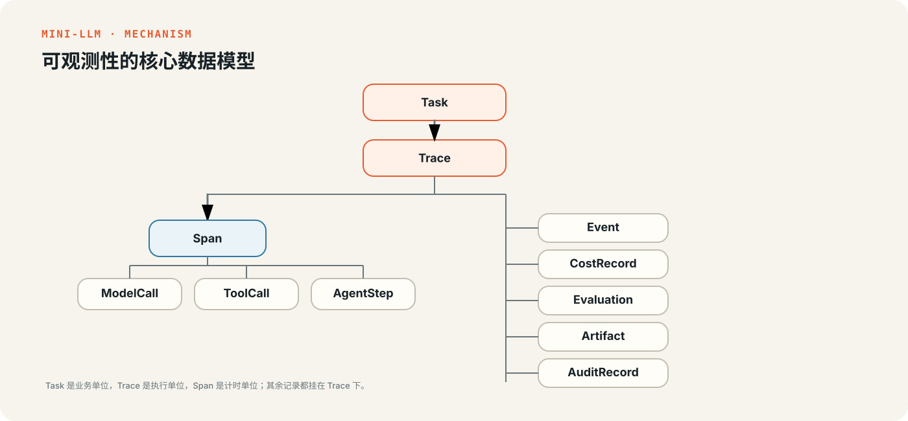

_图：可观测性核心数据模型。Task 是业务单位，Trace 是执行单位，Span 是计时单位，其余记录都挂在 Trace 之下。_

这里需要注意：

- Trace 描述执行关系。
- Event 描述发生的事情。
- Span 描述操作的开始、结束和上下文。
- Artifact 保存较大的执行产物。
- Evaluation 描述任务质量。
- AuditRecord 描述可追责的操作。

它们不能简单合并成一张日志表。

## **十四、mini-llm Observability Engine 的 V1 实现路线**

不建议第一版就实现完整的分布式可观测性平台。

更合理的方式是逐步构建。

### **第一阶段：基础观测**

V1 必须实现

- 统一 Event Schema。
- 统一 Trace ID。
- 统一 Span。
- 结构化 Logging。
- 基础 Metrics。
- Model Call 统计。
- Tool Call 统计。
- Token Usage 统计。
- 错误记录。

目标：

**能够知道一次 Agent 任务发生了什么。**

### **第二阶段：执行分析**

- 完整 Trace。
- Agent Trace。
- P50/P95/P99。
- 模型调用耗时。
- 工具调用耗时。
- Cost Tracking。
- Budget Tracking。
- Grafana Dashboard。

目标：

**能够知道 Agent 为什么慢、成本为什么高。**

### **第三阶段：质量评估**

- Evaluation Dataset。
- Rule-based Evaluation。
- Unit Test。
- LLM-as-a-Judge。
- Agent Success Rate。
- Regression Testing。
- Evaluation Report。

目标：

**能够判断 Agent 是否真正完成任务。**

### **第四阶段：Replay 和审计**

- Event Replay。
- Tool Result Replay。
- Model Response Replay。
- Execution State Recovery。
- Audit Trail。
- Code Diff Tracking。
- Artifact Store。
- 权限和访问审计。

目标：

**能够追踪、分析和恢复历史执行过程。**

## **十五、Observability Engine 与其他 Engine 的关系**

到这里，mini-llm 的 Engine 体系开始形成一个完整的工程闭环。

| Engine                  | 核心职责           |
| ----------------------- | -------------- |
| Tensor Engine           | 张量计算           |
| Autograd Engine         | 自动求导           |
| Neural Network Engine   | 神经网络计算         |
| Transformer Engine      | Transformer 结构 |
| Training Engine         | 模型训练           |
| Evaluation Engine       | 模型能力评估         |
| Representation Engine   | 内部表征           |
| World Model Engine      | 世界状态建模         |
| Memory Engine           | 记忆存储和检索        |
| Knowledge Engine        | 知识表示与推理        |
| Causal Reasoning Engine | 因果推断           |
| Decision Engine         | 决策             |
| Planning Engine         | 规划             |
| Agent Engine            | 目标执行           |
| Learning Engine         | 经验学习           |
| Meta-Controller         | 策略控制           |
| Runtime Engine          | 任务执行           |
| Protocol Engine         | 模块通信           |
| Observability Engine    | 系统观测与分析        |

这些模块并不是完全独立的，它们之间存在数据依赖和控制关系。

例如：

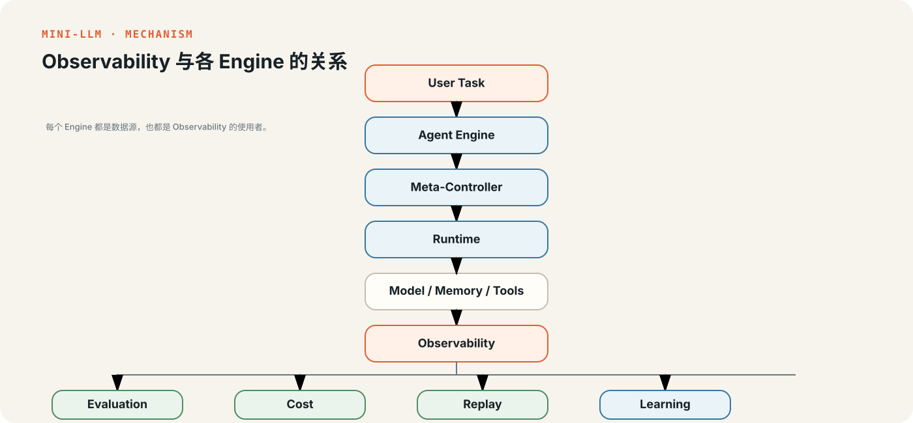

_图：Observability 与各 Engine 的关系：每个 Engine 既是数据源，也是使用者。_

这张图表达的是数据反馈关系，不意味着 Observability Engine 应直接控制 Learning Engine。

更合理的设计是：

1. Agent 和 Runtime 产生执行数据。
2. Observability 采集并关联这些数据。
3. Evaluation 判断任务质量。
4. Learning Engine 根据经过筛选和验证的经验改进策略。
5. 新策略重新进入测试和评估流程。

## **十六、总结：为什么 Observability 是 AI 工程化的基础？**

如果没有 Observability，一个 Agent 系统可能只能告诉用户：

```
任务执行成功。
```

但开发者无法回答：

- Agent 做了什么？
- 为什么这样做？
- 调用了哪个模型？
- 使用了哪些工具？
- 花费了多少 Token？
- 哪一步耗时最长？
- 哪一步发生了错误？
- 任务结果是否正确？
- 如何复现历史执行？
- 如何追踪代码修改？

一个真正可工程化的 Agent 系统，不能只关注智能能力，还必须关注执行过程的透明性、可验证性、成本和责任追踪。

可以将 Observability Engine 的价值归纳为七个方面：

1. **Logging：** 知道系统发生了什么。
2. **Metrics：** 知道系统运行得怎么样。
3. **Tracing：** 知道一次任务经过了哪些模块。
4. **Agent Trace：** 知道 Agent 如何观察、决策和行动。
5. **Cost Tracking：** 知道智能运行消耗了多少资源。
6. **Evaluation：** 知道 Agent 是否真正完成目标。
7. **Replay & Audit：** 知道历史过程如何发生，以及如何追责和复现。

最终，我们希望 mini-llm 具备这样的能力：

## **一个可观测的 AI 系统**

1. **Observe**

   采集模型、Agent、工具和 Runtime 的运行数据。
2. **Correlate**

   通过 Task ID、Trace ID、Span ID 关联完整执行过程。
3. **Analyze**

   分析延迟、成本、错误和任务质量。
4. **Evaluate**

   根据可验证的标准判断执行结果。
5. **Replay**

   重建历史任务，分析失败原因。
6. **Improve**

   将经过验证的经验反馈给 Learning Engine。

**AI 系统的智能能力决定它能做什么，而可观测性决定我们能否理解、验证、管理和持续改进它所做的事情。**

## **下一篇：mini-llm Security Engine 深度解析**

在 Runtime、Protocol 和 Observability 逐渐完善之后，下一步应该研究 AI 系统的安全边界。

建议下一篇：

# **《mini-llm Security Engine 深度解析：从 Identity、Permission、Sandbox 到 Prompt Injection、Policy Enforcement 与 Trust Boundary》**

建议研究：

1. **Security Engine：** 为什么 Agent 系统需要独立安全架构？
2. **Identity：** 如何识别用户、Agent、Model 和 Tool？
3. **Authentication：** 如何验证系统调用身份？
4. **Authorization：** 如何控制 Agent 的操作权限？
5. **Permission Model：** 如何设计 RBAC、ABAC 和 Capability-based Security？
6. **Sandbox：** 如何隔离代码执行和工具调用？
7. **Prompt Injection：** 如何防御间接提示注入？
8. **Tool Security：** 如何限制工具调用的权限和副作用？
9. **Policy Enforcement：** 如何在执行前后实施安全策略？
10. **Trust Boundary：** 如何区分可信输入、外部内容和模型生成内容？
11. **Secrets Management：** 如何管理 API Key、Token 和敏感配置？
12. **Security Audit：** 如何追踪和审计 Agent 的安全行为？
13. **Security Architecture：** 如何构建完整的 mini-llm 安全体系？

这将把 mini-llm 从一个能够执行任务的 Agent 框架，进一步推进到一个具备权限控制、执行隔离和风险治理能力的 AI Runtime 平台。

