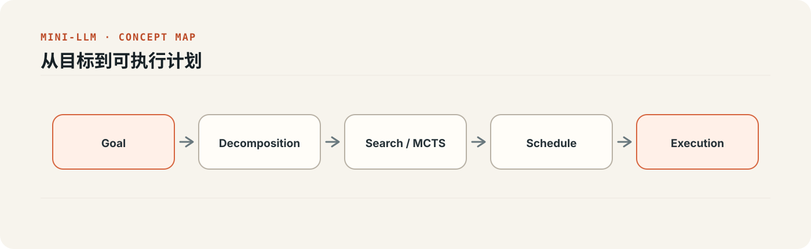
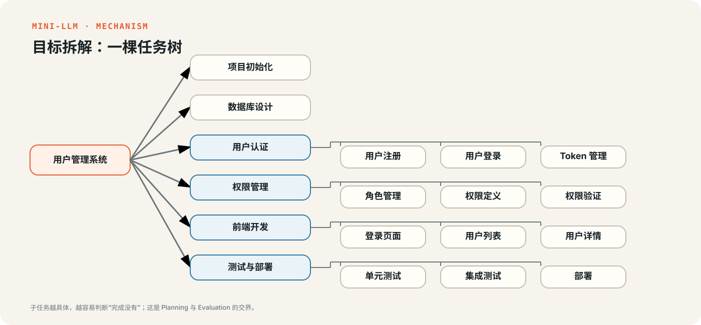
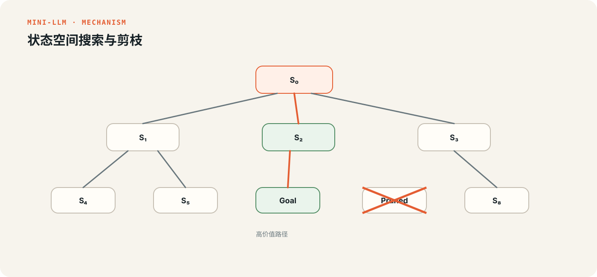
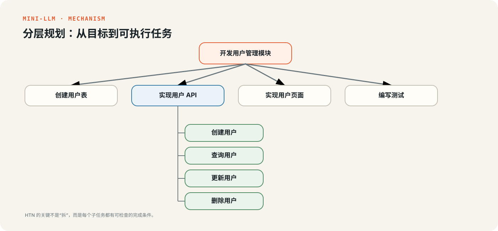
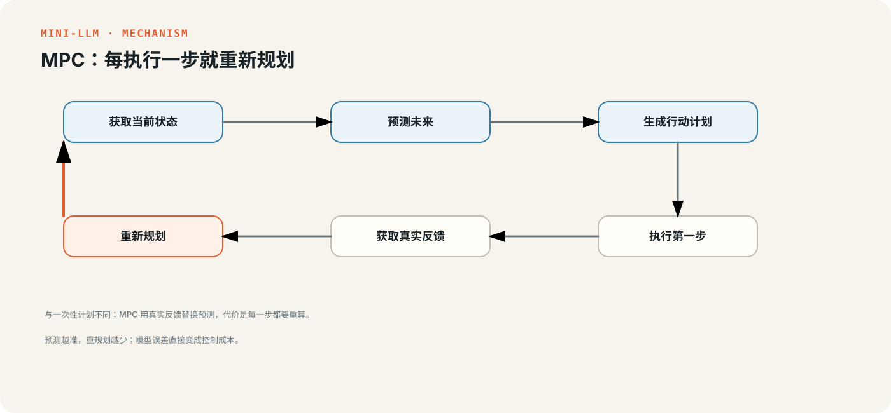

# **《mini-llm Planning Engine 深度解析：从 Goal Decomposition、Search Algorithms 到 Hierarchical Planning、MCTS 与 Model Predictive Control》**



_图：从目标到可执行计划。从左到右展示本章核心概念之间的数据流与依赖关系。_

在前面的系列中，我们已经逐步构建了 mini-llm 的多个核心模块：

- **Representation Engine**：模型如何表示信息与概念。
- **World Model Engine**：系统如何预测世界状态的变化。
- **Causal Reasoning Engine**：系统如何理解行动与结果之间的因果关系。
- **Decision Engine**：系统如何在多个行动方案中选择一个。

但是，这些能力还没有解决一个重要问题：

**当一个智能体面对复杂目标时，它如何一步一步地找到实现目标的行动路径？**

例如，用户向 AI 提出：

> 帮我开发一个具有用户登录、权限管理、数据分析和报表导出功能的 Web 应用。

这不是一个简单的问题回答任务。

AI 需要：

1. 理解最终目标。
2. 将目标拆解成多个子目标。
3. 确定子目标之间的依赖关系。
4. 规划执行顺序。
5. 选择合适的工具。
6. 预测每一步可能产生的结果。
7. 根据实际执行结果调整计划。
8. 判断任务是否真正完成。

这就是 Planning Engine（规划引擎）需要解决的问题。

Planning Engine 的核心不是生成一段看起来合理的执行步骤，而是：

**在目标、环境、资源和约束条件下，搜索并构建一条能够通向目标状态的行动路径。**

# **一、什么是 Planning Engine？**


_图：耐火材料工厂里的 AGV：它按规划好的路径搬运成吨的砖垛，遇到障碍要重新规划，多个任务之间还要排优先级。这是 Planning Engine 最朴素的原型——目标、状态、动作和约束都真实存在。图片：ek robotics GmbH，[Wikimedia Commons](https://commons.wikimedia.org/wiki/File:Ek_robotics-agv-custom_move-rhi_magnesita-refractory_industry-rgb_%288%29.jpg)，[CC BY-SA 4.0](https://creativecommons.org/licenses/by-sa/4.0/)。_

## **1.1 从回答问题到完成目标**

传统语言模型主要执行：

\\[ P(y|x) \\]

根据输入 \\(x\\)，预测输出 \\(y\\)。

例如：

```
输入：什么是数据库索引？

输出：数据库索引是一种提高查询效率的数据结构……
```

但 Agent 面对的是另一类任务：

```
目标：创建一个用户管理系统。

行动：
1. 创建项目。
2. 设计数据库。
3. 实现用户注册。
4. 实现登录认证。
5. 实现权限管理。
6. 编写测试。
7. 部署系统。
```

这时，系统不仅需要生成文本，还需要考虑行动之间的关系。

我们可以将其抽象为：

\\[ S_0 \xrightarrow{a_1} S_1 \xrightarrow{a_2} S_2 \xrightarrow{a_3} \cdots \xrightarrow{a_n} S_n \\]

其中：

- \\(S_0\\)：初始状态。
- \\(a_i\\)：某个行动。
- \\(S_i\\)：执行行动后的状态。
- \\(S_n\\)：最终状态。

Planning Engine 的任务是寻找一系列行动：

\\[ \pi = (a_1,a_2,\ldots,a_n) \\]

使最终状态满足目标条件：

\\[ Goal(S_n)=True \\]

这里的 \\(\pi\\) 称为 Plan（计划）。

## **1.2 Planning Engine 与其他 Engine 的区别**

| Engine                  | 核心问题          | 主要输出   |
| ----------------------- | ------------- | ------ |
| Representation Engine   | 如何表示信息？       | 内部表征   |
| World Model Engine      | 世界可能如何变化？     | 状态预测   |
| Causal Reasoning Engine | 行动为什么会产生结果？   | 因果关系   |
| Decision Engine         | 应该选择哪个行动？     | 行动选择   |
| Planning Engine         | 应该按照什么路径实现目标？ | 行动计划   |
| Agent Engine            | 如何执行任务并与环境交互？ | 实际执行过程 |

需要注意：

Planning 与 Decision 并不是完全独立的。

Decision Engine 可以负责当前状态下的行动选择，而 Planning Engine 负责跨多个步骤的行动组织。

例如：

- Decision：现在应该创建数据库，还是先设计 API？
- Planning：为了实现整个系统，应该按照什么依赖关系组织所有任务？

# **二、Goal Representation：目标表示**

规划的第一步不是搜索，而是明确目标。

如果目标无法被准确表示，系统就无法判断计划是否成功。

## **2.1 自然语言目标的问题**

用户可能提出：

```
帮我开发一个高质量的用户管理系统。
```

这句话包含很多不确定因素：

- 什么是高质量？
- 需要哪些功能？
- 使用什么技术？
- 是否需要部署？
- 是否需要测试？
- 性能要求是多少？
- 是否需要权限控制？

如果直接让 LLM 生成开发步骤，它很可能产生一份看起来完整、实际上缺少约束的计划。

因此，需要将自然语言转换成结构化目标。

## **2.2 Goal 的结构**

可以将目标定义为：

\\[ G=(I,F,C,Q) \\]

其中：

- \\(I\\)：Initial State，初始状态。
- \\(F\\)：Final State，期望达到的最终状态。
- \\(C\\)：Constraints，约束条件。
- \\(Q\\)：Quality Criteria，质量标准。

例如：

```
goal = {    "name": "用户管理系统",    "initial_state": {        "project_exists": False,        "database_exists": False,        "auth_module_exists": False    },    "final_state": {        "project_exists": True,        "database_exists": True,        "auth_module_exists": True,        "permission_module_exists": True,        "tests_passed": True    },    "constraints": {        "language": "TypeScript",        "framework": "React",        "database": "MySQL",        "must_have_tests": True    },    "quality": {        "security": "high",        "maintainability": "high",        "performance": "acceptable"    }}
```

这使得目标从模糊的自然语言，变成了可供规划系统处理的结构化对象。

## **2.3 Goal Predicate：目标谓词**

在经典规划系统中，目标通常可以表示为一组逻辑条件。

例如：

\\[ G = \\{ ProjectCreated, DatabaseReady, AuthReady, TestsPassed \\} \\]

当所有条件都成立时，目标完成：

\\[ Goal(S)= \bigwedge\_{g_i\in G}g_i(S) \\]

其中 \\(\bigwedge\\) 表示逻辑 AND。

代码示意：

```
def is_goal_reached(state, goal):    for key, expected in goal.items():        if state.get(key) != expected:            return False    return True
```

这只是简单的布尔目标检查。现实系统还可能需要：

- 数值约束。
- 时间约束。
- 资源约束。
- 安全约束。
- 质量指标。
- 多目标权衡。

例如，系统不仅要求测试通过，还要求：

\\[ TestCoverage \geq 80\\% \\]

以及：

\\[ ResponseTime < 200ms \\]

因此，复杂目标往往是逻辑条件与数值约束的组合。

# **三、Goal Decomposition：目标拆解**

一个复杂目标通常无法通过单个行动完成。

需要将它分解成多个可以执行和验证的子目标。

这就是 Goal Decomposition。

## **3.1 为什么需要目标拆解？**

假设目标是：

```
开发一个完整的用户管理系统。
```

可以拆解为：



_图：目标拆解成一棵任务树：子任务越具体，越容易判断是否完成。_

这里产生了一个重要变化：

原始目标是一个整体，而拆解后的目标形成了一个任务结构。

## **3.2 AND Decomposition**

AND Decomposition 表示一个目标必须由多个子目标共同完成。

例如：

\\[ G=A\land B\land C \\]

用户管理系统需要：

- 数据库完成。
- 用户认证完成。
- 权限管理完成。

三个条件都满足，整体目标才算完成。

## **3.3 OR Decomposition**

OR Decomposition 表示多个子目标中，满足其中一个即可。

例如：

```
身份认证
│
├── JWT 认证
│
├── Session 认证
│
└── OAuth 认证
```

如果系统只需要选择一种认证方案，那么：

\\[ G=A\lor B\lor C \\]

这两种分解方式非常重要。

因为真实规划不是简单地把任务拆成一棵树，还需要表达：

- 必须完成的任务。
- 可选任务。
- 替代方案。
- 条件任务。
- 互斥任务。

## **3.4 Goal Decomposition 的代码结构**

```
class Goal:    def __init__(        self,        name,        decomposition="AND",        children=None    ):        self.name = name        self.decomposition = decomposition        self.children = children or []
```

构建目标树：

```
root = Goal(    "用户管理系统",    decomposition="AND",    children=[        Goal("项目初始化"),        Goal("数据库设计"),        Goal(            "身份认证",            decomposition="OR",            children=[                Goal("JWT 认证"),                Goal("Session 认证")            ]        ),        Goal("权限管理"),        Goal("测试与部署")    ])
```

这是一个简化的目标树模型。

真正的工程规划通常还需要增加任务状态、执行条件、依赖关系、优先级和验收标准。

# **四、Task Planning：任务规划**

目标拆解回答的是：

**需要完成什么？**

任务规划回答的是：

**这些任务应该按照什么顺序完成？**

两者并不相同。

## **4.1 任务之间存在依赖关系**

例如：

```
数据库设计
      │
      ▼
数据库实现
      │
      ▼
用户认证
      │
      ▼
权限管理
      │
      ▼
集成测试
```

但前端页面和后端接口可能可以并行开发。

因此，任务之间的关系不能简单理解为一条线性流程。

我们可以使用有向图表示：

\\[ G=(V,E) \\]

其中：

- \\(V\\)：任务集合。
- \\(E\\)：任务依赖关系。

例如：

\\[ A\rightarrow C \\]

表示任务 C 必须等待任务 A 完成。

## **4.2 DAG：有向无环图**

在任务依赖规划中，经常使用 DAG（Directed Acyclic Graph）。

**用户管理系统的任务依赖图**

**需求分析**

**数据库设计**

**后端 API**

**前端页面**

**联调与集成**

**系统测试**

示意：前端和后端可以并行开发，但集成测试依赖两者完成。

如果依赖关系构成 DAG，就可以使用拓扑排序得到一种合法执行顺序。

例如：

```
from collections import dequedef topological_sort(graph):    indegree = {        node: 0        for node in graph    }    for node in graph:        for child in graph[node]:            indegree[child] += 1    queue = deque([        node        for node in indegree        if indegree[node] == 0    ])    result = []    while queue:        node = queue.popleft()        result.append(node)        for child in graph[node]:            indegree[child] -= 1            if indegree[child] == 0:                queue.append(child)    if len(result) != len(graph):        raise ValueError("任务依赖存在循环")    return result
```

注意：拓扑排序只解决依赖顺序问题，并不自动解决资源调度、任务优先级和最优成本问题。

## **4.3 Planning 不等于排序**

假设有三个任务：

| 任务    | 耗时   | 依赖    |
| ----- | ---- | ----- |
| 数据库设计 | 2 小时 | 无     |
| 后端开发  | 6 小时 | 数据库设计 |
| 前端开发  | 5 小时 | 数据库设计 |

简单排序可以给出：

```
数据库设计 → 后端开发 → 前端开发
```

但如果允许并行：

```
数据库设计
     │
     ├── 后端开发
     │
     └── 前端开发
```

总耗时可能从 13 小时降低到 8 小时。

这涉及：

- Critical Path：关键路径。
- Resource Scheduling：资源调度。
- Parallel Planning：并行规划。

一个成熟的 Planning Engine 必须考虑这些因素。

# **五、State-space Search：状态空间搜索**



_图：状态空间搜索中的分支、剪枝与最优计划路径。_

目标拆解和任务规划能够描述任务，但复杂环境中，系统还需要在大量可能的行动路径中搜索可行方案。

这就是 State-space Search。

## **5.1 什么是状态空间？**

假设一个机器人在网格中移动。

它的状态可以表示为：

\\[ S=(x,y) \\]

其中：

- \\(x\\)：横坐标。
- \\(y\\)：纵坐标。

可执行行动：

\\[ A=\\{Up,Down,Left,Right\\} \\]

状态转移：

\\[ S\_{t+1}=T(S_t,A_t) \\]

例如：

\\[ (1,1)\xrightarrow{Right}(2,1) \\]

每个状态都可能产生多个后继状态。

从起点出发，经过不断扩展，就形成了一棵搜索树。

## **5.2 搜索树**

```
             S0
          /  |  \
         A   B   C
        / \      / \
       D   E    F   G
      /          \
     H            Goal
```

Planning Engine 需要在这棵树中找到一个满足目标条件的节点。

但搜索树可能非常庞大。

假设每个状态平均有 \\(b\\) 个后继状态，搜索深度为 \\(d\\)，那么完整搜索树的节点数量近似为：

\\[ N=1+b+b^2+\cdots+b^d \\]

当 \\(b>1\\) 时：

\\[ N=O(b^d) \\]

这就是规划系统面临的核心挑战之一：组合爆炸。

# **六、经典搜索算法**

## **6.1 BFS：广度优先搜索**

Breadth-First Search 从起点开始，先搜索距离起点一步的状态，再搜索两步的状态。

```
from collections import dequedef bfs(start, goal, get_neighbors):    queue = deque([start])    visited = {start}    parent = {start: None}    while queue:        current = queue.popleft()        if current == goal:            return reconstruct_path(parent, goal)        for next_state in get_neighbors(current):            if next_state not in visited:                visited.add(next_state)                parent[next_state] = current                queue.append(next_state)    return None
```

特点：

- 完备性：在有限分支等条件下可以找到解。
- 最优性：当每一步代价相同时，能够找到最少步数路径。
- 时间复杂度：\\(O(b^d)\\)。
- 空间复杂度：\\(O(b^d)\\)。

BFS 适合：

- 无权图最短路径。
- 状态空间较小的规划任务。
- 每一步行动成本相同的环境。

## **6.2 DFS：深度优先搜索**

Depth-First Search 优先沿着一条路径不断深入。

```
def dfs(start, goal, get_neighbors):    stack = [start]    visited = set()    while stack:        current = stack.pop()        if current == goal:            return current        if current in visited:            continue        visited.add(current)        for next_state in get_neighbors(current):            if next_state not in visited:                stack.append(next_state)    return None
```

特点：

- 空间消耗通常低于 BFS。
- 可能很快找到一个解。
- 不保证找到最短路径。
- 在无限深度空间中，未经限制的 DFS 可能无法结束。

DFS 适合：

- 深度探索。
- 结构遍历。
- 搜索空间较大但内存有限的情况。

## **6.3 Uniform Cost Search：一致代价搜索**

BFS 假设每一步成本相同。

但现实任务并不是这样。

例如：

| 行动      | 成本 |
| ------- | -- |
| 创建文件    | 1  |
| 修改数据库结构 | 5  |
| 部署服务    | 10 |
| 修复线上故障  | 20 |

此时，我们需要考虑累计成本。

定义路径成本：

\\[ g(n)=\sum\_{i=1}^{n}c(a_i) \\]

Uniform Cost Search 每次扩展当前累计成本最低的节点。

```
import heapqdef uniform_cost_search(start, goal, get_neighbors):    queue = [(0, start)]    cost = {start: 0}    parent = {start: None}    while queue:        current_cost, current = heapq.heappop(queue)        if current_cost != cost[current]:            continue        if current == goal:            return reconstruct_path(parent, goal)        for next_state, action_cost in get_neighbors(current):            new_cost = current_cost + action_cost            if new_cost < cost.get(next_state, float("inf")):                cost[next_state] = new_cost                parent[next_state] = current                heapq.heappush(                    queue,                    (new_cost, next_state)                )    return None
```

在边成本非负等条件下，它可以找到总代价最低的路径。

## **6.4 BFS、DFS、UCS 对比**

| 算法  | 搜索策略     | 最短路径保证   | 典型用途   |
| --- | -------- | -------- | ------ |
| BFS | 按层扩展     | 等权边时保证   | 最少步数   |
| DFS | 优先深入     | 不保证      | 深度探索   |
| UCS | 最低累计成本优先 | 非负边成本时保证 | 最低成本路径 |

但还有一个问题：

如果状态空间特别大，UCS 仍然需要扩展大量节点。

能不能利用目标信息，减少搜索范围？

这就引出了 A\*。

# **七、A\* Search：启发式搜索**

A\* 是经典的启发式搜索算法。

它不仅考虑已经付出的成本，还考虑距离目标可能还需要多少成本。

## **7.1 A\* 的核心公式**

\\[ f(n)=g(n)+h(n) \\]

其中：

- \\(g(n)\\)：从起点到当前节点的实际成本。
- \\(h(n)\\)：从当前节点到目标的估计成本。
- \\(f(n)\\)：经过当前节点到达目标的估计总成本。

A\* 每次优先扩展 \\(f(n)\\) 最小的节点。

## **7.2 什么是 Heuristic？**

Heuristic 是启发式函数。

例如，在二维网格中，可以使用曼哈顿距离：

\\[ h(n)=|x_n-x_g|+|y_n-y_g| \\]

其中：

- \\((x_n,y_n)\\)：当前坐标。
- \\((x_g,y_g)\\)：目标坐标。

如果机器人只能上下左右移动，而且每步成本为 1，那么曼哈顿距离不会高估实际最短距离。

这叫作 Admissible Heuristic（可采纳启发式）。

\\[ h(n)\leq h^\*(n) \\]

其中 \\(h^\*(n)\\) 是真实的最低剩余成本。

在经典图搜索 A\* 中，启发式的一致性（Consistency）也很重要：

\\[ h(n)\leq c(n,n')+h(n') \\]

它保证估计值满足类似三角不等式的性质，有助于避免节点反复以更优代价重新处理。

## **7.3 A\* 的代码**

```
import heapqdef astar(start, goal, get_neighbors, heuristic):    queue = [(heuristic(start), 0, start)]    cost = {start: 0}    parent = {start: None}    while queue:        _, current_cost, current = heapq.heappop(queue)        if current_cost != cost.get(current):            continue        if current == goal:            return reconstruct_path(parent, goal)        for next_state, action_cost in get_neighbors(current):            new_cost = current_cost + action_cost            if new_cost < cost.get(next_state, float("inf")):                cost[next_state] = new_cost                parent[next_state] = current                priority = (                    new_cost + heuristic(next_state)                )                heapq.heappush(                    queue,                    (priority, new_cost, next_state)                )    return None
```

## **7.4 A\* 为什么重要？**

A\* 的思想可以推广到很多 AI 规划任务。

例如，AI 编程 Agent：

```
目标：修复一个 Bug。

当前状态：
- 测试失败
- 错误日志已获取
- 代码结构已分析

候选行动：
A. 直接修改代码
B. 查看调用链
C. 编写复现测试
D. 检查最近 Git 变更
```

系统可以估计：

- 每个行动的成本。
- 每个行动对目标的帮助。
- 后续可能还需要多少工作。

需要强调：在开放式软件开发中，启发式函数通常不是严格可采纳的，因此 A\* 的经典最优性保证未必成立。这里借用的是它的规划思想，而不是声称 LLM Agent 已经能够直接运行一个具有严格最优性保证的 A\*。

# **八、Hierarchical Planning：分层规划**

当任务规模越来越大时，直接在底层行动空间中搜索会非常困难。

例如：

```
目标：开发一个 SaaS 系统。
```

如果直接将所有可能的代码修改、文件操作、命令执行都作为搜索节点，搜索空间会非常庞大。

这时需要分层规划。

## **8.1 什么是 Hierarchical Planning？**

Hierarchical Planning 将高层目标逐步转换为低层行动。

**分层规划结构**

- **L0：业务目标**：开发一个 SaaS 系统
- **L1：子系统规划**：用户、订单、支付、运营
- **L2：技术任务**：数据库、API、前端、测试
- **L3：具体行动**：创建文件、修改代码、运行测试

HTN 是一种经典的分层任务规划方法。

核心思想是：

**将复杂任务通过一系列方法（Methods）分解成更简单的任务，直到得到可以直接执行的原子行动。**

例如：



_图：分层规划把一个目标拆到可执行任务；每个子任务都需要可检查的完成条件。_

可以将其抽象为：

\\[ Task \xrightarrow{Method} Subtasks \\]

例如：

```
methods = {    "开发用户模块": [        "创建用户表",        "实现用户API",        "实现用户页面",        "编写测试"    ]}
```

简化的递归拆解：

```
def decompose(task, methods):    if task not in methods:        return [task]    result = []    for subtask in methods[task]:        result.extend(            decompose(subtask, methods)        )    return result
```

这个例子只是静态分解。真正的 HTN 规划还需要考虑：

- 方法适用条件。
- 子任务的顺序约束。
- 任务执行效果。
- 资源与环境条件。
- 多种分解方法之间的选择。

## **8.3 为什么 Agent 特别需要分层规划？**

因为 LLM 的优势通常体现在：

- 理解自然语言目标。
- 生成候选任务。
- 识别任务关系。
- 生成高层解决方案。

而具体执行需要：

- 确定文件路径。
- 修改代码。
- 执行命令。
- 检查测试。
- 处理异常。

如果让 LLM 一次性生成所有底层操作，容易出现：

- 上下文过长。
- 计划不一致。
- 任务遗漏。
- 依赖关系错误。
- 执行失败后难以恢复。

分层规划可以让系统先确定整体方向，再逐层细化。

# **九、MCTS：蒙特卡洛树搜索**

A\* 依赖启发式函数。

但是，在某些复杂环境中，我们很难准确估计每个行动的剩余成本。

例如：

- 游戏对战。
- 多智能体博弈。
- 复杂资源调度。
- 不确定环境下的策略选择。

这时可以使用 Monte Carlo Tree Search（MCTS）。

## **9.1 什么是 MCTS？**

MCTS 是一种通过反复模拟来评估行动的搜索方法。

它的基本流程包含四个步骤：

1

**Selection：选择**

从搜索树中选择一个值得继续探索的节点。

2

**Expansion：扩展**

为选中的节点添加新的候选行动。

3

**Simulation：模拟**

从新节点开始模拟后续行动，估计最终结果。

4

**Backpropagation：回传**

将模拟结果回传到路径上的节点，更新统计信息。

## **9.2 UCT：选择公式**

MCTS 中经典的 UCT（Upper Confidence Bound for Trees）选择公式为：

\\[ UCT_i= \frac{W_i}{N_i} + c\sqrt{\frac{\ln N}{N_i}} \\]

其中：

- \\(W_i\\)：节点累计收益。
- \\(N_i\\)：该节点被访问次数。
- \\(N\\)：父节点被访问次数。
- \\(c\\)：探索系数。

公式包含两部分：

\\[ UCT=Exploitation+Exploration \\]

第一部分：

\\[ \frac{W_i}{N_i} \\]

表示利用已经发现的高收益行动。

第二部分：

\\[ c\sqrt{\frac{\ln N}{N_i}} \\]

表示探索访问次数较少的行动。

这体现了 AI 中非常重要的一个问题：

**系统应该继续利用已经知道效果不错的方案，还是尝试探索尚未充分了解的方案？**

## **9.3 MCTS 的简单示意**

假设一个 Agent 有三个候选方案：

| 行动 | 模拟次数 | 平均收益 |
| -- | ---- | ---- |
| A  | 100  | 0.75 |
| B  | 30   | 0.82 |
| C  | 5    | 0.60 |

虽然 B 的平均收益最高，但 C 的探索次数非常少。

MCTS 可能继续探索 C，以确认它是否存在更高的潜在收益。

经过大量模拟后，系统再根据统计结果选择行动。

需要注意：

MCTS 的模拟质量高度依赖环境模型或模拟器。如果模拟器与真实环境存在较大偏差，搜索得越深入，反而可能越坚定地选择错误方案。

此外，UCT 公式是经典形式之一，具体应用还需要考虑奖励尺度、终止条件、动作空间和多智能体情形。

## **9.4 MCTS 与 LLM 的结合**

LLM 可以承担 MCTS 中的一部分工作：

- 生成候选行动。
- 扩展搜索节点。
- 评估当前状态。
- 生成模拟策略。

World Model 可以预测行动之后的状态。

Decision Engine 可以根据模拟结果进行效用评价。

这就形成了一种组合：

```
LLM：生成候选行动
       │
       ▼
MCTS：构建搜索树
       │
       ▼
World Model：模拟未来状态
       │
       ▼
Decision Engine：评估结果
       │
       ▼
MCTS：更新节点统计
       │
       ▼
选择下一步行动
```

但这并不意味着所有 LLM Agent 都需要 MCTS。对于确定性强、步骤明确的任务，DAG 规划或普通任务调度可能更简单、更可靠。

# **十、Model Predictive Control：模型预测控制**

前面的算法主要研究如何找到行动路径。

但现实世界有一个问题：

**计划制定之后，环境可能发生变化。**

例如：

- 软件测试失败。
- API 接口发生变化。
- 用户修改需求。
- 外部服务不可用。
- 资源不足。
- 某个行动产生了预期之外的结果。

如果系统坚持执行最初的计划，就可能不断累积错误。

这时需要动态规划。

Model Predictive Control（MPC，模型预测控制）就是一种重要方法。

## **10.1 什么是 MPC？**

MPC 的核心思想是：

1. 根据当前状态预测未来。
2. 规划未来一段时间的行动。
3. 只执行其中的第一步或前几步。
4. 获取真实环境反馈。
5. 更新当前状态。
6. 重新规划。

这也叫 Receding Horizon Control（滚动时域控制）。

## **10.2 数学表示**

假设系统状态为：

\\[ x_t \\]

控制行动为：

\\[ u_t \\]

系统状态转移模型为：

\\[ x\_{t+1}=f(x_t,u_t) \\]

MPC 在每个时刻求解一个有限时域优化问题：

\\[ \min\_{u_t,\ldots,u\_{t+H-1}} \sum\_{k=0}^{H-1} L(x\_{t+k},u\_{t+k}) + V_f(x\_{t+H}) \\]

其中：

- \\(H\\)：预测时域长度。
- \\(L\\)：每一步的成本函数。
- \\(V_f\\)：终端成本。
- \\(u\\)：待规划的控制行动。

通常还需要满足：

\\[ x\_{t+k+1}=f(x\_{t+k},u\_{t+k}) \\]

以及状态和行动约束：

\\[ x\_{t+k}\in X \\]

\\[ u\_{t+k}\in U \\]

求解之后，系统只执行当前行动：

\\[ u_t^\* \\]

然后重新获取状态，再进行下一轮优化。

## **10.3 MPC 与传统计划的区别**

传统一次性规划：

```
生成完整计划
      │
      ▼
执行计划
      │
      ▼
任务结束
```

MPC：



_图：MPC 的控制闭环：预测、规划、只执行第一步、用真实反馈重规划。_

两者最大的区别在于：

**MPC 不把计划视为固定路线，而是将计划视为一个需要持续更新的控制过程。**

## **10.4 MPC 在 AI 编程中的应用**

假设 Agent 正在开发一个功能。

初始计划：

```
1. 创建数据库表
2. 编写 API
3. 编写前端页面
4. 运行测试
```

执行第一步后，发现数据库表设计存在问题。

传统 Agent 可能继续执行原计划。

MPC 风格的 Agent 则会：

```
当前状态：
数据库表已创建，但字段设计不满足需求。

重新评估：
原计划中的 API 开发暂时不能执行。

新计划：
1. 修改数据库结构
2. 运行数据库迁移
3. 验证数据模型
4. 继续开发 API
```

这就是滚动规划在 AI 工程中的价值。

需要区分的是，MPC 原本是控制理论中的数学优化框架。把它用于 AI 编程 Agent 是一种架构借鉴，并不意味着软件任务天然具有连续控制系统的全部数学性质。

# **十一、Planning under Uncertainty：不确定性规划**

前面的规划算法大多假设：

执行行动后，可以明确知道结果。

但现实世界往往具有不确定性。

例如：

```
行动：调用第三方 API。

可能结果：
- 成功：70%
- 超时：20%
- 返回错误：10%
```

同一个行动可能产生多个后继状态。

这就需要处理概率转移。

## **11.1 确定性规划与概率规划**

确定性状态转移：

\\[ S\_{t+1}=T(S_t,A_t) \\]

概率状态转移：

\\[ P(S\_{t+1}|S_t,A_t) \\]

例如：

\\[ P(S\_{success}|S_t,A_t)=0.7 \\]

\\[ P(S\_{timeout}|S_t,A_t)=0.2 \\]

\\[ P(S\_{error}|S_t,A_t)=0.1 \\]

规划系统不能只考虑最理想的结果。

它需要考虑不同结果发生的概率，以及后续补救行动。

## **11.2 Policy：策略**

在确定性规划中，系统可能找到一条固定路径：

\\[ \pi=(a_1,a_2,\ldots,a_n) \\]

但在不确定环境中，更适合使用策略：

\\[ \pi(a|s) \\]

它表示在状态 \\(s\\) 下选择行动 \\(a\\) 的规则或概率分布。

例如：

```
如果 API 调用成功：
    继续执行下一步

如果 API 超时：
    等待并重试

如果 API 返回权限错误：
    检查授权配置
```

这比一条固定行动序列更有适应性。

## **11.3 POMDP：部分可观测马尔可夫决策过程**

在现实环境中，Agent 并不总能直接看到真实状态。

例如：

```
真实状态：
第三方 API 已经完成操作。

Agent 观察：
请求超时，没有收到响应。
```

Agent 无法直接知道操作是否成功。

这时需要维护一个 Belief State（信念状态）。

\\[ b_t(s)=P(S_t=s|o\_{1:t},a\_{1:t-1}) \\]

其中：

- \\(S_t\\)：真实状态。
- \\(o_t\\)：观察结果。
- \\(a_t\\)：之前执行的行动。
- \\(b_t\\)：Agent 对当前真实状态的概率判断。

Agent 可以根据新的观察更新信念。

例如：

```
当前判断：

操作成功：60%
操作失败：40%

下一步：
查询服务端操作记录。
```

POMDP 的规划不是只基于一个确定状态，而是基于对状态的信念分布。

这与前面 Decision Engine 中的 Bayesian Decision Theory、Expected Utility 有直接联系。

# **十二、Planning Engine 与 LLM 的结合**

到这里，我们已经了解了多种规划算法。

那么，LLM 在 Planning Engine 中到底应该负责什么？

一个重要原则是：

**不要把所有规划能力都交给 LLM 的文本生成过程。**

LLM 适合处理语义理解和开放式任务生成，传统算法适合处理明确的结构化约束和搜索问题。

## **12.1 LLM 的职责**

LLM 可以负责：

1. 理解自然语言目标。
2. 提取任务约束。
3. 识别目标之间的关系。
4. 提出任务分解方案。
5. 生成候选行动。
6. 分析异常原因。
7. 根据反馈提出重新规划建议。

## **12.2 传统规划算法的职责**

传统算法可以负责：

1. DAG 依赖检查。
2. 拓扑排序。
3. 最短路径搜索。
4. 资源调度。
5. 约束检查。
6. 状态转移计算。
7. 搜索成本统计。
8. 计划合法性验证。

## **12.3 World Model 的职责**

World Model 负责预测：

\\[ P(S\_{t+1}|S_t,A_t) \\]

例如：

```
行动：修改数据库字段类型。

预测结果：
- 迁移成功
- 迁移失败
- 旧数据转换异常
- 依赖该字段的 API 出现错误
```

预测结果可以帮助 Planning Engine 评估风险。

但是，预测模型不等于真实环境。实际执行后仍然需要验证。

## **12.4 Decision Engine 的职责**

Decision Engine 根据候选计划的成本、收益、风险和约束，帮助选择计划。

例如：

| 计划         | 时间成本 | 风险 | 预期收益 |
| ---------- | ---- | -- | ---- |
| 方案 A：直接修改  | 2 小时 | 高  | 0.9  |
| 方案 B：先写测试  | 3 小时 | 低  | 0.95 |
| 方案 C：重构后修改 | 8 小时 | 低  | 0.98 |

这里的数字只是示意。实际效用函数必须根据任务目标、风险偏好和硬约束定义。

# **十三、构建 mini-llm Planning Engine**

现在将前面的理论转化为工程架构。

## **13.1 核心模块**

- **Goal Manager**：目标解析、目标约束、完成条件
- **Task Decomposer**：目标拆解、HTN、任务层级
- **Planning Core**：BFS、UCS、A\*、MCTS、DAG
- **Plan Validator**：依赖、权限、资源、约束验证
- **Plan Executor Interface**：将计划交给 Agent Engine 执行

```
mini-llm/
│
├── core/
│   ├── tensor/
│   ├── autograd/
│   ├── nn/
│   └── transformer/
│
├── engines/
│   ├── representation/
│   ├── world_model/
│   ├── causal/
│   ├── decision/
│   │
│   ├── planning/
│   │   ├── goal/
│   │   │   ├── goal.py
│   │   │   ├── predicate.py
│   │   │   └── constraints.py
│   │   │
│   │   ├── decomposition/
│   │   │   ├── goal_decomposer.py
│   │   │   ├── htn.py
│   │   │   └── task_tree.py
│   │   │
│   │   ├── search/
│   │   │   ├── bfs.py
│   │   │   ├── dfs.py
│   │   │   ├── ucs.py
│   │   │   ├── astar.py
│   │   │   └── mcts.py
│   │   │
│   │   ├── scheduling/
│   │   │   ├── dag.py
│   │   │   ├── topological_sort.py
│   │   │   └── resource_scheduler.py
│   │   │
│   │   ├── uncertainty/
│   │   │   ├── belief_state.py
│   │   │   └── policy.py
│   │   │
│   │   ├── mpc/
│   │   │   └── controller.py
│   │   │
│   │   ├── validator/
│   │   │   ├── plan_validator.py
│   │   │   └── constraint_checker.py
│   │   │
│   │   ├── planner.py
│   │   └── models.py
│   │
│   └── agent/
│       ├── agent.py
│       ├── executor.py
│       └── tool_router.py
│
├── tests/
│   ├── test_goal.py
│   ├── test_decomposition.py
│   ├── test_search.py
│   ├── test_dag.py
│   └── test_planner.py
│
└── examples/
    ├── grid_pathfinding.py
    ├── software_planning.py
    └── agent_replanning.py
```

## **13.3 核心数据结构**

```
from dataclasses import dataclass, fieldfrom typing import Any@dataclassclass Action:    name: str    preconditions: dict[str, Any]    effects: dict[str, Any]    cost: float = 1.0@dataclassclass Task:    id: str    name: str    dependencies: list[str] = field(        default_factory=list    )    status: str = "pending"    actions: list[Action] = field(        default_factory=list    )@dataclassclass Plan:    tasks: list[Task]    total_cost: float = 0.0    status: str = "draft"    version: int = 1
```

这里需要注意一个关键概念：

**Plan 不应该只是一个字符串数组，而应该是带有状态、依赖、成本和版本信息的结构化对象。**

这样才能支持：

- 计划检查。
- 任务执行。
- 执行追踪。
- 失败恢复。
- 重新规划。
- 审计与回滚。

## **13.4 Action 的前置条件和效果**

经典规划系统经常使用类似 STRIPS 的思想描述行动。

例如：

```
create_database = Action(    name="create_database",    preconditions={        "project_initialized": True    },    effects={        "database_exists": True    },    cost=2.0)
```

执行行动之前，需要检查前置条件：

\\[ Preconditions(a)\subseteq S \\]

执行行动之后，根据效果更新状态：

\\[ S'=Apply(S,a) \\]

示意实现：

```
def can_execute(action, state):    for key, expected in action.preconditions.items():        if state.get(key) != expected:            return False    return Truedef apply_action(action, state):    if not can_execute(action, state):        raise ValueError("前置条件不满足")    new_state = dict(state)    new_state.update(action.effects)    return new_state
```

这个实现假设行动效果是确定性的，并且状态更新简单。真实系统还需要支持删除效果、条件效果、失败结果、外部副作用和事务边界。

# **十四、Planning Engine 的执行闭环**

一个完整的规划系统不能只生成计划。

它需要持续感知执行结果，并根据真实状态调整计划。

可以抽象为：

\\[ Observe\rightarrow Plan\rightarrow Validate \rightarrow Execute\rightarrow Evaluate \\]

如果目标未完成：

\\[ Evaluate\rightarrow Replan \\]

代码示意：

```
class PlanningEngine:    def __init__(        self,        goal_manager,        planner,        validator,        executor,        state_provider    ):        self.goal_manager = goal_manager        self.planner = planner        self.validator = validator        self.executor = executor        self.state_provider = state_provider    def run(self, goal):        while True:            state = self.state_provider.get_state()            if self.goal_manager.is_completed(                state,                goal            ):                return {                    "status": "completed"                }            plan = self.planner.create_plan(                state,                goal            )            validation = self.validator.validate(                plan,
```

这只是架构级伪代码，真实系统还必须处理：

- 循环次数和时间预算。
- 任务取消。
- 幂等性。
- 执行超时。
- 并发冲突。
- 失败重试。
- 权限检查。
- 人工审批。
- 检查点与恢复。
- 计划版本和执行日志。

尤其需要注意：对于支付、删除数据、发布生产环境等有副作用的行动，不能仅依靠规划算法决定是否执行。必须设置独立的权限和审批机制。

# **十五、如何评估 Planning Engine？**

规划系统不能只看它是否生成了一份完整计划。

还需要评估计划是否真正可执行，以及执行后是否达到目标。

| 指标                        | 含义      |
| ------------------------- | ------- |
| Goal Completion Rate      | 目标完成率   |
| Plan Validity Rate        | 计划合法率   |
| Planning Latency          | 规划耗时    |
| Search Nodes              | 搜索节点数量  |
| Plan Cost                 | 计划总成本   |
| Plan Length               | 计划行动数量  |
| Replanning Frequency      | 重新规划频率  |
| Execution Success Rate    | 行动执行成功率 |
| Constraint Violation Rate | 约束违反率   |
| Recovery Success Rate     | 失败恢复成功率 |

其中有几个指标尤其重要。

**1. Goal Completion Rate**

\\[ GCR= \frac{完成的目标数量} {总目标数量} \\]

**2. Plan Validity Rate**

\\[ PVR= \frac{合法计划数量} {生成计划总数量} \\]

**3. Execution Success Rate**

\\[ ESR= \frac{成功执行的行动数量} {执行行动总数量} \\]

**4. Replanning Frequency**

\\[ RF= \frac{重新规划次数} {任务执行次数} \\]

重新规划频率并不是越低越好。

频繁重新规划可能意味着初始计划质量差，也可能说明系统对环境变化具有较强适应性。必须结合任务成功率、成本和异常类型一起评估。

# **十六、Planning Engine 的真正价值：让 AI 从生成答案走向完成任务**

回顾整个过程：

- **1. Goal Representation**：明确系统要实现什么目标。
- **2. Goal Decomposition**：将复杂目标拆解为子目标。
- **3. Task Planning**：确定任务依赖、顺序与并行关系。
- **4. State-space Search**：在可能的状态与行动路径中寻找方案。
- **5. Hierarchical Planning**：从高层目标逐步细化到可执行行动。
- **6. MCTS**：通过模拟探索不确定的行动路径。
- **7. MPC**：根据真实反馈不断更新计划。
- **8. Plan Validation**：检查计划是否满足依赖、资源和安全约束。

这意味着智能系统需要同时具备：

- 世界表征能力。
- 状态预测能力。
- 因果推理能力。
- 目标管理能力。
- 决策能力。
- 规划能力。
- 行动执行能力。
- 反馈学习能力。

其中，Planning Engine 承担着从目标到行动路径的桥梁作用。

# **十七、mini-llm 下一阶段：从 Planning Engine 走向完整 Agent**

到目前为止，mini-llm 已经形成了一组相互关联的智能模块：

## **mini-llm Cognitive & Agent Architecture**

- **Representation Engine**：表示与理解
- **Memory Engine**：记忆
- **Knowledge Engine**：知识
- **World Model**：世界预测
- **Causal Engine**：因果推理
- **Decision Engine**：行动决策
- **Planning Engine**：行动规划
- **Agent Engine**：统一调度、工具调用、执行和反馈

例如：

- Memory Engine 如何为规划提供历史经验？
- World Model 如何预测计划执行结果？
- Causal Engine 如何判断失败原因？
- Decision Engine 如何选择风险更低的方案？
- Planning Engine 如何重新组织行动路径？
- Agent Engine 如何执行、监控和恢复？

这已经不再是单个算法的问题，而是一个完整的智能体架构问题。

# **下一篇：mini-llm Agent Engine 深度解析**

建议下一篇进入整个系列的系统集成阶段：

**《mini-llm Agent Engine 深度解析：从 Agent Loop、Tool Calling 到 Runtime、Multi-agent 与 Autonomous Agent》**

建议研究以下内容：

1. **Agent Architecture**：智能体的基本架构。
2. **Agent Loop**：Observe → Think → Plan → Act → Reflect。
3. **Tool Calling**：工具调用机制与参数约束。
4. **Tool Registry**：工具注册、发现和管理。
5. **Agent Runtime**：智能体运行时。
6. **Context Management**：上下文管理与压缩。
7. **Task Execution**：任务执行、检查点与恢复。
8. **Reflection**：执行结果反思与错误修正。
9. **Multi-agent System**：多智能体协作。
10. **Agent Communication**：智能体之间的通信协议。
11. **Autonomous Agent**：自主目标管理与持续执行。
12. **Agent Evaluation**：智能体评估、安全与可靠性。

**这篇将把 Representation、Memory、Knowledge、World Model、Causal、Decision 和 Planning 等模块连接起来，构建一个真正可以感知环境、制定计划、调用工具、执行任务并根据反馈调整行为的 mini-llm Agent。**

