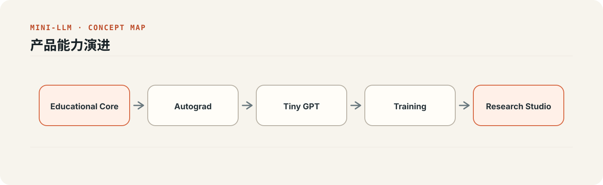
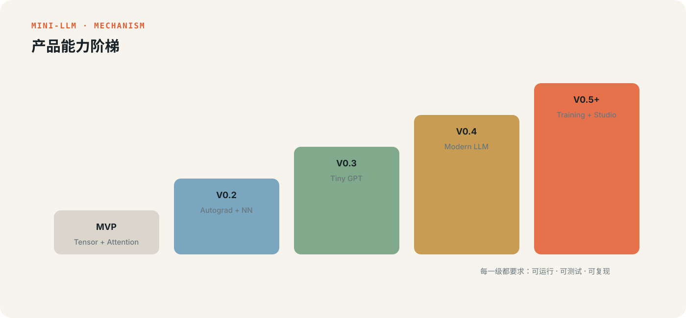
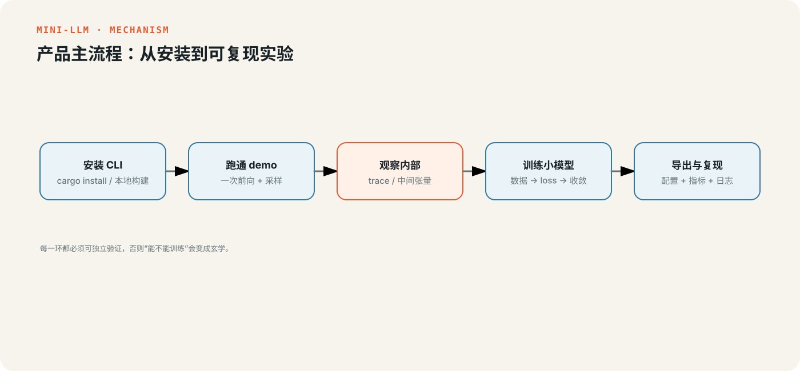

# mini-llm 产品需求文档（PRD）

_图：产品能力演进。从左到右展示本章核心概念之间的数据流与依赖关系。_

_图：一次需求讨论现场：白板上画着范围与切片，桌边的人各自带着不同的约束。PRD 的价值不在于把需求写得漂亮，而在于让产品、工程和使用者在同一张图上对齐“做什么、不做什么”。图片：DERDAKI ILIAS，[Wikimedia Commons](https://commons.wikimedia.org/wiki/File:WikiCamp_Morocco_2026_Day_3_-_Group_Discussing_Map_on_Whiteboard_During_Meeting_-_0021.jpg)，[CC BY-SA 4.0](https://creativecommons.org/licenses/by-sa/4.0/)。_

- 文档版本：0.1
- 状态：初稿 / MVP 范围已确定
- 项目名称：mini-llm
- 产品类型：Rust 原生大语言模型学习、训练与研究平台

## 1. 产品概述

mini-llm 是一个面向开发者、学习者和研究者的开源项目。项目借鉴 MiniMind“以小规模模型复现大模型训练流程”的理念，但以 Rust 为核心实现语言，提供从底层张量计算到小型语言模型训练、实验追踪和内部机制可视化的渐进式研究环境。

### 1.1 产品愿景

让开发者能够在个人计算机上理解、实现、训练和观察一个小型语言模型，而不是只通过高层 API 调用模型。

### 1.2 核心价值

- 可理解：关键算法有透明、可阅读的 Rust 实现。
- 可运行：从 CPU 小实验开始，逐步支持 GPU。
- 可验证：单元测试、数值对照和可复现实验。
- 可观察：展示训练指标及模型内部中间结果。
- 可扩展：模型、训练算法和计算后端保持模块化。

## 2. 目标用户

1. 希望系统学习 Transformer、LLM 和训练算法的开发者。
2. 希望用 Rust 研究神经网络实现的工程师。
3. 希望进行小规模模型架构和训练实验的研究者。
4. 希望理解模型内部计算过程的 AI 工程师。

## 3. 产品范围

_图：产品能力从教学 Tensor 逐级演进到训练、加速和研究工作台。_

### 3.1 MVP（v0.1）

必须交付：

- Cargo workspace 和模块化工程结构。
- CPU Tensor 基础类型与 shape 校验。
- Tensor 加法、矩阵乘法、ReLU、Softmax。
- 可测试的 scaled dot-product attention 原语。
- 模型配置结构。
- CLI 示例和配置检查。
- PRD、架构文档、路线图。
- 单元测试与基础错误处理。

MVP 不承诺训练完整 LLM。它首先验证项目结构、核心数据结构和数值计算路径。

### 3.2 V0.2：自动微分与基础神经网络

- 计算图和反向传播。
- 梯度累积、梯度清零。
- Linear、Embedding、LayerNorm。
- SGD、AdamW。
- XOR / 小型分类任务训练示例。
- 梯度数值检查（finite difference）。

验收标准：
- 基础算子的梯度测试通过。
- 小型 MLP 可以在 CPU 上收敛。
- 相同随机种子和配置可重复实验。

### 3.3 V0.3：Mini GPT

- 字符级或 BPE Tokenizer。
- Dataset、Sampler、Batcher。
- Token Embedding、位置编码。
- Causal Self-Attention。
- Transformer Decoder Block。
- LM Head 和 next-token cross entropy。
- 训练循环、日志、checkpoint。
- 文本生成与采样策略。

验收标准：
- 能从随机初始化训练小型 GPT。
- 能保存并恢复 checkpoint。
- 训练 Loss 能够下降并生成可解码文本。
- 提供端到端示例和训练说明。

### 3.4 V0.4：现代 Transformer

- RoPE
- RMSNorm
- SwiGLU
- GQA
- KV Cache
- 配置化模型结构

### 3.5 V0.5：训练与对齐

- 监督微调（SFT）
- Loss masking
- LoRA
- DPO
- 奖励模型实验
- GRPO（先从可控的玩具环境开始）

### 3.6 V0.6：GPU 与可视化

- Candle 加速后端
- CPU / GPU 数值一致性测试
- 训练事件与指标协议
- React + TypeScript Research Studio
- Attention、Hidden State、Logits 可视化

### 3.7 后续研究方向

- MoE 与路由可视化
- Vision-language 小模型
- 扩散语言模型
- Linear Attention
- Agent 工具调用与环境交互
- 世界模型与可迁移表征实验

## 4. 功能需求

| ID | 功能 | 优先级 | 描述 |
|---|---|---|---|
| FR-001 | Tensor | P0 | 创建张量、记录形状、验证数据长度 |
| FR-002 | Tensor Ops | P0 | Add、MatMul、ReLU、Softmax |
| FR-003 | Attention | P0 | 可运行的缩放点积注意力原语 |
| FR-004 | Model Config | P0 | 通过配置描述模型超参数 |
| FR-005 | CLI | P0 | 运行 demo、检查模型配置 |
| FR-006 | Autograd | P1 | 构建计算图并反向传播 |
| FR-007 | Optimizer | P1 | SGD、AdamW |
| FR-008 | Tokenizer | P1 | 编码、解码和特殊 Token |
| FR-009 | Training | P1 | 训练循环、指标和 checkpoint |
| FR-010 | Inspector | P2 | 暴露中间张量与训练事件 |
| FR-011 | GPU Backend | P2 | 使用 Candle 加速 |
| FR-012 | Studio UI | P2 | 实验管理与可视化 |

## 5. 非功能需求

- **正确性：** 核心算子必须有边界条件和数值测试。
- **可复现：** 实验配置、随机种子、数据版本和代码版本可追踪。
- **可移植：** 核心库优先保持跨平台；GPU 能力按平台提供。
- **可维护：** Cargo workspace 分 crate，避免循环依赖。
- **可观察：** 训练和推理过程通过结构化事件暴露状态。
- **性能：** 教学 CPU 后端优先正确性；性能优化不得破坏参考实现。
- **安全：** 数据集与模型文件默认按不可信输入处理；不执行数据集中的任意代码。

## 6. 核心用户流程

_图：产品主流程：安装、跑通 demo、观察内部、训练小模型、导出与复现。_

### 流程 A：学习 Attention

1. 运行 `cargo run -p mini-llm-cli -- demo`。
2. 阅读 Attention 实现。
3. 修改输入矩阵和 head dimension。
4. 运行测试。
5. 比较输出矩阵与手工计算结果。

### 流程 B：训练小模型（后续版本）

1. 创建模型配置。
2. 准备并检查数据集。
3. 选择 CPU 或 GPU 后端。
4. 启动训练任务。
5. 查看 Loss、学习率、梯度范数。
6. 保存 checkpoint。
7. 加载模型并生成文本。

### 流程 C：研究模型内部表征（后续版本）

1. 选择模型和 checkpoint。
2. 输入一段文本。
3. 选择 Transformer 层和观察点。
4. 查看 Token、Attention、Hidden State、Logits。
5. 保存实验快照并与其他配置比较。

## 7. MVP 验收标准

- `cargo test --workspace` 成功。
- CLI demo 输出矩阵乘法与 Attention 结果。
- 非法 shape 返回可读错误，而不是 panic。
- README 可以指导新用户在干净 Rust 环境中运行项目。
- 代码不依赖 Python。
- 文档明确区分已实现功能和规划功能。

## 8. 关键风险

| 风险 | 应对措施 |
|---|---|
| Rust 深度学习生态变化较快 | 后端隔离，先定义内部接口 |
| 自研 Autograd 工作量大 | 从少量算子开始，使用数值梯度校验 |
| GPU 训练复杂度高 | 先 CPU 正确，再引入 Candle |
| 功能范围过大 | 严格按里程碑交付 |
| 可视化拖慢核心开发 | 先设计事件协议，UI 延后 |
| 小模型结果容易被过度解读 | 文档中区分工程验证与科学结论 |

## 9. 产品成功指标

- 新用户 15 分钟内可以运行第一个 Tensor / Attention 实验。
- 核心算子有自动化测试。
- 能端到端训练一个小型 GPT。
- 实验可以保存、恢复和复现。
- 内部状态可被 Inspector 获取。
- CPU 参考实现与加速后端可以做数值对照。
