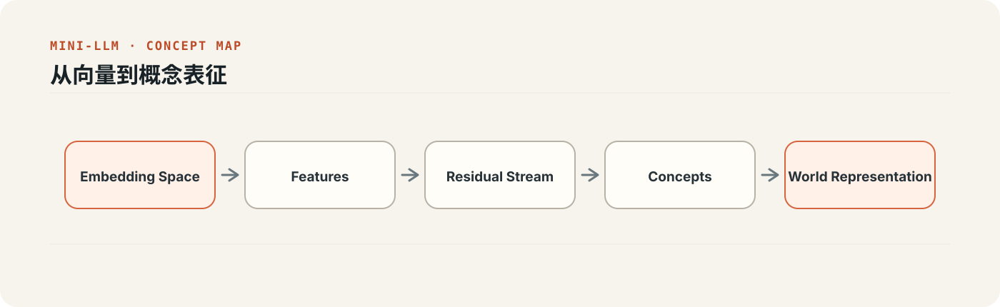

# **mini-llm Representation Engine 深度解析：从 Embedding Space、Semantic Geometry 到 Feature、Concept 与 World Representation**



_图：从向量到概念表征。从左到右展示本章核心概念之间的数据流与依赖关系。_

**副标题：大模型内部如何表示语言、概念、关系与世界？从向量空间走向内部世界表征**

在前面的 mini-llm 系列中，我们已经逐步构建了一个大语言模型的基本体系：

1. Tensor Engine：张量与矩阵运算。
2. Autograd Engine：自动微分与梯度计算。
3. Neural Network Engine：神经网络基础组件。
4. Transformer Engine：Embedding、Attention、Multi-Head Attention。
5. Transformer Block：FFN、Residual Connection、LayerNorm。
6. Decoder Engine：自回归生成与 KV Cache。
7. Training Engine：Dataset、Cross Entropy、Backpropagation、AdamW。
8. Evaluation Engine：Validation Loss、Perplexity、Benchmark、泛化能力。

到这里，我们已经知道模型如何计算、如何训练，以及如何评估。

但一个更深层的问题开始出现：

**模型内部究竟存储和表示了什么？**

例如，当模型看到：

```
苹果、香蕉、橙子、葡萄
```

它为什么能够发现这些词都属于水果？

当模型看到：

```
北京、上海、南京、广州
```

它为什么能够学习到这些词都属于城市？

当模型看到：

```
医生治疗患者。
```

它为什么能够区分医生、治疗和患者之间的关系？

这些能力并不是通过简单的字符串匹配就能解释的。

我们需要研究模型内部的向量空间、特征、概念以及信息流动机制。

这就是 Representation Learning（表征学习）和 Mechanistic Interpretability（机制可解释性）所关注的问题。

# **一、什么是 Representation？**

首先理解一个核心概念：

**Representation（表征），就是系统内部对外部对象、信息、状态或关系的编码方式。**

人类看到一只猫，不需要记住这只猫每个像素的颜色。

我们可以形成一个抽象概念：

```
猫
 ├── 动物
 ├── 哺乳动物
 ├── 四条腿（典型特征）
 ├── 有毛发
 └── 具有特定行为
```

这是一种抽象表征。

计算机也需要类似的机制。

假设输入：

```
这只猫正在睡觉。
```

模型首先将文本转换为 Token：

```
[    token_1,    token_2,    token_3,    token_4]
```

然后通过 Embedding 转换为向量：

\\[ X\in\mathbb{R}^{T\times D} \\]

其中：

- \\(T\\)：Token 数量。
- \\(D\\)：向量维度。

例如：

\\[ D=512 \\]

那么每个 Token 都会被表示为一个 512 维向量。

但这里需要注意：

**Embedding 向量并不是完整的语义，它只是模型处理信息的初始数值表示。**

真正复杂的上下文表征，还会在后续 Transformer 层中不断变化。

## **1.1 从文本到内部表征**

## **语言的内部表征过程**

**原始文本**

## **这只猫正在睡觉**

**Tokenizer**

文本转换为 Token ID

**Embedding**

离散 Token 转换为连续向量

**Transformer Layers**

融合上下文，形成动态表征

**Contextual Representation**

包含上下文相关信息的隐藏状态

这个过程说明：

模型不是直接理解原始文字，而是将语言转换为一系列可以进行数学运算的内部表征。

# **二、Embedding Space：为什么需要向量空间？**

假设我们有四个词：

```
苹果
香蕉
汽车
飞机
```

计算机如何表示它们之间的关系？

一种简单方法是为每个词分配一个向量。

例如：

\\[ E(\text{苹果})= [0.12,0.83,0.21,0.67] \\]

\\[ E(\text{香蕉})= [0.15,0.79,0.18,0.72] \\]

\\[ E(\text{汽车})= [0.91,0.13,0.72,0.20] \\]

\\[ E(\text{飞机})= [0.87,0.17,0.78,0.25] \\]

这些数字是示意值，并非真实模型的 Embedding。

我们可以观察到：

- 苹果和香蕉的向量比较接近。
- 汽车和飞机的向量比较接近。
- 苹果和汽车的向量相对较远。

这意味着模型可以通过向量之间的几何关系表达某些相似性。

这种空间叫做：

**Embedding Space（嵌入空间）。**

[Oracle AI Vector Searchの概要](https://images.openai.com/static-rsc-4/6xfOogcVRwIIeeOeNMQlfN7ZUC46GlQ_SvjLqIMuwB3ujH0HfFgvpkl7Ctm1KrsUzv7GQ-3AbXnVeLUOC0XaIrJ3mcJtuou-XABFJBumuGtUYX3C2YJYoYWdjWoA7tPQq1oXk3n2YZCHkYpW7th7EAZx3GiFb_7OqrMneatTjWY?purpose=inline)

[The Evolution of Word Embeddings in Natural Language Processing: A Journey from One-Hot Encoding to Transformers | by Kiran Gajjana | Medium](https://images.openai.com/static-rsc-4/Z6kpNex3HN8sh2xyeE4x977uzUT_wUD8gMu26-wotnhtq6NdYTP-xs1Smoya782UeguiG6aruO9nYHrBvWKwo24OL6eznHN0HtKBnhh2dCedeCiSKwdwSmCHybMd_tYqBEjOIlM07HV3_ovgcv-D8B1PxZENf5WRM3N0QAjrWPA?purpose=inline)

[矢量数据库与LLM的集成：实践指南 - charlieroro - 博客园](https://images.openai.com/static-rsc-4/4_oayHcEDkrHxQwFVKspTjK7cBq4_L93QBR1eqIL7FJffKP-ZzfTXTbHQJE6Nvg3nvZYgnJ4_ldICwTJ3RPzETSMltgN6D5XVyjtuPKADJaybPRXZo8uyDSJenoDpZkD4DnawTzL5BLKZb5F6P7PPxA9XfIBSpfE1QVjRetcG90?purpose=inline)

12

## **2.1 向量相似度**

如何计算两个向量是否相似？

一种常见方法是余弦相似度：

\\[ CosineSimilarity(A,B) = \frac{A\cdot B} {\\|A\\|\\|B\\|} \\]

其中：

- \\(A\cdot B\\)：向量点积。
- \\(\\|A\\|\\)：向量长度。
- \\(\\|B\\|\\)：向量长度。

计算结果通常在 -1 到 1 之间。

| 相似度   | 大致含义   |
| ----- | ------ |
| 接近 1  | 方向相近   |
| 接近 0  | 方向接近正交 |
| 接近 -1 | 方向相反   |

注意，余弦相似度衡量的是向量方向，不是完整的语义关系。

两个词在某个模型中向量接近，可能意味着它们在训练语料中具有相似的上下文分布，但不一定意味着它们具有相同的含义。

## **2.2 为什么语义可以形成几何结构？**

假设训练语料中经常出现：

```
苹果是一种水果。
香蕉是一种水果。
橙子是一种水果。
```

这些词经常出现在相似的语言环境中。

例如：

```
我喜欢吃苹果。
我喜欢吃香蕉。
我喜欢吃橙子。
```

模型在训练过程中会不断调整参数，使其能够预测正确的后续 Token。

在这个过程中，具有相似上下文行为的词可能形成某些相似的表示。

这与分布式语义学（Distributional Semantics）的思想有关：

**一个词的语义，可以通过它在语言中的使用环境得到部分刻画。**

不过，现代 Transformer 的语义表示并不只是静态词向量。

它还依赖上下文、位置、注意力以及网络层级。

# **三、Static Embedding 与 Contextual Embedding**

这是理解 Transformer 表征的关键区别。

## **3.1 Static Embedding：静态词向量**

假设模型使用一个固定的 Embedding 矩阵：

\\[ E\in\mathbb{R}^{V\times D} \\]

其中：

- \\(V\\)：词表大小。
- \\(D\\)：Embedding 维度。

每个 Token ID 对应一行向量。

例如：

```
苹果 → Vector A
银行 → Vector B
```

无论词语出现在什么句子中，查表得到的初始向量都是相同的。

这就是静态 Embedding。

## **3.2 Contextual Embedding：上下文表征**

考虑两个句子：

```
我去银行取钱。
```

```
河流的两岸有很多银行林。
```

这里第二个句子的表达并不自然，但可以通过另一个更清楚的例子理解多义词：

```
他在银行工作。
```

```
河岸上有一排树。
```

同一个词可能在不同上下文中具有不同含义。

Transformer 会利用上下文对 Token 表征进行更新。

可以表示为：

\\[ H^{(0)}=Embedding(X)+Position(X) \\]

\\[ H^{(l+1)}=TransformerBlock_l(H^{(l)}) \\]

经过多层处理：

\\[ H^{(L)}=Transformer(H^{(0)}) \\]

于是，某个 Token 在不同上下文中，最终可能得到不同的隐藏状态。

**上下文如何改变 Token 表征？**

**句子 A**

## **苹果很好吃。**

苹果：水果相关语境

Context A

**句子 B**

## **苹果发布了新电脑。**

苹果：品牌相关语境

Context B

**Transformer Contextualization**

**不同的上下文隐藏状态**

相同或相关 Token 的表征会根据上下文发生变化。

这里要注意：

不同上下文中的隐藏状态并不一定完全分离，也不一定可以用一个简单的向量方向解释全部词义。

它们是模型为了完成计算任务形成的内部数值状态。

# **四、Semantic Geometry：语义为什么能够形成几何关系？**

现在进入更有意思的问题：

如果模型通过向量表示语言，那么语义关系能否表现为几何关系？

答案是：在一定程度上可以。

## **4.1 经典词向量类比**

早期 Word2Vec 研究中，有一个著名的向量类比现象：

\\[ King-Man+Woman\approx Queen \\]

直观理解：

- King 与 Man 存在某种关系。
- Queen 与 Woman 存在相似的关系。
- 这种关系在向量空间中可能表现为相近的方向。

可以表示为：

\\[ v\_{king}-v\_{man}+v\_{woman} \approx v\_{queen} \\]

[Interpreting word representations and topic analysis using matrix factorization](https://images.openai.com/static-rsc-4/O7XVdShPj2W83HvwGreVs_GdG1UJAj5l1uos8ujidz-3Rq8krgAxbAVMTjCiDK53i-WKLW5Yl5qYMxo_X0GgqjtewQxSdZ3DViJwVFPiz4KVZtfygKL6traJU7AMZZkNisA2GTuVudGXkLcUOBJy61XBK7yybN_ctz0sRCozr9I?purpose=inline)

[lamarr-institute.org](https://lamarr-institute.org/blog/dedicom-matrix-factorization/?utm_source=chatgpt.com)

但这里必须澄清：

这不是所有模型、所有词、所有上下文都成立的普遍定律。

现代 Transformer 的上下文隐藏状态具有更复杂的结构，不能简单认为所有语义关系都能通过固定向量加减获得。

## **4.2 关系可以表现为方向**

假设：

\\[ v\_{Paris}-v\_{France} \\]

在某个向量空间中形成一种关系方向。

那么其他城市与国家之间的关系，可能也会表现出某些相似结构。

例如：

\\[ v\_{Tokyo}-v\_{Japan} \\]

如果两个向量差在某种意义上接近，就说明模型可能在空间中编码了类似的关系。

这引出了一个重要思想：

**语义不一定只体现在某个点上，也可能体现在向量之间的关系、方向和结构上。**

## **4.3 从点表示到关系表示**

我们可以把语义空间理解成三层：

## **语义几何的三个层次**

**第一层：点（Point）**

一个向量代表一个 Token 或一个上下文状态。

**第二层：方向（Direction）**

向量变化可能表达某些关系或特征。

**第三层：结构（Structure）**

多个点、方向与关系共同形成复杂的表征结构。

这为理解模型内部概念提供了一个几何视角。

但我们不能直接把低维可视化中的簇或方向当作真实语义结构的完整证明。PCA、t-SNE 和 UMAP 都会改变高维空间的可视化结构。

# **五、Feature：模型内部的特征是什么？**

现在从 Embedding Space 进入更深层的问题。

假设 Transformer 某一层的隐藏状态为：

\\[ h\in\mathbb{R}^{D} \\]

其中：

\\[ D=512 \\]

这是一个 512 维向量。

每个维度是不是都代表一个明确概念？

例如：

```
第 1 维：动物
第 2 维：颜色
第 3 维：地点
第 4 维：情绪
```

通常不能这样理解。

真实神经网络中的单个维度并不一定对应清晰、独立的人类概念。

更有意义的研究对象是：

**Feature（特征）。**

Feature 可以理解为模型内部某种可被激活、检测或参与计算的模式。

例如，某个特征可能与：

- 人名。
- 代码中的函数调用。
- 引号内部的内容。
- 否定表达。
- 某种语法结构。
- 特定类型的语义关系。

有关。

这些是可能的特征解释，并不意味着一个特征一定只对应一个人类概念。

## **5.1 Feature 如何表示？**

假设隐藏状态：

\\[ h\in\mathbb{R}^{512} \\]

某个 Feature 对应一个方向：

\\[ f\in\mathbb{R}^{512} \\]

那么可以通过点积计算该特征的响应：

\\[ a=f^Th \\]

如果：

\\[ a \\]

比较大，说明当前隐藏状态在这个方向上具有较强的投影。

可以把它理解为：

模型当前状态中，存在较强的某种特征信号。

注意，这是一种简化的几何理解。实际模型中的特征可能需要非线性检测，也可能与其他特征相互作用。

## **5.2 Feature 与 Neuron 有什么区别？**

Neuron 通常指神经网络中的一个神经元，或者某个层中的一个标量激活。

Feature 则是我们希望解释的内部信息模式。

二者并不等价。

例如：

一个 Neuron 可能同时响应：

- 某类动物名称。
- 某些代码片段。
- 某种语法结构。

反过来，一个 Feature 也可能分布在多个 Neuron 上。

这意味着：

**神经元是计算结构中的单元，Feature 是信息表征层面的概念。**

# **六、Superposition：为什么一个神经元可能表示多个特征？**

这是现代机制可解释性研究中的重要问题。

假设一个模型隐藏维度只有 2：

\\[ h\in\mathbb{R}^{2} \\]

但它需要表达 5 种不同特征：

```
Feature A：动物
Feature B：颜色
Feature C：地点
Feature D：代码
Feature E：情绪
```

显然，2 个维度无法为 5 个特征提供相互正交的独立方向。

那么模型怎么办？

一种可能的方式是：

**让多个特征共享同一组神经元或方向。**

这就是 Superposition（叠加）。

[05 - Sparse autoencoders](https://images.openai.com/static-rsc-4/SUG8W7_tP42wfNg88DUJI4rzEuunaXpHyHrbXxAzw8hXEB9YFJ6puvIVLWr8A7zhRf5YlawEa8DHV-7FbJqo1hjivxPwzLaNkJ-NAC4ZVe1gsRkgXx0dJw69wXbclJbT7owvfg3RsGiRfBO80XC_njY8qhH3vPLK8StXMAxwTAQ?purpose=inline)

[learnmechinterp.mcgee.cat](https://learnmechinterp.mcgee.cat/steps/05-sparse-autoencoders?utm_source=chatgpt.com)

## **6.1 用数学理解特征叠加**

假设模型隐藏状态为：

\\[ h\in\mathbb{R}^{2} \\]

存在多个特征向量：

\\[ f_1,f_2,\ldots,f_5 \\]

那么隐藏状态可以近似表示为：

\\[ h=\sum\_{i=1}^{5}a_if_i \\]

其中：

- \\(f_i\\)：特征方向。
- \\(a_i\\)：特征激活强度。

虽然隐藏空间只有 2 维，但不同特征可以通过共享方向和稀疏激活组合在一起。

这有点像：

多个无线信号在同一条通信通道中传输，接收端通过特定结构尝试分离它们。

不过，神经网络中的特征叠加是一个更复杂的非线性问题，不能完全等同于无线信号混合。

## **6.2 为什么模型会使用 Superposition？**

因为模型通常希望表达的特征数量远远超过隐藏维度。

如果每个特征都占据独立维度，模型可能需要非常大的隐藏空间。

通过特征叠加，模型可以在有限维度中编码更多信息。

代价是：

- 特征之间可能发生干扰。
- 某些激活难以解释。
- 单个神经元可能呈现多种响应。
- 线性探测可能无法完整恢复真实特征。

这也解释了为什么直接观察某个神经元的激活，往往不足以理解模型内部的信息。

# **七、Residual Stream：Transformer 内部的信息通道**

现在我们进入 Transformer 结构中一个非常重要的概念：

**Residual Stream（残差流）。**

回顾 Transformer Block：

```
Input
  |
  v
Attention
  |
  v
Residual Add
  |
  v
FFN
  |
  v
Residual Add
  |
  v
Output
```

残差连接的作用不只是让梯度更容易传播。

它还形成了一个可以持续累积和更新信息的向量通道。

## **7.1 Residual Connection**

一个简单的残差结构：

\\[ y=x+F(x) \\]

其中：

- \\(x\\)：原始输入。
- \\(F(x)\\)：网络计算得到的变化。
- \\(y\\)：更新后的表示。

Transformer 中可以抽象为：

\\[ h\_{l+1}=h_l+Attention(LN(h_l)) \\]

然后：

\\[ h\_{l+2}=h\_{l+1}+FFN(LN(h\_{l+1})) \\]

这是 Pre-Norm 风格的示意形式。

不同 Transformer 架构的具体 Norm 放置方式可能不同。

## **7.2 为什么 Residual Stream 很重要？**

可以把它理解为一条持续传递信息的通道。

例如：

## **Residual Stream 信息演化**

**Layer 0**

初始 Token 表征

Attention 添加上下文信息

**Layer 1**

初始表征 + 上下文关系

FFN 添加非线性特征变换

**Layer 2**

原始信息 + 上下文 + 特征变换

更多 Transformer Block

**Final Layer**

供最终预测使用的上下文表征

需要注意，这只是帮助理解的概念模型。

不能简单认为：

- 第一层只负责词法。
- 第二层只负责语法。
- 第三层只负责逻辑。

真实 Transformer 中的信息分布更加复杂，多个层可以同时处理多种类型的信息。

## **7.3 为什么研究 Residual Stream？**

因为它提供了一个研究模型内部计算过程的切入点。

我们可以研究：

- 某个 Attention Head 向 Residual Stream 写入了什么信息？
- 某个 FFN 是否改变了某类特征？
- 某个特征在不同层之间如何传播？
- 某些特征是否被后续层抑制？
- 最终输出是如何从这些信息中形成的？

这就是 Mechanistic Interpretability 的重要研究方向。

# **八、SAE：如何从模型激活中提取特征？**

现在进入一个非常重要的工具：

**Sparse Autoencoder（SAE，稀疏自编码器）。**

我们已经知道：

- 模型隐藏状态包含大量信息。
- 多个特征可能发生叠加。
- 单个神经元不一定对应单一概念。

那么，有没有方法将混合在一起的特征分解出来？

SAE 就是研究这一问题的一种方法。

## **8.1 普通 Autoencoder**

先理解普通自编码器。

输入：

\\[ x\in\mathbb{R}^{D} \\]

编码：

\\[ z=Encoder(x) \\]

解码：

\\[ \hat{x}=Decoder(z) \\]

目标是：

\\[ \hat{x}\approx x \\]

也就是说：

把输入压缩成潜在表示，再尝试还原输入。

## **8.2 Sparse Autoencoder**

SAE 在此基础上增加稀疏约束。

例如：

\\[ z=ReLU(W\_{enc}(x-b\_{dec})+b\_{enc}) \\]

然后：

\\[ \hat{x}=W\_{dec}z+b\_{dec} \\]

训练目标：

\\[ L= \underbrace{\\|x-\hat{x}\\|\_2^2}\_{重构误差} + \lambda \underbrace{\\|z\\|\_1}\_{稀疏约束} \\]

其中：

- \\(x\\)：Transformer 激活。
- \\(z\\)：SAE 特征激活。
- \\(\hat{x}\\)：重构出来的激活。
- \\(\lambda\\)：稀疏约束强度。

稀疏约束希望模型在表达输入时，只激活少量特征。

## **8.3 SAE 为什么可能有帮助？**

假设 Transformer 某层的隐藏维度为：

\\[ D=512 \\]

我们构建一个 SAE：

\\[ D\_{SAE}=4096 \\]

那么 SAE 的特征空间比原始隐藏空间大 8 倍。

它可以尝试将混合在原始隐藏状态中的信息，表示为更多相对稀疏的特征。

[Mechanistic Interpretability for AI Safety — A Review | Leonard F. Bereska](https://images.openai.com/static-rsc-4/4eLnWx_qPjDTT2Fm65CBqpThxlPNP9ooq-WhyGXu7VLFzV4_EnH0sRFC9wW7JdUdzMJaLMoItUlEbTvwXlM4Rj6d3EekfGhHTs8q5R-7oxm2jl4dHCxcQ4_y5eVkmc1cgGwEGVdhr3iVwZbIzjBaywrbvWmebNz3Pr5IvQ8iEvI?purpose=inline)

[leonardbereska.github.io](https://leonardbereska.github.io/blog/2024/mechinterpreview/?utm_source=chatgpt.com)

例如，经过 SAE 后，可能观察到：

```
Feature 001：与动物名称相关
Feature 002：与代码括号相关
Feature 003：与地理位置相关
Feature 004：与否定表达相关
Feature 005：与函数定义相关
```

但必须强调：

**SAE 输出的 Feature 并不会自动带有人类可读的语义标签。**

这些标签通常需要通过激活样本、特征可视化、对比实验和干预实验进行解释。

SAE 也存在局限：

- 重构误差。
- 特征拆分。
- 特征合并。
- 死亡特征。
- 特征解释不稳定。
- 稀疏程度与重构质量之间的权衡。

所以，SAE 是一种研究工具，不是已经证明能够恢复模型全部真实概念的万能解码器。

# **九、从 Feature 到 Concept：特征是否等于概念？**

这里需要进一步区分三个概念：

| 概念      | 含义                |
| ------- | ----------------- |
| Neuron  | 神经网络中的计算单元        |
| Feature | 模型内部可以被检测或解释的信息模式 |
| Concept | 人类认知中具有语义意义的抽象概念  |

例如：

```
Neuron：
某个神经元的激活值。

Feature：
某种与代码函数定义有关的激活模式。

Concept：
函数是一种可调用的程序结构。
```

三者之间没有简单的一一对应关系。

一个 Concept 可能由多个 Feature 共同表达。

一个 Feature 也可能参与多个 Concept 的计算。

例如，模型理解：

```
医生治疗患者。
```

可能需要组合：

- 医生这一实体的表征。
- 患者这一实体的表征。
- 治疗这一动作的表征。
- 主体与动作的关系。
- 动作与对象的关系。

这不是一个神经元就能完整表达的。

因此，我们需要从单个 Feature 进一步研究：

**Feature 如何组合成概念和关系？**

# **十、World Representation：模型内部是否形成了世界表征？**

现在进入本篇最重要的问题。

假设我们输入：

```
小明把杯子放在桌子上。
```

模型可能需要处理：

- 小明是一个人。
- 杯子是一个物体。
- 桌子是一个物体。
- 放置是一个动作。
- 杯子是动作的对象。
- 桌子是杯子的目标位置。

如果继续输入：

```
随后，小明把桌子移动到了房间另一边。
```

模型还需要处理：

- 桌子的位置发生了变化。
- 杯子可能仍在桌子上。
- 杯子的位置也可能随桌子变化。

这已经涉及对象、关系、状态与状态变化。

我们可以将其抽象成一个世界状态：

\\[ S_t \\]

例如：

\\[ S_t= \\{ Object,\ Position,\ Relation,\ State \\} \\]

世界状态发生变化：

\\[ S\_{t+1}=F(S_t,A_t) \\]

其中：

- \\(S_t\\)：当前世界状态。
- \\(A_t\\)：动作。
- \\(F\\)：状态转移过程。
- \\(S\_{t+1}\\)：下一时刻状态。

这就是 World Model（世界模型）研究中的典型思路之一。

## **10.1 语言模型是否真的拥有 World Model？**

这是一个仍然存在争论的问题。

我们不能仅仅因为模型能够描述世界，就断言它一定构建了与人类相同的内部世界模型。

但也不能因为它通过预测下一个 Token 训练，就认为它只是在做简单的字符串匹配。

一个自回归模型需要学习：

\\[ P(x\_{t+1}|x_1,\ldots,x_t) \\]

为了提高预测准确率，它可能需要在内部编码：

- 对象及其属性。
- 事件及其关系。
- 时间顺序。
- 空间关系。
- 因果线索。
- 人物意图。
- 不同状态之间的变化。

这些内部结构是否构成严格意义上的 World Model，需要通过实验来判断。

## **10.2 从语言预测到世界状态预测**

考虑一个简单故事：

```
小明有一个红色的球。

他把球放进盒子里。

然后把盒子拿到房间外面。
```

如果我们问：

```
球现在在哪里？
```

模型需要利用前面的事件信息进行推断。

可以抽象为：

## **一个简单的状态变化模型**

**初始状态 S₀**

球：房间内，盒子外

动作 A₁：把球放进盒子

**状态 S₁**

球：房间内，盒子内

动作 A₂：把盒子移到房间外

**状态 S₂**

球：房间外，盒子内

这里展示的是一个明确的状态转移模型。

语言模型可能通过隐藏状态、注意力和其他内部计算，编码完成这种推断所需的信息。

但它内部是否存在一个明确、可独立读取的状态表，并没有得到普遍证明。

# **十一、如何在 mini-llm 中研究 Representation？**

现在我们从理论进入工程。

我们不应该只训练一个模型，然后观察它生成了什么。

还应该提供一套工具，能够观察模型内部的激活和信息变化。

建议新增：

**Representation Analysis Engine。**

## **11.1 需要采集哪些数据？**

可以从 Transformer 中采集：

| 数据                 | 用途        |
| ------------------ | --------- |
| Token Embedding    | 观察初始向量    |
| Hidden States      | 观察各层表征变化  |
| Attention Weights  | 观察注意力分布   |
| Residual Stream    | 观察信息累积    |
| MLP Activations    | 研究 FFN 特征 |
| Neuron Activations | 分析神经元行为   |
| SAE Activations    | 分析稀疏特征    |

注意，Attention Weight 不能直接等同于模型解释。它描述注意力分配情况，但不能单独证明某个信息对最终预测具有因果作用。

## **11.2 为 Transformer 增加 Hook**

以 PyTorch 风格为例：

```
activations = {}def save_activation(name):    def hook(module, inputs, output):        activations[name] = output.detach()    return hook
```

注册 Hook：

```
model.layers[0].register_forward_hook(    save_activation("layer_0"))model.layers[1].register_forward_hook(    save_activation("layer_1"))
```

执行：

```
with torch.no_grad():    output = model(input_ids)
```

获取：

```
h0 = activations["layer_0"]h1 = activations["layer_1"]
```

现在我们可以研究：

- 不同层的隐藏状态是否发生变化。
- 相同 Token 在不同上下文中的表示差异。
- 某些输入是否激活了特定特征。
- 不同层之间的信息变化。

真实实现需要根据模型模块结构确定 Hook 的位置，并考虑是否采集 Norm 前后、Attention 前后或 Residual Add 前后的激活。

## **11.3 研究特征变化**

例如：

```
similarity = cosine_similarity(    h0,    h1,    dim=-1)
```

可以初步观察同一个位置在不同层之间的表示相似程度。

不过，隐藏状态经过不同层的线性变换和非线性变换后，坐标空间本身也可能发生变化。

因此，不能仅凭相似度大小判断信息是否增加或减少。

还需要结合线性探测、特征激活、消融和因果干预实验。

# **十二、Representation Engine 工程架构**

建议 mini-llm 新增如下模块：

```
mini-llm/
│
├── representation/
│   │
│   ├── embedding/
│   │   ├── embedding_analyzer.py
│   │   └── similarity.py
│   │
│   ├── hidden_states/
│   │   ├── activation_collector.py
│   │   ├── layer_analyzer.py
│   │   └── representation_probe.py
│   │
│   ├── attention/
│   │   ├── attention_analyzer.py
│   │   └── attention_visualizer.py
│   │
│   ├── residual/
│   │   ├── residual_collector.py
│   │   └── residual_analyzer.py
│   │
│   ├── features/
│   │   ├── feature_extractor.py
│   │   ├── neuron_analyzer.py
│   │   └── feature_visualizer.py
│   │
│   ├── sae/
│   │   ├── encoder.py
│   │   ├── decoder.py
│   │   ├── trainer.py
│   │   └── evaluator.py
│   │
│   ├── interventions/
│   │   ├── activation_ablation.py
│   │   ├── activation_patching.py
│   │   └── causal_analysis.py
│   │
│   └── report/
│       ├── feature_report.py
│       └── representation_report.py
│
└── experiments/
    ├── embedding_geometry.py
    ├── contextual_embedding.py
    ├── feature_analysis.py
    └── world_state_probe.py
```

这里增加了一个非常重要的模块：

`interventions/`

因为仅仅观察模型激活是不够的。

我们还需要研究：

**某个特征是否真正参与了模型的计算？**

# **十三、从观察到因果：Activation Patching**

这是机制可解释性研究中非常重要的一类方法。

先看一个简单实验。

准备两个输入：

```
输入 A：巴黎是法国的首都。
输入 B：东京是日本的首都。
```

假设我们希望研究某一层中的某个激活，是否参与了国家与首都关系的处理。

可以执行：

1. 分别运行输入 A 和输入 B。
2. 记录某层某位置的激活。
3. 将输入 A 的激活替换成输入 B 对应位置的激活。
4. 观察模型输出是否发生变化。
5. 比较替换前后的预测结果。

这类实验称为 Activation Patching（激活修补）。

示意：

## **Activation Patching**

**Clean Run**

输入 A

巴黎是法国的首都。

记录激活

**Corrupted Run**

输入 B

东京是日本的首都。

替换激活来源

**Activation Patching**

**观察输出变化**

分析被替换的激活对模型行为产生了什么影响。

如果替换某个激活后，模型的输出发生了系统性变化，说明这个激活可能参与了相关计算。

但要注意：

- 激活替换可能产生分布外状态。
- 位置对齐可能不正确。
- 单个干预的结果可能依赖上下文。
- 输出变化不一定意味着找到了完整的因果机制。

因此，Activation Patching 应当配合对照实验、消融实验和重复实验使用。

# **十四、一个完整的 Representation 研究实验**

现在设计一个可以在 mini-llm 上执行的研究。

**实验名称：模型是否能够形成动物类别的内部表征？**

### **实验目标**

研究模型是否学习到动物概念相关的内部特征。

### **第一步：准备文本**

```
猫是一种动物。
狗是一种动物。
老虎是一种动物。
狮子是一种动物。
苹果是一种水果。
香蕉是一种水果。
```

### **第二步：提取隐藏状态**

分别提取：

```
猫
狗
老虎
狮子
苹果
香蕉
```

在指定 Transformer 层中的隐藏状态。

### **第三步：训练线性探测器**

假设我们得到：

\\[ H\in\mathbb{R}^{N\times D} \\]

其中：

- \\(N\\)：样本数量。
- \\(D\\)：隐藏维度。

给每个样本设置标签：

```
labels = [    1, 1, 1, 1, 0, 0]
```

其中：

- 1：动物。
- 0：水果。

然后训练一个简单的 Logistic Regression：

\\[ P(y=1|h)=\sigma(Wh+b) \\]

观察模型隐藏状态是否能够支持动物与水果的分类。

### **第四步：测试泛化能力**

训练样本：

```
猫、狗、老虎、狮子
```

测试样本：

```
兔子、熊、大象
```

如果分类器能够正确识别未参与训练的动物词汇，说明隐藏状态中可能包含可迁移的类别信息。

### **第五步：进行消融实验**

尝试：

- 删除某个 SAE Feature。
- 修改某个神经元激活。
- 替换某层的部分 Residual Stream。
- 比较模型预测结果。

研究这些干预是否影响模型对动物概念的处理。

### **这个实验能够证明什么？**

它可以提供证据：

模型的隐藏状态中存在能够支持动物类别区分的信息。

但它不能单独证明：

- 模型内部有一个明确的动物概念模块。
- 模型像人类一样理解动物。
- 这个信息一定是模型完成任务的必要条件。

这是表征分析与机制解释之间的重要区别。

# **十五、我们最终想研究的是什么？**

回顾整个过程：

## **从 Token 到 World Representation**

**Token**

离散语言符号

**Embedding**

连续向量表示

**Contextual Representation**

上下文相关的隐藏状态

**Features**

可识别的内部信息模式

**Concepts & Relations**

概念、属性与关系信息

**World Representation**

对对象、状态、关系与变化的内部表征假设

这里的箭头不是已经被证明的固定心理或计算阶段，而是一种研究框架：帮助我们从不同抽象层次分析模型内部信息。

我们现在可以提出一个更深刻的问题：

**如果模型内部形成了特征、概念和关系，那么它是否还能够预测这些关系在未来如何变化？**

例如：

- 杯子从桌子上掉下来，会发生什么？
- 一个物体受到外力，会如何运动？
- 一个人采取某个行动，会导致什么结果？
- 一个软件系统修改某个模块，会影响哪些其他模块？

这些问题已经从静态表征走向动态世界模型。

# **十六、下一篇：mini-llm World Model Engine 深度解析**

建议下一篇：

**《mini-llm World Model Engine 深度解析：从 State Representation、State Transition 到 Prediction、Planning 与 Action》**

重点研究：

1. State Representation：如何表示世界状态？
2. Object Representation：如何表示对象及其属性？
3. Relation Modeling：如何表达对象之间的关系？
4. State Transition：如何预测状态变化？
5. World Dynamics：如何学习世界运行规律？
6. Prediction：如何预测未来状态？
7. Planning：如何根据目标选择行动？
8. Model-based Reasoning：如何利用内部模型进行推理？
9. Active Inference：如何通过行动获取信息并更新认知？
10. LLM 与 World Model：语言模型与世界模型有什么关系？

**这将是 mini-llm 系列一次重要的转折：从研究模型如何表示信息，转向研究模型如何表示一个持续变化的世界。**

