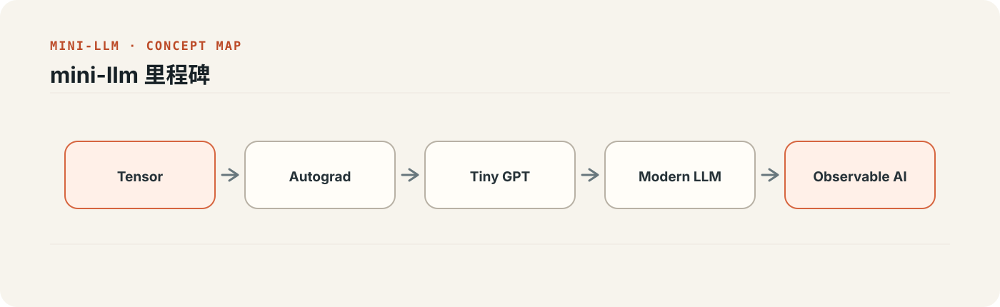
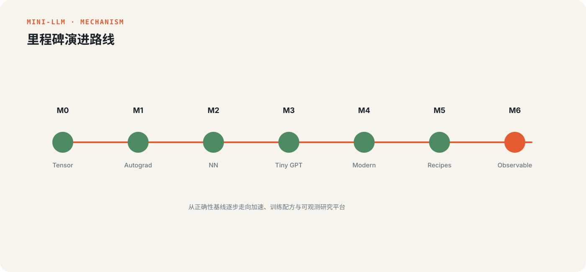

# mini-llm 开发路线图

_图：mini-llm 里程碑。从左到右展示本章核心概念之间的数据流与依赖关系。_

_图：里程碑原本就是路边的石头：刻着到下一站的距离，提醒行人已经走了多远、还有多远。Roadmap 里的 Milestone 借用的正是这个意象——每个阶段都要有可验证的产物，而不只是日期。图片：Dave.Dunford，[Wikimedia Commons](https://commons.wikimedia.org/wiki/File:Milestone_in_Llanystumdwy.jpg)，[CC BY-SA 4.0](https://creativecommons.org/licenses/by-sa/4.0/)。_

## Milestone 0 — 可运行骨架（已完成）

- [x] Cargo workspace
- [x] CPU Tensor
- [x] Add / MatMul / ReLU / Softmax
- [x] Scaled dot-product attention
- [x] CLI demo
- [x] 基础测试
- [x] PRD / 架构文档

## Milestone 1 — Autograd（已完成）

- [x] Tensor 节点与计算图
- [x] backward 机制
- [x] Add / Mul / MatMul 梯度
- [x] ReLU / Softmax / CrossEntropy 梯度
- [x] finite-difference 梯度检查

实现位于 `crates/mini-llm-autograd`：

- `TensorValue` 包装计算图节点，记录 op 名称、父节点和 backward 闭包；
- `backward()` 先做拓扑排序，再按逆序累积梯度，共享子表达式会正确相加；
- 额外支持 `sub` / `transpose` / `scale` / `add_scalar` / `powf` / `sum` /
  `mean` / `mse`，以及 NumPy 风格的右对齐广播（梯度通过 `sum_to` 还原）；
- `crates/mini-llm-autograd/tests/gradients.rs` 用中心差分校验每个算子；
- 演示命令：`cargo run -p mini-llm-cli -- autograd`（计算图 + 梯度）和
  `cargo run -p mini-llm-cli -- train-line`（手写 SGD 拟合直线）。

当前限制：仅 `f32`、单线程、无原地更新、无 `no_grad`、无高阶梯度。

## Milestone 2 — Neural Network Basics（已完成）

- [x] Linear
- [x] Embedding
- [x] LayerNorm
- [x] SGD / AdamW
- [x] XOR 与小型分类任务

实现位于 `crates/mini-llm-nn`：

- `Linear`（`y = xW + b`，Xavier 初始化，可选 bias）、`Embedding`（行 gather，
  重复 token 的梯度会累加）、`LayerNorm`（由 autograd 原语组合而成，反向传播
  自动推导）、`Relu` / `Tanh` / `Sigmoid`、`Sequential` 容器；
- `Sgd`（可选 momentum）与 `AdamW`（解耦权重衰减 + 偏差修正），通过
  `TensorValue::set_value` 原地更新参数；
- 确定性 `Rng`（xorshift64*），相同 seed 得到相同的初始化；
- 测试覆盖形状、LayerNorm 归一化性质、Embedding 梯度散射、SGD/AdamW 数值、
  XOR 端到端收敛；
- 演示命令：`cargo run -p mini-llm-cli -- xor` 与
  `cargo run -p mini-llm-cli -- classify`。

## Milestone 3 — Tiny GPT（已完成）

_图：路线图以可运行、可测试的里程碑逐步构建完整 mini-llm。_

- [x] 字符级 Tokenizer
- [x] 数据批处理
- [x] Causal Attention
- [x] Transformer Decoder
- [x] Language Modeling Loss
- [x] 训练循环与 checkpoint
- [x] 文本生成

实现拆分：

- `mini-llm-data`：`CharTokenizer`（按码点排序、确定性的字符表）与
  `TextDataset`（随机窗口采样，target 右移一位，显式 `batch_at` 便于测试）；
- `mini-llm-model`：`CausalSelfAttention`（按 head 切片，块对角 causal mask）、
  `Mlp`、`TransformerBlock`（pre-norm + 残差）、`TinyGpt`
  （token/position embedding → blocks → final norm → lm head）；
- `mini-llm-train`：`Trainer`（采样、前向、反向、AdamW 更新、评估）与
  自描述的二进制 checkpoint（配置 + 字符表 + 全部参数）；
- 命令行：`train [steps]` 在 420 字符的内置语料上训练约 6 万参数的模型，
  `generate [prompt] [tokens] [temp]` 加载 checkpoint 采样；
- 测试覆盖：causal mask 不泄漏未来 token、不同样本不互相注意、梯度到达全部参数、
  训练可复现且 loss 下降、checkpoint 往返与损坏检测。

为了让纯标量 kernel 在 debug 构建下可用，workspace 的 `[profile.dev]` 与
`[profile.test]` 设为 `opt-level = 2`。

## Milestone 4 — Modern LLM（已完成）

- [x] RoPE
- [x] RMSNorm
- [x] SwiGLU
- [x] GQA
- [x] KV Cache
- [x] MoE

实现要点：

- `mini-llm-tensor`：`rope_rotate(head_dim, positions, base)` 按 head 内
  `(2i, 2i+1)` 配对旋转，负位置即逆旋转；`mini-llm-autograd` 的 `rope`
  正是用它做反向传播，梯度已通过有限差分校验。
- `mini-llm-nn`：`RmsNorm`（无均值中心、无 bias）、`SwiGlu`
  （`W2(SiLU(W1x) ⊙ W3x)`）、`Moe`（router + 多个 SwiGLU 专家，top-k 门控；
  当前为稠密执行，便于观察路由概率与专家占用）。
- `mini-llm-model`：`ModelConfig` 新增 `num_kv_heads`、`norm`、`position`、
  `feed_forward`、`num_experts`；`ModelConfig::modern()` 组合
  RMSNorm + RoPE + SwiGLU + GQA。
- KV Cache：`AttentionCache` / `BlockCache` 保存每层每头的历史 K/V，
  `generate()` 每步只前向一个 token；`generate_uncached()` 保留为对照，
  测试断言两者贪心解码完全一致。
- checkpoint 升级为 v2（10 个配置字段），v1 文件仍可读取并回退到经典架构。

已知限制：MoE 为稠密执行（所有专家都计算）；RoPE 超出训练上下文后质量下降；
缓存只支持 batch=1 的生成。

## Milestone 5 — Training Recipes（已完成）

- [x] Pretraining
- [x] SFT / Loss Masking
- [x] LoRA
- [x] DPO
- [x] GRPO toy environment

实现拆分：

- `mini-llm-autograd`：`log_softmax_rows`、`log_sigmoid`、`sum_rows_keepdim`、
  `cross_entropy_weighted`（权重 0 即掩码，损失按权重和归一化），全部有有限差分校验。
- `mini-llm-data`：`Dataset` trait、`Batch.weights`、`SftDataset`、
  `CharTokenizer::encode_supervised`（prompt 掩码、response 监督）。
- `mini-llm-train`：`Trainer<D: Dataset>` 支持带权批次；`recipes` 模块提供
  `sequence_log_prob`、`dpo_loss`、`grpo_loss`。
- `mini-llm-nn`：`LoraLinear`——冻结 base、只把低秩 A/B 报告给优化器。
- CLI：`sft`、`lora`、`dpo`、`grpo` 四个可运行的配方演示。

已知限制：DPO/GRPO 演示使用玩具策略（单个 Linear），没有真正的多步环境；
SFT 语料仅用于展示掩码机制。

## Milestone 6 — Accelerated & Observable

- [x] Candle backend
- [x] CPU/GPU parity tests
- [x] Training event protocol
- [x] Attention / activation / logits capture
- [x] React Research Studio

实现拆分：

- `mini-llm-trace`：`Event`（RunStarted / Step / Tensor / Checkpoint /
  RunCompleted / RunFailed）、`EventSink`、`MemorySink`、`JsonlSink`；
- `mini-llm-model`：`TinyGpt::forward_traced` 返回每个 layer、每个 head 的
  注意力矩阵（`AttentionRecord`），形状 `[batch*seq, batch*seq]`；
- `mini-llm-train`：`Trainer::train_observed` 在训练循环中发出结构化事件；
- `mini-llm-backend`：`Backend` trait，`CpuBackend` 始终可用，
  `CandleBackend` 由 `candle` feature 启用；`tests/parity.rs` 对比 CPU 与
  Candle 的矩阵乘法（容差 1e-4）；
- CLI：`trace` 命令训练 30 步并把事件、注意力矩阵与 logits 写入
  `traces/<run_id>.jsonl`；
- Research Studio：`web/src/pages/studio.astro` + React 岛
  `ResearchStudio.tsx`，读取轨迹后渲染损失曲线、每个 layer/head 的注意力
  热力图与最后一个位置的 logits，支持拖入自己的 `.jsonl`。

说明：

- 所谓 "CPU/GPU parity" 当前是「本仓库 CPU kernel vs Candle CPU 后端」的
  数值一致性；Candle 的 `Device::Cuda` 可用同一接口接入，但需要 GPU 环境。
- Candle 依赖较重，默认不编译：
  `cargo test -p mini-llm-backend --features candle`。
- Studio 是纯静态页面（`pnpm build` 时把示例轨迹内联），不训练模型；拖入
  新的轨迹即可查看自己的 run。

设备抽象（Milestone 8）：

- `DeviceTensor`：数据可驻留 `Cpu` 或 `Candle(Device)`，`to()` / `to_host()`
  显式跨越边界，混合设备运算直接报错；
- `DeviceLinear` / `DeviceMlp`：权重常驻设备，`forward` 与手写 `backward`
  都在设备上执行，梯度与 host autograd 对照通过；
- `DeviceValue`：设备 tape，`matmul/add/relu/mean/scale` 拓扑反向、梯度累加，
  与 host autograd 逐梯度对照；
- `DeviceLinear`/`DeviceMlp` 是手工反向版本，保留作为对照；
- 设备训练循环：40 步 MLP 回归，参数常驻设备，逐步 loss 与最终参数和 host
  autograd 一致；
- `DeviceAdamW`：矩、偏差校正与解耦权重衰减都在设备上，8 步合成梯度与 host
  参考公式逐参数一致；
- 设备算子：`softmax_rows`、`layer_norm`、embedding `gather_rows`（含反向），
  与 host autograd 在 `Cpu`/`Candle(Cpu)` 上一致；
- 设备算子：`cross_entropy`（融合反向）与 `rope_rotate`（反向为负位置旋转），
  与 host `TensorValue` 数值一致；
- 设备 FFN 块训练：embedding → LayerNorm → SwiGLU → 残差 → head → CE，
  60 步 loss 下降、参数全程驻留设备；
- `.github/workflows/cuda.yml`（手动触发）在 GPU runner 上跑 `--features cuda`；
- CUDA 路径与 Candle CPU 共用代码，但本环境无 GPU，未做运行验证。

## Milestone 7 — Training Loop Hardening（已完成）

- [x] Warmup + cosine learning-rate schedule
- [x] Global gradient-norm clipping
- [x] Held-out validation split and `eval` command
- [x] Resumable checkpoints (step, RNG, Adam moments)
- [x] Gradient accumulation (`--accum N`)
- [x] File corpus loading (`--corpus PATH`)
- [x] Byte-level BPE tokenizer (`--bpe --vocab N`) and checkpoint v4 tokenizer tag
- [x] O(n log n) BPE encoding (linked list + min-heap)
- [x] SFT with either tokenizer (`Tokenizer::encode_supervised`, `sft --bpe`)
- [x] Temperature / top-k / top-p sampling (`Sampling`, `generate --top-k/--top-p`)
- [x] `sft --accum N` and cached BPE merge ranks
- [x] CI: fmt, clippy, tests, Candle parity and site build
- [x] Batched generation (`generate --batch N`, causal-mask isolation)
- [x] Batched KV cache (`generate_batch_cached`, padding masked per position,
  unequal prompts supported with RoPE)
- [x] Sparse MoE dispatch (`gather_rows` + `scatter_add_rows`, dense reference)
- [x] Scoped `no_grad` inference mode (generation stops recording graphs)

实现拆分：

- `mini-llm-train`：`LrSchedule`（Constant / WarmupCosine）、`Trainer::with_schedule`、
  `Trainer::with_grad_clip`、`evaluate_on`、`state` / `restore_state`；
  `StepReport` 增加 `learning_rate` 与 `grad_norm`。
- checkpoint 版本 3：在参数之后追加 `step`、`rng_state`、`optimizer_step` 与
  Adam 一阶/二阶矩；`save_training_checkpoint` / `load_training_checkpoint`，
  旧版本仍可加载。
- CLI：`train` 使用 90/10 划分、每 50 步报告验证损失、`--resume` 续训；
  新增 `eval` 命令复算验证损失。

测试：调度形状、裁剪上界、以及「续训一步与不中断运行逐位相同」。

## Definition of Done

每个 milestone 至少需要：
1. 可运行示例。
2. 单元测试或集成测试。
3. 文档说明算法和张量形状。
4. 明确列出当前限制。
5. 可复现的命令行运行方式。
