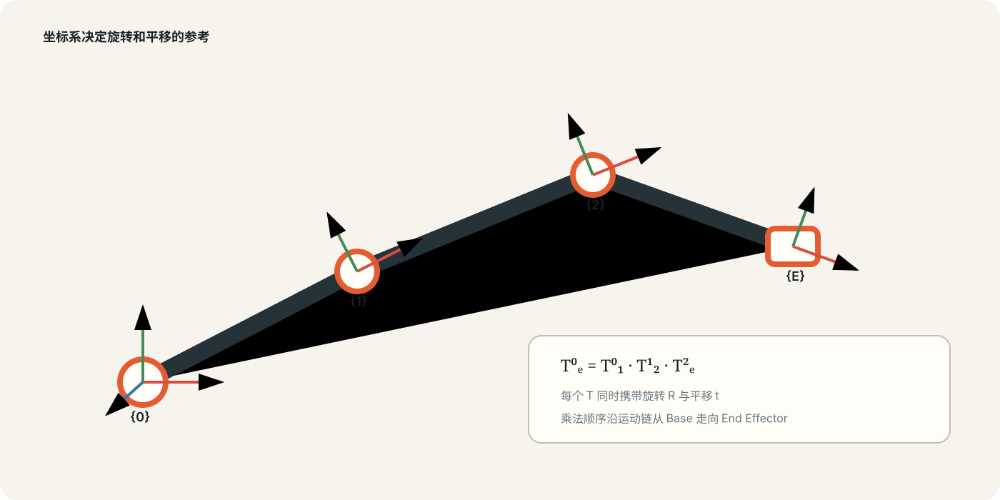
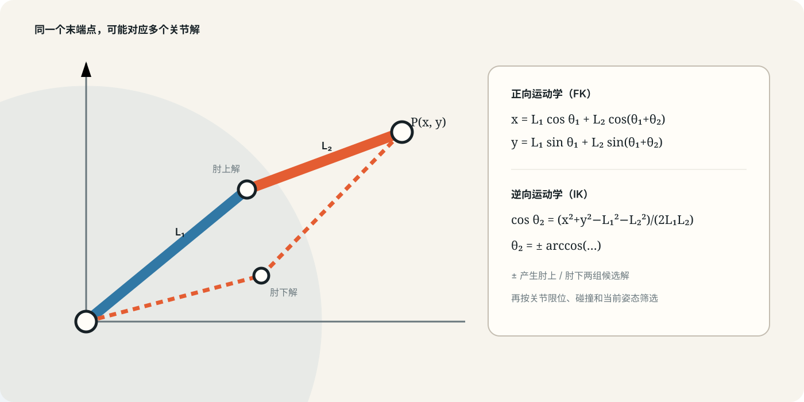
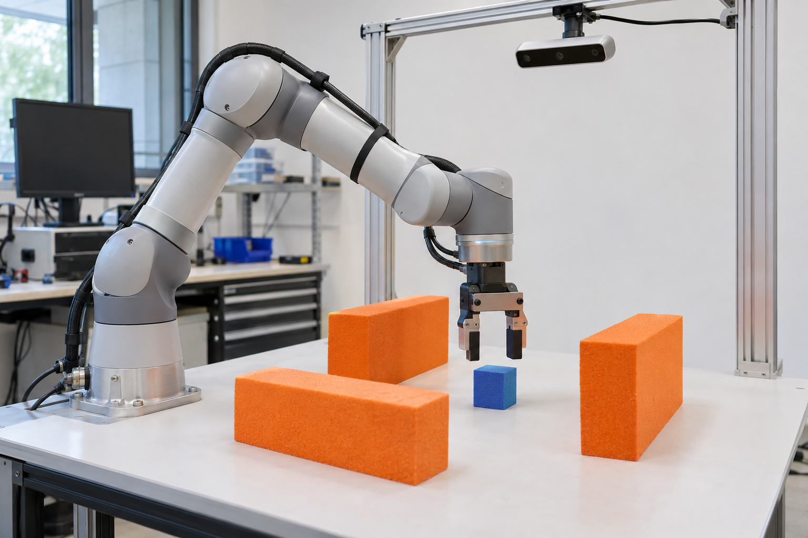
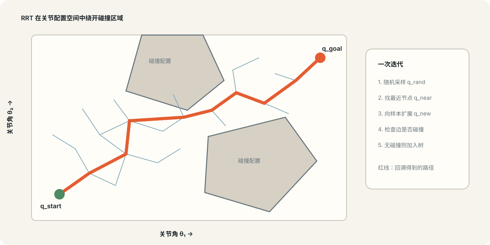
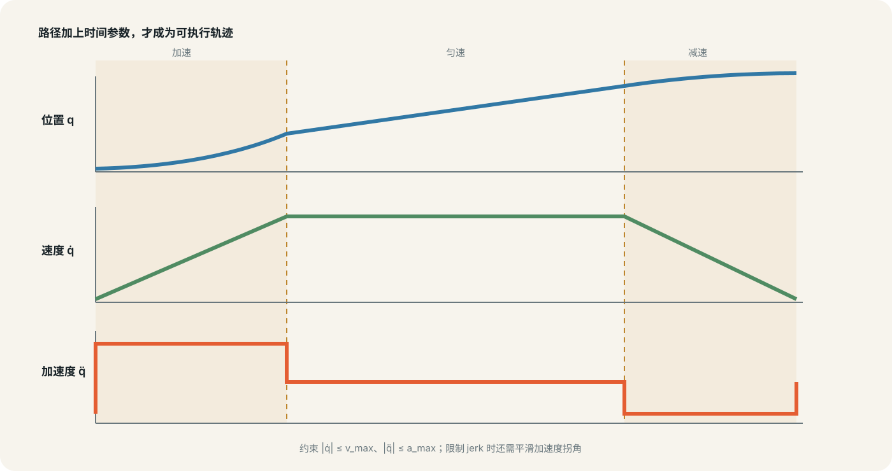
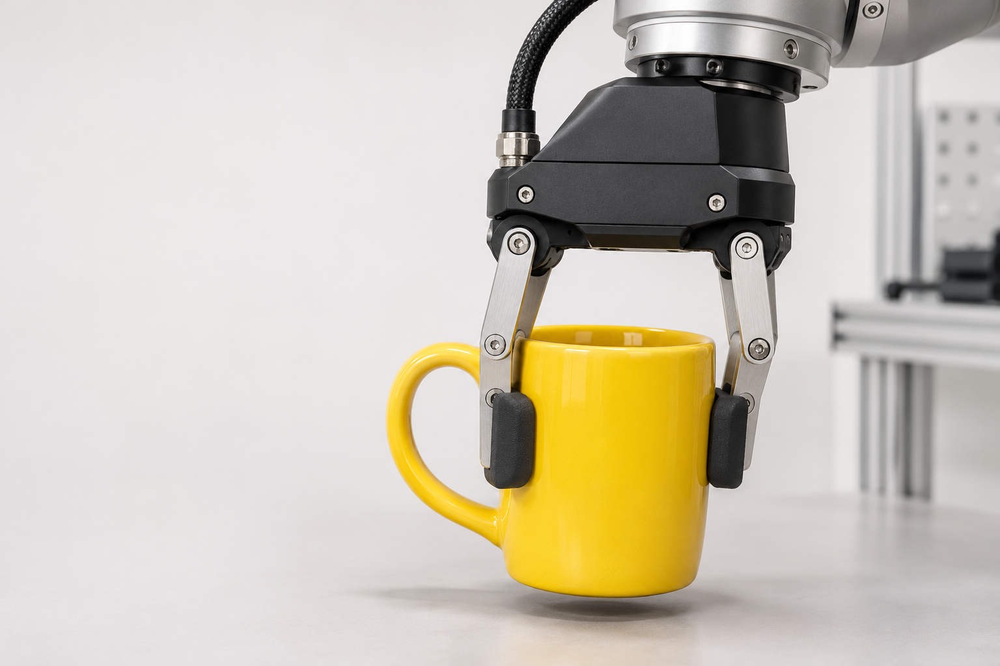
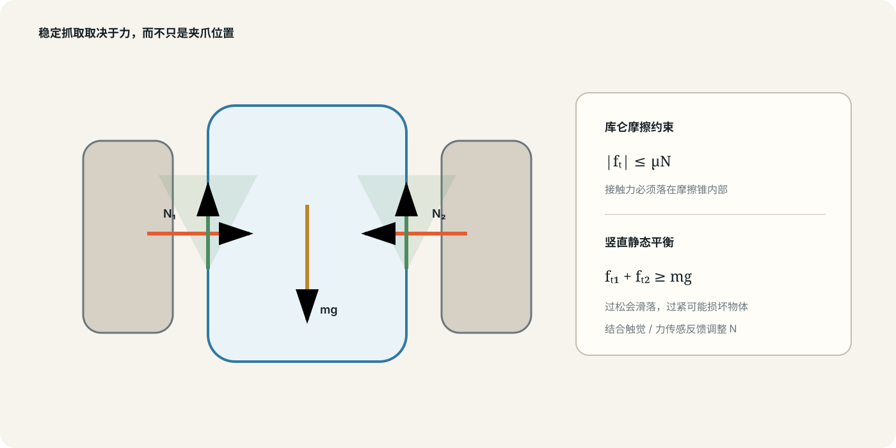
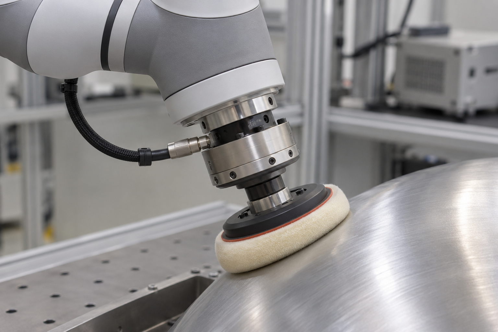

# **《mini-llm Robotics Engine 深度解析：从 Robot Kinematics、Dynamics 到 Motion Planning、Trajectory Optimization 与 Manipulation》**

在前面的文章中，我们研究了 Embodied AI Engine。

Embodied AI 解决的是一个宏观问题：

**AI 如何通过传感器感知环境，通过身体执行动作，并根据真实世界的反馈不断调整行为？**

但当我们真正开始开发机器人时，会遇到更具体的问题：

- 机械臂有多个关节，如何计算末端执行器的位置？
- 已知目标位置，如何反向计算每个关节应该转动多少？
- 机器人运动时，如何考虑质量、惯性、重力和摩擦？
- 如何规划一条不会碰撞障碍物的路径？
- 如何生成平滑、连续的运动轨迹？
- 如何让机械臂准确抓取一个杯子？
- 如何控制抓取力度，避免把杯子捏碎？
- 如何将 AI 的高层指令转换为真正的机器人控制信号？

这些问题属于 Robotics（机器人学）的核心研究领域。

本文将从数学和工程两个角度，深入研究如何为 mini-llm 构建 Robotics Engine。

# **一、Robotics Engine：什么是机器人引擎？**

## **1.1 从任务指令到物理运动**

假设用户向机器人发出指令：

```
把桌子上的杯子拿起来，放到左边的架子上。
```

LLM 可以理解这句话，但它不能直接把这句话发送给电机。

机器人必须完成一系列计算：

```
自然语言任务
    ↓
任务理解
    ↓
识别杯子和目标架子
    ↓
计算杯子的位置和姿态
    ↓
计算机械臂目标位置
    ↓
逆运动学求解
    ↓
运动路径规划
    ↓
轨迹生成
    ↓
碰撞检测
    ↓
控制器执行
    ↓
传感器反馈
```

其中，真正负责机器人运动学、动力学、运动规划和操作控制的部分，可以抽象为 Robotics Engine。

## **1.2 Robotics Engine 的定义**

**Robotics Engine 是负责描述机器人结构、计算机器人运动、规划运动路径，并将运动目标转换为可执行控制指令的核心系统。**

可以将其抽象为：

\\[ R=(K,D,P,T,C,M) \\]

其中：

| 符号      | 模块              | 职责          |
| ------- | --------------- | ----------- |
| \\(K\\) | Kinematics      | 计算关节与末端位置关系 |
| \\(D\\) | Dynamics        | 描述力、力矩和运动关系 |
| \\(P\\) | Motion Planning | 规划运动路径      |
| \\(T\\) | Trajectory      | 生成连续运动轨迹    |
| \\(C\\) | Control         | 控制机器人执行运动   |
| \\(M\\) | Manipulation    | 完成抓取和物体操作   |

这几个模块共同构成机器人从目标到运动的计算链路。

## **1.3 Robotics Engine 与其他 Engine 的区别**

| Engine               | 核心问题               |
| -------------------- | ------------------ |
| World Model Engine   | 世界是什么样的？未来可能如何变化？  |
| Planning Engine      | 为了实现目标，应该采取什么行动？   |
| Robotics Engine      | 机器人应该如何运动？         |
| Motor Control Engine | 如何控制电机和关节？         |
| Embodied AI Engine   | 如何将感知、决策和物理行动连接起来？ |
| Simulation Engine    | 如何在模拟环境中执行和验证运动？   |

其中，Robotics Engine 更关注机器人本体的运动学、动力学和操作能力。

# **二、Robot Architecture：机器人由哪些部分组成？**

在研究数学模型之前，需要先理解机器人的物理结构。

以六自由度机械臂为例。

[Robotics # Kinematic Chains. Welcome to this comprehensive guide on… | by Dilip Kumar | Medium](https://images.openai.com/static-rsc-4/tsGa-CYKgPRvfZOJyK_NSx_SqLvMiO1IaqaHHrAjBSKVRu-U3lpBg00PokYNrjMLTtAh8rrxonDkFvLdfQMy1JVjH_6amqY8dkZbtnEq575Sy61xzCbvB6eHpIISK-KmWeTVy1pfxrHKQZjS1xCEHp98OR_bjLko3yRRHA5dc4A?purpose=inline)

[Articulated Robot Components and Degrees of Freedom | Jeevanand M posted on the topic | LinkedIn](https://images.openai.com/static-rsc-4/D9NOeiuK6Xeh5IvopWssLb4IGvHe9dVOxMUB9cebIJnWJiGdccYGphYAuKW2bXPUtN7WDOwUqaiuht7ApsY8veZ2lWLS88uGhB6jEH9JraR4fJBeSr0gL_q-HYrELV8xNWYxjrFs2_FvpFz41bEmWyZz7_ZPL2R7HSJM0vLcB3I?purpose=inline)

[🔗Unraveling Robotics: Degrees of Freedom, Manipulator Anatomy, and Beyond!🌐📐](https://images.openai.com/static-rsc-4/KogOuQD4xT_mfsXIVqqAc5nLxkx0TX2gmiS-X5ssFmn_3-hgo56YPLdYt7MpZckB6V-5g3NeBxcJdx-yUrkUhzLe960RT4pn1MwIT4wGSrj4uuWrXVVqIhnIwDZuje5mvV8GIC7Jhnc3_GC2H2ZkC4ebDKcSuES4nJXYqOtApIY?purpose=inline)

11

一个典型机械臂由以下部分组成：

- Base：基座。
- Link：连杆。
- Joint：关节。
- Motor：电机。
- Encoder：编码器。
- End Effector：末端执行器。
- Gripper：夹爪。

## **2.1 Link：连杆**

Link 是机器人结构中的刚性或近似刚性部件。

例如：

```
基座
  │
连杆1
  │
关节1
  │
连杆2
  │
关节2
  │
连杆3
  │
末端执行器
```

连杆连接不同关节，形成机器人的机械结构。

## **2.2 Joint：关节**

关节决定机器人能够如何运动。

常见关节有两类：

[Робо-суставы. Погружение в анатомию, физику и сложности проектирования](https://images.openai.com/static-rsc-4/-UTfgf3uzmUetC-ILBUJwECPomgDqzdulEF3L7Qe4TctDzZ9v-Y2rS1D7gEWoVwLx0gMd2aivDmdV8AeLeMQ8xJ648hhzMWbpF8jGHZUwCs8qRwehMkN3iyLDfZmHh_gsZWB1wvBCKii0LUQFcKF55QjLK9T73MmMqCb3DTqnbs?purpose=inline)

**Revolute Joint**

旋转关节，围绕指定轴旋转。

[PPT - Modeling and Control of Robot Manipulators PowerPoint Presentation - ID:838717](https://images.openai.com/static-rsc-4/qI_ZHD1ZQf-64RFLAsbtwZy9X2Ce0CPtm13A_URf1oZ7oQdO2MrJhtQCGiCCSkpRIEm6NSUsGOKU3DfNmNBZuWrxbs3zHKW-TZqrSKUBGKFl-1rxTLok2GbLw_2QcD9YjhCAq-YqguW4LsRtwCV0XrtfgYs3aDevM-cO6-oNGuE?purpose=inline)

**Prismatic Joint**

移动关节，沿指定轴直线移动。

旋转关节的变量通常是角度：

\\[ q_i=\theta_i \\]

移动关节的变量通常是距离：

\\[ q_i=d_i \\]

## **2.3 Degree of Freedom：自由度**

自由度（DOF）表示机器人能够独立运动的变量数量。

例如：

| 机器人      | 典型自由度         |
| -------- | ------------- |
| 平面两关节机械臂 | 2             |
| 三轴机械臂    | 3             |
| 六轴工业机械臂  | 6             |
| 七轴协作机械臂  | 7             |
| 轮式移动机器人  | 通常有 3 个平面位姿变量 |

注意，自由度不完全等于关节数量。例如，一个移动机器人可以有两个驱动轮，但其平面位姿仍包含 \\(x,y,\theta\\) 三个变量。

对于空间中的刚体，其位姿一般包含：

- 三个平移自由度。
- 三个旋转自由度。

所以一个刚体的完整空间位姿有六个自由度。

## **2.4 Joint Space 与 Cartesian Space**

机器人运动中存在两种重要空间。

**Joint Space（关节空间）**

描述每个关节的状态：

\\[ q= \begin{bmatrix} q_1\\\q_2\\\q_3\\\q_4\\\q_5\\\q_6 \end{bmatrix} \\]

**Cartesian Space（笛卡尔空间）**

描述末端执行器在三维空间中的位置和姿态：

\\[ X= \begin{bmatrix} x\\\y\\\z\\\ \alpha\\\\\beta\\\\\gamma \end{bmatrix} \\]

二者之间的关系，是机器人运动学的核心。

# **三、Coordinate System：机器人如何描述空间？**

机器人需要知道：

- 自己在哪里。
- 每个关节在哪里。
- 摄像头在哪里。
- 目标物体在哪里。
- 末端执行器在哪里。

这些信息都依赖坐标系。

## **3.1 坐标系的基本概念**

一个三维坐标系包含：

- X 轴。
- Y 轴。
- Z 轴。
- 原点。
- 轴的方向。

[Robotics Kinematics: Right Hand Rule, Frames & Homogeneous Transformations](https://images.openai.com/static-rsc-4/ktbI-ZvEXJQGJSIAkhHUQpo3Jt1jFmfRhUJyitch0OnQsXsKu6fkWFtgOyFfAz_7ZcatTZya1sz7w7MK5hzg2oTGr8iY9P01OaY9x7KPpXyh7ub6uNsa7R8ydH4_ay9FGHL6cUVqD3gvzY1YZZp0IQc-YdsJVUH_gQgGdBd1Vrw?purpose=inline)

[studylib.net](https://studylib.net/doc/28011693/robot-manipulator-spatial-description-p1?utm_source=chatgpt.com)

例如：

```
point = {    "x": 0.3,    "y": 0.2,    "z": 0.5}
```

表示一个点在某个坐标系中的位置。

但必须注意：

**坐标值必须与坐标系绑定。**

摄像头坐标系中的：

\\[ P_C=(0.3,0.2,0.5) \\]

不一定等于机器人基座坐标系中的位置。

## **3.2 Homogeneous Transformation：齐次变换**



_图：基座、关节与末端坐标系沿运动链组合；矩阵乘法顺序决定变换结果。_

机器人需要在不同坐标系之间转换位置和姿态。

常用齐次变换矩阵：

\\[ T= \begin{bmatrix} R&t\\\ 0&1 \end{bmatrix} \\]

其中：

- \\(R\\)：3×3 旋转矩阵。
- \\(t\\)：3×1 平移向量。

完整形式：

\\[ T= \begin{bmatrix} r\_{11}&r\_{12}&r\_{13}&t_x\\\ r\_{21}&r\_{22}&r\_{23}&t_y\\\ r\_{31}&r\_{32}&r\_{33}&t_z\\\ 0&0&0&1 \end{bmatrix} \\]

一个点的齐次坐标：

\\[ P= \begin{bmatrix} x\\\y\\\z\\\1 \end{bmatrix} \\]

坐标变换：

\\[ P_B=T\_{BC}P_C \\]

这里：

- \\(P_C\\)：点在 Camera Frame 中的坐标。
- \\(P_B\\)：点在 Base Frame 中的坐标。
- \\(T\_{BC}\\)：Camera Frame 到 Base Frame 的变换。

## **3.3 变换矩阵的组合**

假设机器人有：

- 基座坐标系 \\(B\\)。
- 关节坐标系 \\(J\\)。
- 末端坐标系 \\(E\\)。

那么：

\\[ T\_{BE}=T\_{BJ}T\_{JE} \\]

多个变换可以连续相乘：

\\[ T\_{0n}=T\_{01}T\_{12}\cdots T\_{n-1,n} \\]

这就是后续 Forward Kinematics 的基础。

## **3.4 为什么变换顺序不能随意调整？**

矩阵乘法通常不满足交换律：

\\[ AB\neq BA \\]

先旋转再平移，与先平移再旋转，可能得到不同的位置。

因此，机器人系统必须明确：

- 坐标系的方向。
- 变换的起点和终点。
- 矩阵采用的约定。
- 变换组合顺序。

工程上应统一使用明确的 Frame ID，避免坐标系混乱。

# **四、Forward Kinematics：如何从关节角度计算末端位置？**

现在进入机器人学最重要的数学问题之一。

**如果知道每个关节转动了多少，如何计算机械臂末端执行器的位置？**

这就是 Forward Kinematics（正向运动学）。

## **4.1 正向运动学的基本定义**

假设机械臂具有 \\(n\\) 个关节：

\\[ q= \begin{bmatrix} q_1\\\q_2\\\\\cdots\\\q_n \end{bmatrix} \\]

末端执行器的位姿可以表示为：

\\[ T\_{0n}=f(q) \\]

也就是说：

输入：

```
关节1：30°
关节2：45°
关节3：20°
```

输出：

```
末端位置：
x = ...
y = ...
z = ...

末端姿态：
Rotation = ...
```

## **4.2 二自由度机械臂**



_图：给定关节角可计算末端坐标；给定末端坐标时，通常存在肘上与肘下两组逆解。_

先研究最简单的平面两关节机械臂。

[机器人动力学与控制学习笔记（二）————机器人动力学建模-CSDN博客](https://images.openai.com/static-rsc-4/ViLItvzdd_mRPLjK100LeL6r-mwLOdPJ0xycIq5b0vT6Zysr2vD_6Js57HxIK5P0nhjrziSQIRQoeULO9PjFEOulayVz0TtJ42NMYhdd6p5VRCxSPnBFLV_r9V4BZnoBllmRc_u6eT6iQQoBGRGiprJ0smFEyejHffLWXWWIbsM?purpose=inline)

[blog.csdn.net](https://blog.csdn.net/weixin_38452841/article/details/108631723?utm_source=chatgpt.com)

假设：

- 第一段连杆长度为 \\(L_1\\)。
- 第二段连杆长度为 \\(L_2\\)。
- 第一关节角度为 \\(\theta_1\\)。
- 第二关节角度为 \\(\theta_2\\)。

末端位置：

\\[ x=L_1\cos\theta_1+ L_2\cos(\theta_1+\theta_2) \\]

\\[ y=L_1\sin\theta_1+ L_2\sin(\theta_1+\theta_2) \\]

这就是一个简单的正向运动学模型。

## **4.3 数值计算**

假设：

\\[ L_1=1 \\]

\\[ L_2=1 \\]

\\[ \theta_1=30^\circ \\]

\\[ \theta_2=60^\circ \\]

那么：

\\[ x=\cos30^\circ+\cos90^\circ \\]

\\[ x\approx0.866 \\]

\\[ y=\sin30^\circ+\sin90^\circ \\]

\\[ y=1.5 \\]

因此：

\\[ P=(0.866,1.5) \\]

这意味着，当两个关节处于指定角度时，机械臂末端位于这个坐标位置。

## **4.4 Python 实现**

```
import mathdef forward_kinematics(    l1,    l2,    theta1,    theta2):    t1 = math.radians(theta1)    t2 = math.radians(theta2)    x = (        l1 * math.cos(t1)        + l2 * math.cos(t1 + t2)    )    y = (        l1 * math.sin(t1)        + l2 * math.sin(t1 + t2)    )    return {        "x": x,        "y": y    }position = forward_kinematics(    1.0,    1.0,    30,    60)print(position)
```

输出近似为：

```
{
    'x': 0.866,
    'y': 1.5
}
```

## **4.5 Denavit-Hartenberg 参数**

对于多关节机械臂，逐个手工推导变换矩阵会非常复杂。

因此，机器人学中经常使用 Denavit-Hartenberg（DH）参数描述相邻连杆之间的关系。

四个经典参数：

| 参数             | 含义    |
| -------------- | ----- |
| \\(a_i\\)      | 连杆长度  |
| \\(\alpha_i\\) | 连杆扭转角 |
| \\(d_i\\)      | 连杆偏距  |
| \\(\theta_i\\) | 关节角   |

一种常见的标准 DH 变换形式：

\\[ T_i= \begin{bmatrix} \cos\theta_i&-\sin\theta_i\cos\alpha_i& \sin\theta_i\sin\alpha_i&a_i\cos\theta_i\\\ \sin\theta_i&\cos\theta_i\cos\alpha_i& -\cos\theta_i\sin\alpha_i&a_i\sin\theta_i\\\ 0&\sin\alpha_i&\cos\alpha_i&d_i\\\ 0&0&0&1 \end{bmatrix} \\]

注意，标准 DH 与改进 DH 的参数定义和变换顺序不同，工程实现必须明确采用哪一种约定。

通过组合每个关节的变换矩阵：

\\[ T\_{0n}=T_1T_2\cdots T_n \\]

就能计算机械臂末端的位置和姿态。

# **五、Inverse Kinematics：如何从目标位置反求关节角度？**

正向运动学：

```
关节角度 → 末端位置
```

逆向运动学：

```
目标位置 → 关节角度
```

假设机器人需要把末端执行器移动到：

\\[ P=(x,y,z) \\]

我们需要求解：

\\[ q=f^{-1}(P) \\]

这就是 Inverse Kinematics（逆运动学）。

## **5.1 为什么逆运动学很重要？**

用户说：

```
把机械臂移动到杯子上方。
```

视觉系统计算出杯子的位置：

\\[ P=(0.3,0.2,0.5) \\]

但机器人控制器不能直接将这个三维坐标作为所有电机的控制目标。

它需要求解：

```
关节1：多少度？
关节2：多少度？
关节3：多少度？
……
```

这就是逆运动学的作用。

## **5.2 二自由度机械臂的逆运动学**

继续使用前面的平面两连杆机械臂。

已知：

\\[ x=L_1\cos\theta_1+ L_2\cos(\theta_1+\theta_2) \\]

\\[ y=L_1\sin\theta_1+ L_2\sin(\theta_1+\theta_2) \\]

通过平方相加，可以得到：

\\[ x^2+y^2= L_1^2+L_2^2+2L_1L_2\cos\theta_2 \\]

因此：

\\[ \cos\theta_2= \frac{x^2+y^2-L_1^2-L_2^2} {2L_1L_2} \\]

得到：

\\[ \theta_2= \pm\arccos \left( \frac{x^2+y^2-L_1^2-L_2^2} {2L_1L_2} \right) \\]

再计算：

\\[ \theta_1= \operatorname{atan2}(y,x) - \operatorname{atan2} \left( L_2\sin\theta_2, L_1+L_2\cos\theta_2 \right) \\]

这里的正负号意味着，同一个目标位置可能对应多个机械臂姿态。

## **5.3 可达工作空间**

不是所有目标位置都能被机械臂到达。

对于两段长度分别为 \\(L_1,L_2\\) 的平面机械臂：

\\[ |L_1-L_2| \leq \sqrt{x^2+y^2} \leq L_1+L_2 \\]

如果目标位置超出这个范围，机械臂就无法到达。

例如：

\\[ L_1=1,\quad L_2=1 \\]

最大伸展距离：

\\[ r\_{\max}=2 \\]

如果目标距离为 3，那么逆运动学没有实数解。

## **5.4 逆运动学的多解问题**

同一个位置可能对应：

- 肘部向上。
- 肘部向下。

[brian lee](https://images.openai.com/static-rsc-4/VzoYfGYpM-8JX83DOIxr50-BoT7QTxAKIeazNME2zH4JOK3qzq3n5g2hywEqps-NJBR_lSJ1haaFOdPlvKcfWCqKTZg6OoA3fUWx6nvndh-zqojo2wW9FMtjX3HTeMO_QjaqlDb8BE0Ze9VrxjLSUZVIUBVr-tXYMfVdhbUn9kg?purpose=inline)

[brianjsl.com](https://www.brianjsl.com/blog/2024/04/23/mixture_density_networks/?utm_source=chatgpt.com)

对于真实机械臂，可能存在更多解。

选择哪一个解，需要考虑：

- 关节限制。
- 当前姿态。
- 碰撞风险。
- 运动距离。
- 关节速度。
- 机械结构约束。

因此，逆运动学不只是求出一个数学解，还需要从多个解中选择合适的机器人姿态。

## **5.5 数值逆运动学**

对于复杂机械臂，解析解可能很难推导。

可以使用数值方法。

一种常见方法是 Jacobian Pseudoinverse。

首先定义：

\\[ \dot{x}=J(q)\dot{q} \\]

其中：

- \\(\dot{x}\\)：末端速度。
- \\(\dot{q}\\)：关节速度。
- \\(J(q)\\)：Jacobian 矩阵。

如果 \\(J\\) 可逆：

\\[ \dot{q}=J^{-1}\dot{x} \\]

如果不是方阵或不可逆，可以使用伪逆：

\\[ \dot{q}=J^+\dot{x} \\]

对于存在奇异性和数值不稳定风险的情况，可以使用阻尼最小二乘：

\\[ \dot{q} = J^T(JJ^T+\lambda^2I)^{-1}\dot{x} \\]

这可以改善接近奇异位置时的数值稳定性。

# **六、Jacobian：关节运动如何影响末端运动？**

Jacobian（雅可比矩阵）是机器人学中非常重要的数学工具。

它连接：

- 关节速度。
- 末端执行器速度。

## **6.1 Jacobian 的基本定义**

假设末端位置：

\\[ x=f(q) \\]

对时间求导：

\\[ \dot{x} = \frac{\partial f}{\partial q}\dot{q} \\]

定义：

\\[ J(q)=\frac{\partial f}{\partial q} \\]

于是：

\\[ \dot{x}=J(q)\dot{q} \\]

这意味着：

只要知道每个关节的运动速度，就可以计算末端执行器的运动速度。

## **6.2 二自由度机械臂的 Jacobian**

对于：

\\[ x=L_1\cos\theta_1+ L_2\cos(\theta_1+\theta_2) \\]

\\[ y=L_1\sin\theta_1+ L_2\sin(\theta_1+\theta_2) \\]

对两个角度分别求偏导：

\\[ J= \begin{bmatrix} -L_1\sin\theta_1-L_2\sin(\theta_1+\theta_2) & -L_2\sin(\theta_1+\theta_2) \\\ L_1\cos\theta_1+L_2\cos(\theta_1+\theta_2) & L_2\cos(\theta_1+\theta_2) \end{bmatrix} \\]

这个矩阵描述关节角度变化如何影响末端速度。

## **6.3 Jacobian 的用途**

Jacobian 可以用于：

1. 速度控制。
2. 数值逆运动学。
3. 奇异性分析。
4. 力矩映射。
5. 操作灵巧度分析。

尤其是奇异性（Singularity）。

当 Jacobian 降秩时，机器人可能失去某些方向上的运动能力，或者需要非常大的关节速度才能实现很小的末端速度。

因此，运动规划需要尽量避免危险的奇异区域。

# **七、Robot Dynamics：机器人为什么需要考虑力和力矩？**

运动学回答：

```
机器人应该在哪里？
机器人应该如何运动？
```

动力学回答：

```
需要多大的力才能产生这种运动？
```

## **7.1 Kinematics 与 Dynamics 的区别**

| 维度     | Kinematics | Dynamics   |
| ------ | ---------- | ---------- |
| 研究对象   | 位置、速度、加速度  | 力、力矩、质量、惯性 |
| 是否考虑质量 | 不需要        | 需要         |
| 是否考虑力  | 不需要        | 需要         |
| 主要用途   | 位置和轨迹计算    | 力矩计算和控制    |
| 核心问题   | 如何运动？      | 为什么这样运动？   |

## **7.2 机器人动力学方程**

一个经典的刚体机械臂动力学模型：

\\[ M(q)\ddot q+ C(q,\dot q)\dot q+ g(q)+\tau_f = \tau \\]

其中：

| 变量                      | 含义       |
| ----------------------- | -------- |
| \\(M(q)\\)              | 惯性矩阵     |
| \\(C(q,\dot q)\dot q\\) | 科氏力和离心力项 |
| \\(g(q)\\)              | 重力项      |
| \\(\tau_f\\)            | 摩擦力矩     |
| \\(\tau\\)              | 关节驱动力矩   |

这个方程描述了机器人关节运动与所需力矩之间的关系。

## **7.3 为什么动力学很重要？**

假设机械臂需要举起一个杯子。

如果杯子很轻，所需力矩较小。

如果杯子装满水，质量增加，所需力矩也会增加。

如果机械臂快速加速，还需要额外克服惯性。

所以：

**同一个位置目标，在不同负载和速度要求下，可能需要完全不同的电机控制输出。**

## **7.4 Torque：力矩**

力矩可以理解为力对旋转运动产生的作用。

简化公式：

\\[ \tau=r\times F \\]

其中：

- \\(r\\)：力臂。
- \\(F\\)：作用力。

在垂直于力臂的特殊情况下：

\\[ |\tau|=rF \\]

如果负载增加，或者负载距离关节更远，关节需要承担的力矩通常会增加。

这也是机械臂设计中需要考虑负载能力和工作半径的原因。

# **八、Motion Planning：如何规划无碰撞运动路径？**



_图：六轴机械臂在带有深度相机和实体障碍物的实验台上接近目标，运动规划器需要同时满足可达性与无碰撞约束。本文照片式插图由 AI 生成。_

现在假设：

- 机械臂已经知道杯子的位置。
- 逆运动学已经求出目标关节角度。
- 但机械臂从当前姿态移动到目标姿态时，中间可能碰到障碍物。

这就需要 Motion Planning。

## **8.1 什么是 Motion Planning？**

Motion Planning（运动规划）是指：

**在机器人当前状态与目标状态之间，寻找一条满足运动约束、尽量避免碰撞的可行路径。**

例如：

```
当前状态
    ↓
桌子边缘
    ↓
障碍物
    ↓
目标位置
```

机器人不能只考虑起点和终点，还必须考虑中间经过的区域。

## **8.2 Configuration Space**

机器人运动规划有一个重要概念：

Configuration Space（配置空间），简称 C-space。

对于一个六自由度机械臂：

\\[ q= (q_1,q_2,q_3,q_4,q_5,q_6) \\]

每一个 \\(q\\) 都代表机器人一种姿态。

因此，机械臂可以被看成配置空间中的一个点。

障碍物不再只是现实世界中的几何障碍，还会映射为配置空间中的不可行区域。

[CS440 Lectures](https://images.openai.com/static-rsc-4/zM4myn0xZke2MvdZQpEo8MjnsoGivJcmzInylMX0lRTLrrzwRFNZjDUCv2rpa8S5bMu4yEk5qsel8_REyCBpOF70mAcb_MnjI-aaEPf2S4EsLVmGmYdF_rit3C7WdvOEYUJ-7t8jzXo-k-KfdKqAEg-SxL22HJYw3VI6QtZyYjI?purpose=inline)

[courses.grainger.illinois.edu](https://courses.grainger.illinois.edu/cs440/fa2025/lectures/robots.html?utm_source=chatgpt.com)

规划目标变成：

在配置空间中，从：

\\[ q\_{start} \\]

到达：

\\[ q\_{goal} \\]

同时避开碰撞区域。

## **8.3 传统路径规划算法**

常见方法包括：

| 算法                      | 特点         |
| ----------------------- | ---------- |
| A\*                     | 基于图搜索的路径规划 |
| Dijkstra                | 寻找图上的最短路径  |
| RRT                     | 在连续空间中随机探索 |
| RRT\*                   | 渐近优化路径质量   |
| PRM                     | 预先构建概率路网   |
| Trajectory Optimization | 直接优化连续轨迹   |

它们的适用场景不同。

例如：

- A\* 常用于栅格地图和离散图搜索。
- RRT 适合高维连续配置空间中的可行路径搜索。
- PRM 适合可以重复查询的静态场景。
- Trajectory Optimization 可以进一步优化路径平滑性、速度和控制代价。

## **8.4 RRT：快速探索随机树**



_图：RRT 在关节配置空间中随机扩展，无碰撞边组成搜索树，最终回溯得到可行路径。_

RRT 的基本思想是：

1. 从起点建立一棵树。
2. 在空间中随机采样一个目标点。
3. 找到树中距离采样点最近的节点。
4. 向采样点扩展一小步。
5. 检查是否发生碰撞。
6. 如果安全，将新节点加入树。
7. 重复直到到达目标附近。

[Journey Through Robotics Path Planning: From Basic Bugs to AI Brains | by Dilip Kumar | Mar, 2026 | Medium](https://images.openai.com/static-rsc-4/BBX3YRkcUGwOZeOHyL6QbLSZ4T-eT8dX6p--UgLIsh0ylUAgxTVzCZ6j2_qY3yXNoDBwnCjrCXkB4whIuxcLXg9I0pRhSVRX5n94FPskEhTX8m7xVhs2gON67m8vaJ-Mg5ZtyE_1t_XAlv1MODZnksiOmruh02ClvNUERvzWD6k?purpose=inline)

[dilipkumar.medium.com](https://dilipkumar.medium.com/journey-through-robotics-path-planning-from-basic-bugs-to-ai-brains-fcff690fadcd?utm_source=chatgpt.com)

伪代码：

```
def rrt(start, goal, max_iterations):    tree = [start]    for _ in range(max_iterations):        sample = random_sample()        nearest = nearest_node(            tree,            sample        )        new_node = steer(            nearest,            sample        )        if collision_free(nearest, new_node):            tree.append(new_node)            if reached_goal(new_node, goal):                return reconstruct_path(                    tree,                    new_node                )    return None
```

这里省略了父节点索引、目标偏置、采样策略和路径重建等工程细节。

## **8.5 路径不等于轨迹**

这是一个非常重要的区别。

Path（路径）：

描述机器人应该经过哪些位置。

Trajectory（轨迹）：

描述机器人在什么时间到达什么位置，并具有怎样的速度和加速度。

例如：

```
路径：
A → B → C → D
```

但真实机器人还需要知道：

```
0.0 秒：到达 A
0.5 秒：到达 B
1.2 秒：到达 C
2.0 秒：到达 D
```

并且每个时间点还可能包含：

- 位置。
- 速度。
- 加速度。
- 力矩。

因此，Motion Planning 之后通常还需要 Trajectory Generation。

# **九、Trajectory Generation：如何生成平滑的运动轨迹？**

机器人不能简单地从一个位置瞬间跳到另一个位置。

真实运动必须考虑：

- 最大速度。
- 最大加速度。
- 最大加加速度。
- 关节限制。
- 负载限制。
- 执行器能力。

Trajectory Generation 的任务就是：

**将几何路径转换成满足运动约束的时间参数化轨迹。**

## **9.1 位置、速度和加速度**



_图：梯形速度规划把路径转换为带时间的轨迹，并显式满足速度和加速度边界。_

一条运动轨迹可以表示为：

\\[ q(t) \\]

速度：

\\[ \dot q(t)=\frac{dq(t)}{dt} \\]

加速度：

\\[ \ddot q(t)=\frac{d^2q(t)}{dt^2} \\]

加加速度（Jerk）：

\\[ \dddot q(t)=\frac{d^3q(t)}{dt^3} \\]

如果位置变化不连续，机器人可能产生冲击。

如果速度变化过快，也可能导致机械振动。

因此，需要设计连续且满足约束的轨迹。

## **9.2 三次多项式轨迹**

假设关节从 \\(q_0\\) 移动到 \\(q_f\\)，运动时间为 \\(T\\)。

可以使用三次多项式：

\\[ q(t)=a_0+a_1t+a_2t^2+a_3t^3 \\]

给定边界条件：

\\[ q(0)=q_0 \\]

\\[ q(T)=q_f \\]

\\[ \dot q(0)=0 \\]

\\[ \dot q(T)=0 \\]

可以求出：

\\[ a_0=q_0 \\]

\\[ a_1=0 \\]

\\[ a_2=\frac{3(q_f-q_0)}{T^2} \\]

\\[ a_3=-\frac{2(q_f-q_0)}{T^3} \\]

因此：

\\[ q(t)=q_0+ 3\Delta q\left(\frac{t}{T}\right)^2 - 2\Delta q\left(\frac{t}{T}\right)^3 \\]

其中：

\\[ \Delta q=q_f-q_0 \\]

## **9.3 Python 实现**

```
def cubic_trajectory(    q0,    qf,    T,    t):    if T <= 0:        raise ValueError("T must be positive")    if t < 0 or t > T:        raise ValueError("t must be within [0, T]")    delta = qf - q0    u = t / T    q = q0 + delta * (        3 * u**2 - 2 * u**3    )    return q
```

这种方法可以生成起点和终点速度均为零的平滑位置曲线。

但它不保证加速度在运动开始和结束时也为零。

## **9.4 五次多项式轨迹**

如果还希望起点和终点加速度为零，可以使用五次多项式：

\\[ q(t)=a_0+a_1t+a_2t^2+a_3t^3+a_4t^4+a_5t^5 \\]

通过位置、速度、加速度六个边界条件求解六个系数。

在归一化时间：

\\[ u=\frac{t}{T} \\]

且起止速度和加速度都为零的情况下：

\\[ q(t)=q_0+ \Delta q(10u^3-15u^4+6u^5) \\]

这种轨迹具有更平滑的加速度变化。

## **9.5 Jerk-limited Trajectory**

在一些高性能机器人应用中，还需要限制 Jerk。

因为即使加速度连续，也可能出现加加速度突然变化的情况。

Jerk-limited 轨迹能够降低机械冲击，提高运动平稳性。

常见的工程方法包括：

- S-curve Profile。
- Trapezoidal Velocity Profile。
- Time-optimal Trajectory Generation。
- 在线轨迹生成。

对于 mini-llm V1，可以先实现三次和五次多项式，再增加速度、加速度和 Jerk 约束。

# **十、Trajectory Optimization：如何优化运动轨迹？**

Trajectory Generation 负责生成轨迹。

Trajectory Optimization 则进一步解决：

**如何让轨迹更快、更平滑、更节能，同时满足安全约束？**

## **10.1 优化目标**

可以建立一个轨迹优化目标：

\\[ J= w_1J\_{time} +w_2J\_{smooth} +w_3J\_{energy} +w_4J\_{collision} \\]

其中：

- \\(J\_{time}\\)：运动时间。
- \\(J\_{smooth}\\)：轨迹平滑性。
- \\(J\_{energy}\\)：能耗。
- \\(J\_{collision}\\)：碰撞代价。

权重：

\\[ w_1,w_2,w_3,w_4 \\]

用于表达不同目标的重要程度。

但安全约束不应仅仅依赖一个碰撞惩罚项，关键的关节限制、速度限制和碰撞安全边界应当作为硬约束处理。

## **10.2 平滑性优化**

一种常见的目标是最小化加速度平方积分：

\\[ J\_{smooth} = \int_0^T \\|\ddot q(t)\\|^2dt \\]

也可以最小化 Jerk：

\\[ J\_{jerk} = \int_0^T \\|\dddot q(t)\\|^2dt \\]

这能够鼓励轨迹更加平滑。

## **10.3 能耗优化**

一个简化的机械功率：

\\[ P(t)=\tau(t)^T\dot q(t) \\]

可以根据实际电机和控制系统定义能耗目标。

例如：

\\[ J\_{energy} = \int_0^T |\tau(t)^T\dot q(t)|dt \\]

需要注意，这只是简化的机械功率相关指标，并不等于真实电气能耗。实际能耗还受电机效率、驱动器损耗、再生制动等因素影响。

## **10.4 碰撞约束**

可以定义机器人与障碍物之间的最小距离：

\\[ d(q)\geq d\_{safe} \\]

其中：

- \\(d(q)\\)：当前机器人姿态下的最小距离。
- \\(d\_{safe}\\)：安全距离。

轨迹优化需要确保：

\\[ d(q(t))\geq d\_{safe} \\]

对动态环境，还需要考虑障碍物随时间变化的位置。

# **十一、Manipulation：机器人如何抓取和操作物体？**



_图：双指夹爪抓取陶瓷杯时，需要同时考虑抓取姿态、接触位置、夹持力和杯柄方向。本文照片式插图由 AI 生成。_

前面讨论了机器人如何移动。

但机器人不只是移动自身，还需要操作外部物体。

这就是 Manipulation（操作）。

例如：

- 抓取杯子。
- 拿起工具。
- 打开抽屉。
- 拧开瓶盖。
- 将物体放进盒子。
- 插入连接器。

Manipulation 是机器人从运动能力走向实际任务能力的重要一步。

## **11.1 Grasping：抓取**

抓取不仅是移动夹爪到物体附近。

它需要考虑：

- 物体形状。
- 物体重量。
- 物体材质。
- 摩擦系数。
- 接触位置。
- 抓取姿态。
- 夹爪开口。
- 夹持力度。

[9 Industrial Robots for Your Warehouse - Nanalyze](https://images.openai.com/static-rsc-4/0GkilQreKX8QDMcJ6tCBRlz0j2CLFB3khncE_2AcqRBBSV9vpbWzEI0340zXEI9_CR7eulDpUl2YM8qRlxqnYr1g69hmz-2PieFIuMnNDN15RXA3ey-N-kJ5b0ptXDIGDCiJwm8Th-Yf4SgdwNc664h9oA58u4knU3CPsHIvGGg?purpose=inline)

[nanalyze.com](https://www.nanalyze.com/2017/01/9-industrial-robots-warehouse/?utm_source=chatgpt.com)

## **11.2 Grasp Pose**

一个抓取姿态通常包括：

\\[ G=(p,R) \\]

其中：

- \\(p\\)：抓取位置。
- \\(R\\)：抓取方向。

也可以使用齐次变换矩阵：

\\[ T\_{grasp}= \begin{bmatrix} R\_{grasp}&p\_{grasp}\\\ 0&1 \end{bmatrix} \\]

这个姿态定义了夹爪应该如何接近目标物体。

## **11.3 Grasp Planning**

抓取规划可以分为：

1. 检测物体。
2. 估计物体几何形状。
3. 生成候选抓取姿态。
4. 检查夹爪是否能够接触物体。
5. 检查是否发生碰撞。
6. 评估抓取稳定性。
7. 选择合适的抓取姿态。

一个简化的候选抓取结构：

```
grasp_candidates = [    {        "position": [0.3, 0.2, 0.5],        "orientation": [0, 0, 0],        "gripper_width": 0.04,        "score": 0.92    },    {        "position": [0.3, 0.2, 0.5],        "orientation": [0, 90, 0],        "gripper_width": 0.05,        "score": 0.78    }]
```

这些分数是候选模型输出的示意值，不是物理抓取成功概率的天然保证。

## **11.4 抓取力学**



_图：双指抓取时，法向夹持力决定可用摩擦力；接触力必须落在摩擦锥内并抵消重力。_

对于夹爪抓取物体，需要考虑接触力和摩擦力。

在简化的对称双指夹持模型中，假设每侧法向夹持力为 \\(N\\)，摩擦系数为 \\(\mu\\)，物体重量为 \\(mg\\)。

如果依靠两侧摩擦力抵抗重力，则近似需要：

\\[ 2\mu N\geq mg \\]

因此：

\\[ N\geq\frac{mg}{2\mu} \\]

例如：

- 物体质量：0.2 kg。
- 摩擦系数：0.5。
- 重力加速度：9.81 m/s²。

那么：

\\[ N\geq \frac{0.2\times9.81}{2\times0.5} \\]

\\[ N\geq1.962N \\]

这是理想化模型，没有考虑接触几何、动态加速度、夹持结构、材料变形和安全裕度。

真实抓取通常需要结合力传感器、触觉传感器和抓取稳定性分析。

# **十二、Force Control：如何控制接触力？**



_图：机械臂通过腕部力/力矩传感器和柔性抛光垫保持稳定接触，体现阻抗控制与接触力反馈的实际应用。本文照片式插图由 AI 生成。_

机器人抓取杯子时，有两个重要目标：

1. 不能夹得太松，否则杯子会掉下来。
2. 不能夹得太紧，否则杯子可能被压坏。

因此，机器人需要感知接触力，并动态调整控制输出。

## **12.1 Position Control 与 Force Control**

| 控制方式               | 主要目标            |
| ------------------ | --------------- |
| Position Control   | 控制末端或关节的位置      |
| Velocity Control   | 控制运动速度          |
| Torque Control     | 控制关节力矩          |
| Force Control      | 控制末端接触力         |
| Impedance Control  | 建立力与位置偏差之间的动态关系 |
| Admittance Control | 根据外力生成运动响应      |

位置控制适合自由空间运动。

力控制和柔顺控制则在与环境接触时非常重要。

## **12.2 Impedance Control**

阻抗控制希望机器人表现出类似弹簧、阻尼和质量组成的动态特性。

一个常见形式：

\\[ M_d\ddot{x} + B_d\dot{x} + K_d(x-x_d) = F\_{ext} \\]

其中：

- \\(M_d\\)：期望惯性。
- \\(B_d\\)：期望阻尼。
- \\(K_d\\)：期望刚度。
- \\(x_d\\)：目标位置。
- \\(F\_{ext}\\)：外部作用力。

它可以让机器人在受到外力时表现出一定的柔顺性。

例如：

机械臂接触桌面时，不是继续刚性地向下运动，而是根据接触力进行调整。

## **12.3 为什么具身智能需要柔顺控制？**

真实世界中的接触并不总是准确可预测的。

例如：

- 杯子位置估计有误差。
- 桌面高度估计有误差。
- 物体形状不规则。
- 夹爪接触位置发生变化。

如果机器人只使用刚性位置控制，可能造成冲击或损坏。

柔顺控制可以提高接触操作的适应能力。

# **十三、Robotics Engine 与 mini-llm 的整体集成**

现在将前面介绍的模块整合起来。

建议将 Robotics Engine 设计为独立的机器人运动计算层。

## **mini-llm Robotics Engine Architecture**

**Task Input**

自然语言任务 / 结构化目标

**Robot Model**

Robot Description / Links / Joints / Limits

**Kinematics**

FK / IK / Jacobian

**Dynamics**

Mass / Gravity / Torque

**Motion Planning**

Collision Checking / Path Search

**Trajectory Optimization**

Position / Velocity / Acceleration / Jerk

**Control & Manipulation**

Position / Torque / Force / Grasp

**Robot Hardware**

Motor / Joint / Gripper / Sensors

**Feedback → State Estimation → Replanning**

## **13.1 模块接口**

建议提供以下接口：

```
class RoboticsEngine:    def forward_kinematics(self, joints):        pass    def inverse_kinematics(self, pose):        pass    def compute_jacobian(self, joints):        pass    def compute_dynamics(self, state):        pass    def plan_motion(self, start, goal):        pass    def generate_trajectory(self, path):        pass    def optimize_trajectory(self, trajectory):        pass    def plan_grasp(self, object_state):        pass    def validate_motion(self, trajectory):        pass
```

这些接口分别承担机器人运动计算、规划和验证任务。

真正的硬件控制最好由独立的实时控制系统完成。

## **13.2 一个完整任务示例**

用户输入：

```
抓取桌面上的红色杯子。
```

系统执行：

```
def grasp_object(    object_id,    perception,    robotics,    planner,    safety,    controller):    # 1. 获取物体位置与姿态    object_state = perception.get_object(        object_id    )    # 2. 生成抓取姿态    grasp_pose = planner.plan_grasp(        object_state    )    # 3. 逆运动学    joint_goal = robotics.inverse_kinematics(        grasp_pose    )    # 4. 运动规划    path = robotics.plan_motion(        controller.get_joint_state(),        joint_goal    )    # 5. 生成时间轨迹    trajectory = robotics.generate_trajectory(        path    )    # 6. 独立安全验证
```

这是用于说明系统职责的简化流程。真实系统还需要对目标位置误差、碰撞、夹爪状态、抓取力、执行超时和任务取消进行持续监控。

# **十四、mini-llm Robotics Engine 工程目录**

建议第一版采用清晰的模块划分。

```
mini-llm/
│
├── robotics/
│
│   ├── model/
│   │   ├── robot_model.py
│   │   ├── link.py
│   │   ├── joint.py
│   │   ├── robot_description.py
│   │   └── joint_limits.py
│   │
│   ├── geometry/
│   │   ├── vector.py
│   │   ├── matrix.py
│   │   ├── quaternion.py
│   │   ├── transform.py
│   │   └── coordinate_frame.py
│   │
│   ├── kinematics/
│   │   ├── forward.py
│   │   ├── inverse.py
│   │   ├── jacobian.py
│   │   └── dh_parameters.py
│   │
│   ├── dynamics/
│   │   ├── mass_matrix.py
│   │   ├── gravity.py
│   │   ├── torque.py
│   │   └── friction.py
│   │
│   ├── planning/
│   │   ├── collision.py
│   │   ├── configuration_space.py
│   │   ├── astar.py
│   │   ├── rrt.py
│   │   └── planner.py
│   │
│   ├── trajectory/
│   │   ├── polynomial.py
│   │   ├── trapezoidal.py
│   │   ├── s_curve.py
│   │   └── optimizer.py
│   │
│   ├── manipulation/
│   │   ├── grasp_pose.py
│   │   ├── grasp_planner.py
│   │   ├── gripper.py
│   │   └── contact_model.py
│   │
│   ├── control/
│   │   ├── position_control.py
│   │   ├── velocity_control.py
│   │   ├── torque_control.py
│   │   ├── force_control.py
│   │   └── impedance.py
│   │
│   ├── safety/
│   │   ├── collision_guard.py
│   │   ├── joint_limit_guard.py
│   │   ├── velocity_guard.py
│   │   └── trajectory_validator.py
│   │
│   ├── simulation/
│   │   ├── robot_simulator.py
│   │   └── physics_adapter.py
│   │
│   ├── integration/
│   │   ├── ros2_adapter.py
│   │   ├── world_model_adapter.py
│   │   ├── planning_adapter.py
│   │   └── agent_adapter.py
│   │
│   └── robotics_engine.py
│
└── tests/
    ├── test_forward_kinematics.py
    ├── test_inverse_kinematics.py
    ├── test_jacobian.py
    ├── test_dynamics.py
    ├── test_motion_planning.py
    ├── test_trajectory.py
    └── test_manipulation.py
```

# **十五、推荐开源技术与基础设施**

Robotics Engine 涉及大量成熟的数学算法和机器人软件基础设施。建议不要全部从零开发。

[Getting Started — MoveIt Documentation: Humble  documentation](https://images.openai.com/static-rsc-4/T1hdc8d-bvfk6_L-oL4e8NjhroDfyTK_IP5vd7OuE3htKwC2QlDEGyjQIxbwxXKZPjU7nxlrR6L6BqWuG2DNAlwL-P6PYlwpCC5Y1h7afH8hW4zH137qh2mON3oAj8zMvIq4vAvC-EVr2fgID-qXJSujUrFhGBK6WbgW62eHBeU?purpose=inline)

**MoveIt 2**

机械臂运动规划、逆运动学插件、碰撞检测和操作任务。

[官方文档](https://moveit.picknik.ai/?utm_source=chatgpt.com)

[Releases · stack-of-tasks/pinocchio · GitHub](https://images.openai.com/static-rsc-4/NqkrhXMfnF0cZIGiYAjJkrFqAlI2KPW2W9TOHRJDNBUgwFyP9NnFdJeXOHEnu5RVtVNO6OpOFqcAvLkFfYJ8_I_D8bUrVA-w8-GY8G1OD-mvWq_ZIjmx-SFD-rpaRC8CqmZHgB0ez86SJkk5BDuVd8l03Wi_mprOtg69DMjxPng?purpose=inline)

**Pinocchio**

高性能刚体运动学和动力学计算，适合构建底层数学模块。

[项目主页](https://stack-of-tasks.github.io/pinocchio/?utm_source=chatgpt.com)

[Drake: Model-Based Design and Verification for Robotics](https://images.openai.com/static-rsc-4/v8BSAzmxnBrHakkw6wPC3CvFjFrSVbz67JqsgfPk9-mk19hMQh-tag7i05hQppdBAx2rgUdh8TLbSj4y6zc2Apk5FicL4rDVzgrFTQhbI68HhpQSdKwwlWEy3VctxNK7VcM8USLObAo218N8Krc8i4NoP2ke1fFhkeR2wvEfKzM?purpose=inline)

**Drake**

机器人建模、动力学、优化和操作规划。

[官方文档](https://drake.mit.edu/?utm_source=chatgpt.com)

[Install tesseract-ignition on Linux | Snap Store](https://images.openai.com/static-rsc-4/i55mZtjgydlOGy2Os5r3anOlHjqMekWt9CpcSK21BYQRuTi1BWcIQ6A9KmvfOyfvuVgTBlb8DBzKMRo_P_fRImfI9eXIFUr4mp2yfcEIcqPTxvlOEThL40ZQY6N0bsl9Y-bW31kfgDZIuG60StonFeiMTGOQOaonw6k9ZLCKZvc?purpose=inline)

**Tesseract Robotics**

机器人环境建模、碰撞检查和轨迹规划。

[GitHub 项目](https://github.com/tesseract-robotics/tesseract?utm_source=chatgpt.com)

[Ruckig: (15) Tracking Offline](https://images.openai.com/static-rsc-4/hA_mRbuDOpZOoym_b35biktPSf779_2ZaUiZ4Wc1fpEgT2giP-NQKQXQ2zAQxwTu4E8RbYq67oNx7ExPr_oPgCO0R1jQvjGbybnHH4GjCjuLPr5-iKlkRiNTRYhUhf3Hs5fFJhUhBOXz81FC_7g80NCzjCL1shkQprqWp5qxgqE?purpose=inline)

**Ruckig**

支持速度、加速度和 Jerk 限制的在线轨迹生成。

[官方网站](https://ruckig.com/?utm_source=chatgpt.com)

[ROS2 Moveit Servo: A Tool for Robot Teleoperation and Data Collection](https://images.openai.com/static-rsc-4/s9CWtFph8M5paqqqQT518KWlQjO-cfxpUl_Z3IFgFwVvkf_HBT_Xieee93azNtPlnxsfEG7F56R72SXb1FocnmTiyCXkXHmtDvQEgd96K-EsyLfwdOmKaOwiyQOo3ncJMBQLLSAuMU-9HQtlRpvSdMDsqSP3W30cV6fYMJg0W9k?purpose=inline)

**MoveIt Servo**

将末端速度或姿态增量转换为机器人关节运动命令。

[官方教程](https://moveit.picknik.ai/main/doc/examples/realtime_servo/realtime_servo_tutorial.html?utm_source=chatgpt.com)

这些工具可以组合使用：

| 需求      | 推荐技术               |
| ------- | ------------------ |
| 机器人模型   | URDF / SDF         |
| 运动学与动力学 | Pinocchio          |
| 运动规划    | MoveIt 2           |
| 轨迹生成    | Ruckig             |
| 优化与操作规划 | Drake              |
| 机器人通信   | ROS 2              |
| 物理仿真    | MuJoCo / Isaac Sim |

需要注意，工具的具体接口、支持的算法和版本兼容性需要根据实际部署环境验证。

# **十六、mini-llm Robotics Engine V1 实施路线**

建议不要一开始就实现六轴工业机械臂的所有功能。

先建立一个能够完成基础运动计算的微型机器人引擎。

## **Phase 1：机器人模型**

基础阶段

实现：

- Link。
- Joint。
- Robot Model。
- Joint Limits。
- Coordinate Frame。
- Transformation Matrix。

验收：

- 能描述两关节机械臂。
- 能表示关节角度和位置限制。
- 能完成坐标变换。
- 能加载机器人模型。

## **Phase 2：运动学**

实现：

- Forward Kinematics。
- Inverse Kinematics。
- Jacobian。
- Singularity Detection。

验收：

- 输入关节角度能够计算末端位置。
- 输入目标位置能够求解关节角度。
- 能处理不可达目标。
- 能检测基本奇异情况。

## **Phase 3：运动规划**

实现：

- Configuration Space。
- Collision Detection。
- RRT。
- Path Reconstruction。

验收：

- 能规划起点到目标点的路径。
- 能避开静态障碍物。
- 能检查路径上的碰撞。
- 能处理规划失败。

## **Phase 4：轨迹生成**

实现：

- Cubic Polynomial。
- Quintic Polynomial。
- Velocity Constraint。
- Acceleration Constraint。
- Jerk Constraint。

验收：

- 能生成连续运动轨迹。
- 能限制关节速度。
- 能限制关节加速度。
- 能验证轨迹边界条件。

## **Phase 5：动力学与控制**

实现：

- Mass Matrix。
- Gravity Compensation。
- Torque Computation。
- PID。
- Impedance Control。

验收：

- 能计算简化动力学。
- 能进行基础关节控制。
- 能进行仿真轨迹跟踪。
- 能分析跟踪误差。

## **Phase 6：Manipulation**

实现：

- Object Pose。
- Grasp Pose。
- Grasp Planning。
- Gripper Control。
- Contact Feedback。

验收：

- 能规划抓取姿态。
- 能在仿真环境中完成抓取。
- 能检测抓取失败。
- 能根据反馈调整动作。

# **十七、如何评价 Robotics Engine？**

机器人系统不能只看能否到达目标点。

还需要评价运动质量、稳定性和安全性。

| 指标                    | 含义          |
| --------------------- | ----------- |
| Position Error        | 位置误差        |
| Orientation Error     | 姿态误差        |
| Joint Limit Violation | 关节限制违规次数    |
| Collision Rate        | 碰撞发生率       |
| Path Length           | 路径长度        |
| Execution Time        | 执行时间        |
| Tracking Error        | 轨迹跟踪误差      |
| Energy Consumption    | 能量消耗        |
| Grasp Success Rate    | 抓取成功率       |
| Recovery Rate         | 执行失败后的恢复成功率 |

还应该建立分层测试：

1. 数学单元测试。
2. 运动学数值验证。
3. 碰撞检测测试。
4. 仿真轨迹跟踪。
5. 硬件在环测试。
6. 低风险真实设备测试。
7. 完整任务测试。

尤其要区分：

**规划成功，不代表执行成功；执行成功一次，也不代表系统已经可靠。**

# **十八、进一步思考：为什么机器人需要同时具备运动学、动力学和智能？**

现在回到最初的任务：

```
把桌子上的杯子拿起来。
```

一个完整的机器人系统需要完成三个不同层面的工作。

**第一层：理解目标。**

```
目标对象：杯子
目标动作：抓取
目标状态：杯子离开桌面
```

这是 Agent 和 Planning 的任务。

**第二层：计算运动。**

```
杯子在哪里？
末端执行器应该移动到哪里？
关节应该转动多少？
应该如何避开障碍物？
```

这是 Robotics Engine 的任务。

**第三层：执行和反馈。**

```
电机应该输出多大力矩？
夹爪应该施加多大夹持力？
杯子是否真的被抓住？
是否需要重新调整？
```

这是 Control、Execution 和 Feedback 的任务。

三者共同构成：

\\[ Intelligence \rightarrow Motion \rightarrow Physical\ Interaction \\]

但它们并不是简单的单向流水线。

真实机器人需要持续进行：

\\[ Observe \rightarrow Estimate \rightarrow Plan \rightarrow Control \rightarrow Observe \\]

因此，机器人智能本质上是一个持续运行的闭环系统。

# **十九、总结：Robotics Engine 是连接智能与物理世界的运动计算层**

我们可以用下面这张表总结本文：

| 核心模块               | 关键技术                      | 解决的问题       |
| ------------------ | ------------------------- | ----------- |
| Robot Model        | Link、Joint、DOF            | 机器人由什么构成？   |
| Coordinate System  | Transform、Quaternion      | 如何描述空间位置？   |
| Forward Kinematics | FK、DH                     | 关节运动后末端在哪里？ |
| Inverse Kinematics | IK、Jacobian               | 如何到达目标位置？   |
| Dynamics           | Mass、Torque、Gravity       | 如何产生需要的运动？  |
| Motion Planning    | A\*、RRT、PRM               | 如何避开障碍物？    |
| Trajectory         | Polynomial、S-Curve        | 如何平滑地运动？    |
| Optimization       | Cost Function、Constraints | 如何提高运动质量？   |
| Manipulation       | Grasp、Contact             | 如何操作外部物体？   |
| Force Control      | Impedance、Admittance      | 如何安全地与物体接触？ |

对于 mini-llm，建议采用这样的整体分工：

- LLM：理解自然语言任务。
- Agent Engine：组织任务和工具调用。
- World Model Engine：预测环境变化。
- Planning Engine：决定采取什么行动。
- Robotics Engine：计算机器人如何运动。
- Control Engine：控制机器人如何执行。
- Safety Engine：限制危险动作。
- Observability Engine：记录、测量和分析整个执行过程。

**最终目标不是让 LLM 直接控制每一个电机，而是让 AI 能够理解目标、预测结果、规划运动，并通过可靠的机器人控制系统完成物理任务。**

## **下一篇建议**

**《mini-llm VLA Engine 深度解析：从 Vision-Language-Action、Multimodal Tokenization 到 Action Chunking、Behavior Cloning 与 Robot Foundation Model》**

Robotics Engine 解决了机器人如何运动的问题。

但还有一个更进一步的问题：

**能不能让一个模型同时理解图像、语言和机器人动作，直接学习从视觉观察和语言指令到机器人行动的映射？**

这就是 VLA（Vision-Language-Action）模型要研究的问题。

下一篇建议深入：

1. VLA：什么是视觉-语言-动作模型？
2. Vision Encoder：如何理解机器人摄像头输入？
3. Language Conditioning：如何理解自然语言任务？
4. Action Representation：如何表示机器人动作？
5. Multimodal Tokenization：如何统一视觉、语言和动作信息？
6. Behavior Cloning：如何从专家演示中学习动作？
7. Action Chunking：为什么机器人需要一次预测一段动作？
8. Diffusion Policy：如何利用扩散模型生成机器人动作？
9. Robot Foundation Model：如何构建通用机器人基础模型？
10. VLA Architecture：如何将 VLA Engine 集成到 mini-llm？
