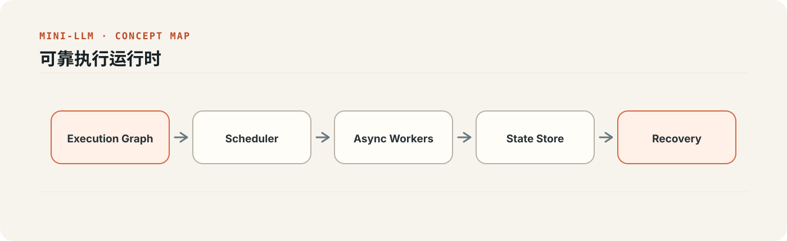

# **《mini-llm Runtime Engine 深度解析：从 Execution Graph、Task Scheduler 到 Async Runtime、Parallel Execution 与 Fault Tolerance》**



_图：可靠执行运行时。从左到右展示本章核心概念之间的数据流与依赖关系。_

前面的 mini-llm 系列已经逐步构建了模型计算、认知、记忆、决策、规划、Agent、学习和元控制等核心模块。

我们现在需要解决一个非常实际的问题：

**当 AI 系统决定执行一项复杂任务时，究竟由谁负责组织执行、调度资源、管理并发、保存状态，并在发生错误后恢复任务？**

例如，用户提出：

> 分析一个 GitHub 项目的架构，检查安全漏洞，分析性能瓶颈，运行测试，最后生成技术报告。

这并不是一次简单的 LLM 调用，而是一个由多个模型调用、工具执行、代码分析、测试和数据处理组成的复杂工作流。

如果没有 Runtime Engine，Agent 可能只能通过一系列临时函数调用完成任务。

如果有 Runtime Engine，系统就能够把任务变成可调度、可观察、可恢复、可并行执行的工程流程。

本文将从底层原理开始，逐步构建一个 mini-llm Runtime Engine。

# **一、Execution Runtime：AI 系统如何真正执行任务？**

## **1.1 从模型推理到任务执行**

首先需要区分三个概念：

| 层次                | 核心职责        | 典型行为                        |
| ----------------- | ----------- | --------------------------- |
| Model Runtime     | 执行模型计算      | Tensor、Attention、Generation |
| Agent Runtime     | 执行 Agent 行为 | 规划、工具调用、观察                  |
| Execution Runtime | 管理整个任务执行过程  | 调度、并发、状态、恢复                 |

例如：

用户要求：

> 分析一个软件项目，并生成架构报告。

Agent 负责决定：

- 需要分析哪些模块。
- 是否需要搜索代码。
- 是否需要运行测试。
- 最终报告应该包含什么。

Runtime 负责：

- 什么时候执行代码搜索。
- 哪些任务可以同时执行。
- 如何分配执行资源。
- 如何记录任务状态。
- 工具失败后如何重试。
- 系统崩溃后如何恢复。

因此：

**Agent 负责决定做什么，Runtime 负责管理事情如何被执行。**

## **1.2 Runtime 的基本组成**

一个基础 Runtime 通常包括：

1. Execution Context：执行上下文。
2. Task Manager：任务管理器。
3. Task Scheduler：任务调度器。
4. Executor：执行器。
5. Resource Manager：资源管理器。
6. State Store：状态存储。
7. Event System：事件系统。
8. Recovery Manager：恢复管理器。

## **Runtime Engine 基本结构**

**Execution Runtime**

统一管理任务生命周期

**Task Manager**

任务生命周期

**Task Scheduler**

任务调度

**Executor**

任务执行

**Resource Manager**

资源分配

**State Store**

状态持久化

**Recovery Manager**

错误恢复

**Event System**

事件通信、日志、状态变化通知

## **1.3 Runtime 执行循环**

Runtime 可以抽象为：

```
接收任务
   ↓
创建 Execution Context
   ↓
生成执行计划
   ↓
构建 Execution Graph
   ↓
提交 Scheduler
   ↓
分配 Executor
   ↓
执行任务
   ↓
记录结果与状态
   ↓
判断是否完成
   ↓
返回结果
```

一个重要设计原则：

**任务执行状态不能只存在于 Python 函数的局部变量中。**

否则进程崩溃后，系统可能无法知道任务执行到了哪里。

因此，Runtime 必须把任务执行过程变成可以持久化和恢复的状态。

# **二、Execution Graph：如何表示复杂任务依赖？**

这是 Runtime Engine 最核心的数据结构之一。

## **2.1 为什么需要 Execution Graph？**

假设需要分析一个软件项目：

1. 获取仓库信息。
2. 分析目录结构。
3. 分析依赖关系。
4. 分析安全风险。
5. 分析性能问题。
6. 综合生成报告。

这些任务并不是完全独立的。

例如：

- 目录结构分析依赖仓库获取。
- 依赖分析也依赖仓库获取。
- 安全分析依赖依赖关系。
- 性能分析依赖代码结构。
- 报告生成依赖所有分析结果。

如果按照固定顺序执行，效率较低。

如果完全并行执行，又可能出现依赖未满足的问题。

因此，需要使用图结构表达任务之间的依赖关系。

## **2.2 什么是 Execution Graph？**

Execution Graph 是一个有向图：

\\[ G=(V,E) \\]

其中：

- \\(V\\)：任务节点集合。
- \\(E\\)：任务之间的依赖边。

例如：

\\[ V=\\{A,B,C,D,E,F\\} \\]

依赖关系：

\\[ E=\\{A\rightarrow B,A\rightarrow C,B\rightarrow D,C\rightarrow E,D\rightarrow F,E\rightarrow F\\} \\]

表示：

- A 完成后，B 和 C 才能执行。
- B 完成后，D 才能执行。
- C 完成后，E 才能执行。
- D 和 E 都完成后，F 才能执行。

**A**

获取仓库

**B**

目录结构

**D**

性能分析

**C**

依赖关系

**E**

安全分析

**F**

综合生成报告

这个图称为 DAG（Directed Acyclic Graph，有向无环图）。

## **2.3 为什么使用 DAG？**

DAG 有三个重要特点：

1. 有方向：表示任务执行依赖。
2. 无环：不存在循环依赖。
3. 可以拓扑排序：可以计算合法的执行顺序。

例如：

```
A → B → D → F
 \→ C → E → F
```

可以得到：

```
第一阶段：A
第二阶段：B、C
第三阶段：D、E
第四阶段：F
```

其中 B、C 可以并行执行，D、E 也可以并行执行。

这就为后面的 Parallel Execution 提供了基础。

## **2.4 Task Node 数据结构**

每个任务节点可以包含：

```
from dataclasses import dataclass, fieldfrom typing import Any@dataclassclass TaskNode:    id: str    task_type: str    input_data: dict    dependencies: list[str] = field(        default_factory=list    )    status: str = "pending"    output: Any = None    retry_count: int = 0    max_retries: int = 3    timeout: float = 60.0    metadata: dict = field(        default_factory=dict    )
```

例如：

```
TaskNode(    id="security_analysis",    task_type="llm_analysis",    input_data={        "target": "dependency_graph"    },    dependencies=[        "dependency_analysis"    ])
```

这里的 `dependencies` 表示依赖节点 ID。

Runtime 需要保证所有依赖成功后，才能调度这个节点。

## **2.5 DAG 与 Workflow 的区别**

二者经常一起出现，但并不完全相同。

- Workflow：描述一个业务或任务流程。
- Execution Graph：描述这个流程中节点之间的执行关系。

Workflow 可以通过 DAG 实现。

但复杂 Workflow 还可能包含：

- 条件分支。
- 循环。
- 动态任务生成。
- 人工审批。
- 等待外部事件。

这些能力不能仅靠静态 DAG 表达。

一个实用设计是：

**将 DAG 作为核心执行结构，将条件分支和循环表示为显式的控制节点或动态子图。**

对于循环，需要设置退出条件、最大迭代次数和执行预算，避免无限运行。

# **三、Task Scheduler：如何调度模型、工具和 Agent？**

有了 Execution Graph，接下来需要决定：

**哪个任务应该先执行，由哪个 Executor 执行，以及什么时候执行。**

这就是 Task Scheduler。

## **3.1 Scheduler 的基本职责**

Task Scheduler 负责：

- 发现可以执行的任务。
- 检查依赖是否完成。
- 选择执行资源。
- 管理任务优先级。
- 控制并发数量。
- 处理任务超时。
- 管理失败和重试。

它相当于整个 Runtime 的交通指挥中心。

## **3.2 Task 状态机**

每个任务都有生命周期。

可以定义以下状态：

**PENDING**

等待执行

**READY**

依赖满足，可以调度

**RUNNING**

正在执行

SUCCEEDED

FAILED

CANCELLED

实际状态机还可以包含 RETRY_WAIT、PAUSED、TIMED_OUT、SKIPPED 等状态。

状态变化必须受到约束。

例如：

```
PENDING → READY
READY → RUNNING
RUNNING → SUCCEEDED
RUNNING → FAILED
FAILED → RETRY_WAIT
RETRY_WAIT → READY
```

不允许随意从 `PENDING` 跳到 `SUCCEEDED`。

## **3.3 任务优先级**

多个任务同时 READY 时，需要选择执行顺序。

可以定义优先级：

\\[ Priority_i= w_1D_i+ w_2C_i+ w_3R_i+ w_4A_i \\]

其中：

- \\(D_i\\)：任务依赖重要性。
- \\(C_i\\)：关键路径影响。
- \\(R_i\\)：任务风险。
- \\(A_i\\)：等待时间或紧迫程度。

但要注意，优先级公式只是一个策略选择，不存在适用于所有工作流的统一权重。

还需要防止低优先级任务长期得不到执行，即调度饥饿。

## **3.4 一个简单 Scheduler**

```
class TaskScheduler:    def __init__(self, graph):        self.graph = graph    def get_ready_tasks(self):        ready = []        for task in self.graph.tasks.values():            if task.status != "pending":                continue            dependencies_done = all(                self.graph.tasks[dep].status == "succeeded"                for dep in task.dependencies            )            if dependencies_done:                task.status = "ready"                ready.append(task)        return ready    def schedule(self):        tasks = self.get_ready_tasks()        return sorted(            tasks,            key=lambda task: task.metadata.get(                "priority", 0            ),            reverse=True        )
```

这是一个简化实现。

真实系统需要考虑依赖失败、条件分支、资源配额、任务取消、并发锁和状态持久化。

## **3.5 不同任务使用不同 Executor**

Runtime 不应该把所有任务都交给同一个执行器。

例如：

| 任务类型      | Executor         |
| --------- | ---------------- |
| LLM 推理    | ModelExecutor    |
| Python 计算 | PythonExecutor   |
| Shell 命令  | ProcessExecutor  |
| 数据库查询     | DatabaseExecutor |
| Web 搜索    | SearchExecutor   |
| Agent 子任务 | AgentExecutor    |
| 文件处理      | FileExecutor     |

可以建立统一接口：

```
class BaseExecutor:    async def execute(self, task):        raise NotImplementedError
```

然后实现不同 Executor：

```
class ModelExecutor(BaseExecutor):    async def execute(self, task):        return await model.generate(            task.input_data        )class PythonExecutor(BaseExecutor):    async def execute(self, task):        return await python_runtime.run(            task.input_data        )
```

这里的 `python_runtime` 必须是受隔离的执行环境，不能直接将不可信代码放到主 Runtime 进程执行。

# **四、Async Runtime：为什么需要异步执行？**

AI 系统大量时间都在等待。

例如：

- 等待模型 API 返回。
- 等待数据库查询。
- 等待 Web 搜索。
- 等待文件读取。
- 等待远程 Agent 完成。

如果使用同步执行，大量时间可能被浪费在等待上。

## **4.1 同步执行**

假设有三个任务：

- A：模型调用，耗时 3 秒。
- B：数据库查询，耗时 2 秒。
- C：Web 搜索，耗时 4 秒。

同步执行：

```
A: 0s ───── 3s
B:           3s ── 5s
C:                   5s ───── 9s
```

总耗时：

\\[ T=3+2+4=9s \\]

## **4.2 异步执行**

如果三个任务互不依赖，可以同时发起：

```
A: 0s ───── 3s
B: 0s ── 2s
C: 0s ──────── 4s
```

总耗时：

\\[ T=\max(3,2,4)=4s \\]

这里的关键不是同时使用了更多 CPU，而是等待一个 I/O 操作时，事件循环可以继续处理其他任务。

## **4.3 什么是 Event Loop？**

Event Loop（事件循环）是异步 Runtime 的重要组成部分。

它负责：

1. 运行协程。
2. 等待 I/O 事件。
3. 恢复已经可以继续执行的协程。
4. 管理定时器和异步任务。
5. 处理协程取消和异常。

可以简化理解为：

```
创建协程
   ↓
加入事件循环
   ↓
执行到 await
   ↓
遇到等待操作
   ↓
暂停当前协程
   ↓
执行其他可运行协程
   ↓
I/O 完成
   ↓
恢复原协程
```

Python 的 `asyncio` 就是实现这一机制的标准库之一。

## **4.4 async / await**

同步代码：

```
def search():    result = request_search_api()    return result
```

异步代码：

```
async def search():    result = await request_search_api()    return result
```

`await` 并不意味着所有操作都自动变快。

它的作用是：当当前协程等待一个可等待对象时，让出执行权。

如果在协程中调用阻塞式函数，仍然可能阻塞整个事件循环。

## **4.5 使用 asyncio 并发执行**

```
import asyncioasync def task_a():    await asyncio.sleep(3)    return "A completed"async def task_b():    await asyncio.sleep(2)    return "B completed"async def task_c():    await asyncio.sleep(4)    return "C completed"async def main():    results = await asyncio.gather(        task_a(),        task_b(),        task_c()    )    print(results)asyncio.run(main())
```

这段代码模拟三个 I/O 等待任务。

在没有额外资源瓶颈的情况下，整体等待时间约为最长任务的时间，而不是三个时间之和。

实际模型请求还需要考虑服务端限流、连接池、网络延迟和请求队列。

# **五、Parallel Execution：如何并行执行多个任务？**

异步和并行经常被混为一谈。

但它们是不同概念。

## **5.1 并发与并行的区别**

**Concurrency（并发）**：

多个任务在一段时间内交替推进。

**Parallelism（并行）**：

多个任务在同一时刻利用不同执行资源进行计算。

**并发**

任务交替推进

**并行**

多个任务同时执行

异步 Runtime 主要解决 I/O 并发。

多进程、线程、GPU Kernel 和分布式计算则可以用于不同形式的并行执行。

## **5.2 AI Runtime 中的并行任务**

假设需要同时执行：

- 安全分析。
- 性能分析。
- 依赖分析。
- 测试分析。

这些任务可以并行：

```
async def analyze_project(project):    results = await asyncio.gather(        security_analysis(project),        performance_analysis(project),        dependency_analysis(project),        test_analysis(project)    )    return {        "security": results[0],        "performance": results[1],        "dependencies": results[2],        "tests": results[3]    }
```

但如果性能分析必须依赖依赖分析的结果，就不能把它们放进同一批无条件并行任务中。

Runtime 必须尊重 Execution Graph 中的依赖关系。

## **5.3 GPU 并行与 Agent 并行不同**

这两个层次需要区分：

**GPU 并行：**

- Matrix Multiplication。
- Attention。
- Tensor Operations。
- CUDA Kernels。

**Agent 并行：**

- 多个 Agent 独立分析不同任务。
- 多个工具并行执行。
- 多个模型请求并发提交。

前者是模型计算层面的并行。

后者是系统任务层面的并行。

mini-llm Runtime Engine 主要负责第二类，并通过 Model Runtime 接口管理第一类资源。

# **六、Concurrency Control：如何管理并发与资源竞争？**

并发执行会提高效率，但也会产生新的问题。

例如：

两个 Agent 同时修改同一个文件。

两个任务同时更新同一条数据库记录。

多个请求同时占用同一个 GPU。

多个任务同时调用同一个 API，超过服务商限制。

这些都需要 Concurrency Control。

## **6.1 资源竞争**

假设两个任务：

```
Task A：读取 config.json
Task B：修改 config.json
```

如果 A 读取的同时 B 正在修改，A 可能读到不完整或不一致的数据。

这就是并发访问问题。

## **6.2 常见并发控制方式**

| 技术              | 作用         |
| --------------- | ---------- |
| Mutex           | 互斥访问       |
| Semaphore       | 限制同时执行数量   |
| Read/Write Lock | 区分读写操作     |
| Queue           | 任务排队       |
| Rate Limiter    | 限制请求速率     |
| Transaction     | 保证数据操作的一致性 |
| Optimistic Lock | 通过版本检测冲突   |

## **6.3 Semaphore：限制并发数量**

假设我们最多允许 5 个模型请求同时执行。

```
import asynciosemaphore = asyncio.Semaphore(5)async def call_model(task):    async with semaphore:        return await model.generate(task)
```

这样，即使同时提交 100 个任务，也只有最多 5 个任务进入这个受控区域。

注意：这只是单进程内的限制。如果有多个 Runtime 实例，需要使用共享配额或分布式限流机制。

## **6.4 Rate Limiter：限制请求频率**

假设模型服务商规定：

每分钟最多允许 60 次请求。

即使并发数量不高，如果请求集中在一秒内发出，也可能触发限流。

因此需要同时管理：

- 并发数。
- 每秒请求数。
- 每分钟请求数。
- Token 吞吐量。

并发限制和速率限制不是同一个概念。

## **6.5 并发执行中的数据一致性**

例如：

Agent A 修改文件 A。

Agent B 修改文件 B。

这通常没有冲突。

但如果：

Agent A 和 Agent B 同时修改同一个文件，就可能产生冲突。

对于 AI 编程 Runtime，可以使用：

- Git Worktree 隔离工作区。
- 文件级锁。
- 变更集审查。
- Git Patch 合并。
- 测试验证。
- 冲突检测。

这与之前设计的 AI 代码开发平台中的 Git Worktree 和变更追踪架构直接相关。

**不要让多个 Agent 在同一个工作目录中无约束地同时写入。**

# **七、State Persistence：如何保存任务执行状态？**

Runtime 必须面对一个现实问题：

进程可能随时崩溃。

例如：

- Python 进程异常退出。
- 服务器重启。
- 模型服务不可用。
- 网络断开。
- 容器被终止。

如果任务状态只存在内存中，恢复就会非常困难。

## **7.1 什么是 State Persistence？**

State Persistence 是将 Runtime 的执行状态持久化到外部存储。

例如：

```
Task ID: task_001

Status: RUNNING

Completed:
  - repository_fetch
  - structure_analysis

Pending:
  - security_analysis
  - performance_analysis
  - report_generation
```

进程崩溃后，可以重新读取这些信息。

## **7.2 执行状态应该保存什么？**

建议至少保存：

| 字段            | 作用      |
| ------------- | ------- |
| execution_id  | 执行实例 ID |
| task_id       | 任务 ID   |
| status        | 当前状态    |
| input         | 任务输入或引用 |
| output        | 执行结果或引用 |
| dependencies  | 依赖关系    |
| retry_count   | 重试次数    |
| started_at    | 开始时间    |
| completed_at  | 完成时间    |
| checkpoint_id | 检查点     |
| executor_id   | 执行器     |
| version       | 状态版本    |

对于 AI Runtime，还应该考虑：

- Model ID 和版本。
- Prompt 版本。
- Tool 版本。
- 上下文引用。
- Token 使用量。
- 成本记录。
- 证据来源。
- 执行权限。
- 审计事件。

## **7.3 数据库结构示例**

可以先使用 SQLite 或 PostgreSQL。

一个简化任务表：

```
CREATE TABLE runtime_tasks (
    id TEXT PRIMARY KEY,

    execution_id TEXT NOT NULL,

    task_type TEXT NOT NULL,

    status TEXT NOT NULL,

    input_json TEXT,

    output_json TEXT,

    retry_count INTEGER DEFAULT 0,

    max_retries INTEGER DEFAULT 3,

    version INTEGER DEFAULT 0,

    created_at TIMESTAMP,

    updated_at TIMESTAMP
);
```

依赖关系单独存储：

```
CREATE TABLE task_dependencies (
    task_id TEXT NOT NULL,

    dependency_id TEXT NOT NULL,

    PRIMARY KEY (
        task_id,
        dependency_id
    )
);
```

执行事件：

```
CREATE TABLE runtime_events (
    id INTEGER PRIMARY KEY,

    execution_id TEXT NOT NULL,

    task_id TEXT,

    event_type TEXT NOT NULL,

    payload_json TEXT,

    created_at TIMESTAMP
);
```

这三个表分别对应：

- 当前状态。
- 任务依赖。
- 状态变化历史。

## **7.4 为什么还需要 Event Log？**

只保存当前状态不够。

例如：

```
Task status = FAILED
```

我们知道任务失败了，却不知道：

- 什么时候失败？
- 执行了哪个工具？
- 使用了哪个模型？
- 是否发生过重试？
- 之前的结果是什么？

因此需要记录事件：

```
TASK_CREATED
TASK_READY
TASK_STARTED
MODEL_CALL_STARTED
MODEL_CALL_COMPLETED
TASK_FAILED
TASK_RETRY_SCHEDULED
TASK_STARTED
TASK_SUCCEEDED
```

这种方式与 Event Sourcing 有关联。

不过，Event Sourcing 是一种完整的数据架构模式，并不意味着 Runtime 只保存事件、不保存当前状态。

实际系统可以采用：

**事件日志 + 当前状态快照。**

这样既能追踪执行历史，也能快速恢复任务。

# **八、Fault Tolerance：任务失败后如何恢复？**

AI Runtime 不可能保证所有任务都成功。

外部 API 可能失败。

模型可能超时。

工具可能崩溃。

Agent 可能输出错误结果。

因此需要 Fault Tolerance（容错机制）。

## **8.1 常见故障类型**

| 故障类型            | 示例         |
| --------------- | ---------- |
| Network Failure | 网络连接中断     |
| Timeout         | 模型调用超时     |
| Rate Limit      | API 返回 429 |
| Process Crash   | 执行进程崩溃     |
| Model Failure   | 模型服务异常     |
| Tool Failure    | 工具执行失败     |
| Data Failure    | 输入数据损坏     |
| Logic Failure   | 任务逻辑错误     |

不同故障不能使用同一种恢复策略。

例如：

- 网络临时中断：可能适合重试。
- 权限不足：重试通常没有意义。
- 输入数据错误：需要修复输入。
- 代码测试失败：可能需要 Agent 修改代码。
- 模型服务不可用：可能需要切换模型服务商。

## **8.2 Retry：重试机制**

最简单的方式是重试。

```
import asyncioasync def retry(    operation,    max_retries=3):    for attempt in range(max_retries):        try:            return await operation()        except Exception:            if attempt == max_retries - 1:                raise            await asyncio.sleep(                2 ** attempt            )
```

这里使用指数退避：

\\[ Delay_n=2^n \\]

实际系统通常还应加入随机抖动（Jitter），避免大量任务在同一时刻同时重试。

例如：

\\[ Delay_n=\min(D\_{\max},D_0\cdot 2^n)+J \\]

其中 \\(J\\) 是随机抖动。

还应该根据错误类型决定是否重试，而不是对所有异常无条件重试。

## **8.3 Circuit Breaker：熔断器**

假设模型 API 连续失败。

如果 Runtime 仍然不断请求，可能导致：

- 更多失败。
- 请求堆积。
- 成本增加。
- 系统整体不可用。

Circuit Breaker 可以在故障达到阈值后暂时停止调用。

典型状态：

**CLOSED**

正常调用，监控失败率

**OPEN**

暂时拒绝请求，快速失败

**HALF-OPEN**

允许少量探测请求

探测成功回到 CLOSED，失败则重新进入 OPEN。

## **8.4 Idempotency：幂等性**

这是 Runtime 设计中非常重要的概念。

假设：

Agent 调用一个充值工具。

服务器已经成功充值。

但网络响应丢失。

Runtime 以为失败，再次调用。

结果用户被充值两次。

这就是典型的重复执行问题。

幂等性要求：

**同一个逻辑操作重复执行，不会产生重复的业务副作用。**

例如：

```
async def recharge(    account_id,    amount,    idempotency_key):    return await payment_service.recharge(        account_id=account_id,        amount=amount,        idempotency_key=idempotency_key    )
```

服务端需要记录幂等键和操作结果。

这样即使 Runtime 重试，也不会重复执行实际业务操作。

但需要注意：

不是所有操作都能天然实现幂等。

发送邮件、创建资源、扣款、部署应用等操作，需要专门设计去重和状态确认机制。

## **8.5 Exactly-once：一次且仅一次执行？**

这是分布式系统中的经典问题。

需要区分：

- At-most-once：最多执行一次，但可能丢失。
- At-least-once：至少执行一次，但可能重复。
- Exactly-once effect：通过幂等、事务、去重等机制实现业务效果上的一次性。

在分布式环境下，简单地说“任务只执行一次”通常是不严谨的。

对于 mini-llm Runtime，更现实的设计是：

**允许任务重试，通过幂等键、事务和执行记录控制副作用。**

# **九、Checkpoint & Rollback：如何实现检查点和回滚？**

在长时间运行的 Agent 任务中，Checkpoint 非常重要。

## **9.1 什么是 Checkpoint？**

Checkpoint 是执行过程中的一个可恢复状态快照。

例如：

```
执行任务
   ↓
完成仓库分析
   ↓
Checkpoint 1
   ↓
完成依赖分析
   ↓
Checkpoint 2
   ↓
安全分析失败
   ↓
从 Checkpoint 2 恢复
```

它可以保存：

- 已完成任务。
- 当前 DAG 状态。
- 中间结果引用。
- Agent 计划。
- 上下文引用。
- 资源使用记录。
- 版本信息。

## **9.2 Checkpoint 与普通日志的区别**

| 对比     | Log     | Checkpoint |
| ------ | ------- | ---------- |
| 目的     | 记录发生了什么 | 保存可恢复状态    |
| 数据形式   | 事件记录    | 状态快照       |
| 恢复用途   | 辅助诊断    | 快速恢复       |
| 是否完整状态 | 不一定     | 应包含恢复所需状态  |

## **9.3 Rollback：回滚**

假设 Agent 修改代码后发现测试失败。

Runtime 可以回滚到之前的代码状态。

例如：

```
Git Commit A
   ↓
Agent 修改代码
   ↓
Git Commit B
   ↓
测试失败
   ↓
Rollback
   ↓
恢复 Git Commit A
```

对于 AI 编程系统，建议将代码状态和 Runtime 状态分开管理：

- Git 管理代码版本。
- Runtime Checkpoint 管理执行状态。
- 数据库管理任务状态。
- Artifact Store 管理中间文件。

这几个系统之间需要保存关联 ID 和版本信息。

## **9.4 一个重要问题：回滚不等于撤销副作用**

如果 Agent 已经：

- 发出邮件。
- 创建云服务器。
- 扣除账户余额。
- 部署到生产环境。

那么恢复 Runtime 状态，并不能自动撤销这些外部操作。

这时需要：

- 补偿操作（Compensation）。
- 事务或 Saga 模式。
- 人工审批。
- 外部系统状态确认。

因此：

**Checkpoint 负责恢复执行状态，Rollback 负责恢复可回滚的数据状态，Compensation 负责处理无法直接回滚的外部副作用。**

# **十、Distributed Execution：如何将任务分配到多台机器？**

当 AI Runtime 需要处理大量任务时，单机可能无法满足需求。

例如：

- 多个模型服务。
- 多个 Agent。
- 大量代码分析任务。
- 大规模文件处理。
- 多 GPU 推理。
- 多租户任务调度。

这时需要 Distributed Execution。

## **10.1 单机 Runtime**

```
Runtime
  ├── Scheduler
  ├── Executor
  ├── State Store
  └── Resource Manager
```

所有任务都在一台机器上执行。

优点：

- 架构简单。
- 调试容易。
- 状态管理简单。
- 部署成本低。

缺点：

- 资源受限。
- 容错能力有限。
- 扩展能力有限。

## **10.2 分布式 Runtime**

```
              Runtime API
                  |
             Scheduler
                  |
              Task Queue
           /      |      \
          /       |       \
      Worker A Worker B Worker C
          |       |       |
       Model    Tools    Agent
          \       |       /
             State Store
```

Scheduler 负责分配任务。

Worker 负责执行任务。

Task Queue 负责传递任务。

State Store 负责保存状态。

## **10.3 Worker 模型**

Worker 是实际执行任务的工作进程。

```
class Worker:    async def run(self, task):        try:            result = await self.execute(task)            return {                "status": "succeeded",                "result": result            }        except Exception as error:            return {                "status": "failed",                "error": str(error)            }
```

真实 Worker 还需要心跳、租约、任务超时、取消机制和优雅关闭。

## **10.4 消息队列**

常见选择：

| 技术               | 典型用途         |
| ---------------- | ------------ |
| Redis Streams    | 轻量任务队列与事件流   |
| RabbitMQ         | 消息路由与任务队列    |
| Kafka            | 高吞吐事件流       |
| NATS             | 轻量消息通信       |
| PostgreSQL Queue | 小规模系统中的数据库队列 |

不要一开始就引入复杂消息中间件。

对于 mini-llm v1，单机任务队列和 SQLite/PostgreSQL 状态存储可能就足够了。

## **10.5 分布式调度的关键问题**

分布式 Runtime 需要解决：

1. Worker 宕机怎么办？
2. 同一个任务是否会被重复执行？
3. 如何确认任务已经完成？
4. 如何管理租约？
5. 如何避免消息丢失？
6. 如何处理 Worker 与 Scheduler 之间的网络分区？
7. 如何保证任务状态最终一致？

例如，可以使用 Lease：

Worker 获得任务后，任务在一定时间内归它处理。

Worker 定期续租。

如果 Worker 宕机，租约过期，任务重新进入调度流程。

但重新执行之前，必须检查任务是否有外部副作用，以及是否具备幂等能力。

# **十一、Runtime Isolation：如何隔离不可信工具和 Agent？**

这是 AI Runtime 从实验系统走向生产系统必须解决的问题。

Agent 能够调用工具，也可能执行用户提供的代码。

这意味着 Runtime 不能默认所有工具都是可信的。

## **11.1 为什么需要隔离？**

假设 Agent 接收到一个任务：

> 下载这个 GitHub 项目，并运行其中的安装脚本。

脚本可能：

- 删除文件。
- 读取敏感数据。
- 访问内部网络。
- 启动恶意进程。
- 消耗大量 CPU。
- 占用全部内存。
- 窃取 API Key。

如果直接在 Runtime 主机上执行，风险非常大。

## **11.2 隔离层次**

可以分为：

| 隔离技术               | 主要作用        |
| ------------------ | ----------- |
| Process Isolation  | 进程级隔离       |
| User/Namespace     | 用户和资源视图隔离   |
| cgroups            | CPU、内存等资源限制 |
| Seccomp            | 限制系统调用      |
| Filesystem Sandbox | 文件系统隔离      |
| Container          | 容器级隔离       |
| MicroVM            | 更强的虚拟化隔离    |

容器隔离依赖 Linux Namespace、cgroups、Capabilities、Seccomp 等机制。

但容器共享宿主机内核，不应被理解为绝对安全边界。

对于高风险不可信代码，可以考虑 MicroVM 等更强的隔离方式。

## **11.3 Runtime Sandbox 架构**

**Runtime Controller**

权限检查、资源配置、任务分配

**Sandbox Manager**

CPU Limit

Memory Limit

Filesystem Policy

Network Policy

Syscall Policy

Timeout Policy

**Isolated Worker**

运行不可信代码和工具

## **11.4 权限控制**

建议采用最小权限原则：

- 默认禁止访问宿主机敏感目录。
- 默认禁止访问内部网络。
- 默认不挂载 Docker Socket。
- 默认不传入宿主机 API Key。
- 限制 CPU 和内存。
- 限制运行时间。
- 限制文件读写范围。
- 对高风险操作要求人工审批。

对于 Agent 的工具调用，可以建立权限策略：

```
class ToolPolicy:    def check(self, tool, context):        if tool.name == "delete_file":            return context.has_permission(                "filesystem.delete"            )        if tool.name == "deploy":            return context.has_permission(                "deployment.execute"            )        return True
```

真实权限引擎应基于明确的主体、资源、动作和环境属性进行授权，并且不能依赖 Agent 自己声明“我有权限”。

# **十二、Runtime Architecture：构建完整的 mini-llm Runtime**

前面介绍了 Runtime 的主要组成。

现在可以把它们组合起来。

## **12.1 完整模块划分**

建议 mini-llm Runtime 使用以下目录：

```
mini-llm/
│
├── engines/
│   ├── tensor/
│   ├── autograd/
│   ├── neural_network/
│   ├── transformer/
│   ├── training/
│   ├── evaluation/
│   ├── representation/
│   ├── world_model/
│   ├── memory/
│   ├── knowledge/
│   ├── causal/
│   ├── decision/
│   ├── planning/
│   ├── agent/
│   ├── learning/
│   └── meta_controller/
│
├── runtime/
│   │
│   ├── core/
│   │   ├── runtime.py
│   │   ├── execution_context.py
│   │   └── lifecycle.py
│   │
│   ├── graph/
│   │   ├── execution_graph.py
│   │   ├── task_node.py
│   │   └── dependency.py
│   │
│   ├── scheduler/
│   │   ├── scheduler.py
│   │   ├── priority.py
│   │   └── resource_scheduler.py
│   │
│   ├── executor/
│   │   ├── base.py
│   │   ├── model_executor.py
│   │   ├── tool_executor.py
│   │   ├── python_executor.py
│   │   └── agent_executor.py
│   │
│   ├── async_runtime/
│   │   ├── event_loop.py
│   │   ├── task_group.py
│   │   └── cancellation.py
│   │
│   ├── concurrency/
│   │   ├── semaphore.py
│   │   ├── rate_limiter.py
│   │   └── lock_manager.py
│   │
│   ├── persistence/
│   │   ├── state_store.py
│   │   ├── event_store.py
│   │   └── checkpoint.py
│   │
│   ├── recovery/
│   │   ├── retry.py
│   │   ├── circuit_breaker.py
│   │   ├── recovery_manager.py
│   │   └── compensation.py
│   │
│   ├── distributed/
│   │   ├── worker.py
│   │   ├── task_queue.py
│   │   ├── lease.py
│   │   └── heartbeat.py
│   │
│   ├── isolation/
│   │   ├── sandbox.py
│   │   ├── resource_limits.py
│   │   └── security_policy.py
│   │
│   └── observability/
│       ├── logger.py
│       ├── metrics.py
│       └── tracing.py
│
└── tests/
    ├── test_execution_graph.py
    ├── test_scheduler.py
    ├── test_async_runtime.py
    ├── test_concurrency.py
    ├── test_persistence.py
    ├── test_recovery.py
    └── test_isolation.py
```

这是完整能力的逻辑目录，不意味着 v1 必须一次性实现所有模块。

## **12.2 Runtime 核心接口**

建议定义统一的 Runtime 接口：

```
class Runtime:    async def submit(self, workflow):        """        提交工作流        """        raise NotImplementedError    async def execute(self, execution_id):        """        执行工作流        """        raise NotImplementedError    async def pause(self, execution_id):        """        暂停执行        """        raise NotImplementedError    async def resume(self, execution_id):        """        恢复执行        """        raise NotImplementedError    async def cancel(self, execution_id):        """        取消执行        """        raise NotImplementedError    async def get_status(self, execution_id):        """        查询执行状态        """
```

这个接口可以成为整个 mini-llm 系统的执行入口。

## **12.3 Runtime 的一次完整执行**

将所有模块连接起来：

```
用户提交任务
      |
      v
Meta-Controller
      |
      v
Planning Engine
      |
      v
Execution Graph
      |
      v
Task Scheduler
      |
      v
Resource Manager
      |
      v
Executor Pool
      |
      +------------------+
      |         |        |
      v         v        v
   Model     Tool     Agent
 Executor  Executor  Executor
      |         |        |
      +---------+--------+
                |
                v
          State Store
                |
                v
          Event Store
                |
                v
         Recovery Manager
                |
                v
          Evaluation Engine
                |
                v
          最终任务结果
```

# **十三、实际构建：mini-llm Runtime v1 应该怎么做？**

前面的架构很完整，但不建议一开始就做分布式 Runtime。

如果目的是理解底层原理并逐步构建 mini-llm，应该从一个可运行的单机版本开始。

## **13.1 v1 技术选择**

| 模块    | 建议方案                     |
| ----- | ------------------------ |
| 开发语言  | Python                   |
| 异步运行  | asyncio                  |
| DAG   | 自定义轻量实现                  |
| 任务调度  | asyncio Task + Scheduler |
| 状态持久化 | SQLite                   |
| 事件记录  | SQLite Event Table       |
| 并发控制  | asyncio.Semaphore        |
| 重试    | 自定义 Retry                |
| 检查点   | JSON + SQLite            |
| 测试    | pytest + pytest-asyncio  |
| 日志    | Python logging           |

暂时不需要：

- Kubernetes。
- Kafka。
- 分布式 Worker。
- 复杂的微服务架构。
- 独立 GPU 调度集群。

## **13.2 v1 实现顺序**

1. **第一阶段：Execution Graph**

   实现 TaskNode、TaskDependency、DAG、拓扑排序、环检测。
2. **第二阶段：Task Scheduler**

   实现 READY 任务发现、依赖检查、优先级调度。
3. **第三阶段：Async Runtime**

   实现 async Executor、协程调度、任务取消、超时。
4. **第四阶段：Parallel Execution**

   实现并发限制、任务组、并行执行和结果聚合。
5. **第五阶段：Persistence**

   实现 SQLite State Store、Event Store 和任务状态恢复。
6. **第六阶段：Fault Tolerance**

   实现重试、指数退避、幂等键和熔断器。
7. **第七阶段：Checkpoint**

   实现检查点、断点恢复和补偿操作接口。
8. **第八阶段：Runtime Isolation**

   将 Python、Shell 等不可信工具放到隔离进程或容器中执行。

## **13.3 v1 最小验收任务**

建议用一个真实任务检验 Runtime：

> 同时分析一个软件项目的目录结构、依赖关系和代码质量，最后生成汇总报告。

验收标准：

| 测试项目        | 预期结果              |
| ----------- | ----------------- |
| DAG         | 正确识别任务依赖          |
| 环检测         | 能发现循环依赖           |
| Scheduler   | 只调度依赖已满足的任务       |
| Async       | I/O 任务异步运行        |
| Parallel    | 独立任务能够并行          |
| Concurrency | 并发数不超过限制          |
| Persistence | 状态可以保存            |
| Recovery    | 中断后能够恢复           |
| Retry       | 可重试错误能够重试         |
| Idempotency | 重复请求不会重复产生业务副作用   |
| Isolation   | 不可信代码不能直接访问主机敏感资源 |

这比单纯编写几个异步函数更能检验 Runtime 是否真正成立。

# **十四、Runtime Engine 与 Meta-Controller 的最终关系**

现在回到上一章的 Meta-Controller。

它负责：

- 选择模型。
- 决定推理深度。
- 分配预算。
- 选择工具。
- 决定是否启动多个 Agent。
- 决定是否继续执行。

Runtime Engine 则负责：

- 创建任务。
- 构建执行图。
- 调度任务。
- 分配执行器。
- 控制并发。
- 保存状态。
- 处理故障。
- 恢复执行。

二者之间的关系可以总结为：

**Meta-Controller**

## **决定怎么做**

策略、模型、工具、预算、推理深度

**Runtime Engine**

## **负责执行**

调度、并发、持久化、隔离、恢复

**Models / Tools / Agents**

实际计算和外部行动

这两者构成一个反馈循环：

1. Meta-Controller 制定执行策略。
2. Runtime 根据策略执行任务。
3. Runtime 收集执行结果和运行状态。
4. Meta-Controller 评估当前策略。
5. 必要时调整模型、工具、预算和执行计划。
6. Runtime 继续执行。

这才是一个能够动态运行的 AI 系统。

# **十五、总结：从模型执行到智能系统运行**

mini-llm 的技术体系现在可以分为三个相互关联的层次。

**第一层：模型计算层**

包括：

- Tensor Engine
- Autograd Engine
- Neural Network Engine
- Transformer Engine
- Training Engine
- Evaluation Engine

它解决模型如何计算、训练和生成。

**第二层：认知与智能层**

包括：

- Representation Engine
- World Model Engine
- Memory Engine
- Knowledge Engine
- Causal Reasoning Engine
- Decision Engine
- Planning Engine
- Agent Engine
- Agent Learning Engine

它解决系统如何表示世界、组织知识、规划和行动。

**第三层：系统控制与运行层**

包括：

- Meta-Controller
- Runtime Engine
- Task Scheduler
- Execution Graph
- Async Runtime
- Distributed Runtime
- Fault Tolerance
- Runtime Isolation

它解决整个智能系统如何被组织、调度和可靠运行。

一个重要的认识是：

**一个能够生成答案的模型，不等于一个能够可靠完成任务的 AI 系统。**

真正的 AI 工程不仅需要模型能力，还需要认知架构、决策机制、执行运行时、状态管理、资源调度和故障恢复。

Runtime Engine 正是连接模型能力与实际任务执行的关键基础设施。

## **下一篇：mini-llm 系列建议**

接下来值得深入研究的是：

# **《mini-llm Protocol Engine 深度解析：从 Tool Calling、Function Schema 到 MCP、A2A、Message Bus 与 Agent Communication》**

建议研究：

1. Protocol Engine：为什么 AI 系统需要统一通信协议？
2. Tool Calling：模型如何调用外部工具？
3. Function Schema：如何定义标准化工具接口？
4. Structured Output：如何约束模型输出？
5. Message Bus：不同 Engine 如何通信？
6. MCP：模型如何发现和使用外部工具与资源？
7. A2A：不同 Agent 如何相互协作？
8. Agent Communication：Agent 之间如何传递任务和状态？
9. Protocol Security：如何防止工具调用权限越界？
10. Protocol Versioning：协议如何兼容和演进？
11. Event-driven Architecture：如何通过事件驱动整个 AI 系统？
12. Protocol Architecture：如何构建完整的 mini-llm 通信协议层？

**Runtime Engine 解决 AI 系统如何执行，Protocol Engine 则要解决不同模型、工具、Agent 和外部系统如何相互通信。**

