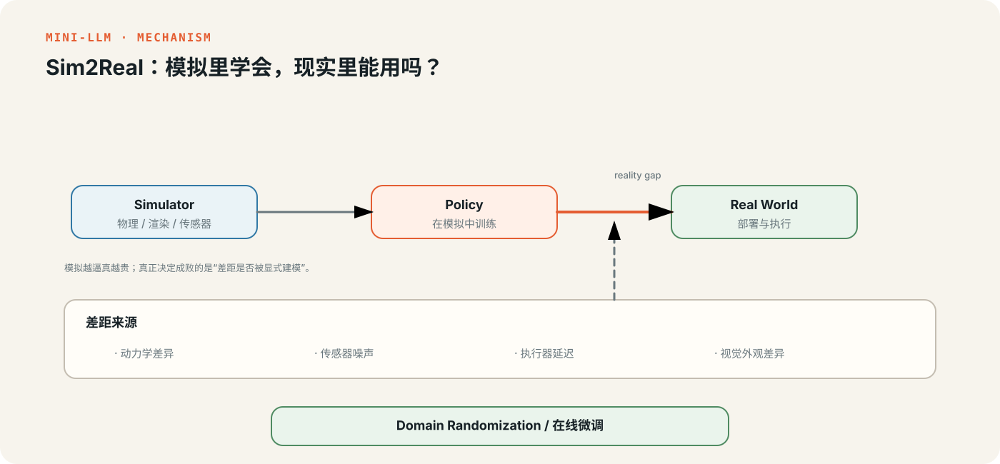
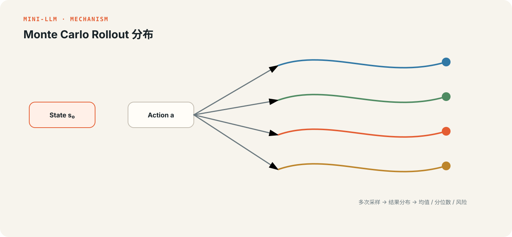
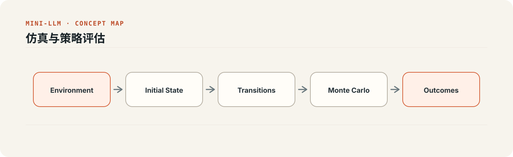
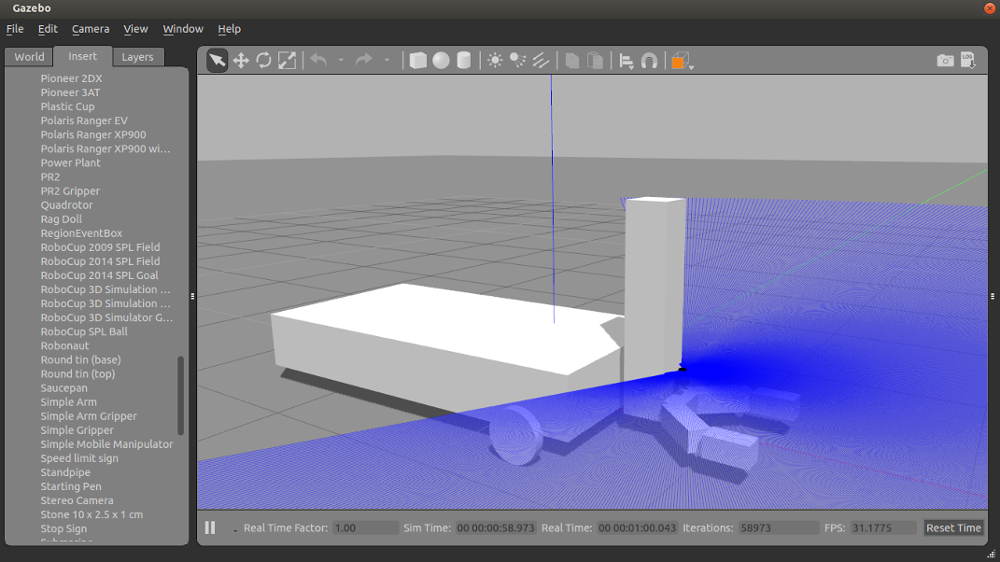

# **《mini-llm Simulation Engine 深度解析：从 Environment Modeling、State Transition 到 Multi-Agent Simulation、Monte Carlo 与 World Model》**



_图：Sim2Real 差距的四个来源，以及 domain randomization 等缓解手段。_




_图：Monte Carlo 通过多次随机 rollout 估计行动结果分布。_



_图：仿真与策略评估。从左到右展示本章核心概念之间的数据流与依赖关系。_

在前面的文章中，我们讨论了 Agent Engine 和 Multi-Agent Engine。

Agent 能够理解目标、制定计划、调用工具并执行任务。

Multi-Agent 则让多个智能体通过分工、通信和协作完成复杂任务。

但这里还存在一个更深层的问题：

**Agent 在采取行动之前，能否先模拟行动可能产生的结果？**

例如：

- 如果修改某个代码模块，会影响哪些其他模块？
- 如果采用微服务架构，系统的延迟和运维成本会发生什么变化？
- 如果两个智能体采取不同策略，最终会产生什么结果？
- 如果一个 Agent 采取行动，另一个 Agent 会如何响应？
- 如果当前决策失败，是否存在更好的替代路径？

如果 Agent 只能根据当前信息直接采取行动，那么它主要依靠预测和经验进行决策。

如果 Agent 能够在内部构建一个环境，并模拟不同的行动及其后果，那么它就获得了一种更强的能力：

**通过模拟未来来辅助当前决策。**

这就是 Simulation Engine（模拟引擎）。

# **一、Simulation Engine：为什么 Agent 需要模拟环境？**



_图：机器人仿真环境可以同时呈现底盘、传感器、机械臂、夹爪与场景几何，用于在真实执行前验证状态转移和控制逻辑。图片：Jose Luis Rivero / OSRF，[官方教程素材](https://github.com/osrf/gazebo_tutorials/tree/master/attach_gripper/files)，Apache 2.0。_

## **1.1 从直接行动到模拟行动**

传统 Agent 的执行过程：

```
User Goal
    |
    v
Agent
    |
    v
Action Selection
    |
    v
Tool Execution
    |
    v
Real Environment
    |
    v
Observation
```

Agent 选择行动，然后直接在真实环境中执行。

这种方式存在一个问题：

如果行动具有风险，Agent 可能需要付出真实代价才能知道行动是否正确。

例如：

用户要求：

> 帮我重构一个核心代码模块。

Agent 直接修改代码，可能出现：

- 接口不兼容。
- 依赖关系破坏。
- 测试失败。
- 性能下降。
- 其他模块无法运行。

能否先模拟修改？

```
User Goal
    |
    v
Agent
    |
    v
Generate Candidate Actions
    |
    v
Simulation Engine
    |
    +----> Scenario A
    |
    +----> Scenario B
    |
    +----> Scenario C
    |
    v
Evaluate Outcomes
    |
    v
Select Action
    |
    v
Real Execution
```

这就形成了一个新的工作模式：

**先预测行动后果，再决定是否在真实环境中执行。**

## **1.2 Simulation 与 Prediction 有什么区别？**

这两个概念容易混淆。

| 概念         | 核心问题               |
| ---------- | ------------------ |
| Prediction | 未来可能发生什么？          |
| Simulation | 给定初始状态和行动，系统将如何演化？ |
| Planning   | 应该采取什么行动才能达到目标？    |
| Decision   | 在多个可选行动中，应该选择哪一个？  |

例如：

一个 Agent 预测：

> 如果增加服务器数量，系统吞吐量可能提高。

Simulation 则进一步建立模型：

```
Current State:
CPU = 80%
Memory = 70%
Requests = 1000/s

Action:
增加 2 台服务器

Simulated Result:
CPU = 45%
Memory = 42%
Estimated Throughput = 1800/s
```

Prediction 可以给出一个结果判断。

Simulation 则通过明确的状态、行动和转移规则，计算不同条件下可能产生的结果。

当然，模拟结果是否可信，取决于模型是否准确。

## **1.3 Simulation Engine 的定义**

Simulation Engine 是一个能够构建环境状态、执行模拟行动、计算状态变化，并预测不同情景结果的系统。

它主要负责：

1. 构建可计算的环境。
2. 描述环境状态。
3. 定义可执行行动。
4. 建立状态转移机制。
5. 模拟环境变化。
6. 生成未来情景。
7. 比较不同模拟结果。
8. 为 Agent 提供决策依据。

# **二、Environment Modeling：如何构建可计算的环境？**

Simulation 的第一步不是执行行动，而是建立环境模型。

如果无法描述环境，就无法模拟环境变化。

## **2.1 什么是 Environment？**

Environment（环境）是 Agent 所处的外部系统。

例如：

| 场景          | Environment     |
| ----------- | --------------- |
| 游戏 Agent    | 游戏地图、角色、物理规则    |
| 软件工程 Agent  | 代码仓库、文件、依赖和测试环境 |
| 自动驾驶 Agent  | 道路、车辆、行人和交通规则   |
| 交易 Agent    | 市场、订单、价格和交易规则   |
| 企业管理 Agent  | 人员、资源、流程和业务规则   |
| Multi-Agent | 多个智能体及其交互环境     |

环境不仅包括静态对象，还包括动态变化规则。

例如，游戏环境包含：

- 地图。
- 玩家位置。
- 角色生命值。
- 物理碰撞。
- 移动规则。
- 攻击规则。
- 时间变化。

这些内容共同构成一个可计算环境。

## **2.2 Environment Model**

可以将环境定义为：

\\[ E=(S,A,T,O,R) \\]

其中：

- \\(S\\)：State，环境状态。
- \\(A\\)：Action，行动集合。
- \\(T\\)：Transition，状态转移机制。
- \\(O\\)：Observation，观察机制。
- \\(R\\)：Reward 或评价函数。

这与强化学习中的环境建模有密切关系。

例如一个简单游戏：

```
Environment
    |
    +-- State
    |     Player Position
    |     Enemy Position
    |     Health
    |
    +-- Action
    |     Move
    |     Attack
    |     Defend
    |
    +-- Transition
    |     Movement Rules
    |     Collision Rules
    |     Damage Rules
    |
    +-- Observation
    |     Visible Objects
    |     Health Status
    |
    +-- Reward
          Score
          Survival
          Goal Completion
```

## **2.3 Environment Model 的两种类型**

**第一种：规则驱动模型（Rule-based Model）**

环境变化由明确规则决定。

例如：

```
def move(position, direction):    if direction == "left":        return position - 1    if direction == "right":        return position + 1    return position
```

优点：

- 可解释。
- 可控制。
- 容易测试。
- 结果通常具有较高确定性。

缺点：

- 需要人工定义规则。
- 难以处理复杂现实环境。
- 规则不完整时模拟结果会产生偏差。

**第二种：学习驱动模型（Learned Model）**

通过数据学习环境的变化规律。

例如：

```
Historical Data
      |
      v
Training
      |
      v
Transition Model
      |
      v
Predict Next State
```

模型可以学习：

- 交通流量变化。
- 用户行为。
- 设备运行状态。
- 市场状态。
- 复杂系统的动态变化。

优点是可以捕捉复杂关系。

但它可能产生预测偏差，尤其在训练数据之外的情景中。

工程上还可以采用混合模型：

```
Environment Model
      |
      +-- Rule-based Physics
      |
      +-- Learned Dynamics
      |
      +-- External Constraints
```

对于 mini-llm，建议优先实现规则驱动环境，再逐步增加学习驱动的状态转移模型。

# **三、State Representation：如何描述环境状态？**

Simulation 的核心是 State。

如果状态表示不准确，那么后续的状态转移、预测和决策都可能出错。

## **3.1 State 是什么？**

State（状态）是某个时间点上，对环境中与模拟任务相关信息的描述。

例如，一个游戏状态：

```
{
  "player": {
    "x": 10,
    "y": 20,
    "health": 100
  },
  "enemy": {
    "x": 15,
    "y": 20,
    "health": 80
  },
  "environment": {
    "weather": "rain",
    "time": 120
  }
}
```

这代表某一时刻的环境状态。

经过行动后，状态可能发生变化。

例如玩家向右移动：

```
Before:
Player Position = (10, 20)

Action:
Move Right

After:
Player Position = (11, 20)
```

## **3.2 State 与 Observation 的区别**

这两个概念非常重要。

State 是环境的真实状态描述。

Observation 是 Agent 能够观察到的信息。

例如：

一辆自动驾驶汽车周围有一辆被建筑物遮挡的车辆。

真实环境：

```
State:
Car A Position = (10, 20)
Car B Position = (15, 20)
```

但 Agent 的摄像头可能无法看到 Car B。

因此：

```
Observation:
Car A Visible
Car B Unknown
```

数学上可以表示为：

\\[ o_t=O(s_t) \\]

其中：

- \\(s_t\\)：真实状态。
- \\(o_t\\)：观察结果。
- \\(O\\)：观察机制。

对于部分可观察环境，Agent 不能直接获得完整 State，需要根据历史观察形成 Belief State（信念状态）。

例如：

\\[ b_t(s)=P(s_t=s\mid o\_{1:t},a\_{1:t-1}) \\]

这表示 Agent 根据历史行动和观察，对当前环境状态形成概率分布。

这与之前讨论的 Bayesian Reasoning、Decision Engine 和 World Model 有直接关系。

## **3.3 State Schema**

mini-llm 可以设计统一状态结构：

```
interface EnvironmentState {
  environmentId: string;

  stateId: string;

  timestamp: number;

  version: number;

  entities: Record<string, EntityState>;

  variables: Record<string, unknown>;

  metadata: Record<string, unknown>;
}

interface EntityState {
  entityId: string;

  entityType: string;

  attributes: Record<string, unknown>;

  position?: {
    x: number;
    y: number;
    z?: number;
  };
}
```

需要注意：通用状态结构只是数据容器，不意味着所有环境都应该被强行抽象成相同的字段。

不同领域应该通过各自的 State Schema 扩展。

# **四、State Transition：行动如何改变环境？**

State Transition 是 Simulation Engine 最核心的机制。

它描述：

**给定当前状态和行动，环境如何变化？**

## **4.1 状态转移函数**

可以表示为：

\\[ s\_{t+1}=T(s_t,a_t) \\]

其中：

- \\(s_t\\)：当前状态。
- \\(a_t\\)：当前行动。
- \\(T\\)：状态转移函数。
- \\(s\_{t+1}\\)：下一个状态。

例如：

```
Current State:
Player Position = 10
Player Health = 100

Action:
Move Right

Transition:
Position += 1

Next State:
Player Position = 11
Player Health = 100
```

## **4.2 确定性状态转移**

如果同样的状态和行动始终产生相同结果：

\\[ s\_{t+1}=T(s_t,a_t) \\]

例如：

```
def transition(state, action):    next_state = state.copy()    if action == "move_right":        next_state["position"] += 1    return next_state
```

这种方式适合：

- 游戏规则。
- 工作流模拟。
- 软件依赖变化。
- 确定性业务规则。

## **4.3 随机状态转移**

现实世界通常具有不确定性。

例如：

玩家攻击敌人，可能造成不同伤害。

这时状态转移可以表示为概率分布：

\\[ P(s\_{t+1}\mid s_t,a_t) \\]

假设攻击伤害：

| 伤害 | 概率  |
| -- | --- |
| 10 | 0.3 |
| 20 | 0.5 |
| 30 | 0.2 |

那么：

\\[ E[Damage] =10(0.3)+20(0.5)+30(0.2) =19 \\]

这里的 19 是期望伤害，不代表每次攻击一定造成 19 点伤害。

## **4.4 连续状态与离散状态**

环境状态还可以分为：

**离散状态：**

```
Door = OPEN / CLOSED
Task = RUNNING / COMPLETED
Traffic Light = RED / GREEN
```

**连续状态：**

```
Temperature = 25.6
Speed = 60.5
Position = (10.2, 30.8)
```

不同环境需要不同的状态转移计算方式。

例如，物理模拟可能使用微分方程：

\\[ \frac{dx}{dt}=v \\]

\\[ \frac{dv}{dt}=a \\]

而工作流模拟可能主要使用有限状态机。

因此，Simulation Engine 需要支持多种 Transition Model，而不是只实现一种计算方式。

# **五、Action & Observation：行动与观察如何构成闭环？**

Agent 与环境之间存在一个持续循环。

```
       Environment
            |
            v
        Observation
            |
            v
           Agent
            |
            v
          Action
            |
            v
     Simulation Engine
            |
            v
       New State
            |
            +----------> Observation
```

这就是经典的 Agent-Environment Loop。

## **5.1 Action 定义**

行动代表 Agent 希望对环境产生的影响。

例如：

```
interface SimulationAction {
  actionId: string;

  agentId: string;

  type: string;

  parameters: Record<string, unknown>;

  timestamp: number;
}
```

例如：

```
{
  "actionId": "action_001",
  "agentId": "agent_001",
  "type": "move",
  "parameters": {
    "direction": "right",
    "distance": 1
  }
}
```

## **5.2 Observation 定义**

```
interface Observation {
  observationId: string;

  agentId: string;

  environmentId: string;

  timestamp: number;

  visibleState: Record<string, unknown>;

  confidence?: number;
}
```

这里的 `confidence` 应当由明确的观测或估计方法产生，而不是随意使用模型自报的数值。

## **5.3 为什么需要 Observation Layer？**

如果 Agent 可以直接读取完整环境状态，就可能获得现实中不应该拥有的信息。

例如：

- 游戏 Agent 直接读取敌人的隐藏位置。
- 交易 Agent 直接获得未来价格。
- 自动驾驶 Agent 直接知道遮挡区域中的所有车辆。

这会导致模拟结果失去真实性。

因此，Simulation Engine 应当支持：

- 完整状态访问。
- 部分状态访问。
- 噪声观察。
- 延迟观察。
- 不同 Agent 的观察权限。

这与 Security Engine 的权限控制也有关联。

# **六、Multi-Agent Simulation：如何模拟多个主体之间的交互？**

这是 Simulation Engine 与 Multi-Agent Engine 最重要的结合点。

单 Agent Simulation 主要研究：

一个主体如何与环境交互。

Multi-Agent Simulation 则研究：

多个主体如何相互影响，并共同改变环境状态。

## **6.1 多主体环境**

例如一个简单的博弈环境：

```
Environment
    |
    +-- Agent A
    |
    +-- Agent B
    |
    +-- Agent C
    |
    +-- Shared Resources
    |
    +-- Rules
```

每个 Agent 都有自己的：

- 状态。
- 目标。
- 观察。
- 行动策略。
- 资源。

同时，Agent 的行动可能影响其他 Agent。

例如：

```
Agent A: Attack
Agent B: Defend
Agent C: Move
```

这些行动共同决定下一轮环境状态。

## **6.2 联合状态**

可以定义：

\\[ S_t=(s_t^1,s_t^2,\dots,s_t^n,e_t) \\]

其中：

- \\(s_t^i\\)：第 i 个 Agent 的状态。
- \\(e_t\\)：共享环境状态。

联合行动：

\\[ A_t=(a_t^1,a_t^2,\dots,a_t^n) \\]

环境变化：

\\[ S\_{t+1}=T(S_t,A_t) \\]

这意味着多个 Agent 的行动可能需要统一计算。

## **6.3 同步与异步模拟**

**同步模拟（Synchronous Simulation）**

所有 Agent 在同一轮提交行动，再统一更新环境。

```
Round 1
  |
  +-- Agent A Action
  +-- Agent B Action
  +-- Agent C Action
  |
  v
Environment Update
  |
  v
Round 2
```

优点：

- 时间步明确。
- 结果比较容易复现。
- 适合博弈和物理模拟。

**异步模拟（Asynchronous Simulation）**

Agent 可以在不同时间采取行动，环境持续变化。

```
Time
 |
 +-- Agent A Action
 |
 +------ Agent B Action
 |
 +-- Environment Update
 |
 +------------ Agent C Action
```

优点：

- 更贴近部分实时系统。
- 适合网络服务、工作流和事件驱动环境。

缺点：

- 时间管理复杂。
- 并发竞争更明显。
- 回放和确定性测试更困难。

## **6.4 Agent 之间的策略交互**

例如：

两个 Agent 在竞争同一资源。

Agent A 的策略：

```
优先获取资源
```

Agent B 的策略：

```
尽量降低资源消耗
```

如果 Agent A 改变策略，Agent B 的最优行动可能也会改变。

这意味着：

\\[ a_A=f_A(s_A,o_A) \\]

\\[ a_B=f_B(s_B,o_B) \\]

而环境状态变化取决于两个 Agent 的联合行动。

这种动态交互正是 Multi-Agent Simulation 的核心。

# **七、Monte Carlo Simulation：如何通过大量采样估计未来结果？**

真实环境存在不确定性。

有时候，我们无法准确计算一个行动的结果。

但是可以通过大量模拟来估计可能结果。

这就是 Monte Carlo Simulation（蒙特卡洛模拟）。

## **7.1 核心思想**

假设一个决策有三种可能结果：

| 结果 | 概率  |
| -- | --- |
| 成功 | 0.5 |
| 普通 | 0.3 |
| 失败 | 0.2 |

我们可以计算期望收益：

\\[ E[R]=\sum_i P(r_i)r_i \\]

但对于更复杂的系统，可能无法直接得到解析解。

这时可以随机采样。

```
Simulation 1 -> Success
Simulation 2 -> Failure
Simulation 3 -> Success
Simulation 4 -> Normal
Simulation 5 -> Success
...
Simulation 10000 -> Success
```

通过统计模拟结果，估计未来分布。

## **7.2 Monte Carlo 估计**

假设模拟 N 次，每次得到一个结果 \\(X_i\\)。

期望值估计：

\\[ \hat{E}[X]=\frac{1}{N}\sum\_{i=1}^{N}X_i \\]

例如模拟 1000 次，得到：

- 成功：600 次。
- 普通：250 次。
- 失败：150 次。

那么成功概率估计：

\\[ \hat{P}(Success)=\frac{600}{1000}=0.6 \\]

需要注意，模拟次数越多，估计结果通常越稳定，但前提是模拟模型本身合理。

**大量模拟不能修复错误的环境模型。**

如果状态转移规则本身不正确，模拟 100 万次仍然可能得到错误结论。

## **7.3 一个简单的 Python 示例**

假设我们要估计一个策略在随机环境中的收益。

```
import randomdef simulate_once():    outcome = random.random()    if outcome < 0.6:        return 100    elif outcome < 0.85:        return 20    else:        return -80def monte_carlo(n=10000):    results = [        simulate_once()        for _ in range(n)    ]    average = sum(results) / n    success_rate = sum(        x > 0 for x in results    ) / n    return {        "average_return": average,        "success_rate": success_rate    }
```

理论期望收益：

\\[ E[R]=0.6(100)+0.25(20)+0.15(-80) \\]

\\[ E[R]=53 \\]

随着模拟次数增加，样本平均收益通常会逐渐接近 53。

## **7.4 Monte Carlo 在 Agent 中的应用**

可以用于：

- 多条执行路径的比较。
- 不同策略的收益估计。
- 风险概率分析。
- 多 Agent 博弈。
- 资源分配。
- 任务调度。
- 规划搜索。

例如：

```
Candidate Action A
      |
      +-- Simulation 1
      +-- Simulation 2
      +-- Simulation 3
      |
      v
Expected Outcome A

Candidate Action B
      |
      +-- Simulation 1
      +-- Simulation 2
      +-- Simulation 3
      |
      v
Expected Outcome B
```

最后比较不同候选行动的模拟结果。

# **八、Scenario Generation：如何生成不同的未来情景？**

Simulation Engine 不应该只模拟一种未来。

它应该支持多个不同的情景。

例如，一个企业准备扩展服务器资源。

可以设计：

```
Scenario A:
保持当前服务器数量

Scenario B:
增加两台服务器

Scenario C:
迁移到更高性能服务器

Scenario D:
采用缓存和异步架构
```

每种方案都需要在相同的初始条件下进行模拟。

## **8.1 Scenario 数据模型**

```
interface SimulationScenario {
  scenarioId: string;

  name: string;

  initialState: EnvironmentState;

  actions: SimulationAction[];

  parameters: Record<string, unknown>;

  assumptions: string[];
}
```

## **8.2 多情景比较**

假设模拟结果：

| 方案 | 预计吞吐量  | 预计成本 | 风险 |
| -- | ------ | ---- | -- |
| A  | 1000/s | $100 | 低  |
| B  | 1800/s | $180 | 中  |
| C  | 2200/s | $300 | 中  |
| D  | 1600/s | $120 | 低  |

这里不能简单认为 C 一定最好。

还需要考虑：

- 成本预算。
- 延迟要求。
- 可靠性。
- 维护难度。
- 扩展性。

Scenario Generation 可以让 Agent 在采取真实行动之前，比较不同方案的潜在结果。

## **8.3 情景不等于预测**

需要明确：

Scenario 是在某些假设条件下构建的未来情景。

它不意味着这些情景一定会发生。

例如：

```
如果用户增长 50%
如果服务器数量增加 2 台
如果数据库迁移到 PostgreSQL
```

这是条件模拟，而不是对未来的确定性预测。

# **九、Counterfactual Simulation：如果采取另一种行动会怎样？**

这是 Simulation Engine 中非常有价值的能力。

Counterfactual（反事实）关注：

**在已经发生的事实之外，如果采取了不同的行动，结果会怎样？**

例如：

一个 Agent 修改代码后导致测试失败。

我们可以问：

- 如果不修改这个模块，会怎样？
- 如果采用另一种重构方案，会怎样？
- 如果先修改接口，再修改调用方，会怎样？

## **9.1 事实路径与反事实路径**

```
Initial State
      |
      v
   Action A
      |
      v
  Actual Result
```

反事实路径：

```
Initial State
      |
      v
   Action B
      |
      v
Counterfactual Result
```

两条路径使用相同的初始条件，比较不同行动产生的结果。

## **9.2 数学表示**

假设：

- \\(Y(A)\\)：采取行动 A 的结果。
- \\(Y(B)\\)：采取行动 B 的结果。

我们希望比较：

\\[ \Delta Y=Y(A)-Y(B) \\]

例如：

```
Action A:
重构整个模块
预计测试通过率：85%

Action B:
只修改接口层
预计测试通过率：95%
```

在模拟模型成立的前提下，可以认为 B 具有更高的预测成功率。

但这里有一个关键限制：

反事实结果无法像真实观察结果那样直接验证，因为同一环境不可能在完全相同的条件下同时经历两条现实路径。

这也是因果推断和结构因果模型中非常重要的问题。

## **9.3 与 Causal Reasoning Engine 的关系**

Simulation 和 Causal Reasoning 有联系，但不等价。

Simulation：

根据状态转移模型计算可能结果。

Causal Reasoning：

研究变量之间的因果关系，并分析干预产生的影响。

例如：

```
服务器数量增加
      |
      v
并发处理能力变化
      |
      v
请求排队时间变化
      |
      v
响应延迟变化
```

如果模型只是根据历史数据拟合相关关系，就不一定能够正确预测干预效果。

因此，Counterfactual Simulation 要想具有因果解释力，需要合理的因果结构、干预定义和模型假设。

# **十、World Model Integration：如何将世界模型接入 Agent？**

Simulation Engine 和 World Model Engine 是两个高度相关的模块。

但它们不是完全相同的东西。

## **10.1 World Model 是什么？**

World Model（世界模型）是系统对外部环境及其变化规律形成的内部表示。

它可以包含：

- 对象。
- 状态。
- 空间关系。
- 物理规律。
- 因果关系。
- 行动后果。
- 不确定性。

例如：

一个机器人需要理解：

```
Object:
桌子

Position:
(10, 20)

Properties:
固定物体

Relation:
机器人前方

Dynamics:
机器人移动时，桌子的位置不变
```

这构成了环境的部分世界表征。

## **10.2 World Model 与 Simulation Model**

| 概念                | 主要职责           |
| ----------------- | -------------- |
| World Model       | 表示系统对世界的理解     |
| Simulation Model  | 根据模型计算状态变化     |
| Simulation Engine | 组织模拟过程和执行      |
| Planning Engine   | 利用模拟结果寻找行动方案   |
| Decision Engine   | 根据目标、风险和成本选择行动 |

可以这样理解：

World Model 提供对世界的内部描述。

Simulation Model 提供世界变化的计算规则。

Simulation Engine 使用这些模型模拟未来。

Planning Engine 利用模拟结果寻找行动路径。

Decision Engine 决定最终采取什么行动。

## **10.3 LLM 是否天然拥有 Simulation 能力？**

LLM 能够根据文本描述预测一些事件。

例如：

> 如果一个物体从桌面边缘掉落，它可能会落到地面。

但这不意味着 LLM 内部天然拥有精确的物理模拟器。

LLM 的预测能力可能来自训练数据中学习到的统计规律和隐式结构。

要实现可靠模拟，通常还需要：

- 明确的环境状态。
- 可执行的状态转移模型。
- 约束条件。
- 数值计算。
- 物理或业务规则。
- 外部验证机制。

因此，不能简单地把 LLM 的文字推演等同于一个经过验证的 Simulation Engine。

## **10.4 mini-llm 的集成架构**

```
             Agent
               |
               v
          Planning Engine
               |
               v
         Decision Engine
               |
               v
         Simulation Engine
               |
       +-------+-------+
       |               |
       v               v
  World Model      Environment
       |               |
       +-------+-------+
               |
               v
        State Transition
               |
               v
       Simulation Results
               |
               v
         Agent Decision
```

这里 World Model 提供环境表示，Simulation Engine 负责执行模拟。

# **十一、Simulation Evaluation：如何验证模拟结果是否接近真实世界？**

这是整个 Simulation Engine 最容易被忽略、却最重要的问题之一。

一个模拟系统可以产生非常漂亮的结果。

但是：

**漂亮的模拟结果不代表它真实可靠。**

## **11.1 为什么需要验证？**

假设系统预测：

```
服务器增加 2 台
吞吐量提升 80%
响应延迟降低 40%
```

但真实部署之后：

```
吞吐量只提升 20%
响应延迟只降低 5%
```

这意味着模拟模型可能存在偏差。

## **11.2 模型验证的几个层次**

| 层次                          | 关注点           |
| --------------------------- | ------------- |
| Code Verification           | 模拟代码是否正确实现模型  |
| Model Validation            | 模型是否能够描述真实系统  |
| Calibration                 | 预测概率与实际频率是否匹配 |
| Sensitivity Analysis        | 参数变化是否造成合理影响  |
| Out-of-distribution Testing | 未见过的情景下是否仍然可靠 |
| Reality Comparison          | 模拟结果与真实实验是否一致 |

## **11.3 Calibration**

如果模型预测某类事件发生概率为 0.8，那么在大量类似预测中，事件实际发生频率应该接近 0.8。

例如：

```
预测概率 0.8 的事件共 100 次

实际发生 78 次
```

模型的概率校准表现相对合理。

但这只说明概率预测的一项性质，并不代表整个环境模型正确。

## **11.4 Sensitivity Analysis**

我们还需要分析：

模拟结果对参数变化是否敏感。

例如：

```
服务器数量：2 -> 4
并发请求：1000 -> 2000
网络延迟：10ms -> 100ms
```

可以观察输出变化。

如果一个参数发生微小变化，模拟结果却剧烈波动，就需要检查模型稳定性。

## **11.5 Simulation 与真实实验形成闭环**

```
Simulation
    |
    v
Predicted Result
    |
    v
Real Execution
    |
    v
Actual Result
    |
    v
Error Analysis
    |
    v
Model Update
    |
    v
New Simulation
```

这才是可靠模拟系统应当具备的持续改进机制。

# **十二、mini-llm Simulation Engine 整体架构**

将上面的模块整合起来。

- **Simulation API**：创建模拟任务、场景和运行配置
- **Simulation Manager**：模拟生命周期、任务和状态管理
- **Environment**：环境定义
- **State Manager**：状态管理
- **Action Engine**：行动执行
- **Transition Engine**：状态转移
- **Scenario Engine**：情景生成
- **Observation Engine**：观察生成
- **Simulation Algorithms**：Monte Carlo

Discrete Event Simulation

**Evaluation & Result Store**

模拟结果、误差分析、统计报告、状态快照

## **12.1 核心模块职责**

| 模块                    | 主要职责   |
| --------------------- | ------ |
| Environment Manager   | 管理环境定义 |
| State Manager         | 管理环境状态 |
| Action Engine         | 处理模拟行动 |
| Transition Engine     | 计算状态变化 |
| Observation Engine    | 生成观察   |
| Scenario Engine       | 管理不同情景 |
| Monte Carlo Engine    | 随机采样模拟 |
| Multi-Agent Simulator | 多主体模拟  |
| Counterfactual Engine | 反事实模拟  |
| Evaluation Engine     | 验证模拟质量 |
| Result Store          | 保存模拟结果 |

# **十三、工程目录设计**

建议 mini-llm 使用 Python 实现第一版 Simulation Engine。

原因是 Python 具有成熟的科学计算、数据处理和模拟生态。

后续如果出现高性能需求，可以将数值计算核心迁移到 Rust 或 C++。

```
mini-llm/
│
├── engines/
│   │
│   ├── simulation/
│   │   │
│   │   ├── core/
│   │   │   ├── simulation.py
│   │   │   ├── simulation_config.py
│   │   │   └── simulation_context.py
│   │   │
│   │   ├── environment/
│   │   │   ├── environment.py
│   │   │   ├── environment_schema.py
│   │   │   └── environment_registry.py
│   │   │
│   │   ├── state/
│   │   │   ├── state.py
│   │   │   ├── state_manager.py
│   │   │   └── state_snapshot.py
│   │   │
│   │   ├── action/
│   │   │   ├── action.py
│   │   │   └── action_executor.py
│   │   │
│   │   ├── transition/
│   │   │   ├── transition_model.py
│   │   │   ├── deterministic.py
│   │   │   └── stochastic.py
│   │   │
│   │   ├── observation/
│   │   │   ├── observation.py
│   │   │   └── observation_model.py
│   │   │
│   │   ├── scenario/
│   │   │   ├── scenario.py
│   │   │   └── scenario_generator.py
│   │   │
│   │   ├── algorithms/
│   │   │   ├── monte_carlo.py
│   │   │   ├── multi_agent.py
│   │   │   ├── counterfactual.py
│   │   │   └── discrete_event.py
│   │   │
│   │   ├── evaluation/
│   │   │   ├── validator.py
│   │   │   ├── calibration.py
│   │   │   └── sensitivity.py
│   │   │
│   │   ├── storage/
│   │   │   ├── result_store.py
│   │   │   └── snapshot_store.py
│   │   │
│   │   └── simulation_engine.py
│   │
│   └── ...
│
└── tests/
    └── simulation/
```

# **十四、核心接口设计**

## **14.1 Environment 接口**

```
from abc import ABC, abstractmethodclass Environment(ABC):    @abstractmethod    def reset(self):        pass    @abstractmethod    def observe(self, agent_id):        pass    @abstractmethod    def step(self, actions):        pass    @abstractmethod    def get_state(self):        pass
```

## **14.2 Transition Model**

```
class TransitionModel:    def transition(self, state, action):        next_state = state.copy()        if action["type"] == "move":            direction = action["direction"]            if direction == "right":                next_state["position"] += 1            elif direction == "left":                next_state["position"] -= 1        return next_state
```

## **14.3 Simulation Engine**

```
class SimulationEngine:    def __init__(        self,        environment,        transition_model    ):        self.environment = environment        self.transition_model = transition_model    def run(self, actions):        state = self.environment.get_state()        history = [state]        for action in actions:            state = self.transition_model.transition(                state,                action            )            history.append(state)        return {            "final_state": state,            "history": history        }
```

这是一个简化的确定性模拟接口。

实际版本还需要处理多 Agent 行动、随机转移、时间推进、事件调度、异常和状态持久化。

# **十五、V1 实施路线**

Simulation Engine 的理论范围非常大。

如果一开始就支持物理模拟、复杂博弈、强化学习和世界模型，工程成本会非常高。

建议从最简单的可计算环境开始。

1. **阶段一：基础模拟**

   优先实现
   - Environment Schema
   - State Representation
   - Action Model
   - Deterministic Transition
   - State Snapshot
   - Simulation History
2. **阶段二：不确定性模拟**
   - Stochastic Transition
   - Random Seed
   - Monte Carlo
   - Scenario Generation
   - Statistical Analysis
3. **阶段三：多主体模拟**
   - Multi-Agent State
   - Joint Actions
   - Synchronous Execution
   - Asynchronous Events
   - Agent Interaction
4. **阶段四：智能模拟**
   - Counterfactual Simulation
   - World Model Integration
   - Planning Integration
   - Simulation Evaluation
   - Model Calibration

## **V1 验收标准**

可以建立一个简单的资源分配环境。

例如：

```
Environment:
一个拥有 100 个资源单位的系统。

Agents:
Agent A
Agent B
Agent C

Actions:
申请资源
释放资源
转移资源

Rules:
资源总量不能超过 100。
每个 Agent 不能使用负数资源。
```

系统需要能够：

1. 创建 Environment。
2. 初始化 State。
3. 注册多个 Agent。
4. 接收 Agent Action。
5. 执行 State Transition。
6. 生成下一时刻状态。
7. 保存完整状态历史。
8. 模拟多个不同策略。
9. 使用 Monte Carlo 进行多次采样。
10. 对比不同方案的结果。

这个场景虽然简单，但已经包含 Simulation Engine 的核心机制。

# **十六、Simulation Engine 与其他 Engine 的关系**

Simulation Engine 不是孤立的模块。

它与之前讨论的多个 Engine 存在紧密联系。

| Engine                  | 关系            |
| ----------------------- | ------------- |
| Agent Engine            | 提出模拟行动        |
| Multi-Agent Engine      | 提供多个模拟主体      |
| World Model Engine      | 提供环境表示和动态模型   |
| Planning Engine         | 使用模拟结果寻找路径    |
| Decision Engine         | 比较行动的预期收益和风险  |
| Causal Reasoning Engine | 提供因果结构和干预分析   |
| Memory Engine           | 保存历史状态和经验     |
| Learning Engine         | 根据真实反馈更新模型或策略 |
| Runtime Engine          | 调度模拟任务        |
| Observability Engine    | 记录模拟执行过程      |
| Evaluation Engine       | 验证模拟结果        |

可以将它们串联成一个完整闭环：

```
         User Goal
             |
             v
         Agent Engine
             |
             v
        Planning Engine
             |
             v
        Decision Engine
             |
             v
       Simulation Engine
             |
             v
        Candidate Results
             |
             v
        Decision Selection
             |
             v
       Runtime Execution
             |
             v
       Real Environment
             |
             v
       Actual Observation
             |
             v
       Evaluation Engine
             |
             v
        Learning Engine
             |
             v
        Model Update
```

这代表一个非常重要的转变：

传统 Agent 主要通过行动获得反馈。

具有模拟能力的 Agent 可以先在内部环境中探索可能的结果，再选择是否采取真实行动。

# **十七、最终思考：智能是否意味着能够模拟未来？**

人类在做决策时，通常不会只考虑当前状态。

我们会想象：

- 如果我这样做，会发生什么？
- 如果我不这样做，又会发生什么？
- 对方可能如何反应？
- 哪种选择风险更小？
- 是否存在更好的替代方案？

这实际上包含了预测、模拟、规划和决策等多种能力。

对于 AI 系统而言，这些能力也可以被逐步工程化。

但需要注意：

模拟未来并不意味着真正知道未来。

模拟结果始终依赖：

- 状态是否完整。
- 环境模型是否准确。
- 转移规则是否合理。
- 不确定性是否得到正确表示。
- 模拟范围是否覆盖真实场景。

因此，Simulation Engine 的核心价值不是制造一个看似确定的未来，而是帮助 Agent 理解：

**在不同假设和行动条件下，未来可能如何变化，以及这些变化存在多大的不确定性。**

可以将这个能力概括为：

\\[ Intelligent\ Decision = State\ Understanding + Future\ Simulation + Outcome\ Evaluation \\]

这也为 mini-llm 从一个能够调用工具的 Agent 系统，逐步走向能够预测、模拟、规划和决策的智能系统，提供了重要的工程基础。

## **下一篇建议：World Model Engine**

Simulation Engine 解决的是如何模拟环境变化。

接下来值得深入研究的是：**系统如何学习和构建一个能够支持预测、推演和规划的世界模型？**

建议下一篇：

**《mini-llm World Model Engine 深度解析：从 World Representation、Latent Dynamics 到 Predictive Model、Model-based Planning 与 Learned Environment》**

重点研究：

1. World Model：什么是世界模型？
2. World Representation：如何表示现实世界？
3. State Space：如何构建状态空间？
4. Latent World Model：为什么需要潜在空间？
5. Dynamics Model：如何学习环境变化规律？
6. Predictive Model：如何预测未来状态？
7. Model-based Planning：如何利用世界模型规划行动？
8. Imagination Rollout：如何在内部想象未来？
9. Uncertainty Modeling：如何表达世界模型的不确定性？
10. Video World Model：如何从视频学习世界动态？
11. Action-conditioned Prediction：如何预测不同动作产生的结果？
12. World Model Architecture：如何将世界模型集成到 mini-llm？

