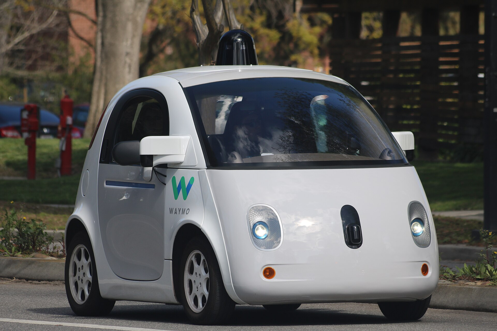
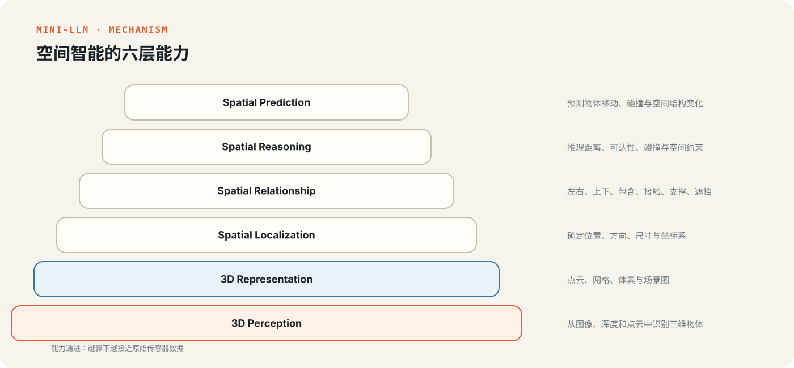
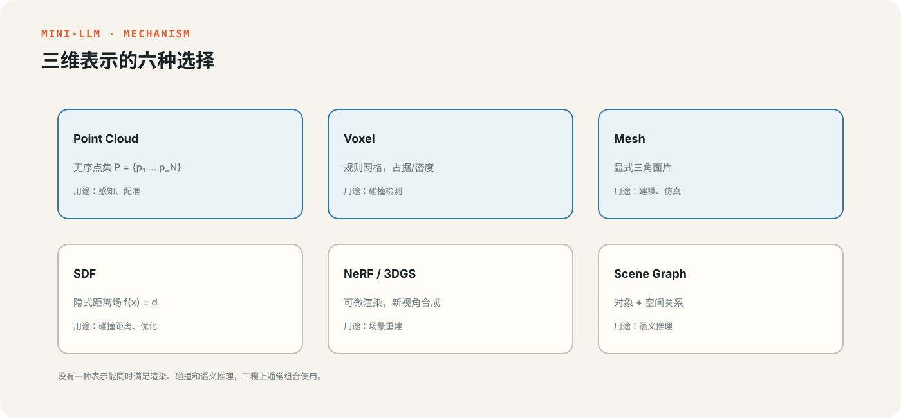
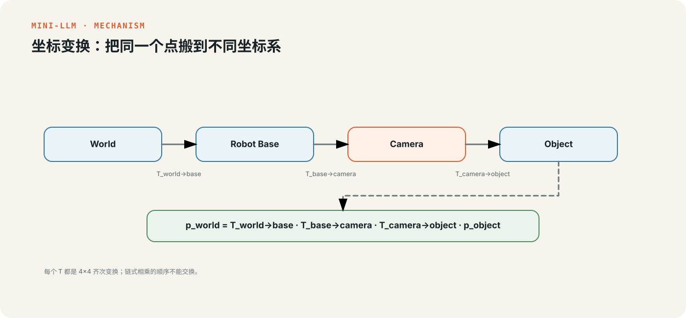

# **《mini-llm Spatial Intelligence Engine 深度解析：从 3D Representation、Spatial Reasoning 到 Scene Graph、Object Pose Estimation 与 3D World Understanding》**

## **一、Spatial Intelligence：什么是空间智能？**

前面我们讨论了 Embodied Intelligence（具身智能）。

具身智能解决的是：

**智能体如何通过身体感知环境，并通过行动与环境交互？**

但是，当一个 AI 真正进入物理世界时，会遇到一个更基础的问题：

- 桌子在哪里？
- 杯子距离机器人多远？
- 杯子是正放还是倾斜？
- 盒子在杯子的左边还是右边？
- 机器人能否伸手拿到杯子？
- 如果移动盒子，周围物体会受到什么影响？

这些问题都涉及空间智能（Spatial Intelligence）。

空间智能是智能体理解、表示、推理和预测三维空间关系的能力。

它不仅需要识别物体是什么，还需要理解：

1. 物体在哪里。
2. 物体有多大。
3. 物体朝向哪里。
4. 物体之间是什么空间关系。
5. 物体能否移动、接触、支撑或被操作。
6. 空间结构发生变化后，环境会如何变化。

例如：

一个普通视觉模型可能识别出：

```
桌子
杯子
盒子
机器人
```

但一个空间智能系统还需要理解：

```
杯子：
  位置：(0.42, 0.18, 0.75)
  朝向：向上
  尺寸：(0.08, 0.08, 0.12)

盒子：
  位置：(0.65, 0.20, 0.75)

空间关系：
  杯子在桌面上
  杯子位于盒子左侧
  机器人可以接近杯子
  杯子当前没有被遮挡
```

这两者有本质区别。

**视觉识别回答“看到了什么”，空间智能回答“世界在空间中是什么结构，以及我能够对它做什么”。**



_图：一辆 Waymo 自动驾驶出租车。车顶的激光雷达，连同车身四周的摄像头与毫米波雷达，共同构成对三维世界的测量。空间智能要做的，是把这些点云和图像变成“杯子在盒子左边、机器人够得到”这样的结构化理解。图片：Grendelkhan，[Wikimedia Commons](https://commons.wikimedia.org/wiki/File:Waymo_self-driving_car_front_view.gk.jpg)，[CC BY-SA 4.0](https://creativecommons.org/licenses/by-sa/4.0/)。_

## **二、为什么 AI 需要 Spatial Intelligence？**

### **2.1 二维视觉不等于三维理解**

摄像头获取的是二维图像。

例如：

图像中的像素只有两个坐标：

\\[ p=(u,v) \\]

但真实世界中的物体具有三维坐标：

\\[ P=(X,Y,Z) \\]

从三维世界投影到二维图像，可以简化表示为：

\\[ \begin{bmatrix} u\\\v\\\1 \end{bmatrix} \sim K \begin{bmatrix} X/Z\\\Y/Z\\\1 \end{bmatrix} \\]

其中：

- \\(X,Y,Z\\)：相机坐标系下的三维位置。
- \\(u,v\\)：图像像素坐标。
- \\(K\\)：相机内参矩阵。

问题在于：

二维投影丢失了深度信息。

例如，图像中的两个杯子可能大小相同，但一个距离相机 30cm，另一个距离相机 100cm。

单张普通 RGB 图像无法直接、唯一地恢复真实深度。

因此，空间智能需要融合更多信息：

- RGB 图像。
- Depth 深度图。
- Stereo 双目视觉。
- LiDAR 激光雷达。
- 多视角图像。
- 机器人运动和传感器位姿。
- 已知物体几何模型。

### **2.2 空间智能涉及六种核心能力**

## **Spatial Intelligence 六层能力**



_图：空间智能的六层能力。越靠下越接近原始传感器数据，越靠上越依赖对空间结构的抽象与预测。_

1. **3D Perception**

   从图像、深度和点云中识别三维物体。
2. **3D Representation**

   用点云、网格、体素和场景图表示空间。
3. **Spatial Localization**

   确定物体的位置、方向、尺寸和坐标系。
4. **Spatial Relationship**

   理解左右、上下、包含、接触、支撑和遮挡。
5. **Spatial Reasoning**

   推理距离、可达性、碰撞和空间约束。
6. **Spatial Prediction**

   预测物体移动、碰撞和空间结构变化。

这些能力最终构成机器人、具身智能和 3D World Model 的空间基础。

## **三、3D Representation：如何表示三维世界？**



_图：点云、体素、Mesh、SDF、NeRF/3DGS 与 Scene Graph 的取舍：没有一种表示能同时满足渲染、碰撞与语义推理。_

空间智能首先需要解决：

**计算机应该使用什么数据结构表示真实世界？**

不同表示方法适合不同任务。

### **3.1 Point Cloud：点云**

点云由大量三维点构成。

\\[ P=\\{p_1,p_2,\ldots,p_N\\} \\]

其中：

\\[ p_i=(x_i,y_i,z_i) \\]

每个点可以附带颜色、法向量、强度等信息。

例如：

```
point = {    "x": 0.42,    "y": 0.18,    "z": 0.75,    "r": 255,    "g": 120,    "b": 80}
```

优点：

- 直接表示真实测量得到的空间位置。
- 适合深度相机和 LiDAR。
- 可以用于物体分割、配准和姿态估计。

缺点：

- 点云可能非常稀疏。
- 传感器存在噪声。
- 遮挡区域没有数据。
- 单纯点云不包含完整的物体拓扑结构。

常见处理过程：

```
RGB-D / LiDAR
      |
      v
 Point Cloud
      |
      v
 Filtering
      |
      v
 Downsampling
      |
      v
 Segmentation
      |
      v
 Registration
      |
      v
 Object Geometry
```

常见算法包括：

- Voxel Grid：体素下采样。
- Statistical Outlier Removal：统计离群点过滤。
- RANSAC：几何模型拟合。
- ICP：点云配准。
- Region Growing：区域生长分割。

### **3.2 Voxel：体素**

Voxel 是三维空间中的体积像素。

二维图像由 Pixel 组成，三维体素网格由 Voxel 组成。

例如：

\\[ V(i,j,k)\in\\{0,1\\} \\]

表示某个体素是否被占据。

更丰富的表示还可以包含：

- Occupancy Probability。
- Distance。
- Semantic Label。
- Color。
- Material。

优点：

- 规则网格便于计算。
- 适合碰撞检测和空间占据分析。
- 容易进行三维卷积。

缺点：

- 高分辨率时内存消耗很大。
- 空间分辨率固定。
- 细节容易丢失。

假设一个边长为 10 米的立方空间，分辨率为 1cm：

\\[ 1000^3=10^9 \\]

这意味着理论上有十亿个体素。

因此，实际系统通常采用稀疏体素、八叉树或局部地图。

### **3.3 Mesh：三角网格**

Mesh 使用顶点、边和面构成三维表面。

典型结构：

```
mesh = {    "vertices": [        [0.0, 0.0, 0.0],        [1.0, 0.0, 0.0],        [0.0, 1.0, 0.0]    ],    "faces": [        [0, 1, 2]    ]}
```

Mesh 适合：

- 三维建模。
- 表面重建。
- 碰撞检测。
- 几何分析。
- 物理仿真。

但 Mesh 不一定天然包含语义信息。

一个三角面本身并不知道自己属于杯子还是桌子。

### **3.4 Implicit Representation：隐式表示**

隐式表示不是直接存储所有表面顶点，而是使用一个函数描述空间。

例如 Signed Distance Function：

\\[ f(x,y,z)=d \\]

其中：

- \\(d<0\\)：点位于物体内部。
- \\(d=0\\)：点位于表面。
- \\(d>0\\)：点位于物体外部。

SDF 可以用于：

- 表面重建。
- 碰撞距离计算。
- 形状优化。
- 机器人路径规划。

另一类表示是 Occupancy Field：

\\[ f(x,y,z)=P(\text{occupied}\mid x,y,z) \\]

它估计空间某个位置被物体占据的概率。

### **3.5 NeRF 与 3D Gaussian Splatting**

NeRF 和 3D Gaussian Splatting 能够通过多视角图像构建具有较强视觉表现力的三维场景。

但需要区分两个问题：

- 能否逼真地渲染一个场景？
- 能否准确地表示场景的几何结构、碰撞边界和物理属性？

两者不是同一件事。

一个视觉效果很好的 3D 场景，不一定适合机器人抓取和碰撞检测。

### **3.6 不同三维表示的比较**

| 表示方式        | 主要特点     | 典型用途      |
| ----------- | -------- | --------- |
| Point Cloud | 离散三维测量点  | 感知、配准     |
| Voxel       | 规则体素空间   | 占据地图、碰撞检测 |
| Mesh        | 显式表面几何   | 建模、仿真     |
| SDF         | 隐式距离场    | 几何优化、碰撞距离 |
| NeRF        | 神经辐射场    | 新视角合成     |
| 3DGS        | 高效三维高斯表示 | 场景重建、渲染   |
| Scene Graph | 对象和关系    | 语义空间推理    |

没有一种表示可以解决所有问题。

mini-llm 的 Spatial Intelligence Engine 应当采用多表示架构，而不是把所有空间信息强制塞进一个数据结构。

## **四、Coordinate System：机器人如何理解不同坐标系？**



_图：World → Base → Camera → Object 的坐标链，每个 T 都是 4×4 齐次变换。_


这是空间智能最重要的工程基础之一。

机器人并不是生活在一个单一坐标系中。

它可能同时使用：

- World Frame：世界坐标系。
- Robot Base Frame：机器人基座坐标系。
- Joint Frame：关节坐标系。
- End Effector Frame：末端执行器坐标系。
- Camera Frame：相机坐标系。
- Object Frame：物体坐标系。

### **4.1 为什么需要坐标变换？**

假设相机检测到杯子的位置：

\\[ P_C= \begin{bmatrix} 0.2\\\ 0.1\\\ 0.5 \end{bmatrix} \\]

这个位置是在相机坐标系下得到的。

但机械臂需要知道杯子相对于机器人基座的位置。

因此需要进行坐标变换：

\\[ P_B=T_B^C P_C \\]

这里采用齐次坐标列向量约定：

\\[ P_C= \begin{bmatrix} x\\\y\\\z\\\1 \end{bmatrix} \\]

而：

\\[ T_B^C= \begin{bmatrix} R&t\\\ 0&1 \end{bmatrix} \\]

其中：

- \\(R\\)：旋转矩阵。
- \\(t\\)：平移向量。

注意这里的记号表示：将 C 坐标系中的坐标转换为 B 坐标系中的坐标。

### **4.2 齐次变换矩阵**

一个三维刚体变换由旋转和平移构成：

\\[ T= \begin{bmatrix} r\_{11}&r\_{12}&r\_{13}&t_x\\\ r\_{21}&r\_{22}&r\_{23}&t_y\\\ r\_{31}&r\_{32}&r\_{33}&t_z\\\ 0&0&0&1 \end{bmatrix} \\]

其中：

\\[ R\in SO(3) \\]

\\[ t\in \mathbb{R}^3 \\]

完整位姿属于：

\\[ T\in SE(3) \\]

### **4.3 多个坐标系之间的变换**

假设：

- 相机坐标系 C。
- 机器人基座坐标系 B。
- 世界坐标系 W。

那么：

\\[ T_W^C=T_W^B T_B^C \\]

也就是说：

```
Camera Frame
     |
     | T_B^C
     v
Robot Base Frame
     |
     | T_W^B
     v
World Frame
```

矩阵乘法顺序不能随意调整。

实际工程中，坐标变换错误可能导致机器人向错误位置移动。

### **4.4 相机标定**

空间系统还需要相机标定。

包括：

- **内参标定：**：确定焦距、主点和畸变参数。
- **外参标定：**：确定相机相对于其他坐标系的位置和方向。
- **手眼标定：**：确定机器人运动坐标系与相机坐标系之间的变换关系。

## **五、Point Cloud Engine：如何理解三维点云？**

点云是连接视觉感知和空间计算的重要桥梁。

### **5.1 从深度图生成点云**

深度相机输出：

\\[ D(u,v) \\]

其中每个像素对应一个深度值。

假设相机内参为：

\\[ f_x,f_y,c_x,c_y \\]

那么可以通过反投影计算三维坐标：

\\[ X=\frac{(u-c_x)Z}{f_x} \\]

\\[ Y=\frac{(v-c_y)Z}{f_y} \\]

\\[ Z=D(u,v) \\]

这样就可以把二维深度图转换为三维点云。

### **5.2 点云预处理**

原始点云通常包含噪声和冗余数据。

处理流程：

```
Raw Point Cloud
       |
       v
 NaN Filtering
       |
       v
 Statistical Filtering
       |
       v
 Voxel Downsampling
       |
       v
 Ground / Plane Removal
       |
       v
 Object Segmentation
       |
       v
 Object Point Clouds
```

例如，使用 RANSAC 检测桌面平面。

平面方程：

\\[ ax+by+cz+d=0 \\]

满足：

\\[ a^2+b^2+c^2=1 \\]

RANSAC 从点云中反复采样，寻找符合平面模型的最大内点集合。

检测到桌面后，可以将桌面点与桌面上的物体点分离。

### **5.3 点云配准：ICP**

如果我们有两组不同时间、不同视角的点云：

\\[ P=\\{p_1,\ldots,p_N\\} \\]

\\[ Q=\\{q_1,\ldots,q_M\\} \\]

希望找到旋转 \\(R\\) 和平移 \\(t\\)，使两组点云尽可能对齐。

经典 ICP 的目标可以写为：

\\[ \min\_{R,t} \sum_i \\|Rp_i+t-q_i\\|^2 \\]

其中匹配点对需要通过最近邻等方法建立。

ICP 通常依赖较好的初始位姿，容易陷入局部最优；实际系统还需要考虑异常匹配、重叠比例和点云质量。

## **六、Object Pose Estimation：如何确定物体的位置和姿态？**

识别出杯子，并不意味着机器人知道如何抓取杯子。

机器人需要知道：

- 杯子中心在哪里？
- 杯口朝向哪里？
- 杯子是否倾斜？
- 抓取位置在哪里？
- 物体的空间边界是什么？

这就需要 Object Pose Estimation。

### **6.1 什么是 6D Pose？**

一个刚体的三维位姿包括：

- 三维平移。
- 三维旋转。

数学上：

\\[ Pose=(R,t) \\]

其中：

\\[ R\in SO(3), \quad t\in\mathbb{R}^3 \\]

所以通常称为 6D Pose。

### **6.2 三种常见旋转表示**

**欧拉角（Euler Angles）**

```
rotation = {    "roll": 0.0,    "pitch": 0.2,    "yaw": 1.57}
```

优点：容易理解。

缺点：存在万向节锁问题，旋转顺序也会影响结果。

**旋转矩阵（Rotation Matrix）**

\\[ R\in SO(3) \\]

优点：几何意义清晰，适合矩阵运算。

缺点：存储 9 个数，但有效自由度只有 3 个。

**四元数（Quaternion）**

\\[ q=(w,x,y,z) \\]

优点：适合连续旋转插值和姿态表达，避免欧拉角的万向节锁。

缺点：需要满足单位长度约束，并注意 \\(q\\) 和 \\(-q\\) 表示同一旋转。

### **6.3 物体姿态估计方法**

常见路线：

1. 基于图像关键点的姿态估计。
2. 基于深度点云的几何匹配。
3. 基于 CAD 模型的模板匹配。
4. 基于深度学习的 6D Pose Estimation。
5. 多视角融合与跟踪。

其中 PnP（Perspective-n-Point）利用已知三维点与二维图像对应点估计相机与物体之间的姿态关系。

但对于对称物体，例如圆柱形杯子，某些旋转方向可能无法从外观中唯一确定。

因此，姿态估计不应该只返回一个结果，还应当考虑：

- 置信度。
- 姿态不确定性。
- 物体对称性。
- 遮挡程度。
- 多个可能姿态。

对于安全关键的机器人抓取，不能把单个低置信度姿态当作确定事实。

## **七、Scene Graph：如何表示物体之间的空间关系？**

点云告诉我们空间中有哪些点。

Object Pose 告诉我们物体在哪里。

但它们仍然缺少一个重要能力：

**理解物体之间的关系。**

例如：

- 杯子在桌子上。
- 盒子在杯子右边。
- 苹果在盒子里面。
- 机器人靠近桌子。
- 杯子挡住了后面的物体。

这些关系可以使用 Scene Graph 表示。

### **7.1 Scene Graph 的基本结构**

Scene Graph 是一个图结构：

\\[ G=(V,E) \\]

其中：

- \\(V\\)：对象节点。
- \\(E\\)：对象之间的关系。

例如：

```
                Table
                  |
                supports
                  |
                 Cup
                  |
              left_of
                  |
                 Box
                  |
               contains
                  |
                Apple
```

### **7.2 节点结构**

```
object_node = {    "id": "cup_001",    "class": "cup",    "pose": {        "position": [0.42, 0.18, 0.75],        "rotation": [1.0, 0.0, 0.0, 0.0],        "frame": "world"    },    "size": [0.08, 0.08, 0.12],    "confidence": 0.96}
```

### **7.3 边结构**

```
relation = {    "subject": "cup_001",    "predicate": "on",    "object": "table_001",    "confidence": 0.98,    "source": "geometry_engine",    "timestamp": 1795488000}
```

关系可以分为几类：

| 关系类别  | 示例                          |
| ----- | --------------------------- |
| 方向关系  | left_of、above、behind        |
| 距离关系  | near、far                    |
| 拓扑关系  | inside、contains、overlapping |
| 接触关系  | touching、connected_to       |
| 支撑关系  | on、supports                 |
| 遮挡关系  | occludes                    |
| 可操作关系 | reachable_by、graspable_by   |

### **7.4 为什么 Scene Graph 很重要？**

假设用户提出：

> 把桌子上盒子左边的杯子拿起来。

系统需要把语言转换为空间查询：

```
Target:
  class = cup

Constraints:
  on(cup, table)
  left_of(cup, box)

Action:
  pick(cup)
```

然后从 Scene Graph 中寻找符合条件的对象。

这意味着：

Scene Graph 是语言理解与空间执行之间的重要中间层。

但是，Scene Graph 的关系不能全部依赖语言模型猜测。

例如，`left_of` 可以来自几何坐标计算，`supports` 可以结合接触关系和物理状态推断，`reachable_by` 则需要机器人运动学与运动规划模块参与。

不同关系需要不同证据，并且应保留置信度、时间和数据来源。

## **八、Spatial Reasoning：如何进行空间推理？**

空间智能不只是表示空间，还需要利用空间信息进行推理。

### **8.1 方向关系**

假设两个物体中心分别是：

\\[ P_A=(x_A,y_A,z_A) \\]

\\[ P_B=(x_B,y_B,z_B) \\]

那么可以通过坐标差值进行初步判断：

\\[ \Delta x=x_A-x_B \\]

\\[ \Delta y=y_A-y_B \\]

\\[ \Delta z=z_A-z_B \\]

如果：

\\[ x_A\<x_B \\]

可以说 A 的中心位于 B 的中心左侧，但前提是所采用坐标系的 X 轴方向已经定义。

还要注意：中心点的左右关系不等于两个物体的边界完全分离。

因此，工程上应区分：

- Center-based Relation。
- Bounding-box Relation。
- Surface-based Relation。

### **8.2 距离计算**

两个物体中心之间的欧氏距离：

\\[ d(A,B)= \sqrt{ (x_A-x_B)^2+ (y_A-y_B)^2+ (z_A-z_B)^2 } \\]

例如：

```
import numpy as npdef distance(a, b):    return np.linalg.norm(        np.array(a) - np.array(b)    )cup = [0.4, 0.2, 0.7]box = [0.8, 0.2, 0.7]print(distance(cup, box))
```

输出：

```
0.4
```

这里的单位取决于坐标数据的单位。如果使用米，距离就是 0.4 米。

### **8.3 碰撞检测**

机器人在移动过程中，不能与障碍物发生不允许的碰撞。

最简单的方法是使用包围盒。

例如：

```
Robot Bounding Box
        |
        v
Obstacle Bounding Box
        |
        v
Intersection Test
        |
        v
Collision / Free
```

更复杂的系统可以使用：

- Oriented Bounding Box。
- Convex Hull。
- Triangle Mesh Collision。
- Signed Distance Field。
- Continuous Collision Detection。

### **8.4 可达性推理**

空间上距离很近，不代表机器人一定能够到达。

可达性取决于：

- 机械臂长度。
- 关节限制。
- 当前关节角。
- 末端姿态。
- 障碍物。
- 运动路径。

机器人运动学给出：

\\[ X=f(q) \\]

其中：

- \\(q\\)：关节变量。
- \\(X\\)：末端执行器位姿。

如果存在符合关节限制的 \\(q\\)，使末端到达目标位姿，并且存在安全路径，那么该目标才可能被执行。

所以：

**Spatial Reasoning 负责提出空间约束，Robotics Engine 负责验证运动学与运动规划可行性。**

## **九、3D World Model：如何构建可操作的三维世界模型？**

Spatial Intelligence 最终需要形成一个结构化的世界模型。

这个模型不仅要知道物体在哪里，还要知道它们如何存在、如何运动以及如何交互。

### **9.1 三维世界模型的组成**

## **3D World Model**

- **Geometry Representation**：Point Cloud / Voxel / Mesh / SDF
- **Object State**：Position / Rotation / Velocity / Size
- **Scene Graph**：Spatial Relations / Semantic Relations
- **Physical Properties**：Mass / Friction / Support / Collision

### **9.2 世界模型需要动态更新**

假设机器人拿起杯子。

系统不能继续认为：

```
cup on table
```

而应该更新：

```
cup held_by robot
```

当机器人移动杯子时：

- 杯子位置发生变化。
- 杯子与桌子的支撑关系消失。
- 杯子与机器人夹爪之间建立接触关系。
- 杯子的速度和姿态发生变化。

这说明 Scene Graph 不是一张静态图，而是随时间变化的状态结构。

可以表示为：

\\[ S_t= (G_t,O_t,R_t,U_t) \\]

其中：

- \\(G_t\\)：几何信息。
- \\(O_t\\)：对象状态。
- \\(R_t\\)：关系图。
- \\(U_t\\)：不确定性信息。

世界模型更新过程：

\\[ S\_{t+1}=F(S_t,A_t,O\_{t+1}) \\]

其中：

- \\(A_t\\)：智能体行动。
- \\(O\_{t+1}\\)：新观察。
- \\(F\\)：状态更新过程。

需要注意，观测不等于真实状态。面对遮挡和传感器误差，系统应维护带不确定性的状态估计，而不是把一次检测结果当作绝对事实。

## **十、Spatial Intelligence 与 VLA、Robotics、Embodied AI 的关系**

这几个 Engine 容易混淆，但职责不同。

| Engine                | 核心职责              |
| --------------------- | ----------------- |
| Embodied Intelligence | 通过身体和环境进行感知、行动与学习 |
| Spatial Intelligence  | 理解三维空间、对象位置和空间关系  |
| VLA Engine            | 将视觉、语言和任务转换为动作输出  |
| Robotics Engine       | 运动学、动力学、路径规划和底层控制 |
| Simulation Engine     | 在模拟环境中测试动作和状态变化   |
| World Model Engine    | 表示和预测环境状态如何变化     |

举个例子：

用户说：

> 把桌子上的杯子放进盒子里。

整个系统可能执行：

```
User Instruction
       |
       v
Language Understanding
       |
       v
Task Planning
       |
       v
Spatial Intelligence
       |
       |-- Identify Cup
       |-- Identify Box
       |-- Estimate 6D Pose
       |-- Check Spatial Relations
       |
       v
VLA Engine
       |
       |-- Predict Action
       |
       v
Robotics Engine
       |
       |-- Inverse Kinematics
       |-- Motion Planning
       |-- Collision Checking
       |
       v
Simulation / Safety Validation
       |
       v
Robot Execution
       |
       v
New Observation
       |
       v
World Model Update
```

真正重要的是：这些模块不能互相替代。

例如，VLA 可以预测动作，但它不应该替代机器人底层安全控制。Spatial Intelligence 可以判断杯子在哪里，但它不能单独证明某条机械臂轨迹一定安全。

## **十一、mini-llm Spatial Intelligence Engine 工程架构**

我们可以把 Spatial Intelligence Engine 定义为：

**负责从多模态传感器数据中构建三维空间表示，并提供对象定位、姿态估计、空间关系、空间查询和几何约束能力的系统模块。**

### **11.1 系统架构**

## **mini-llm Spatial Intelligence Engine**

**Sensor Input Layer**

RGB / Depth / LiDAR / Camera Pose

**3D Perception Engine**

Detection / Segmentation / Depth / Point Cloud

**Spatial Representation Engine**

Voxel / Mesh / SDF / Object Geometry

**Pose Engine**

6D Pose

**Scene Graph Engine**

Relations

**Spatial Reasoning Engine**

Distance / Direction / Reachability / Collision Constraints

**Spatial World State API**

Query / Update / Tracking / Uncertainty

向 VLA、Robotics、Planning、Simulation 和 World Model Engine 提供空间能力

### **11.2 推荐工程目录**

```
mini-llm/
│
├── engines/
│   ├── spatial/
│   │   ├── perception/
│   │   │   ├── detection.py
│   │   │   ├── segmentation.py
│   │   │   └── depth.py
│   │   │
│   │   ├── pointcloud/
│   │   │   ├── filtering.py
│   │   │   ├── downsampling.py
│   │   │   ├── registration.py
│   │   │   └── segmentation.py
│   │   │
│   │   ├── geometry/
│   │   │   ├── coordinate.py
│   │   │   ├── transform.py
│   │   │   ├── bounding_box.py
│   │   │   └── collision.py
│   │   │
│   │   ├── pose/
│   │   │   ├── pose_estimator.py
│   │   │   └── pose_tracker.py
│   │   │
│   │   ├── scene_graph/
│   │   │   ├── node.py
│   │   │   ├── edge.py
│   │   │   ├── graph.py
│   │   │   └── updater.py
│   │   │
│   │   ├── reasoning/
│   │   │   ├── distance.py
│   │   │   ├── direction.py
│   │   │   ├── containment.py
│   │   │   ├── reachability.py
│   │   │   └── spatial_query.py
│   │   │
│   │   ├── world_state/
│   │   │   ├── state.py
│   │   │   ├── tracker.py
│   │   │   └── uncertainty.py
│   │   │
│   │   ├── api/
│   │   │   └── spatial_api.py
│   │   │
│   │   └── tests/
│   │
│   └── robotics/
```

### **11.3 核心数据结构**

建议统一空间对象模型：

```
from dataclasses import dataclassfrom typing import Optional@dataclassclass Pose3D:    position: tuple[float, float, float]    quaternion: tuple[float, float, float, float]    frame_id: str    timestamp: float@dataclassclass SpatialObject:    id: str    category: str    pose: Pose3D    dimensions: tuple[float, float, float]    confidence: float    geometry_ref: Optional[str] = None
```

这里有几个关键约束：

1. 所有坐标都必须声明坐标系。
2. 所有位置都必须明确单位。
3. 姿态必须明确使用四元数还是其他表示。
4. 时间戳需要用于多传感器同步。
5. 置信度不能被当作绝对正确率。
6. 几何数据可以通过引用存储，避免把大型点云直接塞进对象节点。

## **十二、实现一个最小 Spatial Reasoning Engine**

先不考虑复杂的 3D 深度学习模型。

我们可以先实现最基础的空间查询能力。

```
import numpy as npclass SpatialEngine:    def distance(self, a, b):        return float(            np.linalg.norm(                np.array(a) - np.array(b)            )        )    def left_of(self, a, b):        return a[0] < b[0]    def above(self, a, b):        return a[2] > b[2]    def near(self, a, b, threshold=0.3):        return self.distance(a, b) < thresholdengine = SpatialEngine()cup = [0.4, 0.2, 0.8]box = [0.8, 0.2, 0.8]print(engine.left_of(cup, box))print(engine.distance(cup, box))print(engine.near(cup, box))
```

输出：

```
True
0.4
False
```

这是一个极简示例。

真实系统还需要：

- 坐标系统一。
- 物体尺寸和边界。
- 旋转后的几何关系。
- 置信度和不确定性。
- 多帧跟踪。
- 遮挡和动态更新。

例如，判断一个杯子是否在盒子左边，应该考虑两个物体的空间边界，而不仅仅是中心点坐标。

## **十三、mini-llm Spatial Intelligence Engine V1 实施路线**

建议不要一开始就训练一个大型三维基础模型。

先使用现有视觉、深度和几何算法构建可运行的系统。

## **V1 开发阶段**

1. **阶段一：三维坐标基础**
   - 学习相机内参和外参。
   - 实现深度图反投影。
   - 实现坐标系变换。
   - 统一米制单位。
2. **阶段二：点云处理**
   - 读取 RGB-D 数据。
   - 生成点云。
   - 过滤噪声。
   - 桌面平面检测。
   - 物体点云分割。
3. **阶段三：对象空间定位**
   - 检测物体。
   - 估计物体中心和尺寸。
   - 计算 3D Bounding Box。
   - 实现基础姿态估计。
4. **阶段四：Scene Graph**
   - 创建物体节点。
   - 建立空间关系。
   - 实现图结构查询。
   - 更新物体状态。
5. **阶段五：Spatial Reasoning**
   - 左右、上下、前后。
   - 距离与包含关系。
   - 简单碰撞检查。
   - 机器人可达性接口。
6. **阶段六：机器人集成**
   - 接入 Robotics Engine。
   - 输出抓取目标位姿。
   - 进行碰撞检测。
   - 在仿真环境验证。
   - 最后进行低速真实设备测试。

### **V1 推荐桌面实验**

场景中只放置：

- 一个桌面。
- 一个杯子。
- 一个盒子。
- 一个 RGB-D 摄像头。
- 一台机械臂（后期接入）。

第一阶段只要求系统回答：

```
1. 桌子在哪里？
2. 杯子在哪里？
3. 盒子在哪里？
4. 杯子是否在桌子上？
5. 杯子是否在盒子左边？
6. 杯子距离盒子多远？
7. 机器人是否能够到达杯子？
8. 杯子是否可以被安全抓取？
```

先实现准确的空间感知和查询，再增加机器人动作。

### **评价指标**

| 指标                           | 衡量能力     |
| ---------------------------- | -------- |
| 3D Detection AP              | 三维物体检测   |
| Point Cloud IoU              | 三维区域重叠   |
| Chamfer Distance             | 点云几何差异   |
| ADD / ADD-S                  | 物体姿态估计   |
| Translation Error            | 位置误差     |
| Rotation Error               | 方向误差     |
| Relation F1                  | 空间关系识别   |
| Collision Precision / Recall | 碰撞检测质量   |
| Reachability Accuracy        | 可达性判断准确度 |

这些指标不能互相替代。例如，Chamfer Distance 衡量点云几何差异，不代表物体姿态一定正确；Relation F1 也不能证明机器人能够安全执行动作。

## **十四、Spatial Intelligence 的关键难题**

真正困难的地方，并不是生成一个三维场景。

而是让这个场景能够被可靠地理解和操作。

目前至少存在六个重要问题。

- **1. 不完整观察**：相机只能看到部分物体，遮挡区域需要推断。
- **2. 空间不确定性**：传感器存在测量误差，物体位置不可能永远精确。
- **3. 动态空间**：物体和机器人都可能移动，空间关系需要持续更新。
- **4. 多模态对齐**：语言、图像、深度、点云和机器人坐标必须对应同一个世界。
- **5. 几何与语义结合**：几何算法知道距离，视觉模型知道类别，语言模型理解指令，需要建立统一表示。

特别需要建立独立安全边界：

```
LLM / VLA Proposed Target
          |
          v
Schema Validation
          |
          v
Coordinate & Unit Validation
          |
          v
Workspace Validation
          |
          v
Collision Checking
          |
          v
Pose Confidence Validation
          |
          v
Independent Safety Controller
          |
          v
Robot Execution
```

模型输出只能是候选动作或候选目标，不能直接成为未经验证的硬件控制命令。

## **十五、进一步思考：空间智能是否是通向通用智能的重要基础？**

我们可以从三个层面理解智能的发展。

### **第一层：符号与语言智能**

AI 能够理解文字、概念、知识和逻辑关系。

例如：

```
杯子是一种容器。
容器可以装水。
```

### **第二层：空间与几何智能**

AI 能够理解物体的位置、形状、距离和空间关系。

例如：

```
杯子在桌子上。
杯子距离盒子 40cm。
杯子可以从上方接近。
```

### **第三层：行动与物理智能**

AI 不仅知道杯子在哪里，还能预测和执行：

```
伸出机械臂。
调整末端姿态。
抓住杯子。
抬起杯子。
移动到盒子上方。
放入盒子。
```

## **从语言智能到物理智能**

- **Language Intelligence**：理解概念、语言和指令
- **Spatial Intelligence**：理解几何、位置、关系和空间约束
- **Embodied Intelligence**：通过身体感知、行动和学习
- **Autonomous Intelligence**：自主设定目标、规划、行动和适应

## **十六、总结**

mini-llm Spatial Intelligence Engine 的核心不是某一个三维算法，而是一套完整的空间认知与计算体系。

它需要整合：

1. 3D Perception：获取三维环境信息。
2. 3D Representation：构建空间表示。
3. Coordinate System：统一空间坐标。
4. Point Cloud Processing：处理三维几何数据。
5. Object Pose Estimation：估计物体位置和姿态。
6. Scene Graph：表示物体及其关系。
7. Spatial Reasoning：进行空间推理。
8. 3D World Model：维护动态三维世界状态。

最终形成：

\\[ \text{Perception} \rightarrow \text{Representation} \rightarrow \text{Reasoning} \rightarrow \text{Prediction} \rightarrow \text{Action} \\]

这是一个从感知到行动的空间智能闭环。

## **下一篇建议**

**《mini-llm Multimodal Intelligence Engine 深度解析：从 Image、Audio、Video 到 Cross-Modal Alignment、Multimodal Fusion 与 Unified Representation》**

下一篇将研究一个核心问题：

**AI 如何把文字、图像、声音、视频和三维空间信息统一到同一个智能系统中？**

这将把前面讨论的 Transformer、Representation、Spatial Intelligence、VLA 和 Embodied Intelligence 连接起来。
