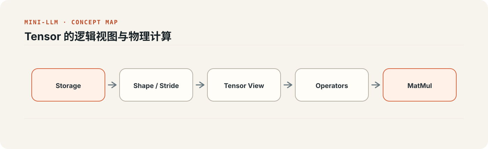
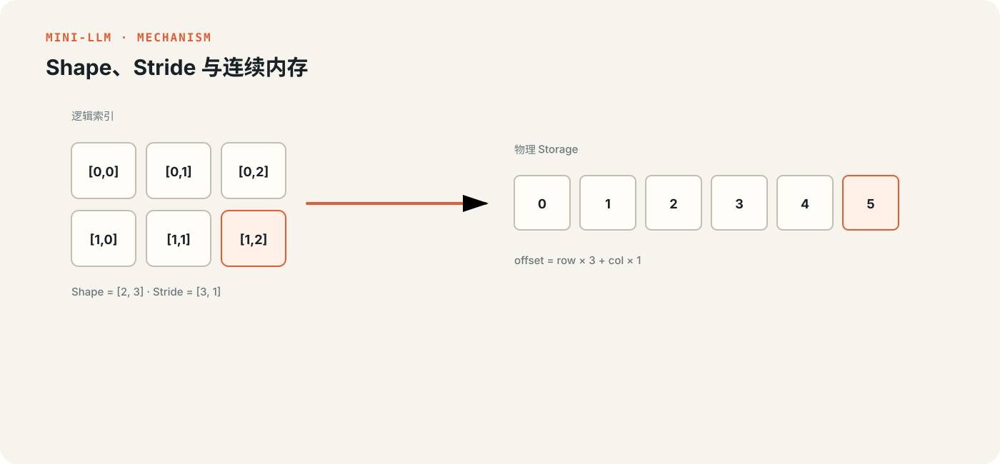

# **mini-llm Tensor Engine 深度解析**



_图：Tensor 的逻辑视图与物理计算。从左到右展示本章核心概念之间的数据流与依赖关系。_

## **从内存布局、Shape、Stride 到矩阵乘法**

mini-llm 技术文档 · 第二部分 · Tensor Engine

# **一、为什么要自己实现 Tensor Engine？**

在上一章中，我们已经了解了神经网络所依赖的数学基础：

- 向量和矩阵。
- 矩阵乘法。
- 导数和梯度。
- Softmax 和交叉熵。
- 梯度下降。

但这些数学公式只是理论。

当我们真正使用 Rust 编写大语言模型时，会遇到一个问题：

**如何让计算机高效地存储和计算这些数学对象？**

例如，一个 GPT 模型可能需要处理：

\\[ X\in\mathbb{R}^{B\times S\times D} \\]

其中：

- \\(B\\)：Batch Size。
- \\(S\\)：Sequence Length。
- \\(D\\)：Hidden Size。

假设：

\\[ B=4,\quad S=512,\quad D=768 \\]

那么总共有：

\\[ 4\times512\times768=1,572,864 \\]

个数值。

如果使用 `f32`，每个数占 4 字节：

\\[ 1,572,864\times4=6,291,456 \\]

约为 6 MiB。

但这只是一个中间 Tensor。

一个 Transformer 可能同时存在：

- 输入 Embedding。
- Query。
- Key。
- Value。
- Attention Scores。
- Attention Output。
- FFN 中间结果。
- 梯度。
- 优化器状态。

如果没有合理的数据组织和内存管理，模型很容易出现性能和内存问题。

因此，Tensor Engine 不只是一个多维数组库。

它是整个神经网络计算系统的基础设施。

## **1.1 Tensor Engine 在 mini-llm 中的位置**

**LLM Application**

文本生成、推理、训练

**Transformer Engine**

Attention、MLP、LayerNorm、Embedding

**Tensor Engine**

Tensor、Shape、Stride、Memory、MatMul

**Hardware Backend**

CPU、SIMD、GPU、CUDA、Metal

Tensor Engine 位于神经网络和底层硬件之间。

它负责将数学运算转化成计算机能够执行的内存访问与数值计算。

# **二、Tensor 到底是什么？**

## **2.1 Tensor 的数学定义**

Tensor（张量）是一个多维数据结构。

在深度学习工程中，可以先把它理解为：

> Tensor 是具有确定数据类型、维度结构和存储方式的多维数值集合。

例如：

标量：

\\[ A=5 \\]

向量：

\\[ A= \begin{bmatrix} 1\\\2\\\3 \end{bmatrix} \\]

矩阵：

\\[ A= \begin{bmatrix} 1&2\\\ 3&4 \end{bmatrix} \\]

三维 Tensor：

\\[ A\in\mathbb{R}^{2\times2\times2} \\]

例如：

\\[ A= \left[ \begin{bmatrix} 1&2\\\ 3&4 \end{bmatrix}, \begin{bmatrix} 5&6\\\ 7&8 \end{bmatrix} \right] \\]

这里包含两个 \\(2\times2\\) 的矩阵。

[Tensors Made Simple: From Math to Machine Learning | by Amarjeetsingh | Medium](https://images.openai.com/static-rsc-4/_d9YGIYs7U5T37OQ-GKmKOL-nN6e1Ab6qJURHIHS50BNHW6KQbsoD2x2efui-Lwc2eMDYNQzerP9VVvIPsOSzzN-A9HorePUQfFhattQELZIUXguqG3f2sq3Mk-IR8SwPBn6Fix9wrY_P67SIJtwS2c6rioCtVenOQH1E4f90ic?purpose=inline)

[medium.com](https://medium.com/%40amarjeetsingh23833/tensors-made-simple-from-math-to-machine-learning-9a83eeb2946d?utm_source=chatgpt.com)

## **2.2 Tensor 的四个基本属性**

一个 Tensor 至少需要考虑四个基本属性：

| 属性     | 含义         | 示例              |
| ------ | ---------- | --------------- |
| Shape  | 每个维度的长度    | `[2, 3]`        |
| Dtype  | 数据类型       | `f32`           |
| Stride | 各维度对应的内存步长 | `[3, 1]`        |
| Data   | 实际存储的数据    | `[1,2,3,4,5,6]` |

此外，现代 Tensor Engine 还需要考虑：

- Device：数据存放在哪种计算设备上。
- Layout：数据的逻辑维度与物理存储布局。
- Offset：Tensor 从底层存储的哪个位置开始读取。
- Ownership：谁负责管理底层内存。
- Gradient：是否需要计算梯度。

我们先理解最重要的四个属性。

# **三、Shape：Tensor 的形状**

## **3.1 什么是 Shape？**

Shape 表示 Tensor 每个维度的长度。

例如：

\\[ A= \begin{bmatrix} 1&2&3\\\ 4&5&6 \end{bmatrix} \\]

那么：

\\[ Shape(A)=[2,3] \\]

意味着：

- 第一维长度为 2。
- 第二维长度为 3。

Shape 中的维度数量，也称为 Rank。

| Shape       | Rank | 含义        |
| ----------- | ---- | --------- |
| `[]`        | 0    | 标量        |
| `[5]`       | 1    | 向量        |
| `[2,3]`     | 2    | 矩阵        |
| `[2,3,4]`   | 3    | 三维 Tensor |
| `[2,3,4,5]` | 4    | 四维 Tensor |

注意：Rank 是维度数量，不是 Tensor 中元素的总数。

## **3.2 Shape 与元素数量**

Tensor 的元素总数等于所有维度长度的乘积：

\\[ Numel(A)=\prod\_{i=0}^{n-1}Shape_i \\]

例如：

\\[ Shape(A)=[2,3,4] \\]

那么：

\\[ Numel(A)=2\times3\times4=24 \\]

如果数据类型是 `f32`：

\\[ Memory=24\times4=96\ bytes \\]

## **3.3 Shape 为什么重要？**

因为数学运算要求维度匹配。

例如：

\\[ A\in\mathbb{R}^{2\times3} \\]

\\[ B\in\mathbb{R}^{3\times4} \\]

可以进行矩阵乘法：

\\[ C=AB \\]

结果：

\\[ C\in\mathbb{R}^{2\times4} \\]

矩阵乘法的维度规则：

\\[ (m\times n)(n\times p)=m\times p \\]

中间的维度必须相同。

如果：

\\[ A\in\mathbb{R}^{2\times3} \\]

\\[ B\in\mathbb{R}^{2\times4} \\]

那么：

\\[ AB \\]

无法直接计算，因为第一个矩阵的列数 3 与第二个矩阵的行数 2 不匹配。

**Shape 检查是 Tensor Engine 中非常重要的安全机制。**

## **3.4 LLM 中常见的 Shape**

在 Transformer 中，最常见的 Shape 包括：

| 数据               | Shape        | 含义            |
| ---------------- | ------------ | ------------- |
| Token IDs        | `[B,S]`      | 一批 Token      |
| Embedding        | `[B,S,D]`    | Token 向量      |
| Query            | `[B,H,S,Dh]` | 多头 Query      |
| Key              | `[B,H,S,Dh]` | 多头 Key        |
| Value            | `[B,H,S,Dh]` | 多头 Value      |
| Attention Scores | `[B,H,S,S]`  | Token 之间的关联分数 |
| FFN Hidden       | `[B,S,Dff]`  | 前馈网络中间结果      |
| Logits           | `[B,S,V]`    | 每个位置的词表预测分数   |

其中：

\\[ D=H\times D_h \\]

例如：

\\[ D=768,\quad H=12 \\]

那么：

\\[ D_h=768/12=64 \\]

这意味着每个 Attention Head 使用 64 维向量。

# **四、Memory Layout：Tensor 的内存布局**



_图：Tensor 的二维索引如何通过 Stride 映射到连续内存。_

这是理解 Tensor Engine 最重要的部分之一。

## **4.1 数组在内存中如何存储？**

假设我们定义一个矩阵：

\\[ A= \begin{bmatrix} 1&2&3\\\ 4&5&6 \end{bmatrix} \\]

从逻辑上看，它是一个二维矩阵。

但计算机的物理内存本质上是一段连续或分散的字节地址空间。

因此，矩阵最终需要转换成某种内存存储形式。

最常见的是连续存储：

**矩阵的逻辑结构**

| 数值 | 1 | 2 | 3 | 4 | 5 | 6 |
| ---- | - | - | - | - | - | - |
| 内存位置 | 0 | 1 | 2 | 3 | 4 | 5 |

Row-major：按行连续存储

底层数据可以表示为：

[1, 2, 3, 4, 5, 6]

这种布局叫做 Row-major（行优先存储）。

它表示先存储第一行，再存储第二行。

C、C++、Rust 常见的二维数组布局通常采用行优先方式。

另一种方式是 Column-major（列优先存储）。

\\[ A= \begin{bmatrix} 1&2&3\\\ 4&5&6 \end{bmatrix} \\]

其内存排列为：

\\[ [1,4,2,5,3,6] \\]

Fortran、MATLAB 等环境常见列优先布局。

两种布局都可以表示同一个数学矩阵，只是物理存储顺序不同。

## **4.2 Row-major 与 Column-major**

**Row-major**

**1**

**2**

**3**

**4**

**5**

**6**

1 → 2 → 3 → 4 → 5 → 6

**Column-major**

**1**

**3**

**5**

**2**

**4**

**6**

1 → 4 → 2 → 5 → 3 → 6

为什么要关心存储顺序？

因为 CPU 和 GPU 的计算效率与内存访问模式有很大关系。

如果计算过程频繁访问不连续的内存，可能造成：

- CPU Cache Miss。
- 内存访问延迟增加。
- GPU Memory Coalescing 效率下降。
- 矩阵乘法性能下降。

因此，Tensor Engine 不仅要保证计算正确，还要考虑内存访问效率。

# **五、Stride：理解 Tensor 的核心**

## **5.1 什么是 Stride？**

Shape 告诉我们：

> Tensor 有多大？

Stride 告诉我们：

> 在某个维度上移动一个位置，需要跨过多少个底层元素？

这是两个完全不同的概念。

假设：

\\[ A= \begin{bmatrix} 1&2&3\\\ 4&5&6 \end{bmatrix} \\]

其 Shape：

\\[ [2,3] \\]

如果使用 Row-major 连续存储：

\\[ Data=[1,2,3,4,5,6] \\]

那么 Stride：

\\[ [3,1] \\]

解释：

- 第一维移动一个位置，需要跨过 3 个元素。
- 第二维移动一个位置，需要跨过 1 个元素。

## **5.2 Stride 如何计算元素位置？**

对于一个二维 Tensor：

\\[ A[i,j] \\]

对应的底层一维存储位置：

\\[ Offset(i,j)=i\times Stride_0+j\times Stride_1 \\]

例如：

\\[ A[1,2] \\]

Shape：

\\[ [2,3] \\]

Stride：

\\[ [3,1] \\]

计算：

\\[ Offset(1,2)=1\times3+2\times1=5 \\]

底层数组：

\\[ Data=[1,2,3,4,5,6] \\]

位置 5 的元素：

\\[ A[1,2]=6 \\]

## **5.3 多维 Tensor 的 Offset 公式**

对于 N 维 Tensor：

\\[ A[i_0,i_1,\ldots,i\_{n-1}] \\]

其内存偏移量：

\\[ Offset=\sum\_{k=0}^{n-1}i_k\times Stride_k \\]

如果考虑存储起始偏移量：

\\[ PhysicalOffset= StorageOffset+ \sum\_{k=0}^{n-1}i_kStride_k \\]

这就是现代 Tensor 库访问元素时使用的基本思想。

## **5.4 为什么需要 Stride？**

考虑一个矩阵：

\\[ A= \begin{bmatrix} 1&2&3\\\ 4&5&6 \end{bmatrix} \\]

如果我们想获取它的转置：

\\[ A^T= \begin{bmatrix} 1&4\\\ 2&5\\\ 3&6 \end{bmatrix} \\]

一种方式是重新分配内存并复制数据。

但还有一种方式：

**只修改 Shape 和 Stride，不移动数据。**

原始矩阵：

\\[ Shape=[2,3] \\]

\\[ Stride=[3,1] \\]

转置之后：

\\[ Shape'=[3,2] \\]

\\[ Stride'=[1,3] \\]

底层数据依然是：

\\[ [1,2,3,4,5,6] \\]

但是访问方式发生了变化。

**转置前后：底层数据没有改变**

原始 Tensor

Shape = [2, 3] · Stride = [3, 1]

**1**

**2**

**3**

**4**

**5**

**6**

转置 View

Shape = [3, 2] · Stride = [1, 3]

**1**

**4**

**2**

**5**

**3**

**6**

逻辑上已经转置，但底层仍然引用同一组数据。

这种只改变元数据、不复制数据的操作称为 View。

这也是为什么 PyTorch 中的 `transpose()`、`permute()` 在很多情况下不需要复制底层数据。

但要注意：不是所有操作都能零复制完成，也不是所有下游计算都能直接高效处理非连续 Tensor。

## **5.5 Contiguous：连续 Tensor**

一个 Tensor 如果满足特定布局下的连续存储规则，就可以称为 Contiguous。

对于 Row-major 的二维 Tensor：

\\[ Stride=[Shape_1,1] \\]

例如：

\\[ Shape=[2,3] \\]

连续布局：

\\[ Stride=[3,1] \\]

但转置之后：

\\[ Shape=[3,2] \\]

\\[ Stride=[1,3] \\]

它通常不是 Row-major 连续布局。

为什么连续性重要？

因为连续内存访问通常更容易：

- 使用 CPU SIMD。
- 利用 CPU Cache。
- 执行高效的矩阵乘法。
- 使用 GPU 高效的内存加载方式。

因此，很多 Tensor 库提供：

```
tensor.is_contiguous()
tensor.contiguous()
```

前者检查连续性，后者在必要时创建连续副本。

# **六、Tensor 的底层数据结构设计**

理解 Shape 和 Stride 后，我们就可以开始设计 Rust Tensor。

## **6.1 最简单的 Tensor**

最初可以这样设计：

```
pub struct Tensor {
    pub data: Vec<f32>,
    pub shape: Vec<usize>,
}
```

例如：

```
let tensor = Tensor {
    data: vec![
        1.0, 2.0, 3.0,
        4.0, 5.0, 6.0,
    ],
    shape: vec![2, 3],
};
```

优点：

- 简单。
- 易于理解。
- 适合第一阶段实现。
- 可以直接验证数学运算。

但存在问题：

- 没有 Stride。
- 无法方便地创建零复制转置 View。
- 无法表示共享底层内存。
- 无法表达 Storage Offset。

## **6.2 增加 Stride**

进一步设计：

```
pub struct Tensor {
    pub data: Vec<f32>,
    pub shape: Vec<usize>,
    pub strides: Vec<usize>,
}
```

现在可以表示非连续 Tensor。

但如果多个 Tensor 需要共享相同的底层存储，直接使用 `Vec<f32>` 就不够方便。

## **6.3 引入 Storage**

更合理的设计是把底层内存和 Tensor 元数据分开。

```
use std::rc::Rc;
use std::cell::RefCell;

pub struct Storage {
    pub data: Vec<f32>,
}

pub struct Tensor {
    pub storage: Rc<RefCell<Storage>>,
    pub shape: Vec<usize>,
    pub strides: Vec<usize>,
    pub storage_offset: usize,
}
```

这里有几个重要概念：

| 字段             | 作用                       |
| -------------- | ------------------------ |
| Storage        | 管理实际数据                   |
| Shape          | 描述逻辑形状                   |
| Strides        | 描述索引到内存的映射               |
| Storage Offset | 描述 Tensor 在 Storage 中的起点 |

注意：这只是学习型 CPU Tensor 的一种设计。`Rc<RefCell<_>>` 方便学习共享存储，但不适合直接作为最终高性能并行后端的通用方案。后续可以考虑不可变共享存储、内部可变性控制以及线程安全的存储抽象。

## **6.4 Tensor 的内存结构**

**Tensor A**

Shape · Stride · Storage Offset

**Storage**

Vec\<f32> · 实际底层内存

**1**

**2**

**3**

**4**

**5**

**6**

多个 Tensor View 可以共享 Storage

**Tensor B（转置 View）**

Shape = [3, 2] · Stride = [1, 3]

这种设计可以让 Tensor 的逻辑结构和底层内存管理相互独立。

# **七、矩阵乘法：神经网络最核心的计算**

理解 Tensor 的存储方式后，我们来研究真正的计算核心：MatMul。

## **7.1 矩阵乘法的数学定义**

假设：

\\[ A\in\mathbb{R}^{M\times K} \\]

\\[ B\in\mathbb{R}^{K\times N} \\]

那么：

\\[ C=AB \\]

其中：

\\[ C\in\mathbb{R}^{M\times N} \\]

每一个输出元素：

\\[ C\_{ij}=\sum\_{k=0}^{K-1}A\_{ik}B\_{kj} \\]

例如：

\\[ A= \begin{bmatrix} 1&2\\\ 3&4 \end{bmatrix} \\]

\\[ B= \begin{bmatrix} 5&6\\\ 7&8 \end{bmatrix} \\]

那么：

\\[ C= \begin{bmatrix} 19&22\\\ 43&50 \end{bmatrix} \\]

## **7.2 最直接的算法**

可以使用三层循环：

```
for i in 0..m {
    for j in 0..n {
        let mut sum = 0.0;

        for k in 0..k_size {
            sum += a[i * k_size + k]
                 * b[k * n + j];
        }

        c[i * n + j] = sum;
    }
}
```

其时间复杂度：

\\[ O(MKN) \\]

如果三个维度都是 1000：

\\[ 1000\times1000\times1000 =10^9 \\]

需要进行约十亿次乘加运算。

这就是为什么矩阵乘法是深度学习计算的核心。

## **7.3 为什么 CPU 上简单的矩阵乘法不够快？**

问题不只是计算量大。

还涉及内存访问。

在 Row-major 存储中：

- A 的一行是连续的。
- B 的一行是连续的。
- 但传统三重循环在内层 k 循环中读取 B 的一列。

读取：

\\[ B[0,j],B[1,j],B[2,j],\ldots \\]

这些元素在内存中并不连续。

这会降低 Cache 命中率。

因此，我们需要进一步优化矩阵乘法。

## **7.4 Loop Reordering**

一种简单优化是改变循环顺序。

例如：

```
for i in 0..m {
    for k in 0..k_size {
        let a_value = a[i * k_size + k];

        for j in 0..n {
            c[i * n + j] +=
                a_value * b[k * n + j];
        }
    }
}
```

这里：

- A 的当前元素被读取一次。
- B 的一整行连续读取。
- C 的一整行连续更新。

这样更容易利用 CPU Cache。

但它需要正确初始化 C，并且仍然不是最优的高性能矩阵乘法实现。

## **7.5 Blocking / Tiling**

当矩阵很大时，可以将矩阵拆分成多个小块。

例如将一个 \\(8\times8\\) 矩阵拆成多个 \\(2\times2\\) 小矩阵。

[Fast Multidimensional Matrix Multiplication on CPU from Scratch](https://images.openai.com/static-rsc-4/XMaCfsuPV_swME7D78srmtQ0E0sVK_Ifd-L9pE_tD5yCc5tawtXZdam385cBx7lfKhBnGRtwox4GIh2CKshnen1plaKhD1u8fCBF1uQi_2oAtCOaimIO4JlRMXPa8xwxWbfbgkafWJnizKBxKOFYBXJgxE9jre2f7iG7UyVSGTA?purpose=inline)

[siboehm.com](https://siboehm.com/articles/22/Fast-MMM-on-CPU?utm_source=chatgpt.com)

基本思想：

1. 将矩阵分割成多个 Tile。
2. 每次处理一小块数据。
3. 尽可能让当前 Tile 留在高速缓存中。
4. 完成局部计算后，再处理下一块。

这叫做 Blocking 或 Tiling。

高性能 BLAS 库、CPU 矩阵计算库以及 GPU GEMM 实现，都大量使用类似思想。

# **八、矩阵乘法为什么是 GPU 的核心？**

## **8.1 CPU 与 GPU 的区别**

CPU 更擅长：

- 复杂控制逻辑。
- 分支判断。
- 通用任务调度。
- 低延迟串行处理。

GPU 更擅长：

- 大规模并行计算。
- 向量和矩阵运算。
- 高吞吐量数据处理。

[GPUs Trade Complexity for Massive Parallelism: What Every Machine Learning Engineer Should Know | HackerNoon](https://images.openai.com/static-rsc-4/duILus5kz5pEdVq5CUEJQ6_2gVxXqXyU_6XPXcafRBM2xIUqke69ohEZYErqHw6ABu1Pyh9yXGmXIiDoW-Zjrsh9j_CE282WyNxcnpis6c1ZnhF2leBhqBqG1A-15JXwHbwUblLZIrNpqUXDPIXoDleSCm1sivL9V2xnL76f8ik?purpose=inline)

[hackernoon.com](https://hackernoon.com/gpus-trade-complexity-for-massive-parallelism-what-every-machine-learning-engineer-should-know?utm_source=chatgpt.com)

矩阵乘法有一个非常适合 GPU 的特点：

每个输出元素都可以独立计算。

例如：

\\[ C\_{00},C\_{01},C\_{02},\ldots \\]

可以分配给不同的计算线程。

因此，矩阵乘法可以拆分成大量并行任务。

## **8.2 GEMM**

高性能矩阵乘法通常称为 GEMM：

General Matrix Multiply。

其形式：

\\[ C=\alpha AB+\beta C \\]

其中：

- A、B：输入矩阵。
- C：输出矩阵。
- \\(\alpha,\beta\\)：缩放系数。

GEMM 是深度学习框架底层最重要的算子之一。

例如：

- PyTorch 的 Linear。
- Transformer 的 QKV 投影。
- FFN。
- Attention 中的 QKᵀ。
- Attention 中的 AV。

这些操作都可以归结为矩阵乘法或其变体。

## **8.3 混合精度**

深度学习中的 Tensor 不一定都使用 `f32`。

常见类型：

| 类型   | 位宽     | 特点              |
| ---- | ------ | --------------- |
| f32  | 32 bit | 精度较高，内存占用较大     |
| f16  | 16 bit | 节省内存，需要注意数值范围   |
| bf16 | 16 bit | 指数范围接近 f32，精度较低 |
| f64  | 64 bit | 精度高，计算和存储成本较大   |
| i8   | 8 bit  | 常用于量化推理         |

例如：

一个 7B 参数模型：

如果使用 FP32：

\\[ 7\times10^9\times4=28GB \\]

如果使用 FP16：

\\[ 7\times10^9\times2=14GB \\]

如果使用 INT8：

\\[ 7\times10^9\times1=7GB \\]

这里只计算模型权重，不包含 KV Cache、激活值、运行时工作区等额外内存。

所以 Tensor Engine 必须具备数据类型抽象能力。

# **九、Tensor Engine 如何支持 Transformer？**

现在将 Shape、Stride 和 MatMul 联系起来。

## **9.1 Embedding**

假设：

\\[ V=10000 \\]

\\[ D=512 \\]

Embedding 矩阵：

\\[ E\in\mathbb{R}^{10000\times512} \\]

每个 Token 对应一行 512 维向量。

如果输入 Token IDs：

\\[ [12,45,78] \\]

那么通过索引操作，可以取出：

\\[ X\in\mathbb{R}^{3\times512} \\]

这就是 Embedding。

它本质上是从一个大矩阵中按索引提取行。

## **9.2 QKV 投影**

假设：

\\[ X\in\mathbb{R}^{S\times D} \\]

权重：

\\[ W_Q,W_K,W_V\in\mathbb{R}^{D\times D} \\]

计算：

\\[ Q=XW_Q \\]

\\[ K=XW_K \\]

\\[ V=XW_V \\]

三次矩阵乘法。

如果将权重合并：

\\[ W\_{QKV}\in\mathbb{R}^{D\times3D} \\]

则可以一次计算：

\\[ QKV=XW\_{QKV} \\]

然后再切分成 Q、K、V。

## **9.3 Attention**

核心公式：

\\[ Attention(Q,K,V)= Softmax\left( \frac{QK^T}{\sqrt{d_k}} \right)V \\]

从 Tensor Engine 的角度看，它包含：

1. MatMul：计算 \\(QK^T\\)。
2. Scale：除以 \\(\sqrt{d_k}\\)。
3. Mask：屏蔽未来 Token。
4. Softmax：计算概率权重。
5. MatMul：计算概率权重与 V 的乘积。

也就是说，Attention 并不是一个完全独立的神秘计算，而是由多个 Tensor 运算组合而成。

## **9.4 FFN**

典型前馈网络：

\\[ FFN(X)=Activation(XW_1+b_1)W_2+b_2 \\]

主要计算：

- MatMul。
- Add。
- Activation。
- MatMul。

这再次说明：Tensor Engine 是 Transformer 的计算基础。

# **十、mini-llm Tensor Engine 的工程设计**

我们现在可以确定第一版的工程边界。

## **10.1 V1 必须支持的功能**

| 模块           | 功能                 | 优先级 |
| ------------ | ------------------ | --- |
| Storage      | 底层数据存储             | P0  |
| Tensor       | Shape、Dtype、Stride | P0  |
| Indexing     | 多维索引               | P0  |
| Reshape      | 形状变换               | P0  |
| Transpose    | 转置 View            | P0  |
| Add          | 张量加法               | P0  |
| Mul          | 逐元素乘法              | P0  |
| MatMul       | 二维矩阵乘法             | P0  |
| ReLU         | 激活函数               | P0  |
| Softmax      | 概率归一化              | P1  |
| Reduce       | Sum、Mean           | P1  |
| Broadcasting | 广播机制               | P1  |
| Device       | CPU/GPU 抽象         | P2  |

建议第一版先做 CPU、`f32`、二维 MatMul 和必要的基础运算。

不要一开始就追求 CUDA、量化、复杂布局和高性能内核。

## **10.2 建议的数据结构**

可以将 Tensor 设计为以下概念：

```
pub struct Tensor {
    storage: Storage,
    shape: Vec<usize>,
    strides: Vec<usize>,
    storage_offset: usize,
    dtype: DType,
    device: Device,
}
```

其中：

```
pub enum DType {
    F32,
    F64,
    F16,
    BF16,
    I32,
    I64,
}
```

```
pub enum Device {
    Cpu,
    Cuda(usize),
}
```

第一版可以只真正实现：

```
DType::F32
Device::Cpu
```

其他类型和设备先作为后续架构扩展方向，不应在尚未实现时伪装成可用能力。

## **10.3 Tensor Engine 的 API 设计**

建议将 API 设计成：

```
Tensor::new(data, shape)

tensor.shape()

tensor.strides()

tensor.numel()

tensor.get(indices)

tensor.reshape(new_shape)

tensor.transpose(dim0, dim1)

tensor.is_contiguous()

tensor.contiguous()

tensor.add(&other)

tensor.mul(&other)

tensor.matmul(&other)

tensor.sum()

tensor.mean()

tensor.relu()

tensor.softmax(dim)
```

API 的设计原则：

- Shape 错误应该返回明确错误。
- 尽可能避免隐式复制。
- View 操作需要明确共享内存的语义。
- 不要让数学运算依赖 CLI。
- Tensor Engine 不负责 Tokenizer、Transformer 或文本生成。

## **10.4 错误处理**

建议定义：

```
pub enum TensorError {
    ShapeMismatch,
    InvalidShape,
    InvalidStride,
    IndexOutOfBounds,
    UnsupportedDType,
    UnsupportedDevice,
    NonContiguous,
}
```

例如，执行矩阵乘法：

\\[ A\in\mathbb{R}^{2\times3} \\]

\\[ B\in\mathbb{R}^{2\times4} \\]

应该返回 ShapeMismatch，而不是产生错误结果或越界访问。

# **十一、Tensor Engine 的测试与实验**

学习型 Tensor Engine 不应该只关注代码能否运行，还应该验证数学结果。

建议建立以下测试。

| 测试         | 验证目标           |
| ---------- | -------------- |
| 创建 Tensor  | Shape 和元素数量    |
| 多维索引       | Offset 计算      |
| Transpose  | Shape 与 Stride |
| Reshape    | 元素数量与内存布局      |
| Add        | 逐元素运算          |
| Mul        | 逐元素运算          |
| MatMul     | 矩阵乘法结果         |
| ReLU       | 非线性计算          |
| Softmax    | 概率和为 1         |
| Contiguous | 连续布局转换         |

## **11.1 手动验证矩阵乘法**

输入：

\\[ A= \begin{bmatrix} 1&2\\\ 3&4 \end{bmatrix} \\]

\\[ B= \begin{bmatrix} 5&6\\\ 7&8 \end{bmatrix} \\]

预期结果：

\\[ C= \begin{bmatrix} 19&22\\\ 43&50 \end{bmatrix} \\]

## **11.2 验证转置**

原始：

\\[ Shape=[2,3] \\]

\\[ Stride=[3,1] \\]

转置：

\\[ Shape=[3,2] \\]

\\[ Stride=[1,3] \\]

同时验证底层 Storage 是否共享。

## **11.3 验证 MatMul 的数学正确性**

对于随机小矩阵，可以将 Tensor Engine 的计算结果与简单三重循环参考实现对比。

浮点数不能总是要求完全相等，可以使用误差：

\\[ |a-b|<\epsilon \\]

例如：

\\[ \epsilon=10^{-5} \\]

更严格的测试还可以使用相对误差：

\\[ RelativeError= \frac{|a-b|}{\max(|a|,|b|,\epsilon)} \\]

# **十二、学习检查：你是否真正理解 Tensor？**

**Tensor Engine 理解测试**

0/8

**1. Shape 和 Stride 有什么区别？**

显示解释

**2. 为什么 Tensor 转置不一定需要复制数据？**

显示解释

**3. Shape=[2,3]、Stride=[3,1] 时，元素 [1,2] 的 Offset 是多少？**

显示解释

**4. 为什么非连续 Tensor 可能影响矩阵乘法性能？**

显示解释

**5. 矩阵乘法的时间复杂度是什么？**

显示解释

**6. 为什么 Transformer 需要 Tensor Engine？**

显示解释

**7. Storage 与 Tensor 为什么要分开？**

显示解释

**8. 为什么 V1 应先实现 CPU，而不是直接实现 GPU？**

显示解释

# **十三、本章总结**

本章需要建立五个关键认识：

**第一，Tensor 不只是数组。**

它是由数据存储、形状、步长、偏移量、数据类型和设备等信息共同描述的计算对象。

**第二，Shape 和 Stride 是不同的概念。**

Shape 决定逻辑结构，Stride 决定如何映射到物理内存。

**第三，View 是 Tensor Engine 的重要能力。**

转置、切片等操作有机会只改变元数据，不复制底层数据。

**第四，矩阵乘法是神经网络的核心计算。**

Linear、QKV、Attention、FFN 都大量依赖矩阵乘法。

**第五，Tensor Engine 是模型与硬件之间的桥梁。**

它不仅要正确计算，还需要考虑内存布局、Cache、并行计算和数据类型。

## **下一篇：mini-llm Autograd Engine 深度解析**

下一篇将从 Tensor Engine 继续向上，研究神经网络如何学习：

1. 为什么普通 Tensor 无法自动完成模型训练？
2. 什么是计算图（Computational Graph）？
3. 为什么需要记录每一个 Tensor 运算？
4. 如何使用链式法则计算梯度？
5. 什么是 Reverse-mode Automatic Differentiation？
6. 为什么大模型训练通常使用反向模式自动微分？
7. 如何设计 Rust 版 Autograd Engine？
8. 如何处理梯度累积、共享节点和计算图生命周期？

**核心问题：计算机究竟是如何知道，应该修改模型中的哪一个参数，才能让预测结果变得更准确？**

