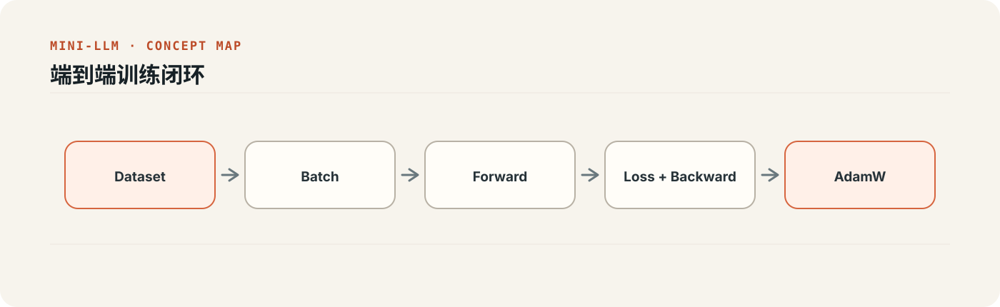
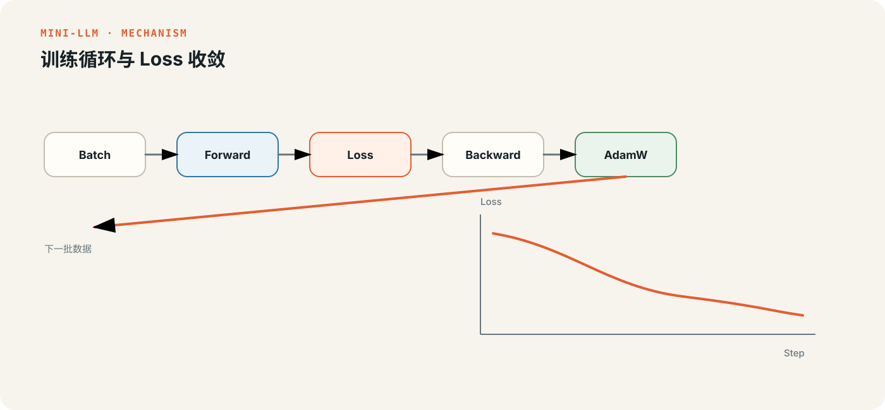

# **mini-llm Training Engine 深度解析：从 Dataset、Batch、Cross Entropy 到 Backpropagation、AdamW**



_图：端到端训练闭环。从左到右展示本章核心概念之间的数据流与依赖关系。_

**副标题：理解大语言模型如何从文本中学习——构建一个真正能够训练 Transformer 的训练引擎**

在前面的文章中，我们已经逐步构建了 mini-llm 的核心组件：

1. Tensor Engine：张量、Shape、Stride、矩阵运算。
2. Autograd Engine：自动微分与计算图。
3. Neural Network Engine：Linear、MLP、Loss、Optimizer。
4. Transformer Engine：Embedding、Positional Encoding、Self-Attention、Multi-Head Attention。
5. Transformer Block：FFN、Residual Connection、LayerNorm、RMSNorm。
6. Decoder Engine：Transformer Stack、LM Head、Logits、Softmax、KV Cache 和自回归生成。

现在，我们已经有了一个能够执行前向计算、预测下一个 Token 的 Transformer。

但还有一个关键问题：

**模型如何从一开始什么都不懂，逐渐学会语言、知识和推理？**

答案是：训练。

训练并不是简单地把大量文本输入模型，而是构建一个持续循环：

## **LLM 训练的核心循环**



_图：批次训练循环与随 Step 下降的示意 Loss 曲线。_

**Dataset**

准备训练文本

**Tokenizer + Batch**

文本转换为 Token 序列和训练样本

**Forward**

Transformer 预测下一个 Token

**Cross Entropy Loss**

计算预测结果与真实答案的差距

**Backward**

计算模型参数的梯度

**AdamW Optimizer**

根据梯度更新模型参数

**进入下一轮训练**

这篇文章，我们开始构建 mini-llm 的 Training Engine。

## **一、训练究竟在改变什么？**

先理解一个最重要的问题：

**训练大模型，本质上是在改变什么？**

答案是：模型参数（Parameters）。

一个 Transformer 通常包含大量可学习参数，例如：

- Token Embedding 矩阵。
- Attention 的 Query、Key、Value 投影矩阵。
- Attention Output Projection。
- FFN 的权重矩阵。
- LayerNorm 或 RMSNorm 参数。
- LM Head 权重。

假设模型的所有参数组成一个集合：

\\[ \theta = \\{W_1,W_2,\ldots,W_n\\} \\]

模型接收输入 Token：

\\[ X = [x_1,x_2,\ldots,x_T] \\]

经过 Transformer 后，得到每个位置的预测结果：

\\[ P\_\theta(x\_{t+1}\mid x_1,\ldots,x_t) \\]

训练的目标是调整参数 \\(\theta\\)，让模型预测下一个 Token 的概率越来越接近真实数据。

可以表示为：

\\[ \theta^\*=\arg\min\_\theta L(\theta) \\]

其中：

- \\(\theta\\)：模型参数。
- \\(L(\theta)\\)：训练损失。
- \\(\theta^\*\\)：希望找到的最优参数。

注意，这里不是直接把知识写进某个参数，而是通过大量训练样本，让参数逐步形成能够预测语言结构的数值关系。

## **二、Dataset：训练数据如何组织？**

模型不会直接理解 TXT、PDF、Markdown 或网页。

它最终处理的是 Token ID。

例如，假设有一段训练文本：

```
人工智能正在改变软件开发。
```

Tokenizer 将其转换成：

```
[    1024,    381,    2056,    982,    761,    2048]
```

这里的数字仅用于演示，并非某个真实 Tokenizer 的编码结果。

因此，训练数据可以抽象为：

\\[ D = \\{X_1,X_2,\ldots,X_N\\} \\]

其中每个 \\(X_i\\) 都是一个 Token 序列。

### **2.1 为什么需要 Dataset？**

Dataset 的主要职责是：

1. 加载训练数据。
2. 将文本转换为 Token。
3. 组织 Token 序列。
4. 提供训练样本。
5. 支持随机访问或流式读取。

可以设计一个简单接口：

```
class TextDataset:    def __init__(self, texts, tokenizer):        self.samples = []        for text in texts:            tokens = tokenizer.encode(text)            self.samples.append(tokens)    def __len__(self):        return len(self.samples)    def __getitem__(self, index):        return self.samples[index]
```

这只是一个教学版本。真实训练系统还需要处理数据清洗、去重、文档边界、数据混合、异常样本和数据质量评估。

### **2.2 为什么不能直接把所有文本拼接起来？**

假设有两篇文章：

```
文章 A：人工智能正在改变世界。

文章 B：深度学习是机器学习的重要分支。
```

如果直接拼接：

```
人工智能正在改变世界。深度学习是机器学习的重要分支。
```

模型可能会学习到文章 A 和文章 B 之间的连续关系。

这不一定是我们希望的。

常见处理方式有：

- 使用 EOS Token 标记文档结束。
- 保留文档边界信息。
- 对不同文档设置独立的注意力区域。
- 根据训练目标决定是否允许跨文档预测。

需要注意：加入 EOS 并不意味着模型自动无法跨文档注意。若没有额外的边界或注意力约束，模型仍可能利用前一篇文档的上下文预测下一篇。

## **三、Sliding Window：如何切分长文本？**

Transformer 通常有最大上下文长度（Context Length）。

例如，假设 mini-llm 的最大上下文长度为：

\\[ T=8 \\]

但训练文本有 10000 个 Token。

显然，不能一次性把全部 Token 输入模型。

因此需要切分。

假设 Token 序列为：

```
tokens = [    10, 11, 12, 13, 14,    15, 16, 17, 18, 19,    20, 21, 22, 23]
```

设置：

- Window Size = 8
- Stride = 4

切分结果：

**Sliding Window 示例**

Window 1

10

11

12

13

14

15

16

17

Window 2

14

15

16

17

18

19

20

21

Window 3

18

19

20

21

22

23

相邻窗口存在重叠，使不同训练样本能够共享部分上下文。

对应代码：

```
def create_windows(tokens, window_size, stride):    windows = []    for start in range(0, len(tokens) - window_size + 1, stride):        window = tokens[start:start + window_size]        windows.append(window)    return windows
```

为什么需要重叠？

因为语言具有上下文依赖关系。

例如：

```
人工智能的发展速度非常快，
```

如果一个窗口只包含：

```
非常快，
```

模型就无法利用前面的上下文。

通过 Sliding Window，可以让相邻样本共享部分上下文。

实际工程中，还可以使用随机采样、流式数据加载和按文档边界切分等方式，不一定要提前生成所有窗口。

## **四、Input / Target：如何构造下一个 Token 预测任务？**

这是整个大语言模型训练中最核心的设计之一。

假设 Token 序列是：

```
tokens = [10, 11, 12, 13, 14]
```

我们希望模型学习：

- 输入 10，预测 11。
- 输入 10、11，预测 12。
- 输入 10、11、12，预测 13。
- 输入 10、11、12、13，预测 14。

因此需要构造 Input 和 Target。

**Next Token Prediction**

同一条 Token 序列，向右错开一个位置。

Input

## **10**

## **11**

## **12**

## **13**

Target

## **11**

## **12**

## **13**

## **14**

Input 第 i 个位置的预测，对应 Target 第 i 个位置。

数学表达：

\\[ X=[x_1,x_2,\ldots,x\_{T-1}] \\]

\\[ Y=[x_2,x_3,\ldots,x_T] \\]

代码：

```
def create_input_target(tokens):    input_ids = tokens[:-1]    target_ids = tokens[1:]    return input_ids, target_ids
```

例如：

```
tokens = [10, 11, 12, 13, 14]x, y = create_input_target(tokens)# x = [10, 11, 12, 13]# y = [11, 12, 13, 14]
```

### **4.1 为什么每个位置都可以产生一个训练目标？**

因为 Causal Self-Attention 具有因果约束。

在预测第 3 个 Token 时，模型只能看到第 1、2 个 Token，不能看到未来的第 4、5 个 Token。

因此，一条长度为 \\(T\\) 的序列，可以同时产生 \\(T-1\\) 个预测任务。

这就是为什么语言模型可以从一段文本中提取大量监督信号。

### **4.2 Causal Mask 的作用**

假设序列长度为 4。

注意力矩阵必须限制未来位置：

\\[ M= \begin{bmatrix} 0&-\infty&-\infty&-\infty\\\ 0&0&-\infty&-\infty\\\ 0&0&0&-\infty\\\ 0&0&0&0 \end{bmatrix} \\]

然后：

\\[ Attention(Q,K,V) = Softmax\left( \frac{QK^T}{\sqrt{d_k}}+M \right)V \\]

这里的 \\(-\infty\\) 表示对应位置经过 Softmax 后概率为 0。

**Causal Mask 防止模型在训练时偷看未来答案。**

这一点非常重要：训练阶段虽然已经拿到了完整文本，但模型的每个位置仍然必须遵守因果约束。

## **五、Batch：为什么需要批量训练？**

假设每个训练样本包含 128 个 Token。

如果每次只训练一条序列：

```
input_ids.shape = [128]
```

GPU 的并行计算能力就无法充分利用。

因此，我们需要把多条序列组成一个 Batch。

例如：

- Batch Size = 4
- Sequence Length = 128

输入张量：

\\[ X\in \mathbb{N}^{4\times128} \\]

**Batch 张量结构**

4 条训练序列，每条序列有 8 个 Token（示意）。

11

12

13

14

15

16

17

18

21

22

23

24

25

26

27

28

31

32

33

34

35

36

37

38

41

42

43

44

45

46

47

48

Shape = [Batch, Sequence Length] = [4, 8]

进入 Embedding 后：

\\[ X\_{emb}\in\mathbb{R}^{B\times T\times D} \\]

假设：

- Batch Size = 4
- Sequence Length = 128
- Hidden Size = 512

则：

\\[ X\_{emb}\in\mathbb{R}^{4\times128\times512} \\]

Transformer 可以并行处理这 4 条序列。

### **5.1 Batch 与 DataLoader**

通常会将 Dataset 和 Batch 采样逻辑分开。

```
class DataLoader:    def __init__(self, dataset, batch_size):        self.dataset = dataset        self.batch_size = batch_size    def get_batch(self, indices):        batch = [self.dataset[i] for i in indices]        return stack(batch)
```

实际系统还需要处理：

- Shuffle。
- Padding。
- Drop Last。
- 多进程数据加载。
- 数据预取。
- 动态长度 Batch。

### **5.2 Padding 与 Loss Mask**

不同文本的长度可能不一样。

例如：

```
样本 A：[10, 11, 12, 13]
样本 B：[20, 21]
```

可以补齐为：

```
样本 A：[10, 11, 12, 13]
样本 B：[20, 21, PAD, PAD]
```

但不能让模型把 PAD 当成普通预测目标。

因此需要一个 Loss Mask：

```
loss_mask = [    [1, 1, 1],    [1, 0, 0]]
```

这里的 1 表示参与 Loss 计算，0 表示忽略。

注意三个概念不能混淆：

- Causal Mask：防止模型看到未来 Token。
- Padding Attention Mask：防止注意力使用无效的填充位置。
- Loss Mask：防止 PAD 等无效目标参与损失计算。

它们解决的是不同问题。

## **六、Forward：模型如何产生预测结果？**

现在我们有了：

\\[ X\in\mathbb{N}^{B\times T} \\]

将其送入 Transformer。

完整计算流程：

```
Input Token IDs
       |
       v
Token Embedding
       |
       v
Positional Encoding / RoPE
       |
       v
Transformer Block × N
       |
       v
Final Norm
       |
       v
LM Head
       |
       v
Logits
```

假设：

- Batch Size = 4
- Sequence Length = 128
- Hidden Size = 512
- Vocabulary Size = 32000

最终 Logits 的 Shape：

\\[ Logits\in\mathbb{R}^{4\times128\times32000} \\]

这意味着：

每个样本的每个位置，模型都会给词表中的 32000 个 Token 分配一个分数。

例如：

```
logits[0, 10]
```

表示：

第 1 条序列、第 11 个位置，对整个词表的预测分数。

这些分数还不是概率。

需要通过 Softmax 转换：

\\[ P_i=\frac{e^{z_i}}{\sum_j e^{z_j}} \\]

其中 \\(z_i\\) 是第 \\(i\\) 个 Token 的 Logit。

但训练时通常不必先显式计算 Softmax，再计算交叉熵。可以直接使用数值稳定的 LogSoftmax + NLL，或框架提供的 Cross Entropy 实现。

## **七、Cross Entropy：如何衡量模型预测错误？**

现在进入训练最重要的数学部分。

假设词表只有 4 个 Token：

```
Token A
Token B
Token C
Token D
```

模型对某个位置的预测概率为：

\\[ P=[0.1,0.7,0.1,0.1] \\]

真实答案是 Token B。

那么模型给正确答案的概率是：

\\[ P(y)=0.7 \\]

交叉熵损失：

\\[ L=-\log P(y) \\]

因此：

\\[ L=-\log(0.7)\approx0.357 \\]

如果模型预测概率为：

\\[ P=[0.8,0.05,0.05,0.1] \\]

但正确答案仍然是 Token B：

\\[ L=-\log(0.05)\approx2.996 \\]

模型越不相信正确答案，Loss 越大。

### **7.1 Cross Entropy 的数学形式**

对于一个包含 \\(V\\) 个 Token 的词表：

\\[ L=-\sum\_{i=1}^{V}y_i\log p_i \\]

其中：

- \\(y_i\\)：真实标签的 One-Hot 编码。
- \\(p_i\\)：模型预测概率。

如果真实 Token 是第 2 个 Token：

\\[ y=[0,1,0,0] \\]

则：

\\[ L=-\log p_2 \\]

也就是说，交叉熵实际上是在惩罚模型对正确 Token 分配过低的概率。

### **7.2 整个 Batch 的 Loss**

对于语言模型，每个 Batch 中有很多预测位置。

假设有效预测位置数量为 \\(N\\)，那么：

\\[ L\_{batch}= -\frac{1}{N} \sum\_{i=1}^{N} \log P\_\theta(y_i|x\_{\leq i}) \\]

如果使用 Padding Mask，则只统计有效位置。

### **7.3 Cross Entropy 实现**

下面是一个简化的数学示意：

```
def cross_entropy(logits, targets):    log_probs = log_softmax(logits, dim=-1)    selected = gather(        log_probs,        index=targets    )    return -mean(selected)
```

实际实现必须保证：

1. Logits 的最后一个维度是 Vocabulary Size。
2. Target 是整数 Token ID。
3. LogSoftmax 使用数值稳定算法。
4. Padding 位置不参与 Loss。
5. 计算平均值时使用有效 Token 数量作为分母。

### **7.4 为什么 Loss 越低，模型通常越好？**

因为 Loss 衡量的是模型对真实 Token 的概率预测质量。

但要注意：

**训练 Loss 下降，不等于模型一定具备更强的泛化能力。**

如果模型只是记住了训练集，它的训练 Loss 也可能很低。

因此必须区分：

- Training Loss：训练数据上的损失。
- Validation Loss：验证数据上的损失。
- Test Performance：独立测试数据上的表现。

## **八、Backpropagation：梯度如何传遍整个 Transformer？**

现在，模型已经计算出了 Loss。

接下来要解决：

**应该修改哪些参数？每个参数应该修改多少？**

这就需要 Backpropagation（反向传播）。

### **8.1 梯度是什么？**

假设模型只有一个参数：

\\[ y=wx \\]

其中：

\\[ x=2,\quad w=3 \\]

得到：

\\[ y=6 \\]

假设目标值是：

\\[ y\_{target}=10 \\]

使用平方误差：

\\[ L=(y-y\_{target})^2 \\]

那么：

\\[ L=(6-10)^2=16 \\]

现在需要知道参数 \\(w\\) 改变一点点，会让 Loss 发生多大变化。

求导：

\\[ \frac{\partial L}{\partial w} = 2(wx-y\_{target})x \\]

代入：

\\[ \frac{\partial L}{\partial w} = 2(6-10)\times2=-16 \\]

这个 -16 就是参数 \\(w\\) 的梯度。

梯度告诉我们：

- 正梯度：增加参数会使局部 Loss 上升。
- 负梯度：增加参数会使局部 Loss 下降。
- 梯度绝对值越大：局部变化越敏感。

### **8.2 链式法则**

Transformer 是由大量计算模块组成的。

例如：

```
Input
  |
  v
Embedding
  |
  v
Attention
  |
  v
Residual
  |
  v
FFN
  |
  v
LayerNorm
  |
  v
LM Head
  |
  v
Loss
```

反向传播从 Loss 开始，逐层计算梯度。

核心数学原理是链式法则：

\\[ \frac{\partial L}{\partial x} = \frac{\partial L}{\partial y} \frac{\partial y}{\partial x} \\]

假设：

\\[ y=f(g(x)) \\]

则：

\\[ \frac{dy}{dx} = \frac{df}{dg} \frac{dg}{dx} \\]

通过不断应用链式法则，最终可以求出每个模型参数对 Loss 的影响。

### **8.3 Transformer 中的梯度传播**

例如，Attention：

\\[ Attention(Q,K,V) = Softmax\left(\frac{QK^T}{\sqrt{d_k}}\right)V \\]

它由多个计算步骤组成：

1. Q 与 K 矩阵相乘。
2. 除以 \\(\sqrt{d_k}\\)。
3. 加入 Mask。
4. Softmax。
5. 与 V 相乘。

反向传播时，需要依次计算这些运算对输入和参数的梯度。

然后，梯度继续传回：

- Q、K、V 投影矩阵。
- Embedding。
- FFN。
- Norm 参数。
- 其他 Transformer 层。

这就是为什么我们之前需要实现 Autograd Engine。

### **8.4 为什么不能只更新 LM Head？**

因为 LM Head 只是模型最后的预测层。

如果只更新 LM Head：

- Embedding 不会学习新的表示。
- Attention 不会学习上下文关系。
- FFN 不会学习新的特征变换。
- Transformer Block 的参数不会得到优化。

完整训练需要让梯度传播到所有参与训练的参数。

## **九、AdamW：如何真正更新模型参数？**

有了梯度，还需要优化器。

最简单的参数更新方式是 SGD：

\\[ \theta\_{t+1}= \theta_t-\eta g_t \\]

其中：

- \\(\theta_t\\)：当前参数。
- \\(g_t\\)：当前梯度。
- \\(\eta\\)：Learning Rate。

但是，深度学习模型的梯度可能存在较大的波动。

因此，现代大语言模型训练通常使用 AdamW 等优化器。

### **9.1 Adam 的两个核心变量**

Adam 会维护两个状态：

**一阶矩估计：**

\\[ m_t=\beta_1m\_{t-1}+(1-\beta_1)g_t \\]

它可以理解为梯度的指数移动平均。

**二阶矩估计：**

\\[ v_t=\beta_2v\_{t-1}+(1-\beta_2)g_t^2 \\]

它可以理解为梯度平方的指数移动平均。

然后进行偏差修正：

\\[ \hat m_t=\frac{m_t}{1-\beta_1^t} \\]

\\[ \hat v_t=\frac{v_t}{1-\beta_2^t} \\]

最终更新：

\\[ \theta\_{t+1} = \theta_t- \eta \frac{\hat m_t}{\sqrt{\hat v_t}+\epsilon} \\]

这让不同参数可以根据自己的梯度历史进行自适应更新。

### **9.2 AdamW 与 Adam 有什么区别？**

AdamW 的重要特点是：**Weight Decay 与梯度更新解耦。**

AdamW 的更新公式可以写为：

\\[ \theta\_{t+1} = \theta_t- \eta\frac{\hat m_t}{\sqrt{\hat v_t}+\epsilon} -\eta\lambda\theta_t \\]

其中：

- \\(\lambda\\)：Weight Decay 系数。
- \\(\eta\\)：Learning Rate。

可以理解为两个操作：

1. 根据梯度调整参数。
2. 对参数施加权重衰减。

Weight Decay 可以限制参数无限增大，作为一种正则化手段。

需要注意，实际训练中通常不会对所有参数都应用相同的 Weight Decay。例如，Norm 参数和 Bias 经常被排除在衰减之外，具体取决于训练配置。

### **9.3 AdamW 简化实现**

```
class AdamW:    def __init__(        self,        params,        lr=3e-4,        beta1=0.9,        beta2=0.999,        eps=1e-8,        weight_decay=0.01    ):        self.params = params        self.lr = lr        self.beta1 = beta1        self.beta2 = beta2        self.eps = eps        self.weight_decay = weight_decay        self.step_count = 0        self.m = zeros_like(params)        self.v = zeros_like(params)    def step(self):        self.step_count += 1        for p, m, v in zip(            self.params,            self.m,            self.v        ):            g = p.grad            m = self.beta1 * m + (1 - self.beta1) * g            v = self.beta2 * v + (1 - self.beta2) * g**2
```

这是便于理解的伪代码，真实实现还需要处理张量设备、参数分组、梯度为空、状态保存、精度和原地更新等问题。

## **十、Learning Rate Scheduler：为什么学习率需要变化？**

Learning Rate 决定每次更新参数的步长。

如果学习率太大：

- 参数更新可能过于剧烈。
- Loss 可能剧烈震荡。
- 训练可能不稳定甚至发散。

如果学习率太小：

- 参数更新缓慢。
- 训练时间变长。
- 可能难以在有限训练预算内达到较好的效果。

因此，大模型训练经常采用 Learning Rate Scheduler。

### **10.1 Warmup**

训练开始时，学习率从较小值逐渐增加到目标学习率。

例如：

示意学习率曲线，非真实训练数据。

00.30.60.91.201002003004005006007008009001000

Warmup 的作用是让训练初期更加平稳。

### **10.2 Cosine Decay**

训练后期，学习率逐渐降低。

余弦衰减公式：

\\[ \eta_t= \eta\_{min} + \frac{1}{2}(\eta\_{max}-\eta\_{min}) \left(1+\cos\left(\frac{\pi t}{T}\right)\right) \\]

其中：

- \\(\eta\_{max}\\)：最大学习率。
- \\(\eta\_{min}\\)：最小学习率。
- \\(t\\)：当前训练步数。
- \\(T\\)：总训练步数。

Warmup + Cosine Decay 是一种常见组合，但并非所有训练任务都必须采用它。

## **十一、Gradient Accumulation：显存不足怎么办？**

假设：

- 模型需要 Batch Size = 32。
- GPU 显存只能容纳 Batch Size = 8。

是不是就无法训练了？

不一定。

可以使用 Gradient Accumulation（梯度累积）。

原理：

将一个大 Batch 拆分成多个小 Batch，分别计算梯度，再累积起来更新参数。

**Gradient Accumulation**

**Micro Batch 1**

8 条序列

**Micro Batch 2**

8 条序列

**Micro Batch 3**

8 条序列

**Micro Batch 4**

8 条序列

**Gradient Accumulation**

累计 4 次梯度

**Optimizer Step**

更新一次参数

有效 Batch Size：

\\[ B\_{effective}=B\_{micro}\times K \\]

例如：

\\[ 8\times4=32 \\]

简化代码：

```
accumulation_steps = 4optimizer.zero_grad()for step in range(accumulation_steps):    logits = model(input_ids)    loss = cross_entropy(logits, targets)    loss = loss / accumulation_steps    loss.backward()optimizer.step()
```

为什么要除以 4？

因为我们希望 4 次梯度累积后，得到的梯度平均值与一个 Batch Size 为 32 的训练过程尽可能接近。

但要注意：

- Batch 内样本应合理划分。
- 如果每个 Micro Batch 的有效 Token 数不同，应该按有效 Token 数正确加权，而不是简单地每次除以相同的累积步数。
- Dropout、BatchNorm 等状态行为可能使累积训练与真正的大 Batch 不完全等价。
- 学习率调度器通常应按真正的 Optimizer Step 更新，而不是每个 Micro Batch 更新。

## **十二、Mixed Precision：FP16、BF16 与显存优化**

训练大语言模型时，显存是非常重要的限制。

假设一个模型有 10 亿参数。

如果每个参数使用 FP32：

\\[ 10^9\times4\ bytes=4GB \\]

如果使用 BF16：

\\[ 10^9\times2\ bytes=2GB \\]

仅模型参数就能减少一半存储空间。

但训练显存不只是参数。

还包括：

- 参数梯度。
- AdamW 一阶矩。
- AdamW 二阶矩。
- 激活值。
- 临时计算空间。
- 可能存在的 FP32 主参数副本。

### **12.1 FP32**

精度较高

FP32 使用 32 位浮点数：

- 1 位符号位。
- 8 位指数位。
- 23 位尾数位。

优势是数值范围和精度较好。

缺点是显存消耗更大，部分硬件上的计算速度也较慢。

### **12.2 FP16**

FP16 使用 16 位浮点数：

- 1 位符号位。
- 5 位指数位。
- 10 位尾数位。

优势是显存占用较低。

但指数位较少，数值范围有限，容易出现上溢和下溢。

因此，FP16 训练经常需要 Loss Scaling。

### **12.3 BF16**

BF16 同样使用 16 位：

- 1 位符号位。
- 8 位指数位。
- 7 位尾数位。

BF16 的指数位与 FP32 相同，因此动态范围更大。

但它的尾数位更少，数值精度低于 FP16。

| 类型   | 位宽 | 指数位 | 尾数位 | 特点     |
| ---- | -- | --- | --- | ------ |
| FP32 | 32 | 8   | 23  | 精度较高   |
| FP16 | 16 | 5   | 10  | 动态范围较小 |
| BF16 | 16 | 8   | 7   | 动态范围较大 |

### **12.4 Loss Scaling 是什么？**

FP16 可能无法准确表示很小的梯度。

因此可以将 Loss 放大：

\\[ L'=S\times L \\]

然后反向传播：

\\[ \frac{\partial L'}{\partial\theta} = S\times\frac{\partial L}{\partial\theta} \\]

在更新参数前，再将梯度除以 \\(S\\)。

这样可以减少梯度在低精度计算中下溢的风险。

BF16 通常不需要像 FP16 那样依赖 Loss Scaling，因为它具有更大的指数范围，但仍然需要关注数值稳定性。

## **十三、Checkpoint：为什么训练必须支持保存和恢复？**

假设一个模型训练了 72 小时。

突然服务器断电。

如果没有 Checkpoint，就可能需要从头开始训练。

因此，Training Engine 必须支持保存训练状态。

Checkpoint 不应该只保存模型参数。

完整的训练状态通常包括：

```
checkpoint = {    "model": model.state_dict(),    "optimizer": optimizer.state_dict(),    "scheduler": scheduler.state_dict(),    "step": global_step,    "epoch": epoch,    "config": config,    "rng_state": rng_state}
```

为什么需要保存 Optimizer？

因为 AdamW 还维护着：

- 一阶矩估计 \\(m_t\\)。
- 二阶矩估计 \\(v_t\\)。
- 当前优化步数。

如果只恢复模型参数，却不恢复优化器状态，训练过程就不再是原来那个连续过程。

另外，数据采样位置、随机数状态、混合精度状态等也可能需要保存。

工程上建议：

- 定期保存 Checkpoint。
- 保存最近一次 Checkpoint。
- 保留若干历史 Checkpoint。
- 定期验证 Checkpoint 是否可以成功加载。
- 通过临时文件和原子替换等方式降低保存中断导致文件损坏的风险。

## **十四、Training Engine 的整体架构**

现在，我们可以把前面介绍的模块组织起来。

## **mini-llm Training Engine**

**Data Pipeline**

Dataset

Tokenizer

Windowing

DataLoader

Batch

**Model Engine**

Embedding

Transformer

LM Head

**Loss Engine**

Cross Entropy

Loss Mask

**Gradient Engine**

Autograd

Backward

Gradient Accumulation

**Optimization Engine**

AdamW

LR Scheduler

Gradient Clipping

**Training Runtime**

Mixed Precision

Checkpoint

Logging

Evaluation

建议的项目目录：

```
mini-llm/
│
├── tensor/
│   ├── tensor.py
│   ├── ops.py
│   └── device.py
│
├── autograd/
│   ├── graph.py
│   └── backward.py
│
├── nn/
│   ├── linear.py
│   ├── embedding.py
│   ├── attention.py
│   ├── transformer.py
│   └── decoder.py
│
├── data/
│   ├── dataset.py
│   ├── tokenizer.py
│   ├── sampler.py
│   ├── dataloader.py
│   └── collator.py
│
├── losses/
│   └── cross_entropy.py
│
├── optim/
│   ├── optimizer.py
│   ├── adamw.py
│   └── scheduler.py
│
├── training/
│   ├── trainer.py
│   ├── precision.py
│   ├── gradient.py
│   ├── checkpoint.py
│   ├── evaluator.py
│   └── logger.py
│
└── train.py
```

## **十五、完整训练循环：把所有模块连接起来**

现在将整个训练流程连接起来。

下面是一个基于 PyTorch 风格接口的简化示意：

```
def train(    model,    dataloader,    optimizer,    scheduler,    epochs):    global_step = 0    for epoch in range(epochs):        model.train()        for input_ids, targets in dataloader:            # 1. 清空上一轮梯度            optimizer.zero_grad()            # 2. 前向计算            logits = model(input_ids)            # 3. 计算交叉熵            loss = cross_entropy(                logits,                targets            )            # 4. 反向传播            loss.backward()            # 5. 梯度裁剪            clip_grad_norm_(                model.parameters(),                max_norm=1.0            )
```

真实实现还需要补上验证集评估、异常处理、梯度累积、混合精度、有效 Token Mask、分布式训练等逻辑。

还要注意：如果使用 Gradient Accumulation，`optimizer.step()` 和 `scheduler.step()` 应该在一个完整的累积周期结束后执行。

### **15.1 训练与推理有什么区别？**

| 维度        | 训练阶段  | 推理阶段     |
| --------- | ----- | -------- |
| 主要目标      | 更新参数  | 生成 Token |
| Forward   | 需要    | 需要       |
| Backward  | 需要    | 不需要      |
| Loss      | 需要    | 通常不需要    |
| Optimizer | 需要    | 不需要      |
| Dropout   | 通常启用  | 通常关闭     |
| KV Cache  | 通常不使用 | 常用于加速    |
| 梯度        | 需要计算  | 通常关闭     |
| 参数        | 持续更新  | 固定       |

特别说明：训练时可以在一次前向传播中并行计算整段序列的所有位置，但仍需要 Causal Mask。推理时则通常逐 Token 生成，并使用 KV Cache 避免重复计算历史 Key 和 Value。

## **十六、如何验证 mini-llm 真的学会了？**

不能只看代码是否能够运行。

必须设计训练实验。

### **实验一：极小数据集过拟合**

准备一条简单文本：

```
hello world
hello world
hello world
```

让模型反复训练。

观察：

- Loss 是否下降。
- 是否能逐渐预测正确 Token。
- 是否能生成接近训练文本的内容。

如果模型连很小的数据集都无法过拟合，通常说明训练流程存在问题。

### **实验二：验证 Input / Target**

输入：

```
[10, 11, 12, 13]
```

目标：

```
[11, 12, 13, 14]
```

检查模型的输出是否与 Target 对齐。

### **实验三：检查梯度**

```
loss.backward()for name, param in model.named_parameters():    if param.grad is None:        print("Missing gradient:", name)    else:        print(            name,            param.grad.norm()        )
```

重点检查：

- Embedding 是否有梯度。
- Attention 是否有梯度。
- FFN 是否有梯度。
- LM Head 是否有梯度。

### **实验四：检查参数是否更新**

```
before = model.layers[0].weight.clone()loss.backward()optimizer.step()after = model.layers[0].weightassert not equal(before, after)
```

### **实验五：检查训练与验证 Loss**

如果出现：

- Training Loss 持续下降。
- Validation Loss 持续上升。

可能说明模型正在过拟合。

如果两者都不下降，则需要检查：

- 数据是否正确。
- Target 是否错位。
- Loss 是否正确。
- 梯度是否正常。
- 学习率是否合适。
- 参数是否真正更新。

## **十七、Training Engine 真正解决了什么？**

到这里，我们可以重新理解大语言模型的训练过程。

模型并不是从文本中直接读取一条条知识，然后存储到某个数据库里。

而是经历：

1. 将文本转换成 Token。
2. 将 Token 组织成训练序列。
3. 使用 Transformer 预测下一个 Token。
4. 使用 Cross Entropy 衡量预测误差。
5. 使用 Backpropagation 计算参数梯度。
6. 使用 AdamW 更新参数。
7. 通过海量样本反复优化模型。

训练的核心过程可以浓缩为：

\\[ \boxed{ \text{Data} \rightarrow \text{Prediction} \rightarrow \text{Loss} \rightarrow \text{Gradient} \rightarrow \text{Parameter Update} } \\]

这就是现代自回归语言模型预训练的基本机制。

但还有一个值得继续追问的问题：

**为什么只训练模型预测下一个 Token，最后却能够获得语法、知识、逻辑、代码能力，甚至表现出某种推理能力？**

这已经超出了单纯的 Training Engine 实现问题，进入了大模型学习机制的核心。

## **十八、下一篇：mini-llm Evaluation Engine 深度解析**

训练完成并不意味着模型就具备了可靠的能力。

我们还需要判断：

- 模型是否真的学会了语言？
- 模型是否记住了训练数据？
- 模型能否在未见过的数据上正确预测？
- 如何衡量困惑度 Perplexity？
- 如何进行生成质量评估？
- 如何构建 Benchmark？
- 如何判断模型是否发生过拟合？

下一篇建议：

**《mini-llm Evaluation Engine 深度解析：从 Validation Loss、Perplexity 到 Benchmark、模型泛化能力》**

它将把 mini-llm 从一个能够训练的模型，进一步变成一个能够被科学评估的模型。

这也为后续研究更深层的问题打下基础：**模型究竟是如何从下一个 Token 预测任务中，逐渐形成内部世界表征与复杂认知能力的？**

