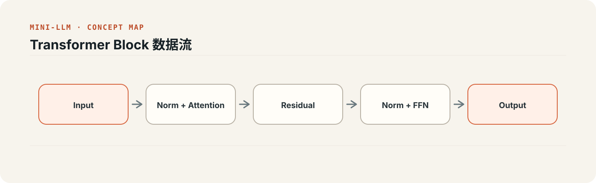
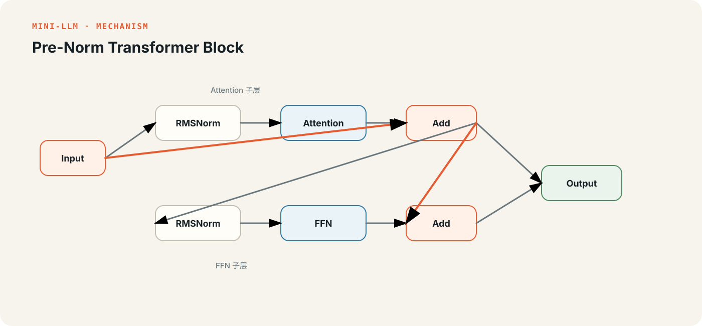

# **mini-llm Transformer Block 深度解析：从 Feed Forward、Residual Connection 到 LayerNorm、RMSNorm**



_图：Transformer Block 数据流。从左到右展示本章核心概念之间的数据流与依赖关系。_

**—— 理解 Transformer 如何通过非线性变换、残差连接和归一化，构建深层神经网络**


_图：一块主板：CPU、内存插槽、供电与总线各司其职，靠走线协同。一个 Transformer Block 内部也是同样的分工——Attention 负责取信息，FFN 负责变换，残差与归一化保证信号能稳定地穿过整块“电路”。图片：Lenharth Systems，[Wikimedia Commons](https://commons.wikimedia.org/wiki/File:Computer_Motherboard_Closeup.jpg)，[CC0 1.0](https://creativecommons.org/publicdomain/zero/1.0/)。_

## **一、引言：Attention 之后，Transformer 还需要做什么？**

在上一篇文章中，我们已经深入理解了 Transformer Engine 的几个核心模块：

1. Embedding：将 Token 转换成向量。
2. Positional Encoding：向模型提供位置信息。
3. Self-Attention：建立 Token 之间的信息关系。
4. Multi-Head Attention：从多个表示子空间学习不同关系。
5. Causal Mask：限制模型读取未来 Token。

但是，还有一个重要问题：

**Attention 已经让 Token 获得了上下文信息，为什么还需要 Feed Forward Network（FFN）？**

假设输入：

```
苹果是一种水果。
```

经过 Self-Attention 之后，Token“苹果”已经能够融合：

- “是”的信息；
- “一种”的信息；
- “水果”的信息。

但是，信息融合不等于完成了复杂的信息加工。

Attention 主要负责 Token 之间的信息交互，而 FFN 负责对每个 Token 的表示进行进一步的非线性变换。

此外，Transformer 还有两个非常重要的结构：

- Residual Connection：残差连接。
- LayerNorm / RMSNorm：归一化。

它们解决的是深层网络训练中的稳定性和优化问题。

这四个部分组合起来，构成了 Transformer Block 的核心结构。

# **二、Transformer Block 的整体架构**



_图：Pre-Norm Transformer Block 中的两条残差路径。_

先看一个标准 Transformer Block。

[Transformer Architecture & Key Design Decisions | Amardeep Kumar](https://images.openai.com/static-rsc-4/R-MngmTXVZGT6gZxtjcRThT9pDJVJfGBiaM67tF1NnTmyy1yxg5J0AZJm8MWlby3uFxdXuQA0sU6TW7jwS74FJDQ4CIgLUmRdii_iciH30PYgT0l6B7piTdH7oExkqBj28qJ9jtx_rTmhU2graJaAZXzVVsekh7h6H_TEcpgq7s?purpose=inline)

[ad6398.github.io](https://ad6398.github.io/posts/genai-interviews-01-transformer-architecture/?utm_source=chatgpt.com)

一个经典的 Post-Norm Transformer Block 可以表示为：

```
输入 X
  │
  ▼
Multi-Head Self-Attention
  │
  ▼
Residual Connection
  │
  ▼
LayerNorm
  │
  ▼
Feed Forward Network
  │
  ▼
Residual Connection
  │
  ▼
LayerNorm
  │
  ▼
输出
```

数学表达：

第一阶段：

\\[ Y=LayerNorm(X+Attention(X)) \\]

第二阶段：

\\[ Z=LayerNorm(Y+FFN(Y)) \\]

这就是原始 Transformer 论文使用的 Post-Norm 结构。

现代 GPT、LLaMA 等 Decoder-only 模型通常采用 Pre-Norm 或其变体。

我们先分别理解这些模块。

# **三、Feed Forward Network：为什么 Attention 之后还需要 MLP？**

## **3.1 Attention 和 FFN 的职责不同**

这是理解 Transformer 最重要的一个区别。

Attention 解决：

**Token 与 Token 之间如何交换信息？**

FFN 解决：

**获得上下文信息之后，如何进一步变换每个 Token 的表示？**

可以这样理解：

| 模块             | 主要作用  | 计算特点          |
| -------------- | ----- | ------------- |
| Self-Attention | 信息交互  | 不同 Token 之间计算 |
| Feed Forward   | 非线性变换 | 每个 Token 独立计算 |

例如：

```
Token 1 ──┐
Token 2 ──┼── Self-Attention ── 上下文信息融合
Token 3 ──┘
                  │
                  ▼
             Feed Forward
                  │
                  ▼
          每个 Token 独立变换
```

Attention 让 Token 能够获得其他 Token 的信息。

FFN 则进一步加工这些信息。

## **3.2 FFN 的基本结构**

最简单的 FFN 是两层 Linear，中间加入一个非线性激活函数。

\\[ FFN(x)=W_2\sigma(W_1x+b_1)+b_2 \\]

其中：

- \\(W_1\\)：第一层权重。
- \\(W_2\\)：第二层权重。
- \\(\sigma\\)：非线性激活函数。
- \\(b_1,b_2\\)：偏置。

[LLM 系列（十九）：前馈神经网络 FFN-腾讯云开发者社区-腾讯云](https://images.openai.com/static-rsc-4/HayQ5nMhfZyxu9JBqgRAWiF2A3tMpPSl2ILxw-1yUJlGqN_cAa7wk7v0eFTZqrSpXe3zQcFp4R9Yjm3qdOA4MGps7uCuhhORiCCwlg2uZi8F05JKq24VcKOlQKJq9Ernx8LJZ1OOXKciIvg5TomD4dYLdHciLFJD5BqwJIH0_BE?purpose=inline)

[cloud.tencent.com](https://cloud.tencent.com/developer/article/2627429?utm_source=chatgpt.com)

假设：

```
d_model = 128d_ff = 512
```

那么：

第一层：

\\[ W_1 \in \mathbb{R}^{128\times512} \\]

第二层：

\\[ W_2 \in \mathbb{R}^{512\times128} \\]

计算过程：

```
输入：[3, 128]
       │
       ▼
Linear(128 → 512)
       │
       ▼
Activation
       │
       ▼
Linear(512 → 128)
       │
       ▼
输出：[3, 128]
```

为什么先扩大维度，再缩小维度？

这是为了让模型在更大的隐藏空间中进行非线性特征变换。

例如：

```
128 维
  │
  ▼
512 维
  │
  ▼
非线性组合
  │
  ▼
128 维
```

可以理解为：

先将信息投影到更大的特征空间，再通过非线性变换，最后映射回原始维度。

需要注意，这并不意味着 512 维一定对应 512 个可以独立解释的语义概念。

它们是模型学习出来的隐藏特征。

## **3.3 为什么需要激活函数？**

如果没有激活函数：

\\[ FFN(x)=W_2(W_1x) \\]

那么：

\\[ W_2W_1=W \\]

最终仍然等价于一个 Linear。

无论堆叠多少个纯线性层，整体仍然是线性变换。

这会严重限制模型的表达能力。

因此，需要加入非线性激活函数。

常见激活函数：

| 激活函数   | 特点             |
| ------ | -------------- |
| ReLU   | 简单、高效          |
| GELU   | 平滑非线性          |
| SiLU   | 平滑，常用于现代 LLM   |
| SwiGLU | 门控结构，常用于现代 LLM |

## **3.4 GELU 是什么？**

GELU（Gaussian Error Linear Unit）是一种平滑激活函数。

公式：

\\[ GELU(x)=x\Phi(x) \\]

其中：

\\[ \Phi(x) \\]

是标准正态分布的累积分布函数。

直观上：

- 正数通常得到较大的保留。
- 负数不会像 ReLU 那样全部直接归零。
- 函数具有平滑的非线性特征。

[FFN Activation Functions: ReLU, GELU, and SiLU for Transformer Models - Interactive | Michael Brenndoerfer | Michael Brenndoerfer](https://images.openai.com/static-rsc-4/8rR3le8m8HBPdDrtJQt22tUP7uiHmcw9SJntloeo18x1LMtGaHnsSbYF71Qpicni13XlKWCT1GPHHSndiaAaOEZjN_FulgJ_DWpXWTUjiZqBtV9EbLXs4qjvliEjkRcug5FTCLAeLOgcHDQgbQiQAj3O4QZlOITtPQzV1pQMR38?purpose=inline)

[mbrenndoerfer.com](https://mbrenndoerfer.com/writing/ffn-activation-functions?utm_source=chatgpt.com)

GELU 曾广泛应用于 BERT、GPT 等模型。

## **3.5 SwiGLU：现代 LLM 常用的 FFN 结构**

现代 LLaMA 等模型通常使用 SwiGLU，而不是最简单的 GELU FFN。

它属于 Gated Feed Forward Network（门控前馈网络）。

其简化表达为：

\\[ SwiGLU(x)= (SiLU(xW_g)\odot xW_u)W_d \\]

其中：

- \\(W_g\\)：门控投影。
- \\(W_u\\)：信息投影。
- \\(W_d\\)：输出投影。
- \\(\odot\\)：逐元素乘法。

[On-device AI — MobileLLM: Optimizing Sub-billion Parameter Language Models for On-Device Use Cases | by Don Moon | Byte-Sized AI | Medium](https://images.openai.com/static-rsc-4/MgneJBQEiJcBoxV2hEYj81KC0URU6thJLhU1zZLU8y93Xcrnej7fnL1i9_ZF-NzW5aleLkesRYHDR3xmqdGyZqJ8BN6n7GeJTmMqo-mbaRYGJB9_6KACUt4gzJilXVfaBbwFxNNKRY4Imj5ARZ-mzGByAj1GyYHuEkXBOXJYJC8?purpose=inline)

[medium.com](https://medium.com/byte-sized-ai/on-device-ai-mobilellm-optimizing-sub-billion-parameter-language-models-for-on-device-use-cases-885cc311daa6?utm_source=chatgpt.com)

与普通 FFN 相比，SwiGLU 增加了一条门控分支。

它可以让模型学习：

- 哪些特征应该被保留；
- 哪些特征应该被抑制；
- 不同特征应该如何组合。

需要注意，SwiGLU 的隐藏维度通常需要重新设计，不能直接照搬普通 FFN 的维度配置。

## **3.6 FFN 在 Transformer 中的重要性**

Attention 负责信息交互。

FFN 负责非线性变换。

二者配合，使 Transformer 不仅能够建立 Token 之间的关系，还能够对融合后的表示进行复杂加工。

这也是为什么一个 Transformer Block 不能只有 Attention。

# **四、Residual Connection：为什么需要残差连接？**

## **4.1 深层神经网络遇到的问题**

假设我们有一个非常深的 Transformer：

```
Block 1
   │
Block 2
   │
Block 3
   │
Block 4
   │
Block 5
   │
 ...
   │
Block 32
```

数据需要经过很多层计算。

训练过程中，梯度需要从最后一层反向传播到最前面。

如果每层都对梯度产生不利影响，深层网络就可能出现：

- 梯度消失；
- 梯度爆炸；
- 训练不稳定；
- 深层网络难以优化。

残差连接就是解决这一问题的重要技术。

## **4.2 残差连接的基本思想**

普通神经网络：

\\[ y=F(x) \\]

残差网络：

\\[ y=x+F(x) \\]

[Google Colab](https://images.openai.com/static-rsc-4/Cgr-oOXBN4rNr5Z3fPz2rkD2qLdSgLzQjOySitwcdaUIFJvg82Mu0lyHeYtcFbXgJfnEadvhYnzqQT5LLQD4a_KnBnlSXSM67q8UviJlOlZtLDX5Acd41NIhk8VeM8bPjvD5Z_4WB8xXAFyUkMBgFrF0tCb8o9c7qxlT3KBZ5OQ?purpose=inline)

[colab.research.google.com](https://colab.research.google.com/github/SalChem/Fastai-iNotes-iTutorials/blob/master/Image_Recognizer_Tutorial.ipynb?utm_source=chatgpt.com)

注意这里多了一条直接连接：

```
       ┌───────────────┐
       │               │
       │               ▼
输入 X ────────────── Add ── 输出
       │               ▲
       ▼               │
    Function F(X) ─────┘
```

原来的输入不需要完全经过复杂变换，而是可以直接传递到下一层。

## **4.3 为什么这能够改善梯度传播？**

来看数学推导。

假设：

\\[ y=x+F(x) \\]

根据求导法则：

\\[ \frac{dy}{dx} = 1+\frac{dF(x)}{dx} \\]

这里最重要的是：

\\[ 1 \\]

即使：

\\[ \frac{dF(x)}{dx} \\]

很小，残差连接仍然提供了一条直接的梯度传播路径。

而对于普通结构：

\\[ y=F(x) \\]

则：

\\[ \frac{dy}{dx}= \frac{dF(x)}{dx} \\]

如果多层连续相乘的梯度都比较小，就可能出现梯度消失。

残差连接并不能保证梯度永远稳定，但能够显著改善深层网络的优化条件。

## **4.4 Transformer 中有两条残差连接**

一个标准 Transformer Block 中通常包含两条残差路径：

第一条：

\\[ Y=X+Attention(X) \\]

第二条：

\\[ Z=Y+FFN(Y) \\]

结构：

```
输入 X
  │
  ├────────────────────────┐
  │                        │
  ▼                        │
Attention                  │
  │                        │
  └─────────── Add ◄───────┘
                 │
                 ▼
                 Y
                 │
  ┌──────────────┤
  │              │
  ▼              │
  FFN            │
  │              │
  └──── Add ◄────┘
          │
          ▼
        输出 Z
```

因此，每个 Block 都保留了输入信息的直接传递路径。

# **五、LayerNorm：为什么 Transformer 需要归一化？**

## **5.1 神经网络为什么需要归一化？**

假设某一层输出：

```
[1000, 2000, 3000, 4000]
```

下一层输入：

```
[0.001, 0.002, 0.003, 0.004]
```

如果每层输出的数值分布变化很大，训练可能会变得不稳定。

归一化的目标之一，就是让数据保持更可控的数值尺度。

Transformer 早期架构使用 LayerNorm。

## **5.2 LayerNorm 的数学原理**

假设一个 Token 的隐藏向量为：

\\[ x=[x_1,x_2,\ldots,x_d] \\]

首先计算均值：

\\[ \mu= \frac{1}{d}\sum\_{i=1}^{d}x_i \\]

然后计算方差：

\\[ \sigma^2= \frac{1}{d}\sum\_{i=1}^{d}(x_i-\mu)^2 \\]

执行归一化：

\\[ \hat{x}\_i= \frac{x_i-\mu}{\sqrt{\sigma^2+\epsilon}} \\]

最后进行可学习的缩放和偏移：

\\[ y_i=\gamma_i\hat{x}\_i+\beta_i \\]

其中：

- \\(\gamma\\)：可训练缩放参数。
- \\(\beta\\)：可训练偏移参数。
- \\(\epsilon\\)：防止除零的小常数。

[One Piece of Math — Samuel Vaiter](https://images.openai.com/static-rsc-4/hY_zgsMcU7DSaiE578V870aS2kE7m97otsyZwISVUMEYJuQ-DJ2io1GPiGpio4LLWfesT8LojtAi8Br77WjZAoLbJueYxIqzzbOcMmPcDuKju_CySULGbH6G4qpbfO2ahU6UJgT_qPjx1AjLU-Dh2mnljH0i6Rntp3vYh__zhY4?purpose=inline)

[samuelvaiter.com](https://samuelvaiter.com/one-piece/index.html?utm_source=chatgpt.com)

## **5.3 LayerNorm 的计算示例**

假设：

\\[ x=[1,2,3,4] \\]

均值：

\\[ \mu=2.5 \\]

方差：

\\[ \sigma^2=1.25 \\]

标准差：

\\[ \sigma=\sqrt{1.25} \\]

归一化后（忽略 epsilon）：

\\[ \hat{x}\approx [-1.342,-0.447,0.447,1.342] \\]

现在数据被转换成了均值接近 0、方差接近 1 的表示。

然后再通过可学习的 \\(\gamma\\) 和 \\(\beta\\) 调整。

## **5.4 LayerNorm 与 BatchNorm 有什么区别？**

这是理解深度学习归一化机制的重要知识。

| 对比             | BatchNorm    | LayerNorm   |
| -------------- | ------------ | ----------- |
| 归一化维度          | 通常跨 Batch 统计 | 每个样本内部的特征维度 |
| 是否依赖 Batch     | 是            | 否           |
| 小 Batch 适应性    | 可能较差         | 通常较好        |
| Transformer 应用 | 较少           | 广泛          |

Transformer 输入通常是：

\\[ X\in\mathbb{R}^{B\times L\times D} \\]

其中：

- B：Batch Size。
- L：Sequence Length。
- D：隐藏维度。

LayerNorm 通常对每个 Token 的最后一个维度 D 单独计算均值和方差。

也就是说：

不同 Token、不同样本之间不会混合计算归一化统计量。

# **六、RMSNorm：现代大语言模型为什么喜欢它？**

## **6.1 RMSNorm 的提出背景**

LayerNorm 需要计算：

1. 均值。
2. 方差。
3. 减去均值。
4. 标准化。
5. 缩放和偏移。

这意味着需要进行多次计算。

RMSNorm（Root Mean Square Layer Normalization）提出了一种更简单的归一化方法。

核心思想：

**不再减去均值，只使用均方根进行缩放。**

## **6.2 RMSNorm 的数学公式**

首先计算均方根：

\\[ RMS(x)= \sqrt{ \frac{1}{d}\sum\_{i=1}^{d}x_i^2+\epsilon } \\]

然后归一化：

\\[ y_i= \frac{x_i}{RMS(x)}\cdot\gamma_i \\]

与 LayerNorm 相比：

- 不计算均值。
- 不进行中心化。
- 不需要偏移参数 \\(\beta\\)。
- 计算过程更加简单。

[LayerNorm Limitations and RMSNorm Advantages | Dhwanit Agarwal, PhD posted on the topic | LinkedIn](https://images.openai.com/static-rsc-4/uhuxgoRi03ZXh0EjeX-LIvLDabBEV42I__DkxoX-NP6FPGbUhFlMRiQUig1csLdr-Pn83CSmaOUA2Gq2Qlw-c53I7eoigK896ux1ez_EafVtXmKWG4CdND7fM4M4kCSJDGZA-_M_m19iUddYCjjKPXfs0w4Iyje61eqZan-Iugg?purpose=inline)

[linkedin.com](https://www.linkedin.com/posts/dhwanit-agarwal_llm-genai-ai-activity-7419511823919603713-PIpe?utm_source=chatgpt.com)

## **6.3 LayerNorm 与 RMSNorm 的区别**

| 对比     | LayerNorm | RMSNorm |
| ------ | --------- | ------- |
| 计算均值   | 是         | 否       |
| 计算方差   | 是         | 否       |
| 计算 RMS | 否         | 是       |
| 中心化    | 是         | 否       |
| 缩放参数   | 有         | 有       |
| 偏移参数   | 通常有       | 通常没有    |
| 计算复杂度  | 较高        | 较低      |

RMSNorm 并不意味着在所有场景都比 LayerNorm 更好。

但它在现代 LLM 中非常常见，例如 LLaMA 系列使用 RMSNorm。

## **6.4 RMSNorm 代码实现**

```
class RMSNorm:    def __init__(self, dim, eps=1e-6):        self.weight = Tensor(ones(dim))        self.eps = eps    def forward(self, x):        rms = sqrt(            mean(x * x, axis=-1, keepdims=True)            + self.eps        )        return (x / rms) * self.weight
```

这里最重要的是：

```
axis=-1
```

代表沿着最后一个维度计算。

如果输入：

```
[batch, seq_len, hidden_dim]
```

那么每个 Token 都独立进行 RMSNorm。

# **七、Pre-Norm 与 Post-Norm：归一化应该放在哪里？**

这是 Transformer 架构演进中的一个重要问题。

## **7.1 Post-Norm**

原始 Transformer 使用 Post-Norm。

结构：

```
输入 X
  │
  ▼
Attention
  │
  ▼
Add(X)
  │
  ▼
LayerNorm
  │
  ▼
FFN
  │
  ▼
Add
  │
  ▼
LayerNorm
  │
  ▼
输出
```

数学表达：

\\[ Y=LN(X+Attention(X)) \\]

\\[ Z=LN(Y+FFN(Y)) \\]

优点：

- 每次残差相加之后进行归一化。
- 结构直观。

缺点：

- 深层网络训练时，梯度传播可能不够稳定。
- 通常需要更谨慎的学习率和初始化设计。

## **7.2 Pre-Norm**

现代 GPT、LLaMA 等模型通常采用 Pre-Norm 或相关变体。

结构：

```
输入 X
  │
  ├───────────────────────┐
  │                       │
  ▼                       │
Norm                      │
  │                       │
  ▼                       │
Attention                 │
  │                       │
  └──────── Add ◄─────────┘
              │
              ▼
              Y
              │
  ┌───────────┤
  │           │
  ▼           │
Norm          │
  │           │
  ▼           │
FFN           │
  │           │
  └── Add ◄───┘
       │
       ▼
     输出
```

数学表达：

\\[ Y=X+Attention(Norm(X)) \\]

\\[ Z=Y+FFN(Norm(Y)) \\]

这里最重要的区别是：

归一化发生在子层计算之前，而不是残差相加之后。

## **7.3 为什么 Pre-Norm 更适合深层模型？**

观察：

\\[ Y=X+F(Norm(X)) \\]

求导时：

\\[ \frac{dY}{dX} = I+ \frac{dF(Norm(X))}{dX} \\]

这里仍然存在一个直接的恒等映射路径：

\\[ I \\]

这使得梯度能够沿着残差路径传播。

Pre-Norm 在深层 Transformer 中通常具有更好的训练稳定性。

当然，具体效果仍然与模型结构、初始化、学习率和训练策略有关。

## **7.4 Pre-Norm 还需要 Final Norm**

现代 Decoder-only Transformer 通常在最后一个 Block 之后再使用一次归一化。

例如：

```
Embedding
   │
Transformer Block 1
   │
Transformer Block 2
   │
Transformer Block 3
   │
...
   │
Transformer Block N
   │
Final RMSNorm
   │
LM Head
   │
Logits
```

Final Norm 对最终隐藏状态进行整理，然后交给 LM Head 预测下一个 Token。

# **八、完整 Transformer Block：数学结构整合**

现在我们将所有模块组合起来。

以现代 Pre-Norm + RMSNorm + SwiGLU 结构为例。

第一阶段：

\\[ Y=X+MHA(RMSNorm(X)) \\]

第二阶段：

\\[ Z=Y+SwiGLU(RMSNorm(Y)) \\]

其中：

- MHA：Multi-Head Attention。
- RMSNorm：归一化。
- SwiGLU：门控前馈网络。

[LLaMA Architecture: Design Philosophy and Training Efficiency - Interactive | Michael Brenndoerfer | Michael Brenndoerfer](https://images.openai.com/static-rsc-4/husG9lDCEKrmmFlBnpHUtLkfrKgtms3AIEEsp9SXn4XpixDTVmm7lsoIcE0qA60K_8yOejIRUw7gpvV9zbrnZw1dP-beAScZ9iHEvVcjdobwKrysxL5n6cG1NUKRkJLUbswkYloBgMWBE_qWXLH4y-INNzuibDsOA8NvA7MocjI?purpose=inline)

[mbrenndoerfer.com](https://mbrenndoerfer.com/writing/llama-architecture-design-training-efficiency?utm_source=chatgpt.com)

这就是现代 Decoder-only LLM 中非常典型的一种 Transformer Block。

## **8.1 代码实现框架**

```
class TransformerBlock:    def __init__(self, config):        self.attention_norm = RMSNorm(            config.d_model        )        self.attention = MultiHeadAttention(            config        )        self.ffn_norm = RMSNorm(            config.d_model        )        self.feed_forward = SwiGLU(            config        )    def forward(self, x, mask=None):        # Pre-Norm Attention        h = self.attention_norm(x)        h = self.attention(            h,            mask=mask        )        x = x + h        # Pre-Norm Feed Forward        h = self.ffn_norm(x)        h = self.feed_forward(h)        x = x + h
```

这个代码展示的是结构示意，真实实现还需要处理 Dropout（如果配置需要）、KV Cache、参数初始化、权重加载和 Autograd。

# **九、不同大语言模型的 Transformer Block 有什么区别？**

理解架构演进，可以帮助我们设计 mini-llm。

| 模型架构           | Attention  | FFN      | Normalization |
| -------------- | ---------- | -------- | ------------- |
| 原始 Transformer | Multi-Head | ReLU FFN | LayerNorm     |
| GPT-2          | Masked MHA | GELU     | LayerNorm     |
| GPT-3          | Masked MHA | GELU FFN | LayerNorm     |
| LLaMA          | GQA/MHA 等  | SwiGLU   | RMSNorm       |
| Qwen 系列        | 随具体版本变化    | 随具体版本变化  | 随具体版本变化       |

这里需要注意，不同版本模型的配置并不完全一致，表格是架构层面的概括。

## **9.1 为什么现代模型越来越重视 FFN？**

Attention 的主要计算量通常与序列长度平方相关：

\\[ O(L^2D) \\]

而 FFN 的计算量主要与：

\\[ O(LD D\_{ff}) \\]

相关。

当序列很长时，Attention 的计算压力会显著增加。

当隐藏维度和 FFN 隐藏维度较大时，FFN 同样会占据大量参数和计算量。

因此，Transformer 的性能优化不能只关注 Attention。

## **9.2 为什么现代模型使用 GQA？**

GQA（Grouped Query Attention）是另一项值得后续研究的技术。

它让多个 Query Head 共享部分 Key、Value Head。

主要目的是减少 KV Cache 的存储和读取成本。

例如：

```
传统 MHA：

Q1 → K1, V1
Q2 → K2, V2
Q3 → K3, V3
Q4 → K4, V4

GQA：

Q1 ─┐
Q2 ─┴── K1, V1

Q3 ─┐
Q4 ─┴── K2, V2
```

这对于推理阶段非常重要。

我们会在后续 Attention 优化和 KV Cache 章节详细展开。

# **十、mini-llm 应该如何实现 Transformer Block？**

前面已经建立了 mini-llm 的基础计算体系。

现在可以正式定义 Transformer Block 的实现范围。

## **10.1 推荐目录结构**

```
mini-llm/
│
├── tensor/
│   ├── tensor.py
│   ├── ops.py
│   ├── shape.py
│   └── autograd.py
│
├── nn/
│   ├── linear.py
│   ├── embedding.py
│   ├── activation.py
│   └── dropout.py
│
├── transformer/
│   ├── attention.py
│   ├── multi_head_attention.py
│   ├── causal_mask.py
│   │
│   ├── normalization/
│   │   ├── layer_norm.py
│   │   └── rms_norm.py
│   │
│   ├── ffn/
│   │   ├── feed_forward.py
│   │   ├── gelu.py
│   │   ├── swiglu.py
│   │   └── silu.py
│   │
│   ├── residual.py
│   └── transformer_block.py
│
└── model/
    └── decoder.py
```

## **10.2 开发顺序**

建议严格按照下面的顺序实现。

1. **Linear 与 Activation**

   确保矩阵乘法、偏置和激活函数前向、反向正确。
2. **LayerNorm**

   实现均值、方差、归一化和可学习参数。
3. **RMSNorm**

   实现均方根归一化及其梯度。
4. **Residual Connection**

   确保输入与输出 Shape 一致，验证梯度能够沿恒等路径传播。
5. **Feed Forward Network**

   先实现 GELU FFN，再实现 SwiGLU。
6. **Transformer Block**

   组合 Attention、Norm、FFN 和 Residual。
7. **Decoder Stack**

   将多个 Transformer Block 堆叠起来。

## **10.3 必须设计的测试**

| 测试                 | 验证内容        |
| ------------------ | ----------- |
| LayerNorm Forward  | 均值、方差和输出正确  |
| LayerNorm Backward | 梯度正确        |
| RMSNorm Forward    | RMS 计算正确    |
| RMSNorm Backward   | 参数梯度和输入梯度正确 |
| GELU               | 激活函数数值正确    |
| SwiGLU             | 门控计算正确      |
| Residual           | 梯度恒等路径正确    |
| FFN                | 输入输出维度正确    |
| Transformer Block  | 整体计算图正确     |
| Gradient Check     | 自动微分与数值梯度一致 |

特别建议实现 Gradient Check：

\\[ g\_{numeric} = \frac{f(x+\epsilon)-f(x-\epsilon)} {2\epsilon} \\]

将数值梯度与 Autograd 计算的梯度进行比较。

这对于发现归一化和门控计算中的反向传播错误非常有帮助。

# **十一、一个更深层的问题：Transformer Block 到底在学习什么？**

现在我们从工程实现回到模型原理。

一个 Transformer Block 做了两件不同的事情：

**第一件：信息交互。**

Attention 让一个 Token 获取其他 Token 的信息。

**第二件：信息变换。**

FFN 对融合后的特征进行非线性计算。

而 Residual Connection 和 Normalization 为这种深层计算提供稳定的优化结构。

可以抽象为：

## **Transformer Block 的四种能力**

**Attention：信息交互**

让不同 Token 交换上下文信息。

**FFN：非线性变换**

对每个 Token 的特征进行进一步加工。

**Residual：信息与梯度通路**

保留原始表示，改善深层优化。

**Normalization：数值稳定**

控制特征尺度，改善训练过程。

因此，Transformer 并不是简单地重复 Attention。

它实际上是一个反复执行：

\\[ \text{信息交互} \rightarrow \text{非线性变换} \rightarrow \text{表示更新} \\]

的深层计算系统。

随着多个 Block 堆叠，模型逐渐形成更加复杂的上下文表示。

# **十二、总结**

今天我们完成了 Transformer Block 的四个核心模块：

| 模块                   | 核心作用        |
| -------------------- | ----------- |
| Feed Forward Network | 非线性特征变换     |
| Residual Connection  | 保留信息与改善梯度传播 |
| LayerNorm            | 均值方差归一化     |
| RMSNorm              | 均方根归一化      |
| Pre-Norm             | 子层计算之前归一化   |
| Post-Norm            | 残差相加之后归一化   |

最重要的认识是：

**Attention 决定信息如何交互，FFN 决定信息如何变换，Residual 和 Normalization 决定这些计算如何稳定地组成深层网络。**

# **十三、mini-llm 系列下一篇**

目前我们已经理解了 Transformer 的基本计算架构。

下一步应该进入完整模型的组织方式。

下一篇推荐

# **《mini-llm Decoder Engine 深度解析：从 Transformer Stack、LM Head 到 Next Token Prediction》**

**重点研究：**

1. 为什么 GPT 使用 Decoder-only 架构？
2. 多个 Transformer Block 如何堆叠？
3. 最终隐藏状态如何转换成词表概率？
4. LM Head 与 Embedding Weight Tying 是什么？
5. Logits、Softmax、Temperature 分别做什么？
6. 模型如何预测下一个 Token？
7. Next Token Prediction 为什么能够形成语言生成能力？
8. 如何从 mini-llm 构建一个真正可以生成文本的模型？

这篇完成之后，我们就能够把 Tensor、Autograd、Neural Network、Transformer 和 Decoder 串联起来，形成一个完整的大语言模型计算链路。

