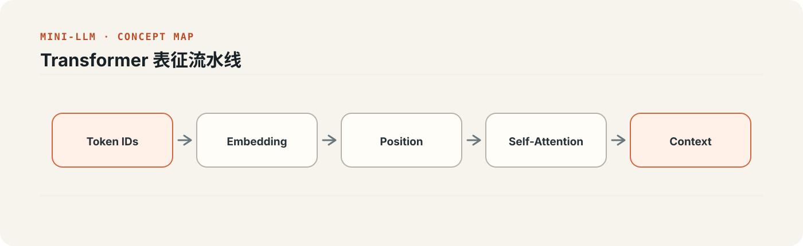
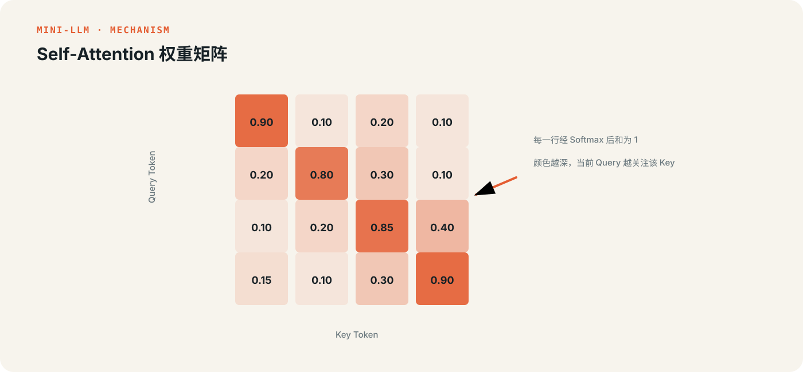

# **mini-llm Transformer Engine 深度解析：从 Embedding、Positional Encoding 到 Self-Attention、Multi-Head Attention**



_图：Transformer 表征流水线。从左到右展示本章核心概念之间的数据流与依赖关系。_

**—— 从 Token 向量化、位置信息注入到注意力计算，理解大语言模型最核心的计算引擎**

## **一、引言：Transformer Engine 到底在做什么？**

在前面的 mini-llm 系列中，我们已经逐步拆解了几个重要的底层模块：

1. Tensor Engine：张量、内存布局、Shape、Stride、矩阵运算。
2. Autograd Engine：计算图、梯度传播、反向传播。
3. Neural Network Engine：Linear、MLP、Loss、Optimizer。

现在，我们进入整个 mini-llm 最重要的核心部分之一：

**Transformer Engine。**

如果说 Tensor Engine 负责提供数学计算能力，Autograd Engine 负责让这些计算能够学习，那么 Transformer Engine 就负责组织这些计算，让模型能够理解 Token 之间的关系。

Transformer 并不是一个单独的神经网络算子，而是一套由多个计算模块组合起来的架构。

它主要解决三个问题：

- 如何将 Token 转换成模型能够计算的向量？
- 如何让模型理解 Token 在序列中的位置？
- 如何让一个 Token 根据其他 Token 的信息更新自己的表示？

这三个问题分别对应：

| 模块                   | 核心作用             |
| -------------------- | ---------------- |
| Embedding            | 将 Token 转换成向量    |
| Positional Encoding  | 向向量注入位置信息        |
| Self-Attention       | 建立 Token 之间的信息关系 |
| Multi-Head Attention | 从多个表示子空间并行学习关系   |

这些模块组合起来，构成 Transformer 的核心信息处理机制。

## **二、Transformer Engine 的整体架构**

先看一个简化的 Transformer 数据流。

[AI-大语言模型LLM-Transformer架构3-嵌入和位置编码 - 技术栈](https://images.openai.com/static-rsc-4/3lGKCbNSdqF_ulQvyJZuBVFD6aywcQlxYW7GGyK7H1HKSWL6yaNuFJdWmpS8hxGc6lzBCj0kGuqUStuAISO22s7w8HTELqw0QbnppMoRMN2_7Kjavimbg6J4HzX0mpzd-wVuMq_qMTpyCGb99d6YpFx4rHsR6fvIGIBa9SD3vXQ?purpose=inline)

[jishuzhan.net](https://jishuzhan.net/article/2016769043689684993?utm_source=chatgpt.com)

假设我们输入一句话：

```
我 喜欢 人工智能
```

模型首先将文本转换成 Token：

```
[我, 喜欢, 人工智能]
```

随后进入 Transformer：

```
文本
  │
  ▼
Tokenizer
  │
  ▼
Token IDs
  │
  ▼
Embedding
  │
  ▼
Positional Encoding
  │
  ▼
Transformer Block
  │
  ├── Self-Attention
  │
  ├── Add & Norm
  │
  ├── Feed Forward Network
  │
  └── Add & Norm
  │
  ▼
下一层 Transformer Block
  │
  ▼
最终隐藏状态
```

注意：

这里展示的是一个简化的 Transformer Block。

实际 GPT 类模型通常采用 Decoder-only 架构，并使用因果注意力（Causal Self-Attention），确保当前位置不能读取未来 Token。

Transformer 的原始架构则采用 Encoder-Decoder 结构。

[image](https://www.google.com/s2/favicons?domain=https://arxiv.org\&sz=32)

arXiv+1


# **三、Embedding：Token 如何变成向量？**

## **3.1 为什么需要 Embedding？**

计算机并不能直接理解：

```
我 喜欢 人工智能
```

神经网络也不能直接对汉字进行矩阵乘法。

它需要数字。

最简单的方法是给每个 Token 分配一个整数编号。

例如：

| Token | Token ID |
| ----- | -------- |
| 我     | 1001     |
| 喜欢    | 2056     |
| 人工智能  | 8721     |
| 学习    | 3012     |

输入文本就变成：

```
tokens = [1001, 2056, 8721]
```

但是，这里出现了一个问题：

**Token ID 只是编号，并不包含语义信息。**

例如：

```
猫 = 100
狗 = 101
汽车 = 102
```

这不代表猫和狗之间的语义距离一定比猫和汽车更近。

因此，我们需要一种方法，将离散的 Token ID 映射成连续的向量。

这就是 Embedding。

## **3.2 Embedding 的本质**

Embedding 本质上是一个可训练的矩阵。

假设：

- 词表大小：10,000
- Embedding 维度：128

那么 Embedding 矩阵为：

\\[ E \in \mathbb{R}^{10000 \times 128} \\]

可以理解为：

[Transformers Encoder Deep Dive - Part 1 - DEV Community](https://images.openai.com/static-rsc-4/fDhY0Rr1dSIcVX1he-vfSaUDDbiu1CjhQ9eZj4uld2sFgIS_y4EcDuBU3hFP1qGCBuOf4q0M_05HWKRXhMq_UZyLt1xyEugQ55OzdTN4CQJrSN4QcT5JnPP42jss_ki2SqGruee3AXWWRMpbN60AL24LrVtYJ1T6M3FeovvqyYo?purpose=inline)

[dev.to](https://dev.to/iamyuvaraj/transformers-encoder-deep-dive-part-1-1g0?utm_source=chatgpt.com)

每一行对应一个 Token 的向量。

例如：

```
E[1001] = [0.12, 0.38, -0.21, ...]E[2056] = [0.31, -0.17, 0.56, ...]E[8721] = [-0.11, 0.62, 0.19, ...]
```

原来的 Token ID：

```
[1001, 2056, 8721]
```

经过 Embedding 查表：

```
[    [0.12, 0.38, -0.21, ...],    [0.31, -0.17, 0.56, ...],    [-0.11, 0.62, 0.19, ...]]
```

最终得到一个二维矩阵：

\\[ X \in \mathbb{R}^{3 \times 128} \\]

这意味着：

3 个 Token，每个 Token 对应一个 128 维向量。

## **3.3 Embedding 是如何学习的？**

Embedding 并不是人工编写的语义字典。

它是模型训练过程中不断更新的参数。

假设模型学习：

```
我喜欢人工智能
我喜欢机器学习
我喜欢编程
```

训练过程中，模型通过预测任务产生损失。

随后通过反向传播调整 Embedding 参数。

逐渐地，向量空间会形成某种有利于预测任务的语义结构。

例如：

- 语义相近的 Token 可能形成相近的表示。
- 具有类似语法作用的 Token 可能形成某些相似方向。
- 不同上下文中的词语可能形成不同的关联模式。

但要注意：

Embedding 并不是一个固定的人工语义空间，也不保证所有语义相似的词都具有简单的几何关系。

它是通过训练任务学习出来的表示空间。

## **3.4 Embedding 的代码实现**

mini-llm 中可以使用一个矩阵实现 Embedding。

```
class Embedding:    def __init__(self, vocab_size, embedding_dim):        self.weight = Tensor(            random_matrix(vocab_size, embedding_dim)        )    def forward(self, token_ids):        return self.weight[token_ids]
```

例如：

```
embedding = Embedding(    vocab_size=10000,    embedding_dim=128)token_ids = [1001, 2056, 8721]x = embedding.forward(token_ids)
```

输出：

```
Shape: [3, 128]
```

这里需要注意一个底层细节：

Embedding 的前向计算是矩阵行索引，而不是必须执行一次完整的矩阵乘法。

反向传播时，只有被访问的 Embedding 行会收到对应的梯度贡献。

如果同一个 Token 出现多次，其梯度需要累加。

这意味着 Tensor Engine 和 Autograd Engine 必须支持索引操作以及对应的梯度传播。

# **四、Positional Encoding：模型如何理解顺序？**

## **4.1 为什么 Embedding 还不够？**

假设我们输入：

```
我喜欢你
```

以及：

```
你喜欢我
```

这两个句子使用了相同的 Token 集合。

但它们的意思完全不同。

问题在于：

Embedding 只负责表达 Token 本身的表示。

它并不天然知道：

- 这个 Token 位于第几个位置；
- 哪个 Token 在前面；
- 哪个 Token 在后面；
- 两个 Token 相距多远。

Transformer 的 Self-Attention 可以同时计算多个位置之间的关系，但如果没有额外的位置信息，它本身并不知道原始序列的顺序。

因此需要 Positional Encoding。

## **4.2 位置编码的基本思想**

给每个 Token 的 Embedding 加入一个位置向量。

例如：

```
Token Embedding
      +
Position Embedding
      =
Transformer Input
```

数学表示：

\\[ X = E + PE \\]

其中：

- \\(E\\)：Token Embedding。
- \\(PE\\)：位置编码。
- \\(X\\)：Transformer 的输入。

假设：

\\[ E = \begin{bmatrix} 0.1 & 0.2 & 0.3 \\\ 0.4 & 0.5 & 0.6 \\\ 0.7 & 0.8 & 0.9 \end{bmatrix} \\]

位置编码：

\\[ PE = \begin{bmatrix} 0.01 & 0.02 & 0.03 \\\ 0.04 & 0.05 & 0.06 \\\ 0.07 & 0.08 & 0.09 \end{bmatrix} \\]

相加之后：

\\[ X = \begin{bmatrix} 0.11 & 0.22 & 0.33 \\\ 0.44 & 0.55 & 0.66 \\\ 0.77 & 0.88 & 0.99 \end{bmatrix} \\]

现在每个 Token 的表示同时包含：

1. Token 本身的表示。
2. Token 所处位置的信息。

## **4.3 正弦位置编码（Sinusoidal Positional Encoding）**

在 2017 年 Transformer 原始论文中，提出了一种基于正弦和余弦函数的位置编码方案。

公式：

\\[ PE(pos,2i)= \sin\left( \frac{pos}{10000^{2i/d}} \right) \\]

\\[ PE(pos,2i+1)= \cos\left( \frac{pos}{10000^{2i/d}} \right) \\]

其中：

- \\(pos\\)：Token 所在的位置。
- \\(i\\)：向量维度的索引。
- \\(d\\)：Embedding 维度。

为什么要使用正弦和余弦？

因为不同维度使用不同频率。

[🧭 Understanding Positional Embeddings: How Transformers Know Word Order Without Remembering It | by Himanshu Mittal | Medium](https://images.openai.com/static-rsc-4/eVZZe4Re-GRE4HYc1M21FWqhFhj2MPTqBmLChjJNM8iryaGG4AnWjACS4YwyB4E9jakG4xpfe4tzrh_ReVxeyc4ko0kswRceGVQl24c1gXAMid9fXMZWPdCCFXNntOE7J2i1NoHzgCdAu2V_BmAjX8ij-eoJD9UtgytjrgqMhW0?purpose=inline)

[medium.com](https://medium.com/%40himanshum14/understanding-positional-embeddings-how-transformers-know-word-order-without-remembering-it-bc308cacbb11?utm_source=chatgpt.com)

直观理解：

- 某些维度变化较快，可以表达较小的位置变化。
- 某些维度变化较慢，可以表达较大的位置变化。
- 多个频率组合起来，可以形成不同位置的特征表示。

这种设计还使模型能够利用不同位置之间的相对关系。

## **4.4 可学习的位置编码**

另一种方案是直接定义一个可训练的位置矩阵：

\\[ P \in \mathbb{R}^{L \times d} \\]

其中：

- \\(L\\)：最大序列长度。
- \\(d\\)：向量维度。

例如：

```
position_embedding = Tensor(    random_matrix(max_seq_len, embedding_dim))
```

前向计算：

```
x = token_embedding + position_embedding
```

这种方法的优点是简单。

缺点是位置参数通常受到预设最大序列长度的限制。

## **4.5 现代 LLM 使用什么位置编码？**

现代大语言模型已经不再局限于原始 Transformer 的正弦位置编码。

常见方案包括：

| 方案            | 特点            |
| ------------- | ------------- |
| Sinusoidal PE | 固定正弦余弦函数      |
| Learned PE    | 可训练的位置向量      |
| RoPE          | 旋转位置编码        |
| ALiBi         | 通过注意力偏置引入距离信息 |

其中 RoPE（Rotary Position Embedding）是现代 Decoder-only LLM 中非常重要的一种方案。

[Build a DeepSeek Model (From Scratch)](https://images.openai.com/static-rsc-4/xOCPn2bZRzruCTLRBdOZx_fIMqRN_sjbglHoKa_EgWEpKAG6iyCdlA8r-3lLPUFLFSkLtle0QjrqGE_7S8omE82Henrsp0dhOynptzH7-Oftnkj8d6_wNEnJ7hzpaIWhgDFkWr3BLAsHJnCNvYt1R7rjitHTRhwNTD6ldkb0MSY?purpose=inline)

[manning.com](https://www.manning.com/preview/build-a-deepseek-model-from-scratch/chapter-3?utm_source=chatgpt.com)

RoPE 不再简单地将位置向量加到 Embedding 上，而是在 Attention 计算中对 Query 和 Key 进行位置相关的旋转变换。

其核心价值是：

**让注意力计算能够感知 Token 之间的相对位置关系。**

这对于长上下文建模非常重要。

因此，在 mini-llm 的设计中，可以先实现 Sinusoidal PE，再扩展 RoPE。

[image](https://www.google.com/s2/favicons?domain=https://arxiv.org\&sz=32)

arXiv+2

# **五、Self-Attention：Token 如何理解其他 Token？**



_图：注意力矩阵将每个 Query 与所有 Key 的相关性表示为权重。_

这是 Transformer 最核心的部分。

## **5.1 为什么需要 Self-Attention？**

看一个句子：

```
小明把苹果放在桌子上，因为它很重。
```

这里的“它”指的是什么？

模型需要根据上下文判断：

- 苹果很重？
- 桌子很重？

一个 Token 的理解往往依赖其他 Token。

传统神经网络主要通过局部或逐层计算提取信息。

Transformer 使用 Self-Attention，让一个 Token 能够直接计算与其他 Token 的关联程度。

例如：

```
小明 ─────┐
          │
把 ───────┤
          │
苹果 ─────┼── Attention
          │
桌子 ─────┤
          │
它 ───────┘
```

每个 Token 都可以根据其他 Token 的信息更新自己的表示。

这就是 Self-Attention。

## **5.2 Self-Attention 的三个核心向量**

Self-Attention 引入三个概念：

- Query（Q）：我想寻找什么信息？
- Key（K）：我能够提供什么信息？
- Value（V）：我实际提供什么内容？

这是一个帮助理解的类比。

实际计算中，Q、K、V 都是通过可训练的线性变换生成的。

假设输入：

\\[ X \in \mathbb{R}^{3 \times 128} \\]

分别定义三个权重矩阵：

\\[ W_Q \in \mathbb{R}^{128 \times 128} \\]

\\[ W_K \in \mathbb{R}^{128 \times 128} \\]

\\[ W_V \in \mathbb{R}^{128 \times 128} \\]

那么：

\\[ Q=XW_Q \\]

\\[ K=XW_K \\]

\\[ V=XW_V \\]

输出：

\\[ Q,K,V \in \mathbb{R}^{3 \times 128} \\]

[What is Transformers in Deep Learning: A Guide 2026](https://images.openai.com/static-rsc-4/xO4fPox9ELTrYHdqurOpfbPtoHytHgEgmh5g8rkWfhUFfpkH9hgzv4zmeWEnGHh6LGEIkw3D6VcTWPZ3RiFzyq_UH16e76U4NB1nyfR4-DpZQ3PFTFCPpFlP8Y0-0F4Qn-xpySScL0lnZIl-65d5pOF-xekJxjxZSWjZYNm4X1o?purpose=inline)

[deeplearningcourse.co.in](https://www.deeplearningcourse.co.in/blog/transformers-in-deep-learning?utm_source=chatgpt.com)

注意：

三个矩阵使用不同的可训练参数。

因此，同一个 Token 会被映射成三种不同的表示。

为什么需要三个不同的表示？

因为模型需要分别学习：

1. 当前 Token 应该关注什么。
2. 其他 Token 有什么特征可以匹配。
3. 匹配之后应该提取什么信息。

## **5.3 Attention Score：计算 Token 之间的关联程度**

有了 Q 和 K，下一步是计算它们之间的相似程度。

使用矩阵乘法：

\\[ S=QK^T \\]

其中：

\\[ S \in \mathbb{R}^{3 \times 3} \\]

例如：

\\[ S= \begin{bmatrix} 2.1 & 1.3 & 0.8 \\\ 1.2 & 2.5 & 1.4 \\\ 0.6 & 1.7 & 2.8 \end{bmatrix} \\]

这个矩阵表示：

每一行代表一个 Query Token，每一列代表一个 Key Token。

例如：

第一行：

```
Token 1 对 Token 1 的匹配程度：2.1
Token 1 对 Token 2 的匹配程度：1.3
Token 1 对 Token 3 的匹配程度：0.8
```

但是，这些分数还不能直接作为注意力权重。

因为它们可能具有较大的数值范围。

## **5.4 为什么需要 Scaled Dot-Product Attention？**

Transformer 使用缩放点积注意力。

公式：

\\[ Attention(Q,K,V)= Softmax\left( \frac{QK^T}{\sqrt{d_k}} \right)V \\]

其中：

\\[ d_k \\]

代表 Key 向量的维度。

为什么要除以：

\\[ \sqrt{d_k} \\]

因为随着向量维度增加，点积数值的方差通常也会增加。

如果直接进行 Softmax，可能使输出分布过于尖锐，导致梯度变小，不利于训练。

缩放操作可以缓解这个问题。

例如：

```
scores = Q @ K.transpose(-2, -1)scores = scores / sqrt(head_dim)attention_weights = softmax(scores)output = attention_weights @ V
```

这是 Self-Attention 最核心的计算流程。

## **5.5 Softmax：将分数转换为权重**

假设某个 Token 得到了三个关联分数：

```
[2.0, 1.0, 0.5]
```

经过 Softmax：

\\[ Softmax(x_i)= \frac{e^{x_i}}{\sum_j e^{x_j}} \\]

得到：

```
[0.629, 0.231, 0.140]
```

这些数字表示：

- 第一个 Token：62.9%。
- 第二个 Token：23.1%。
- 第三个 Token：14.0%。

它们加起来等于 1。

[Self-Attention Explained Clearly: The Core Mechanism Behind LLM Intelligence | by Dhruv_sharma | Medium](https://images.openai.com/static-rsc-4/Dq7FP73A6ln2zVJXg3Uqrqnxm3_vJSd0ouXD7wuIZd0MBK_oZvnLykaACHfXF2JvgM_fWK_J42wZD-l7vSomvfy7-7bfd9vzT803dC5VSNmwKy-Y3PTAvaZuWYXGFcfNYKwCpbB3gG18jLoAvDZ8t0bv0Fsq_3tEmoSWTHl68Z0?purpose=inline)

[medium.com](https://medium.com/%40dhruvsharmaaugust2003/self-attention-explained-clearly-the-core-mechanism-behind-llm-intelligence-50e04263e4ba?utm_source=chatgpt.com)

这里需要特别注意：

这些权重并不意味着模型在进行人类意义上的有意识关注。

它们是模型计算得到的加权系数。

## **5.6 加权 Value：生成新的 Token 表示**

现在我们有了注意力权重：

\\[ A=Softmax\left( \frac{QK^T}{\sqrt{d_k}} \right) \\]

下一步：

\\[ O=AV \\]

假设：

\\[ A= \begin{bmatrix} 0.6 & 0.3 & 0.1 \end{bmatrix} \\]

Value：

\\[ V= \begin{bmatrix} V_1\\\ V_2\\\ V_3 \end{bmatrix} \\]

那么：

\\[ O=0.6V_1+0.3V_2+0.1V_3 \\]

这意味着：

当前 Token 的新表示，是其他 Token 信息按照注意力权重进行加权组合的结果。

**Self-Attention 最重要的意义：让每个 Token 的表示从独立的 Token 表示，转变为融合上下文信息的表示。**

# **六、Causal Mask：为什么 GPT 不能看到未来？**

前面讲的是普通 Self-Attention。

但 GPT 类模型还需要解决一个问题：

假设模型正在预测：

```
我 喜欢 人工智能
```

当模型处理第一个 Token“我”时，不能提前看到：

```
喜欢 人工智能
```

否则模型就可能直接利用未来答案。

这会破坏自回归语言模型的训练目标。

因此，GPT 使用 Causal Mask（因果掩码）。

## **6.1 因果掩码的原理**

假设序列长度为 4。

原始 Attention Score：

\\[ S= \begin{bmatrix} s\_{11}&s\_{12}&s\_{13}&s\_{14}\\\ s\_{21}&s\_{22}&s\_{23}&s\_{24}\\\ s\_{31}&s\_{32}&s\_{33}&s\_{34}\\\ s\_{41}&s\_{42}&s\_{43}&s\_{44} \end{bmatrix} \\]

因果掩码：

\\[ M= \begin{bmatrix} 0&-\infty&-\infty&-\infty\\\ 0&0&-\infty&-\infty\\\ 0&0&0&-\infty\\\ 0&0&0&0 \end{bmatrix} \\]

计算：

\\[ S'=S+M \\]

经过 Softmax 后，未来位置对应的权重变成 0。

[GPT-3 訓練 vs 推理：完整解析](https://images.openai.com/static-rsc-4/FHbQ4nL6-H9AY96VuUKJIqbNu1_RSBYIApY1-NbISjG_H3BZFXi9JFMCsz5rITVu3oRPdgYxb0ToTGewtgmMxpC4V0zI4JZsMQL5keVDohUAoWx8n96gNvrRTRErvlClyPReqIGeAMwdb_XZC7OCkoqa2VqGFg4ZJKB54Cax358?purpose=inline)

[hsiehchenwei.github.io](https://hsiehchenwei.github.io/ai-paper-archaeology/articles/gpt3-training-vs-inference.html?utm_source=chatgpt.com)

因此：

| 当前 Token | 可以看到的 Token   |
| -------- | ------------- |
| Token 1  | Token 1       |
| Token 2  | Token 1、2     |
| Token 3  | Token 1、2、3   |
| Token 4  | Token 1、2、3、4 |

这就是 GPT 能够按照从左到右的顺序生成文本的基础。

需要注意：

训练阶段可以并行计算所有位置，只要通过 Mask 阻止未来信息泄漏；推理阶段通常按照自回归方式逐步生成 Token。

# **七、Multi-Head Attention：为什么需要多个 Attention Head？**

前面我们已经理解了单个 Self-Attention。

现在产生一个新问题：

**为什么 Transformer 不只使用一个 Attention，而是需要多个 Attention Head？**

## **7.1 单个 Attention 的局限**

假设一句话：

```
小明昨天在南京购买了一台电脑。
```

模型可能需要同时学习不同类型的关系：

- 小明与购买之间的关系。
- 南京与购买之间的关系。
- 电脑与购买之间的关系。
- 昨天与购买之间的关系。

这些关系并不完全相同。

如果只有一个 Attention Head，模型需要通过一套投影参数处理各种关系。

这会限制模型学习不同表示子空间中关系的能力。

## **7.2 Multi-Head 的核心思想**

Multi-Head Attention 的方法是：

**把输入向量投影到多个不同的表示子空间，在每个子空间中独立计算 Attention。**

例如：

```
                    Input X
                       │
          ┌────────────┼────────────┐
          │            │            │
          ▼            ▼            ▼
       Head 1       Head 2       Head 3
          │            │            │
          ▼            ▼            ▼
      Attention    Attention    Attention
          │            │            │
          ▼            ▼            ▼
        Out 1        Out 2        Out 3
          │            │            │
          └────────────┼────────────┘
                       │
                    Concat
                       │
                       ▼
                 Linear Projection
                       │
                       ▼
                  Final Output
```

[Transformer (Attention Is All You Need) 구현하기 (1/3) | Reinforce NLP](https://images.openai.com/static-rsc-4/PbmGHsrVqSJ3L2q6hWm-LLq067vDL0xH_meEpsGV1RdZUQaAxKgM7exqbqKgHTz9mpMvcBMX5w0CtSqPROXf3vbjzQhIaqJOFCb3J9w7eZTdEE05EF-3gR7BeiCYzD6QeUn9BnrK3r72CApGrkMyc6XDL-_1hWKEpl0qQqozB7o?purpose=inline)

[paul-hyun.github.io](https://paul-hyun.github.io/transformer-01/?utm_source=chatgpt.com)

每个 Head 都拥有独立的：

- Query 权重矩阵。
- Key 权重矩阵。
- Value 权重矩阵。

因此，不同 Head 可以学习不同的信息关联模式。

但不要简单地认为 Head 1 一定负责语法、Head 2 一定负责语义。

真实模型中，各个 Head 学习到的功能可能存在重叠、组合和复杂分工。

## **7.3 Multi-Head Attention 的数学公式**

单个 Head：

\\[ head_i= Attention(QW_i^Q,KW_i^K,VW_i^V) \\]

多个 Head 拼接：

\\[ MultiHead(Q,K,V)= Concat(head_1,\ldots,head_h)W^O \\]

其中：

- \\(h\\)：Attention Head 数量。
- \\(W_i^Q\\)：第 i 个 Head 的 Query 权重。
- \\(W_i^K\\)：第 i 个 Head 的 Key 权重。
- \\(W_i^V\\)：第 i 个 Head 的 Value 权重。
- \\(W^O\\)：输出投影矩阵。

[image](https://www.google.com/s2/favicons?domain=https://nlp.seas.harvard.edu\&sz=32)

nlp.seas.harvard.edu+1

## **7.4 具体计算示例**

假设 mini-llm 使用：

```
d_model = 128num_heads = 4head_dim = 32
```

那么：

\\[ d\_{model}=h \times d\_{head} \\]

\\[ 128=4\times32 \\]

输入：

\\[ X \in \mathbb{R}^{3\times128} \\]

经过 Q、K、V 投影后：

\\[ Q,K,V \in \mathbb{R}^{3\times128} \\]

然后拆分为 4 个 Head：

```
Q: [3, 128]
      │
      ▼
Reshape
      │
      ▼
[3, 4, 32]
      │
      ▼
Transpose
      │
      ▼
[4, 3, 32]
```

每个 Head 独立计算：

\\[ Q_iK_i^T \\]

得到：

\\[ [3,32]\times[32,3]=[3,3] \\]

4 个 Head 分别产生：

```
Head 1: [3, 32]
Head 2: [3, 32]
Head 3: [3, 32]
Head 4: [3, 32]
```

拼接后：

\\[ Concat \in \mathbb{R}^{3\times128} \\]

最后通过输出投影：

\\[ Output=Concat \cdot W^O \\]

其中：

\\[ W^O \in \mathbb{R}^{128\times128} \\]

最终结果：

\\[ Output \in \mathbb{R}^{3\times128} \\]

输入和输出的维度保持一致。

这也是 Transformer 能够堆叠多个 Block 的重要条件。

# **八、Transformer Engine 的完整计算过程**

现在我们把前面所有知识连接起来。

假设：

```
vocab_size = 10000seq_len = 3d_model = 128num_heads = 4head_dim = 32
```

输入：

```
我 喜欢 人工智能
```

完整计算流程：

## **Transformer Engine 数据流**

**Token IDs**

[1001, 2056, 8721]

**Embedding**

[3, 128]

**Positional Encoding**

[3, 128]

**Multi-Head Self-Attention**

**Head 1**

32维

**Head 2**

32维

**Head 3**

32维

**Head 4**

32维

Q、K、V → Attention → Concat → Linear

**Add & Norm**

残差连接 + 归一化

**Feed Forward Network**

逐 Token 的非线性变换

**Add & Norm**

输出 [3, 128]

**Next Transformer Block**

重复 N 层

这里的 Add & Norm 和 Feed Forward 将在后续的 Transformer Block 深度解析中展开。

# **九、mini-llm 应该如何实现 Transformer Engine？**

理解原理之后，我们需要将这些数学运算变成真正的软件模块。

建议 mini-llm 使用分层设计。

## **9.1 模块划分**

```
mini-llm/
│
├── tensor/
│   ├── tensor.py
│   ├── shape.py
│   ├── ops.py
│   └── autograd.py
│
├── nn/
│   ├── linear.py
│   ├── embedding.py
│   └── normalization.py
│
├── transformer/
│   ├── positional_encoding.py
│   ├── rope.py
│   ├── attention.py
│   ├── multi_head_attention.py
│   ├── causal_mask.py
│   └── transformer_block.py
│
└── model/
    └── transformer_model.py
```

## **9.2 每个模块负责什么？**

| 模块                      | 主要职责                         |
| ----------------------- | ---------------------------- |
| embedding.py            | Token ID 到向量的映射              |
| positional_encoding.py  | 正弦位置编码                       |
| rope.py                 | 旋转位置编码                       |
| attention.py            | Scaled Dot-Product Attention |
| causal_mask.py          | 因果注意力掩码                      |
| multi_head_attention.py | 多头拆分、并行计算、拼接                 |
| transformer_block.py    | Attention 与 FFN 组合           |
| transformer_model.py    | 多层 Transformer 组织            |

## **9.3 建议的开发顺序**

不要一开始就实现完整 GPT。

应该按照依赖关系逐步构建。

1. **Embedding**

   实现 Token ID 查询向量和 Embedding 梯度累加。
2. **Positional Encoding**

   实现 Sinusoidal PE，验证位置向量的 Shape 和数值。
3. **Scaled Dot-Product Attention**

   实现 Q、K、V、矩阵乘法、缩放和 Softmax。
4. **Causal Mask**

   实现未来 Token 屏蔽，并验证未来信息不会影响当前输出。
5. **Multi-Head Attention**

   实现 Head 拆分、Transpose、并行计算、Concat 和输出投影。
6. **RoPE**

   在基础 Attention 正确运行之后，扩展现代位置编码。
7. **Transformer Block**

   组合 Attention、残差连接、Normalization 和 FFN。
8. **Transformer Model**

   堆叠多个 Transformer Block，形成完整模型。

## **9.4 必须重点测试的底层能力**

| 测试项目               | 需要验证的问题          |
| ------------------ | ---------------- |
| Embedding Lookup   | 索引是否正确           |
| Embedding Backward | 重复 Token 的梯度是否累加 |
| Position Encoding  | 位置编码是否正确         |
| QKV Projection     | 矩阵维度是否正确         |
| Attention Score    | QKᵀ 是否正确         |
| Softmax            | 每行概率和是否为 1       |
| Causal Mask        | 未来位置权重是否为 0      |
| Multi-Head Split   | 拆分和合并是否保持数据顺序    |
| Attention Backward | 梯度是否正确传播         |

特别是 Multi-Head Attention，需要反复检查 Shape、Stride 和 Transpose。

这正好与之前 Tensor Engine 的内容形成联系。

# **十、Transformer Engine 与其他 Engine 的关系**

现在可以将 mini-llm 的底层架构理解为一个完整的分层体系。

[PyTorch](https://images.openai.com/static-rsc-4/GNJoLb3vs9vN3wVGOWTVhNT4eyjUCmT4Ap0EBVmT-r_N0HP6XqM9px8wk7OPM2oIGq8YgQfQh-tk200dTM763-8Y3JXCmsIffC4f20Qz1qWJahgiKt0ZVGxYJ8GAHmhAD8GpfUKaLFtu81OY5ZA8xZo4OiSrrkn4H-5oR0WWmCk?purpose=inline)

[se.ewi.tudelft.nl](https://se.ewi.tudelft.nl/desosa2019/chapters/pytorch/?utm_source=chatgpt.com)

| Engine                | 解决的问题     | 核心能力                         |
| --------------------- | --------- | ---------------------------- |
| Tensor Engine         | 如何进行数学计算？ | Tensor、Shape、Stride、MatMul   |
| Autograd Engine       | 如何计算梯度？   | Computation Graph、Backward   |
| Neural Network Engine | 如何组织神经网络？ | Linear、MLP、Loss、Optimizer    |
| Transformer Engine    | 如何处理序列关系？ | Embedding、Attention、RoPE     |
| Model Engine          | 如何组织完整模型？ | Transformer Stack、LM Head    |
| Training Engine       | 如何训练模型？   | Dataset、Batch、Training Loop  |
| Inference Engine      | 如何运行模型？   | Sampling、KV Cache、Generation |

这里有一个非常重要的认识：

**Transformer Engine 并不是独立于 Tensor Engine 和 Autograd Engine 的另一套数学系统，而是建立在它们之上的高级计算架构。**

例如：

```
Multi-Head Attention
        │
        ├── MatMul
        ├── Transpose
        ├── Softmax
        ├── Reshape
        └── Linear
                │
                ▼
           Tensor Engine
                │
                ▼
           Autograd Engine
```

这就是为什么我们前面必须先理解 Tensor、Autograd 和 Neural Network。

# **十一、深入理解：Transformer 为什么能够产生上下文表示？**

现在回到一个更本质的问题：

为什么 Transformer 能够处理语言？

假设输入：

```
苹果是一种水果。
```

Embedding 首先将每个 Token 转换成向量。

Positional Encoding 加入顺序信息。

Self-Attention 让不同 Token 交换上下文信息。

例如：

```
苹果
  │
  ├── 是
  ├── 一种
  └── 水果
```

经过 Attention，苹果对应的向量不再只是初始 Embedding。

它会逐渐融合其他 Token 提供的信息。

因此：

第一层 Transformer 输出的是经过一次上下文信息交互的表示。

第二层 Transformer 可以在第一层结果上继续进行信息交互。

第三层继续处理……

随着网络深度增加，模型能够构建越来越复杂的上下文表示。

这里要区分两个概念：

**Embedding 是初始表示，Contextual Representation 是上下文相关表示。**

一个 Token 的初始 Embedding 可以在不同句子中保持相同，但经过 Transformer 后，其隐藏状态会根据上下文发生变化。

例如：

```
我喜欢吃苹果。
```

与：

```
苹果公司发布了新产品。
```

两句话中的“苹果”可以拥有相同的初始 Token Embedding，但经过多层 Transformer 后，得到的上下文表示可以明显不同。

这也是 Transformer 能够处理一词多义、上下文关系和复杂语言结构的重要原因。

# **十二、总结：Transformer Engine 的核心思想**

回顾整个计算过程：

| 阶段                   | 核心问题           | 解决方案     |
| -------------------- | -------------- | -------- |
| Tokenization         | 如何将文本数字化？      | Token ID |
| Embedding            | 如何表示 Token？    | 向量映射     |
| Positional Encoding  | 如何表示位置？        | 位置编码     |
| Self-Attention       | 如何建立 Token 关系？ | Q、K、V    |
| Softmax              | 如何分配关联权重？      | 概率归一化    |
| Multi-Head Attention | 如何学习多种关系？      | 多头并行计算   |
| Causal Mask          | 如何防止读取未来？      | 因果掩码     |

可以用一句话概括：

**Embedding 让模型拥有 Token 的初始向量表示，Positional Encoding 让模型获得位置线索，Self-Attention 让 Token 之间建立动态信息关系，而 Multi-Head Attention 则让模型能够从多个表示子空间同时学习这些关系。**

这四个部分共同构成 Transformer 的核心信息处理机制。

## **十三、参考资料**

1. Vaswani et al. (2017)：[Attention Is All You Need](https://arxiv.org/abs/1706.03762?utm_source=chatgpt.com) —— Transformer 原始论文。
2. Harvard NLP：[The Annotated Transformer](https://nlp.seas.harvard.edu/annotated-transformer/?utm_source=chatgpt.com) —— Transformer 逐行实现与数学解析。
3. Jay Alammar：[The Illustrated Transformer](https://jalammar.github.io/illustrated-transformer/?utm_source=chatgpt.com) —— 图解 Transformer。
4. Stanford CS224W：[Transformer Lecture](https://snap.stanford.edu/class/cs224w-2025/slides/03-GNN1.pdf?utm_source=chatgpt.com) —— Transformer 结构与注意力机制。
5. Dive into Deep Learning：[Transformer](https://s3-us-west-2.amazonaws.com/classic.d2l.ai/chapter_attention-mechanisms/transformer.html?utm_source=chatgpt.com) —— 深度学习中的 Transformer 实现。

## **十四、mini-llm 系列下一篇建议**

完成 Transformer Engine 基础模块之后，还需要理解一个关键问题：

**Attention 负责 Token 之间的信息交互，但 Attention 并不是 Transformer 唯一的计算模块。**

每个 Transformer Block 中还存在一个重要组件：Feed Forward Network。

它负责对每个 Token 的上下文表示进行进一步的非线性变换。

建议下一篇：

下一篇推荐

# **《mini-llm Transformer Block 深度解析：从 Feed Forward、Residual Connection 到 LayerNorm、RMSNorm》**

**重点研究：**

- Feed Forward Network 为什么需要两层 Linear？
- 为什么 Attention 之后还需要 MLP？
- Residual Connection 为什么能够改善深层网络训练？
- LayerNorm 和 RMSNorm 有什么区别？
- Pre-Norm 与 Post-Norm 有什么区别？
- Transformer Block 如何组织完整的计算图？
- GPT、LLaMA 等模型的 Block 有什么不同？

这样就可以从底层计算模块逐步建立一个完整的 mini-llm 模型架构。

