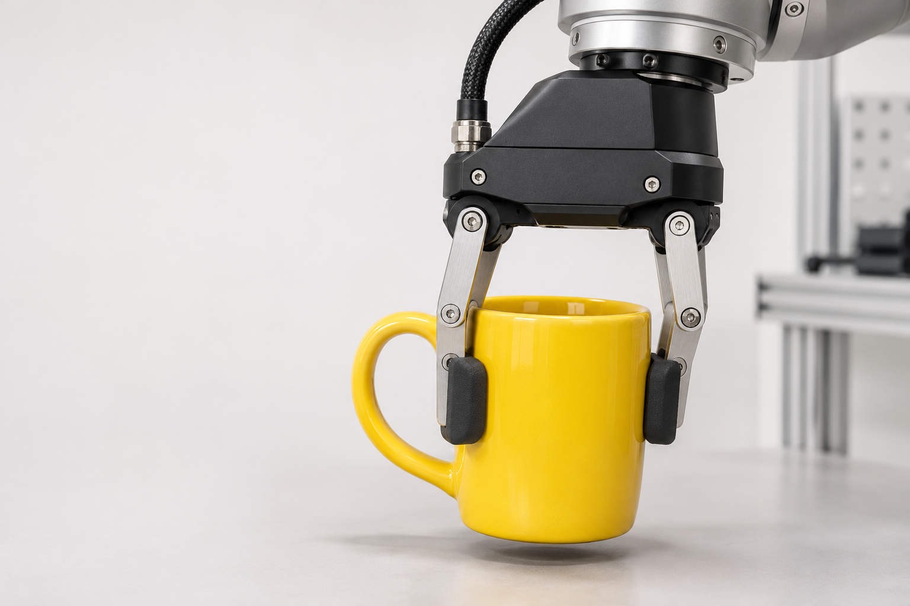
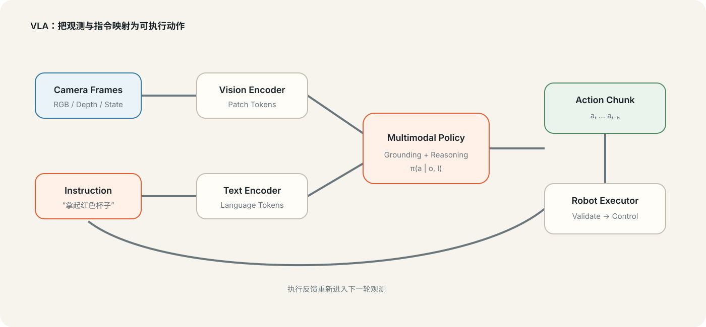
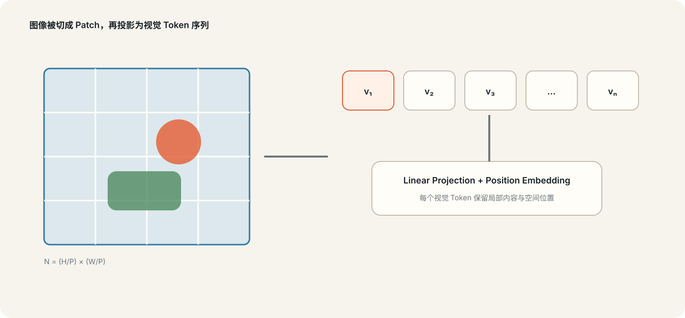
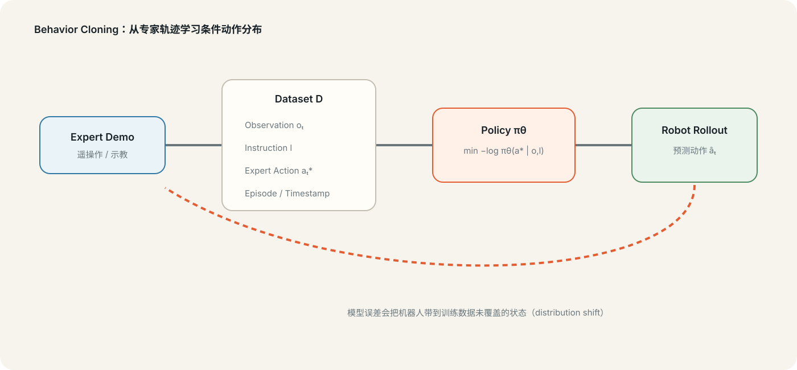
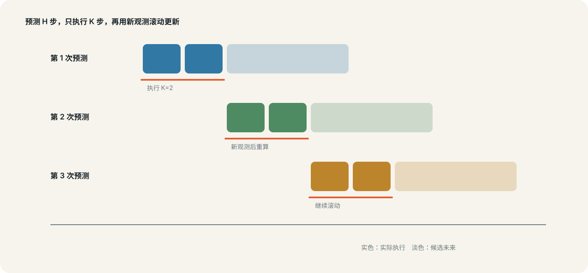
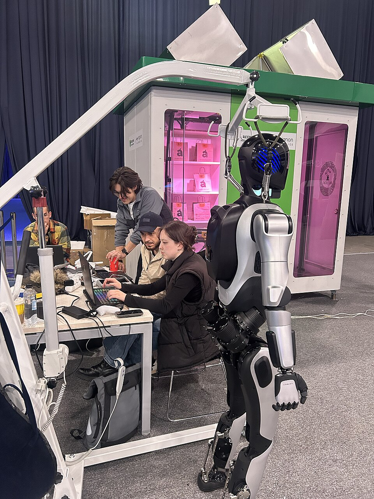
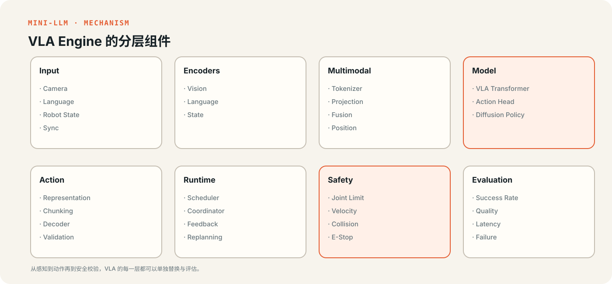
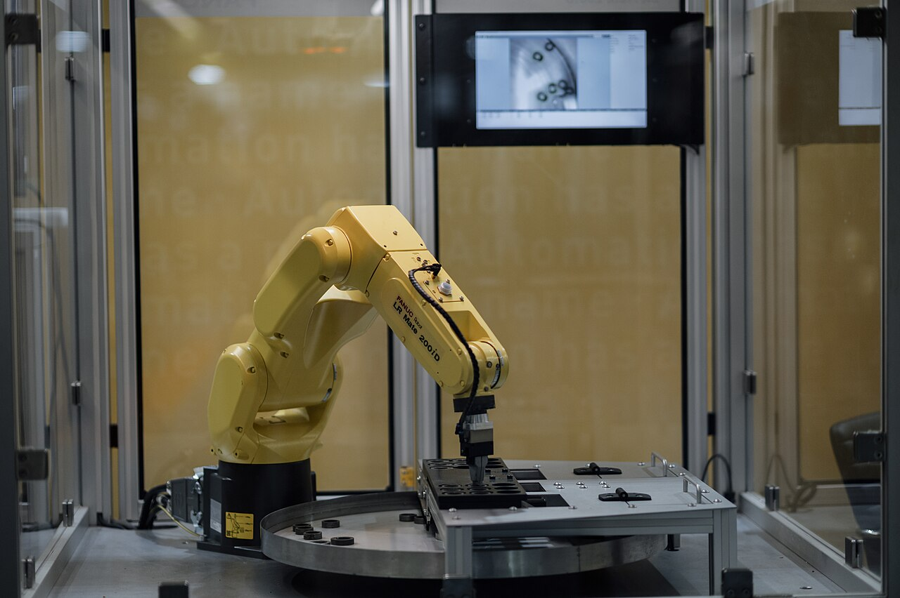

# **《mini-llm VLA Engine 深度解析：从 Vision-Language-Action、Multimodal Tokenization 到 Action Chunking、Behavior Cloning 与 Robot Foundation Model》**

在前面的 Robotics Engine 中，我们讨论了机器人如何理解自身的运动结构、计算关节位置、规划运动路径，以及通过控制算法完成抓取和操作。

但这里还存在一个关键问题：

**机器人如何理解人类的自然语言指令，并根据摄像头看到的环境，决定自己应该执行什么动作？**

例如，人类对机器人说：

> 请把桌子上的红色杯子拿起来，放到左边的托盘里。

机器人需要完成一系列复杂任务：

1. 通过摄像头识别桌子、杯子和托盘。
2. 理解“红色杯子”“左边”“放到托盘里”等语言信息。
3. 将语言描述与视觉对象建立对应关系。
4. 判断当前机器人是否能够够到杯子。
5. 规划抓取和移动动作。
6. 生成机械臂、夹爪等设备能够执行的控制指令。
7. 根据执行结果不断调整动作。

这不是单纯的视觉识别问题，也不是单纯的语言理解问题，更不是传统机器人运动规划能够独立解决的问题。

它需要将三种能力结合起来：

- **Vision：视觉感知世界。**
- **Language：理解人类指令。**
- **Action：生成并执行机器人动作。**

这就是 VLA（Vision-Language-Action）。

本篇核心主题

**让大模型不仅能够理解世界，还能够根据世界状态生成可执行的动作。**

## **一、VLA Engine：什么是 Vision-Language-Action？**



_图：VLA 的目标不是描述画面，而是把视觉观测与语言指令转化为机器人能够执行的动作。本文照片式插图由 AI 生成。_

### **1. 从 LLM 到 VLM，再到 VLA**

我们可以将 AI 模型的发展分为三个层次。

**LLM：Large Language Model**

输入文本，输出文本。

主要解决语言理解、知识表达、推理和文本生成问题。

**VLM：Vision-Language Model**

输入图像和文本，输出文本或其他模型表示。

让模型能够理解图像内容，并结合语言进行推理。

**VLA：Vision-Language-Action Model**

输入视觉、语言以及机器人状态，输出机器人动作。

让模型能够从感知和指令走向物理世界中的行动。

三者最重要的区别：

| 模型  | 输入          | 主要输出  | 核心能力    |
| --- | ----------- | ----- | ------- |
| LLM | 文本          | 文本    | 语言理解与生成 |
| VLM | 图像、文本       | 文本或特征 | 多模态理解   |
| VLA | 图像、文本、机器人状态 | 动作    | 具身任务执行  |

需要注意：VLA 并不意味着模型必须直接输出电机电流。它可以输出关节目标、末端执行器位姿、动作序列，或者更高层的动作表示，再由 Robotics Engine 转换成实际控制命令。

### **2. VLA 的数学定义**

可以把 VLA 看作一个条件动作生成模型。

定义：

- \\(I_t\\)：时刻 \\(t\\) 的视觉输入。
- \\(L\\)：自然语言任务指令。
- \\(S_t\\)：机器人当前状态。
- \\(A_t\\)：机器人需要执行的动作。

那么：

\\[ A_t \sim \pi\_\theta(A_t\mid I_t,L,S_t) \\]

其中：

- \\(\pi\_\theta\\)：VLA 模型学习得到的策略。
- \\(\theta\\)：模型参数。
- \\(A_t\\)：根据当前环境和任务生成的动作。

如果模型一次生成一段动作：

\\[ A\_{t:t+H} \sim \pi\_\theta(A\_{t:t+H}\mid I_t,L,S_t) \\]

这里的 \\(H\\) 就是 Action Chunk 的长度。

这意味着 VLA 不再只是回答：

> 我看到了一个杯子。

而是进一步生成：

> 将机械臂移动到杯子附近，调整末端姿态，闭合夹爪，然后抬起机械臂。

当然，这些动作仍然需要经过机器人运动学、动力学和安全控制系统的检查。

## **二、VLA 的整体架构**



_图：摄像头、机器人状态和语言指令被编码为多模态 Token，策略模型输出动作块，经安全验证后交给执行器。_

一个典型 VLA 系统可以拆分成六个主要部分。

整体数据流：

```
                 Human Instruction
                        |
                        v
                 Language Encoder
                        |
                        |
Camera Input            |
     |                  |
     v                  |
 Vision Encoder         |
     |                  |
     +--------+---------+
              |
              v
       Multimodal Fusion
              |
              v
       VLA Transformer
              |
              v
        Action Decoder
              |
              v
        Action Chunk
              |
              v
        Robotics Engine
              |
              v
        Motion Controller
              |
              v
           Robot
              |
              v
       New Observation
              |
              +------> Feedback Loop
```

各模块职责：

| 模块                | 主要职责           |
| ----------------- | -------------- |
| Vision Encoder    | 将摄像头图像转换为视觉特征  |
| Language Encoder  | 将自然语言指令转换为语言特征 |
| Multimodal Fusion | 融合视觉、语言和机器人状态  |
| VLA Transformer   | 学习任务与动作之间的关系   |
| Action Decoder    | 将模型表示转换为动作     |
| Robotics Engine   | 检查、规划和执行动作     |

这里有一个非常重要的设计原则：

**VLA 负责决定做什么，Robotics Engine 负责确保动作在机器人系统中能够执行。**

两者不能混为一谈。

# **三、Vision Encoder：机器人如何理解摄像头图像？**

## **1. 摄像头看到的是什么？**

假设机器人摄像头拍摄到这样一个场景：

摄像头产生的是图像矩阵：

\\[ I \in \mathbb{R}^{H\times W\times C} \\]

其中：

- \\(H\\)：图像高度。
- \\(W\\)：图像宽度。
- \\(C\\)：颜色通道数量。

对于 RGB 图像：

\\[ C=3 \\]

例如，一张 224×224 的 RGB 图像：

\\[ I\in\mathbb{R}^{224\times224\times3} \\]

但 Transformer 并不能直接像人一样理解这张图像。

因此，需要先通过 Vision Encoder 提取视觉特征。

## **2. Image Patch：把图像切分成视觉 Token**



_图：输入图像按固定网格切成 Patch，经线性投影和位置编码后形成视觉 Token 序列。_

一种经典方法是 Vision Transformer（ViT）。

假设输入图像大小为：

\\[ 224\times224 \\]

将其切分成：

\\[ 16\times16 \\]

大小的 Patch。

那么：

\\[ N=\frac{224}{16}\times\frac{224}{16}=196 \\]

也就是说，一张图像被切分为 196 个视觉 Patch。

每个 Patch 会经过线性投影，转换成一个向量：

\\[ x_i=W_p\cdot Flatten(Patch_i) \\]

然后加上位置编码：

\\[ z_i=x_i+p_i \\]

最终得到视觉 Token 序列：

\\[ Z=[z_1,z_2,\ldots,z\_{196}] \\]

这一步非常重要。

原始图像是像素数据，经过 Vision Encoder 后变成模型可以处理的向量序列。

## **3. Vision Encoder 不只是识别物体**

传统计算机视觉系统可能主要关注：

- 物体检测。
- 图像分类。
- 目标分割。
- 关键点识别。
- 深度估计。

而 VLA 需要学习更加丰富的视觉信息。

例如：

| 视觉信息 | 对机器人操作的意义    |
| ---- | ------------ |
| 物体类别 | 知道目标是杯子      |
| 物体位置 | 知道杯子在哪里      |
| 物体姿态 | 知道杯子如何摆放     |
| 物体形状 | 判断适合从哪里抓取    |
| 空间关系 | 判断杯子和托盘的相对位置 |
| 场景状态 | 判断是否存在障碍物    |
| 时间变化 | 判断物体是否正在移动   |

需要注意，视觉编码器输出的特征并不天然等于精确的三维坐标。机器人通常还需要深度传感器、相机标定、视觉定位、几何计算等模块。

## **4. 多摄像头输入**

实际机器人可能具有：

- 头部摄像头。
- 手腕摄像头。
- 环境摄像头。
- 深度摄像头。

因此，视觉输入可以扩展为：

\\[ I_t= \\{I_t^{front},I_t^{wrist},I_t^{depth}\\} \\]

不同摄像头提供不同视角的信息。

例如：

- 前置摄像头观察整个桌面。
- 手腕摄像头观察夹爪附近的细节。
- 深度摄像头提供空间深度信息。

VLA 可以融合这些信息，但必须处理摄像头时间同步、坐标系转换、视角差异和遮挡问题。

# **四、Language Conditioning：机器人如何理解人类指令？**

## **1. 自然语言不是动作命令**

用户说：

> 把红色杯子放到左边的托盘里。

这句话包含多个语义元素：

```
Task:
  Action: Move

  Target:
    Object: Cup
    Attribute: Red

  Destination:
    Object: Tray
    Relation: Left

  Goal:
    Place cup into tray
```

这里存在几个不同层次：

1. 识别动作意图：移动、抓取、放置。
2. 识别目标对象：红色杯子。
3. 识别目标位置：左边托盘。
4. 建立对象之间的空间关系。
5. 将语言任务转化为机器人可以执行的目标。

Language Encoder 可以把指令转换为向量：

\\[ L=Encoder\_{lang}(Instruction) \\]

例如：

\\[ Instruction= \text{"Pick up the red cup and place it on the tray"} \\]

经过编码后：

\\[ L\in\mathbb{R}^{N\times d} \\]

其中：

- \\(N\\)：语言 Token 数量。
- \\(d\\)：隐藏向量维度。

这些向量将与视觉特征一起进入多模态模型。

## **2. Language Grounding：语言与真实物体建立联系**

这是 VLA 的关键能力之一。

例如，机器人看到三个杯子：

人类说：

> 把红色杯子拿起来。

模型需要将语言中的：

\\[ \text{Red Cup} \\]

映射到视觉场景中的具体对象。

这个过程叫作 Language Grounding。

它解决的问题是：

**语言中的概念，如何与真实世界中的对象和位置建立对应关系？**

Grounding 不只是文字和图像的相似度匹配，还涉及：

- 对象身份。
- 属性。
- 空间关系。
- 任务上下文。
- 对象状态。
- 目标约束。

如果视觉场景中有两个红色杯子，模型可能还需要进一步确认目标。

这说明 VLA 不仅需要理解语言，还需要处理语言中的歧义。

# **五、Multimodal Tokenization：如何统一视觉、语言和动作？**

这是 VLA 架构中非常核心的一部分。

LLM 通常处理文本 Token，而 VLA 需要处理不同类型的数据。

例如：

```
Vision Tokens:
  [V1, V2, V3, ...]

Language Tokens:
  [L1, L2, L3, ...]

Robot State:
  [S1, S2, S3, ...]

Action Tokens:
  [A1, A2, A3, ...]
```

这些数据的结构并不一样。

| 类型          | 原始数据      | 模型表示          |
| ----------- | --------- | ------------- |
| Vision      | 图像像素      | 视觉向量          |
| Language    | 文本        | 语言 Token      |
| Robot State | 关节位置、速度等  | 状态向量          |
| Action      | 位置、速度、力矩等 | 连续向量或离散 Token |

## **1. 多模态融合**

一种典型方式是将不同模态投影到统一隐藏维度：

\\[ Z_v=f_v(I) \\]

\\[ Z_l=f_l(L) \\]

\\[ Z_s=f_s(S) \\]

然后组合：

\\[ Z=[Z_v;Z_l;Z_s] \\]

这里的分号表示序列拼接。

之后进入 Transformer：

\\[ H=Transformer(Z) \\]

模型通过 Attention 学习不同模态之间的关系。

例如：

- 哪些视觉区域与语言指令有关？
- 哪个对象是当前任务目标？
- 机器人目前处于什么状态？
- 当前动作应该朝哪个方向变化？

## **2. Action Tokenization：动作如何变成 Token？**

动作与文字有一个本质区别。

文本通常是离散的：

```
Pick
up
the
cup
```

而机器人动作往往是连续的。

例如机械臂的关节位置：

\\[ q= [q_1,q_2,q_3,q_4,q_5,q_6] \\]

每个关节角度都可能是连续值。

因此，VLA 有两种常见动作表示方式。

**方式一：连续动作输出**

直接输出：

\\[ A_t\in\mathbb{R}^{d_a} \\]

例如：

```
action = {    "joint_positions": [0.2, -0.4, 0.6, 0.1, 0.3, 0.0],    "gripper": 0.8}
```

**方式二：离散动作 Token**

将连续动作空间进行量化。

例如：

```
ACTION_001
ACTION_002
ACTION_003
...
```

模型通过分类或自回归预测动作 Token。

离散动作 Token 有利于复用语言模型的序列建模能力，但量化可能损失动作精度。

因此，不同 VLA 模型可能采用：

- 离散动作 Token。
- 连续动作回归头。
- 混合离散与连续输出。
- 基于扩散模型的动作生成。

不存在一种方法适合所有机器人任务。

# **六、Action Representation：机器人动作究竟如何表示？**

如果模型输出动作不准确，机器人就无法正确执行。

因此，Action Representation 是 VLA 与 Robotics Engine 之间的重要接口。

## **1. 关节空间动作**

对于一个六自由度机械臂：

\\[ q= [q_1,q_2,q_3,q_4,q_5,q_6] \\]

模型可以预测目标关节角度：

\\[ A_t=q\_{t+1} \\]

也可以预测关节速度：

\\[ A_t=\dot q_t \\]

或者关节力矩：

\\[ A_t=\tau_t \\]

三者代表不同的控制语义。

| 动作类型     | 含义     |
| -------- | ------ |
| Position | 目标关节位置 |
| Velocity | 目标关节速度 |
| Torque   | 目标关节力矩 |

直接预测力矩通常对模型精度、动力学建模和安全控制要求更高。

## **2. 末端执行器动作**

另一种方式是让模型预测机械臂末端的位置和姿态。

例如：

\\[ T= \begin{bmatrix} R & p\\\ 0 & 1 \end{bmatrix} \\]

其中：

- \\(R\\)：末端执行器旋转矩阵。
- \\(p\\)：末端执行器三维位置。

模型输出：

```
action = {    "position": [0.32, 0.15, 0.28],    "orientation": [0.0, 0.0, 0.0, 1.0],    "gripper": 0.0}
```

这里的四元数表示姿态。

随后 Robotics Engine 通过逆运动学计算对应的关节目标。

## **3. 高层动作与低层动作**

我们还可以将动作分为两个层次。

**High-level Action**

# **抓取红色杯子**

任务级语义动作

**Mid-level Action**

- 移动到杯子上方
- 调整末端姿态
- 接近杯子
- 闭合夹爪

**Low-level Control**

- 关节位置
- 关节速度
- 电机力矩
- 夹爪控制

VLA 更适合负责高层和部分中层动作生成。

真正的实时控制通常由 Robotics Engine 和底层控制器完成。

# **七、Behavior Cloning：如何让机器人从演示中学习？**



_图：专家示教产生观测—指令—动作数据；策略通过监督学习模仿专家，但部署后的误差会带来分布偏移。_

VLA 的重要训练方法之一是 Behavior Cloning（行为克隆）。

它的核心思想非常简单：

**让机器人观察人类或专家机器人如何完成任务，然后模仿这些行为。**

## **1. 专家演示数据**

假设我们希望机器人学会抓杯子。

人类操作机械臂完成一次抓取，系统记录：

```
Observation 1:
  Camera Image
  Robot State

Action 1:
  Move Arm Forward

Observation 2:
  Camera Image
  Robot State

Action 2:
  Lower Arm

Observation 3:
  Camera Image
  Robot State

Action 3:
  Close Gripper

Observation 4:
  Camera Image
  Robot State

Action 4:
  Lift Arm
```

一条完整轨迹可以表示为：

\\[ \tau= (o_1,a_1,o_2,a_2,\ldots,o_T,a_T) \\]

其中：

- \\(o_t\\)：观察。
- \\(a_t\\)：专家动作。
- \\(T\\)：轨迹长度。

大量这样的轨迹就形成了机器人训练数据集。

## **2. Behavior Cloning 的训练目标**

训练数据可以表示为：

\\[ D=\\{(o_i,a_i)\\}\_{i=1}^{N} \\]

模型学习：

\\[ \pi\_\theta(a\mid o) \\]

目标是让模型输出尽可能接近专家动作。

对于连续动作，常见的训练目标是均方误差：

\\[ L(\theta)= \frac{1}{N} \sum\_{i=1}^{N} \left\\| a_i-\hat a_i \right\\|^2 \\]

其中：

- \\(a_i\\)：专家动作。
- \\(\hat a_i\\)：模型预测动作。

对于离散动作，可以使用交叉熵损失。

对于复杂的连续动作分布，也可以使用概率模型或扩散模型。

## **3. 为什么 Behavior Cloning 会失败？**

假设专家机器人总是在正确位置抓杯子。

训练数据中，机器人几乎没有出现过偏离目标的情况。

但真实执行时，机器人可能发生一点偏差。

接下来：

1. 机器人没有到达专家演示中的位置。
2. 摄像头观察到一个训练数据中很少出现的状态。
3. 模型仍然根据训练分布生成动作。
4. 动作产生新的偏差。
5. 偏差不断累积。

这就是分布偏移（Distribution Shift）问题。

Behavior Cloning 通常存在一个重要局限：

**训练时看到的状态分布，不一定等于部署时模型自己执行后遇到的状态分布。**

## **4. DAgger：让模型学习自己造成的错误**

一种经典改进方法是 DAgger（Dataset Aggregation）。

基本流程：

```
专家演示数据
      |
      v
训练初始策略
      |
      v
机器人自主执行
      |
      v
收集模型遇到的新状态
      |
      v
专家提供正确动作标签
      |
      v
加入训练数据集
      |
      v
重新训练模型
```

这样，模型不再只学习理想情况下的操作，而是逐渐学习如何处理自己执行过程中遇到的偏差。

不过，DAgger 需要专家能够对采集到的状态提供正确动作标签，也需要合理设计数据采集和安全机制。

# **八、Action Chunking：为什么机器人需要一次预测一段动作？**



_图：模型预测未来 H 步动作，但只执行前 K 步；随后根据新观测重新预测，形成滚动时域控制。_

这是现代 VLA 非常重要的设计方向。

## **1. 逐步预测动作的问题**

假设机器人需要执行：

```
1. 移动到杯子上方
2. 降低机械臂
3. 闭合夹爪
4. 抬起杯子
5. 移动到托盘
6. 放下杯子
```

如果每个动作都需要单独调用一次大模型：

```
Observation
    |
    v
Model Inference
    |
    v
Action 1
    |
    v
Observation
    |
    v
Model Inference
    |
    v
Action 2
    |
    v
...
```

就可能出现：

- 推理延迟较高。
- 频繁调用模型。
- 动作不够连贯。
- 网络通信开销较大。
- 控制周期难以稳定。

尤其当模型运行在远程服务器时，频繁推理可能成为系统瓶颈。

## **2. Action Chunking 的基本思想**

Action Chunking 不再每次只预测一个动作，而是一次预测一段动作。

\\[ A_t= [a_t,a\_{t+1},\ldots,a\_{t+H-1}] \\]

其中 \\(H\\) 表示动作块长度。

例如：

```
action_chunk = [    [0.10, 0.20, 0.30],    [0.11, 0.21, 0.31],    [0.12, 0.22, 0.32],    [0.13, 0.23, 0.33],]
```

模型一次输出多个连续动作。

机器人可以先执行其中一部分，然后重新观察环境并生成下一段动作。

## **3. Receding Horizon：滚动执行**

一个实用的策略是：

- 模型预测未来 \\(H\\) 步。
- 控制器只执行其中前 \\(K\\) 步。
- 重新获取视觉观察。
- 再预测下一段动作。

其中：

\\[ K\leq H \\]

这类似于滚动时域控制的思想。

```
第 1 次预测：
[A1, A2, A3, A4, A5]

实际执行：
[A1, A2]

重新观察环境

第 2 次预测：
[A3', A4', A5', A6', A7']

实际执行：
[A3', A4']
```

这样可以在动作连贯性和环境反馈之间取得平衡。

## **4. Action Chunking 的参数**

| 参数          | 含义     | 影响          |
| ----------- | ------ | ----------- |
| H           | 预测动作长度 | 越大，预测范围越长   |
| K           | 实际执行长度 | 越大，重新规划频率越低 |
| Δt          | 动作时间间隔 | 决定动作时间分辨率   |
| Replan Rate | 重新规划频率 | 决定反馈更新速度    |

例如：

- 模型预测未来 20 步。
- 每一步对应 50ms。
- 每次执行前 4 步。

那么：

\\[ H\Delta t=20\times50ms=1s \\]

实际每次执行：

\\[ K\Delta t=4\times50ms=200ms \\]

机器人执行 200ms 后重新观察和规划。

这里的数字只是示例，并不是所有 VLA 模型的通用配置。

## **5. Action Chunking 的风险**

预测越长，并不意味着一定越好。

如果环境发生变化，例如：

- 杯子突然被移动。
- 人的手进入机械臂工作区域。
- 夹爪没有成功抓住杯子。
- 机械臂遇到意外阻力。

之前预测的动作就可能不再适用。

因此，VLA 必须支持：

- 动作中断。
- 动作重新规划。
- 预测结果过期处理。
- 安全约束检查。
- 执行反馈。

**Action Chunking 解决的是动作生成和执行效率问题，不是取消实时反馈。**

# **九、Diffusion Policy：如何利用扩散模型生成机器人动作？**

除了直接预测动作，另一条重要路线是 Diffusion Policy。

它将扩散模型的生成思想应用到机器人动作序列上。

## **1. 为什么直接预测动作不够？**

假设机器人需要抓取一个杯子。

可能存在多个正确的抓取方式：

- 从杯子左侧抓取。
- 从杯子右侧抓取。
- 从杯子上方抓取。

这意味着同一个观察状态可能对应多种合理动作。

如果模型使用简单的均方误差预测动作，可能倾向于输出多个动作之间的平均值。

但平均动作不一定是有效动作。

例如，两个不同方向的抓取动作取平均，可能得到一个无法完成抓取的轨迹。

这就是多模态动作分布问题。

## **2. 扩散模型如何生成动作？**

Diffusion Policy 的核心思想：

先对真实动作序列添加噪声，再训练模型逐步去除噪声。

假设真实动作序列为：

\\[ A_0 \\]

前向扩散过程：

\\[ A_k= \sqrt{\bar\alpha_k}A_0+ \sqrt{1-\bar\alpha_k}\epsilon \\]

其中：

- \\(A_0\\)：真实动作序列。
- \\(A_k\\)：第 \\(k\\) 步加噪后的动作。
- \\(\epsilon\\)：高斯噪声。
- \\(\bar\alpha_k\\)：噪声调度参数。

模型学习根据当前噪声动作和环境条件预测噪声：

\\[ \epsilon\_\theta(A_k,k,O) \\]

其中 \\(O\\) 表示视觉、语言或机器人状态等条件信息。

训练目标通常可以写为：

\\[ L(\theta)= \mathbb{E} \left[ \\|\epsilon-\epsilon\_\theta(A_k,k,O)\\|^2 \right] \\]

推理时，从噪声动作开始，经过多次去噪，得到最终动作序列。

## **3. Diffusion Policy 的优点**

- 能够表示多种可能的动作轨迹。
- 适合生成连续动作序列。
- 可以结合视觉条件。
- 能够学习复杂的动作分布。
- 不必把所有动作都压缩为单一确定性预测。

## **4. Diffusion Policy 的局限**

扩散生成通常需要多次去噪计算。

这会带来推理延迟。

对于要求高频控制的机器人系统，需要考虑：

- 去噪步数。
- 模型推理速度。
- 动作生成频率。
- GPU 资源。
- 轨迹安全性。
- 动作生成与控制执行之间的时间同步。

此外，扩散模型生成的动作并不会天然满足机器人关节限制、碰撞约束或动力学约束。

仍然需要 Robotics Engine 进行验证。

## **5. Diffusion Policy 与 Action Chunking 的关系**

两者不是互斥技术。

Diffusion Policy 可以生成一段动作序列：

\\[ A\_{t:t+H} \\]

因此，它可以和 Action Chunking 结合。

简单理解：

- Diffusion Policy：解决动作序列如何生成。
- Action Chunking：解决一次生成多少动作、执行多少动作。
- Robotics Engine：解决动作如何安全执行。

另外，Flow Matching 也是动作生成的重要路线，但它与经典扩散模型的训练和采样机制并不完全相同，不能简单视为同一个算法。

# **十、Robot Foundation Model：如何构建通用机器人基础模型？**



_图：通用机器人基础模型必须适应不同机体、传感器布局与动作空间，而不是假设所有机器人共享同一套控制接口。图片：ZhanatKappassov，Wikimedia Commons，CC0 1.0。_

传统机器人系统通常针对特定设备、特定任务进行开发。

例如：

```
Robot A:
  只负责抓取杯子

Robot B:
  只负责分拣零件

Robot C:
  只负责搬运物体
```

每种机器人可能需要单独开发控制逻辑和训练模型。

Robot Foundation Model 希望突破这种限制。

它希望通过大量、多样化的机器人数据，训练能够迁移到不同任务和设备上的基础模型。

## **1. 什么是 Robot Foundation Model？**

可以将它理解为：

**在大规模机器人交互数据上预训练，具备跨任务、跨场景或跨机器人迁移能力的基础模型。**

它可能学习：

- 物体操作。
- 空间关系。
- 机器人运动规律。
- 语言与动作的对应关系。
- 任务执行策略。
- 多步骤操作。
- 环境变化下的适应能力。

但需要注意，通用机器人基础模型不代表它能够直接控制所有机器人。

不同机器人可能具有不同的：

- 关节数量。
- 关节排列。
- 末端执行器。
- 运动范围。
- 动力学特征。
- 动作接口。

这些差异必须通过适配机制处理。

## **2. 为什么需要 Embodiment Conditioning？**

Embodiment 指机器人本身的形态和身体结构。

例如：

- **机械臂**：主要关注关节、末端执行器和抓取
- **人形机器人**：涉及双臂、双腿、平衡和全身协调
- **移动机器人**：主要关注移动、定位和导航
- **不同夹爪**：不同抓取结构具有不同动作空间

\\[ A= \pi\_\theta(O,L,E) \\]

其中：

- \\(O\\)：环境观察。
- \\(L\\)：语言指令。
- \\(E\\)：机器人 Embodiment 信息。

Embodiment 信息可以包括：

- 机器人类型。
- 关节数量。
- 关节限制。
- 末端执行器类型。
- 动作空间定义。
- 运动学参数。

这让模型知道自己正在控制哪一种机器人。

## **3. Robot Foundation Model 的训练数据**

数据是 Robot Foundation Model 的关键基础。

常见数据来源包括：

| 数据类型      | 作用          |
| --------- | ----------- |
| 人类遥操作数据   | 学习专家动作      |
| 机器人自主执行数据 | 学习自主操作经验    |
| 仿真数据      | 扩大场景和任务范围   |
| 多摄像头数据    | 学习空间和视觉信息   |
| 语言任务数据    | 建立指令与动作关联   |
| 失败轨迹      | 学习错误状态和恢复策略 |

但数据规模并不是唯一决定因素。

数据质量、动作覆盖范围、机器人多样性、任务分布和真实环境代表性同样重要。

## **4. 从单任务到通用任务**

一个合理的训练路径：

```
单任务数据
    |
    v
单机器人模仿学习
    |
    v
多任务训练
    |
    v
多场景泛化
    |
    v
多机器人数据混合
    |
    v
Embodiment Conditioning
    |
    v
Robot Foundation Model
```

真正的跨机器人泛化仍然是一个困难的研究问题。

不能因为模型使用了多机器人数据，就认为它已经具备通用的物理操作能力。

# **十一、VLA 与 World Model、Planning、Robotics 的关系**

到这里，我们已经讨论了视觉、语言、动作生成、行为克隆、动作块和机器人基础模型。

但在 mini-llm 中，VLA 不应该独立存在。

它需要与其他 Engine 协作。

可以这样划分职责：

| Engine             | 主要职责           |
| ------------------ | -------------- |
| Vision Engine      | 识别和编码视觉信息      |
| Language Engine    | 理解语言指令         |
| World Model Engine | 表示环境状态与预测可能变化  |
| VLA Engine         | 根据观察和任务生成动作    |
| Planning Engine    | 进行任务分解和规划      |
| Robotics Engine    | 运动学、动力学和运动规划   |
| Simulation Engine  | 在模拟环境中测试行为     |
| Agent Engine       | 组织任务、工具和执行流程   |
| Safety Engine      | 执行权限、安全约束和风险控制 |

### **1. VLA 与 World Model**

World Model 关注：

> 当前世界是什么状态？如果执行某个动作，世界可能发生什么变化？

VLA 关注：

> 根据当前观察和任务，应该生成什么动作？

二者可以结合：

\\[ \hat S\_{t+1}=WorldModel(S_t,A_t) \\]

VLA 根据预测结果调整动作：

\\[ A_t=\pi\_\theta(S_t,L) \\]

但这里的 World Model 必须具有经过验证的预测能力。不能简单把 LLM 对未来的文字描述当成准确的物理仿真结果。

### **2. VLA 与 Planning Engine**

Planning Engine 更关注任务层面的规划。

例如：

```
任务：把杯子放进托盘

Planning Engine:
  1. 找到杯子
  2. 找到托盘
  3. 抓取杯子
  4. 移动到托盘
  5. 放下杯子

VLA Engine:
  根据当前视觉和机器人状态
  生成具体动作序列
```

Planning Engine 负责任务组织，VLA 负责将观察和任务转化为动作。

两者也可以交替工作，而不是严格单向调用。

### **3. VLA 与 Robotics Engine**

这是最重要的工程边界。

VLA 可以输出：

```
{    "position": [0.3, 0.2, 0.4],    "orientation": [0.0, 0.0, 0.0, 1.0],    "gripper": 0.8}
```

Robotics Engine 需要检查：

- 坐标系是否正确。
- 位置是否在机械臂工作范围内。
- 姿态是否可达。
- 关节是否超过限制。
- 运动轨迹是否存在碰撞。
- 速度和加速度是否符合限制。
- 当前设备是否允许执行该动作。

只有通过检查，才可以交给底层控制器。

**不能让 VLA 直接绕过 Robotics Engine 控制电机。**

# **十二、mini-llm VLA Engine 的工程架构**

现在将理论转换为实际软件设计。

## **1. 推荐架构**

建议采用以下模块：



_图：VLA Engine 的八个组件层：输入、编码器、多模态、模型、动作、运行时、安全与评估。_

## **2. 推荐工程目录**

```
mini-llm/
│
├── engines/
│   │
│   ├── vision/
│   │   ├── encoder/
│   │   ├── detection/
│   │   └── spatial/
│   │
│   ├── language/
│   │   ├── encoder/
│   │   └── instruction/
│   │
│   ├── vla/
│   │   ├── input/
│   │   │   ├── camera.py
│   │   │   ├── language.py
│   │   │   └── robot_state.py
│   │   │
│   │   ├── encoders/
│   │   │   ├── vision_encoder.py
│   │   │   ├── language_encoder.py
│   │   │   └── state_encoder.py
│   │   │
│   │   ├── multimodal/
│   │   │   ├── tokenizer.py
│   │   │   ├── projector.py
│   │   │   └── fusion.py
│   │   │
│   │   ├── model/
│   │   │   ├── transformer.py
│   │   │   ├── action_head.py
│   │   │   └── diffusion_policy.py
│   │   │
│   │   ├── action/
│   │   │   ├── representation.py
│   │   │   ├── chunking.py
│   │   │   └── decoder.py
│   │   │
│   │   ├── runtime/
│   │   │   ├── inference.py
│   │   │   ├── scheduler.py
│   │   │   └── feedback.py
│   │   │
│   │   ├── safety/
│   │   │   ├── validator.py
│   │   │   └── constraints.py
│   │   │
│   │   └── evaluation/
│   │       ├── task_metrics.py
│   │       └── action_metrics.py
│   │
│   └── robotics/
│
├── datasets/
│   ├── demonstrations/
│   ├── trajectories/
│   └── simulation/
│
├── training/
│   ├── behavior_cloning/
│   ├── diffusion/
│   └── evaluation/
│
└── examples/
    ├── pick_place/
    └── tabletop_manipulation/
```

这里需要强调：Vision、Language、Robotics 可以是独立 Engine，也可以由 VLA Engine 复用外部模型和服务，不必在 VLA 内重复实现所有能力。

# **十三、VLA Engine 的核心接口设计**

VLA Engine 最重要的是定义稳定的数据接口。

### **1. Observation**

```
from dataclasses import dataclassfrom typing import Optionalimport numpy as np@dataclassclass Observation:    rgb: np.ndarray    depth: Optional[np.ndarray]    joint_positions: np.ndarray    joint_velocities: np.ndarray    timestamp: float
```

### **2. Task Instruction**

```
@dataclassclass TaskInstruction:    instruction: str    task_id: str
```

### **3. Action Chunk**

```
@dataclassclass ActionChunk:    actions: np.ndarray    start_timestamp: float    dt: float    coordinate_frame: str    action_type: str
```

这里需要特别注意：

- `coordinate_frame` 必须明确。
- `action_type` 必须明确。
- `dt` 表示动作时间间隔。
- 时间戳用于检查动作是否过期。

### **4. VLA Model**

```
class VLAEngine:    def __init__(        self,        vision_encoder,        language_encoder,        state_encoder,        transformer,        action_head    ):        self.vision_encoder = vision_encoder        self.language_encoder = language_encoder        self.state_encoder = state_encoder        self.transformer = transformer        self.action_head = action_head    def predict(self, observation, instruction):        vision_features = (            self.vision_encoder(observation.rgb)        )        language_features = (            self.language_encoder(instruction.instruction)        )        state_features = (            self.state_encoder(                observation.joint_positions,                observation.joint_velocities            )        )        features = self.fuse(            vision_features,            language_features,
```

这是用于解释模块关系的简化接口，不是可以直接控制真实机械臂的完整实现。

实际系统还需要：

- 输入归一化。
- 视觉与状态时间同步。
- 机器人状态校验。
- 模型推理超时处理。
- 动作反归一化。
- 坐标系转换。
- 安全检查。
- 执行反馈。

# **十四、VLA Engine 应该如何训练和测试？**



_图：VLA 的离线指标必须结合仿真回放、实验室闭环测试和低风险真实设备验证。图片：Nenad Stojković，Wikimedia Commons，CC BY 2.0。_

建议不要一开始就训练一个完整的通用机器人模型。

可以采用渐进式路线。

## **V1：单机器人、单任务、仿真环境**

推荐起点

先实现一个最小任务：

**让机械臂根据自然语言指令，抓取桌面上的指定物体。**

例如：

```
Instruction:
  Pick up the red cup.

Observation:
  RGB Image
  Robot Joint State

Output:
  Action Chunk
```

V1 暂时不追求跨机器人泛化。

重点验证完整链路：

```
摄像头
  |
  v
视觉编码
  |
  v
语言理解
  |
  v
多模态融合
  |
  v
动作预测
  |
  v
动作校验
  |
  v
仿真机器人执行
  |
  v
结果反馈
```

## **V2：Behavior Cloning**

采集专家演示数据。

训练：

\\[ \pi\_\theta(A\mid O,L,S) \\]

评估：

- 抓取成功率。
- 放置成功率。
- 动作误差。
- 任务完成时间。
- 不同物体的泛化能力。

## **V3：Action Chunking**

加入动作块预测。

测试：

- 不同 Chunk Horizon。
- 不同执行窗口。
- 不同重新规划频率。
- 环境变化时的恢复能力。

## **V4：Diffusion Policy**

针对动作具有多种合理解的任务，引入扩散策略。

对比：

- 直接动作回归。
- 自回归动作预测。
- Diffusion Policy。

重点比较动作质量、生成延迟和成功率。

## **V5：多任务与多机器人**

逐步扩展：

- 多种物体。
- 多种抓取方式。
- 多种放置任务。
- 不同光照和场景。
- 不同机器人结构。

最后再考虑 Robot Foundation Model。

# **十五、VLA Engine 的评价指标**

VLA 不能只使用语言模型的 Accuracy 或 Perplexity 来衡量。

因为它最终需要完成物理任务。

建议建立以下指标。

| 指标                        | 解释            |
| ------------------------- | ------------- |
| Task Success Rate         | 任务成功率         |
| Object Grounding Accuracy | 目标对象定位准确率     |
| Action Prediction Error   | 动作预测误差        |
| Trajectory Smoothness     | 轨迹平滑程度        |
| Collision Rate            | 碰撞发生率         |
| Recovery Rate             | 异常恢复成功率       |
| Inference Latency         | 模型推理延迟        |
| End-to-end Latency        | 从观察到动作执行的整体延迟 |
| Generalization Rate       | 新物体、新场景下的成功率  |

例如，任务成功率：

\\[ SuccessRate= \frac{N\_{success}}{N\_{total}} \\]

动作预测误差：

\\[ MAE= \frac{1}{N} \sum\_{i=1}^{N} |a_i-\hat a_i| \\]

但要注意：

动作预测误差低，并不一定代表任务成功率高。

同一个物体可能存在多种正确抓取方式，模型生成的动作与专家动作不同，也可能成功完成任务。

因此，最终评价必须包含真实任务执行结果，而不是只看动作与标签的差异。

# **十六、安全问题：VLA 不能直接控制真实世界**

这是整个架构中最重要的工程原则之一。

VLA 模型输出的动作只是预测结果，不是可信的控制命令。

例如：

```
{    "joint_positions": [        100.0,        -200.0,        300.0    ]}
```

模型可能输出不合理的数值。

如果直接交给机器人，可能产生严重后果。

因此必须设置独立的安全边界。

**动作安全执行链路**

VLA Model Output

**Action Validator**

- 数据结构检查
- 坐标系检查
- 单位检查
- 时间戳检查

**Robotics Safety Layer**

- 关节限制
- 速度和加速度限制
- 工作空间限制
- 碰撞检查

**Motion Controller**

**Robot Execution**

**Emergency Stop：独立于 VLA 模型的紧急停止机制**

还应考虑：

1. 模型推理超时，不能继续使用过期动作。
2. 摄像头数据异常，不能继续执行依赖该数据的动作。
3. 机器人反馈与预测状态不一致，应暂停或重新规划。
4. 碰撞检查失败，应拒绝动作。
5. 人员进入危险区域，应由独立安全系统处理。
6. 真实设备需要硬件级急停和经过验证的安全控制机制。

**安全不能仅依靠 Prompt，也不能只依靠 VLA 模型自己判断。**

# **十七、mini-llm VLA Engine 的开源技术选型**

以下是可以研究的技术方向：

| 项目               | 主要用途          |
| ---------------- | ------------- |
| OpenVLA          | 开源 VLA 模型研究   |
| Octo             | 通用机器人策略研究     |
| Diffusion Policy | 连续动作生成        |
| LeRobot          | 数据采集、训练和机器人学习 |
| RoboMimic        | 模仿学习和行为克隆     |
| MuJoCo           | 机器人物理仿真       |
| Isaac Lab        | 大规模机器人仿真训练    |
| ROS 2            | 机器人通信和系统集成    |

相关资源：

-
-
-
-
-
-
-
-

这些项目解决的问题并不完全相同：有的是预训练模型，有的是策略学习框架，有的是数据工具或仿真平台。不能简单地把它们当成可以互相替换的 VLA 模型。

# **十八、最终总结：VLA 是让 AI 从认知走向行动的重要桥梁**

回顾整个 VLA Engine，我们可以将其归纳为一条完整链路：

```
          Human Instruction
                  |
                  v
           Language Encoder
                  |
                  |
Camera ----------+
   |              |
   v              |
Vision Encoder    |
   |              |
   +--------------+
          |
          v
    Multimodal Fusion
          |
          v
     VLA Transformer
          |
          v
     Action Decoder
          |
          v
     Action Chunking
          |
          v
     Safety Validation
          |
          v
     Robotics Engine
          |
          v
        Robot
          |
          v
    Environment Feedback
          |
          +------> Next Observation
```

这条链路体现了一个重要的变化：

传统语言模型主要处理符号和信息。

视觉语言模型进一步理解视觉世界。

VLA 则试图将视觉理解、语言理解和动作生成连接起来，让 AI 能够参与物理世界的任务执行。

但这并不意味着模型已经具备完整的人类智能，也不意味着它能够在所有环境中可靠地自主行动。

真正的机器人智能，需要模型、传感器、控制器、物理环境、反馈机制和安全系统共同工作。

## **mini-llm 各 Engine 的完整关系**

| Engine                  | 核心问题                  |
| ----------------------- | --------------------- |
| Tensor Engine           | 如何表示和计算张量？            |
| Autograd Engine         | 如何计算梯度？               |
| Neural Network Engine   | 如何构建神经网络？             |
| Transformer Engine      | 如何建模序列关系？             |
| Training Engine         | 如何训练模型？               |
| Representation Engine   | 如何形成内部表示？             |
| World Model Engine      | 如何表示和预测世界？            |
| Memory Engine           | 如何存储和检索经验？            |
| Knowledge Engine        | 如何组织结构化知识？            |
| Causal Reasoning Engine | 如何分析因果关系？             |
| Decision Engine         | 如何选择行动？               |
| Planning Engine         | 如何规划任务？               |
| Agent Engine            | 如何组织自主任务执行？           |
| Runtime Engine          | 如何执行任务？               |
| Simulation Engine       | 如何模拟环境？               |
| Robotics Engine         | 如何规划和控制机器人？           |
| **VLA Engine**          | **如何根据视觉和语言生成机器人动作？** |

## **下一篇建议**

接下来可以进入 mini-llm 的一个重要方向：

**《mini-llm Embodied Intelligence Engine 深度解析：从 Embodied AI、Perception-Action Loop 到 Active Perception、World Interaction 与 Autonomous Learning》**

这篇将进一步研究一个更深层的问题：

**智能为什么需要身体？**

当 AI 不再只是处理文本，而是拥有传感器、身体、行动能力，并且能够通过行动改变环境时，智能系统的结构会发生什么变化？

这将把此前研究的 World Model、Cognitive Architecture、Agent、VLA、Robotics 和 Simulation Engine 连接成一个更完整的具身智能架构。
