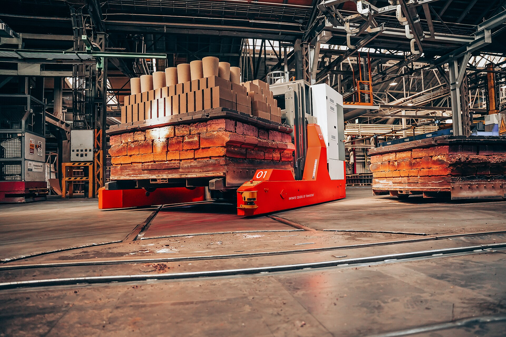
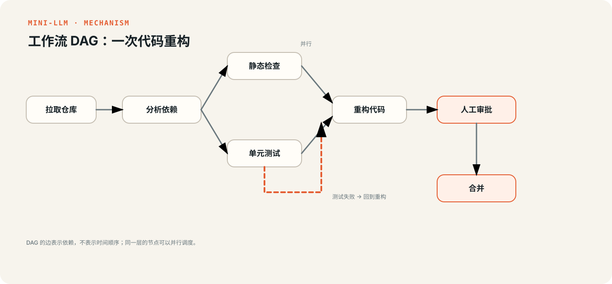
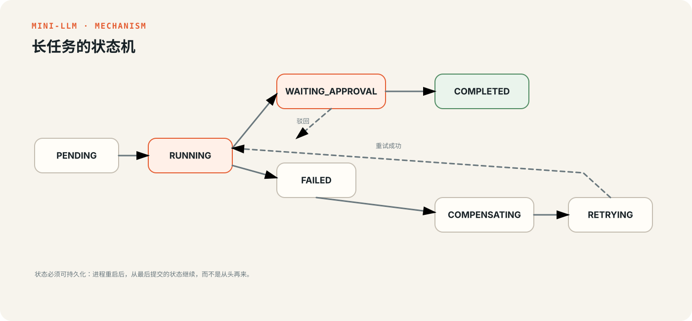
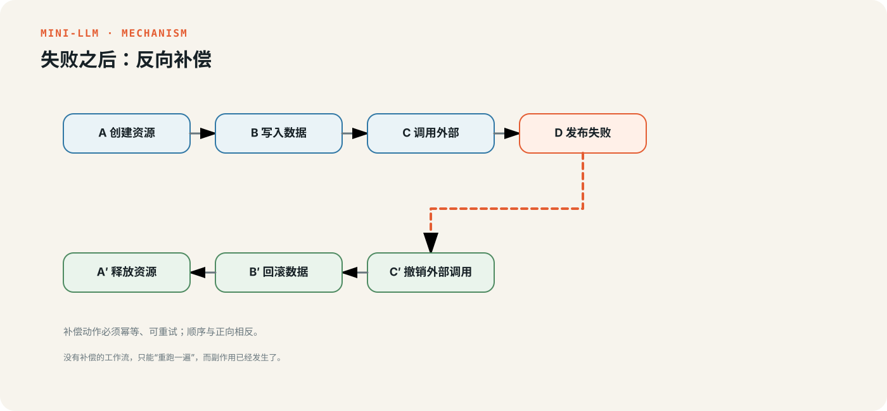

# **《mini-llm Workflow Engine 深度解析：从 DAG、Workflow Orchestration 到 State Machine、Event-Driven Execution 与 Human-in-the-Loop》**

在前面的 mini-llm 系列中，我们已经讨论了 Agent Engine、Runtime Engine、Protocol Engine、Memory Architecture、Distributed Agent Engine 等核心模块。

这些模块解决了不同的问题：

- **Agent Engine**：决定 Agent 要做什么。
- **Runtime Engine**：负责执行任务。
- **Protocol Engine**：负责 Agent 与工具、服务之间的通信。
- **Memory Architecture**：负责保存和检索历史信息。
- **Distributed Agent Engine**：负责跨节点调度和执行 Agent。
- **Workflow Engine**：负责把多个任务、Agent、工具和人工操作组织成一个完整、可恢复、可管理的业务流程。

这里存在一个值得思考的问题：

**当一个 Agent 需要完成一个包含几十个步骤、多个分支、并行任务、人工审批和外部系统交互的复杂目标时，究竟应该由谁管理整个执行过程？**

仅靠 Agent 自己不断调用工具是不够的。

我们需要一个独立的 Workflow Engine。



_图：工厂里的 AGV 按调度系统下发的任务搬运砖垛，走哪条路、什么时候让行、失败后回到哪一步，都由外部编排决定。工作流引擎处理的正是这类“谁在什么时候做什么”的问题。图片：ek robotics GmbH，[Wikimedia Commons](https://commons.wikimedia.org/wiki/File:Ek_robotics-agv-custom_move-rhi_magnesita-refractory_industry-rgb_%288%29.jpg)，[CC BY-SA 4.0](https://creativecommons.org/licenses/by-sa/4.0/)。_

# **一、Workflow Engine：为什么 Agent 需要工作流引擎？**

## **1.1 从单个 Agent 到复杂任务**

假设我们让 mini-llm 完成一个软件开发任务：

> 分析一个 GitHub 项目，理解其架构，发现潜在问题，制定重构方案，修改代码，运行测试，生成技术报告，最后等待人工审核。

这个任务实际上包含多个子任务：

1. 获取 GitHub 项目代码。
2. 分析项目目录。
3. 识别模块依赖。
4. 分析代码质量。
5. 识别架构问题。
6. 制定重构方案。
7. 修改代码。
8. 运行单元测试。
9. 运行集成测试。
10. 生成重构报告。
11. 等待人工审核。
12. 根据审核结果决定是否合并代码。

这些步骤之间存在复杂的依赖关系。

例如：

- 代码分析完成之后才能制定重构方案。
- 单元测试和静态代码检查可以并行执行。
- 如果测试失败，需要回到代码修改阶段。
- 如果人工审核不通过，需要重新修改。
- 如果人工审核通过，才允许合并代码。

这已经不是一个简单的 Agent 调用工具的过程。

它实际上是一个工作流。

## **1.2 Agent 与 Workflow 的区别**

| 比较维度 | Agent Engine   | Workflow Engine            |
| ---- | -------------- | -------------------------- |
| 核心职责 | 智能决策与行动        | 流程组织与控制                    |
| 主要关注 | 下一步应该做什么       | 整个流程如何执行                   |
| 执行方式 | 动态决策           | 节点、边、状态转换                  |
| 分支控制 | 根据上下文判断        | 根据条件定义分支                   |
| 并行执行 | 决定哪些任务可以并行     | 管理并行任务和汇合                  |
| 失败处理 | 尝试重新决策         | Retry、Timeout、Compensation |
| 人工审批 | 可以发起审批         | 管理审批等待和恢复                  |
| 持久化  | 保存 Agent 状态和记忆 | 保存完整工作流状态                  |

两者不是竞争关系，而是协作关系。

Agent 可以作为 Workflow 中的一个执行节点。

Workflow 也可以调用多个 Agent。

**Agent Engine 与 Workflow Engine 的协作关系**

- **Workflow Engine**：流程编排、状态管理、依赖控制、异常恢复
- **Agent Engine**：理解任务、推理、决策
- **Tool Executor**：调用工具、执行操作
- **External Systems**：Git、数据库、文件系统、API、CI/CD
- Workflow Engine 是一个能够管理整个执行过程的协调者。

# **二、DAG：如何表示复杂任务依赖？**



_图：一次代码重构工作流的 DAG。静态检查与单元测试可以并行，测试失败则回到重构节点——边表示依赖，不表示时间顺序。_

Workflow 最重要的基础之一是 DAG。

DAG 是 Directed Acyclic Graph，即有向无环图。

它由两部分组成：

- Node：节点，代表一个任务。
- Edge：边，代表任务之间的依赖关系。

## **2.1 为什么需要 DAG？**

假设一个软件项目需要完成以下工作：

- A：下载代码。
- B：分析目录。
- C：分析依赖关系。
- D：检查代码质量。
- E：制定重构方案。
- F：修改代码。
- G：执行测试。
- H：生成报告。

任务依赖如下：

```
       A
       |
       v
       B
      / \
     v   v
     C   D
      \ /
       v
       E
       |
       v
       F
       |
       v
       G
       |
       v
       H
```

这里：

- B 必须等待 A。
- C 和 D 必须等待 B。
- C 和 D 可以并行。
- E 必须等待 C 和 D。
- F 必须等待 E。

如果没有 DAG，系统可能只能按照固定顺序执行任务。

有了 DAG，Workflow Engine 就能理解任务之间的依赖关系，并自动决定哪些任务可以执行。

## **2.2 DAG 的数学表示**

可以定义一个工作流：

\\[ G=(V,E) \\]

其中：

- \\(V\\)：任务节点集合。
- \\(E\\)：依赖关系集合。

例如：

\\[ V=\\{A,B,C,D,E,F\\} \\]

\\[ E=\\{(A,B),(B,C),(B,D),(C,E),(D,E),(E,F)\\} \\]

其中：

\\[ (A,B) \\]

表示 B 依赖 A。

DAG 必须满足：

\\[ G \text{ contains no directed cycle} \\]

也就是不能出现有向循环。

例如：

```
A → B → C → A
```

这不是 DAG。

为什么？

因为 C 等待 A，A 又等待 B，B 又等待 C。

三个任务永远无法按照依赖关系启动。

## **2.3 Topological Sorting：拓扑排序**

Workflow Engine 需要解决一个重要问题：

**如何确定哪些节点可以执行？**

这需要使用拓扑排序。

拓扑排序是一种将 DAG 中的节点排列成线性顺序的算法。

假设：

```
A → B
B → C
B → D
C → E
D → E
```

一种合法的拓扑排序为：

```
A → B → C → D → E
```

另一种合法顺序为：

```
A → B → D → C → E
```

注意，拓扑排序只保证依赖顺序，不代表实际执行必须串行。

C 和 D 可以同时执行。

常见实现方法：

- Kahn Algorithm：利用入度和队列。
- DFS：利用深度优先搜索和完成顺序。

Kahn 算法的基本逻辑：

```
function topologicalSort(graph: Graph) {
  const indegree = new Map<string, number>();

  for (const node of graph.nodes) {
    indegree.set(node.id, 0);
  }

  for (const edge of graph.edges) {
    indegree.set(
      edge.to,
      (indegree.get(edge.to) ?? 0) + 1
    );
  }

  const queue = graph.nodes
    .filter(node => indegree.get(node.id) === 0)
    .map(node => node.id);

  const result: string[] = [];

  while (queue.length > 0) {
    const current = queue.shift()!;

    result.push(current);

    for (const next of graph.getChildren(current)) {
      const degree = indegree.get(next)! - 1;

      indegree.set(next, degree);

      if (degree === 0) {
        queue.push(next);
      }
    }
  }

  if (result.length !== graph.nodes.length) {
    throw new Error("Workflow contains a cycle");
  }

  return result;
}
```

时间复杂度：

\\[ O(|V|+|E|) \\]

对于一般工作流系统，这已经足够高效。

## **2.4 DAG 如何支持并行执行？**

拓扑排序解决的是依赖顺序。

真正的并行调度还需要考虑：

1. 节点是否已经满足依赖条件。
2. 节点是否已经就绪。
3. 系统是否有可用资源。
4. 节点是否受到并发限制。
5. 节点是否满足权限和执行策略。

可以定义：

\\[ Ready(v)= \bigwedge\_{u\in Pred(v)} Success(u) \\]

其中：

- \\(Pred(v)\\) 表示节点 v 的所有前置节点。
- \\(Success(u)\\) 表示前置节点 u 已经成功。

当所有前置节点成功时，当前节点进入 Ready 状态。

实际系统还要支持条件边、失败策略和可选依赖，因此这个公式是基础模型，而不是完整调度规则。

# **三、Workflow Node：工作流节点的设计**

DAG 负责描述依赖关系。

Node 则负责描述具体任务。

## **3.1 Node 的基本结构**

一个 Workflow Node 可以包含：

```
interface WorkflowNode {
  id: string;

  type:
    | "agent"
    | "tool"
    | "condition"
    | "parallel"
    | "human"
    | "delay";

  name: string;

  inputs: Record<string, unknown>;

  outputs?: Record<string, unknown>;

  timeout?: number;

  retry?: RetryPolicy;

  dependencies: string[];
}
```

其中 type 表示节点类型。

不同节点具有不同职责。

## **3.2 六种常见节点**

- **Agent Node**：调用 Agent 完成需要推理和决策的任务。
- **Tool Node**：调用 API、数据库、文件系统或其他工具。
- **Condition Node**：根据条件判断选择不同执行路径。
- **Parallel Node**：同时启动多个可以独立执行的任务。
- **Human Node**：等待人工审批、补充信息或执行决策。
- **Delay Node**：等待指定时间或外部事件。

## **3.3 为什么 Agent Node 和 Tool Node 必须分开？**

例如：

```
分析代码
   |
   v
Agent Node
   |
   v
决定需要检查 Git 历史
   |
   v
Tool Node
   |
   v
执行 git log
```

Agent 负责决定是否调用工具。

Tool Node 负责实际执行工具。

这样设计有几个优点：

- 工具调用可以独立审计。
- 可以独立设置工具权限。
- 可以单独统计工具执行成本。
- 工具失败可以独立重试。
- 工具可以被不同 Agent 和 Workflow 复用。

**模型提出调用请求，不代表模型本身拥有执行权限。最终执行仍然需要经过 Runtime 和 Security 层。**

# **四、Workflow Orchestration：如何协调多个任务？**

Orchestration 的意思是编排。

Workflow Orchestration 就是由一个协调系统控制多个任务的启动、等待、执行和结束。

## **4.1 Orchestrator 架构**

- **Workflow Orchestrator**：工作流调度中心
- **DAG Scheduler**：依赖与就绪节点
- **State Manager**：状态持久化
- **Event Dispatcher**：事件分发
- **Failure Handler**：异常恢复

**Human**

**Execution Runtime**

实际执行环境

Orchestrator 不一定亲自执行每个任务。

它主要负责：

1. 读取工作流定义。
2. 检查节点依赖。
3. 找出就绪节点。
4. 创建执行实例。
5. 将任务分发给 Runtime。
6. 接收执行事件。
7. 更新工作流状态。
8. 决定下一步操作。

## **4.2 Orchestration 与 Choreography**

分布式系统中有两种常见协调模式。

**Orchestration：中心编排。**

```
          Orchestrator
          /    |    \
         v     v     v
       Agent  Tool  Agent
```

所有任务由中心协调者统一控制。

优点：

- 流程清晰。
- 容易查看整体状态。
- 容易实现暂停、恢复和审计。

缺点：

- 中心协调者需要高可用。
- 任务状态管理相对复杂。
- 可能形成调度瓶颈。

**Choreography：事件协作。**

```
Agent A
   |
   | Event ACompleted
   v
Event Bus
   |
   +-------> Agent B
   |
   +-------> Agent C
```

不同组件订阅事件，并根据事件自主执行。

优点：

- 服务之间耦合较低。
- 更适合事件驱动的分布式系统。

缺点：

- 整体流程不够直观。
- 复杂依赖难以管理。
- 故障定位和全局状态追踪更困难。

对于 mini-llm V1，我建议优先采用：

**中心化 Orchestration + 内部 Event-Driven Execution。**

也就是工作流由一个明确的 Orchestrator 管理，但执行过程使用事件驱动。

# **五、State Machine：如何管理长时间运行的任务？**



_图：长任务的状态机。状态必须可持久化，进程重启后从最后一次提交的状态继续，而不是从头再来。_

这是 Workflow Engine 最重要的部分之一。

因为工作流并不总是一次执行完成。

有些任务可能持续几秒。

有些任务可能持续几小时。

还有一些任务可能等待人工审批几天。

因此，我们需要状态机。

## **5.1 什么是 State Machine？**

State Machine，即有限状态机（Finite State Machine，FSM）。

它由以下几个部分构成：

\\[ M=(S,\Sigma,\delta,s_0,F) \\]

其中：

- \\(S\\)：状态集合。
- \\(\Sigma\\)：事件集合。
- \\(\delta\\)：状态转换函数。
- \\(s_0\\)：初始状态。
- \\(F\\)：终止状态集合。

对于 Workflow，可以设计以下状态：

## **Workflow 生命周期**

- **PENDING**：等待启动
- **RUNNING**：正在执行
- **WAITING**：等待事件或审批
- **FAILED**：执行失败
- **COMPLETED**：成功完成
- **CANCELLED**：主动取消

- PAUSED：主动暂停。
- COMPENSATING：正在执行补偿操作。
- TIMED_OUT：超过执行时间。
- CANCELLING：正在取消。

注意：WAITING 不代表工作流执行失败。

它意味着工作流暂时没有可以继续执行的操作，需要等待某个事件。

## **5.2 Workflow State 与 Node State**

必须区分两个不同层次的状态。

Workflow State：

```
type WorkflowStatus =
  | "PENDING"
  | "RUNNING"
  | "WAITING"
  | "PAUSED"
  | "COMPLETED"
  | "FAILED"
  | "CANCELLED";
```

Node State：

```
type NodeStatus =
  | "PENDING"
  | "READY"
  | "RUNNING"
  | "WAITING"
  | "RETRYING"
  | "SUCCEEDED"
  | "FAILED"
  | "SKIPPED"
  | "CANCELLED";
```

为什么需要分开？

假设一个工作流有 10 个节点：

- 5 个节点已经成功。
- 2 个节点正在执行。
- 1 个节点正在等待人工审批。
- 2 个节点尚未开始。

此时：

Workflow 可能处于 WAITING。

但是内部每个 Node 的状态完全不同。

这也是为什么 Workflow Engine 不能只保存一个全局 status 字段。

## **5.3 状态转换必须具有约束**

不能允许任意状态转换。

例如：

```
PENDING → RUNNING
RUNNING → WAITING
RUNNING → COMPLETED
RUNNING → FAILED
FAILED → RETRYING
WAITING → RUNNING
RUNNING → CANCELLED
```

下面这种转换通常不应该直接允许：

```
PENDING → COMPLETED
```

因为任务还没有经过执行。

可以建立状态转换表：

| 当前状态    | 事件            | 下一状态      |
| ------- | ------------- | --------- |
| PENDING | Start         | RUNNING   |
| RUNNING | AwaitEvent    | WAITING   |
| WAITING | EventReceived | RUNNING   |
| RUNNING | Success       | COMPLETED |
| RUNNING | Error         | FAILED    |
| FAILED  | Retry         | RUNNING   |
| RUNNING | Cancel        | CANCELLED |

在工程中，应通过统一的状态转换函数完成更新，而不是让每个节点随意修改数据库中的状态。

# **六、Event-Driven Execution：如何实现事件驱动执行？**

Workflow 并不应该依赖不断轮询每个节点的状态。

更合理的方式是事件驱动。

## **6.1 什么是 Event-Driven Execution？**

事件驱动执行意味着：

**系统通过事件触发状态变化，并根据状态变化决定下一步操作。**

例如：

```
Node A 执行完成
      |
      v
发布 NodeSucceeded
      |
      v
Workflow Event Dispatcher
      |
      v
检查依赖关系
      |
      v
Node B 进入 READY
      |
      v
Scheduler 调度 Node B
```

常见事件包括：

```
type WorkflowEvent =
  | "WorkflowStarted"
  | "WorkflowPaused"
  | "WorkflowCompleted"
  | "WorkflowFailed"
  | "NodeReady"
  | "NodeStarted"
  | "NodeSucceeded"
  | "NodeFailed"
  | "NodeRetrying"
  | "HumanApprovalRequested"
  | "HumanApprovalReceived"
  | "TimerFired";
```

事件不仅用于触发下一步执行，还可以用于：

- 审计。
- 运行历史记录。
- 指标统计。
- 故障排查。
- 工作流恢复。
- Execution Replay。

## **6.2 Event 与 Command 的区别**

这是一个非常重要的设计原则。

Command 表示希望系统执行某个操作。

Event 表示某个事实已经发生。

例如：

```
Command:
ExecuteNode
```

含义是：

请执行这个节点。

而：

```
Event:
NodeStarted
```

含义是：

这个节点已经开始执行。

两者不能混为一谈。

| 类型      | 含义      | 示例                |
| ------- | ------- | ----------------- |
| Command | 请求执行操作  | StartWorkflow     |
| Event   | 已经发生的事实 | WorkflowStarted   |
| Query   | 查询当前状态  | GetWorkflowStatus |

这三种概念构成了很多事件驱动系统和 CQRS 架构的基础。

## **6.3 Event Persistence：为什么事件必须持久化？**

假设：

1. Workflow 启动。
2. Node A 成功。
3. Node B 开始执行。
4. 服务器突然崩溃。

如果没有持久化事件，系统可能不知道 Node A 是否成功，也不知道 Node B 是否已经开始。

因此需要将关键事件保存下来。

例如：

```
{
  "event_id": "evt_001",
  "workflow_id": "wf_001",
  "node_id": "node_a",
  "event_type": "NodeSucceeded",
  "sequence": 12,
  "timestamp": "2026-11-24T08:00:00Z",
  "payload": {
    "output_ref": "artifact_001"
  }
}
```

服务器恢复后，可以根据事件记录和状态快照恢复工作流。

但必须注意：

**持久化事件不意味着可以简单地把所有事件重新执行一遍。**

有些事件只是状态记录。

有些事件可能触发外部副作用。

恢复时必须区分状态重建与实际操作执行。

## **6.4 Transactional Outbox**

还有一个经典问题：

数据库状态已经更新，但是事件还没有成功发送。

例如：

```
1. 更新 Node 状态为 SUCCEEDED
2. 发送 NodeSucceeded 事件
```

如果第一步成功、第二步失败，就会产生状态与消息不一致。

一种解决方法是 Transactional Outbox Pattern。

在同一个数据库事务中：

```
BEGIN;

UPDATE workflow_nodes
SET status = 'SUCCEEDED'
WHERE id = 'node_a';

INSERT INTO outbox_events (
    event_type,
    aggregate_id,
    payload
) VALUES (
    'NodeSucceeded',
    'wf_001',
    '{"node_id":"node_a"}'
);

COMMIT;
```

之后由独立的 Publisher 读取 Outbox 并发布事件。

消息可能重复发布，因此消费者仍然需要通过 event_id 或幂等键去重。

# **七、Conditional Branching：如何根据执行结果动态分支？**

复杂工作流不能只有固定的线性流程。

它还需要条件分支。

例如：

```
        代码分析
           |
           v
       判断风险等级
        /       \
       /         \
      v           v
   低风险        高风险
      |           |
      v           v
   自动重构     人工审核
      |           |
      +-----+-----+
            |
            v
         运行测试
```

## **7.1 条件表达式**

可以定义：

```
interface Condition {
  expression: string;
  expected: unknown;
}
```

例如：

```
{
  "expression": "context.analysis.riskLevel",
  "operator": "equals",
  "value": "high"
}
```

也可以使用更完整的表达式：

```
analysis.score >= 80
AND
analysis.riskLevel == "low"
```

条件引擎负责：

1. 读取上下文。
2. 解析表达式。
3. 计算结果。
4. 选择对应分支。

## **7.2 为什么不能让 LLM 直接决定所有分支？**

LLM 可以参与复杂决策，但并不意味着所有条件都应该交给 LLM。

例如：

```
账户余额 >= 1000
```

这种条件应当通过确定性的代码执行。

而：

```
这份代码是否存在严重架构问题？
```

这种判断可以交给 Agent。

建议将条件分成三类：

| 类型    | 实现方式        | 例子     |
| ----- | ----------- | ------ |
| 确定性条件 | 普通表达式引擎     | 数值比较   |
| 业务规则  | Rule Engine | 风险阈值   |
| 智能判断  | Agent Node  | 代码质量评估 |

对于权限、金额上限、审批门槛等安全关键条件，应当由确定性规则控制，不能仅依赖 LLM 判断。

# **八、Parallel Execution：如何实现任务并行？**

并行执行是 DAG 的重要价值。

## **8.1 Fork-Join 模式**

假设需要同时执行：

- 静态代码检查。
- 单元测试。
- 依赖漏洞扫描。
- 架构分析。

这些任务相互独立。

可以采用 Fork-Join 模式。

**Start**

**静态代码检查**

**单元测试**

**依赖扫描**

**架构分析**

**Join：等待所有必需任务完成**

**Generate Report**

如果四个任务都需要 10 秒。

串行执行大约需要：

\\[ T\_{serial}=10+10+10+10=40s \\]

理想并行执行大约需要：

\\[ T\_{parallel}=\max(10,10,10,10)=10s \\]

实际耗时还需要加上：

- 任务调度时间。
- Worker 启动时间。
- 数据传输时间。
- 资源竞争。
- Join 同步开销。

因此并行并不保证一定更快。

## **8.2 并发限制**

如果同时有 100 个任务，系统不一定应该全部启动。

需要设置并发限制：

```
interface ParallelConfig {
  maxConcurrency: number;
  joinPolicy:
    | "ALL"
    | "ANY"
    | "QUORUM";
}
```

三种汇合策略：

- ALL：等待所有任务完成。
- ANY：任意一个任务成功即可满足条件。
- QUORUM：达到指定成功数量即可满足条件。

这里要特别注意：

ANY 不代表其余任务会自动停止。

如果不再需要其他任务，应明确执行取消策略，并处理已经发生的外部副作用。

QUORUM 则需要额外指定阈值，例如 3 个任务中至少 2 个成功。

## **8.3 并行任务的数据隔离**

多个节点并行执行时，不应该随意修改同一个共享对象。

例如：

```
const context = {
  analysis: {},
  test: {},
  security: {}
};
```

如果多个 Worker 同时修改 context，可能发生覆盖。

更好的方式是：

```
Node A → 输出 analysis_result
Node B → 输出 test_result
Node C → 输出 security_result
```

每个节点写入独立输出。

Join 节点负责聚合结果。

对于共享状态更新，还需要版本控制、事务或并发控制机制。

# **九、Compensation：如何处理失败后的补偿操作？**



_图：失败后的反向补偿。已完成的步骤按相反顺序执行补偿动作，补偿必须幂等、可重试。_


这是工作流系统与简单任务调度器的重要区别。

现实中的业务操作不一定能够回滚。

例如：

```
1. 创建订单
2. 扣减库存
3. 扣除账户余额
4. 发送通知
```

如果第三步失败，前两步已经产生了真实的业务影响。

数据库事务无法跨越所有外部系统自动回滚。

这时候需要 Saga Pattern 和 Compensation。

## **9.1 什么是 Compensation？**

Compensation 的意思是补偿操作。

假设：

| 正向操作   | 补偿操作   |
| ------ | ------ |
| 创建订单   | 取消订单   |
| 锁定库存   | 释放库存   |
| 预扣余额   | 退回余额   |
| 创建部署任务 | 触发回滚部署 |

当工作流执行失败时，系统按照预定义规则执行补偿。

```
Create Order
     |
     v
Reserve Inventory
     |
     v
Deduct Balance
     |
     v
Failure
     |
     v
Compensation
     |
     +----> Release Inventory
     |
     +----> Cancel Order
```

## **9.2 Saga 模式**

Saga 将一个长事务拆分成多个本地事务：

\\[ T_1,T_2,T_3,\ldots,T_n \\]

每个事务对应一个补偿操作：

\\[ C_1,C_2,C_3,\ldots,C_n \\]

如果 \\(T_3\\) 失败，通常需要按照反向顺序执行：

\\[ C_2 \rightarrow C_1 \\]

但补偿操作不等于严格的数据库回滚。

例如：

- 已经发送的短信无法真正撤回。
- 已经发出的邮件无法保证收件人没有看到。
- 已经产生的第三方费用可能无法完全退还。

所以 Compensation 的本质是：

**通过新的业务操作，尽可能恢复到可接受的业务状态。**

## **9.3 Compensation 的工程结构**

```
interface WorkflowStep {
  id: string;

  execute: {
    handler: string;
    input: unknown;
  };

  compensation?: {
    handler: string;
    input: unknown;
  };
}
```

执行引擎需要记录：

```
interface CompensationRecord {
  stepId: string;

  executionStatus:
    | "NOT_STARTED"
    | "EXECUTED"
    | "COMPENSATED"
    | "COMPENSATION_FAILED";

  compensationAttempts: number;
}
```

重要原则：

- 补偿操作必须可审计。
- 补偿操作也可能失败。
- 补偿需要幂等设计。
- 不可补偿操作必须在执行前明确风险。
- 对资金、删除、部署等高风险操作，应要求权限检查和必要的人工审批。

# **十、Human-in-the-Loop：如何让人类参与审批和决策？**

Agent 自动化并不意味着完全取消人工参与。

在很多真实业务中，人工审批是系统的重要组成部分。

例如：

- AI 修改代码后等待开发人员审核。
- AI 生成合同后等待法务审核。
- AI 分析检测报告后等待专业人员确认。
- AI 制定采购方案后等待管理人员批准。

这就是 Human-in-the-Loop。

## **10.1 Human Node 的执行过程**

```
Agent 分析任务
      |
      v
生成执行方案
      |
      v
Human Approval Node
      |
      v
发送审批通知
      |
      v
Workflow → WAITING
      |
      v
等待人工操作
      |
      v
收到 Approval Event
      |
      v
Workflow → RUNNING
      |
      v
继续执行
```

关键点在于：

**工作流不应该一直占用一个线程等待人类审批。**

它应该保存当前状态，释放 Worker 资源，等待外部事件。

当审批结果到达时，再恢复执行。

## **10.2 Human Approval 数据结构**

```
interface HumanApproval {
  id: string;

  workflowId: string;
  nodeId: string;

  requestedBy: string;

  approverPolicy: {
    roles: string[];
    requiredApprovals: number;
  };

  status:
    | "PENDING"
    | "APPROVED"
    | "REJECTED"
    | "EXPIRED";

  decision?: {
    userId: string;
    action: "APPROVE" | "REJECT";
    comment?: string;
    timestamp: string;
  };

  expiresAt: string;
}
```

需要考虑：

1. 审批人身份认证。
2. 审批权限校验。
3. 多人审批。
4. 审批超时。
5. 审批拒绝。
6. 审批撤回。
7. 审批历史记录。
8. 审批内容与版本绑定。

特别需要注意：审批应当绑定具体的工作流版本和待审批内容。

如果审批之后，AI 又修改了代码或方案，那么之前的审批不能自动视为对新内容的批准。

## **10.3 Human-in-the-Loop 的三个层次**

| 模式             | 人类参与方式  | 适用场景      |
| -------------- | ------- | --------- |
| Human Approval | 审批或拒绝   | 代码合并、资金操作 |
| Human Review   | 检查并修改结果 | 报告、合同、方案  |
| Human Guidance | 补充信息和方向 | 模糊任务、复杂决策 |

这三个模式的自动化程度不同。

对于涉及真实业务风险的系统，我更推荐采用：

**低风险任务自动执行，高风险任务经过人工审批。**

# **十一、Workflow Persistence：如何保存、恢复和重放工作流？**

如果一个 Workflow 运行几个小时，甚至几天，就不能仅仅依赖内存。

需要持久化。

## **11.1 为什么不能只保存当前状态？**

假设工作流执行了：

```
A → B → C → D
```

当前 D 正在执行。

如果系统突然崩溃，只保存：

```
{
  "status": "RUNNING"
}
```

系统并不知道：

- A 是否完成？
- B 是否完成？
- C 是否完成？
- D 是否已经产生外部副作用？
- D 是否可以重新执行？

因此需要保存更多信息。

## **11.2 三种核心数据**

### **1. Workflow Definition**

工作流定义。

描述工作流应该如何执行。

```
{
  "id": "code-review",
  "version": 1,
  "nodes": [],
  "edges": []
}
```

### **2. Workflow Instance**

工作流实例。

描述某一次具体运行。

```
{
  "id": "wf_001",
  "definition_id": "code-review",
  "definition_version": 1,
  "status": "RUNNING",
  "created_at": "2026-11-24T08:00:00Z"
}
```

### **3. Workflow Events**

工作流事件。

描述执行过程中发生的事实。

```
{
  "id": "evt_001",
  "workflow_id": "wf_001",
  "type": "NodeSucceeded",
  "node_id": "analysis",
  "sequence": 1
}
```

## **11.3 Snapshot 与 Event Sourcing**

可以结合：

- Snapshot：状态快照。
- Event Sourcing：事件记录。

例如：

```
Workflow Events
     |
     +---- WorkflowStarted
     |
     +---- NodeAStarted
     |
     +---- NodeASucceeded
     |
     +---- NodeBStarted
     |
     +---- NodeBWaiting
     |
     v
Snapshot
     |
     v
Workflow State
```

恢复时：

1. 加载最近一次 Snapshot。
2. 读取 Snapshot 之后的事件。
3. 重建 Workflow 状态。
4. 检查正在执行的节点。
5. 根据执行记录和幂等策略决定是否恢复或重新调度。

不要在每次恢复时都从第一条事件开始重建，否则随着事件增长，恢复成本会不断增加。

## **11.4 Deterministic Replay 与 Observational Replay**

这是一个容易被忽视的问题。

对于普通程序：

```
const result = 1 + 2;
```

每次执行都得到：

```
3
```

但是 Agent 的执行并不完全确定。

例如：

```
调用 LLM
   |
   v
获得回答 A
```

下一次相同输入可能得到不同回答。

此外还可能受到以下因素影响：

- 模型版本。
- Prompt 版本。
- Temperature。
- 外部 API 状态。
- 数据库内容。
- 时间。
- 随机数。
- 工具执行结果。

因此需要区分两种 Replay。

**Deterministic Replay：确定性重放。**

在受控条件下，重新执行时能够得到一致结果。

适用于确定性代码、规则计算和部分受控任务。

**Observational Replay：观察性重放。**

不保证重新产生相同结果，而是根据历史记录还原当时发生了什么。

对于 Agent 系统，Observational Replay 通常更现实。

例如：

```
Workflow Started
    |
    v
Agent Called
    |
    v
Model Response Recorded
    |
    v
Tool Called
    |
    v
Tool Result Recorded
    |
    v
Node Completed
```

重放时可以直接使用历史模型输出和工具结果，重建执行过程，而不是重新调用真实模型和真实工具。

对于付款、删除文件、部署等副作用操作，Replay 默认必须使用 Mock、Sandbox 或只读模拟，不能直接重复真实操作。

# **十二、Workflow Versioning：如何管理工作流版本？**

工作流不是一成不变的。

例如：

V1：

```
分析代码 → 修改代码 → 测试
```

V2：

```
分析代码 → 风险评估 → 修改代码 → 测试 → 人工审核
```

如果旧版本工作流正在执行，突然替换定义，可能导致严重问题。

因此需要 Workflow Versioning。

## **12.1 Definition Version**

每次修改工作流定义，都产生一个新的版本：

```
code-review
   |
   +---- v1
   |
   +---- v2
   |
   +---- v3
```

每个 Workflow Instance 必须绑定创建时使用的版本。

```
interface WorkflowInstance {
  id: string;

  definitionId: string;

  definitionVersion: number;

  status: WorkflowStatus;
}
```

## **12.2 为什么版本不能直接覆盖？**

假设：

- Instance A 使用 V1。
- Instance B 使用 V1。
- 管理员发布 V2。

此时：

- Instance A 应该继续按照 V1 的语义执行。
- Instance B 也应该继续按照 V1 的语义执行。
- 新创建的 Instance 使用 V2。

否则，旧工作流可能在执行到一半时遇到不存在的节点或不同的状态定义。

## **12.3 Workflow Migration**

有时旧工作流必须升级。

例如 V1 中有一个：

```
code_analysis
```

V2 将其拆分成：

```
architecture_analysis
security_analysis
```

这时需要专门的迁移逻辑。

迁移需要处理：

- 旧节点状态映射。
- 新增节点初始化。
- 删除节点的历史状态。
- 输入输出数据转换。
- 正在执行的任务。
- 人工审批记录。
- 补偿任务状态。

V1 阶段不建议实现通用的任意版本迁移。

更实际的做法是：

**先固定运行实例所使用的 Definition Version，只允许新实例使用新版本。**

# **十三、Workflow Context：工作流上下文如何传递？**

一个复杂工作流中的多个节点需要共享数据。

例如：

```
Node A：分析项目
       |
       v
Node B：分析架构
       |
       v
Node C：制定方案
       |
       v
Node D：修改代码
```

Node B 需要使用 Node A 的结果。

Node C 需要使用 A、B 的结果。

Node D 需要使用 C 的方案。

这需要 Workflow Context。

## **13.1 Context 数据结构**

```
interface WorkflowContext {
  workflowId: string;

  input: Record<string, unknown>;

  outputs: Record<
    string,
    Record<string, unknown>
  >;

  metadata: {
    definitionVersion: number;
    createdAt: string;
  };
}
```

节点通过自己的输出引用其他节点结果。

例如：

```
${nodes.project_analysis.output.modules}
```

需要注意，Context 不应该无限膨胀。

特别是大型代码文件、图片、视频和长文本，应该使用外部 Artifact Store 保存。

Context 中只保留引用：

```
{
  "artifact_id": "artifact_001",
  "storage_uri": "artifact://workflow/wf_001/result.json"
}
```

这样可以降低：

- 数据库负担。
- Worker 内存压力。
- 网络传输成本。
- LLM 上下文污染。

另外，Context 中来自网页、用户文件和工具输出的内容仍然需要进行信任边界管理，不能因为进入工作流上下文就自动成为可信数据。

# **十四、Workflow Engine 完整架构**

前面讨论的 DAG、State Machine、Event、Scheduler、Compensation、Human-in-the-Loop 等能力，最终需要组成一个完整系统。

## **mini-llm Workflow Engine**

**Workflow API**

Create / Start / Pause / Resume / Cancel / Query

**Workflow Orchestrator**

DAG Scheduler

State Machine

Condition Engine

Parallel Executor

Event Dispatcher

Failure Handler

**Agent Node**

**Tool Node**

**Human Node**

- **Runtime Engine**：任务执行、异步调度、资源管理、隔离
- **Workflow Database**：定义、实例、状态、事件
- **Artifact Store**：大文件、执行结果、快照
- **Observability / Audit**：Logs、Metrics、Traces、Replay、审批记录
| -------------------- | ---------- |
| Workflow API         | 管理工作流      |
| Definition Manager   | 保存和验证工作流定义 |
| DAG Scheduler        | 依赖计算和节点调度  |
| State Machine        | 状态转换       |
| Condition Engine     | 条件表达式      |
| Parallel Executor    | 并行执行       |
| Event Dispatcher     | 事件分发       |
| Failure Handler      | 重试和故障处理    |
| Compensation Manager | 补偿操作       |
| Human Task Manager   | 人工审批       |
| Persistence Layer    | 状态和事件持久化   |
| Artifact Store       | 保存大型执行产物   |

# **十五、数据库设计**

建议 V1 至少包含以下数据表。

## **15.1 workflow_definitions**

保存工作流定义。

```
CREATE TABLE workflow_definitions (
    id VARCHAR(64) PRIMARY KEY,
    name VARCHAR(255) NOT NULL,
    version INT NOT NULL,
    definition JSON NOT NULL,
    status VARCHAR(32) NOT NULL,
    created_at TIMESTAMP NOT NULL,
    UNIQUE (id, version)
);
```

## **15.2 workflow_instances**

保存工作流运行实例。

```
CREATE TABLE workflow_instances (
    id VARCHAR(64) PRIMARY KEY,
    definition_id VARCHAR(64) NOT NULL,
    definition_version INT NOT NULL,
    status VARCHAR(32) NOT NULL,
    context JSON,
    created_at TIMESTAMP NOT NULL,
    updated_at TIMESTAMP NOT NULL
);
```

## **15.3 workflow_nodes**

保存节点执行状态。

```
CREATE TABLE workflow_nodes (
    id VARCHAR(64) PRIMARY KEY,
    workflow_id VARCHAR(64) NOT NULL,
    node_key VARCHAR(128) NOT NULL,
    status VARCHAR(32) NOT NULL,
    input JSON,
    output JSON,
    retry_count INT DEFAULT 0,
    version BIGINT DEFAULT 0,
    updated_at TIMESTAMP NOT NULL,
    UNIQUE (workflow_id, node_key)
);
```

实际执行中，如果节点支持循环、Map/ForEach 或多次迭代，还需要增加 iteration、attempt 等标识，不能简单假设一个 node_key 永远只对应一次执行。

## **15.4 workflow_events**

保存事件。

```
CREATE TABLE workflow_events (
    id VARCHAR(64) PRIMARY KEY,
    workflow_id VARCHAR(64) NOT NULL,
    node_id VARCHAR(64),
    sequence BIGINT NOT NULL,
    event_type VARCHAR(64) NOT NULL,
    payload JSON,
    created_at TIMESTAMP NOT NULL,
    UNIQUE (workflow_id, sequence)
);
```

## **15.5 workflow_approvals**

保存人工审批记录。

```
CREATE TABLE workflow_approvals (
    id VARCHAR(64) PRIMARY KEY,
    workflow_id VARCHAR(64) NOT NULL,
    node_id VARCHAR(64) NOT NULL,
    status VARCHAR(32) NOT NULL,
    requested_by VARCHAR(128),
    decided_by VARCHAR(128),
    decision JSON,
    expires_at TIMESTAMP,
    created_at TIMESTAMP NOT NULL
);
```

此外，建议增加：

- workflow_checkpoints
- workflow_artifacts
- workflow_outbox
- workflow_compensations

这些表可以根据 V1 的功能范围逐步引入。

# **十六、核心执行算法**

现在把前面的概念整合起来。

一个简化版 Workflow Engine 可以采用事件驱动调度。

```
async function processWorkflowEvent(
  workflowId: string,
  event: WorkflowEvent
) {
  // 1. 持久化事件和状态变化
  await persistence.applyEvent(
    workflowId,
    event
  );

  // 2. 获取最新工作流状态
  const workflow =
    await persistence.loadWorkflow(workflowId);

  // 3. 检查工作流是否可以继续
  if (workflow.status !== "RUNNING") {
    return;
  }

  // 4. 查找满足依赖条件的节点
  const readyNodes =
    await scheduler.findReadyNodes(workflow);

  // 5. 按并发限制和资源策略调度
  for (const node of readyNodes) {
    await scheduler.dispatch(node);
  }

  // 6. 检查工作流整体状态
  await stateManager.reconcile(workflowId);
}
```

这里的代码只是逻辑示意。

真正的生产实现需要额外处理：

- 数据库事务。
- 并发状态竞争。
- 重复事件。
- 节点执行租约。
- Worker 崩溃。
- 超时。
- 取消。
- 幂等。
- 事件乱序。
- 任务重新投递。

尤其不能在多个事件并发到达时，直接无锁地修改同一个 Workflow Instance。

可以通过乐观并发控制实现：

```
UPDATE workflow_instances
SET
    status = 'RUNNING',
    updated_at = CURRENT_TIMESTAMP,
    version = version + 1
WHERE
    id = ?
    AND version = ?;
```

如果更新行数为 0，说明版本已经变化，需要重新读取状态并进行协调。

# **十七、mini-llm Workflow Engine 工程目录**

建议采用模块化结构。

```
mini-llm/
│
├── packages/
│   │
│   ├── workflow-core/
│   │   ├── definition/
│   │   ├── graph/
│   │   ├── node/
│   │   ├── edge/
│   │   └── validation/
│   │
│   ├── workflow-scheduler/
│   │   ├── dag-scheduler/
│   │   ├── dependency/
│   │   ├── parallel/
│   │   └── concurrency/
│   │
│   ├── workflow-state/
│   │   ├── machine/
│   │   ├── transition/
│   │   └── persistence/
│   │
│   ├── workflow-event/
│   │   ├── dispatcher/
│   │   ├── publisher/
│   │   ├── consumer/
│   │   └── outbox/
│   │
│   ├── workflow-executor/
│   │   ├── agent/
│   │   ├── tool/
│   │   ├── condition/
│   │   ├── human/
│   │   └── delay/
│   │
│   ├── workflow-recovery/
│   │   ├── checkpoint/
│   │   ├── retry/
│   │   ├── compensation/
│   │   └── replay/
│   │
│   ├── workflow-storage/
│   │   ├── database/
│   │   ├── artifact/
│   │   └── snapshot/
│   │
│   └── workflow-api/
│       ├── routes/
│       ├── schemas/
│       └── services/
│
└── apps/
    ├── workflow-server/
    └── workflow-studio/
```

Workflow Studio 可以提供可视化 DAG 编辑器：

- 拖拽创建节点。
- 连接节点。
- 设置条件。
- 设置重试策略。
- 设置人工审批。
- 查看运行状态。
- 查看执行历史。
- 查看失败原因。
- 从检查点恢复。

不过，V1 应先实现可靠的执行引擎，再开发复杂的可视化编辑器。

# **十八、技术选型建议**

对于 mini-llm，我建议先采用轻量级架构。

| 层次            | 推荐方案             | 用途              |
| ------------- | ---------------- | --------------- |
| 核心语言          | TypeScript       | 工作流核心           |
| DAG           | 自研轻量 DAG         | 依赖分析            |
| State Machine | 自研状态机            | 状态转换            |
| API           | Fastify / NestJS | 服务接口            |
| 数据库           | PostgreSQL       | 持久化             |
| 事件            | 数据库 Outbox       | V1 事件传递         |
| Artifact      | 本地文件 / S3 兼容存储   | 执行产物            |
| 可观测性          | OpenTelemetry    | Trace、Metrics   |
| 前端            | React            | Workflow Studio |

为什么不建议一开始就使用 Kafka、Temporal、Kubernetes 等完整基础设施？

不是因为它们不好，而是 mini-llm 目前更需要先明确自己的核心抽象：

- Workflow Definition。
- Workflow Instance。
- Node。
- Edge。
- Event。
- State Transition。
- Checkpoint。
- Compensation。

当这些概念稳定后，再决定是否需要引入成熟的分布式工作流基础设施。

如果以后需要跨数百个 Worker、数百万级工作流实例、长时间运行和复杂故障恢复，可以研究：

- Temporal：持久化工作流执行。
- Apache Airflow：偏数据管道和批处理工作流。
- Argo Workflows：Kubernetes 原生工作流。
- LangGraph：面向 Agent 和 LLM 的图式工作流编排。

它们的定位并不完全相同，不能简单地互相替代。

# **十九、V1 实施路线：构建一个真正可运行的 Workflow Engine**

不要一开始就实现所有复杂功能。

我建议分成六个阶段。

1. **阶段一：Workflow Core**
   - Workflow Definition。
   - Node / Edge。
   - DAG 校验。
   - 拓扑排序。
   - 循环检测。

   基础能力
2. **阶段二：Execution Engine**
   - Node Executor。
   - Agent Node。
   - Tool Node。
   - Condition Node。
   - 依赖调度。
   - 基础并行执行。
3. **阶段三：State & Persistence**
   - Workflow State Machine。
   - Node State。
   - 数据库持久化。
   - 事件记录。
   - Snapshot。
   - 服务重启恢复。
4. **阶段四：Reliability**
   - Retry。
   - Timeout。
   - Cancellation。
   - Idempotency。
   - Checkpoint。
   - 基础 Compensation。
5. **阶段五：Human-in-the-Loop**
   - 审批节点。
   - 人工等待。
   - 审批回调。
   - 审批超时。
   - 多人审批。
6. **阶段六：Workflow Studio**
   - DAG 可视化。
   - 工作流运行监控。
   - 节点状态展示。
   - 事件历史。
   - 执行回放。

## **19.1 V1 验收标准**

| 测试场景    | 预期结果           |
| ------- | -------------- |
| 简单线性流程  | 按顺序执行          |
| DAG 多分支 | 正确识别依赖         |
| 并行任务    | 多节点同时执行        |
| 条件分支    | 选择正确路径         |
| 节点失败    | 按策略重试          |
| 服务重启    | 恢复未完成工作流       |
| 人工审批    | 等待后继续执行        |
| 重复事件    | 不重复推进状态        |
| 取消工作流   | 停止后续调度并处理运行中任务 |
| 补偿操作    | 按定义执行并记录结果     |

还有一个非常重要的测试：

**在节点执行成功、事件尚未完全发布时强制终止服务，然后重启系统。**

系统应该能够根据持久化状态和事件恢复，而不是重复执行已经完成的外部操作。

# **二十、Workflow Engine 与其他 mini-llm Engine 的关系**

到这里，我们可以把 mini-llm 的整体结构理解为多个相互协作的 Engine。

| Engine                   | 核心问题             |
| ------------------------ | ---------------- |
| Tensor Engine            | 如何进行张量计算？        |
| Autograd Engine          | 如何计算梯度？          |
| Neural Network Engine    | 如何构建神经网络？        |
| Transformer Engine       | 如何处理序列信息？        |
| Training Engine          | 如何训练模型？          |
| Inference Engine         | 如何运行模型推理？        |
| Representation Engine    | 如何形成内部表征？        |
| World Model Engine       | 如何预测世界状态变化？      |
| Memory Engine            | 如何存储和检索信息？       |
| Knowledge Engine         | 如何组织结构化知识？       |
| Causal Engine            | 如何分析因果关系？        |
| Decision Engine          | 如何选择行动？          |
| Planning Engine          | 如何制定行动计划？        |
| Agent Engine             | 如何自主完成任务？        |
| Runtime Engine           | 如何执行任务？          |
| Protocol Engine          | 如何与外部系统通信？       |
| Security Engine          | 如何控制权限和风险？       |
| Observability Engine     | 如何观察和评估系统？       |
| Simulation Engine        | 如何模拟环境？          |
| Distributed Agent Engine | 如何跨节点执行 Agent？   |
| **Workflow Engine**      | **如何组织和管理完整流程？** |

这里有一个很重要的认识：

**Workflow Engine 不负责创造智能，它负责将智能转化为可管理、可执行、可恢复的工程流程。**

# **二十一、进一步思考：Workflow Engine 会不会成为 Agent 的操作系统？**

这是一个值得继续研究的问题。

传统软件系统中：

- 操作系统负责进程调度。
- 数据库负责数据持久化。
- 消息系统负责事件传递。
- 工作流引擎负责业务流程编排。

AI Agent 系统逐渐变得复杂之后，也出现了类似的需求：

```
                 AI Agent System
                        |
          +-------------+-------------+
          |             |             |
          v             v             v
       Agent         Workflow       Memory
       Engine         Engine        Engine
          |             |             |
          v             v             v
       Decision      Orchestration   Storage
          |             |             |
          +-------------+-------------+
                        |
                        v
                  Runtime Engine
                        |
                        v
                 Distributed Workers
```

未来，一个复杂 Agent 系统可能不再是一个单独的 Agent，而是由多个 Agent、工具、模型、工作流和执行环境构成的智能系统。

Workflow Engine 就像这个系统的流程协调层。

但是，它还不是完整的 Agent Operating System。

如果要构建真正的 AI Agent 操作系统，还需要进一步整合：

1. Identity：Agent 身份。
2. Permission：Agent 权限。
3. Resource Management：资源管理。
4. Scheduling：任务调度。
5. Workflow：流程管理。
6. Memory：记忆管理。
7. Model Gateway：模型路由。
8. Runtime：执行环境。
9. Observability：可观测性。
10. Recovery：故障恢复。

这些模块共同构成一个面向智能体的运行基础设施。

# **二十二、总结**

Workflow Engine 解决的核心问题不是如何让 AI 更聪明，而是：

**如何让一个由多个智能体、工具、规则和人工参与者组成的系统，按照明确的流程可靠地完成复杂任务。**

本文介绍的关键技术可以归纳为：

| 技术                     | 解决的问题        |
| ---------------------- | ------------ |
| DAG                    | 任务之间如何依赖     |
| Orchestration          | 如何协调多个执行者    |
| State Machine          | 如何管理执行状态     |
| Event-Driven Execution | 如何通过事件推进流程   |
| Conditional Branching  | 如何选择不同执行路径   |
| Parallel Execution     | 如何并行执行任务     |
| Compensation           | 如何处理失败后的业务恢复 |
| Human-in-the-Loop      | 如何让人类参与决策    |
| Persistence            | 如何保存和恢复工作流   |
| Replay                 | 如何还原历史执行     |
| Versioning             | 如何管理工作流演进    |

最终，我们希望 mini-llm 不只是能够回答问题，也不只是能够调用工具。

它应该能够：

- 理解复杂目标。
- 将目标拆解为任务。
- 建立任务依赖图。
- 调度多个 Agent。
- 并行执行独立任务。
- 根据执行结果动态分支。
- 在必要时等待人工审批。
- 在失败后进行重试或补偿。
- 在系统崩溃后恢复执行。
- 对整个过程进行审计和回放。

这才是从单个 AI Agent 走向完整 AI 执行系统的重要一步。

## **下一篇：mini-llm Meta-Controller 深度解析**

Workflow Engine 解决了流程如何执行的问题，但还有一个更高层的问题：

**当系统同时拥有多个 Agent、多个 Workflow、多个模型和多个执行策略时，究竟由谁决定应该启动哪个 Agent、选择哪条工作流，以及如何在运行过程中调整整体策略？**

这就引出了 Meta-Controller。

建议下一篇研究：

**《mini-llm Meta-Controller 深度解析：从 Hierarchical Control、Task Delegation 到 Dynamic Routing、Policy Selection 与 Self-Adaptive Agent System》**

重点研究：

1. Meta-Controller：什么是智能系统的元控制器？
2. Hierarchical Agent：如何构建分层 Agent 架构？
3. Task Delegation：如何将任务分配给不同 Agent？
4. Dynamic Routing：如何动态选择模型、工具和 Workflow？
5. Policy Selection：如何根据任务选择执行策略？
6. Resource-Aware Control：如何根据资源和成本调整执行方案？
7. Adaptive Execution：如何根据执行反馈动态改变计划？
8. Multi-Agent Coordination：如何协调多个 Agent？
9. Meta-Reasoning：系统如何评估自身决策策略？
10. Self-Adaptive System：如何构建能够动态调整行为的智能系统？
