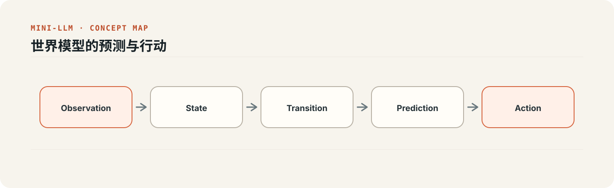

# **mini-llm World Model Engine 深度解析：从 State Representation、State Transition 到 Prediction、Planning 与 Action**



_图：世界模型的预测与行动。从左到右展示本章核心概念之间的数据流与依赖关系。_

**副标题：让大语言模型不仅理解语言，还能表示世界状态、预测未来变化，并在可能的未来中进行推演。**

在前面的 Representation Engine 中，我们讨论了一个重要问题：

**模型内部如何形成对世界的表示？**

我们研究了 Embedding Space、Semantic Geometry、Feature、Concept、Residual Stream，以及 Sparse Autoencoder（SAE）。

但这只是智能系统理解世界的第一步。

假设我们给模型一个问题：

> 房间里有一个玻璃杯，杯子放在桌子边缘。如果有人推动桌子，杯子可能会发生什么？

模型需要完成哪些计算？

1. 识别房间、桌子、玻璃杯和它们之间的关系。
2. 判断当前世界处于什么状态。
3. 理解推动桌子会改变什么。
4. 预测杯子未来的位置。
5. 推断杯子是否可能掉落。
6. 根据目标决定采取什么行动。

这已经不只是语言理解，而是涉及一套更复杂的机制：

**状态表示 → 状态转移 → 未来预测 → 规划 → 行动。**

这就是 World Model Engine 希望研究的问题。

[Learning to Model the World: A Survey of World Models in Artificial Intelligence\[v1\] | Preprints.org](https://images.openai.com/static-rsc-4/hZ7VDEp9VBY4YGVT743dgYhWy_3MVKYztbADQpoag2xXTy3fUX_d3kQGmNWBs_MPXHemPkYiyBOfbV-qyy-YHgXVTFDSDMVRnkDumlJL8lMPMtKjVj-qSRgWsdk5n6AI0X1LnP923hCeKFs-ypad2mgCYDyHdcfYvH33xXpH6oU?purpose=inline)

[World Models in Robotics - How Robots Learn to Predict the Future (and Why It Changes Everything)](https://images.openai.com/static-rsc-4/Y_d3r-9kdwjWRO7Lut-DbX3_BXO5kxfCeEb_lBDPo7njv3jrsHgLZRee8RytPUs4rEznGckenw-u8we5KytYcD72zH6MFBnmVoVlGDyO6W7gUulMQrOgDCgWsslq0Bg31VNYUyH-8UOpH9B7TKsBG-0Cil5dxYKBJo9Q3gdqbgg?purpose=inline)

[Offline motion libraries and online MPC for advanced mobility skills - Marko Bjelonic, Ruben Grandia, Moritz Geilinger, Oliver Harley, Vivian S Medeiros, Vuk Pajovic, Edo Jelavic, Stelian Coros, Marco Hutter, 2022](https://images.openai.com/static-rsc-4/D6okKuGaJoYjkf_BQbw3VgkQqB29liXFiBJiNKGKHgY0uDSpi97dcUasl2t61uoIOx4WF3CAM3nRd6N8hRA2aCuhcZcsTV65pizL7uiZTuLUmByP5tjR7hYQvfSj8dAXX5lD2gTQSWNC7n0IAApx3gmXyuIx_pGtqpI5lTiWkgY?purpose=inline)

11

## **一、什么是 World Model？**

### **1.1 从描述世界到模拟世界**

我们先区分两种能力。

**第一种：描述世界。**

例如：

> 玻璃杯放在桌子上，桌子位于房间中央。

模型可以理解这句话，并生成相关描述。

**第二种：模拟世界。**

例如：

> 如果桌子向右移动 30 厘米，玻璃杯会发生什么？

模型需要根据当前状态和动作，推断可能出现的新状态。

两者有本质区别。

| 能力   | 描述世界   | 模拟世界      |
| ---- | ------ | --------- |
| 输入   | 语言或观察  | 当前状态和动作   |
| 核心任务 | 理解与表达  | 预测状态变化    |
| 输出   | 文字、语义  | 未来状态或分布   |
| 关键能力 | 表征     | 动态建模      |
| 示例   | 杯子在桌子上 | 杯子可能滑动或掉落 |

World Model（世界模型）可以理解为：

**智能体内部对外部世界及其动态变化规律建立的可计算模型。**

它不仅表示世界当前是什么样子，还尝试表示：

- 世界中有哪些对象？
- 对象之间有什么关系？
- 当前状态是什么？
- 哪些动作可以改变状态？
- 动作之后可能发生什么？
- 不同未来的概率和代价是什么？

### **1.2 数学定义**

假设世界在时间 \\(t\\) 的状态为：

\\[ s_t \\]

智能体执行的动作是：

\\[ a_t \\]

环境产生的新状态为：

\\[ s\_{t+1} \\]

那么世界的状态转移可以表示为：

\\[ s\_{t+1}=f(s_t,a_t) \\]

其中：

- \\(s_t\\)：当前状态。
- \\(a_t\\)：当前动作。
- \\(f\\)：世界动态模型。
- \\(s\_{t+1}\\)：下一时刻状态。

但真实世界通常具有不确定性。

例如，推动桌子时，杯子是否滑落，还受到摩擦力、桌面倾斜程度、推动力度等因素影响。

因此，更一般的表达是：

\\[ P(s\_{t+1}\mid s_t,a_t) \\]

它表示：

**给定当前状态和动作，下一状态可能是什么，以及每种状态出现的概率。**

这就是概率状态转移模型。

## **二、State Representation：如何表示世界状态？**

### **2.1 什么是 State？**

State（状态）是对某一时刻世界情况的描述。

假设一个房间中存在：

- 一个桌子。
- 一个玻璃杯。
- 一个人。

我们可以构造如下状态：

```
state = {    "objects": [        {            "id": "table_1",            "type": "table",            "position": [0.0, 0.0, 0.0]        },        {            "id": "cup_1",            "type": "cup",            "position": [0.8, 0.0, 0.7]        },        {            "id": "person_1",            "type": "person",            "position": [1.5, 0.0, 0.0]        }    ]}
```

这是一种显式的结构化状态表示。

它告诉模型：

- 世界里有什么对象。
- 每个对象的类型是什么。
- 对象处于什么位置。

但这还不够。

### **2.2 Object Representation：对象表示**

对象是世界状态的重要组成部分。

可以把对象抽象为：

\\[ o_i=(id_i,c_i,x_i,v_i,p_i) \\]

其中：

- \\(id_i\\)：对象标识。
- \\(c_i\\)：对象类别。
- \\(x_i\\)：对象的位置或属性。
- \\(v_i\\)：对象的运动状态。
- \\(p_i\\)：对象的其他物理属性。

例如：

\\[ o\_{\text{cup}}= (\text{cup},\text{glass},x,v,\text{fragile}) \\]

这里需要注意：

对象表示不一定全部采用人工定义的属性。

计算机视觉模型可能通过图像提取对象特征：

\\[ z_i=Encoder(I)\_i \\]

其中：

- \\(I\\)：输入图像。
- \\(z_i\\)：对象的潜在特征表示。

这就将 Representation Engine 与 World Model Engine 联系起来了。

Representation Engine 负责构造内部表示，而 World Model Engine 使用这些表示建立状态与动态关系。

### **2.3 Relation Modeling：关系表示**

仅仅知道对象存在是不够的。

我们还需要知道对象之间的关系。

例如：

- 杯子在桌子上。
- 人站在桌子旁边。
- 桌子位于房间中央。

可以用关系三元组表示：

\\[ r=(subject,predicate,object) \\]

例如：

\\[ (\text{cup},\text{on},\text{table}) \\]

\\[ (\text{person},\text{near},\text{table}) \\]

这些关系可以构建为知识图谱或场景图。

[Leonid Sigal's Personal Web Page](https://images.openai.com/static-rsc-4/nfMy_cs8kHETcAWS1km-Z6ZQMw4fCbl0noOaTgpXXXOY1pWZ4d79AVN88ajWblzuGMwOYhf6tdRpy1hKiVi5_tjsyrBdEuPxuOjhViVrKMd8F5O06LiqQov9dCEavFQ0vZVU3FLh6En95hffEvY4pUgSXfw732rVfKs0mpHNaFE?purpose=inline)

[cs.ubc.ca](https://www.cs.ubc.ca/~lsigal/publications_year.html?utm_source=chatgpt.com)

一种简单的数据结构：

```
relations = [    ("cup_1", "on", "table_1"),    ("person_1", "near", "table_1")]
```

这样，模型不只是拥有一组对象，还能够理解对象之间的结构。

### **2.4 从对象到场景状态**

现在可以将对象、关系和环境属性组合起来：

\\[ S_t=(O_t,R_t,E_t) \\]

其中：

- \\(O_t\\)：对象集合。
- \\(R_t\\)：对象之间的关系。
- \\(E_t\\)：环境状态。

例如：

```
state = {    "objects": [...],    "relations": [...],    "environment": {        "gravity": 9.8,        "surface_friction": 0.35,        "time": 0.0    }}
```

这就是一个简单的显式世界状态。

但现代 AI 系统不一定直接保存这种结构。

它还可以把整个状态压缩成潜在向量：

\\[ z_t=Encoder(S_t) \\]

其中：

\\[ z_t\in\mathbb{R}^{d} \\]

例如：

\\[ z_t\in\mathbb{R}^{1024} \\]

这意味着复杂世界状态可以被映射到一个 1024 维的潜在空间中。

需要注意：潜在向量的每个维度通常不能直接解释为一个明确的物理属性。它是一种学习得到的分布式表示。

## **三、State Transition：世界是如何变化的？**

如果 State Representation 解决的是：

**世界现在是什么样子？**

那么 State Transition 解决的就是：

**世界如何从现在变化到下一刻？**

### **3.1 状态转移函数**

假设当前状态为：

\\[ s_t \\]

执行动作：

\\[ a_t \\]

那么：

\\[ s\_{t+1}=f\_\theta(s_t,a_t) \\]

这里的 \\(\theta\\) 是模型参数。

对于神经网络而言，我们可以用一个简单的 MLP 实现状态转移：

```
class WorldTransition:    def __init__(self, state_dim, action_dim, hidden_dim):        self.network = MLP(            input_dim=state_dim + action_dim,            hidden_dim=hidden_dim,            output_dim=state_dim        )    def forward(self, state, action):        x = concat(state, action)        delta = self.network(x)        return state + delta
```

这里采用的是残差式状态更新：

\\[ \hat{s}\_{t+1}=s_t+\Delta s_t \\]

模型不必从头生成完整状态，而是预测状态变化量。

这种设计在连续动态系统中很常见。

### **3.2 为什么状态转移需要动作？**

假设一个杯子放在桌子上。

如果没有任何外部作用：

\\[ s\_{t+1}\approx s_t \\]

如果桌子被推动：

\\[ s\_{t+1}=f(s_t,a\_{\text{push}}) \\]

如果有人拿起杯子：

\\[ s\_{t+1}=f(s_t,a\_{\text{pick}}) \\]

同一个初始状态，因为动作不同，会产生不同的未来。

因此，World Model 不能只学习：

\\[ P(s\_{t+1}\mid s_t) \\]

还需要考虑：

\\[ P(s\_{t+1}\mid s_t,a_t) \\]

这是世界模型与单纯时间序列预测之间的重要区别之一。

当然，对于没有显式动作输入的被动预测任务，也可以使用前一种形式。

### **3.3 确定性与概率性状态转移**

确定性模型：

\\[ s\_{t+1}=f\_\theta(s_t,a_t) \\]

它认为给定相同输入，就会产生相同预测。

概率模型：

\\[ s\_{t+1}\sim P\_\theta(s\_{t+1}\mid s_t,a_t) \\]

它可以表达多种可能的未来。

例如，推动桌子后：

| 未来状态   | 概率示意 |
| ------ | ---- |
| 杯子保持稳定 | 0.65 |
| 杯子发生滑动 | 0.25 |
| 杯子掉落   | 0.10 |

这些数字仅用于说明概率分布，并不是实际物理实验结果。

概率模型更适合处理不确定性，但也需要可靠的概率校准，不能把模型输出的概率直接当成真实世界频率。

## **四、World Dynamics：学习世界的变化规律**

状态转移描述单步变化。

World Dynamics（世界动力学）则关注更长期、更一般的变化规律。

例如：

- 物体受到力之后如何运动？
- 物体碰撞之后如何变化？
- 人的行为如何影响环境？
- 一个动作会不会触发多个后续事件？

### **4.1 从单步预测到多步预测**

单步预测：

\\[ \hat{s}\_{t+1}=f\_\theta(s_t,a_t) \\]

两步预测：

\\[ \hat{s}\_{t+2} = f\_\theta(\hat{s}\_{t+1},a\_{t+1}) \\]

多步预测：

\\[ \hat{s}\_{t+H} = f\_\theta( \hat{s}\_{t+H-1},a\_{t+H-1} ) \\]

其中 \\(H\\) 表示预测步数。

例如：

```
当前状态
   |
   v
推动桌子
   |
   v
杯子开始移动
   |
   v
杯子接近桌边
   |
   v
杯子掉落
   |
   v
杯子发生碰撞
```

这就是一个简单的未来状态序列。

[Physics Virtual Lab | Free Interactive Simulations | SciSimulator](https://images.openai.com/static-rsc-4/aMqCNrDen4ghWb9YyeQvRviMKkF0zPZgU06fYuu-g39DLsuh2xuHKUbPAV7QaMsKO07OkQwJCYiuruar8IvAIWteNVhC9N5I3wGV6_0qNl27fVx2TlYh05HvgJvstcKW1u5hah-104CnhUF_q6OhNNogIg03sZCNLc9o0xkqq-c?purpose=inline)

[scisimulator.com](https://scisimulator.com/en/subject/physics?utm_source=chatgpt.com)

### **4.2 多步预测为什么困难？**

假设模型每一步都有预测误差：

\\[ \epsilon_t \\]

当模型使用自己预测的状态继续推演时，前一步的误差会影响后一步。

因此：

\\[ \epsilon\_{t+2} \\]

不仅取决于第二步模型本身的误差，还受到第一步预测误差的影响。

这就是误差累积问题。

在长时间预测中，模型可能逐渐偏离真实世界。

解决思路包括：

1. 使用真实轨迹进行训练。
2. 使用多步预测损失。
3. 在真实环境中不断校正状态。
4. 通过不确定性估计识别不可靠预测。
5. 采用滚动规划，而不是一次性规划很长的未来。

## **五、Prediction Engine：预测未来状态**

World Model 的重要能力之一是预测。

但预测不只有一种形式。

### **5.1 状态预测**

预测未来状态：

\\[ \hat{s}\_{t+1}=f\_\theta(s_t,a_t) \\]

例如：

输入：

```
杯子在桌子边缘。
桌子向右移动。
```

输出：

```
杯子可能向桌子边缘移动。
```

### **5.2 结果预测**

预测动作产生的结果：

\\[ \hat{o}\_{t+1}=g\_\theta(s_t,a_t) \\]

这里 \\(o\\) 可以表示：

- 物理结果。
- 环境反馈。
- 任务结果。
- 目标是否完成。

例如：

```
动作：打开门

预测结果：
- 门从关闭变为打开
- 房间与走廊连通
- 可以进入下一个区域
```

### **5.3 预测不确定性**

对于真实世界，单一预测通常不够。

我们可以使用概率分布表示未来：

\\[ P(s\_{t+1}\mid s_t,a_t) \\]

还可以计算预测熵：

\\[ H(S)=-\sum_i p_i\log p_i \\]

熵越高，说明模型对未来状态越不确定。

例如：

**低不确定性**

杯子保持稳定

**95%**

**高不确定性**

稳定、滑动、掉落等多种结果

**无法确定单一结果**

示意图：概率分布越分散，预测不确定性通常越高。

需要区分两件事：

- 模型不确定性：模型本身对规律掌握不足。
- 环境随机性：即使模型完全知道规律，未来仍可能存在随机结果。

二者的处理方式并不完全相同。

## **六、Planning Engine：为什么预测还不够？**

假设模型预测出三种结果：

- A：杯子保持稳定。
- B：杯子滑动。
- C：杯子掉落。

这只是预测。

如果智能体的目标是保护杯子，它还需要选择行动。

这就涉及 Planning（规划）。

### **6.1 规划的基本结构**

规划可以表示为：

\\[ \pi^\*= \arg\max\_\pi \mathbb{E} \left[ \sum\_{t=0}^{H} \gamma^t r(s_t,a_t) \right] \\]

其中：

- \\(\pi\\)：行动策略。
- \\(r(s_t,a_t)\\)：奖励函数。
- \\(\gamma\\)：未来奖励折扣因子。
- \\(H\\)：规划时域。

简单理解：

**规划就是在可能的未来中，寻找最符合目标的行动序列。**

例如：

目标：防止杯子掉落。

可选动作：

1. 不采取行动。
2. 将杯子移到桌子中央。
3. 固定杯子。
4. 停止推动桌子。

模型可以先预测不同动作的后果，再计算每个动作的价值。

### **6.2 Model Predictive Control（模型预测控制）**

一个非常重要的规划方法是 MPC（Model Predictive Control）。

它的基本思想是：

1. 获取当前状态。
2. 使用世界模型预测未来。
3. 比较不同动作序列。
4. 选择当前最优动作。
5. 执行一步。
6. 获取新状态。
7. 重新规划。

[Introduction to Model Predictive Control - imperix Technical notes](https://images.openai.com/static-rsc-4/XhPFsWxnKCy34T3xK8YwZZ7RsvQlm7bW7Nm09FpHfcWxZ_i1O5YAR5ukS0xjOyl4cVWwU40XL5YOG7UluAOS6EW9iZV5nixiXxOZBM55WavUwjj5bbAOwpLWMsl8zgzGTvIlrr5kGFnqIdQ56mVcZCQE-jLF4fgONtwTSIPUZAc?purpose=inline)

[cn.imperix.com](https://cn.imperix.com/doc/implementation/model-predictive-control.html?utm_source=chatgpt.com)

它的核心不是一次规划完整的未来，而是不断根据新观察修正计划。

数学上：

\\[ a\_{t:t+H}^\* = \arg\min\_{a\_{t:t+H}} \sum\_{k=0}^{H} c(\hat{s}\_{t+k},a\_{t+k}) \\]

执行时通常只执行第一个动作：

\\[ a_t=a_t^\* \\]

然后重新观察环境。

这种方式可以减少长期预测误差带来的影响。

### **6.3 Planning 与 Reasoning 的关系**

我们可以区分：

| 概念         | 核心问题       |
| ---------- | ---------- |
| Reasoning  | 为什么会这样？    |
| Prediction | 接下来会发生什么？  |
| Planning   | 为了目标应该怎么做？ |
| Action     | 现在实际执行什么？  |

例如：

- 推理：杯子靠近桌边，因此有掉落风险。
- 预测：继续推动桌子，杯子可能掉落。
- 规划：先把杯子移到安全位置。
- 行动：执行移动杯子的操作。

这四种能力相互关联，但不能简单等同。

## **七、Active Inference：智能体如何主动探索世界？**

前面讨论的规划主要是根据已有信息选择行动。

但如果智能体不知道环境规律呢？

例如：

一个机器人进入陌生房间。

它不知道：

- 门是否可以打开。
- 地面是否光滑。
- 桌子是否稳定。
- 某个按钮有什么作用。

此时，机器人不仅需要行动，还需要通过行动获取信息。

这涉及 Active Inference（主动推断）。

### **7.1 行动不仅为了改变世界，也为了获取信息**

假设机器人看到一个未知按钮。

它有两个选择：

- 不触碰按钮。
- 轻轻触碰按钮，观察结果。

第二种行为可能没有直接完成任务，但能够减少不确定性。

这就是探索行为。

可以将行动价值分成两部分：

\\[ V(a)= V\_{\text{goal}}(a) + \beta V\_{\text{information}}(a) \\]

其中：

- \\(V\_{\text{goal}}\\)：完成目标的价值。
- \\(V\_{\text{information}}\\)：获取信息的价值。
- \\(\beta\\)：探索价值权重。

这是一种简化表达，不是 Active Inference 的完整数学定义。

在主动推断理论中，常用 Expected Free Energy（期望自由能）来描述行动与感知如何共同服务于目标和不确定性降低。

### **7.2 探索与利用**

这里出现了一个经典问题：

**Exploration vs Exploitation。**

- Exploration：探索未知信息。
- Exploitation：利用已经掌握的信息完成目标。

例如：

机器人发现一条道路可以快速到达目标，但另一条道路可能更安全。

如果它完全利用当前信息，可能选择熟悉的道路。

如果它愿意探索，可能先尝试了解另一条道路的风险。

真正的智能系统需要在二者之间平衡。

## **八、LLM 与 World Model：大语言模型真的拥有世界模型吗？**

这是一个非常值得深入研究的问题。

大语言模型通过海量文本训练，学习了大量关于世界的知识。

例如：

- 物体通常如何运动。
- 人类通常如何行动。
- 不同事件之间有什么因果关系。
- 某些动作通常会产生什么后果。

那么，LLM 是否已经拥有 World Model？

答案需要谨慎。

### **8.1 LLM 学到了世界的统计规律**

语言模型训练的基本目标是：

\\[ P(x_t\mid x_1,x_2,\ldots,x\_{t-1}) \\]

也就是根据上下文预测下一个 Token。

但语言不是随机产生的。

语言中包含大量世界信息：

```
玻璃杯从桌子上掉下来，通常会发生破碎。
```

模型通过大量类似文本，能够学习：

- 玻璃杯与破碎之间的关系。
- 掉落与碰撞之间的关系。
- 高度、重力与运动之间的关系。
- 人类对事件的描述方式。

因此，语言模型可能在内部形成关于世界的某些结构化表示。

### **8.2 但语言统计规律不等于真实物理模型**

举个例子。

模型知道：

> 玻璃杯掉在坚硬地面上，通常会破碎。

但这不代表它能够准确计算：

- 杯子的质量。
- 地面的弹性。
- 碰撞速度。
- 应力分布。
- 杯子破碎的具体形态。

这两者之间存在明显差异。

| 能力   | 语言模型中的隐式知识 | 显式世界模型    |
| ---- | ---------- | --------- |
| 对象理解 | 语义表示       | 对象状态      |
| 关系理解 | 语言与特征关联    | 结构化关系     |
| 变化预测 | 基于训练规律生成   | 学习状态转移    |
| 物理计算 | 可能近似推断     | 可结合物理方程   |
| 行动规划 | 语言推理、工具调用  | 基于模型模拟后规划 |
| 反馈修正 | 依赖上下文和外部工具 | 根据环境状态更新  |

这意味着：

**LLM 可以拥有与世界模型相关的内部知识，但不能仅凭语言生成能力，就认定它具有可靠、可执行的完整世界模型。**

### **8.3 LLM + World Model 的组合架构**

一个值得研究的方向，是让 LLM 负责高层语义推理，让专门的 World Model 负责状态预测和动态模拟。

[AI in Robotics - An LLM Is Not a Brain - The Real Role of LLMs — and Other AI Models — in a Cyber-Physical system](https://images.openai.com/static-rsc-4/VX1nzhlxxhxwDjZn5q3HfwajqqsV83NXMvPDHFWTG_tgXoLDY1TItlf_QPVjFcM0GbOFyk-VfwlSNWG2eN-S79ouWXvZMlRKqNTjJp_UVw9PFW3GpXHIH_PNAN3xpGPKx5RgycYrxTCKZ-ahFAjxIMGowRlIdhTAS2fMvgOebt4?purpose=inline)

[thomasthelliez.com](https://thomasthelliez.com/blog/real-role-of-llms-and-other-ai-models-in-a-cyber-physical-system/?utm_source=chatgpt.com)

可以设计成：

```
                User Goal
                   |
                   v
             LLM Reasoning
                   |
                   v
             Task Planner
                   |
                   v
          World Model Engine
                   |
          +--------+--------+
          |                 |
          v                 v
    State Encoder     Dynamics Model
          |                 |
          +--------+--------+
                   |
                   v
             Future Prediction
                   |
                   v
              Action Planner
                   |
                   v
                Action
                   |
                   v
              Environment
                   |
                   v
               Feedback
                   |
                   +-------> State Update
```

其中：

- LLM：理解目标、解释任务、生成高层计划。
- State Encoder：将观察转成状态表示。
- Dynamics Model：预测状态变化。
- Future Prediction：模拟可能的未来。
- Action Planner：选择行动。
- Environment：真实环境或模拟环境。

这也是具身智能（Embodied AI）、机器人和智能 Agent 的重要研究方向。

## **九、mini-llm World Model Engine 工程设计**

接下来将理论转化为工程模块。

我们可以为 mini-llm 增加一个独立的 World Model Engine。

### **9.1 模块目录**

```
mini-llm/
│
├── core/
│   ├── tensor.py
│   ├── autograd.py
│   └── module.py
│
├── representation/
│   ├── embedding.py
│   ├── feature.py
│   └── encoder.py
│
├── world_model/
│   ├── state.py
│   ├── object.py
│   ├── relation.py
│   ├── transition.py
│   ├── dynamics.py
│   ├── prediction.py
│   ├── uncertainty.py
│   ├── planner.py
│   └── simulator.py
│
├── agent/
│   ├── reasoning.py
│   ├── policy.py
│   └── action.py
│
└── experiments/
    ├── state_prediction.py
    ├── transition_learning.py
    └── planning_demo.py
```

### **9.2 核心数据结构**

```
class WorldObject:    def __init__(self, object_id, object_type, position):        self.id = object_id        self.type = object_type        self.position = positionclass WorldState:    def __init__(self, objects, relations, environment):        self.objects = objects        self.relations = relations        self.environment = environmentclass Action:    def __init__(self, action_type, parameters):        self.type = action_type        self.parameters = parameters
```

### **9.3 State Transition Engine**

```
class StateTransitionEngine:    def __init__(self, model):        self.model = model    def predict(self, state, action):        state_tensor = encode_state(state)        action_tensor = encode_action(action)        next_state_tensor = self.model(            state_tensor,            action_tensor        )        return decode_state(next_state_tensor)
```

这里的 `encode_state` 和 `decode_state` 需要根据具体任务实现。

对于真实世界中的复杂对象，不能假设一个简单的向量就能无损保存全部状态信息。

### **9.4 Prediction Engine**

```
class PredictionEngine:    def __init__(self, transition_model):        self.transition_model = transition_model    def rollout(self, state, actions):        trajectory = [state]        current_state = state        for action in actions:            current_state = self.transition_model.predict(                current_state,                action            )            trajectory.append(current_state)        return trajectory
```

它可以根据一系列动作，预测未来状态轨迹。

### **9.5 Planning Engine**

```
class PlanningEngine:    def __init__(self, prediction_engine, cost_function):        self.prediction_engine = prediction_engine        self.cost_function = cost_function    def choose_action(self, state, action_candidates):        best_action = None        best_cost = float("inf")        for actions in action_candidates:            trajectory = self.prediction_engine.rollout(                state,                actions            )            cost = self.cost_function(trajectory)            if cost < best_cost:                best_cost = cost                best_action = actions[0]        return best_action
```

这是一个简化的候选动作枚举规划器。

真正的 MPC 还需要考虑动作约束、滚动时域、模型不确定性、计算预算以及执行反馈。

## **十、训练 World Model：模型如何学会预测？**

如果我们希望模型掌握世界变化规律，就需要提供状态变化数据。

假设训练数据是：

\\[ D= \\{(s_t,a_t,s\_{t+1})\\} \\]

模型学习：

\\[ \hat{s}\_{t+1}=f\_\theta(s_t,a_t) \\]

最简单的训练损失是均方误差：

\\[ L(\theta)= \frac{1}{N} \sum\_{i=1}^{N} \left\\| f\_\theta(s_i,a_i)-s\_{i+1} \right\\|\_2^2 \\]

通过梯度下降：

\\[ \theta\leftarrow \theta-\eta\nabla\_\theta L \\]

模型逐渐学习状态转移规律。

不过，这种损失适用于连续数值状态的简单情况。

如果预测的是对象类别、离散事件或概率分布，就需要采用分类损失、似然损失等更合适的目标。

### **10.1 多步预测损失**

只训练一步预测，可能导致模型在多步推演时误差累积。

因此，可以增加多步损失：

\\[ L\_{\text{multi}}= \sum\_{k=1}^{H} \lambda_k \left\\| \hat{s}\_{t+k}-s\_{t+k} \right\\|^2 \\]

其中：

- \\(H\\)：预测步数。
- \\(\lambda_k\\)：不同预测步数的权重。

模型不仅需要预测下一步，还需要学习更长时间尺度上的变化规律。

### **10.2 训练数据从哪里来？**

可以有三种来源：

| 数据来源  | 特点               | 适合研究     |
| ----- | ---------------- | -------- |
| 物理模拟器 | 可以获得准确状态和动作      | 物理动态学习   |
| 真实传感器 | 接近真实环境           | 机器人与具身智能 |
| 视频数据  | 容易获得，但状态和动作不一定明确 | 视觉预测     |

特别需要注意：

**视频中的连续画面不一定能提供完整的状态转移监督。**

视频可以告诉模型发生了什么，但未必告诉模型：

- 物体受到什么力。
- 人执行了什么动作。
- 哪些变化是因果关系。
- 哪些变化只是同时发生。

所以，从视频中学习世界模型，通常还需要设计潜在状态、动作推断和时序学习机制。

## **十一、World Model 与六种智能能力**

把前面讨论的内容放到一起，我们可以看到 World Model 与智能能力之间的关系。

| 智能能力              | World Model 中的对应模块               |
| ----------------- | -------------------------------- |
| 感知 Perception     | State Encoder                    |
| 表征 Representation | Object / Relation Representation |
| 学习 Learning       | Dynamics Learning                |
| 预测 Prediction     | Future State Prediction          |
| 规划 Planning       | Action Planner                   |
| 行动 Action         | Policy / Action Executor         |

这六种能力不是严格的串行流程。

实际系统往往存在反馈循环：

\\[ Perception \rightarrow Representation \rightarrow Prediction \rightarrow Planning \rightarrow Action \rightarrow Perception \\]

行动改变环境，环境又产生新的观察。

智能体通过这种循环不断修正内部模型。

[What Is Embodied AI? A Simple Guide to AI in the Physical World | Loona Blog](https://images.openai.com/static-rsc-4/2M4Mdz1zNMnXNYzGbhFUmR1aLnouZFsJuMcGnT4sVbh_GaB5Zo2uxonr1iVuJ2un1YArok4c66p_h_IPIaSngYxKhpv9npca3lSI2hWodlyfyrm04iuu7QWMP-BrCuRW8nNCFUuMDVwjkXYyis4AzfYyxT3qw6dDBFvEhXzTV8g?purpose=inline)

[keyirobot.com](https://keyirobot.com/blogs/buying-guide/what-is-embodied-ai-a-simple-guide-to-ai-in-the-physical-world?utm_source=chatgpt.com)

## **十二、核心结论：智能不仅是理解世界，还要能够推演世界**

我们可以把本篇的核心观点总结为五层：

**第一层：State Representation**

建立世界当前状态的内部表示。

**第二层：State Transition**

理解动作如何改变当前状态。

**第三层：Prediction**

推演不同动作可能产生的未来。

**第四层：Planning**

比较未来结果，寻找符合目标的行动序列。

**第五层：Action**

在真实或模拟环境中执行行动，并根据反馈更新模型。

从这个角度看，智能系统不只是一个接收输入、输出答案的函数。

它还可以是一个不断建立内部状态、预测未来、评估行动、改变环境并更新认知的动态系统。

不过，拥有这些模块不自动意味着系统已经具备通用智能。世界模型的准确性、可迁移性、长期稳定性，以及行动与真实环境之间的闭环能力，仍然是需要验证的关键问题。

## **下一篇：mini-llm Agent Engine 深度解析**

World Model 解决了一个重要问题：

**智能体如何表示世界、预测未来？**

但还有一个问题：

**谁来决定目标、调用工具、分解任务、执行行动，并判断任务是否完成？**

下一篇可以进入 Agent Engine：

1. Agent Architecture：智能体整体架构。
2. Goal Representation：目标表示。
3. Task Decomposition：任务分解。
4. Tool Calling：工具调用机制。
5. Memory Engine：短期记忆与长期记忆。
6. Planning and Execution：规划与执行。
7. Reflection：反思与自我修正。
8. Multi-Agent：多智能体协作。
9. Agent 与 LLM、World Model 的关系。
10. mini-llm Agent Engine 的完整工程实现。

这将把 mini-llm 从一个语言模型，进一步扩展为一个能够理解目标、规划任务并使用工具的智能体系统。

