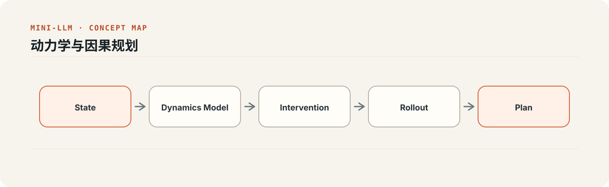
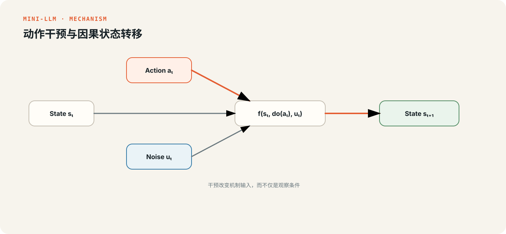

# **《mini-llm World Model Engine 深度解析：从 State Representation、State Transition 到 Dynamics Model、Planning 与 Causal Reasoning》**



_图：动力学与因果规划。从左到右展示本章核心概念之间的数据流与依赖关系。_

在前面的 mini-llm 系列中，我们已经逐步构建了 Tensor Engine、Autograd Engine、Neural Network Engine、Transformer Engine、Training Engine、Representation Engine、Memory Architecture 和 Knowledge Architecture。

这些模块解决了不同层次的问题：

- Tensor Engine：如何进行数值计算？
- Neural Network Engine：如何通过参数学习函数？
- Transformer Engine：如何处理序列和上下文？
- Representation Engine：如何在向量空间中表达信息？
- Memory Architecture：如何保存和检索经验？
- Knowledge Architecture：如何组织事实、概念和关系？

但还有一个更深层的问题：

**一个智能系统如何理解世界当前处于什么状态，并预测采取某种行动之后，世界会发生什么变化？**

例如：

一个机器人看到桌子上有一个杯子。

它不仅需要识别杯子，还需要理解：

1. 杯子现在在哪里？
2. 杯子是否可以被抓取？
3. 如果向左移动机械臂，会发生什么？
4. 如果抓住杯子并抬起，杯子会不会移动？
5. 如果杯子受到外力，会不会倾倒？
6. 如果执行某个动作失败，应该如何调整计划？

这已经超出了简单的信息检索和文本生成。

它涉及一个重要的研究方向：

**World Model（世界模型）。**

World Model Engine 的目标，就是让 mini-llm 不仅能够描述世界，还能够建立世界状态的内部表示，学习状态变化规律，预测未来，并利用预测结果规划行动。

需要先强调：世界模型是一个广泛的研究方向，不意味着语言模型天然拥有完整、准确、可执行的世界模型。我们需要明确区分隐式世界知识与显式可操作的动态模型。

# **一、什么是 World Model？**

## **1.1 从静态描述到动态理解**

先看两个系统。

**系统 A：语言知识系统**

用户问：

> 如果把一个玻璃杯从桌子上推下去，会发生什么？

系统根据训练数据回答：

> 玻璃杯可能会掉落并摔碎。

它能够生成合理的语言描述。

但是，这并不意味着它真正建立了杯子、桌面、重力、碰撞和破碎之间的可计算关系。

**系统 B：世界模型系统**

系统建立了一个简化的物理环境：

- 杯子的位置：\\(x=0.5\\)
- 桌面高度：\\(h=1.0\\)
- 杯子质量：\\(m=0.3\\)
- 重力加速度：\\(g=9.8\\)
- 杯子当前速度：\\(v=0\\)

当执行向右推动的动作时，模型可以预测：

- 杯子的位置变化。
- 杯子是否离开桌面。
- 杯子是否进入自由落体。
- 杯子与地面的碰撞。
- 杯子是否达到破碎条件。

两个系统的核心差异：

| 维度   | 语言知识系统  | 世界模型系统   |
| ---- | ------- | -------- |
| 信息表达 | 文本、概念   | 状态、变量、关系 |
| 时间   | 描述过去和未来 | 显式建模状态变化 |
| 行动   | 生成行动建议  | 模拟行动后果   |
| 预测   | 语言概率预测  | 状态转移预测   |
| 反馈   | 文本评价    | 环境状态反馈   |
| 规划   | 生成步骤    | 比较不同未来路径 |

世界模型可以抽象为：

\\[ \boxed{ \text{World Model} = \text{State Representation} + \text{Dynamics Model} + \text{Prediction} } \\]

进一步加入行动和规划：

\\[ \boxed{ \text{World Model} = (S,A,T,O,P) } \\]

其中：

- \\(S\\)：State，世界状态。
- \\(A\\)：Action，行动。
- \\(T\\)：Transition，状态转移。
- \\(O\\)：Observation，观测。
- \\(P\\)：Prediction，未来预测。

# **二、State Representation：如何表示世界状态？**

## **2.1 什么是 State？**

State（状态）是对系统在某个时刻情况的描述。

例如，一个简单的机器人环境：

[HandoverSim: A Simulation Framework and Benchmark for Human-to-Robot Object Handovers | Research](https://images.openai.com/static-rsc-4/jw7Ypku19OD88sbsJedL0wSLr8QsFAW1d0F9PN6N4URyTkZBy6g27IeMcr3kEtXGleSfhMW3kTTMrqs1y-ZKKGKwpp1ulykvNhva4S0Xdh1qFXln_FWZcDCGJUu9hQFVc0sJYwxJn5L69VL_rewhGYpeA7rWI7MLXvzkaC7ALPY?purpose=inline)

[research.nvidia.com](https://research.nvidia.com/publication/2022-05_handoversim-simulation-framework-and-benchmark-human-robot-object-handovers?utm_source=chatgpt.com)

可以定义：

\\[ S_t = \\{ Position, Velocity, Object, Environment, Robot \\} \\]

具体表示：

```
state = {    "robot": {        "position": [0.1, 0.2, 0.3],        "velocity": [0.0, 0.0, 0.0],        "gripper_open": True    },    "objects": [        {            "id": "cup_001",            "position": [0.5, 0.2, 0.1],            "velocity": [0.0, 0.0, 0.0],            "material": "glass"        }    ],    "environment": {        "gravity": 9.8,        "table_height": 0.8    }}
```

这就是一个结构化的世界状态。

需要注意，现实中的状态可能包含大量无法直接观测的变量。

例如：

- 杯子的真实质量。
- 材料内部结构。
- 物体是否存在微小裂纹。
- 机械臂关节内部状态。

因此，我们通常只能获得观测，而不能直接获得完整状态。

这引出两个不同的概念：

**State 与 Observation。**

## **2.2 State 和 Observation 的区别**

State 是世界实际的内部状态。

Observation 是智能体能够获得的信息。

例如：

真实世界：

```
杯子的位置：X
杯子的质量：300g
杯子的内部裂纹：存在
杯子的真实速度：0
```

机器人摄像头可能只看到：

```
杯子的位置：估计值
杯子的颜色：透明
杯子的形状：圆柱形
```

因此：

\\[ O_t = h(S_t) + \epsilon_t \\]

其中：

- \\(O_t\\)：观测。
- \\(S_t\\)：真实状态。
- \\(h\\)：观测模型。
- \\(\epsilon_t\\)：观测噪声。

这意味着：

**智能体看到的世界，不一定等于世界本身。**

这也是为什么机器人需要传感器融合、状态估计和概率推断。

## **2.3 状态表示的三种形式**

### **第一种：符号状态（Symbolic State）**

使用结构化变量表示世界。

```
state = {    "door": "closed",    "light": "off",    "robot_location": "room_a"}
```

优点：

- 容易理解。
- 容易解释。
- 适合规则推理。
- 适合任务规划。

缺点：

- 难以表达连续变化。
- 难以处理复杂视觉信息。
- 状态抽象依赖人工设计。

### **第二种：向量状态（Vector State）**

使用数值向量表示状态：

\\[ S_t = [x,y,z,v_x,v_y,v_z] \\]

例如：

```
import numpy as npstate = np.array([    0.5, 0.2, 0.1,    0.0, 0.0, 0.0])
```

优点：

- 适合数学运算。
- 适合神经网络。
- 适合连续控制。
- 适合物理模拟。

缺点：

- 人类不容易直接理解。
- 变量含义需要额外定义。
- 不一定能够表达复杂语义关系。

### **第三种：潜在状态（Latent State）**

使用神经网络从图像、文本、声音等观测中提取内部表示。

例如：

\\[ z_t = Encoder(O_t) \\]

[World Models: Learning to Dream for Efficient Reinforcement Learning - FeynmanWiki](https://images.openai.com/static-rsc-4/r6a8Ucqf-H1d1PquXj2TU2Pyzxd45jBQsW_g8JzUGfMcOPeo-T372th8jPckpZfCsMJp4bKhmCTJ1YwG92OA2Xyf4EB7TFEX0tTxebeWFEcHkqoDxGR9FAPVTGFQKiXVPoXOH0l3QzHRmT-qEKLsevHidgf5K7zlZbq_aPShFc4?purpose=inline)

[feynmanwiki.com](https://www.feynmanwiki.com/library/world-models-dc29?utm_source=chatgpt.com)

```
z_t = encoder(observation)
```

其中：

\\[ z_t \in \mathbb{R}^{d} \\]

假设：

\\[ d=512 \\]

那么一个观测就可以被映射成 512 维潜在向量。

潜在状态不一定对应人类能够直接命名的变量。它可能编码物体位置、运动趋势、环境结构等多种信息。

### **三种状态表示的比较**

| 类型       | 表示方式     | 适合场景        |
| -------- | -------- | ----------- |
| Symbolic | 变量、对象、关系 | 逻辑推理、任务规划   |
| Vector   | 数值数组     | 物理模拟、控制     |
| Latent   | 神经网络向量   | 图像理解、复杂环境预测 |

实际系统通常需要混合表示，而不是只选择一种。

# **三、State Space：世界可能处于哪些状态？**

有了状态表示，还需要理解一个问题：

**一个世界究竟有多少种可能状态？**

这就是 State Space（状态空间）。

## **3.1 什么是状态空间？**

假设一个简单的机器人只有两个变量：

- \\(x\\)：位置。
- \\(v\\)：速度。

那么：

\\[ S=(x,v) \\]

如果：

\\[ x \in \\{0,1,2,3\\} \\]

\\[ v \in \\{-1,0,1\\} \\]

那么状态空间为：

\\[ |\mathcal{S}|=4\times3=12 \\]

也就是说，机器人可能处于 12 种离散状态。

但现实世界通常是连续的。

例如：

\\[ x \in \mathbb{R} \\]

\\[ v \in \mathbb{R} \\]

此时状态空间可能是无限的。

## **3.2 状态空间为什么重要？**

因为智能体的预测和规划，本质上都是在状态空间中进行的。

例如：

机器人当前状态：

\\[ S_0=(0,0) \\]

目标状态：

\\[ S_g=(5,0) \\]

机器人可以采取：

- 向左移动。
- 向右移动。
- 停止。
- 加速。
- 减速。

不同动作会产生不同的未来状态。

[An Intelligently Enhanced Ant Colony Optimization Algorithm for Global Path Planning of Mobile Robots in Engineering Applications](https://images.openai.com/static-rsc-4/5n7fUdrP5bUQzKunt_tJZ0fHg89mTMTkHsQHegsIk3EuWzXSn_JXMbvi8jhr5wJQ0xEywY_AQ66aRkYp9phUL4nn_c7y7TilSvi_FbpoUaZVkgB2yUhCO0J2kMmk0LS7yhtqIg0Sly4xjFIwLyzMw3tcjNqIU-8PWU9An_upGlo?purpose=inline)

[mdpi.com](https://www.mdpi.com/1424-8220/25/5/1326?utm_source=chatgpt.com)

因此，规划问题可以理解为：

\\[ \text{Find a path: } S_0 \rightarrow S_g \\]

但是，真实规划不仅要找到路径，还要考虑：

- 路径长度。
- 能源消耗。
- 碰撞风险。
- 时间成本。
- 不确定性。

这就需要 Dynamics Model 和 Planning Engine。

# **四、State Transition：世界如何发生变化？**



_图：动作干预改变状态转移，并沿因果链影响未来结果。_

这是 World Model 的核心。

世界不是静态的。

世界不断发生变化。

例如：

- 机器人移动。
- 杯子掉落。
- 人走进房间。
- 服务器负载增加。
- 股票价格变化。
- 用户修改代码。
- 数据库状态改变。

我们需要一个模型描述：

**当前状态经过某个行动后，会变成什么状态？**

这就是 State Transition。

## **4.1 状态转移函数**

定义：

\\[ S\_{t+1}=T(S_t,A_t) \\]

其中：

- \\(S_t\\)：当前状态。
- \\(A_t\\)：当前动作。
- \\(T\\)：状态转移函数。
- \\(S\_{t+1}\\)：下一个状态。

例如：

机器人当前位置：

\\[ x_t=2 \\]

执行：

\\[ A_t=\text{MoveRight} \\]

如果每次向右移动一个单位：

\\[ x\_{t+1}=x_t+1 \\]

因此：

\\[ x\_{t+1}=3 \\]

这就是最简单的状态转移模型。

## **4.2 加入速度和加速度**

考虑一个物理系统：

\\[ x\_{t+1}=x_t+v_t\Delta t \\]

\\[ v\_{t+1}=v_t+a_t\Delta t \\]

其中：

- \\(x_t\\)：位置。
- \\(v_t\\)：速度。
- \\(a_t\\)：加速度。
- \\(\Delta t\\)：时间间隔。

例如：

\\[ x_t=0 \\]

\\[ v_t=2 \\]

\\[ a_t=1 \\]

\\[ \Delta t=1 \\]

那么：

\\[ x\_{t+1}=0+2\times1=2 \\]

\\[ v\_{t+1}=2+1\times1=3 \\]

下一时刻的位置是 2，速度是 3。

这就是一个简单的动力学系统。

## **4.3 确定性与随机性状态转移**

现实世界并不总是确定的。

例如：

机器人推动一个杯子。

由于摩擦力、接触角度、桌面材质等因素，杯子最终移动距离可能不同。

确定性模型：

\\[ S\_{t+1}=T(S_t,A_t) \\]

随机性模型：

\\[ P(S\_{t+1}\mid S_t,A_t) \\]

后者表示：

给定当前状态和动作，下一状态具有一个概率分布。

例如：

| 下一状态     | 概率  |
| -------- | --- |
| 向右移动 1cm | 0.6 |
| 向右移动 2cm | 0.3 |
| 没有移动     | 0.1 |

这意味着模型不再只预测一个结果，而是预测多个可能结果及其概率。

# **五、Dynamics Model：学习世界的变化规律**

State Transition 描述状态如何变化。

Dynamics Model 则是学习或表达这种变化规律的模型。

它是世界模型的重要组成部分。

## **5.1 什么是 Dynamics Model？**

可以定义：

\\[ \hat{S}\_{t+1}=f\_\theta(S_t,A_t) \\]

其中：

- \\(f\_\theta\\)：参数为 \\(\theta\\) 的模型。
- \\(S_t\\)：当前状态。
- \\(A_t\\)：动作。
- \\(\hat{S}\_{t+1}\\)：预测的下一状态。

如果使用神经网络：

```
class DynamicsModel:    def __init__(self, encoder, network):        self.encoder = encoder        self.network = network    def predict(self, state, action):        x = self.encoder(state, action)        next_state = self.network(x)        return next_state
```

这里是概念级伪代码，实际实现需要处理输入编码、输出状态空间、训练目标和不确定性。

## **5.2 神经网络如何学习状态变化？**

假设我们拥有大量环境交互数据：

```
当前状态 + 动作 → 下一状态
```

训练样本：

\\[ D= \\{ (S_t,A_t,S\_{t+1}) \\} \\]

模型学习：

\\[ f\_\theta(S_t,A_t)\approx S\_{t+1} \\]

可以使用均方误差：

\\[ L(\theta)= \frac{1}{N} \sum\_{i=1}^{N} \left\\| f\_\theta(S_i,A_i)-S'\_i \right\\|^2 \\]

其中：

- \\(S_i\\)：当前状态。
- \\(A_i\\)：动作。
- \\(S'\_i\\)：真实下一状态。
- \\(f\_\theta\\)：模型预测。

训练的目标是：

**让模型预测的未来状态尽可能接近真实世界的未来状态。**

## **5.3 直接预测状态，还是预测状态变化？**

有两种常见方式。

第一种：直接预测下一状态。

\\[ \hat{S}\_{t+1}=f\_\theta(S_t,A_t) \\]

第二种：预测状态变化量。

\\[ \Delta S_t=f\_\theta(S_t,A_t) \\]

\\[ \hat{S}\_{t+1}=S_t+\Delta S_t \\]

第二种方式在某些连续动力学任务中更方便，因为模型只需要学习状态发生了什么变化。

但它不一定在所有任务中都更好，需要根据状态表示和训练数据选择。

## **5.4 为什么不能只预测下一时刻？**

因为智能体关心的不只是下一步，还关心更远的未来。

例如：

机器人当前在位置 A。

执行向右移动后：

\\[ S_1=T(S_0,A_0) \\]

再执行向右移动：

\\[ S_2=T(S_1,A_1) \\]

继续展开：

\\[ S_3=T(S_2,A_2) \\]

于是：

\\[ S_0\rightarrow S_1\rightarrow S_2\rightarrow S_3 \\]

这就是多步预测（Multi-step Prediction）。

但误差也会不断累积。

假设每一步都有预测误差：

\\[ \epsilon_1,\epsilon_2,\epsilon_3 \\]

那么多步预测可能逐渐偏离真实轨迹。

因此，世界模型必须考虑：

- 预测误差。
- 长期稳定性。
- 不确定性传播。
- 真实环境反馈。

# **六、Prediction Error：预测错误如何帮助系统学习？**

世界模型不是建立一次就永久正确。

它必须持续比较预测与现实。

## **6.1 什么是 Prediction Error？**

假设模型预测：

\\[ \hat{S}\_{t+1}=3.5 \\]

真实环境反馈：

\\[ S\_{t+1}=4.0 \\]

预测误差：

\\[ e_t=S\_{t+1}-\hat{S}\_{t+1} \\]

因此：

\\[ e_t=0.5 \\]

这个误差说明模型对环境变化的预测不够准确。

## **6.2 预测误差如何形成学习闭环？**

**当前状态 State**

**Dynamics Model 预测未来**

**执行 Action**

**获得真实环境反馈**

**计算 Prediction Error**

**更新 Dynamics Model**

不断重复，形成预测—行动—反馈—学习闭环

这种机制与预测加工（Predictive Processing）研究有一定联系，但两者并不完全等价。这里描述的是可实现的工程学习闭环。

## **6.3 预测误差不一定只是数值误差**

例如：

模型预测杯子会向右移动。

实际杯子没有移动。

原因可能是：

1. 杯子被其他物体挡住。
2. 杯子底部摩擦力很大。
3. 推动动作没有真正执行。
4. 视觉传感器识别错误。
5. Dynamics Model 不准确。

因此，预测错误不仅可以用于更新模型，还可以触发诊断：

**究竟是状态估计错误、动作执行失败，还是世界变化规律理解错误？**

这是一个非常重要的工程问题。

# **七、Model-based Planning：利用世界模型进行规划**

到这里，我们已经有了：

- State Representation。
- State Space。
- State Transition。
- Dynamics Model。
- Prediction Error。

接下来，系统可以尝试利用模型预测未来。

这就是 Model-based Planning。

## **7.1 什么是模型式规划？**

传统的反应式系统：

```
看到障碍物 → 转向
```

模型式系统：

```
观察当前环境
    ↓
建立当前状态
    ↓
模拟多个行动方案
    ↓
预测不同方案的结果
    ↓
比较成本与风险
    ↓
选择行动
```

[A Complete Guide to the MPPI Controller in Nav2: How Do Robots Avoid O  – Amovlab](https://images.openai.com/static-rsc-4/BA8vnZKTHxEJUFCX3F9l-gY7grK_pR_Bm6D-BxhFGAsLiOcQQxcNBnf-h4xZigb8_bXkHNIYY07YMbHM6OUseIA1UU4UinFbDwpYyXjVoJfAmUR68v1o5szj9Fq60KSQrHMFj758mttm2AqXSRb6VFozrRASEM36sW9hV5M-jVs?purpose=inline)

[amovlab.top](https://www.amovlab.top/blogs/news/a-complete-guide-to-the-mppi-controller-in-nav2-how-do-robots-avoid-obstacles-so-smoothly?utm_source=chatgpt.com)

核心思想：

**先在内部预测行动后果，再决定现实中采取什么行动。**

## **7.2 如何定义规划目标？**

假设机器人需要从起点到达终点。

定义目标函数：

\\[ J= \sum\_{t=0}^{H-1} c(S_t,A_t)+c_T(S_H) \\]

其中：

- \\(H\\)：规划时间范围。
- \\(c(S_t,A_t)\\)：每一步的成本。
- \\(c_T(S_H)\\)：最终状态的成本。

成本可以包含：

\\[ c= \alpha D+ \beta E+ \gamma R \\]

其中：

- \\(D\\)：移动距离。
- \\(E\\)：能源消耗。
- \\(R\\)：碰撞风险。
- \\(\alpha,\beta,\gamma\\)：权重。

规划的目标：

\\[ \boxed{ A^\*\_{0:H-1} = \arg\min\_{A\_{0:H-1}}J } \\]

也就是寻找一组行动，使整体成本最低。

## **7.3 Model Predictive Control（MPC）**

MPC 是一种重要的模型式控制方法。

它的基本思想：

1. 根据当前状态预测未来。
2. 规划未来一段时间的动作序列。
3. 只执行第一个动作。
4. 获取新的环境状态。
5. 重新规划。

[Model Predictive Control (MPC) for Autonomous Vehicles | by Amit Patel | Medium](https://images.openai.com/static-rsc-4/Nis2sdgs2Oeo2I5SfBbg12KfL2DyKqqSgUvBu1D3xC9M8k9I49MM_0CKiRR6U0et7uUWfTqFs-9ZfgMz3IAbxOeqgsyQVQ-drPJ0BInsR2xhESqdYqLGOE7_imL81yKsl3Yi9cK8BRYxXvgHRHQ-Z9BcO8y1qtxGNgK94RQuYD0?purpose=inline)

[amitp-ai.medium.com](https://amitp-ai.medium.com/model-predictive-control-mpc-for-autonomous-vehicles-e0fdf75a9661?utm_source=chatgpt.com)

例如：

机器人需要连续移动 10 步。

它先预测：

```
右 → 右 → 上 → 上 → 右 → ...
```

但是不会一次性执行全部动作。

它只执行第一步：

```
右
```

然后重新观察环境，再规划后续动作。

这种方法可以降低模型误差对长期行动的影响。

## **7.4 一个简化的 MPC 代码框架**

```
def mpc_plan(state, model, action_candidates, horizon):    best_actions = None    best_cost = float("inf")    for actions in generate_sequences(        action_candidates,        horizon    ):        predicted_state = state        total_cost = 0        for action in actions:            predicted_state = model.predict(                predicted_state,                action            )            total_cost += calculate_cost(                predicted_state,                action            )        if total_cost < best_cost:            best_cost = total_cost            best_actions = actions    return best_actions[0]
```

这里采用的是简化的候选动作搜索思路，真实 MPC 还需要处理约束、状态估计、模型不确定性和优化器效率。

# **八、Counterfactual Reasoning：如果当时采取另一种行动，会怎样？**

这是世界模型非常重要的能力。

Counterfactual Reasoning，反事实推理。

它研究的是：

**在现实已经发生的情况下，如果采取另一种行动，结果会不会不同？**

## **8.1 普通预测与反事实推理**

普通预测：

> 如果现在推动杯子，它会不会掉下去？

反事实推理：

> 杯子已经掉下去了。如果当时没有推动它，结果会怎样？

两者的区别：

| 类型             | 关注点          |
| -------------- | ------------ |
| Prediction     | 未来可能发生什么     |
| Counterfactual | 如果过去不同，结果会怎样 |
| Planning       | 现在应该采取什么行动   |

## **8.2 反事实推理的数学表达**

假设：

- \\(A=1\\)：推动杯子。
- \\(A=0\\)：不推动杯子。
- \\(Y\\)：杯子是否掉落。

我们观察到：

\\[ A=1,\quad Y=1 \\]

即推动之后杯子掉落。

但我们想知道：

\\[ Y(A=0) \\]

也就是在同一个相关背景条件下，如果没有推动，杯子是否会掉落。

这里需要注意：单纯观察到推动与掉落同时发生，并不能证明推动是唯一原因。

反事实推理需要对因果结构、背景条件和未观测因素做出假设。

## **8.3 为什么反事实推理重要？**

它能够帮助系统：

- 分析失败原因。
- 比较不同策略。
- 评估决策质量。
- 识别风险。
- 改进未来行动。

例如，AI 编程 Agent 修改了一个文件，导致测试失败。

它可以进行反事实分析：

```
现实：
修改文件 A
    ↓
测试失败

反事实：
如果不修改文件 A
    ↓
测试是否仍然失败？

另一种反事实：
如果只修改文件 A 中的函数 X
    ↓
测试是否能够通过？
```

这就把世界模型的思想引入了软件工程。

# **九、Causal Model：世界变化是否存在因果规律？**

到这里，我们需要区分两个容易混淆的概念：

**相关性（Correlation）与因果关系（Causality）。**

## **9.1 相关性不等于因果关系**

假设：

```
天气炎热
    ↓
冰淇淋销量增加

天气炎热
    ↓
游泳人数增加
```

我们观察到：

冰淇淋销量与游泳人数具有相关性。

但是：

冰淇淋销量增加，不一定导致游泳人数增加。

真正影响两者的可能是天气。

这就是混杂变量问题。

## **9.2 结构因果模型（SCM）**

Structural Causal Model 是表达变量之间因果机制的一种数学框架。

例如：

\\[ X=f_X(U_X) \\]

\\[ Y=f_Y(X,U_Y) \\]

其中：

- \\(X\\)：原因变量。
- \\(Y\\)：结果变量。
- \\(U_X,U_Y\\)：外部因素。

可以构建：

```
天气
 ├──> 冰淇淋销量
 └──> 游泳人数
```

这种结构不仅表达变量之间的统计关系，还表达我们假设的因果方向。

## **9.3 Intervention：干预**

因果推理中还有一个重要概念：

Intervention。

使用：

\\[ do(X=x) \\]

表示主动将变量 \\(X\\) 设置为某个值，而不是仅仅观察它自然发生的取值。

例如：

\\[ P(Y\mid X=x) \\]

表示观察到 \\(X=x\\) 时，\\(Y\\) 的概率。

而：

\\[ P(Y\mid do(X=x)) \\]

表示主动干预，让 \\(X=x\\) 后，\\(Y\\) 的概率。

二者通常不相等。

这对于智能体理解行动后果非常重要。

例如：

- 观察到某种代码结构与高质量项目相关。
- 主动改变代码结构，测试质量是否提升。

这两种研究方式不是一回事。

# **十、World Model 与 LLM、Agent、Reinforcement Learning 的关系**

现在可以把前面学习的内容连接起来。

## **10.1 World Model 与 LLM**

LLM 的核心训练目标通常是：

\\[ P(x\_{t+1}\mid x_1,\ldots,x_t) \\]

即根据上下文预测下一个 Token。

World Model 更关注：

\\[ P(S\_{t+1}\mid S_t,A_t) \\]

两者关注的对象不同：

| 维度   | LLM       | World Model |
| ---- | --------- | ----------- |
| 主要输入 | Token 序列  | 状态、观测、动作    |
| 主要输出 | 下一个 Token | 下一状态或状态分布   |
| 学习目标 | 语言统计规律    | 世界变化规律      |
| 时间结构 | 序列上下文     | 状态转移        |
| 行动模拟 | 可以通过文本描述  | 显式预测行动后果    |

但两者可以结合。

例如：

LLM 负责理解自然语言目标：

> 把桌子上的杯子移动到左边。

World Model 负责：

- 识别当前状态。
- 模拟抓取动作。
- 预测移动结果。
- 评估碰撞风险。

Agent 负责：

- 拆解任务。
- 调用机器人控制工具。
- 执行动作。
- 检查结果。

## **10.2 World Model 与 Reinforcement Learning**

强化学习中，智能体通常通过环境交互学习策略。

模型无关强化学习（Model-free RL）：

直接学习：

\\[ \pi(a\mid s) \\]

即在状态 \\(s\\) 下选择动作 \\(a\\) 的策略。

模型式强化学习（Model-based RL）：

学习或利用：

\\[ P(S\_{t+1}\mid S_t,A_t) \\]

再通过模型进行规划或辅助策略学习。

二者的主要区别：

| 维度   | Model-free RL | Model-based RL       |
| ---- | ------------- | -------------------- |
| 环境模型 | 不显式依赖         | 学习或使用环境模型            |
| 决策   | 通过策略或价值函数     | 可以模拟未来               |
| 样本利用 | 通常需要较多交互      | 可以利用模型生成模拟经验         |
| 模型误差 | 不涉及显式动力学误差    | 可能出现模型偏差             |
| 典型方法 | PPO、DQN       | MPC、Dyna、Dreamer 类方法 |

需要注意，PPO、DQN 等是算法家族，具体实现可以有不同变体；Dreamer 则属于具有学习潜在世界模型的模型式强化学习研究路线。

## **10.3 World Model 与 Agent**

Agent 是行动主体。

World Model 是 Agent 对环境建立的可预测模型。

二者的关系：

**Agent**

目标理解 · 任务拆解 · 决策 · 工具调用

**World Model**

状态表示、动力学、未来预测、反事实模拟

**Memory & Knowledge**

历史经验、事实、关系、规则和证据

与真实环境交互

**Environment**

物理世界、软件系统、网络、数据库、用户

可以用一句话理解：

- Agent 决定做什么。
- World Model 预测做了之后会发生什么。
- Memory 保存过去的经验。
- Knowledge 提供可验证的事实与规则。
- Environment 提供真实反馈。

# **十一、mini-llm World Model Engine 的工程设计**

现在尝试将理论转化为工程系统。

需要强调：这里设计的是一个可逐步实现的通用世界模型框架，不是要求第一版就实现完整的物理模拟器或通用认知系统。

## **11.1 模块架构**

```
mini-llm/
│
├── tensor/
├── autograd/
├── neural_network/
├── transformer/
├── tokenizer/
├── training/
│
├── representation/
├── memory/
├── knowledge/
│
├── world_model/
│   │
│   ├── state/
│   │   ├── state.py
│   │   ├── state_space.py
│   │   └── state_encoder.py
│   │
│   ├── observation/
│   │   ├── observation.py
│   │   ├── observation_encoder.py
│   │   └── state_estimator.py
│   │
│   ├── dynamics/
│   │   ├── dynamics_model.py
│   │   ├── transition.py
│   │   └── uncertainty.py
│   │
│   ├── prediction/
│   │   ├── predictor.py
│   │   ├── rollout.py
│   │   └── prediction_error.py
│   │
│   ├── planning/
│   │   ├── planner.py
│   │   ├── mpc.py
│   │   └── cost_function.py
│   │
│   ├── causal/
│   │   ├── causal_graph.py
│   │   ├── intervention.py
│   │   └── counterfactual.py
│   │
│   ├── learning/
│   │   ├── experience_buffer.py
│   │   ├── dynamics_trainer.py
│   │   └── model_evaluator.py
│   │
│   └── world_model.py
│
└── agent/
```

## **11.2 核心接口设计**

### **State**

```
class State:    def __init__(        self,        values,        timestamp,        metadata=None    ):        self.values = values        self.timestamp = timestamp        self.metadata = metadata or {}
```

### **Observation**

```
class Observation:    def __init__(        self,        data,        source,        timestamp    ):        self.data = data        self.source = source        self.timestamp = timestamp
```

### **Dynamics Model**

```
class DynamicsModel:    def predict(        self,        state,        action    ):        raise NotImplementedError
```

### **Planner**

```
class Planner:    def plan(        self,        state,        goal,        world_model    ):        raise NotImplementedError
```

### **World Model**

```
class WorldModel:    def __init__(        self,        state_estimator,        dynamics_model,        planner    ):        self.state_estimator = state_estimator        self.dynamics_model = dynamics_model        self.planner = planner    def update_state(self, observations):        return self.state_estimator.estimate(            observations        )    def predict(self, state, action):        return self.dynamics_model.predict(            state,            action        )    def plan(self, state, goal):        return self.planner.plan(            state,            goal,            self        )
```

# **十二、如何验证 World Model 是否真正有效？**

不能因为模型能够生成合理的未来描述，就认为它已经具备有效的世界建模能力。

必须进行实验验证。

| 评估项目                         | 衡量内容      |
| ---------------------------- | --------- |
| State Estimation Error       | 状态估计误差    |
| One-step Prediction Error    | 单步预测误差    |
| Multi-step Prediction Error  | 多步预测误差    |
| Calibration                  | 概率预测是否校准  |
| Planning Success Rate        | 规划成功率     |
| Constraint Violation Rate    | 约束违反率     |
| Counterfactual Accuracy      | 反事实预测准确性  |
| Causal Intervention Accuracy | 干预结果预测准确性 |
| Sample Efficiency            | 学习所需样本数量  |

尤其需要关注三个问题：

**第一，模型是否能够预测未来？**

不能只在训练数据上表现好，还需要测试未见过的状态和动作组合。

**第二，模型是否知道自己可能预测错误？**

如果模型面对未知环境仍然给出很高的确定性，那么它可能存在严重的风险。

**第三，模型是否能够帮助 Agent 做出更好的决策？**

预测准确不一定意味着规划有效。最终仍然需要在真实环境中比较决策成功率、成本和安全性。

# **十三、最终理解：World Model 是智能系统连接认知与行动的桥梁**

回顾整个 mini-llm 架构。

## **mini-llm Cognitive Architecture**

**Perception / Observation**

感知环境，获取观测

**Representation Engine**

构建内部表征

**Memory Engine**

保存经验

**Knowledge Engine**

组织知识

**World Model Engine**

理解状态、模拟变化、预测未来、评估行动后果

**Agent / Planning Engine**

目标管理、决策、规划与执行

**Real Environment**

真实世界反馈

可以将智能系统的发展理解为一个逐步扩展的过程：

1. **感知（Perception）**：知道环境中发生了什么。
2. **表征（Representation）**：把信息转化为内部结构。
3. **记忆（Memory）**：保存过去的经验。
4. **知识（Knowledge）**：建立事实、概念和关系。
5. **世界模型（World Model）**：理解状态如何变化。
6. **预测（Prediction）**：推测未来可能发生什么。
7. **规划（Planning）**：比较未来并选择行动。
8. **行动（Action）**：改变环境。
9. **学习（Learning）**：根据真实反馈修正内部模型。

**最重要的区别是：**

一个只会描述世界的系统，能够告诉我们世界是什么样的。

一个拥有可操作世界模型的系统，还需要回答：

- 如果我做某件事，世界会怎样变化？
- 如果我不这样做，结果会怎样？
- 哪一种行动更有利？
- 我的预测有多大把握？
- 如果预测错误，我应该如何修正模型？

这正是 World Model 对 AI Agent 的核心价值。

## **下一篇建议**

接下来可以研究：

# **《mini-llm Causal Reasoning Engine 深度解析：从 Causal Graph、Structural Causal Model 到 Intervention、Counterfactual 与 Causal Discovery》**

重点包括：

1. Correlation 与 Causation：相关性和因果关系。
2. Causal Graph：因果图。
3. Structural Causal Model：结构因果模型。
4. Confounder：混杂变量。
5. Intervention：因果干预。
6. Do-Calculus：因果演算。
7. Counterfactual：反事实推理。
8. Causal Discovery：因果发现。
9. Causal Representation Learning：因果表征学习。
10. Causal Reasoning 与 LLM、World Model、Agent 的结合。

这篇将进一步回答一个更深层的问题：

**智能系统如何从观察世界的变化，进一步理解是什么导致了这些变化？**

