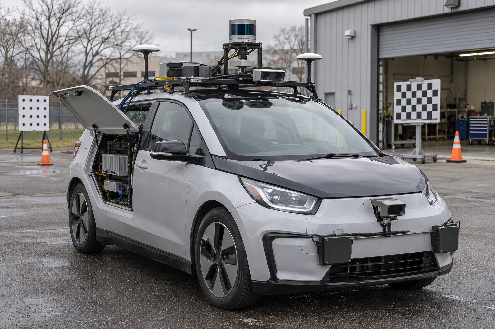
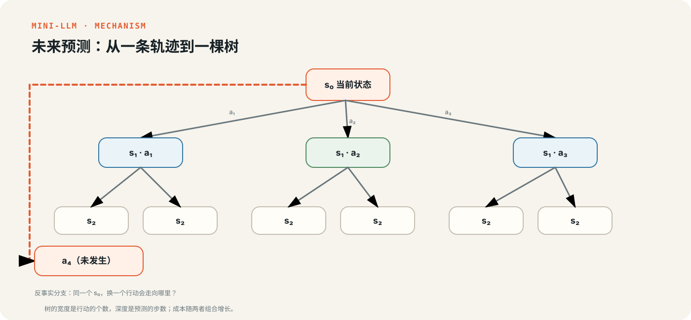
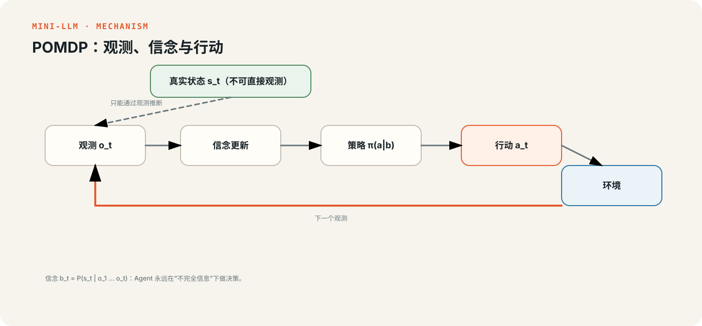

# **《mini-llm World Model Engine 深度解析：从 State Representation、World Dynamics 到 Future Prediction、Action Simulation 与 Counterfactual Reasoning》**

**核心问题：AI 如何不只是理解当前世界，还能在内部模拟未来世界？**

前面我们已经研究了 mini-llm 的多个核心 Engine：

- Transformer Engine：如何处理上下文和序列信息。
- Representation Engine：如何构建内部表示空间。
- Knowledge Engine：如何组织知识和关系。
- Causal Reasoning Engine：如何分析因果关系。
- Decision Engine：如何根据目标和风险做出决策。
- Planning Engine：如何规划行动步骤。
- Simulation Engine：如何模拟环境运行。
- Spatial Intelligence Engine：如何理解三维空间。
- Multimodal Intelligence Engine：如何融合文字、图像、音频和视频。
- Embodied Intelligence Engine：如何通过身体与环境交互。

这些能力最终指向一个更深层的问题：

**智能体能不能在真正行动之前，先在自己的内部构建一个世界，并模拟不同的行动可能产生什么结果？**

例如：

一个机器人看到桌子上有一个杯子。

它不仅需要知道：

```
桌子上有一个杯子。
```

还需要能够预测：

```
如果我推动杯子：
  杯子可能向前移动。

如果我抬起杯子：
  杯子会离开桌面。

如果我松开杯子：
  杯子可能受到重力影响而下落。

如果我把杯子放进盒子：
  杯子与盒子之间会形成包含关系。
```

这就是 World Model（世界模型）试图解决的问题。



_图：搭载多种传感器的自动驾驶研究车辆。世界模型要在内部预测周围车辆与行人的下一步变化，规划才有依据。图片：本仓库 AI 生成图。_

# **一、World Model：什么是世界模型？**



_图：从一条轨迹到一棵树。树的宽度是行动的个数，深度是预测的步数；反事实分支问的是“换一个行动会走向哪里”。_

## **1.1 从识别世界到模拟世界**

传统 AI 系统通常重点解决感知任务。

例如：

- 图像分类。
- 目标检测。
- 语音识别。
- 文本理解。
- 视频摘要。

这些任务主要回答：

**当前输入是什么？**

World Model 则试图进一步回答：

- 当前世界处于什么状态？
- 世界中的对象如何变化？
- 如果执行某个行动，会发生什么？
- 不同行动的结果有什么差异？
- 如果没有执行这个行动，结果会怎样？

我们可以用三个层次理解：

## **从感知到世界模拟**

**Level 1：World Perception**

理解当前世界

桌子上有一个杯子，杯子距离机器人 30cm。

**Level 2：World Representation**

构建内部世界表示

记录杯子的位置、姿态、尺寸、物理属性和空间关系。

**Level 3：World Prediction & Simulation**

模拟未来世界

预测抓取、推动、放置等行动可能产生的结果。

例如，AI 不仅知道杯子在桌子上，还可以在内部模拟：

```
当前状态：
  杯子在桌面上。

候选行动 A：
  抓取杯子。

预测结果：
  杯子离开桌面，进入机器人夹爪。

候选行动 B：
  推动杯子。

预测结果：
  杯子可能沿桌面移动。

候选行动 C：
  不执行任何操作。

预测结果：
  如果环境保持稳定，杯子大概率仍然在原位置。
```

注意，预测结果并不是事实，而是模型在特定假设下给出的估计。

## **1.2 World Model 的核心定义**

可以把 World Model 定义为：

**一个学习或维护环境状态及其变化规律，并能够根据当前状态、行动和环境条件预测未来状态的内部模型。**

数学上：

\\[ s\_{t+1}=f\_\theta(s_t,a_t) \\]

其中：

- \\(s_t\\)：当前世界状态。
- \\(a_t\\)：智能体执行的行动。
- \\(s\_{t+1}\\)：未来世界状态。
- \\(f\_\theta\\)：世界动态模型。
- \\(\theta\\)：模型参数。

如果环境存在随机性，可以进一步写为：

\\[ P(s\_{t+1}\mid s_t,a_t) \\]

这意味着模型不再只预测一个确定结果，而是预测未来状态的概率分布。

这非常重要。

现实世界具有不确定性：

- 杯子可能滑动，也可能没有滑动。
- 机械臂可能抓稳，也可能抓取失败。
- 行人可能继续前进，也可能突然转向。
- 天气可能变化。
- 用户可能改变决策。

一个成熟的 World Model 必须能够处理这些不确定性。

# **二、State Representation：如何表示当前世界状态？**



_图：POMDP 的信念更新。真实状态 s_t 不可直接观测，Agent 只能根据观测维护信念 b_t = P(s_t | o_1 … o_t)。_

World Model 的第一项基础能力，是构建 State Representation（状态表示）。

如果 AI 不知道当前世界是什么状态，就无法可靠预测未来。

## **2.1 什么是 State？**

State 是描述系统在某个时刻状态的信息集合。

例如，一个机器人操作桌面物体的场景：

```
world_state = {    "robot": {        "position": [0.1, 0.2, 0.3],        "joint_positions": [0.1, 0.3, 0.5]    },    "objects": [        {            "id": "cup",            "position": [0.4, 0.2, 0.8],            "rotation": [1, 0, 0, 0],            "velocity": [0, 0, 0]        }    ],    "environment": {        "gravity": 9.81,        "surface": "table"    }}
```

这只是一个简化示例。

真实状态还可能包含：

- 物体质量。
- 摩擦系数。
- 关节速度。
- 末端执行器状态。
- 接触状态。
- 温度。
- 环境约束。
- 其他智能体状态。

## **2.2 State 与 Observation 有什么区别？**

这是理解 World Model 必须掌握的概念。

**State 是系统的状态，Observation 是智能体实际观察到的信息。**

例如：

现实世界中：

```
杯子：
  位置：桌子右侧
  内部有水
  当前没有移动
```

摄像头只能看到杯子的外部形状，无法确定杯子里面是否有水。

因此：

```
真实状态：
  杯子有水。

观察结果：
  看到了一个杯子。
```

二者并不相同。

数学上：

\\[ o_t\sim P(o_t\mid s_t) \\]

其中：

- \\(s_t\\)：真实状态。
- \\(o_t\\)：观察结果。
- \\(P(o_t\mid s_t)\\)：观察模型。

这也是为什么机器人不能仅依赖一次摄像头识别结果做出所有决策。

## **2.3 部分可观察环境：POMDP**

现实环境往往不是完全可观察的。

例如：

- 物体被遮挡。
- 传感器有噪声。
- 物体内部状态未知。
- 其他智能体的意图未知。

这类问题可以使用 POMDP（Partially Observable Markov Decision Process，部分可观察马尔可夫决策过程）建模。

一个 POMDP 通常包括：

\\[ \mathcal{P}=(S,A,T,O,Z,R,\gamma) \\]

其中：

| 符号 | 含义     |
| -- | ------ |
| S  | 状态集合   |
| A  | 行动集合   |
| T  | 状态转移模型 |
| O  | 观察集合   |
| Z  | 观察模型   |
| R  | 奖励函数   |
| γ  | 折扣因子   |

在部分可观察环境中，智能体通常不能直接获取真实状态，而是维护一个 Belief State（信念状态）。

\\[ b_t(s)=P(s_t=s\mid o\_{1:t},a\_{1:t-1}) \\]

它表示：

智能体根据历史观察和行动，对当前世界状态形成的概率判断。

例如：

```
杯子是否装水？

有水：0.75
没有水：0.25
```

这里的概率是示意值，实际需要通过传感器和模型校准得到。

## **2.4 State Representation 的不同层次**

World Model 可以维护多层状态：

| 状态层次            | 内容             |
| --------------- | -------------- |
| Physical State  | 位置、速度、质量、力     |
| Spatial State   | 三维位置、姿态、空间关系   |
| Semantic State  | 对象类别、属性、含义     |
| Temporal State  | 时间、事件顺序、持续时间   |
| Social State    | 其他智能体、角色、意图估计  |
| Cognitive State | 智能体自身的目标、信念和计划 |

需要注意：并不是所有 World Model 都必须包含全部这些状态。具体取决于应用领域。

例如：

- 机器人需要重点关注物理状态。
- 自动驾驶需要重点关注动态交通参与者。
- 软件 Agent 可能需要重点关注程序状态、任务状态和工具状态。
- 游戏 Agent 需要关注地图、角色、资源和事件状态。

**State Representation 必须服务于预测任务，而不是无限制地收集信息。**

# **三、World Dynamics：世界是如何变化的？**

如果 State Representation 描述当前世界，那么 World Dynamics 描述世界如何从一个状态变化到另一个状态。

## **3.1 什么是状态转移？**

假设一个球在桌面上。

当前状态：

\\[ s_t= \begin{bmatrix} x_t\\\ v_t \end{bmatrix} \\]

其中：

- \\(x_t\\)：球的位置。
- \\(v_t\\)：球的速度。

如果给球一个推动力，它的位置和速度会发生变化。

简化的一维运动模型：

\\[ x\_{t+1}=x_t+v_t\Delta t \\]

\\[ v\_{t+1}=v_t+a_t\Delta t \\]

其中：

- \\(\Delta t\\)：时间间隔。
- \\(a_t\\)：加速度。

合并：

\\[ s\_{t+1}=f(s_t,a_t,\Delta t) \\]

这就是状态转移模型。

## **3.2 物理世界的动态模型**

在物理系统中，状态变化通常与物理定律有关。

例如，经典牛顿运动方程：

\\[ F=ma \\]

可以得到：

\\[ a=\frac{F}{m} \\]

如果知道物体质量和外力，就可以估计加速度。

更完整的机械系统可以表示为：

\\[ M(q)\ddot q+C(q,\dot q)\dot q+g(q)=\tau \\]

其中：

- \\(q\\)：关节位置。
- \\(\dot q\\)：关节速度。
- \\(\ddot q\\)：关节加速度。
- \\(M(q)\\)：惯性矩阵。
- \\(C(q,\dot q)\\)：科氏力和离心力相关项。
- \\(g(q)\\)：重力项。
- \\(\tau\\)：关节力矩。

这说明机器人世界模型可以利用已知物理规律，而不必完全依赖数据学习。

## **3.3 三种 World Dynamics 建模方法**

### **方法一：Physics-based Model**

基于物理规律建立模型。

例如：

- 牛顿力学。
- 刚体动力学。
- 流体力学。
- 热力学。
- 电路模型。

优点：

- 有明确的物理意义。
- 对已知系统可以具有较强泛化能力。
- 能够进行物理约束检查。

缺点：

- 建模复杂。
- 需要物理参数。
- 真实环境存在难以建模的摩擦、变形和复杂接触。

### **方法二：Data-driven Model**

使用数据学习状态转移关系。

例如：

\\[ s\_{t+1}=f\_\theta(s_t,a_t) \\]

训练数据：

```
输入：
  当前状态
  执行的行动

标签：
  下一时刻的真实状态
```

模型可以使用：

- MLP。
- CNN。
- Transformer。
- RNN。
- State Space Model。

优点：

- 可以学习复杂、难以手工建模的规律。
- 适合从大量交互数据中提取模式。

缺点：

- 依赖训练数据覆盖范围。
- 分布外预测可能不可靠。
- 可能违反物理约束。

### **方法三：Hybrid Model**

混合物理模型与数据驱动模型。

例如：

\\[ s\_{t+1} = f\_{physics}(s_t,a_t) + f\_\theta(s_t,a_t) \\]

其中：

- \\(f\_{physics}\\)：已知物理模型。
- \\(f\_\theta\\)：学习物理模型没有覆盖的残差。

这种方式可以让模型利用物理知识，同时学习现实系统中的复杂偏差。

但残差模型也需要验证，不能保证自动保持物理合理性。

## **3.4 World Dynamics 的核心难点**

真实世界并不是简单的线性函数。

例如：

一个杯子受到推动时，结果可能受到以下因素影响：

- 推动力大小。
- 推动方向。
- 杯子质量。
- 桌面摩擦。
- 杯子底部形状。
- 杯子是否装水。
- 是否发生碰撞。

因此：

\\[ s\_{t+1}=f(s_t,a_t,e_t) \\]

其中 \\(e_t\\) 表示环境条件。

更复杂的情况下，状态转移本身还是随机的：

\\[ s\_{t+1}\sim P\_\theta(s\_{t+1}\mid s_t,a_t) \\]

这意味着 World Model 需要学习的不只是状态变化，还包括变化的不确定性。

# **四、Future Prediction：如何预测未来？**

World Model 的重要能力是 Future Prediction。

也就是：

**根据当前状态和可能的行动，预测未来可能发生什么。**

## **4.1 单步预测**

最简单的预测是下一时刻状态：

\\[ \hat{s}\_{t+1}=f\_\theta(s_t,a_t) \\]

例如：

```
当前状态：
  杯子位置：x=0.4
  杯子速度：v=0

行动：
  向右推动杯子

预测：
  杯子向右移动
```

这叫 One-step Prediction。

## **4.2 多步预测**

现实任务往往需要预测多个时间步。

例如：

机器人抓取杯子，需要提前预测：

- 机械臂移动后的位置。
- 夹爪闭合后的接触状态。
- 杯子被抬起后的状态。
- 机械臂移动过程中的碰撞风险。

可以递归计算：

\\[ \hat{s}\_{t+1}=f\_\theta(s_t,a_t) \\]

\\[ \hat{s}\_{t+2}=f\_\theta(\hat{s}\_{t+1},a\_{t+1}) \\]

\\[ \hat{s}\_{t+3}=f\_\theta(\hat{s}\_{t+2},a\_{t+2}) \\]

一般形式：

\\[ \hat{s}\_{t+H} = f\_\theta^{(H)}(s_t,a\_{t:t+H-1}) \\]

其中 H 是预测步数。

### **多步预测为什么更困难？**

因为预测误差会逐步累积。

假设每一步都有一定误差：

\\[ \hat{s}\_{t+1}=s\_{t+1}+\epsilon_1 \\]

下一步预测依赖前一步的预测状态：

\\[ \hat{s}\_{t+2}=f\_\theta(\hat{s}\_{t+1},a\_{t+1}) \\]

如果模型本身不稳定，误差可能逐渐放大。

因此，World Model 需要考虑：

- 预测时间范围。
- 误差累积。
- 不确定性传播。
- 观测更新。
- 模型校准。

## **4.3 Deterministic Prediction 与 Probabilistic Prediction**

确定性预测：

\\[ \hat{s}\_{t+1}=f\_\theta(s_t,a_t) \\]

输出一个状态估计。

概率预测：

\\[ P\_\theta(s\_{t+1}\mid s_t,a_t) \\]

输出未来状态的概率分布。

例如：

```
推动杯子后：

向右移动 5cm：0.60
向右移动 3cm：0.25
基本不动：0.10
发生倾倒：0.05
```

这组概率只是示意。

概率预测更适合处理现实世界中的不确定性。

### **4.4 多模态未来预测**

未来预测不仅可以针对数值状态，也可以针对图像、视频和空间结构。

例如：

- 预测未来视频帧。
- 预测物体轨迹。
- 预测三维场景变化。
- 预测机器人动作执行结果。
- 预测交通参与者行为。

但是需要区分：

**预测一张视觉上合理的未来图像，不等于准确预测真实世界的物理状态。**

例如，一个生成模型可能生成看起来合理的杯子移动视频，但杯子实际运动轨迹、接触关系和物理约束可能并不正确。

所以：

- 视觉预测需要视觉指标。
- 物理预测需要状态误差和物理一致性指标。
- 机器人执行预测需要真实执行成功率。

不能只通过生成图像的视觉效果判断 World Model 的质量。

# **五、Action Simulation：如何在内部模拟行动？**

Future Prediction 预测未来。

Action Simulation 则进一步关注：

**如果我主动采取某个行动，世界会发生什么变化？**

这是 World Model 与智能体决策之间的重要连接。

## **5.1 为什么需要 Action Simulation？**

假设机器人面前有两个选择：

```
行动 A：直接抓取杯子。

行动 B：先移动盒子，再抓取杯子。
```

机器人不应该盲目选择。

它可以先模拟：

```
Simulation A：
  机械臂直接接近杯子。
  可能与盒子发生碰撞。
  任务失败风险较高。

Simulation B：
  先移动盒子。
  再接近杯子。
  预计路径更加安全。
```

通过模拟不同动作，智能体可以在真实执行之前比较方案。

## **5.2 Action-conditioned World Model**

模型需要把行动作为输入。

\\[ \hat{s}\_{t+1}=f\_\theta(s_t,a_t) \\]

如果动作是连续的：

\\[ a_t\in\mathbb{R}^n \\]

例如：

```
action = {    "end_effector_position": [0.4, 0.2, 0.8],    "gripper_opening": 0.04,    "duration": 1.0}
```

如果动作是离散的：

```
action = "pick_up_cup"
```

模型需要理解不同动作对应的状态变化。

实际系统中，建议将高层语义动作和底层控制指令区分开：

```
High-level Action:
  Pick up cup

Low-level Action:
  Move joints
  Close gripper
  Apply force
```

World Model 可以预测高层任务结果，也可以在具备足够精度的情况下预测低层动力学。

两者的模型要求和时间尺度不同。

## **5.3 Action Simulation 的基本流程**

## **Action Simulation Loop**

**Current World State**

当前世界状态 \\(s_t\\)

**Candidate Actions**

候选行动 \\(a_1,a_2,\ldots,a_n\\)

**World Model**

模拟不同动作的状态转移

**Predicted Future States**

未来状态、风险和不确定性

**Action Evaluation**

比较收益、成本和风险

**Select Action**

选择通过约束验证的行动

## **5.4 Model Predictive Control：模型预测控制**

Model Predictive Control（MPC）是将预测模型用于行动决策的重要方法。

核心思想：

1. 获取当前状态。
2. 预测未来一段时间。
3. 优化未来行动序列。
4. 只执行第一个行动。
5. 获取新的观察。
6. 重新预测和优化。

假设规划未来 H 步行动：

\\[ A=(a_t,a\_{t+1},\ldots,a\_{t+H-1}) \\]

优化目标：

\\[ A^\*= \arg\min_A \sum\_{k=0}^{H-1} \ell(s\_{t+k},a\_{t+k}) + \ell_f(s\_{t+H}) \\]

其中：

- \\(\ell\\)：每一步的成本函数。
- \\(\ell_f\\)：终端成本。
- 状态由 World Model 预测得到。

执行时只执行：

\\[ a_t^\* \\]

然后重新获取真实观察。

这种方式叫 Receding Horizon Control（滚动时域控制）。

### **为什么不一次性执行整个计划？**

因为真实世界可能发生变化：

- 杯子被其他人移动。
- 机器人产生定位误差。
- 机械臂抓取失败。
- 环境出现新的障碍物。

因此，预测必须持续接受真实观察的修正。

**World Model 提供预测，MPC 利用预测优化行动，反馈控制负责让系统根据真实状态持续调整。**

# **六、Counterfactual Reasoning：如果当时采取另一个行动，会怎样？**

这是 World Model 更深层的能力。

Counterfactual Reasoning，反事实推理，研究的是：

**在已经发生的事实之外，如果某个条件不同，结果会怎样？**

例如：

```
现实：

机器人推动杯子。
杯子掉到了地上。

反事实：

如果机器人没有推动杯子，
杯子是否还会掉下来？
```

这与普通预测有区别。

## **6.1 Prediction 与 Counterfactual 的区别**

| 类型                | 问题                 |
| ----------------- | ------------------ |
| Prediction        | 接下来可能发生什么？         |
| Action Simulation | 如果采取某个行动，会发生什么？    |
| Counterfactual    | 如果过去采取另一个行动，结果会怎样？ |

例如：

**Prediction：**

如果现在推动杯子，它可能向右移动。

**Action Simulation：**

模拟推动杯子和抓取杯子两种行动的结果。

**Counterfactual：**

杯子已经被推动并掉落。如果当时没有推动，杯子是否会保持在桌面上？

这三个问题相关，但并不相同。

## **6.2 结构因果模型（SCM）**

反事实推理通常需要结构因果模型（Structural Causal Model）。

一个 SCM 可以表示为：

\\[ X_i=f_i(PA_i,U_i) \\]

其中：

- \\(X_i\\)：变量。
- \\(PA_i\\)：变量的直接原因。
- \\(U_i\\)：外生因素。
- \\(f_i\\)：结构方程。

例如：

```
推动力度
   |
   v
杯子速度
   |
   v
杯子位置
   |
   v
是否掉落
```

可以写成：

\\[ V=f_1(F,U_1) \\]

\\[ X=f_2(V,U_2) \\]

\\[ Y=f_3(X,U_3) \\]

其中：

- \\(F\\)：推动力度。
- \\(V\\)：杯子速度。
- \\(X\\)：杯子位置。
- \\(Y\\)：是否掉落。

这只是一个简化模型。现实中还需要考虑摩擦、桌面边界、杯子形状和接触动力学等因素。

## **6.3 Intervention：干预**

因果推理中有一个重要概念：

\\[ do(X=x) \\]

它表示主动把变量 X 设置为 x，而不是仅仅观察 X 恰好取值为 x。

例如：

\\[ P(Y\mid F=0) \\]

表示观察到推动力度为 0 时，杯子掉落的概率。

而：

\\[ P(Y\mid do(F=0)) \\]

表示主动设置推动力度为 0 后，杯子掉落的概率。

在存在混杂因素时，两者可能不同。

这也是普通预测与因果干预之间的重要区别。

## **6.4 反事实的三步过程**

在结构因果模型中，一个经典的反事实计算过程包括：

## **Counterfactual Inference**

**Step 1：Abduction**

根据实际观察推断外生变量或背景条件。

**Step 2：Action**

修改模型中的某个变量或结构方程输入。

**Step 3：Prediction**

使用修改后的模型重新计算结果。

例如：

现实：

```
推动力度：较大
杯子速度：较快
杯子掉落：是
```

反事实：

```
保持其他背景条件不变。

如果推动力度较小：

杯子速度可能较低。
杯子可能没有掉落。
```

这里的“保持其他背景条件不变”非常重要。

如果没有可信的结构模型，就不能仅凭一段自然语言推理断言反事实结果。

## **6.5 Counterfactual 与 World Model 的关系**

World Model 提供状态和动态规律。

Causal Reasoning Engine 提供因果结构和干预推理能力。

Counterfactual Reasoning 则利用这些结构回答替代情境问题。

因此：

\\[ World\ Model + Causal\ Model \rightarrow Counterfactual\ Analysis \\]

但这不是说任何预测模型都自动具有反事实推理能力。

一个只学习：

\\[ P(s\_{t+1}\mid s_t,a_t) \\]

的预测模型，并不必然识别出了真实世界的因果结构。

# **七、World Model 与 Planning：如何利用模拟进行规划？**

如果 World Model 可以预测未来，那么 Planning Engine 就可以利用预测结果寻找行动方案。

## **7.1 Planning 的基本问题**

假设机器人需要把杯子放进盒子。

目标：

\\[ G=\text{cup inside box} \\]

当前状态：

\\[ s_0=\text{cup on table} \\]

候选计划：

```
Plan A:
  直接抓取杯子。
  移动到盒子上方。
  放下杯子。

Plan B:
  先移动盒子。
  再抓取杯子。
  放入盒子。
```

World Model 可以预测每个计划的执行结果。

Planning Engine 再根据目标、成本和约束进行选择。

## **7.2 基于模型的规划**

假设有一个目标函数：

\\[ J(A)= \sum\_{t=0}^{H-1} c(s_t,a_t) + c_f(s_H) \\]

其中：

- \\(A\\)：行动序列。
- \\(c\\)：行动成本。
- \\(c_f\\)：终端状态成本。

规划目标：

\\[ A^\*=\arg\min_A J(A) \\]

这里的状态由 World Model 预测产生。

如果存在多个可能结果，可以优化期望成本：

\\[ A^\*= \arg\min_A \mathbb{E}[J(A)] \\]

但在高风险任务中，单纯最小化期望成本可能不够，还需要考虑尾部风险和硬性安全约束。

## **7.3 Monte Carlo Tree Search**

当行动选择比较复杂时，可以考虑 Monte Carlo Tree Search（MCTS）。

基本思想：

```
             Current State
                  |
          -----------------
          |       |       |
        Action A Action B Action C
          |       |       |
        Future  Future  Future
        State   State   State
          |       |       |
        Rollout Rollout Rollout
          |       |       |
        Evaluate Evaluate Evaluate
```

主要步骤：

1. Selection：选择已有搜索树中的节点。
2. Expansion：扩展新的行动。
3. Simulation：模拟后续状态。
4. Backpropagation：将模拟结果回传到搜索树。

MCTS 可以结合 World Model 进行模型内部搜索。

但模拟质量受 World Model 质量限制。

如果模型对未来状态预测错误，搜索可能反而找到现实中不可行的方案。

# **八、World Model 的重要技术路线**

World Model 并不是一种固定的神经网络架构。

它可以使用不同技术构建。

## **8.1 Latent World Model**

一种重要方向是 Latent World Model（潜在空间世界模型）。

它不直接在原始像素空间模拟世界，而是在压缩后的潜在空间进行预测。

例如：

\\[ z_t=Encoder(o_t) \\]

然后：

\\[ z\_{t+1}=f\_\theta(z_t,a_t) \\]

其中：

- \\(o_t\\)：原始观察。
- \\(z_t\\)：潜在状态。
- \\(a_t\\)：行动。
- \\(f\_\theta\\)：潜在状态转移模型。

完整流程：

```
Observation
    |
    v
Encoder
    |
    v
Latent State
    |
    v
World Dynamics
    |
    v
Future Latent State
    |
    v
Decoder
    |
    v
Predicted Observation
```

为什么要使用 Latent Space？

因为原始图像数据非常庞大。

假设一张图片：

\\[ 224\times224\times3 \\]

共有：

\\[ 150528 \\]

个像素通道值。

如果直接预测每个像素，模型需要处理大量细节。

但任务可能只关心：

- 杯子在哪里。
- 杯子是否移动。
- 机器人是否抓住杯子。

因此，潜在状态可以压缩任务相关信息。

需要注意，压缩过度可能丢失对任务重要的细节。潜在表示必须通过预测目标和任务评估验证是否足够。

## **8.2 Recurrent State-Space Model**

RSSM（Recurrent State-Space Model）是世界模型领域的重要架构思路。

它将状态拆成：

- Deterministic State：确定性记忆状态。
- Stochastic State：随机潜在状态。

一种简化表达：

\\[ h_t=f\_\theta(h\_{t-1},z\_{t-1},a\_{t-1}) \\]

\\[ z_t\sim q\_\phi(z_t\mid h_t,o_t) \\]

预测先验：

\\[ \hat z_t\sim p\_\theta(z_t\mid h_t) \\]

其中：

- \\(h_t\\)：确定性隐藏状态。
- \\(z_t\\)：随机潜在状态。
- \\(o_t\\)：观察。
- \\(q\_\phi\\)：后验分布。
- \\(p\_\theta\\)：先验分布。

其价值在于：

模型可以在有观察时更新潜在状态，也可以在没有新观察时继续在内部预测。

这对机器人和强化学习尤其重要。

## **8.3 Video Prediction Model**

另一种方式是直接预测未来视频帧。

\\[ \hat I\_{t+1}=f\_\theta(I\_{1:t},a\_{1:t}) \\]

适合：

- 视频未来帧生成。
- 动作条件视频预测。
- 环境动态学习。
- 视频模拟。

但视频生成模型不一定具备精确的物理状态预测能力。

## **8.4 Object-centric World Model**

另一种重要思路是以对象为中心表示世界。

而不是把整个世界当作一个整体向量。

例如：

```
World
 ├── Robot
 ├── Cup
 ├── Box
 ├── Table
 └── Human
```

每个对象都有自己的：

- Position。
- Velocity。
- Geometry。
- Physical Properties。
- Semantic Properties。

对象之间存在：

- Contact。
- Support。
- Containment。
- Collision。
- Relative Position。

这种表示特别适合机器人操作和场景推理。

## **8.5 不同 World Model 架构比较**

| 架构             | 主要表示  | 优势         | 局限          |
| -------------- | ----- | ---------- | ----------- |
| Physics-based  | 物理状态  | 可解释、物理约束明确 | 建模成本高       |
| Data-driven    | 观测和动作 | 能学习复杂规律    | 分布外风险       |
| Latent Model   | 潜在状态  | 计算效率高      | 可解释性和信息损失   |
| Video Model    | 视频帧   | 视觉未来预测     | 不保证物理准确     |
| Object-centric | 对象和关系 | 适合交互和推理    | 对象分割和关系估计困难 |
| Hybrid Model   | 物理+学习 | 兼顾先验和数据    | 系统复杂度较高     |

# **九、World Model 与 LLM：大语言模型内部是否有世界模型？**

这是一个非常值得研究的问题。

LLM 通过预测下一个 Token 进行训练：

\\[ P(x\_{t+1}\mid x_1,\ldots,x_t) \\]

那么，为什么它能够回答：

- 如果杯子掉在地上，会发生什么？
- 如果汽车突然刹车，后面的车辆可能怎样？
- 如果一个人向左移动，另一个人会不会受到影响？

一种解释是：

模型从大量文本和多模态数据中学习到了世界中的统计规律。

这些规律可能隐含在：

- Embedding。
- Attention。
- Residual Stream。
- MLP。
- Hidden States。
- 内部激活模式。

例如：

```
输入：
  如果把玻璃杯从桌面推下去，会发生什么？

输出：
  玻璃杯可能掉落并破碎。
```

模型能够生成这种回答，说明它学习到了某些与物理世界相关的统计关联。

但这里必须区分三个概念。

### **9.1 隐式世界知识**

模型通过训练数据学到关于世界的知识和规律。

例如：

- 物体受到重力影响。
- 杯子可以装水。
- 人通常需要通过门进入房间。

### **9.2 可操作的世界状态**

模型能够显式维护：

```
cup.position
cup.velocity
cup.mass
cup.support_surface
```

并对其进行更新。

### **9.3 可验证的世界动态模型**

模型能够通过状态和行动预测未来，并且预测结果可以通过真实环境或仿真器验证。

这三者不是同一回事。

**LLM 能够描述世界，不等于它拥有准确的物理模拟器。**

# **十、World Model 与 JEPA：从预测像素到预测表示**

在世界模型研究中，JEPA（Joint Embedding Predictive Architecture）提供了一种值得关注的思路。

它关注的问题是：

**是否可以不直接预测未来像素，而是预测未来的抽象表示？**

## **10.1 传统像素预测**

输入：

```
当前视频帧
```

模型输出：

```
未来视频帧
```

目标：

\\[ \hat{x}\_{t+1}\approx x\_{t+1} \\]

问题：

像素级预测可能需要处理大量无关细节。

例如：

- 光照变化。
- 纹理变化。
- 背景细节。
- 摄像头噪声。

这些细节不一定是理解物体运动所必需的。

## **10.2 Representation Prediction**

JEPA 的基本思想是：

先将观察转换为表示，再预测目标表示。

```
Context Observation
       |
       v
Context Encoder
       |
       v
Context Representation
       |
       v
Predictor
       |
       v
Predicted Target Representation

Target Observation
       |
       v
Target Encoder
       |
       v
Target Representation
```

数学上：

\\[ z_c=Encoder(x_c) \\]

\\[ \hat z_t=Predictor(z_c) \\]

\\[ z_t=TargetEncoder(x_t) \\]

然后让：

\\[ \hat z_t\approx z_t \\]

通过这种方式，模型重点学习未来的抽象特征，而不是重建所有像素。

## **10.3 为什么这很重要？**

假设一辆汽车在道路上移动。

传统像素预测需要预测：

- 汽车表面颜色。
- 车窗反光。
- 背景树木。
- 道路纹理。
- 所有像素变化。

而表示预测可以重点关注：

- 汽车位置。
- 汽车速度。
- 道路结构。
- 与其他车辆的关系。
- 未来运动方向。

这可能更适合规划和决策任务。

但 JEPA 不是自动获得物理规律的万能架构。它学习到的表示是否保留了行动决策需要的信息，仍然需要任务和环境验证。

# **十一、World Model 与 Dreamer：在想象中学习行动**

Dreamer 是基于世界模型进行强化学习的重要代表方向。

它的核心思想是：

**智能体可以先学习环境动态，再利用学习到的世界模型进行内部想象和策略学习。**

## **11.1 传统强化学习**

传统 Model-free Reinforcement Learning 通常通过真实环境交互学习策略。

```
Agent
  |
  v
Environment
  |
  v
Reward
  |
  v
Policy Update
```

问题：

- 需要大量真实环境交互。
- 真实机器人试错成本高。
- 某些动作可能造成损坏。

## **11.2 基于 World Model 的强化学习**

Model-based RL 可以先学习环境模型：

```
Real Environment
      |
      v
Collect Experience
      |
      v
Train World Model
      |
      v
Imagine Future Trajectories
      |
      v
Learn Policy
      |
      v
Evaluate in Real Environment
```

例如：

机器人在真实环境中学习抓取杯子。

然后在内部模型中尝试大量动作：

```
尝试 A：
  夹爪位置偏左。
  抓取失败。

尝试 B：
  夹爪位置居中。
  抓取成功。

尝试 C：
  夹爪位置过高。
  无法接触杯子。
```

通过内部模拟，策略可以获得更多训练经验。

但必须强调：

**在错误的世界模型中进行大量想象，可能让智能体学会利用模型漏洞，而不是学会真实世界中的能力。**

因此，想象数据不能完全替代真实环境验证。

# **十二、mini-llm World Model Engine 工程架构**

现在将前面的理论转化为 mini-llm 的工程设计。

## **12.1 核心职责**

mini-llm World Model Engine 应当负责：

1. 维护世界状态。
2. 整合多模态观察。
3. 学习或加载状态转移模型。
4. 预测未来状态。
5. 模拟候选行动。
6. 估计预测不确定性。
7. 为 Planning 和 Decision 提供预测结果。
8. 通过真实观察更新世界模型状态。

它不应该直接承担所有底层物理仿真和机器人控制工作。

例如：

- Robotics Engine 负责机器人运动学和动力学。
- Simulation Engine 负责组织仿真实验和运行环境。
- Causal Reasoning Engine 负责因果结构与干预推理。
- World Model Engine 负责状态表示和未来预测。

## **12.2 总体架构**

## **mini-llm World Model Engine**

**Observation Ingestion**

Text / Image / Audio / Video / Sensors / Events

**State Estimation**

State / Belief / Object Tracking / State Fusion

**World Representation**

Latent State / Scene Graph / Physical State / Memory

**Dynamics Model**

State Transition

**Uncertainty Model**

Probability / Confidence

**Prediction & Action Simulation**

Future State / Trajectory / Action Outcomes

**World Model API**

Predict / Simulate / Query / Update / Evaluate

向 Planning、Decision、Causal、Simulation、Robotics 和 Agent Engine 提供世界状态与预测能力

## **12.3 推荐工程目录**

```
mini-llm/
│
├── engines/
│   └── world_model/
│       │
│       ├── state/
│       │   ├── world_state.py
│       │   ├── state_estimator.py
│       │   ├── belief_state.py
│       │   └── state_fusion.py
│       │
│       ├── representation/
│       │   ├── latent_encoder.py
│       │   ├── object_state.py
│       │   ├── scene_state.py
│       │   └── state_schema.py
│       │
│       ├── dynamics/
│       │   ├── base_dynamics.py
│       │   ├── physics_model.py
│       │   ├── neural_dynamics.py
│       │   └── hybrid_dynamics.py
│       │
│       ├── prediction/
│       │   ├── one_step.py
│       │   ├── multi_step.py
│       │   ├── trajectory.py
│       │   └── uncertainty.py
│       │
│       ├── simulation/
│       │   ├── action_simulator.py
│       │   ├── rollout.py
│       │   └── scenario.py
│       │
│       ├── counterfactual/
│       │   ├── causal_model.py
│       │   ├── intervention.py
│       │   └── counterfactual.py
│       │
│       ├── learning/
│       │   ├── dataset.py
│       │   ├── trainer.py
│       │   ├── replay_buffer.py
│       │   └── model_registry.py
│       │
│       ├── evaluation/
│       │   ├── prediction_eval.py
│       │   ├── uncertainty_eval.py
│       │   └── rollout_eval.py
│       │
│       ├── api/
│       │   └── world_model_api.py
│       │
│       └── tests/
```

# **十三、设计核心 API**

建议将 World Model 设计成一个可以被其他 Engine 调用的独立服务或模块。

### **13.1 World State**

```
from dataclasses import dataclassfrom typing import Any@dataclassclass WorldState:    timestamp: float    objects: list[dict[str, Any]]    environment: dict[str, Any]    robot_state: dict[str, Any]    uncertainty: dict[str, Any]
```

### **13.2 Action**

```
@dataclassclass WorldAction:    action_type: str    parameters: dict[str, Any]    duration: float
```

### **13.3 Prediction Result**

```
@dataclassclass PredictionResult:    predicted_states: list[WorldState]    confidence: float    horizon: int    model_version: str
```

实际工程中，建议不要仅使用一个 `confidence` 表示整段预测的可信度。

应该为不同变量、对象和时间步分别维护预测分布或不确定性。

### **13.4 World Model 接口**

```
class WorldModel:    def observe(self, observation):        """        更新世界状态。        """        raise NotImplementedError    def get_state(self):        """        获取当前状态估计。        """        raise NotImplementedError    def predict(self, state, action, horizon):        """        预测未来状态。        """        raise NotImplementedError    def simulate(self, state, actions):        """        模拟一系列候选行动。        """        raise NotImplementedError    def evaluate_prediction(self, prediction, actual):        """        评估预测结果。        """        raise NotImplementedError
```

# **十四、实现一个最小 World Model**

先使用简单的一维运动模型理解 World Dynamics。

假设有一个物体，它在直线上移动。

状态：

\\[ s_t= \begin{bmatrix} x_t\\\ v_t \end{bmatrix} \\]

行动：

\\[ a_t=u_t \\]

其中 \\(u_t\\) 表示加速度。

运动方程：

\\[ x\_{t+1} = x_t+v_t\Delta t+ \frac{1}{2}u_t\Delta t^2 \\]

\\[ v\_{t+1}=v_t+u_t\Delta t \\]

Python 实现：

```
class SimpleWorldModel:    def __init__(self, dt=0.1):        self.dt = dt    def predict(self, state, action):        x = state["position"]        v = state["velocity"]        a = action["acceleration"]        dt = self.dt        next_x = (            x + v * dt            + 0.5 * a * dt * dt        )        next_v = v + a * dt        return {            "position": next_x,            "velocity": next_v        }model = SimpleWorldModel()state = {    "position": 0.0,    "velocity": 0.0}action = {    "acceleration": 2.0}next_state = model.predict(    state,    action)print(next_state)
```

输出：

```
{
    'position': 0.010000000000000002,
    'velocity': 0.2
}
```

这就是一个最小的 World Dynamics Model。

它虽然简单，却已经具备三个关键要素：

1. 当前状态。
2. 行动输入。
3. 未来状态预测。

如果再加入：

- 摩擦力。
- 外部扰动。
- 传感器噪声。
- 随机状态转移。

就可以逐渐扩展成一个更真实的世界模型。

# **十五、World Model 如何训练？**

World Model 的训练与普通语言模型有一些不同。

普通自回归语言模型通常学习：

\\[ P(x\_{t+1}\mid x\_{\leq t}) \\]

World Model 则需要学习：

\\[ P(s\_{t+1}\mid s_t,a_t) \\]

关键区别是：

**世界模型必须理解行动与状态变化之间的关系。**

## **15.1 Experience Dataset**

训练数据可以来自真实环境或仿真环境。

一条经验：

\\[ e_t=(s_t,a_t,s\_{t+1}) \\]

例如：

```
experience = {    "state": {        "cup_position": [0.4, 0.2, 0.8]    },    "action": {        "type": "push",        "direction": "right",        "force": 1.0    },    "next_state": {        "cup_position": [0.45, 0.2, 0.8]    }}
```

如果使用部分可观察数据，还需要记录：

```
Observation
Action
Next Observation
Timestamp
Sensor Metadata
```

不要把 Observation 和真实 State 混为一谈。

## **15.2 Prediction Loss**

如果模型预测的是连续状态，可以使用 MSE：

\\[ L\_{MSE} = \frac{1}{N} \sum\_{i=1}^{N} (\hat{s}\_i-s_i)^2 \\]

如果预测的是概率分布，可以使用 Negative Log-Likelihood：

\\[ L\_{NLL} = -\log P\_\theta(s\_{t+1}\mid s_t,a_t) \\]

对于潜在状态模型，还可能使用：

- Reconstruction Loss。
- KL Divergence。
- Contrastive Loss。
- Latent Prediction Loss。
- Temporal Consistency Loss。

具体损失函数应根据模型结构和预测目标确定。

## **15.3 为什么需要 Action Coverage？**

假设机器人训练数据只有：

```
向左推动杯子。
```

但实际使用时要求：

```
向右推动杯子。
```

模型可能无法正确预测。

因此，训练数据需要覆盖不同的：

- 状态。
- 行动。
- 环境条件。
- 物理参数。
- 交互对象。
- 失败情况。

这就是 Action Coverage。

世界模型不能仅仅学习环境中常见的静态场景，还需要学习不同干预条件下的动态变化。

# **十六、World Model 的评价体系**

World Model 不能只看 Loss。

更重要的是，它能否准确预测未来，并支持有效行动。

| 评估指标                          | 主要用途          |
| ----------------------------- | ------------- |
| One-step Prediction Error     | 下一状态预测误差      |
| Multi-step Prediction Error   | 多步预测误差        |
| State RMSE                    | 连续状态误差        |
| NLL                           | 概率预测质量        |
| Calibration Error             | 不确定性校准        |
| Trajectory Error              | 轨迹预测误差        |
| Collision Prediction Accuracy | 碰撞预测质量        |
| Physical Consistency          | 物理一致性         |
| Rollout Success Rate          | 模型内规划结果的真实成功率 |
| Real-world Transfer           | 仿真到现实的迁移表现    |

### **16.1 为什么 Multi-step Prediction 很重要？**

一个模型可能单步预测很准确，但多步预测很差。

例如：

```
第 1 步：误差 0.01
第 2 步：误差 0.03
第 3 步：误差 0.08
第 4 步：误差 0.20
第 5 步：误差 0.45
```

因此，必须评估不同预测时域下的误差。

### **16.2 为什么要测试模型是否被利用？**

假设 World Model 预测：

```
机器人穿过墙壁：
  预测成本很低。
```

Planning Engine 可能就会选择这条路径。

这说明规划器正在利用世界模型的错误。

因此，还需要：

- 分布外测试。
- 对抗性状态测试。
- 物理约束检查。
- 真实环境回放。
- 模型误差敏感性分析。

一个好的 World Model 不只是能预测常见情况，还需要能够识别自己不可靠的情况。

# **十七、mini-llm World Model Engine V1 实施路线**

我的建议是：先构建一个可验证的最小世界模型，而不是一开始就训练大型视频预测模型。

## **V1 开发路线**

1. **阶段一：State Representation**
   - 定义 WorldState。
   - 定义 ObjectState。
   - 统一坐标系和单位。
   - 实现状态快照。
   - 区分 State 和 Observation。
2. **阶段二：World Dynamics**
   - 实现简单物理状态转移。
   - 实现数据驱动预测接口。
   - 支持离散和连续行动。
   - 支持确定性和概率预测。
3. **阶段三：Future Prediction**
   - 单步预测。
   - 多步预测。
   - 轨迹预测。
   - 误差累计评估。
   - 不确定性估计。
4. **阶段四：Action Simulation**
   - 候选行动生成。
   - 多行动模拟。
   - 预测结果比较。
   - 约束检查。
5. **阶段五：Planning Integration**
   - 对接 Planning Engine。
   - 实现简单 MPC。
   - 比较不同计划。
   - 只执行经过验证的行动。
6. **阶段六：Causal & Counterfactual**
   - 引入结构因果模型。
   - 支持干预。
   - 支持反事实查询。
   - 记录模型假设和证据。

## **17.1 推荐第一个实验：桌面物体运动预测**

实验对象：

- 桌子。
- 杯子。
- 盒子。
- 一个推动机构。

第一阶段：

输入：

```
杯子当前位置
杯子速度
推动方向
推动力度
桌面摩擦系数
```

输出：

```
未来杯子位置
未来杯子速度
是否可能碰撞
是否可能掉落
```

第二阶段：

让模型比较：

```
方案 A：
  推动杯子。

方案 B：
  抓取杯子。

方案 C：
  不采取行动。
```

第三阶段：

把预测结果交给 Planning Engine，让它根据目标选择行动。

第四阶段：

在仿真环境和真实桌面实验中比较预测与实际结果。

这条路线能够帮助我们验证：

- State Representation 是否合理。
- Dynamics Model 是否有效。
- 多步预测是否稳定。
- Action Simulation 是否具有决策价值。
- 模型能否迁移到真实环境。

# **十八、World Model 与 mini-llm 其他 Engine 的关系**

到这里，我们可以重新审视整个 mini-llm 架构。

World Model 并不是孤立模块，而是连接感知、知识、推理、决策和行动的核心基础设施之一。

## **mini-llm World Model Ecosystem**

**Multimodal Intelligence Engine**

感知文字、图像、音频、视频

**Spatial Intelligence Engine**

三维空间、对象和关系

**World Model Engine**

世界状态、动态模型、未来预测

**Causal Engine**

因果关系与反事实

**Simulation Engine**

环境模拟和实验

**Planning Engine**

行动序列规划

**Decision Engine**

收益、风险和行动选择

**Agent / VLA / Robotics Engine**

执行行动并获得新的观察

新观察反馈到 World Model，更新状态并继续预测

各 Engine 的职责边界：

| Engine      | 主要回答的问题          |
| ----------- | ---------------- |
| Multimodal  | 我观察到了什么？         |
| Spatial     | 世界的空间结构是什么？      |
| World Model | 世界将如何变化？         |
| Causal      | 哪些因素导致了变化？       |
| Simulation  | 如何运行和比较模拟实验？     |
| Planning    | 我应该采取什么行动序列？     |
| Decision    | 哪个行动更值得选择？       |
| Robotics    | 如何把行动转化为安全的物理控制？ |
| Agent       | 如何协调整个任务执行？      |

# **十九、最重要的思考：智能是否来自预测未来的能力？**

我们可以把前面研究过的智能能力串联起来。

一个 AI 系统首先需要感知世界。

\\[ Observation \\]

然后构建内部表示。

\\[ Representation \\]

再形成对当前世界状态的估计。

\\[ State\ Estimation \\]

然后学习世界的变化规律。

\\[ World\ Dynamics \\]

进一步预测未来。

\\[ Future\ Prediction \\]

模拟不同的行动。

\\[ Action\ Simulation \\]

比较可能结果。

\\[ Decision \\]

最终选择行动。

\\[ Action \\]

整个过程形成：

\\[ \boxed{ Perception \rightarrow Representation \rightarrow Prediction \rightarrow Simulation \rightarrow Decision \rightarrow Action } \\]

这与前面讨论的 Perception-Action Loop 相互连接。

## **19.1 为什么预测能力很重要？**

假设一个智能体没有预测能力。

它只能：

```
观察当前世界
    |
    v
立即行动
    |
    v
观察行动结果
```

这种方式需要大量真实世界试错。

如果它具有世界模型：

```
观察当前世界
    |
    v
构建内部状态
    |
    v
模拟多个未来
    |
    v
比较行动结果
    |
    v
选择行动
    |
    v
执行
```

它就有机会在行动之前排除明显不可行的方案。

这也是 Model-based Intelligence 的重要价值。

## **19.2 世界模型是否等于理解世界？**

还不能这样简单地说。

一个模型可能：

- 在训练数据分布内预测准确。
- 在新环境中预测失败。
- 对视觉变化预测准确。
- 对物理接触预测错误。
- 能预测相关关系。
- 却不能正确识别干预效果。

因此：

**预测能力是理解世界的重要组成部分，但预测准确并不自动证明模型已经掌握了完整的因果规律或物理机制。**

我们需要通过真实交互、干预实验、分布外测试和可重复验证，评估模型究竟学到了什么。

# **二十、最终总结**

mini-llm World Model Engine 的核心不是简单地生成未来图像，也不是让 LLM 对未来进行文字想象。

它真正需要解决的是：

**如何构建一个能够表示世界状态、学习世界动态、预测未来结果、模拟行动后果，并支持决策的计算系统。**

核心技术体系可以归纳为：

| 核心模块                 | 关键技术                                             |
| -------------------- | ------------------------------------------------ |
| State Representation | State、Observation、Belief State                   |
| World Dynamics       | Physics-based、Data-driven、Hybrid Model           |
| Future Prediction    | One-step、Multi-step、Probabilistic Prediction     |
| Action Simulation    | Action-conditioned Model、Rollout                 |
| Planning             | MPC、MCTS、Model-based RL                          |
| Counterfactual       | SCM、Intervention、Abduction-Action-Prediction     |
| Latent World Model   | Encoder、Latent Dynamics、Decoder                  |
| Model Learning       | Experience Dataset、Prediction Loss、Replay        |
| Evaluation           | Prediction Error、Calibration、Real-world Transfer |

最终，我们可以把 World Model Engine 理解为：

# **World Model Engine**

# **从理解现在，到模拟未来**

**输入：** 当前世界状态、历史观察、候选行动。

**处理：** 状态估计、动态建模、未来预测、行动模拟。

**输出：** 未来状态分布、行动结果、预测不确定性。

**价值：** 让智能体能够在真实行动之前，先评估可能发生的事情。

## **下一篇建议**

**《mini-llm Self-Improvement Engine 深度解析：从 Experience Learning、Self-Reflection 到 Policy Optimization、Meta-Learning 与 Autonomous Improvement》**

下一篇研究一个更深层的问题：

**AI 能否通过自己的经验，不断发现问题、修正策略、改进能力，最终形成持续自我改进的系统？**

重点将讨论：

1. Experience Learning：如何从每次执行中学习？
2. Credit Assignment：如何判断成功或失败来自哪个决策？
3. Self-Reflection：反思如何转化为可验证的改进？
4. Policy Optimization：如何优化 Agent 行为策略？
5. Meta-Learning：如何学习如何学习？
6. Continual Learning：如何持续学习又避免灾难性遗忘？
7. Autonomous Improvement：如何构建安全、可评估、可回滚的自我改进闭环？
