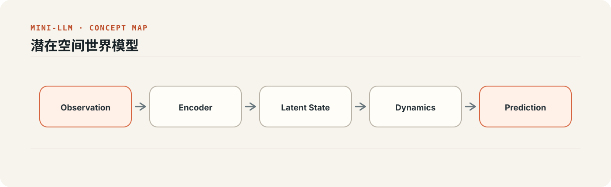
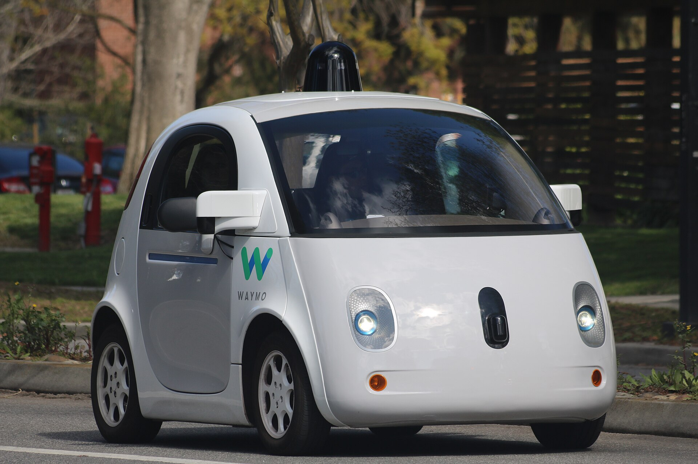
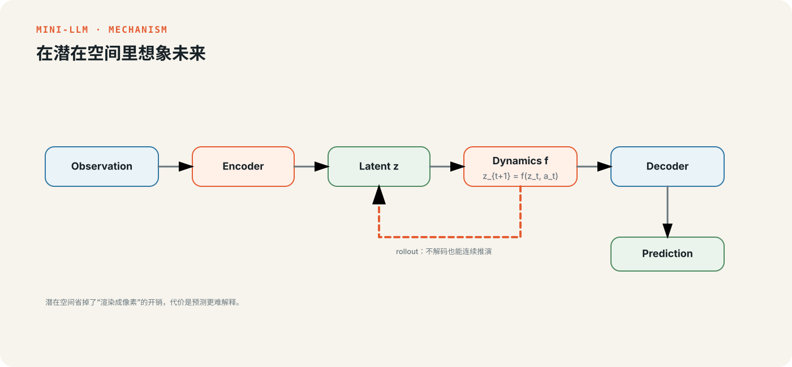
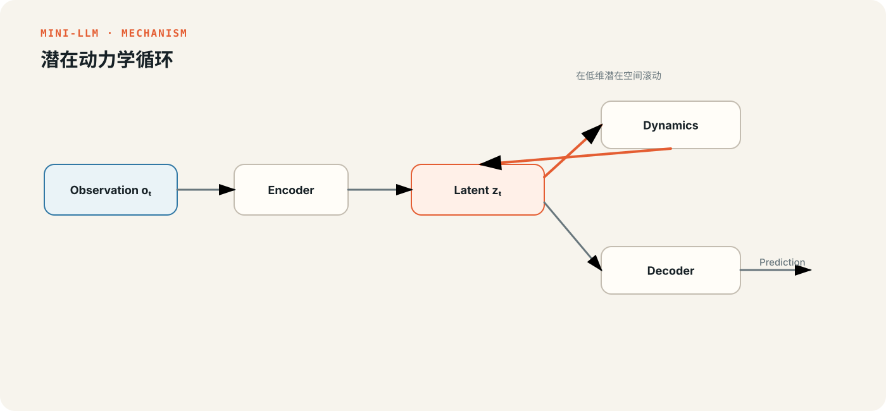

# **《mini-llm World Model Engine 深度解析：从 World Representation、Latent Dynamics 到 Predictive Model、Model-based Planning 与 Learned Environment》**



_图：潜在空间世界模型。从左到右展示本章核心概念之间的数据流与依赖关系。_



_图：一辆在真实道路上行驶的 Waymo。世界模型要在潜在空间里预测周围车辆、行人和信号灯的下一步变化；预测得越准，规划就越不需要频繁急刹。图片：Grendelkhan，[Wikimedia Commons](https://commons.wikimedia.org/wiki/File:Waymo_self-driving_car_front_view.gk.jpg)，[CC BY-SA 4.0](https://creativecommons.org/licenses/by-sa/4.0/)。_

在前面的文章中，我们讨论了 Simulation Engine（模拟引擎）。

Simulation Engine 解决的是一个问题：

**给定一个环境模型、当前状态和一组行动，如何模拟未来可能发生的变化？**

但这里存在一个更基础的问题：

- 环境模型从哪里来？
- AI 如何知道世界中有哪些对象？
- AI 如何理解对象之间的关系？
- AI 如何学习世界的变化规律？
- AI 如何预测一个行动会产生什么结果？
- AI 能否在真正执行行动之前，先在内部模拟未来？

这些问题指向一个重要的 AI 概念：

**World Model（世界模型）。**

World Model Engine 的目标，是让 mini-llm 不仅能够处理语言，还能够建立对环境的内部表示，学习环境动态，并利用这些知识预测未来。

# **一、World Model：什么是世界模型？**

## **1.1 从语言模型到世界模型**

传统语言模型的基本训练目标是：

\\[ P(x_t|x_1,x_2,\ldots,x\_{t-1}) \\]

也就是根据前面的 Token，预测下一个 Token。

例如：

输入：

```
一个杯子从桌子边缘掉落，接下来它可能会……
```

模型可能预测：

```
摔碎
```

从语言角度看，模型完成了合理的文本预测。

但真正理解这个过程，还需要掌握：

- 杯子具有位置和速度。
- 杯子受到重力影响。
- 杯子离开桌面后会向下运动。
- 杯子接触地面时可能发生碰撞。
- 杯子的材质影响它是否破碎。

这就涉及对物理世界的建模。

语言模型能够学习大量关于世界的统计规律，但这不意味着它已经拥有一个明确、可执行、经过验证的物理世界模型。

World Model 希望将这些信息组织成一个能够支持预测和规划的内部模型。

## **1.2 世界模型的基本定义**

可以将 World Model 定义为：

**智能体对外部环境的内部表示，以及对环境状态如何随时间变化的预测模型。**

一个简化的世界模型可以表示为：

\\[ M=(R,T,O) \\]

其中：

| 符号      | 含义                        |
| ------- | ------------------------- |
| \\(R\\) | World Representation，世界表示 |
| \\(T\\) | Transition Model，状态转移模型   |
| \\(O\\) | Observation Model，观测模型    |

如果进一步考虑智能体的行动：

\\[ s\_{t+1}\sim P(s\_{t+1}|s_t,a_t) \\]

其中：

- \\(s_t\\)：当前世界状态。
- \\(a_t\\)：智能体采取的行动。
- \\(s\_{t+1}\\)：行动之后的世界状态。

世界模型需要回答：

> 如果现在处于状态 S，执行行动 A，未来可能出现什么状态？

这就是它与单纯文本预测的重要区别。

## **1.3 World Model 与相关概念的区别**

| 概念                   | 主要解决的问题          |
| -------------------- | ---------------- |
| LLM                  | 根据上下文预测 Token    |
| World Representation | 如何表示世界中的对象、属性和关系 |
| World Model          | 如何表示世界及其变化规律     |
| Dynamics Model       | 环境状态如何随时间变化      |
| Predictive Model     | 如何预测未来状态或观测      |
| Simulation Engine    | 如何运行环境模拟         |
| Planning Engine      | 如何搜索和规划未来行动      |
| Decision Engine      | 如何根据目标和约束选择行动    |

它们之间存在联系，但不能简单视为同一个组件。

# **二、World Representation：如何表示现实世界？**

世界模型首先需要解决一个问题：

**现实世界如此复杂，AI 应该如何在内部表示它？**

现实世界包含：

- 物体。
- 人类。
- 空间。
- 时间。
- 运动。
- 事件。
- 因果关系。
- 环境约束。
- 不确定性。

如果直接使用自然语言描述所有内容，虽然灵活，但难以进行精确计算。

因此，需要建立结构化的世界表示。

## **2.1 对象表示（Object Representation）**

例如，一个机器人观察到房间中有三个对象：

- 桌子。
- 杯子。
- 机器人。

可以建立对象表示：

```
world = {    "objects": [        {            "id": "table_001",            "type": "table",            "position": [1.0, 2.0, 0.0]        },        {            "id": "cup_001",            "type": "cup",            "position": [1.2, 2.1, 0.8]        },        {            "id": "robot_001",            "type": "robot",            "position": [0.0, 0.0, 0.0]        }    ]}
```

这比单纯的文字描述更容易被程序处理。

当然，真实世界中的对象还可能具有：

- 形状。
- 颜色。
- 质量。
- 材质。
- 速度。
- 姿态。
- 可操作属性。
- 当前状态。

## **2.2 关系表示（Relation Representation）**

对象本身并不足够。

AI 还需要知道对象之间的关系。

例如：

```
杯子 在 桌子 上
机器人 靠近 桌子
杯子 位于 机器人 前方
```

可以将这些关系表示为图：

## **World Representation：对象关系图**

**桌子**

Object: table

支撑（supports）

**杯子**

Object: cup

**机器人**

Object: robot

靠近（near）

**桌子**

Object: table

示意图：世界不仅由对象构成，还由对象之间的关系构成。

这类表示可以使用：

- Scene Graph。
- Knowledge Graph。
- Spatial Graph。
- Object-centric Representation。

其中，Scene Graph 特别适合描述视觉场景中的对象及其空间关系。

## **2.3 状态表示（State Representation）**

对象和关系描述了世界的结构，但还需要描述世界当前的状态。

例如：

```
state = {    "cup": {        "position": [1.2, 2.1, 0.8],        "velocity": [0.0, 0.0, 0.0],        "is_broken": False    },    "robot": {        "position": [0.0, 0.0, 0.0],        "battery": 0.85    }}
```

状态可以随时间变化：

\\[ S_0\rightarrow S_1\rightarrow S_2\rightarrow \cdots \\]

World Model 的核心任务之一，就是学习这种变化规律。

# **三、State Space：如何构建世界状态空间？**

现实世界的状态非常复杂。

如果要完整描述一个真实环境，可能需要考虑：

- 所有物体的位置。
- 所有物体的速度。
- 所有物体的姿态。
- 物体之间的接触关系。
- 环境温度。
- 湿度。
- 光照。
- 其他智能体的状态。

这会产生非常高维的状态空间。

## **3.1 状态空间的数学定义**

假设世界状态为：

\\[ s_t= \begin{bmatrix} x_t\\\ y_t\\\ v\_{x,t}\\\ v\_{y,t}\\\ \theta_t \end{bmatrix} \\]

其中：

- \\(x,y\\)：位置。
- \\(v_x,v_y\\)：速度。
- \\(\theta\\)：方向。

那么状态空间可以表示为：

\\[ S\subseteq \mathbb{R}^5 \\]

如果系统包含更多对象，状态维度可能迅速增加。

例如，100 个物体，每个物体包含 10 个状态变量：

\\[ D=100\times10=1000 \\]

此时，直接在原始状态空间中进行预测和规划，计算成本可能很高。

## **3.2 完全可观察与部分可观察**

世界状态并不总是能够被直接观察。

例如：

机器人看到一个关闭的盒子。

它能够观察：

- 盒子的位置。
- 盒子的形状。
- 盒子的颜色。

但无法直接知道：

- 盒子内部是否有物品。
- 盒子内部物品的质量。
- 盒子是否被锁住。

这意味着：

\\[ Observation\neq State \\]

观测只是世界状态的一部分信息。

在部分可观察环境中，可以维护一个信念状态：

\\[ b_t(s)=P(s_t=s|o\_{1:t},a\_{1:t-1}) \\]

它表示智能体根据历史观测和行动，对当前世界状态形成的概率分布。

这也是 POMDP（Partially Observable Markov Decision Process，部分可观察马尔可夫决策过程）的重要思想。

## **3.3 状态空间与观测空间**

| 概念                | 含义          | 示例         |
| ----------------- | ----------- | ---------- |
| State Space       | 世界可能处于的状态   | 盒子内部真实物品   |
| Observation Space | 智能体能够观察到的信息 | 摄像头拍摄的盒子图像 |
| Action Space      | 智能体能够执行的行动  | 移动、抓取、打开盒子 |
| Belief Space      | 智能体对状态的概率信念 | 盒子内有物品的概率  |

这几个空间是 World Model、Simulation、Planning 等引擎之间的重要接口。

# **四、Latent World Model：为什么需要潜在空间？**



_图：在潜在空间里做 rollout：编码、动力学推演、再解码，省掉渲染开销。_




_图：观测经编码进入潜在状态，在潜在空间滚动后再解码预测。_

前面介绍了原始状态空间。

但是，直接使用原始状态存在一个问题：

**状态可能太复杂，很多信息与当前任务无关。**

例如，一张 1920×1080 的图像包含超过 200 万个像素。

如果直接使用像素预测下一帧，需要处理非常庞大的数据。

但对于一个正在学习物体运动的机器人来说，它可能更关心：

- 物体在哪里？
- 物体朝哪个方向移动？
- 物体是否发生碰撞？
- 物体是否即将掉落？

因此，可以将原始数据映射到一个更紧凑的潜在空间。

## **4.1 Latent Representation**

定义编码器：

\\[ z_t=Encoder(o_t) \\]

其中：

- \\(o_t\\)：原始观测。
- \\(z_t\\)：潜在表示。

例如：

## **从原始观测到潜在表示**

**原始观测**

摄像头图像 / 视频 / 传感器数据

**Encoder**

特征提取与信息压缩

**Latent State&#x20;**\\(z_t\\)

紧凑的潜在状态表示

**Dynamics Model**

预测未来潜在状态

例如：

```
observation = camera.capture()latent_state = encoder(observation)next_latent_state = dynamics_model(    latent_state,    action)
```

这里，模型不必直接生成完整的下一帧图像，也可以先预测潜在状态。

## **4.2 潜在空间的优势**

主要有三个方面。

- **第一，降低计算复杂度。**：原始输入可能非常庞大，潜在表示可以压缩与任务有关的信息。
- **第二，提取有用特征。**：模型可能从图像中提取物体位置、运动趋势和空间结构等信息。
- **第三，便于预测和规划。**：在潜在空间中预测未来，可能比直接生成原始像素更高效。

潜在表示并不天然等于真实世界状态。

它可能：

- 丢失重要细节。
- 将不同状态压缩成相似表示。
- 忽略模型没有学习到的物理变量。
- 在训练数据分布之外产生错误预测。

因此，Latent World Model 必须通过预测任务、下游任务和真实环境反馈进行验证。

# **五、Dynamics Model：如何学习环境变化规律？**

有了当前状态，下一步就是学习：

**世界如何从当前状态变化到下一个状态？**

这就是 Dynamics Model。

## **5.1 状态转移模型**

一个基础的动态模型可以表示为：

\\[ s\_{t+1}=f\_\theta(s_t,a_t) \\]

其中：

- \\(s_t\\)：当前状态。
- \\(a_t\\)：当前行动。
- \\(f\_\theta\\)：参数为 \\(\theta\\) 的动态模型。
- \\(s\_{t+1}\\)：预测的下一状态。

如果环境具有随机性，可以使用概率形式：

\\[ P\_\theta(s\_{t+1}|s_t,a_t) \\]

模型不再只输出一个结果，而是输出未来状态的概率分布。

## **5.2 一个简单的物理示例**

假设一个物体在二维平面上运动。

状态：

\\[ s_t= \begin{bmatrix} x_t\\\ v_t \end{bmatrix} \\]

行动：

\\[ a_t=u_t \\]

假设采用简单的离散运动模型：

\\[ x\_{t+1}=x_t+v_t\Delta t \\]

\\[ v\_{t+1}=v_t+u_t\Delta t \\]

对应 Python：

```
def dynamics(state, action, dt=0.1):    x, v = state    next_x = x + v * dt    next_v = v + action * dt    return [next_x, next_v]
```

执行：

```
state = [0.0, 1.0]action = 0.5next_state = dynamics(state, action)print(next_state)
```

输出：

```
[0.1, 1.05]
```

这个模型是人为定义的简化物理模型。

而在 Learned World Model 中，模型需要从数据中学习类似的动态关系。

## **5.3 如何训练 Dynamics Model？**

可以收集环境交互数据：

\\[ D=\\{(s_t,a_t,s\_{t+1})\\} \\]

训练模型预测下一状态：

\\[ \hat{s}\_{t+1}=f\_\theta(s_t,a_t) \\]

对于连续数值状态，可以使用均方误差：

\\[ L(\theta)= \frac{1}{N} \sum\_{i=1}^{N} \left\\| s\_{i,t+1}-\hat{s}\_{i,t+1} \right\\|^2 \\]

如果预测的是概率分布，可以使用负对数似然：

\\[ L(\theta)= -\sum_i \log P\_\theta(s\_{i,t+1}|s\_{i,t},a\_{i,t}) \\]

对于不同类型的环境，损失函数也可能不同。

例如：

- 图像预测：像素损失、感知损失。
- 连续控制：状态预测误差。
- 离散事件：交叉熵。
- 概率动态：负对数似然。
- 潜在空间预测：Latent Prediction Loss。

## **5.4 单步预测与多步预测**

单步预测：

\\[ \hat{s}\_{t+1}=f\_\theta(s_t,a_t) \\]

多步预测：

\\[ \hat{s}\_{t+2} = f\_\theta(\hat{s}\_{t+1},a\_{t+1}) \\]

继续递归：

\\[ \hat{s}\_{t+H} = f\_\theta( \hat{s}\_{t+H-1},a\_{t+H-1} ) \\]

这就是模型在内部进行未来推演的基础。

但有一个重要问题：

**单步预测准确，不代表多步预测一定准确。**

因为每一步的预测误差都可能进入下一步，形成误差累积。

这也是 World Model 必须进行多步验证的原因。

# **六、Predictive Model：如何预测未来？**

Dynamics Model 描述状态变化规律。

Predictive Model 则更广泛地关注未来可能出现的结果。

它可以预测：

- 下一时刻的状态。
- 未来一段时间的状态。
- 下一帧图像。
- 某个事件是否发生。
- 某个行动是否会成功。
- 未来奖励或代价。

## **6.1 状态预测**

最简单的预测形式：

\\[ \hat{s}\_{t+1}=f\_\theta(s_t,a_t) \\]

例如：

```
当前状态：
机器人距离目标 5 米。

行动：
向前移动 1 米。

预测：
机器人距离目标 4 米。
```

## **6.2 事件预测**

有些问题不需要预测完整状态，只需要预测事件发生的概率。

例如：

```
当前状态：
杯子位于桌子边缘。

行动：
推动桌子。

预测：
杯子掉落的概率。
```

可以建模为：

\\[ P(E\_{t+1}=1|s_t,a_t) \\]

其中 \\(E\\) 表示目标事件。

## **6.3 不确定性预测**

真实世界通常不是确定性的。

例如：

机器人推动一个杯子。

杯子可能：

- 向前移动。
- 旋转。
- 滑落。
- 被其他物体阻挡。

模型不应该总是只输出一个确定结果。

可以使用概率分布：

\\[ P(s\_{t+1}|s_t,a_t) \\]

也可以输出：

\\[ \mu\_\theta(s_t,a_t),\quad \Sigma\_\theta(s_t,a_t) \\]

其中：

- \\(\mu\\)：预测均值。
- \\(\Sigma\\)：预测协方差。

这使模型能够表达预测的不确定性。

需要区分两类不确定性：

1. **Aleatoric Uncertainty**：环境本身的随机性，例如随机风力。
2. **Epistemic Uncertainty**：模型自身知识不足，例如从未见过某种物体。

这两类不确定性对规划具有不同意义。

# **七、Model-based Planning：如何利用世界模型规划行动？**

到这里，我们已经拥有：

- 世界表示。
- 当前状态。
- 动态模型。
- 未来预测。

接下来就可以利用世界模型进行规划。

传统方式：

```
观察环境
   ↓
选择行动
   ↓
执行行动
   ↓
观察结果
```

Model-based Planning：

```
观察环境
   ↓
建立当前状态
   ↓
调用 World Model
   ↓
模拟多个未来
   ↓
比较不同结果
   ↓
选择行动
   ↓
执行行动
   ↓
观察真实结果
   ↓
更新模型
```

## **7.1 为什么需要 Model-based Planning？**

假设机器人需要到达一个目标位置。

有三个候选行动：

- A：向左走。
- B：向右走。
- C：向前走。

如果只依靠当前策略，模型可能直接选择一个行动。

但如果拥有世界模型，就可以预测：

| 行动 | 预测结果     | 预计代价 |
| -- | -------- | ---- |
| 向左 | 遇到障碍物    | 8    |
| 向右 | 路径较长     | 5    |
| 向前 | 可以直接接近目标 | 2    |

这里的代价是示意性的，并非真实测量值。

系统可以选择预计代价较低的行动。

## **7.2 基于模型的优化**

假设未来规划长度为 \\(H\\)，可以定义：

\\[ J= \sum\_{t=0}^{H-1} c(s_t,a_t)+c_T(s_H) \\]

其中：

- \\(c(s_t,a_t)\\)：每一步行动代价。
- \\(c_T(s_H)\\)：最终状态代价。
- \\(H\\)：规划时域。

目标是：

\\[ \min\_{a_0,\ldots,a\_{H-1}}J \\]

如果模型存在不确定性，则可以优化期望代价：

\\[ \min\_{a\_{0:H-1}} \mathbb{E}[J] \\]

也可以加入风险约束。

例如：

\\[ P(\text{collision})<\epsilon \\]

这样，系统不仅考虑效率，还需要考虑安全性。

## **7.3 MPC：模型预测控制**

Model Predictive Control（MPC）是一个典型的模型预测规划方法。

它的基本过程：

1. 获取当前状态。
2. 使用模型预测未来。
3. 优化一段行动序列。
4. 只执行第一个行动。
5. 获取新的真实状态。
6. 重新预测和优化。

## **MPC 闭环控制**

**获取真实状态**

**World Model 预测未来**

**优化未来行动序列**

**执行第一个行动**

重新观察、重新预测、重新规划

MPC 的关键思想是：

**不完全相信过去的预测，而是持续使用真实环境反馈修正未来计划。**

# **八、Imagination Rollout：如何在内部想象未来？**

这是 World Model 非常重要的能力。

人类在执行行动之前，往往会先在脑海中想象结果。

例如：

- 如果我向前走，会发生什么？
- 如果我打开门，会看到什么？
- 如果我选择方案 A，未来会怎样？
- 如果我选择方案 B，结果是否更好？

AI 也可以利用世界模型进行类似的计算。

这通常被称为：

**Imagination Rollout（想象展开）。**

## **8.1 多条未来路径**

假设当前状态是：

\\[ s_0 \\]

模型可以生成多个候选行动序列：

\\[ A_1=(a_1,a_2,a_3) \\]

\\[ A_2=(b_1,b_2,b_3) \\]

\\[ A_3=(c_1,c_2,c_3) \\]

然后利用世界模型分别预测：

\\[ S_1=Rollout(s_0,A_1) \\]

\\[ S_2=Rollout(s_0,A_2) \\]

\\[ S_3=Rollout(s_0,A_3) \\]

最终比较这些未来路径。

## **Imagination Rollout：多路径未来推演**

**当前状态 S₀**

**路径 A**

行动序列 A

未来 S₁

较优

**路径 B**

行动序列 B

未来 S₂

一般

**路径 C**

行动序列 C

未来 S₃

较差

**评估未来结果，选择行动**

这里的未来路径是模型预测出来的，不是真实发生过的历史。

## **8.2 Rollout 的代码结构**

```
def rollout(world_model, state, actions):    trajectory = [state]    current_state = state    for action in actions:        current_state = world_model.predict(            current_state,            action        )        trajectory.append(current_state)    return trajectory
```

多路径评估：

```
def evaluate_action_sequences(    world_model,    initial_state,    candidates,    cost_fn):    results = []    for actions in candidates:        trajectory = rollout(            world_model,            initial_state,            actions        )        cost = sum(            cost_fn(state)            for state in trajectory        )        results.append({            "actions": actions,            "trajectory": trajectory,            "cost": cost        })    return min(        results,        key=lambda item: item["cost"]    )
```

这只是一个确定性示例。实际系统还需要考虑概率分布、模型误差、约束和计算预算。

## **8.3 想象能力与智能**

Imagination Rollout 让 AI 能够：

- 在行动之前预测结果。
- 比较多个行动方案。
- 发现潜在风险。
- 尝试不同的行动组合。
- 在真实环境中减少无效试错。

它是 Model-based Reinforcement Learning、机器人控制和规划系统的重要基础。

但需要注意：

**模型能够想象某种结果，不代表这个结果一定符合真实世界。**

模型的想象能力受到训练数据、模型结构和环境建模准确性的限制。

# **九、Uncertainty Modeling：如何表达世界模型的不确定性？**

一个可靠的世界模型不能只给出预测结果，还应该知道自己的预测有多可靠。

例如：

机器人预测：

```
杯子将在 2 秒后掉落。
```

这句话并不完整。

更合理的表达是：

```
预测杯子将在 2 秒左右掉落。

预测置信区间：1.5～2.5 秒。
模型不确定性：中等。
```

这里需要区分：

- 预测结果。
- 预测不确定性。
- 模型自身的知识不足。

## **9.1 概率预测**

模型可以输出：

\\[ P(s\_{t+1}|s_t,a_t) \\]

而不是只输出单个状态。

例如：

| 预测结果   | 概率   |
| ------ | ---- |
| 杯子向前移动 | 0.65 |
| 杯子发生旋转 | 0.20 |
| 杯子掉落   | 0.15 |

这些概率只是示意数据。

## **9.2 Ensemble World Model**

一种常见的方法是训练多个世界模型：

\\[ M_1,M_2,\ldots,M_K \\]

让它们分别预测同一个未来状态。

如果预测结果差异很大，说明模型之间存在较大的分歧。

例如：

```
Model 1：杯子向前移动 10 cm
Model 2：杯子向前移动 12 cm
Model 3：杯子向前移动 35 cm
```

这种分歧可以作为模型认知不确定性的一个估计信号。

但 Ensemble 的分歧不是完整、严格的概率校准保证。

## **9.3 不确定性如何影响规划？**

假设两个行动：

| 行动 | 预计收益 | 不确定性 |
| -- | ---- | ---- |
| A  | 10   | 高    |
| B  | 8    | 低    |

如果只追求最大收益，可能选择 A。

但如果系统非常重视安全，可以选择 B。

一种简单的风险敏感目标：

\\[ J(a)= \mathbb{E}[C(a)] + \lambda Risk(a) \\]

其中：

- \\(C(a)\\)：行动成本。
- \\(Risk(a)\\)：风险度量。
- \\(\lambda\\)：风险权重。

对于高风险应用，也可以采用硬约束，而不是只通过一个风险权重进行惩罚。

# **十、Video World Model：如何从视频学习世界动态？**

如果说文本模型主要从语言中学习世界知识，那么视频为 AI 提供了另一类重要信息：

**世界是如何随时间变化的。**

单张图片只能提供某一时刻的视觉信息。

视频则提供连续的时间序列。

例如：

```
Frame 1：杯子位于桌子中央。

Frame 2：杯子开始移动。

Frame 3：杯子接近桌子边缘。

Frame 4：杯子离开桌面。

Frame 5：杯子接触地面。
```

通过视频，模型可以学习：

- 物体运动。
- 空间关系。
- 物体交互。
- 碰撞。
- 遮挡。
- 场景变化。
- 事件顺序。

## **10.1 视频表示**

一个视频可以表示为：

\\[ V=(o_1,o_2,\ldots,o_T) \\]

其中每个 \\(o_t\\) 是一帧图像。

通过视觉编码器：

\\[ z_t=Encoder(o_t) \\]

得到一系列潜在状态：

\\[ Z=(z_1,z_2,\ldots,z_T) \\]

然后训练动态模型：

\\[ P(z\_{t+1}|z_t) \\]

如果考虑行动：

\\[ P(z\_{t+1}|z_t,a_t) \\]

这使模型能够学习行动与环境变化之间的关系。

## **10.2 视频世界模型的架构**

## **Video World Model Pipeline**

- **Video Input**：连续视频帧 / 传感器数据
- **Visual Encoder**：视觉特征提取
- **Temporal Representation**：时间序列与动态信息
- **Dynamics Model**：学习状态转移规律
- **Future Prediction**：预测未来状态或视频帧

但这不一定意味着它准确掌握了物理规律。

例如：

模型生成了一个球反弹的视频。

但如果球的运动轨迹、速度变化和碰撞结果不符合真实物理规律，那么它可能只是生成了视觉上看起来合理的画面。

因此：

**Video Generation 不等于 Physical World Modeling。**

要真正建立可靠的世界模型，还需要针对状态、动力学、行动条件和物理约束进行验证。

# **十一、Action-conditioned Prediction：如何预测不同动作产生的结果？**

这是 World Model 与 Agent 系统结合时特别重要的能力。

普通预测：

```
根据当前状态，预测未来。
```

Action-conditioned Prediction：

```
如果执行行动 A，未来会怎样？

如果执行行动 B，未来又会怎样？
```

两者存在重要区别。

## **11.1 条件预测**

可以表示为：

\\[ P(s\_{t+1}|s_t,a_t) \\]

例如：

当前状态：

```
机器人面对一扇门。
```

候选行动：

```
A：向前移动。
B：伸手推门。
C：伸手拉门。
```

模型可以分别预测：

| 行动   | 预测结果          |
| ---- | ------------- |
| 向前移动 | 机器人接近门        |
| 推门   | 门可能打开，也可能无法打开 |
| 拉门   | 如果门向外开，可能成功   |

这使 AI 不再只是描述环境，而是可以推演行动的潜在后果。

## **11.2 为什么需要行动数据？**

如果训练数据只有：

\\[ (s_t,s\_{t+1}) \\]

模型只能学习状态之间的相关变化。

如果加入行动：

\\[ (s_t,a_t,s\_{t+1}) \\]

模型才能尝试学习行动与状态变化之间的条件关系。

但这仍然不自动意味着模型识别了因果关系。

如果训练数据存在选择偏差、隐藏混杂或动作分布不充分，模型可能只学到观察数据中的相关性。

要让模型可靠地预测干预结果，还需要适当的环境交互、实验设计和模型假设。

# **十二、World Model Architecture：如何将世界模型集成到 mini-llm？**

现在将前面的概念整合到 mini-llm。

建议不要把 World Model 简单实现为一个神经网络。

更合理的方式是将它设计为一个独立 Engine。

## **12.1 整体架构**

## **mini-llm World Model Engine**

**Environment Input**

Text / Image / Video / Sensor / Agent Observation

- **World Encoder**：将外部观测转换为内部表示
- **World Representation**：Objects / Relations / State
- **Latent Representation**：Latent State / Embedding
- **Dynamics Model**：Action-conditioned State Transition
- **Predictive Model**：Future State / Event Prediction
- **Uncertainty Model**：Confidence / Model Disagreement
- **Imagination & Rollout**：多路径未来推演
- **Planning Interface**：向 Planning Engine 提供预测结果

## **12.2 各模块职责**

| 模块                   | 职责         |
| -------------------- | ---------- |
| World Encoder        | 编码环境观测     |
| World Representation | 表示对象、关系和状态 |
| Latent Model         | 构建紧凑潜在状态   |
| Dynamics Model       | 学习状态转移     |
| Predictive Model     | 预测未来状态和事件  |
| Uncertainty Model    | 估计预测不确定性   |
| Rollout Engine       | 展开多个未来路径   |
| Model Evaluator      | 评估模型预测质量   |
| Model Trainer        | 训练和更新世界模型  |

其中，Model Trainer 不应该直接在生产环境中无审核地修改模型。

模型更新需要版本控制、评估和回滚机制。

# **十三、mini-llm World Model Engine 工程目录**

建议采用 Python 实现第一版，重点是先把接口、数据结构和模型生命周期建立起来。

```
mini-llm/
│
├── world_model/
│   │
│   ├── core/
│   │   ├── world.py
│   │   ├── state.py
│   │   ├── observation.py
│   │   ├── action.py
│   │   └── transition.py
│   │
│   ├── representation/
│   │   ├── object_encoder.py
│   │   ├── relation_encoder.py
│   │   ├── scene_graph.py
│   │   └── latent_encoder.py
│   │
│   ├── dynamics/
│   │   ├── dynamics_model.py
│   │   ├── deterministic.py
│   │   ├── probabilistic.py
│   │   └── ensemble.py
│   │
│   ├── prediction/
│   │   ├── state_predictor.py
│   │   ├── event_predictor.py
│   │   └── uncertainty.py
│   │
│   ├── imagination/
│   │   ├── rollout.py
│   │   ├── trajectory.py
│   │   └── scenario.py
│   │
│   ├── training/
│   │   ├── dataset.py
│   │   ├── trainer.py
│   │   ├── losses.py
│   │   └── checkpoint.py
│   │
│   ├── evaluation/
│   │   ├── prediction_metrics.py
│   │   ├── rollout_metrics.py
│   │   ├── calibration.py
│   │   └── benchmark.py
│   │
│   ├── integration/
│   │   ├── planning_adapter.py
│   │   ├── simulation_adapter.py
│   │   └── agent_adapter.py
│   │
│   └── world_model_engine.py
│
└── tests/
    ├── test_state.py
    ├── test_dynamics.py
    ├── test_prediction.py
    ├── test_rollout.py
    └── test_evaluation.py
```

## **13.1 定义统一接口**

```
from abc import ABC, abstractmethodclass WorldModel(ABC):    @abstractmethod    def encode(self, observation):        pass    @abstractmethod    def predict(self, state, action):        pass    @abstractmethod    def rollout(self, state, actions):        pass    @abstractmethod    def uncertainty(self, state, action):        pass
```

注意：这里的 `state` 可以是结构化状态，也可以是潜在状态。正式实现时建议使用明确的类型定义，避免两种状态混用。

## **13.2 定义统一状态结构**

```
from dataclasses import dataclassfrom typing import Any@dataclassclass WorldState:    timestamp: float    objects: dict[str, Any]    relations: list[dict]    latent_state: Any = None@dataclassclass WorldAction:    action_type: str    parameters: dict@dataclassclass Prediction:    next_state: WorldState    uncertainty: dict    model_version: str
```

## **13.3 定义 World Model Engine**

```
class WorldModelEngine:    def __init__(        self,        encoder,        dynamics,        predictor    ):        self.encoder = encoder        self.dynamics = dynamics        self.predictor = predictor    def observe(self, observation):        return self.encoder.encode(observation)    def predict(self, state, action):        return self.predictor.predict(            self.dynamics,            state,            action        )    def imagine(self, state, action_sequence):        trajectory = [state]        current_state = state        for action in action_sequence:            prediction = self.predict(                current_state,                action            )            current_state = prediction.next_state            trajectory.append(current_state)
```

这个接口体现了三个基本能力：

1. 将观测转换为内部状态。
2. 根据行动预测未来。
3. 在内部展开未来轨迹。

它还不是一个完整的训练系统，但足以作为 V1 的架构起点。

# **十四、World Model Engine 与其他 Engine 的关系**

World Model 不应该独立工作，它需要与 mini-llm 的其他 Engine 协同。

| Engine                | 与 World Model 的关系 |
| --------------------- | ----------------- |
| Tensor Engine         | 提供张量计算            |
| Autograd Engine       | 提供梯度计算            |
| Neural Network Engine | 构建编码器和动态模型        |
| Transformer Engine    | 处理序列和时序依赖         |
| Representation Engine | 提供特征和潜在空间表示       |
| Memory Engine         | 保存历史状态与经验         |
| Knowledge Engine      | 提供结构化事实与关系        |
| Simulation Engine     | 执行世界模型驱动的环境模拟     |
| Planning Engine       | 利用预测结果规划未来        |
| Decision Engine       | 根据目标、效用和约束选择行动    |
| Agent Engine          | 执行行动并收集反馈         |
| Learning Engine       | 利用经验更新模型          |

尤其需要明确三个模块的职责：

- **World Model**：世界是什么？世界可能如何变化？
- **Simulation Engine**：给定模型和行动，如何运行模拟？
- **Planning Engine**：为了实现目标，应该采取什么行动？

但这并不意味着所有系统都必须采用三个独立模块。有些小型系统可以将部分功能合并实现。

# **十五、V1 实施路线：先建立一个能够预测的微型世界**

不建议一开始就开发视频世界模型或大型神经网络。

World Model 涉及状态表示、环境动态、模型训练、预测验证和规划接口，复杂度很高。

建议采用渐进式实现。

## **Phase 1：结构化世界模型**

第一阶段

目标：让 mini-llm 能够表示一个简单世界。

实现：

- Object。
- Relation。
- WorldState。
- Observation。
- Action。
- State Transition。

验收标准：

- 能创建多个世界对象。
- 能维护对象之间的关系。
- 能更新对象状态。
- 能保存状态历史。
- 能根据规则执行状态转移。

## **Phase 2：Learned Dynamics Model**

第二阶段

目标：让模型从数据中学习环境变化。

实现：

- Transition Dataset。
- Dynamics Model。
- Training Pipeline。
- Loss Function。
- Model Checkpoint。

验收标准：

- 能使用历史交互数据训练。
- 能预测下一状态。
- 能计算预测误差。
- 能保存和加载模型版本。

## **Phase 3：Predictive World Model**

第三阶段

目标：让模型预测未来多个时间步。

实现：

- Multi-step Prediction。
- Probabilistic Prediction。
- Ensemble Model。
- Uncertainty Estimation。

验收标准：

- 能执行多步预测。
- 能比较不同预测结果。
- 能输出不确定性估计。
- 能检测明显的预测误差累积。

## **Phase 4：Imagination Rollout**

第四阶段

目标：让模型能够模拟多个未来行动序列。

实现：

- Action Sequence。
- Rollout。
- Trajectory。
- Scenario Evaluation。

验收标准：

- 能生成多个未来路径。
- 能比较不同路径。
- 能计算路径成本。
- 能选择满足约束的候选路径。

## **Phase 5：Planning Integration**

第五阶段

目标：将世界模型接入 Planning Engine 和 Agent Engine。

实现：

- Planning Adapter。
- MPC。
- Agent Feedback。
- Model Evaluation。
- Model Versioning。

验收标准：

- Agent 能调用世界模型。
- Planner 能利用模型预测行动结果。
- Agent 能收集真实执行反馈。
- 能比较预测结果和真实结果。
- 模型更新经过独立评估。

# **十六、如何评价一个 World Model 是否真正有效？**

不能只看模型生成的未来画面是否逼真。

更重要的是它是否能够准确预测环境变化，并帮助智能体完成任务。

建议建立以下评价指标：

| 指标                          | 评价内容       |
| --------------------------- | ---------- |
| One-step Prediction Error   | 单步状态预测误差   |
| Multi-step Prediction Error | 多步预测误差     |
| Event Prediction Accuracy   | 事件预测准确率    |
| Calibration Error           | 概率预测校准程度   |
| Uncertainty Quality         | 不确定性估计质量   |
| Rollout Stability           | 长期展开稳定性    |
| Planning Success Rate       | 规划任务成功率    |
| Model Generalization        | 未见场景中的泛化能力 |
| Prediction Latency          | 预测耗时       |

其中，特别需要关注：

**预测准确率与规划效果不是同一回事。**

一个模型可能在平均预测误差上表现很好，但在关键决策区域预测错误，最终导致规划失败。

因此，除了预测指标，还必须进行真实任务评估。

# **十七、进一步思考：世界模型是智能的基础吗？**

我们可以将智能系统抽象成一个循环：

\\[ Observe \rightarrow Represent \rightarrow Predict \rightarrow Plan \rightarrow Act \rightarrow Learn \\]

这个循环包含了智能体与环境交互的几个关键环节。

其中：

- Observe：获取环境信息。
- Represent：建立内部世界表示。
- Predict：推测未来。
- Plan：制定行动计划。
- Act：改变环境。
- Learn：根据结果更新模型。

这与人类解决问题时的一些认知过程存在相似之处。

例如：

一个人准备穿过马路。

他会：

1. 观察车辆的位置和速度。
2. 判断车辆与自己的距离。
3. 预测车辆未来的位置。
4. 推测自己现在过马路是否安全。
5. 决定等待还是通过。
6. 根据实际情况调整行动。

这里真正重要的并不是预测本身，而是：

**预测未来，并利用预测结果改变当前行动。**

这使 World Model 与 Planning、Decision 和 Agent Learning 形成了紧密联系。

但我们也不能因此断言，所有智能都必须依赖显式的世界模型。不同任务可以使用不同形式的内部表示和决策机制，世界模型的作用也需要通过具体任务验证。

# **十八、总结：World Model 让 AI 从预测文本走向预测环境**

我们可以用下面这张表概括 World Model Engine 的核心组成：

| 核心能力 | 对应模块                 | 解决的问题        |
| ---- | -------------------- | ------------ |
| 世界表示 | World Representation | 世界中有什么？      |
| 状态建模 | State Space          | 世界现在是什么状态？   |
| 潜在表示 | Latent Model         | 如何压缩和提取有效信息？ |
| 动态学习 | Dynamics Model       | 世界如何变化？      |
| 未来预测 | Predictive Model     | 接下来可能发生什么？   |
| 不确定性 | Uncertainty Model    | 我们对预测有多确定？   |
| 内部推演 | Imagination Rollout  | 不同选择会产生什么结果？ |
| 规划接口 | Planning Adapter     | 如何利用预测指导行动？  |
| 反馈学习 | Model Learning       | 如何根据现实更新模型？  |

从 mini-llm 的整体架构来看：

**LLM 负责理解和生成语言，World Model 负责表示和预测环境，Simulation Engine 负责执行模拟，Planning Engine 负责规划行动，Decision Engine 负责选择方案，Agent Engine 负责与环境交互。**

它们共同构成一个能够感知、理解、预测、规划和行动的系统。

## **下一篇建议：《mini-llm Embodied AI Engine 深度解析：从 Perception、Sensor Fusion 到 Motor Control、Action Execution 与 Physical Interaction》**

World Model 解决了 AI 如何在内部表示和预测世界的问题。

但还有一个更进一步的问题：

**如果 AI 不只是观察世界，而是拥有机器人身体、摄像头、传感器和执行器，它应该如何真正与物理世界交互？**

下一篇可以继续研究：

1. Embodied AI：什么是具身智能？
2. Perception Engine：如何感知真实环境？
3. Sensor Fusion：如何融合摄像头、IMU、LiDAR 等传感器？
4. Spatial Understanding：如何理解三维空间？
5. Localization：如何确定自身位置？
6. Motor Control：如何控制身体和运动？
7. Action Execution：如何将决策转换为物理行动？
8. Feedback Control：如何根据反馈调整动作？
9. Sim-to-Real：如何从模拟环境迁移到真实环境？
10. Embodied Agent Architecture：如何构建 mini-llm 具身智能系统？

